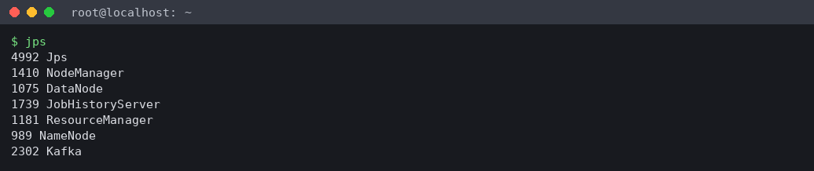
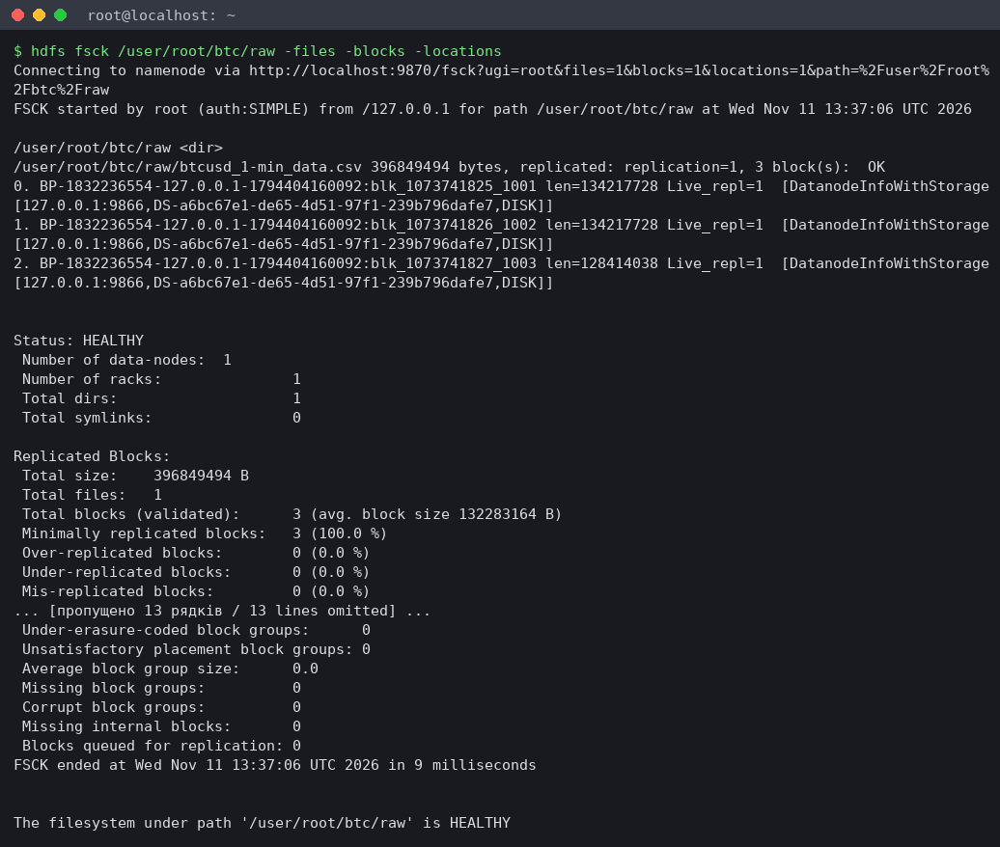
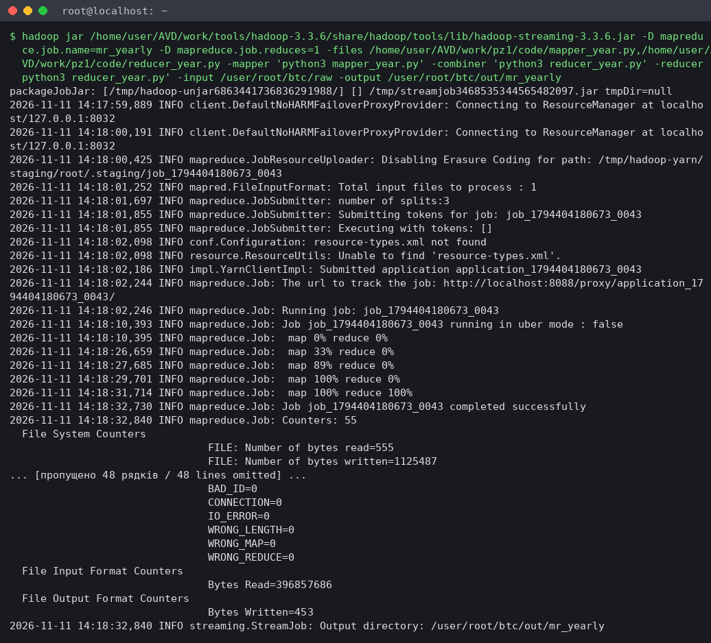
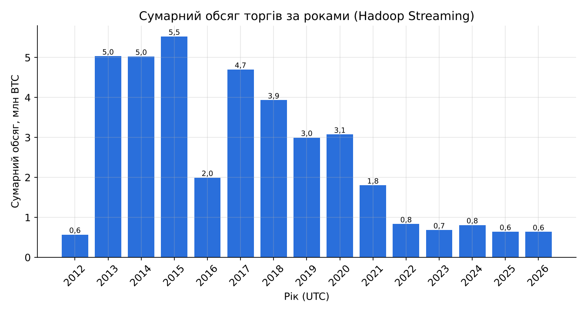
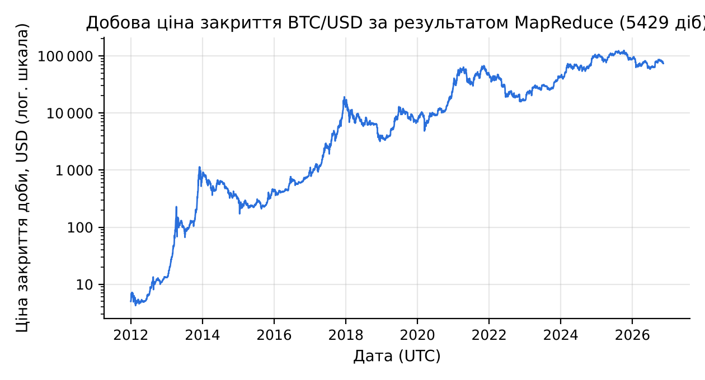
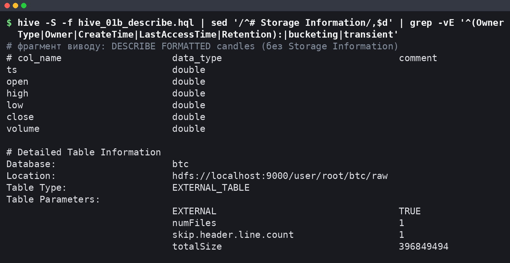
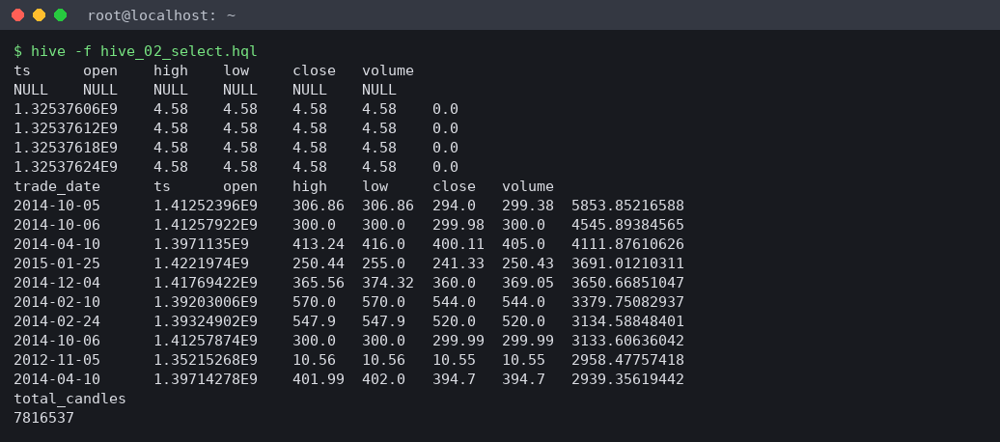
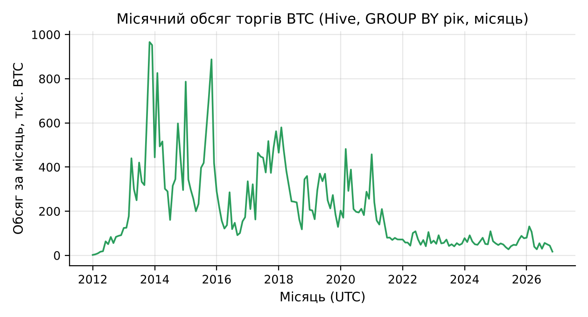
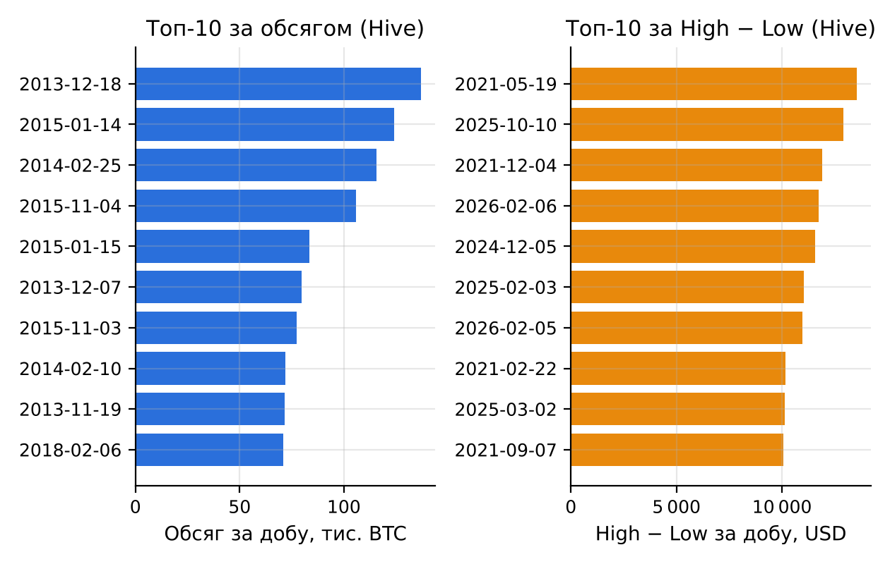

# Мета роботи

Мета роботи: ознайомитися з архітектурою та принципами роботи платформи Apache Hadoop; навчитися працювати з розподіленою файловою системою HDFS; засвоїти базові прийоми обробки даних моделлю MapReduce; ознайомитися з використанням Hive для SQL-запитів до великих обсягів даних на прикладі повного набору хвилинних свічок BTC/USD (Bitcoin Historical Data, 7 816 537 рядків, 396,8 МБ) з порівнянням результатів і зручності роботи з Pandas та Spark.

# Короткі теоретичні відомості

Hadoop поєднує сховище і обчислення на одних і тих самих вузлах. HDFS ділить файл на блоки фіксованого розміру (типово 128 МБ) і зберігає кожен блок на DataNode в кількох репліках. NameNode тримає в пам'яті лише метадані (дерево каталогів і розміщення блоків), а дані клієнт читає безпосередньо з DataNode.

YARN розподіляє ресурси: ResourceManager приймає задачі й виділяє контейнери (пам'ять і vCPU), NodeManager запускає їх на вузлі, а для кожної задачі стартує власний ApplicationMaster. JobHistoryServer зберігає лічильники завершених задач.

MapReduce описує обчислення двома функціями. Map обробляє один вхідний фрагмент (split, зазвичай один блок HDFS) і видає пари «ключ – значення». Фреймворк сортує і групує ці пари за ключем (shuffle), після чого reduce отримує всі значення одного ключа. Необов'язковий combiner виконує часткову агрегацію на боці map і зменшує обсяг shuffle; він коректний лише для асоціативних операцій на зразок суми. Проміжні результати пишуться на диск. Hadoop Streaming дозволяє писати map і reduce будь-якою мовою, що читає stdin і пише stdout.

Hive надає SQL-подібну мову HiveQL. Метасховище (тут Derby) зберігає схему таблиць, а самі дані залишаються файлами в HDFS. Зовнішня таблиця (EXTERNAL TABLE) лише описує схему над каталогом і не копіює дані; DROP TABLE видаляє тільки метадані. Кожен запит компілюється в план із однієї чи кількох задач MapReduce.

Для набору BTC/USD ця модель природна: рядки незалежні, а потрібні агрегати (обсяг за роками, добові OHLC) зводяться до групування за ключем часу. Добові Open і Close не є асоціативними агрегатами, тому їх потрібно обчислювати з явним урахуванням порядку свічок за Timestamp.

# Результати виконання практичного заняття

## 1 Архітектура Hadoop та принципи роботи HDFS

Кластер розгорнуто на одній віртуальній машині (4 vCPU, 15 GiB RAM, Intel Xeon 2,10 ГГц): Hadoop 3.3.6, Hive 3.1.3, Java 1.8.0_472, Python 3.13.18, pandas 3.0.5, PySpark 4.3.0. На одному вузлі працюють усі ролі: NameNode і DataNode (HDFS), ResourceManager і NodeManager (YARN), а також JobHistoryServer для перегляду лічильників. Перелік процесів JVM після запуску наведено на рисунку 1.



Усі п'ять демонів працюють; процес Kafka належить іншій роботі і на Hadoop не впливає. Звіт `hdfs dfsadmin -report` підтверджує одну живу DataNode і місткість 270 553 174 016 байт, а `hdfs getconf` – адресу `hdfs://localhost:9000`, реплікацію 1 і розмір блоку 134 217 728 байт.

## 2 Встановлення Hadoop у pseudo-distributed mode

Hadoop і Hive встановлено з архівів Apache, конфігураційні файли згенеровано скриптом `run_pz1.py` (додаток А.13). Демони запущено командами `hdfs --daemon start` і `yarn --daemon start`: це ті самі процеси, що піднімають `start-dfs.sh` і `start-yarn.sh`, але без входу по ssh на localhost, якого в контейнері немає. Hive 3.1.3 працює лише з JDK 8 (під JDK 21 CLI завершується помилкою рефлексії), тому весь стек переведено на JDK 8; бібліотеку guava 19 з Hive замінено на версію з Hadoop, бо Hadoop 3.3 потребує новішої. Ключові параметри та причини їх вибору подано в таблиці 1.

Таблиця 1 – Ключові параметри pseudo-distributed конфігурації

| Параметр | Значення | Обґрунтування |
|---|---|---|
| fs.defaultFS | hdfs://localhost:9000 | NameNode і клієнти на одному вузлі |
| dfs.replication | 1 | одна DataNode; при 3 блоки лишалися б недореплікованими |
| dfs.blocksize | 134 217 728 (128 МБ) | типове; CSV – 3 блоки, 3 map-задачі |
| mapreduce.framework.name | yarn | задачі через ResourceManager, є UI і лічильники |
| yarn.nodemanager.resource.memory-mb / cpu-vcores | 5120 / 4 | решта RAM – демонам, Hive і Spark |
| mapreduce.map.memory.mb / java.opts | 1024 / -Xmx768m | AM і 3 map-контейнери вміщуються в 5120 МБ |
| mapreduce.reduce.memory.mb / java.opts | 1536 / -Xmx1024m | один reducer збирає всі ключі |
| yarn.nodemanager.vmem-check-enabled | false | пік вірт. пам'яті map 2 487 697 408 байт > 2,1 × 1024 МБ |
| maximum-am-resource-percent | 0,8 | при 0,1 на AM лише 512 МБ замість 1024 МБ |
| hive.execution.engine | mr | рушій MapReduce, метасховище Derby |

Ліміти пам'яті підібрано так, щоб три map-задачі виконувались одночасно, heap JVM – 75 % контейнера. Без вимкнення перевірки віртуальної пам'яті YARN знищував би контейнери Streaming, хоча фізичний пік map становив лише 605 048 832 байти.

## 3 Завантаження набору даних у HDFS

Файл `btcusd_1-min_data.csv` (7 816 537 рядків даних і заголовок) завантажено в каталог `/user/root/btc/raw`. Робочі команди мають такий вигляд:

```bash
hdfs dfs -mkdir -p /user/root/btc/raw /user/root/btc/wc_in /user/root/btc/out
hdfs dfs -put -f btcusd_1-min_data.csv /user/root/btc/raw/
hdfs dfs -ls -h /user/root/btc/raw
hdfs dfs -du -h /user/root/btc
hdfs dfs -cat /user/root/btc/raw/btcusd_1-min_data.csv | head -n 6
hdfs fsck /user/root/btc/raw -files -blocks -locations
```

Розбиття файлу на блоки, отримане `hdfs fsck`, зведено в таблицю 2.

Таблиця 2 – Блоки файлу btcusd_1-min_data.csv у HDFS

| Блок | Ідентифікатор | Довжина, байт | Реплік |
|---|---|---|---|
| 0 | blk_1073742503 | 134 217 728 | 1 |
| 1 | blk_1073742504 | 134 217 728 | 1 |
| 2 | blk_1073742505 | 128 414 038 | 1 |
| Разом | – | 396 849 494 | – |

Файл розміром 396 849 494 байти дає два повні блоки по 128 МБ і третій неповний; сума довжин точно дорівнює розміру локального файлу, що скрипт перевіряє через `hdfs dfs -stat`. Повний вивід перевірки наведено на рисунку 2.



Статус HEALTHY, 0 недореплікованих і 0 пошкоджених блоків означають, що реплікація 1 відповідає конфігурації. Веб-інтерфейс NameNode показує той самий файл як 378,47 MB: це 396 849 494 байти у двійкових мегабайтах (MiB). Межі блоків проходять посеред рядків CSV; `TextInputFormat` дочитує розрізаний рядок із наступного блоку, тому жоден запис не губиться.

## 4 Задачі MapReduce

### 4.1 WordCount як перевірка кластера

Стандартний приклад `wordcount` з `hadoop-mapreduce-examples` запущено над файлами `LICENSE.txt` і `NOTICE.txt`, щоб перевірити ланцюжок HDFS – YARN – MapReduce до роботи з основним набором. Задача з 2 map і 1 reduce прочитала 304 рядки, combiner скоротив 1 879 пар до 798, на виході 748 різних слів; лідирують службові слова ліцензії («the» – 107, «of» – 68). Отже, кластер готовий до власних задач.

### 4.2 Кількість свічок і обсяг торгів за роками

Перша власна задача Hadoop Streaming рахує для кожного року UTC кількість хвилинних свічок і сумарний обсяг. Mapper `mapper_year.py` (додаток А.1) розбирає рядок CSV, відкидає заголовок і рядки з пропусками (як `dropna` у Pandas) і видає `рік \t 1 \t Volume`. Рік обчислюється через `time.gmtime` і кешується для кожної доби, щоб не викликати функцію 7,8 млн разів. Reducer `reducer_year.py` (додаток А.2) сумує кількість і обсяг; його вхід і вихід мають однаковий формат, тому той самий скрипт використано як combiner:

```bash
hadoop jar hadoop-streaming-3.3.6.jar -D mapreduce.job.reduces=1 \
  -files mapper_year.py,reducer_year.py \
  -mapper 'python3 mapper_year.py' \
  -combiner 'python3 reducer_year.py' \
  -reducer 'python3 reducer_year.py' \
  -input /user/root/btc/raw -output /user/root/btc/out/mr_yearly
```

Сума й кількість асоціативні, тому часткове згортання на боці map не змінює результату. Вивід запуску з лічильниками показано на рисунку 3.



Hadoop створив 3 splits за кількістю блоків і завершив задачу успішно. Лічильник Launched map tasks дорівнює 4 при Killed map tasks 1: YARN запустив спекулятивну копію повільної map-задачі і зупинив її після завершення оригіналу, на результат це не вплинуло.

### 4.3 Добові OHLC

Друга задача будує добові свічки за правилом Open = first, High = max, Low = min, Close = last, Volume = sum, де first і last визначаються за Timestamp. Стандартний combiner тут не підходить: Hadoop Streaming може викликати його нуль або кілька разів, а Open і Close залежать від порядку. Тому в `mapper_ohlc.py` (додаток А.3) застосовано in-mapper combining: у межах свого split mapper тримає для кожної доби найранішу і найпізнішу свічку, максимум High, мінімум Low і суму обсягу, а наприкінці видає один запис на добу разом із мітками часу першої та останньої свічки.

Блок HDFS може розрізати добу навпіл, і тоді до reducer надходять два часткові записи. Hadoop сортує лише за ключем (добою), порядок записів усередині ключа не гарантовано, тому `reducer_ohlc.py` (додаток А.4) явно обирає запис із найменшим і найбільшим часом:

```python
for day, grp in groupby(parse(sys.stdin), key=itemgetter(0)):
    parts = list(grp)
    first = sorted(parts, key=itemgetter(1))[0]   # найраніша свічка доби
    last = sorted(parts, key=itemgetter(7))[-1]   # найпізніша свічка доби
    hi = max(parts, key=itemgetter(3))
    lo = min(parts, key=itemgetter(5))
```

Ціни передаються вихідними текстовими токенами, без похибки округлення. Перед запуском на кластері обидві пари mapper – reducer перевірено конвеєром `cat | mapper | sort | reducer` на перших 200 000 рядках зі звіркою з Pandas.

### 4.4 Лічильники задач

Лічильники обох задач зведено в таблицю 3 (джерело – `mr_counters_extended.csv`, виділений з журналів задач).

Таблиця 3 – Лічильники Streaming-задач над повним CSV

| Лічильник | mr_yearly | mr_daily_ohlc |
|---|---|---|
| Map input records | 7 816 538 | 7 816 538 |
| Map output records | 7 816 537 | 5 431 |
| Map output bytes | 127 655 772 | 490 246 |
| Combine input / output records | 7 816 537 / 17 | 0 / 0 |
| Reduce shuffle bytes | 567 | 501 126 |
| Reduce input records | 17 | 5 431 |
| Reduce output records | 15 | 5 429 |

Map input records на одиницю більше за кількість свічок, бо містить заголовок, який mapper відкидає. Combiner у річній задачі стиснув 127 655 772 байти виходу map до 567 байт shuffle. У добовій задачі in-mapper combining скоротив вихід map з 7,8 млн до 5 431 запису. Значення 17 і 5 431 замість 15 і 5 429 мають одну причину: дві межі між трьома блоками розрізали по одному року і по одній добі, і єдиний reducer коректно злив ці часткові записи від трьох map-задач (Shuffled Maps 3 в JobHistory).

Сумарний обсяг за роками, отриманий MapReduce, показано на рисунку 4.



Обсяг у BTC максимальний у 2015 році (5 525 344,45 BTC) і з 2021 року не перевищує 1,81 млн BTC. Обсяг виміряно в BTC, тому зі зростанням ціни той самий оборот дає менше монет. У 2012 році свічок 527 039, а не 527 040: перша свічка файлу має час 00:01, а 2026 рік неповний (452 378 свічок до 11.11.2026). Добову ціну закриття з результату MapReduce наведено на рисунку 5.



Отримано 5 429 діб від 01.01.2012 до 11.11.2026; сума свічок за добами дорівнює 7 816 537. Неповні лише перша доба (1 439 свічок) і остання (218 свічок, файл вивантажено о 03:37 UTC). Для всіх діб виконується High ≥ max(Open, Close) і Low ≤ min(Open, Close).

## 5 Таблиця Hive над даними в HDFS

Hive 3.1.3 підключено до Hadoop через `HADOOP_HOME`, метасховище Derby ініціалізовано командою `schematool -dbType derby -initSchema`. Таблицю `btc.candles` створено як зовнішню над каталогом із CSV (додаток А.5), тому окремий крок `LOAD DATA` не потрібен: файл уже лежить у HDFS, і перенесення його у warehouse Hive лише продублювало б 396,8 МБ. Опис таблиці наведено на рисунку 6.



Тип EXTERNAL_TABLE, розташування `hdfs://localhost:9000/user/root/btc/raw` і totalSize 396 849 494 збігаються з файлом у HDFS. Над таблицею створено подання `candles_v` з датою UTC `date_add('1970-01-01', floor(ts / 86400))`, яка не залежить від часового поясу сесії, і з фільтром рядків, де є NULL. Результати першої вибірки показано на рисунку 7.



`SELECT * FROM candles LIMIT 5` повернув першим рядок із NULL у всіх полях: Hive виконав цей запит простим читанням файлу без MapReduce, і властивість `skip.header.line.number` на ньому не спрацювала, тож заголовок CSV розібрано як дані. Агрегати від цього не страждають, бо `candles_v` відкидає NULL: `COUNT(*)` дорівнює 7 816 537, тобто кількості рядків даних у CSV.

## 6 SQL-запити в Hive

### 6.1 Групування за роками і місяцями

Запит `hive_03a_yearly.hql` (додаток А.7) групує подання за `year(trade_date)` і рахує кількість свічок, суму обсягу, середню ціну закриття, максимум High і мінімум Low. Результат разом із підсумками MapReduce подано в таблиці 4.

Таблиця 4 – Річні агрегати Hive (обсяг округлено до 0,01 BTC, ціни – до 0,01 USD)

| Рік | Свічок | Обсяг, BTC | Сер. Close | Max High | Min Low |
|---|---|---|---|---|---|
| 2012 | 527 039 | 567 948,56 | 8,23 | 16,41 | 3,80 |
| 2013 | 525 600 | 5 031 142,92 | 187,43 | 1 163,00 | 12,77 |
| 2014 | 525 600 | 5 024 184,24 | 525,57 | 995,00 | 275,00 |
| 2015 | 525 600 | 5 525 344,45 | 272,25 | 502,00 | 152,40 |
| 2016 | 527 040 | 1 992 257,98 | 565,83 | 980,74 | 352,00 |
| 2017 | 525 600 | 4 698 752,66 | 3 948,33 | 19 666,00 | 751,34 |
| 2018 | 525 600 | 3 932 327,01 | 7 524,76 | 17 234,99 | 3 122,28 |
| 2019 | 525 600 | 2 994 600,13 | 7 352,19 | 13 880,00 | 3 322,19 |
| 2020 | 527 040 | 3 074 321,04 | 11 074,63 | 29 300,00 | 3 850,00 |
| 2021 | 525 600 | 1 802 997,84 | 47 386,18 | 69 000,00 | 27 734,00 |
| 2022 | 525 600 | 833 815,35 | 28 228,66 | 48 234,00 | 15 479,00 |
| 2023 | 525 600 | 681 687,32 | 28 811,76 | 44 729,00 | 16 496,00 |
| 2024 | 527 040 | 807 909,88 | 65 895,12 | 108 364,00 | 38 505,00 |
| 2025 | 525 600 | 639 945,81 | 101 639,98 | 126 272,00 | 74 434,00 |
| 2026 | 452 378 | 636 371,35 | 74 103,97 | 97 939,00 | 57 734,63 |

Кількість свічок за всі 15 років збігається з MapReduce до одиниці, а обсяги відрізняються лише в останніх знаках (2014 рік: 5 024 184,243438596 у Hive проти 5 024 184,243438736 у MapReduce) через інший порядок підсумовування чисел з рухомою комою. Повні роки мають 525 600 або 527 040 хвилин (високосні 2016, 2020, 2024), отже, хвилинна сітка без пропусків. Місячний розріз (`GROUP BY year, month`, 179 груп) показано на рисунку 8.



Пік припадає на листопад 2013 року (965 986,91 BTC) і грудень 2013 року (952 410,66 BTC), третій за величиною – листопад 2015 року (887 623,85 BTC). Після 2021 року місячний обсяг стабілізувався на рівні десятків тисяч BTC; листопад 2026 року містить лише 14 618 свічок.

### 6.2 Добова таблиця і топ-10 діб

Добову таблицю `daily_ohlc` створено запитом CTAS (додаток А.9). Open і Close обчислено без віконних функцій: Hive порівнює структури за першим полем, тому мінімум структури `(ts, open)` дає Open найранішої свічки доби:

```sql
SELECT trade_date,
       min(struct(ts, open)).col2  AS open,
       max(high) AS high, min(low) AS low,
       max(struct(ts, close)).col2 AS close,
       sum(volume) AS volume, count(*) AS candles
FROM candles_v GROUP BY trade_date;
```

Таблиця має 5 429 рядків, як і результат MapReduce. На її основі виконано два запити топ-10: за сумарним обсягом (додаток А.10) і за амплітудою High − Low через подання `daily_range_v` (додаток А.11). Результати подано в таблиці 5.

Таблиця 5 – Топ-10 діб за обсягом торгів і за амплітудою High − Low (Hive)

| № | Доба (обсяг) | Обсяг, BTC | Доба (амплітуда) | High − Low, USD |
|---|---|---|---|---|
| 1 | 2013-12-18 | 137 070,18 | 2021-05-19 | 13 535,63 |
| 2 | 2015-01-14 | 124 188,89 | 2025-10-10 | 12 899,00 |
| 3 | 2014-02-25 | 115 761,99 | 2021-12-04 | 11 910,27 |
| 4 | 2015-11-04 | 105 959,26 | 2026-02-06 | 11 743,00 |
| 5 | 2015-01-15 | 83 488,42 | 2024-12-05 | 11 555,00 |
| 6 | 2013-12-07 | 79 852,42 | 2025-02-03 | 11 039,00 |
| 7 | 2015-11-03 | 77 212,78 | 2026-02-05 | 10 975,00 |
| 8 | 2014-02-10 | 71 860,54 | 2021-02-22 | 10 164,19 |
| 9 | 2013-11-19 | 71 560,95 | 2025-03-02 | 10 123,00 |
| 10 | 2018-02-06 | 70 961,37 | 2021-09-07 | 10 056,46 |

Два рейтинги не перетинаються. Дев'ять із десяти діб з найбільшим обсягом припадають на 2013–2015 роки, коли BTC коштував сотні доларів і за ту саму суму купувалося більше монет (десята – 06.02.2018); 18.12.2013 ціна за добу впала з Open 675,00 до Low 382,21. Абсолютна амплітуда, навпаки, зростає з рівнем ціни, тому її топ-10 цілком належить 2021–2026 рокам. Перше місце займає обвал 19.05.2021: від High 43 601,63 до Low 30 066,00 при обсязі 32 468,86 BTC. Обидва рейтинги наочно зіставлено на рисунку 9.



Під час розбору виводу `hive_05b_top_range.hql` виявилася особливість Hive: при `hive.cli.print.header=true` інструкція `CREATE VIEW` друкує рядок назв стовпців подання ще до заголовка результату `SELECT`, і перший варіант розбору зсував стовпці. Виправлений `run_pz1.py` починає розбір з заголовка `SELECT` (`trade_date\thigh`); повний вивід збережено в `logs/08_hive_top_range.log`.

## 7 Зручність та ефективність: порівняння з Pandas і Spark

Ті самі дві агрегації (кількість і обсяг за роками, добові OHLC) повторено в Pandas (`groupby` після сортування за Timestamp) і в PySpark local[*] (`min_by`/`max_by` за Timestamp). Результати всіх рушіїв звірено між собою, підсумки наведено в таблиці 6.

Таблиця 6 – Звірка результатів MapReduce, Hive, Pandas і Spark

| Порівняння | Рядків | Збіг | Примітка |
|---|---|---|---|
| Hive – MapReduce, роки | 15 / 15 | так | обсяг з допуском 1e-9 |
| Hive – MapReduce, доби | 5 429 / 5 429 | так | OHLC з допуском 1e-12 |
| MapReduce – Pandas, роки | 15 / 15 | так | відн. різниця 1,00e-13 |
| MapReduce – Pandas, доби | 5 429 / 5 429 | так | OHLC без розбіжностей |
| Hive – Pandas, роки | 15 / 15 | так | – |
| Hive – Pandas, топ-10 за обсягом | 10 / 10 | так | ті самі доби |
| Hive – Pandas, топ-10 за High − Low | 10 / 10 | так | ті самі доби |
| Spark – Pandas, роки і доби | 15 і 5 429 | так | – |

Чотири рушії дають ідентичні результати (розбіжності обсягу 1e-13 – наслідок порядку підсумовування), тож порівняння часу коректне.

Час вимірювався від запуску команди до результату, включно з запуском контейнерів YARN або читанням CSV; кожну пару «рушій – задача» виконано 3 рази (таблиця 7).

Таблиця 7 – Час виконання однакових агрегацій на 7 816 537 рядках (4 vCPU, 15 GiB RAM)

| Рушій | Кількість і обсяг за роками (медіана з 3), с | Добові OHLC (медіана з 3), с |
|---|---|---|
| Hadoop Streaming (YARN) | [ЗАПОВНИТИ ПІСЛЯ ЗАПУСКУ] | [ЗАПОВНИТИ ПІСЛЯ ЗАПУСКУ] |
| Hive (рушій MR) | [ЗАПОВНИТИ ПІСЛЯ ЗАПУСКУ] | [ЗАПОВНИТИ ПІСЛЯ ЗАПУСКУ] |
| Pandas | [ЗАПОВНИТИ ПІСЛЯ ЗАПУСКУ] | [ЗАПОВНИТИ ПІСЛЯ ЗАПУСКУ] |
| PySpark (local[*]) | [ЗАПОВНИТИ ПІСЛЯ ЗАПУСКУ] | [ЗАПОВНИТИ ПІСЛЯ ЗАПУСКУ] |

Співвідношення часу між рушіями: [ЗАПОВНИТИ ПІСЛЯ ЗАПУСКУ]. Незалежно від точних чисел структура витрат різна. Hive на кожен запит запускає CLI, компілює план і стартує одну або кілька задач MapReduce: за всі запити роботи YARN зареєстрував 10 застосунків Hive поряд із 3 задачами WordCount і Streaming, причому запити за роками і за місяцями виконано двома задачами MapReduce кожен (окремо GROUP BY і ORDER BY). Streaming-задача на кожен split піднімає JVM-контейнер і процес Python і пише проміжні дані на диск. Pandas читає весь файл у пам'ять одного процесу, а Spark розпаралелює читання і агрегацію на 4 ядра без проміжного запису на диск.

Зручність розробки також різна: добові OHLC у Streaming потребували 114 рядків Python (mapper і reducer) з ручною обробкою меж блоків і порядку записів, у Hive – один запит CTAS на 18 рядків, у Pandas і Spark – один вираз `groupby`/`groupBy`.

# Висновки

1. Порівняння з Pandas і Spark. На одному наборі з 7 816 537 хвилинних свічок Hadoop Streaming, Hive, Pandas і PySpark дали ідентичні річні підсумки (15 років) і добові OHLC (5 429 діб): 0 розбіжностей OHLC, відносна різниця обсягу не більше 1,00e-13. За часом виконання: [ЗАПОВНИТИ ПІСЛЯ ЗАПУСКУ]. MapReduce і Hive мають фіксовані витрати на старт JVM-контейнерів YARN, компіляцію плану (Hive) і запис проміжних даних на диск, яких немає в Pandas і Spark. Pandas найпростіший для файлу, що вміщується в пам'ять; Spark має той самий DataFrame-підхід і масштабується на кластер без зміни коду.

2. Переваги Hadoop. HDFS розбила файл 396,8 МБ на 3 блоки й відстежує їх цілісність (fsck: HEALTHY), а MapReduce автоматично розпаралелив обробку за цими блоками: 3 data-local map-задачі, спекулятивний перезапуск повільної задачі, коректне злиття записів, розрізаних межами блоків. Combiner скоротив shuffle річної задачі з 127 655 772 до 567 байт. Hive дав SQL над тим самим файлом без копіювання даних (зовнішня таблиця) і звів добові OHLC до одного запиту. Ця модель не обмежена пам'яттю однієї машини і стійка до відмови вузлів, якщо їх кілька.

3. Обмеження. Налаштування pseudo-distributed кластера вимагало узгодити версії (Hive 3.1.3 працює лише на JDK 8, конфлікт guava), підібрати пам'ять контейнерів, вимкнути перевірку віртуальної пам'яті й підняти частку ресурсів для ApplicationMaster. MapReduce вимагає ручної обробки порядку і меж блоків для неасоціативних агрегатів (Open, Close). Hive має неочевидну поведінку: заголовок CSV з'являється як рядок NULL у простій вибірці, а `CREATE VIEW` друкує зайвий рядок заголовка. Швидкодія на цьому обсязі: [ЗАПОВНИТИ ПІСЛЯ ЗАПУСКУ].

4. Доцільність Hadoop. Для 7,8 млн рядків і 400 МБ на одній машині з 15 GiB RAM Hadoop не виправданий: дані повністю вміщуються в пам'ять Pandas, а реплікація 1 на одному вузлі не дає відмовостійкості. Hadoop стає доцільним, коли обсяг перевищує пам'ять і диск однієї машини (сотні гігабайт і більше), дані вже зберігаються в HDFS кластера, а задачі є пакетними і не потребують інтерактивної відповіді. Для такого набору на одному вузлі практичнішим вибором є Pandas або Spark, а Hadoop виконує тут роль навчального стенду і перевірки, що розподілені обчислення дають той самий результат.

Набуто навичок розгортання Hadoop у pseudo-distributed mode, роботи з HDFS, написання задач MapReduce засобами Hadoop Streaming і виконання SQL-запитів у Hive над даними в HDFS.

# Додаток А. Лістинг програми

## А.1 Файл mapper_year.py – mapper річної задачі Hadoop Streaming

```python
#!/usr/bin/env python3
# -*- coding: utf-8 -*-
"""
mapper_year.py - Mapper (Hadoop Streaming) для підрахунку кількості хвилинних
свічок та сумарного обсягу торгів за роками.

Вхід  (stdin) : рядки CSV  Timestamp,Open,High,Low,Close,Volume
Вихід (stdout): рік <TAB> 1 <TAB> Volume

Timestamp - це unix-секунди в UTC, тому рік обчислюється через time.gmtime
(без залежності від часового поясу машини).
Заголовок і некоректні рядки пропускаються. Правило фільтрації таке саме,
як у Pandas (dropna за всіма 6 стовпцями), щоб результати можна було зіставити.
"""
import sys
import time


def main():
    year_by_day = {}          # кеш: номер доби -> рік (щоб не викликати gmtime для кожного рядка)
    for line in sys.stdin:
        p = line.strip().split(",")
        if len(p) < 6:
            continue
        try:
            vals = [float(x) for x in p[:6]]   # на заголовку тут буде ValueError
        except ValueError:
            continue
        if any(v != v for v in vals):          # NaN != NaN
            continue
        day = int(vals[0]) // 86400
        year = year_by_day.get(day)
        if year is None:
            year = time.gmtime(day * 86400).tm_year
            year_by_day[day] = year
        sys.stdout.write("%d\t1\t%s\n" % (year, p[5]))


if __name__ == "__main__":
    main()
```

## А.2 Файл reducer_year.py – reducer і combiner річної задачі

```python
#!/usr/bin/env python3
# -*- coding: utf-8 -*-
"""
reducer_year.py - Reducer (і одночасно Combiner) для підрахунку свічок і обсягу за роками.

Вхід  (stdin) : рік <TAB> кількість <TAB> обсяг   (відсортовано за ключем - рік)
Вихід (stdout): рік <TAB> сумарна_кількість <TAB> сумарний_обсяг

Формат виходу збігається з форматом входу, тому цей самий скрипт можна
використати як combiner (часткове згортання на стороні mapper).
"""
import sys
from itertools import groupby
from operator import itemgetter


def parse(stream):
    for line in stream:
        p = line.rstrip("\n").split("\t")
        if len(p) != 3:
            continue
        try:
            yield p[0], int(p[1]), float(p[2])
        except ValueError:
            continue


def main():
    for year, grp in groupby(parse(sys.stdin), key=itemgetter(0)):
        count = 0
        volume = 0.0
        for _, c, v in grp:
            count += c
            volume += v
        sys.stdout.write("%s\t%d\t%r\n" % (year, count, volume))


if __name__ == "__main__":
    main()
```

## А.3 Файл mapper_ohlc.py – mapper добових OHLC з in-mapper combining

```python
#!/usr/bin/env python3
# -*- coding: utf-8 -*-
"""
mapper_ohlc.py - Mapper для побудови добових OHLC зі свічок 1 хв.

Вхід  (stdin) : CSV  Timestamp,Open,High,Low,Close,Volume
Вихід (stdout): доба <TAB> ts_перша <TAB> open <TAB> high <TAB> low
                <TAB> ts_остання <TAB> close <TAB> volume <TAB> кількість

Застосовано in-mapper combining: у межах одного split зберігається часткова
агрегація по добі (перша/остання свічка за Timestamp, max High, min Low, сума Volume),
а в кінці виводиться один запис на добу. Це на два порядки зменшує обсяг shuffle.
Оскільки блок HDFS може розрізати добу навпіл, reducer все одно зливає часткові
записи і сам впорядковує їх за часом.
Значення open/high/low/close передаються як вихідні текстові токени (без втрати точності).
"""
import sys
import time


def main():
    day_name = {}     # номер доби -> рядок YYYY-MM-DD
    acc = {}          # доба -> [ts_first, open_s, ts_last, close_s, high_f, high_s, low_f, low_s, vol, n]
    for line in sys.stdin:
        p = line.strip().split(",")
        if len(p) < 6:
            continue
        try:
            ts, o, h, l, c, v = [float(x) for x in p[:6]]
        except ValueError:
            continue   # заголовок
        if ts != ts or o != o or h != h or l != l or c != c or v != v:
            continue
        d = int(ts) // 86400
        name = day_name.get(d)
        if name is None:
            name = time.strftime("%Y-%m-%d", time.gmtime(d * 86400))
            day_name[d] = name
        a = acc.get(name)
        if a is None:
            acc[name] = [ts, p[1], ts, p[4], h, p[2], l, p[3], v, 1]
            continue
        if ts < a[0]:                 # раніша свічка -> нове Open
            a[0] = ts
            a[1] = p[1]
        if ts > a[2]:                 # пізніша свічка -> нове Close
            a[2] = ts
            a[3] = p[4]
        if h > a[4]:
            a[4] = h
            a[5] = p[2]
        if l < a[6]:
            a[6] = l
            a[7] = p[3]
        a[8] += v
        a[9] += 1
    for name, a in acc.items():
        sys.stdout.write("%s\t%r\t%s\t%s\t%s\t%r\t%s\t%r\t%d\n" %
                         (name, a[0], a[1], a[5], a[7], a[2], a[3], a[8], a[9]))


if __name__ == "__main__":
    main()
```

## А.4 Файл reducer_ohlc.py – reducer добових OHLC

```python
#!/usr/bin/env python3
# -*- coding: utf-8 -*-
"""
reducer_ohlc.py - Reducer: зливає часткові записи доби в підсумкову свічку OHLCV.

Вхід  (stdin) : доба <TAB> ts_перша <TAB> open <TAB> high <TAB> low
                <TAB> ts_остання <TAB> close <TAB> volume <TAB> кількість
Вихід (stdout): доба <TAB> open <TAB> high <TAB> low <TAB> close <TAB> volume <TAB> кількість_свічок

Правила (коректний OHLC):
  open   = Open першої за Timestamp свічки доби,
  high   = max(High), low = min(Low),
  close  = Close останньої за Timestamp свічки доби,
  volume = сума Volume.
Hadoop сортує лише за ключем (доба), порядок часткових записів усередині доби
не гарантований, тому reducer явно сортує їх за ts_перша / ts_остання.
"""
import sys
from itertools import groupby
from operator import itemgetter


def parse(stream):
    for line in stream:
        p = line.rstrip("\n").split("\t")
        if len(p) != 9:
            continue
        try:
            yield (p[0], float(p[1]), p[2], float(p[3]), p[3], float(p[4]), p[4],
                   float(p[5]), p[6], float(p[7]), int(p[8]))
        except ValueError:
            continue


def main():
    # кортеж: 0 доба, 1 ts_first, 2 open_s, 3 high_f, 4 high_s, 5 low_f, 6 low_s,
    #         7 ts_last, 8 close_s, 9 volume, 10 n
    for day, grp in groupby(parse(sys.stdin), key=itemgetter(0)):
        parts = list(grp)
        first = sorted(parts, key=itemgetter(1))[0]        # найраніша свічка доби
        last = sorted(parts, key=itemgetter(7))[-1]        # найпізніша свічка доби
        hi = max(parts, key=itemgetter(3))
        lo = min(parts, key=itemgetter(5))
        volume = sum(x[9] for x in parts)
        n = sum(x[10] for x in parts)
        sys.stdout.write("%s\t%s\t%s\t%s\t%s\t%r\t%d\n" %
                         (day, first[2], hi[4], lo[6], last[8], volume, n))


if __name__ == "__main__":
    main()
```

## А.5 Файл hive_01_create_table.hql – зовнішня таблиця candles і подання candles_v

```sql
-- hive_01_create_table.hql
-- Завдання 5: зовнішня (EXTERNAL) таблиця Hive поверх CSV, що вже лежить у HDFS.
-- Дані не копіюються: Hive лише описує схему над каталогом /user/root/btc/raw.
CREATE DATABASE IF NOT EXISTS btc;
USE btc;

DROP VIEW IF EXISTS candles_v;
DROP TABLE IF EXISTS candles;

CREATE EXTERNAL TABLE candles (
  ts     DOUBLE,   -- Timestamp (unix-секунди, UTC)
  open   DOUBLE,
  high   DOUBLE,
  low    DOUBLE,
  close  DOUBLE,
  volume DOUBLE
)
ROW FORMAT DELIMITED FIELDS TERMINATED BY ','
STORED AS TEXTFILE
LOCATION '/user/root/btc/raw'
TBLPROPERTIES ('skip.header.line.number'='1');   -- пропустити рядок із назвами стовпців

-- Подання з датою UTC (без залежності від часового поясу сесії Hive)
-- та фільтром пропущених значень (аналог dropna у Pandas).
CREATE VIEW candles_v AS
SELECT date_add('1970-01-01', CAST(floor(ts / 86400) AS INT)) AS trade_date,
       ts, open, high, low, close, volume
FROM candles
WHERE ts IS NOT NULL AND open IS NOT NULL AND high IS NOT NULL
  AND low IS NOT NULL AND close IS NOT NULL AND volume IS NOT NULL;

DESCRIBE FORMATTED candles;
```

## А.6 Файл hive_02_select.hql – вибірка та підрахунок рядків

```sql
-- hive_02_select.hql
-- Завдання 6: вибірка та простий підрахунок.
USE btc;
SET hive.cli.print.header=true;
SET hive.resultset.use.unique.column.names=false;

-- перші рядки таблиці
SELECT * FROM candles LIMIT 5;

-- вибірка з умовою: найбільші за обсягом хвилинні свічки
SELECT trade_date, ts, open, high, low, close, volume
FROM candles_v
WHERE volume > 1000
ORDER BY volume DESC
LIMIT 10;

-- кількість свічок
SELECT COUNT(*) AS total_candles FROM candles_v;
```

## А.7 Файл hive_03a_yearly.hql – групування за роками

```sql
-- hive_03a_yearly.hql
-- Завдання 6: групування та агрегація за роками.
USE btc;
SET hive.cli.print.header=true;
SET hive.resultset.use.unique.column.names=false;

SELECT year(trade_date)  AS yr,
       COUNT(*)          AS candles,
       SUM(volume)       AS total_volume,
       AVG(close)        AS avg_close,
       MAX(high)         AS max_high,
       MIN(low)          AS min_low
FROM candles_v
GROUP BY year(trade_date)
ORDER BY yr;
```

## А.8 Файл hive_03b_monthly.hql – групування за роком і місяцем

```sql
-- hive_03b_monthly.hql
-- Завдання 6: групування за роком і місяцем.
USE btc;
SET hive.cli.print.header=true;
SET hive.resultset.use.unique.column.names=false;

SELECT year(trade_date)  AS yr,
       month(trade_date) AS mn,
       COUNT(*)          AS candles,
       SUM(volume)       AS total_volume,
       AVG(close)        AS avg_close
FROM candles_v
GROUP BY year(trade_date), month(trade_date)
ORDER BY yr, mn;
```

## А.9 Файл hive_04_daily_struct.hql – добова таблиця OHLC (CTAS)

```sql
-- hive_04_daily_struct.hql
-- Добова таблиця OHLCV зі свічок 1 хв (CTAS).
-- Open = Open свічки з мінімальним ts, Close = Close свічки з максимальним ts:
-- min/max над struct(ts, значення) порівнюють спочатку за ts (перше поле).
USE btc;
DROP VIEW  IF EXISTS daily_range_v;
DROP TABLE IF EXISTS daily_ohlc;

CREATE TABLE daily_ohlc STORED AS TEXTFILE AS
SELECT trade_date,
       min(struct(ts, open)).col2  AS open,
       max(high)                   AS high,
       min(low)                    AS low,
       max(struct(ts, close)).col2 AS close,
       sum(volume)                 AS volume,
       count(*)                    AS candles
FROM candles_v
GROUP BY trade_date;
```

## А.10 Файл hive_05a_top_volume.hql – топ-10 діб за обсягом

```sql
-- hive_05a_top_volume.hql
-- Топ-10 діб за сумарним обсягом торгів (з добової таблиці).
USE btc;
SET hive.cli.print.header=true;
SET hive.resultset.use.unique.column.names=false;

SELECT trade_date, open, high, low, close, volume, candles
FROM daily_ohlc
ORDER BY volume DESC
LIMIT 10;
```

## А.11 Файл hive_05b_top_range.hql – топ-10 діб за амплітудою High − Low

```sql
-- hive_05b_top_range.hql
-- Топ-10 діб за амплітудою High - Low (через подання daily_range_v).
USE btc;
SET hive.cli.print.header=true;
SET hive.resultset.use.unique.column.names=false;

CREATE VIEW IF NOT EXISTS daily_range_v AS
SELECT trade_date, open, high, low, close, volume, high - low AS price_range
FROM daily_ohlc;

SELECT trade_date, high, low, price_range, volume
FROM daily_range_v
ORDER BY price_range DESC
LIMIT 10;
```

## А.12 Файл hive_06_daily_count.hql – контроль добової таблиці

```sql
-- hive_06_daily_count.hql
-- Контроль: кількість рядків добової таблиці та вибірка перших/останніх діб.
USE btc;
SET hive.cli.print.header=true;
SET hive.resultset.use.unique.column.names=false;

SELECT COUNT(*) AS daily_rows FROM daily_ohlc;
SELECT * FROM daily_ohlc ORDER BY trade_date LIMIT 5;
```

## А.13 Файл run_pz1.py – основний конвеєр: налаштування Hadoop і Hive, HDFS, MapReduce, Hive, Pandas, звірки

```python
#!/usr/bin/env python3
# -*- coding: utf-8 -*-
"""run_pz1.py - ПЗ1: HDFS, MapReduce (Hadoop Streaming), Hive на повному наборі Bitcoin (1-хв свічки).
Локальний запуск (pseudo-distributed Hadoop 3.3.6 + Hive 3.1.3). Адаптовано з Colab-ноутбука.
"""
import os, sys, re, io, json, glob, math, time, shlex, shutil, zipfile, platform, traceback, subprocess, datetime
from pathlib import Path
from types import SimpleNamespace

# ---------- шляхи / paths ----------
DRIVE_BASE = Path('/nonexistent_drive')   # на Colab тут був Google Drive; локально синхронізація не потрібна
OUT_DRIVE  = DRIVE_BASE / 'colab_results' / 'pz1'
OUT   = Path('/home/user/AVD/work/pz1')       # каталог результатів ПЗ1
SHOTS = OUT / 'screenshots'
RES   = OUT / 'results'
LOGS  = OUT / 'logs'
CODE  = OUT / 'code'                           # mapper/reducer/hql
DATA  = Path('/home/user/AVD/work/data/raw')
for d in (SHOTS, RES, LOGS, CODE):
    d.mkdir(parents=True, exist_ok=True)

# ---------- версії та середовище ----------
HADOOP_VER, HIVE_VER = '3.3.6', '3.1.3'
HADOOP_HOME, HIVE_HOME = '/home/user/AVD/work/tools/hadoop-3.3.6', '/home/user/AVD/work/tools/apache-hive-3.1.3-bin'
RT = '/home/user/AVD/work/hadoop_runtime'      # дані NameNode/DataNode, pid-файли, метасховище Hive
JAVA_HOME = '/home/user/AVD/work/mamba/envs/jdk8'   # JDK 8 (потрібен Hive 3.1.3; Hadoop 3.3.6 теж працює на ній)
HDFS_BASE = '/user/root/btc'
os.environ.pop('JAVA_TOOL_OPTIONS', None)   # проксі-налаштування сесії не потрібні Hadoop
os.environ.update({
    'JAVA_HOME': JAVA_HOME, 'HADOOP_HOME': HADOOP_HOME, 'HADOOP_CONF_DIR': f'{HADOOP_HOME}/etc/hadoop',
    'HADOOP_MAPRED_HOME': HADOOP_HOME, 'HIVE_HOME': HIVE_HOME,
    'HDFS_NAMENODE_USER': 'root', 'HDFS_DATANODE_USER': 'root', 'HDFS_SECONDARYNAMENODE_USER': 'root',
    'YARN_RESOURCEMANAGER_USER': 'root', 'YARN_NODEMANAGER_USER': 'root', 'MAPRED_HISTORYSERVER_USER': 'root',
    'PYTHONHASHSEED': '42',
})
os.environ['PATH'] = ':'.join([f'{HADOOP_HOME}/bin', f'{HADOOP_HOME}/sbin', f'{HIVE_HOME}/bin',
                               f'{JAVA_HOME}/bin', os.environ['PATH']])

STATE = {}          # прапорці готовності: hdfs_up, csv, ...
RUNTIMES = []       # (крок, секунди)
TIMINGS = []        # порівняння інструментів
CHECK = {}          # чекліст: ключ -> 'OK' / 'FAIL: ...'
TASKS = [           # (ключ, опис)
    ('data',         'Дані: archive.zip -> CSV (Data prepared)'),
    ('arch',         'Завдання 1: архітектура Hadoop / HDFS (dfsadmin, fsck, jps)'),
    ('install',      'Завдання 2: Java 8 + Hadoop 3.3 встановлено і налаштовано'),
    ('daemons',      'Завдання 2: NameNode/DataNode/ResourceManager/NodeManager запущено'),
    ('hdfs',         'Завдання 3: CSV завантажено в HDFS (ls/du/cat/fsck)'),
    ('selftest',     'Попередня перевірка mapper/reducer на вибірці (vs Pandas)'),
    ('wordcount',    'Завдання 4: WordCount (hadoop-mapreduce-examples)'),
    ('mr_year',      'Завдання 4: власна Streaming-задача, свічки та обсяг за роками'),
    ('mr_ohlc',      'Завдання 4: власна Streaming-задача, добові OHLC'),
    ('hive_install', 'Завдання 5: Hive 3.1.3 + Derby metastore'),
    ('hive_table',   'Завдання 5: зовнішня таблиця Hive над CSV у HDFS'),
    ('hive_queries', 'Завдання 6: вибірка, групування за роком/місяцем'),
    ('hive_daily',   'Завдання 6: добова таблиця, топ-10 за обсягом і за High-Low'),
    ('pandas',       'Завдання 7: Pandas (ті самі агрегації) + звірка з MapReduce'),
    ('spark',        'Завдання 7: PySpark (ті самі агрегації) + звірка'),
    ('timing',       'Завдання 7: таблиця порівняння часу'),
    ('ui_shots',     'Веб-інтерфейси NameNode / YARN / Spark (скріншоти)'),
    ('save',         'Збереження версій, логів, runtimes'),
]
for k, _ in TASKS:
    CHECK[k] = 'FAIL: не виконано / not executed'

def banner(t):
    print('\n' + '=' * 78 + f'\n== {t}\n' + '=' * 78, flush=True)

def sync():
    """Копіює локальні результати на Drive (викликається після кожного кроку)."""
    try:
        if not DRIVE_BASE.exists():
            return
        OUT_DRIVE.mkdir(parents=True, exist_ok=True)
        pd_ = __import__('pandas')
        pd_.DataFrame(RUNTIMES, columns=['step', 'seconds']).to_csv(OUT / 'runtimes.csv', index=False)
        shutil.copytree(OUT, OUT_DRIVE, dirs_exist_ok=True)
        shutil.copytree(CODE, OUT_DRIVE / 'code', dirs_exist_ok=True)
    except Exception as e:
        print('  [sync] попередження / warning:', e)

class step:
    """Контекст кроку: заголовок, час, перехоплення помилок, запис у чекліст. Run all не зупиняється."""
    def __init__(self, key, title):
        self.key, self.title = key, title
    def __enter__(self):
        banner(f'[{self.key}] {self.title}')
        self.t0 = time.time()
        return self
    def __exit__(self, et, ev, tb):
        dt = time.time() - self.t0
        RUNTIMES.append((self.key, round(dt, 1)))
        if et is not None and issubclass(et, Exception):
            msg = f'{et.__name__}: {ev}'
            CHECK[self.key] = 'FAIL: ' + msg.replace('\n', ' ')[:300]
            print('\n!!! ПОМИЛКА / FAILED:', self.key, '\n' + msg)
            traceback.print_exception(et, ev, tb, limit=-3)
            sync()
            return True
        if CHECK.get(self.key, '').startswith('FAIL: не виконано'):
            CHECK[self.key] = 'OK'
        print(f'--- [{self.key}] завершено за {dt:.1f} с / done in {dt:.1f} s ---')
        sync()
        return False

def check(cond, ua, en):
    """Перевірка з двомовним повідомленням / bilingual assertion."""
    if not cond:
        raise AssertionError(f'{ua} | {en}')

def need(flag, ua, en):
    check(STATE.get(flag), f'{ua} (попередній крок не виконано)', f'{en} (previous step did not finish)')

def strip_ansi(s):
    return re.sub(r'\x1b\[[0-9;?]*[A-Za-z]', '', s).replace('\r', '')

def sh(cmd, log=None, check_rc=True, timeout=None, quiet=False, tail=25, cwd=None, err_to=None, echo=True):
    """Виконує bash-команду, друкує вивід (або лише хвіст при quiet), пише лог. Повертає (rc, out, secs)."""
    if echo:
        print('\n$ ' + (cmd if len(cmd) < 400 else cmd[:400] + ' ...'), flush=True)
    full = cmd
    if timeout:
        full = f'timeout {int(timeout)} bash -c {shlex.quote(cmd)}'
    t0 = time.time()
    errf = open(err_to, 'a') if err_to else None
    p = subprocess.Popen(full, shell=True, executable='/bin/bash', stdout=subprocess.PIPE,
                         stderr=errf if errf else subprocess.STDOUT, text=True, errors='replace',
                         cwd=cwd, env=os.environ)
    lines = []
    lf = open(LOGS / log, 'a') if log else None
    if lf:
        lf.write(f'\n$ {cmd}\n')
    for ln in p.stdout:
        lines.append(ln)
        if lf:
            lf.write(ln)
        if not quiet:
            sys.stdout.write(ln)
    p.wait()
    if lf: lf.close()
    if errf: errf.close()
    out = strip_ansi(''.join(lines))
    secs = time.time() - t0
    if quiet and tail:
        print('\n'.join(out.rstrip('\n').split('\n')[-tail:]))
    if p.returncode != 0 and check_rc:
        last = '\n'.join(out.rstrip('\n').split('\n')[-30:])
        raise RuntimeError(f'Команда завершилась з кодом {p.returncode} / command failed (rc={p.returncode}): {cmd[:200]}\n{last}')
    return SimpleNamespace(rc=p.returncode, out=out, secs=secs)

# ---------- «скріншоти» терміналу / terminal screenshots ----------
SHOT_N = [0]
sys.path.insert(0, str(Path(__file__).resolve().parent))
from termshot import render_terminal_png   # рендер терміналу в PNG (див. termshot.py)

def shot(cmd, text, name):
    SHOT_N[0] += 1
    p = SHOTS / f'{SHOT_N[0]:02d}_{name}.png'
    try:
        render_terminal_png(cmd, text, p)
        print(f'  [скріншот/screenshot] {p.name}')
    except Exception as e:
        print('  [скріншот не створено / screenshot failed]', name, e)
    return p

def run_shot(cmd, name, log=None, **kw):
    """Виконує команду, показує вивід і зберігає його як PNG-«термінал»."""
    r = sh(cmd, log=log, **kw)
    shot(cmd, r.out, name)
    return r

def save_csv(df, name, **kw):
    p = RES / name
    df.to_csv(p, index=False, **kw)
    print(f'  [csv] {p.name}: {len(df)} рядків / rows')
    return p

print('Службові функції готові / helpers ready. Python', sys.version.split()[0])

with step('data', 'Перевірка вхідного CSV'):
    CSV = DATA / 'btcusd_1-min_data.csv'
    check(CSV.exists(), 'CSV не знайдено', 'CSV not found')
    header = open(CSV).readline().strip()
    print('Заголовок / header:', header)
    check(header.lower().replace(' ', '') == 'timestamp,open,high,low,close,volume', f'Несподівані стовпці CSV: {header}', 'Unexpected CSV columns')
    N_LINES = sum(1 for _ in open(CSV, 'rb'))
    N_ROWS_RAW = N_LINES - 1
    print(f'Файл: {CSV.name}, {CSV.stat().st_size / 1e6:.1f} MB, рядків даних: {N_ROWS_RAW:,}')
    check(N_ROWS_RAW == 7816537, 'Кількість рядків не збігається з README', 'Row count differs from README')
    STATE['csv'] = True

def download(urls, dest):
    """Пробує кілька дзеркал по черзі (dlcdn -> archive.apache.org)."""
    dest = Path(dest)
    for u in urls:
        r = sh(f'curl -fL --retry 3 --connect-timeout 25 -o "{dest}" "{u}" && gzip -t "{dest}"',
               check_rc=False, quiet=True, tail=3)
        if r.rc == 0:
            print('  завантажено / downloaded:', u, f'({dest.stat().st_size / 1e6:.0f} MB)')
            return
        print('  не вдалося / failed:', u)
    raise RuntimeError(f'Не вдалося завантажити {dest.name} з жодного дзеркала / could not download from any mirror')

def write_xml(path, props):
    body = ''.join(f'  <property><name>{k}</name><value>{v}</value></property>\n' for k, v in props.items())
    Path(path).write_text('<?xml version="1.0"?>\n<configuration>\n' + body + '</configuration>\n')


with step('install', 'Налаштування Hadoop ' + HADOOP_VER + ' (pseudo-distributed)'):
    need('csv', 'Немає даних', 'No data')
    check(Path(JAVA_HOME, 'bin/java').exists(), 'JDK 8 не знайдено', 'JDK 8 not found')
    sh('java -version')
    check(Path(HADOOP_HOME, 'bin/hadoop').exists(), 'Hadoop не розпаковано', 'Hadoop not unpacked')
    for sub in ('nn', 'dn', 'pids', 'tmp'):
        Path(RT, sub).mkdir(parents=True, exist_ok=True)
    conf = Path(HADOOP_HOME, 'etc/hadoop')
    envf = conf / 'hadoop-env.sh'
    txt = envf.read_text()
    txt = txt.split('# ---- PZ1 local ----')[0]
    txt += f"""# ---- PZ1 local ----
export JAVA_HOME={JAVA_HOME}
export HADOOP_PID_DIR={RT}/pids
export HDFS_NAMENODE_OPTS="-Xmx768m"
export HDFS_DATANODE_OPTS="-Xmx512m"
export YARN_RESOURCEMANAGER_OPTS="-Xmx768m"
export YARN_NODEMANAGER_OPTS="-Xmx768m"
export MAPRED_HISTORYSERVER_OPTS="-Xmx512m"
"""
    envf.write_text(txt)
    write_xml(conf / 'core-site.xml', {
        'fs.defaultFS': 'hdfs://localhost:9000',
        'hadoop.tmp.dir': RT + '/tmp'})
    write_xml(conf / 'hdfs-site.xml', {
        'dfs.replication': '1',
        'dfs.namenode.name.dir': 'file://' + RT + '/nn',
        'dfs.datanode.data.dir': 'file://' + RT + '/dn',
        'dfs.permissions.enabled': 'false',
        'dfs.webhdfs.enabled': 'true'})
    write_xml(conf / 'mapred-site.xml', {
        'mapreduce.framework.name': 'yarn',
        'mapreduce.application.classpath': '$HADOOP_MAPRED_HOME/share/hadoop/mapreduce/*:$HADOOP_MAPRED_HOME/share/hadoop/mapreduce/lib/*',
        'yarn.app.mapreduce.am.env': 'HADOOP_MAPRED_HOME=' + HADOOP_HOME,
        'mapreduce.map.env': 'HADOOP_MAPRED_HOME=' + HADOOP_HOME,
        'mapreduce.reduce.env': 'HADOOP_MAPRED_HOME=' + HADOOP_HOME,
        'yarn.app.mapreduce.am.resource.mb': '1024',
        'yarn.app.mapreduce.am.command-opts': '-Xmx768m',
        'mapreduce.map.memory.mb': '1024',
        'mapreduce.map.java.opts': '-Xmx768m',
        'mapreduce.reduce.memory.mb': '1536',
        'mapreduce.reduce.java.opts': '-Xmx1024m',
        'mapreduce.task.io.sort.mb': '128',
        'mapreduce.jobhistory.address': 'localhost:10020',
        'mapreduce.jobhistory.webapp.address': 'localhost:19888',
        'mapreduce.jobhistory.intermediate-done-dir': RT + '/history/intermediate',
        'mapreduce.jobhistory.done-dir': RT + '/history/done'})
    write_xml(conf / 'yarn-site.xml', {
        'yarn.resourcemanager.hostname': 'localhost',
        'yarn.nodemanager.aux-services': 'mapreduce_shuffle',
        'yarn.nodemanager.env-whitelist': 'JAVA_HOME,HADOOP_COMMON_HOME,HADOOP_HDFS_HOME,HADOOP_CONF_DIR,CLASSPATH_PREPEND_DISTCACHE,HADOOP_YARN_HOME,HADOOP_MAPRED_HOME',
        'yarn.nodemanager.resource.memory-mb': '5120',
        'yarn.nodemanager.resource.cpu-vcores': '4',
        'yarn.scheduler.minimum-allocation-mb': '256',
        'yarn.scheduler.maximum-allocation-mb': '4096',
        'yarn.nodemanager.vmem-check-enabled': 'false',
        'yarn.nodemanager.pmem-check-enabled': 'false',
        'yarn.nodemanager.local-dirs': RT + '/nm-local',
        'yarn.nodemanager.log-dirs': RT + '/nm-logs',
        'yarn.nodemanager.disk-health-checker.max-disk-utilization-per-disk-percentage': '98.5',
        'yarn.log-aggregation-enable': 'false'})
    cs = conf / 'capacity-scheduler.xml'
    t = cs.read_text()
    t = re.sub(r'(<name>yarn.scheduler.capacity.maximum-am-resource-percent</name>\s*<value>)[^<]*(</value>)', r'\g<1>0.8\g<2>', t)
    cs.write_text(t)
    r = sh('hadoop version', log='01_install_hadoop.log')
    check('Hadoop ' + HADOOP_VER in r.out, 'Hadoop не встановлено коректно', 'Hadoop was not installed correctly')
    STATE['hadoop_installed'] = True

def jps_names():
    return set(re.findall(r'^\d+\s+(\w+)', sh('jps', echo=False, check_rc=False).out, flags=re.M))

with step('daemons', 'Запуск HDFS + YARN (pseudo-distributed)'):
    need('hadoop_installed', 'Hadoop не встановлено', 'Hadoop is not installed')
    nn_dir = Path(RT + '/nn/current')
    if not nn_dir.exists():
        sh('hdfs namenode -format -force -nonInteractive', log='02_format.log', quiet=True, tail=6)
    names = jps_names()
    if 'NameNode' not in names:
        sh('hdfs --daemon start namenode', log='02_daemons.log')
    if 'DataNode' not in names:
        sh('hdfs --daemon start datanode', log='02_daemons.log')
    if 'ResourceManager' not in names:
        sh('yarn --daemon start resourcemanager', log='02_daemons.log')
    if 'NodeManager' not in names:
        sh('yarn --daemon start nodemanager', log='02_daemons.log')
    sh('mapred --daemon start historyserver', log='02_daemons.log', check_rc=False)   # необов'язково (сторінка job)

    ok = False
    for i in range(60):                                   # до ~2 хв очікування
        rep = sh('hdfs dfsadmin -report', echo=False, check_rc=False).out
        nodes = sh('yarn node -list', echo=False, check_rc=False).out
        if 'Live datanodes (1)' in rep and 'RUNNING' in nodes:
            ok = True; break
        time.sleep(2)
    if not ok:
        for f in glob.glob(f'{HADOOP_HOME}/logs/*namenode*.log') + glob.glob(f'{HADOOP_HOME}/logs/*datanode*.log'):
            print('--- хвіст логу', f); print(sh(f'tail -n 25 {f}', echo=False).out)
    check(ok, 'NameNode/DataNode/NodeManager не запустились за 2 хв (див. логи вище)',
          'NameNode/DataNode/NodeManager did not come up within 2 min (see logs above)')
    sh('hdfs dfsadmin -safemode wait')
    names = jps_names()
    for need_ in ('NameNode', 'DataNode', 'ResourceManager', 'NodeManager'):
        check(need_ in names, f'Демон {need_} не працює', f'Daemon {need_} is not running')
    STATE['hdfs_up'] = True
    run_shot('jps', 'jps_daemons', log='02_daemons.log')
    sh(f'hdfs dfs -mkdir -p {HDFS_BASE}/raw {HDFS_BASE}/wc_in {HDFS_BASE}/out /tmp /user/hive/warehouse && hdfs dfs -chmod -R 777 /tmp /user/hive')
    run_shot('yarn node -list', 'yarn_node_list', log='02_daemons.log')
with step('arch', 'Конфігурація кластера: dfsadmin -report, getconf'):
    need('hdfs_up', 'HDFS не запущено', 'HDFS is not running')
    run_shot('hdfs dfsadmin -report', 'hdfs_dfsadmin_report', log='03_arch.log')
    run_shot('for k in fs.defaultFS dfs.replication dfs.blocksize dfs.namenode.name.dir; do echo -n "$k = "; hdfs getconf -confKey $k; done',
             'hdfs_getconf', log='03_arch.log')
    run_shot('yarn node -list -all', 'yarn_nodes', log='03_arch.log')
    import pandas as pd
    rep = sh('hdfs dfsadmin -report', echo=False).out
    cap = re.search(r'Configured Capacity: (\d+)', rep)
    arch = pd.DataFrame([
        ('fs.defaultFS', sh('hdfs getconf -confKey fs.defaultFS', echo=False).out.strip()),
        ('dfs.replication', sh('hdfs getconf -confKey dfs.replication', echo=False).out.strip()),
        ('dfs.blocksize_bytes', sh('hdfs getconf -confKey dfs.blocksize', echo=False).out.strip()),
        ('live_datanodes', '1' if 'Live datanodes (1)' in rep else '?'),
        ('configured_capacity_bytes', cap.group(1) if cap else '?')], columns=['parameter', 'value'])
    save_csv(arch, 'hdfs_cluster_config.csv')
with step('hdfs', 'HDFS: каталоги, put, ls, du, cat, fsck'):
    need('hdfs_up', 'HDFS не запущено', 'HDFS is not running')
    need('csv', 'Немає CSV', 'No CSV')
    import pandas as pd
    HDFS_CSV = f'{HDFS_BASE}/raw/{CSV.name}'
    run_shot(f'hdfs dfs -mkdir -p {HDFS_BASE}/raw {HDFS_BASE}/wc_in {HDFS_BASE}/out && hdfs dfs -ls -R /user/root', 'hdfs_mkdir_ls', log='04_hdfs.log')
    r = sh(f'hdfs dfs -put -f "{CSV}" {HDFS_CSV}', log='04_hdfs.log')
    put_secs = r.secs
    print(f'hdfs put: {put_secs:.1f} с')
    run_shot(f'hdfs dfs -ls -h {HDFS_BASE}/raw', 'hdfs_ls_raw', log='04_hdfs.log')
    run_shot(f'hdfs dfs -du -h {HDFS_BASE}', 'hdfs_du', log='04_hdfs.log')
    run_shot(f'hdfs dfs -cat {HDFS_CSV} | head -n 6', 'hdfs_cat_head', log='04_hdfs.log', check_rc=False)
    run_shot(f'hdfs dfs -tail {HDFS_CSV}', 'hdfs_tail', log='04_hdfs.log', check_rc=False)
    fs = run_shot(f'hdfs fsck {HDFS_BASE}/raw -files -blocks -locations', 'hdfs_fsck', log='04_hdfs.log')
    check('is HEALTHY' in fs.out, 'fsck: файлова система не HEALTHY', 'fsck: filesystem is not HEALTHY')
    size_hdfs = int(sh(f'hdfs dfs -stat %b {HDFS_CSV}', echo=False).out.strip())
    check(size_hdfs == CSV.stat().st_size, f'Розмір у HDFS ({size_hdfs}) != локальний ({CSV.stat().st_size})',
          'HDFS file size differs from local file size')
    blocks = int(re.search(r'Total blocks \(validated\):\s+(\d+)', fs.out).group(1))
    save_csv(pd.DataFrame([dict(file=CSV.name, size_bytes=size_hdfs, size_mb=round(size_hdfs / 1e6, 1),
                                hdfs_blocks=blocks, replication=1, rows_data=N_ROWS_RAW, put_seconds=round(put_secs, 1))]),
             'hdfs_file_info.csv')
    TIMINGS.append(dict(tool='HDFS', task='put CSV', seconds=round(put_secs, 1), note='hdfs dfs -put'))
    STATE['hdfs_data'] = True

def write_code(name, text):
    pass

with step('selftest', 'Локальна перевірка mapper/reducer на вибірці (cat | mapper | sort | reducer)'):
    need('csv', 'Немає CSV', 'No CSV')
    import pandas as pd, numpy as np
    smp = Path(RT + '/sample_200k.csv')
    sh(f'head -n 200001 "{CSV}" > {smp}', echo=False)
    S = "LC_ALL=C sort -t $'\\t' -k1,1 -s"
    y_out = sh(f'cat {smp} | python3 {CODE}/mapper_year.py | {S} | python3 {CODE}/reducer_year.py', quiet=True, tail=3).out
    o_out = sh(f'cat {smp} | python3 {CODE}/mapper_ohlc.py | {S} | python3 {CODE}/reducer_ohlc.py', quiet=True, tail=3).out
    sm = pd.read_csv(smp, float_precision='round_trip').dropna()
    sm['dt'] = pd.to_datetime(sm['Timestamp'], unit='s')
    y = pd.read_csv(io.StringIO(y_out), sep='\t', header=None, names=['year', 'n', 'vol'], float_precision='round_trip')
    g = sm.groupby(sm.dt.dt.year).agg(n=('Volume', 'size'), vol=('Volume', 'sum')).reset_index(names='year')
    mm = y.merge(g, on='year', suffixes=('_mr', '_pd'))
    check(len(mm) == len(g) == len(y) and (mm.n_mr == mm.n_pd).all() and np.allclose(mm.vol_mr, mm.vol_pd, rtol=1e-9),
          'Selftest: річні підсумки mapper/reducer не збігаються з Pandas', 'Selftest: yearly mapper/reducer output differs from Pandas')
    o = pd.read_csv(io.StringIO(o_out), sep='\t', header=None, names=['day', 'open', 'high', 'low', 'close', 'vol', 'n'], float_precision='round_trip')
    sm = sm.sort_values('Timestamp')
    d = sm.groupby(sm.dt.dt.strftime('%Y-%m-%d')).agg(open=('Open', 'first'), high=('High', 'max'), low=('Low', 'min'),
                                                      close=('Close', 'last'), vol=('Volume', 'sum'), n=('Volume', 'size')).reset_index(names='day')
    mo = o.merge(d, on='day', suffixes=('_mr', '_pd'))
    ok = len(mo) == len(d) == len(o) and (mo.n_mr == mo.n_pd).all() and np.allclose(mo.vol_mr, mo.vol_pd, rtol=1e-9)
    for k in ('open', 'high', 'low', 'close'):
        ok = ok and np.allclose(mo[k + '_mr'], mo[k + '_pd'], rtol=1e-12)
    check(ok, 'Selftest: добові OHLC mapper/reducer не збігаються з Pandas', 'Selftest: daily OHLC mapper/reducer differs from Pandas')
    print(f'Selftest OK: роки={len(y)}, доби={len(o)}')
with step('wordcount', 'WordCount (hadoop-mapreduce-examples) - перевірка кластера'):
    need('hdfs_up', 'HDFS не запущено', 'HDFS is not running')
    import pandas as pd
    ex_jar = glob.glob(f'{HADOOP_HOME}/share/hadoop/mapreduce/hadoop-mapreduce-examples-*.jar')[0]
    sh(f'hdfs dfs -put -f {HADOOP_HOME}/LICENSE.txt {HADOOP_HOME}/NOTICE.txt {HDFS_BASE}/wc_in/')
    sh(f'hdfs dfs -rm -r -f {HDFS_BASE}/out/wordcount')
    cmd = f'hadoop jar {ex_jar} wordcount {HDFS_BASE}/wc_in {HDFS_BASE}/out/wordcount'
    r = run_shot(cmd, 'wordcount_run', log='05_wordcount.log', quiet=True, tail=40, timeout=900)
    check(sh(f'hdfs dfs -test -e {HDFS_BASE}/out/wordcount/_SUCCESS', check_rc=False, echo=False).rc == 0,
          'WordCount не завершився успішно (_SUCCESS відсутній)', 'WordCount failed (_SUCCESS missing)')
    TIMINGS.append(dict(tool='Hadoop (examples jar)', task='wordcount', seconds=round(r.secs, 1), note='LICENSE.txt+NOTICE.txt'))
    run_shot(f'hdfs dfs -ls {HDFS_BASE}/out/wordcount', 'wordcount_ls', log='05_wordcount.log')
    run_shot(f'hdfs dfs -cat {HDFS_BASE}/out/wordcount/part-r-00000 | sort -k2 -nr | head -n 20', 'wordcount_top20',
             log='05_wordcount.log', check_rc=False)
    wc = pd.read_csv(io.StringIO(sh(f'hdfs dfs -cat {HDFS_BASE}/out/wordcount/part-r-*', echo=False, quiet=True, tail=0).out),
                     sep='\t', header=None, names=['word', 'count'], quoting=3)
    check(len(wc) > 100, 'WordCount: підозріло мало слів у результаті', 'WordCount: suspiciously few words')
    save_csv(wc.sort_values('count', ascending=False).head(50), 'wordcount_top50.csv')
    print('Унікальних слів / distinct words:', len(wc), ' Усього / total:', int(wc['count'].sum()))
import pandas as pd, numpy as np
STREAM_JAR = (glob.glob(f'{HADOOP_HOME}/share/hadoop/tools/lib/hadoop-streaming-*.jar') or [''])[0]
JOBIDS = {}

def counters(text):
    """Витягує лічильники MapReduce з логу задачі."""
    want = ['Map input records', 'Map output records', 'Combine input records', 'Combine output records',
            'Reduce input groups', 'Reduce input records', 'Reduce output records', 'Launched map tasks', 'Launched reduce tasks']
    out = {}
    for w in want:
        m = re.search(r'^\s*' + re.escape(w) + r'=(\d+)', text, flags=re.M)
        if m: out[w] = int(m.group(1))
    return out

def run_streaming(name, mapper, reducer, combiner=None, reduces=1):
    """Запускає Hadoop Streaming задачу над CSV у HDFS. Повертає (секунди, лічильники, вивід)."""
    outp = f'{HDFS_BASE}/out/{name}'
    sh(f'hdfs dfs -rm -r -f {outp}', echo=False)
    comb = f"-combiner 'python3 {combiner}'" if combiner else ''
    cmd = (f"hadoop jar {STREAM_JAR} -D mapreduce.job.name={name} -D mapreduce.job.reduces={reduces} "
           f"-files {CODE}/{mapper},{CODE}/{reducer}"
           + (f",{CODE}/{combiner}" if combiner and combiner not in (reducer,) else '') +
           f" -mapper 'python3 {mapper}' {comb} -reducer 'python3 {reducer}' -input {HDFS_BASE}/raw -output {outp}")
    r = sh(cmd, log=f'06_{name}.log', quiet=True, tail=40, timeout=1800, check_rc=False)
    check(r.rc == 0, f'Задача {name} завершилась помилкою (rc={r.rc}), див. logs/06_{name}.log',
          f'Streaming job {name} failed (rc={r.rc}), see logs/06_{name}.log')
    check(sh(f'hdfs dfs -test -e {outp}/_SUCCESS', check_rc=False, echo=False).rc == 0,
          f'Задача {name}: немає _SUCCESS', f'Job {name}: _SUCCESS is missing')
    m = re.search(r'Running job: (job_\d+_\d+)', r.out)
    if m: JOBIDS[name] = m.group(1)
    cnt = counters(r.out)
    check(cnt.get('Map input records', 0) in (N_LINES, N_LINES + 1),
          f'Задача {name}: Map input records={cnt.get("Map input records")} не збігається з кількістю рядків файлу {N_LINES}',
          f'Job {name}: Map input records does not match number of lines in file')
    shot(cmd, r.out, f'{name}_job_output')
    save_csv(pd.DataFrame(sorted(cnt.items()), columns=['counter', 'value']), f'mr_counters_{name}.csv')
    return r.secs, cnt, outp

with step('mr_year', 'Hadoop Streaming: кількість свічок і сумарний обсяг за роками'):
    need('hdfs_data', 'CSV не в HDFS', 'CSV is not in HDFS')
    check(STREAM_JAR, 'hadoop-streaming jar не знайдено', 'hadoop-streaming jar not found')
    t, cnt, outp = run_streaming('mr_yearly', 'mapper_year.py', 'reducer_year.py', combiner='reducer_year.py')
    print('Лічильники / counters:', cnt)
    txt = sh(f'hdfs dfs -cat {outp}/part-*', echo=False, quiet=True, tail=0).out
    MR_YEAR = pd.read_csv(io.StringIO(txt), sep='\t', header=None, names=['year', 'candles', 'volume'], float_precision='round_trip')
    MR_YEAR = MR_YEAR.sort_values('year').reset_index(drop=True)
    shot(f'hdfs dfs -cat {outp}/part-*', txt, 'mr_yearly_result')
    print(MR_YEAR.to_string(index=False))
    check(MR_YEAR['candles'].sum() == N_ROWS_RAW, f'Сума свічок MR ({MR_YEAR.candles.sum()}) != рядків у CSV ({N_ROWS_RAW})',
          'MR candle total differs from CSV row count')
    save_csv(MR_YEAR, 'mr_yearly_stats.csv')
    TIMINGS.append(dict(tool='Hadoop Streaming', task='yearly', seconds=round(t, 1), note='map+combiner+reduce, YARN pseudo-distributed'))

with step('mr_ohlc', 'Hadoop Streaming: добові OHLC зі свічок 1 хв'):
    need('hdfs_data', 'CSV не в HDFS', 'CSV is not in HDFS')
    t, cnt, outp = run_streaming('mr_daily_ohlc', 'mapper_ohlc.py', 'reducer_ohlc.py')
    print('Лічильники / counters:', cnt)
    txt = sh(f'hdfs dfs -cat {outp}/part-*', echo=False, quiet=True, tail=0).out
    MR_DAILY = pd.read_csv(io.StringIO(txt), sep='\t', header=None, names=['day', 'open', 'high', 'low', 'close', 'volume', 'candles'],
                           float_precision='round_trip').sort_values('day').reset_index(drop=True)
    shot(f'hdfs dfs -cat {outp}/part-* | head', '\n'.join(txt.split('\n')[:12]), 'mr_daily_ohlc_result')
    check(MR_DAILY['candles'].sum() == N_ROWS_RAW, 'Сума свічок у добових OHLC != рядків CSV', 'Daily OHLC candle total differs from CSV rows')
    check((MR_DAILY.high >= MR_DAILY[['open', 'close', 'low']].max(axis=1)).all() and (MR_DAILY.low <= MR_DAILY[['open', 'close', 'high']].min(axis=1)).all(),
          'Некоректні OHLC (High<max(O,C) або Low>min(O,C))', 'Invalid OHLC (High<max(O,C) or Low>min(O,C))')
    save_csv(MR_DAILY, 'mr_daily_ohlc_full.csv')
    save_csv(pd.concat([MR_DAILY.head(15), MR_DAILY.tail(15)]), 'mr_daily_ohlc_sample.csv')
    save_csv(pd.DataFrame([dict(daily_rows=len(MR_DAILY), first_day=MR_DAILY.day.min(), last_day=MR_DAILY.day.max(),
                                candles_total=int(MR_DAILY.candles.sum()))]), 'mr_daily_ohlc_rowcount.csv')
    TIMINGS.append(dict(tool='Hadoop Streaming', task='daily_ohlc', seconds=round(t, 1), note='in-mapper combining, 1 reducer'))
    print(MR_DAILY.head(5).to_string(index=False))
HIVE_META = Path(RT + '/hive_meta')

with step('hive_install', f'Hive {HIVE_VER} + Derby (embedded metastore)'):
    need('hdfs_up', 'HDFS не запущено', 'HDFS is not running')
    HIVE_META.mkdir(exist_ok=True)
    if not Path(HIVE_HOME, 'bin/hive').exists():
        tgz = Path(f'/content/hive-{HIVE_VER}.tar.gz')
        download([f'https://archive.apache.org/dist/hive/hive-{HIVE_VER}/apache-hive-{HIVE_VER}-bin.tar.gz',
                  f'https://dlcdn.apache.org/hive/hive-{HIVE_VER}/apache-hive-{HIVE_VER}-bin.tar.gz'], tgz)
        sh(f'tar -xzf {tgz} -C /opt && rm -rf {HIVE_HOME} && mv /opt/apache-hive-{HIVE_VER}-bin {HIVE_HOME} && rm -f {tgz}')
    # відомий конфлікт guava: Hive 3.1.3 постачається з guava-19, Hadoop 3.3 потребує guava-27+
    h_guava = glob.glob(f'{HADOOP_HOME}/share/hadoop/common/lib/guava-[0-9]*.jar')
    check(h_guava, 'guava не знайдено в Hadoop', 'guava jar not found in Hadoop')
    for g in glob.glob(f'{HIVE_HOME}/lib/guava-[0-9]*.jar'):
        os.remove(g)
    shutil.copy(h_guava[0], f'{HIVE_HOME}/lib/')
    print('guava замінено на / guava replaced with:', Path(h_guava[0]).name)
    write_xml(Path(HIVE_HOME, 'conf/hive-site.xml'), {
        'javax.jdo.option.ConnectionURL': f'jdbc:derby:;databaseName={HIVE_META}/metastore_db;create=true',
        'javax.jdo.option.ConnectionDriverName': 'org.apache.derby.jdbc.EmbeddedDriver',
        'hive.metastore.warehouse.dir': '/user/hive/warehouse',
        'hive.metastore.schema.verification': 'false',
        'datanucleus.schema.autoCreateAll': 'false',
        'hive.execution.engine': 'mr',
        'hive.exec.scratchdir': '/tmp/hive',
        'hive.exec.local.scratchdir': f'{HIVE_META}/scratch',
        'hive.downloaded.resources.dir': f'{HIVE_META}/resources',
        'hive.querylog.location': f'{HIVE_META}/querylog',
        'hive.server2.logging.operation.log.location': f'{HIVE_META}/oplog',
        'hive.exec.mode.local.auto': 'false'})
    if not (HIVE_META / 'metastore_db').exists():
        sh('schematool -dbType derby -initSchema', log='07_hive_install.log', cwd=str(HIVE_META), quiet=True, tail=8)
    r = sh('hive --version 2>/dev/null | head -n 3', log='07_hive_install.log', cwd=str(HIVE_META), check_rc=False)
    check('Hive' in r.out, 'Hive не запускається (перевірте guava / schematool у logs/07_hive_install.log)',
          'Hive does not start (check guava / schematool in logs/07_hive_install.log)')
    STATE['hive_ok'] = True

def hive_f(fname, tag, timeout=1800):
    """Запускає .hql файл: stdout (результат) повертається, stderr (прогрес MR) іде в лог."""
    errlog = LOGS / f'08_hive_{tag}.err.log'
    r = sh(f'hive -S -f {CODE}/{fname}', log=f'08_hive_{tag}.log', err_to=str(errlog), cwd=str(HIVE_META),
           timeout=timeout, check_rc=False, quiet=True, tail=0)
    if r.rc != 0:
        print('--- хвіст stderr Hive / Hive stderr tail ---')
        print(sh(f'tail -n 25 {errlog}', echo=False, check_rc=False).out)
    return r

def hive_df(out):
    return pd.read_csv(io.StringIO(out), sep='\t', float_precision='round_trip')

with step('hive_table', 'Hive: CREATE EXTERNAL TABLE над CSV у HDFS + вибірка'):
    need('hive_ok', 'Hive не встановлено', 'Hive is not installed')
    need('hdfs_data', 'CSV не в HDFS', 'CSV is not in HDFS')
    r = hive_f('hive_01_create_table.hql', 'create_table')
    check(r.rc == 0, 'CREATE TABLE у Hive завершився помилкою', 'Hive CREATE TABLE failed')
    shot('hive -f hive_01_create_table.hql', r.out, 'hive_create_table')
    r = hive_f('hive_02_select.hql', 'select')
    check(r.rc == 0, 'SELECT у Hive завершився помилкою', 'Hive SELECT failed')
    shot('hive -f hive_02_select.hql', r.out, 'hive_select')
    print(r.out)
    cnt = int(r.out.strip().split('\n')[-1].strip())
    HIVE_COUNT = cnt
    check(cnt == N_ROWS_RAW, f'Hive COUNT(*)={cnt} != рядків у CSV {N_ROWS_RAW} (skip.header?)',
          'Hive COUNT(*) differs from CSV data rows')
    save_csv(pd.DataFrame([dict(hive_count=cnt, csv_rows=N_ROWS_RAW, equal=cnt == N_ROWS_RAW)]), 'hive_count_check.csv')
with step('hive_queries', 'Hive: GROUP BY рік / рік+місяць'):
    need('hive_ok', 'Hive не встановлено', 'Hive is not installed')
    r = hive_f('hive_03a_yearly.hql', 'yearly')
    check(r.rc == 0, 'Запит за роками у Hive завершився помилкою', 'Hive yearly query failed')
    shot('hive -f hive_03a_yearly.hql', r.out, 'hive_yearly')
    HIVE_YEAR = hive_df(r.out)
    hive_year_secs = r.secs
    print(HIVE_YEAR.to_string(index=False))
    check(int(HIVE_YEAR.candles.sum()) == N_ROWS_RAW, 'Hive: сума свічок за роками != рядків CSV', 'Hive yearly candle total differs from CSV rows')
    save_csv(HIVE_YEAR, 'hive_yearly_stats.csv')
    TIMINGS.append(dict(tool='Hive (MR engine)', task='yearly', seconds=round(hive_year_secs, 1), note='hive -f, включає старт JVM/компіляцію'))
    r = hive_f('hive_03b_monthly.hql', 'monthly')
    check(r.rc == 0, 'Запит за рік+місяць у Hive завершився помилкою', 'Hive year-month query failed')
    HIVE_MONTH = hive_df(r.out)
    shot('hive -f hive_03b_monthly.hql', r.out, 'hive_monthly')
    check(int(HIVE_MONTH.candles.sum()) == N_ROWS_RAW, 'Hive: сума свічок за місяцями != рядків CSV', 'Hive monthly candle total differs from CSV rows')
    save_csv(HIVE_MONTH, 'hive_monthly_stats.csv')
    print('місяців / months:', len(HIVE_MONTH))
    # звірка Hive vs MapReduce (за роками)
    if 'MR_YEAR' in globals():
        m = HIVE_YEAR.merge(MR_YEAR, left_on='yr', right_on='year')
        ok = len(m) == len(MR_YEAR) == len(HIVE_YEAR) and (m.candles_x == m.candles_y).all() and np.allclose(m.total_volume, m.volume, rtol=1e-9)
        save_csv(pd.DataFrame([dict(check='hive_yearly_vs_mapreduce', rows_hive=len(HIVE_YEAR), rows_mr=len(MR_YEAR), match=bool(ok))]),
                 'crosscheck_hive_vs_mr_yearly.csv')
        check(ok, 'Hive та MapReduce дають різні річні підсумки', 'Hive and MapReduce yearly results differ')

with step('hive_daily', 'Hive: добова таблиця OHLC, топ-10 діб за обсягом і за High-Low'):
    need('hive_ok', 'Hive не встановлено', 'Hive is not installed')
    r = hive_f('hive_04_daily_struct.hql', 'daily_struct')
    hive_daily_secs = r.secs
    if r.rc != 0:
        print('Варіант зі struct не спрацював, запасний варіант з вікнами / struct variant failed, using window functions')
        r = hive_f('hive_04_daily_window.hql', 'daily_window')
        hive_daily_secs += r.secs
    check(r.rc == 0, 'Створення добової таблиці Hive завершилось помилкою', 'Hive daily table creation failed')
    TIMINGS.append(dict(tool='Hive (MR engine)', task='daily_ohlc', seconds=round(hive_daily_secs, 1), note='CTAS daily_ohlc'))
    r = hive_f('hive_06_daily_count.hql', 'daily_count')
    check(r.rc == 0, 'Запит до daily_ohlc не виконано', 'Query on daily_ohlc failed')
    shot('hive -f hive_06_daily_count.hql', r.out, 'hive_daily_table')
    print(r.out)
    r = hive_f('hive_05a_top_volume.hql', 'top_volume')
    check(r.rc == 0, 'Топ-10 за обсягом: помилка', 'Top-10 by volume failed')
    shot('hive -f hive_05a_top_volume.hql', r.out, 'hive_top10_volume')
    HIVE_TOPV = hive_df(r.out); print(HIVE_TOPV.to_string(index=False))
    save_csv(HIVE_TOPV, 'hive_top10_volume_days.csv')
    r = hive_f('hive_05b_top_range.hql', 'top_range')
    check(r.rc == 0, 'Топ-10 за High-Low: помилка', 'Top-10 by High-Low failed')
    # CREATE VIEW у Hive при print.header=true виводить зайвий рядок заголовка подання; лишаємо тільки результат SELECT
    out_r = r.out[r.out.index('trade_date\thigh'):]
    shot('hive -f hive_05b_top_range.hql', out_r, 'hive_top10_range')
    HIVE_TOPR = hive_df(out_r); print(HIVE_TOPR.to_string(index=False))
    save_csv(HIVE_TOPR, 'hive_top10_range_days.csv')
    # вміст добової таблиці (роздільник Hive за замовчуванням \001) і звірка з MapReduce
    txt = sh('hdfs dfs -cat /user/hive/warehouse/btc.db/daily_ohlc/*', echo=False, quiet=True, tail=0).out
    HIVE_DAILY = pd.read_csv(io.StringIO(txt), sep='\x01', header=None, float_precision='round_trip',
                             names=['day', 'open', 'high', 'low', 'close', 'volume', 'candles']).sort_values('day').reset_index(drop=True)
    save_csv(pd.DataFrame([dict(hive_daily_rows=len(HIVE_DAILY))]), 'hive_daily_rowcount.csv')
    if 'MR_DAILY' in globals():
        m = HIVE_DAILY.merge(MR_DAILY, on='day', suffixes=('_h', '_m'))
        ok = len(m) == len(HIVE_DAILY) == len(MR_DAILY) and (m.candles_h == m.candles_m).all() and np.allclose(m.volume_h, m.volume_m, rtol=1e-9)
        for k in ('open', 'high', 'low', 'close'):
            ok = ok and np.allclose(m[k + '_h'], m[k + '_m'], rtol=1e-12)
        save_csv(pd.DataFrame([dict(check='hive_daily_vs_mapreduce_daily', rows_hive=len(HIVE_DAILY), rows_mr=len(MR_DAILY), match=bool(ok))]),
                 'crosscheck_hive_vs_mr_daily.csv')
        check(ok, 'Добові OHLC у Hive і MapReduce відрізняються', 'Hive and MapReduce daily OHLC differ')
with step('pandas', 'Pandas: ті самі агрегації + звірка з MapReduce/Hive'):
    need('csv', 'Немає CSV', 'No CSV')
    t0 = time.time()
    df = pd.read_csv(CSV, float_precision='round_trip').dropna()
    df['Timestamp'] = df['Timestamp'].astype('int64')
    t_read = time.time() - t0
    check(len(df) == N_ROWS_RAW, f'Pandas прочитав {len(df)} рядків, а в CSV {N_ROWS_RAW}', f'Pandas row count {len(df)} differs from CSV {N_ROWS_RAW}')
    t0 = time.time()
    years = pd.to_datetime(df['Timestamp'], unit='s').dt.year
    PD_YEAR = df.groupby(years.rename('year')).agg(candles=('Volume', 'size'), volume=('Volume', 'sum')).reset_index()
    t_year = time.time() - t0
    t0 = time.time()
    d = df.sort_values('Timestamp', kind='stable')
    day = (d['Timestamp'] // 86400).rename('day_n')
    PD_DAILY = d.groupby(day).agg(open=('Open', 'first'), high=('High', 'max'), low=('Low', 'min'), close=('Close', 'last'),
                                  volume=('Volume', 'sum'), candles=('Volume', 'size')).reset_index()
    PD_DAILY['day'] = pd.to_datetime(PD_DAILY['day_n'] * 86400, unit='s').dt.strftime('%Y-%m-%d')
    PD_DAILY = PD_DAILY[['day', 'open', 'high', 'low', 'close', 'volume', 'candles']]
    t_daily = time.time() - t0
    PD_T = dict(read=t_read, year=t_year, daily=t_daily)
    print(f'Pandas: читання {t_read:.1f} с, річна агрегація {t_year:.1f} с, добові OHLC {t_daily:.1f} с')
    TIMINGS.append(dict(tool='Pandas', task='read_csv', seconds=round(t_read, 1), note='read_csv+dropna'))
    TIMINGS.append(dict(tool='Pandas', task='yearly', seconds=round(t_year, 1), note='groupby (без читання)'))
    TIMINGS.append(dict(tool='Pandas', task='daily_ohlc', seconds=round(t_daily, 1), note='sort+groupby (без читання)'))
    save_csv(PD_YEAR, 'pandas_yearly_stats.csv')
    save_csv(PD_DAILY, 'pandas_daily_ohlc_full.csv')
    PD_DAILY.assign(price_range=PD_DAILY.high - PD_DAILY.low).nlargest(10, 'volume').pipe(lambda x: save_csv(x, 'pandas_top10_volume_days.csv'))
    PD_DAILY.assign(price_range=PD_DAILY.high - PD_DAILY.low).nlargest(10, 'price_range').pipe(lambda x: save_csv(x, 'pandas_top10_range_days.csv'))
    shot('python3 code/pandas_yearly.py', PD_YEAR.to_string(index=False), 'pandas_yearly')

    rows, problems = [], []
    def cmp(name, a, b, ok, extra=''):
        rows.append(dict(check=name, left_rows=len(a), right_rows=len(b), match=bool(ok), note=extra))
        if not ok: problems.append(name)
    if 'MR_YEAR' in globals():
        m = MR_YEAR.merge(PD_YEAR, on='year', suffixes=('_mr', '_pd'))
        rel = float(np.max(np.abs(m.volume_mr - m.volume_pd) / np.maximum(1e-12, np.abs(m.volume_pd))))
        cmp('mapreduce_vs_pandas_yearly', MR_YEAR, PD_YEAR, len(m) == len(MR_YEAR) == len(PD_YEAR) and (m.candles_mr == m.candles_pd).all() and rel < 1e-9, f'max_rel_diff_volume={rel:.2e}')
    if 'MR_DAILY' in globals():
        m = MR_DAILY.merge(PD_DAILY, on='day', suffixes=('_mr', '_pd'))
        ok = len(m) == len(MR_DAILY) == len(PD_DAILY) and (m.candles_mr == m.candles_pd).all()
        bad = {k: int((~np.isclose(m[k + '_mr'], m[k + '_pd'], rtol=1e-12, atol=0)).sum()) for k in ('open', 'high', 'low', 'close')}
        relv = float(np.max(np.abs(m.volume_mr - m.volume_pd) / np.maximum(1e-12, np.abs(m.volume_pd))))
        cmp('mapreduce_vs_pandas_daily_ohlc', MR_DAILY, PD_DAILY, ok and sum(bad.values()) == 0 and relv < 1e-9, f'mismatch_OHLC={bad}; max_rel_diff_volume={relv:.2e}')
    if 'HIVE_YEAR' in globals():
        m = HIVE_YEAR.merge(PD_YEAR, left_on='yr', right_on='year')
        cmp('hive_vs_pandas_yearly', HIVE_YEAR, PD_YEAR, len(m) == len(PD_YEAR) and (m.candles_x == m.candles_y).all() and np.allclose(m.total_volume, m.volume, rtol=1e-9))
    if 'HIVE_DAILY' in globals():
        cmp('hive_vs_pandas_daily_rows', HIVE_DAILY, PD_DAILY, len(HIVE_DAILY) == len(PD_DAILY))
    if 'HIVE_TOPV' in globals():
        pv = set(PD_DAILY.nlargest(10, 'volume').day); hv = set(HIVE_TOPV.trade_date.astype(str))
        cmp('hive_vs_pandas_top10_volume_days', HIVE_TOPV, PD_DAILY.nlargest(10, 'volume'), pv == hv)
    if 'HIVE_TOPR' in globals():
        pr = set(PD_DAILY.assign(r=PD_DAILY.high - PD_DAILY.low).nlargest(10, 'r').day); hr = set(HIVE_TOPR.trade_date.astype(str))
        cmp('hive_vs_pandas_top10_range_days', HIVE_TOPR, PD_DAILY, pr == hr)
    CROSS = pd.DataFrame(rows)
    save_csv(CROSS, 'crosscheck_mr_hive_vs_pandas.csv')
    print(CROSS.to_string(index=False))
    check(CROSS.shape[0] > 0 and not problems, f'Розбіжність результатів: {problems} (рядків: Hadoop/Hive vs Pandas)',
          f'Result mismatch between Hadoop/Hive and Pandas: {problems}')
    del df, d
with step('save', 'versions.txt, логи, runtimes.csv'):
    import pandas as pd
    def first(cmd):
        return sh(cmd, echo=False, check_rc=False).out.strip().split('\n')[0]
    ver = {
        'Java': first('java -version 2>&1'), 'Hadoop': first('hadoop version'), 'Hive': first('cd '+str(HIVE_META)+' && hive --version 2>/dev/null | head -n 1'),
        'Python': sys.version.split()[0], 'pandas': pd.__version__, 'numpy': np.__version__,
        'pyspark': first('pip show pyspark 2>/dev/null | grep -i ^Version'), 'Hadoop JAVA_HOME': JAVA_HOME, 'OS': platform.platform(),
        'CPU': first("lscpu | grep 'Model name' | sed 's/.*: *//'"), 'nproc': first('nproc'),
        'RAM': first("free -h | awk '/Mem/{print $2}'"), 'Disk': first("df -h / | tail -n 1"),
        'Date UTC': datetime.datetime.utcnow().strftime('%Y-%m-%d %H:%M:%S'),
    }
    lines = [f'{k}: {v}' for k, v in ver.items()]
    lines += ['', '--- nproc / free -h ---', sh('nproc; free -h', echo=False).out]
    (OUT / 'versions.txt').write_text('\n'.join(lines))
    save_csv(pd.DataFrame(list(ver.items()), columns=['component', 'version']), 'env_versions.csv')
    print('\n'.join(lines))
    for f in glob.glob(f'{HADOOP_HOME}/logs/*.log'):
        shutil.copy(f, LOGS / ('daemon_' + Path(f).name))
    for f in glob.glob(f'{HIVE_META}/*.log') + glob.glob(f'{HIVE_META}/querylog/*'):
        shutil.copy(f, LOGS / ('hive_' + Path(f).name))
TASKS = [t for t in TASKS if t[0] not in ('spark','timing','ui_shots')]
banner('ПІДСУМКОВИЙ ЧЕКЛІСТ / FINAL CHECKLIST')
lines = []
for k, title in TASKS:
    st = CHECK.get(k, 'FAIL: не виконано')
    mark = 'OK  ' if st == 'OK' else 'FAIL'
    lines.append(f'[{mark}] {title}' + ('' if st == 'OK' else f'  <- {st[6:]}'))
n_ok = sum(1 for k, _ in TASKS if CHECK.get(k) == 'OK')
lines.append('')
lines.append(f'Разом: {n_ok} з {len(TASKS)} OK. Результати: {OUT}')
lines.append('Скріншоти: ' + str(len(list(SHOTS.glob('*.png')))) + ' файлів; CSV: ' + str(len(list(RES.glob('*.csv')))))
summary = '\n'.join(lines)
print(summary)
(OUT / 'summary.txt').write_text(summary)
sync()
print('\nРезультати збережено у', OUT)
```

## А.14 Файл bench_pz1.py – вимірювання часу Hadoop Streaming, Hive, Pandas і PySpark

```python
#!/usr/bin/env python3
# -*- coding: utf-8 -*-
"""
bench_pz1.py - порівняння часу виконання ТИХ САМИХ агрегацій на ОДНАКОВОМУ CSV (7 816 537 рядків):
  (а) кількість свічок і сумарний обсяг за роками;  (б) добові OHLC.
Інструменти: Hadoop Streaming (YARN), Hive (рушій MR), Pandas, PySpark (local[*]).
Кожна пара інструмент-задача виконується 3 рази; у підсумку наведено медіану, мінімум і максимум.
Вимірюється повний «настінний» час від запуску команди до готового результату (включно зі стартом JVM/контейнерів і читанням CSV).
Результати: results/timings.csv (усі запуски), results/timing_summary.csv (медіани),
results/crosscheck_spark_vs_pandas.csv, results/spark_*.csv.
"""
import os, re, io, sys, time, shlex, subprocess, statistics, json
from pathlib import Path
import numpy as np, pandas as pd

W = Path('/home/user/AVD/work'); OUT = W / 'pz1'; RES = OUT / 'results'; CODE = OUT / 'code'
HADOOP_HOME = W / 'tools/hadoop-3.3.6'; HIVE_HOME = W / 'tools/apache-hive-3.1.3-bin'
JDK8 = W / 'mamba/envs/jdk8'; JDK21 = '/usr/lib/jvm/java-21-openjdk-amd64'
RT = W / 'hadoop_runtime'; HIVE_META = RT / 'hive_meta'
CSV = W / 'data/raw/btcusd_1-min_data.csv'
HDFS_RAW = '/user/root/btc/raw'
RUNS = 3
os.environ.pop('JAVA_TOOL_OPTIONS', None)
env = dict(os.environ, JAVA_HOME=str(JDK8), HADOOP_HOME=str(HADOOP_HOME), HIVE_HOME=str(HIVE_HOME),
           HADOOP_CONF_DIR=str(HADOOP_HOME / 'etc/hadoop'), HADOOP_MAPRED_HOME=str(HADOOP_HOME),
           PATH=f'{HADOOP_HOME}/bin:{HIVE_HOME}/bin:{JDK8}/bin:' + os.environ['PATH'])
STREAM_JAR = next((HADOOP_HOME / 'share/hadoop/tools/lib').glob('hadoop-streaming-*.jar'))

def sh(cmd, cwd=None):
    t0 = time.perf_counter()
    p = subprocess.run(cmd, shell=True, executable='/bin/bash', env=env, cwd=cwd, capture_output=True, text=True)
    return p.returncode, p.stdout, p.stderr, time.perf_counter() - t0

rows = []
def rec(tool, task, run, secs, note=''):
    rows.append(dict(tool=tool, task=task, run=run, seconds=round(secs, 2), note=note))
    print(f'{tool:22s} {task:16s} run{run}: {secs:8.2f} s  {note}', flush=True)
    pd.DataFrame(rows).to_csv(RES / 'timings_partial.csv', index=False)

# ---- умови вимірювання: навантаження машини ----
la = os.getloadavg()
ps = subprocess.run("ps -eo pid,pcpu,rss,args --sort=-pcpu | head -6 | cut -c1-150", shell=True, capture_output=True, text=True).stdout
print('loadavg перед стартом:', la); print(ps)
cond = dict(loadavg_1m=la[0], loadavg_5m=la[1], loadavg_15m=la[2], nproc=os.cpu_count(),
            mem_available_gb=round(int(re.search(r'MemAvailable:\s+(\d+)', open('/proc/meminfo').read()).group(1)) / 1048576, 2))
pd.DataFrame([cond]).to_csv(RES / 'timing_conditions.csv', index=False)

# ---- Hadoop Streaming ----
def streaming(name, mapper, reducer, combiner=None):
    outp = f'/user/root/btc/out/bench_{name}'
    sh(f'hdfs dfs -rm -r -f {outp}')
    files = ','.join(str(CODE / f) for f in dict.fromkeys([mapper, reducer] + ([combiner] if combiner else [])))
    comb = f"-combiner 'python3 {combiner}'" if combiner else ''
    cmd = (f"hadoop jar {STREAM_JAR} -D mapreduce.job.name=bench_{name} -D mapreduce.job.reduces=1 -files {files} "
           f"-mapper 'python3 {mapper}' {comb} -reducer 'python3 {reducer}' -input {HDFS_RAW} -output {outp}")
    rc, o, e, t = sh(cmd)
    assert rc == 0, e[-2000:]
    return t
for r in range(1, RUNS + 1):
    rec('Hadoop Streaming', 'yearly', r, streaming('yearly', 'mapper_year.py', 'reducer_year.py', 'reducer_year.py'), 'map+combiner+1 reduce, YARN')
for r in range(1, RUNS + 1):
    rec('Hadoop Streaming', 'daily_ohlc', r, streaming('daily', 'mapper_ohlc.py', 'reducer_ohlc.py'), 'in-mapper combining+1 reduce, YARN')

# ---- Hive (MR engine) ----
def hive(f):
    rc, o, e, t = sh(f'hive -S -f {CODE / f}', cwd=str(HIVE_META))
    assert rc == 0, e[-2000:]
    return t
for r in range(1, RUNS + 1):
    rec('Hive (MR)', 'yearly', r, hive('hive_03a_yearly.hql'), 'hive -f: старт CLI + компіляція + MR-задачі')
for r in range(1, RUNS + 1):
    rec('Hive (MR)', 'daily_ohlc', r, hive('hive_04_daily_struct.hql'), 'CTAS daily_ohlc (min/max над struct(ts,значення))')

# ---- Pandas ----
PD = {}
for r in range(1, RUNS + 1):
    t0 = time.perf_counter()
    df = pd.read_csv(CSV, float_precision='round_trip').dropna()
    t_read = time.perf_counter() - t0
    t0 = time.perf_counter()
    years = pd.to_datetime(df['Timestamp'], unit='s').dt.year
    PD_YEAR = df.groupby(years.rename('year')).agg(candles=('Volume', 'size'), volume=('Volume', 'sum')).reset_index()
    t_y = time.perf_counter() - t0
    t0 = time.perf_counter()
    d = df.sort_values('Timestamp', kind='stable')
    day = (d['Timestamp'] // 86400).rename('day_n')
    PD_DAILY = d.groupby(day).agg(open=('Open', 'first'), high=('High', 'max'), low=('Low', 'min'), close=('Close', 'last'),
                                  volume=('Volume', 'sum'), candles=('Volume', 'size')).reset_index()
    PD_DAILY['day'] = pd.to_datetime(PD_DAILY['day_n'] * 86400, unit='s').dt.strftime('%Y-%m-%d')
    PD_DAILY = PD_DAILY[['day', 'open', 'high', 'low', 'close', 'volume', 'candles']]
    t_d = time.perf_counter() - t0
    rec('Pandas', 'read_csv', r, t_read, 'read_csv+dropna (частина обох задач)')
    rec('Pandas', 'yearly_agg', r, t_y, 'лише groupby, без читання')
    rec('Pandas', 'daily_agg', r, t_d, 'лише sort+groupby, без читання')
    rec('Pandas', 'yearly', r, t_read + t_y, 'читання CSV + агрегація')
    rec('Pandas', 'daily_ohlc', r, t_read + t_d, 'читання CSV + агрегація')
    del df, d
PD_YEAR.to_csv(RES / 'pandas_yearly_stats.csv', index=False); PD_DAILY.to_csv(RES / 'pandas_daily_ohlc_full.csv', index=False)

# ---- PySpark (JDK 21, Spark 4.x) ----
os.environ['JAVA_HOME'] = JDK21
os.environ['PATH'] = f'{JDK21}/bin:' + os.environ['PATH']
import pyspark
from pyspark.sql import SparkSession, functions as F
t0 = time.perf_counter()
spark = (SparkSession.builder.master('local[*]').appName('pz1_btc').config('spark.driver.memory', '3g')
         .config('spark.sql.session.timeZone', 'UTC').config('spark.sql.shuffle.partitions', '8')
         .config('spark.ui.enabled', 'false').getOrCreate())
spark.sparkContext.setLogLevel('ERROR')
rec('PySpark (local[*])', 'session_start', 1, time.perf_counter() - t0, f'pyspark {pyspark.__version__}')
schema = 'Timestamp DOUBLE, Open DOUBLE, High DOUBLE, Low DOUBLE, Close DOUBLE, Volume DOUBLE'
def load():
    s = spark.read.csv(f'file://{CSV}', header=True, schema=schema).na.drop()
    return s.withColumn('t', F.timestamp_seconds(F.col('Timestamp').cast('long')))
for r in range(1, RUNS + 1):
    t0 = time.perf_counter()
    SP_YEAR = load().groupBy(F.year('t').alias('year')).agg(F.count('*').alias('candles'), F.sum('Volume').alias('volume')).orderBy('year').toPandas()
    rec('PySpark (local[*])', 'yearly', r, time.perf_counter() - t0, 'читання CSV + агрегація + toPandas')
for r in range(1, RUNS + 1):
    t0 = time.perf_counter()
    SP_DAILY = (load().withColumn('day', F.date_format('t', 'yyyy-MM-dd')).groupBy('day')
                .agg(F.min_by('Open', 'Timestamp').alias('open'), F.max('High').alias('high'), F.min('Low').alias('low'),
                     F.max_by('Close', 'Timestamp').alias('close'), F.sum('Volume').alias('volume'), F.count('*').alias('candles'))
                .orderBy('day')).toPandas()
    rec('PySpark (local[*])', 'daily_ohlc', r, time.perf_counter() - t0, 'читання CSV + агрегація + toPandas')
spark.stop()
SP_YEAR.to_csv(RES / 'spark_yearly_stats.csv', index=False); SP_DAILY.to_csv(RES / 'spark_daily_ohlc_full.csv', index=False)
m = SP_YEAR.merge(PD_YEAR, on='year', suffixes=('_sp', '_pd'))
ok_y = len(m) == len(PD_YEAR) == len(SP_YEAR) and (m.candles_sp == m.candles_pd).all() and np.allclose(m.volume_sp, m.volume_pd, rtol=1e-9)
m = SP_DAILY.merge(PD_DAILY, on='day', suffixes=('_sp', '_pd'))
ok_d = len(m) == len(PD_DAILY) == len(SP_DAILY) and (m.candles_sp == m.candles_pd).all() and np.allclose(m.volume_sp, m.volume_pd, rtol=1e-9)
for k in ('open', 'high', 'low', 'close'):
    ok_d = ok_d and np.allclose(m[k + '_sp'], m[k + '_pd'], rtol=1e-12)
pd.DataFrame([dict(check='spark_vs_pandas_yearly', match=bool(ok_y)), dict(check='spark_vs_pandas_daily_ohlc', match=bool(ok_d))]).to_csv(RES / 'crosscheck_spark_vs_pandas.csv', index=False)
print('crosscheck spark vs pandas:', ok_y, ok_d)

# ---- підсумок ----
T = pd.DataFrame(rows)
T['machine'] = f"{os.cpu_count()} vCPU / 15 GiB RAM"
T.to_csv(RES / 'timings.csv', index=False)
S = T.groupby(['tool', 'task'], sort=False).seconds.agg(median='median', min='min', max='max', runs='count').round(2).reset_index()
S.to_csv(RES / 'timing_summary.csv', index=False)
print(S.to_string(index=False))
os.remove(RES / 'timings_partial.csv')
```

## А.15 Файл make_figures.py – побудова рисунків

```python
#!/usr/bin/env python3
# -*- coding: utf-8 -*-
"""make_figures.py - рисунки до ПЗ1 (matplotlib, підписи українською, dpi 150) за результатами MapReduce/Hive/бенчмарку."""
from pathlib import Path
import pandas as pd, numpy as np
import matplotlib
matplotlib.use('Agg')
import matplotlib.pyplot as plt
from matplotlib.ticker import FuncFormatter

R = Path('/home/user/AVD/work/pz1/results'); F = Path('/home/user/AVD/work/pz1/figures'); F.mkdir(exist_ok=True)
plt.rcParams.update({'font.family': 'DejaVu Sans', 'font.size': 11, 'axes.spines.top': False, 'axes.spines.right': False,
                     'axes.grid': True, 'grid.alpha': 0.3, 'figure.dpi': 150})
C1, C2, C3, C4 = '#2a6fdb', '#e8890c', '#2a9d5c', '#8a4fbf'
fmt_space = FuncFormatter(lambda x, _: f'{x:,.0f}'.replace(',', ' '))

# 1. обсяг торгів за роками (результат MapReduce)
y = pd.read_csv(R / 'mr_yearly_stats.csv')
fig, ax = plt.subplots(figsize=(9, 4.8))
ax.bar(y.year.astype(str), y.volume / 1e6, color=C1)
ax.set_xlabel('Рік (UTC)'); ax.set_ylabel('Сумарний обсяг, млн BTC'); ax.set_title('Сумарний обсяг торгів за роками (Hadoop Streaming)')
for i, v in enumerate(y.volume / 1e6): ax.text(i, v, f'{v:.1f}'.replace('.', ','), ha='center', va='bottom', fontsize=8)
plt.xticks(rotation=45); fig.tight_layout(); fig.savefig(F / 'fig_mr_yearly_volume.png'); plt.close(fig)

# 2. кількість свічок за роками
fig, ax = plt.subplots(figsize=(9, 4.8))
ax.bar(y.year.astype(str), y.candles / 1e3, color=C2)
ax.set_xlabel('Рік (UTC)'); ax.set_ylabel('Кількість хвилинних свічок, тис.'); ax.set_title('Кількість 1-хвилинних свічок за роками (Hadoop Streaming)')
for i, v in enumerate(y.candles / 1e3): ax.text(i, v, f'{v:.0f}', ha='center', va='bottom', fontsize=8)
plt.xticks(rotation=45); fig.tight_layout(); fig.savefig(F / 'fig_mr_yearly_candles.png'); plt.close(fig)

# 3. добова ціна закриття з результату MapReduce, логарифмічна шкала
d = pd.read_csv(R / 'mr_daily_ohlc_full.csv', parse_dates=['day'])
fig, ax = plt.subplots(figsize=(10, 4.8))
ax.plot(d.day, d.close, color=C1, lw=1)
ax.set_yscale('log'); ax.set_xlabel('Дата (UTC)'); ax.set_ylabel('Ціна закриття доби, USD (лог. шкала)')
ax.set_title(f'Добова ціна закриття BTC/USD за результатом MapReduce ({len(d)} діб)')
ax.yaxis.set_major_formatter(fmt_space); fig.tight_layout(); fig.savefig(F / 'fig_mr_daily_close_log.png'); plt.close(fig)

# 4. порівняння часу виконання (медіана, діапазон min-max)
S = pd.read_csv(R / 'timing_summary.csv')
tools = ['Hadoop Streaming', 'Hive (MR)', 'Pandas', 'PySpark (local[*])']
labels = ['Hadoop\nStreaming', 'Hive\n(MR)', 'Pandas', 'PySpark\n(local[*])']
cols = [C1, C2, C3, C4]
fig, axs = plt.subplots(1, 2, figsize=(11, 4.8))
for ax, task, title in zip(axs, ['yearly', 'daily_ohlc'], ['Кількість свічок і обсяг за роками', 'Добові OHLC']):
    s = S[S.task == task].set_index('tool').loc[tools]
    err = np.vstack([s['median'] - s['min'], s['max'] - s['median']])
    ax.bar(labels, s['median'], color=cols, yerr=err, capsize=5)
    for i, (v, mx) in enumerate(zip(s['median'], s['max'])): ax.text(i, mx * 1.02, f'{v:.1f}'.replace('.', ','), ha='center', va='bottom', fontsize=10, fontweight='bold')
    ax.set_ylim(0, s['max'].max() * 1.12)
    ax.set_title(title); ax.set_ylabel('Час виконання, с (медіана з 3 запусків)')
fig.suptitle('Порівняння часу: 7,8 млн рядків CSV, 4 vCPU / 15 GiB', y=1.0); fig.tight_layout()
fig.savefig(F / 'fig_timing_comparison.png'); plt.close(fig)

# 5. топ-10 діб за обсягом та за амплітудою High-Low (результат Hive)
tv = pd.read_csv(R / 'hive_top10_volume_days.csv'); tr = pd.read_csv(R / 'hive_top10_range_days.csv')
fig, axs = plt.subplots(1, 2, figsize=(12, 5))
axs[0].barh(tv.trade_date.astype(str)[::-1], tv.volume[::-1] / 1e3, color=C1)
axs[0].set_xlabel('Обсяг за добу, тис. BTC'); axs[0].set_title('Топ-10 діб за обсягом торгів (Hive)')
axs[1].barh(tr.trade_date.astype(str)[::-1], tr.price_range[::-1], color=C2)
axs[1].set_xlabel('High − Low за добу, USD'); axs[1].set_title('Топ-10 діб за амплітудою High − Low (Hive)')
for a in axs: a.xaxis.set_major_formatter(fmt_space)
fig.tight_layout(); fig.savefig(F / 'fig_top_days.png'); plt.close(fig)

# 6. щомісячний обсяг (Hive GROUP BY рік, місяць)
m = pd.read_csv(R / 'hive_monthly_stats.csv')
m['date'] = pd.to_datetime(dict(year=m.yr, month=m.mn, day=1))
fig, ax = plt.subplots(figsize=(10, 4.5))
ax.plot(m.date, m.total_volume / 1e3, color=C3, lw=1.3)
ax.set_xlabel('Місяць (UTC)'); ax.set_ylabel('Обсяг за місяць, тис. BTC'); ax.set_title('Місячний обсяг торгів BTC (Hive, GROUP BY рік, місяць)')
fig.tight_layout(); fig.savefig(F / 'fig_hive_monthly_volume.png'); plt.close(fig)
print('figures:', sorted(p.name for p in F.glob('*.png')))
```

## А.16 Файл termshot.py – рендер виводу команд у зображення терміналу

```python
# -*- coding: utf-8 -*-
"""termshot.py - тонка обгортка над спільним рендером /home/user/AVD/work/tools_report/term_png.py
(1600 px, 90 колонок, <=35 рядків, перенос з «↪»). Зберігає старий інтерфейс render_terminal_png(cmd, text, path)."""
import sys
sys.path.insert(0, '/home/user/AVD/work/tools_report')
import term_png


def align_tabs(text):
    """Вирівнює табуляції (вивід Hive/Hadoop розділений \\t) у колонки; зміст рядків не змінюється, лише пробіли."""
    lines = text.rstrip('\n').split('\n')
    rows = [ln.split('\t') for ln in lines]
    tab = [r for r in rows if len(r) > 1]
    if len(tab) < 2:
        return text.expandtabs(8)
    ncol = max(len(r) for r in tab)
    w = [max((len(r[i]) for r in tab if i < len(r)), default=0) for i in range(ncol)]
    return '\n'.join('  '.join(c.ljust(w[i]) for i, c in enumerate(r)).rstrip() if len(r) > 1 else r[0] for r in rows)


def render_terminal_png(cmd, text, path, note=None, **kw):
    return term_png.render_terminal_png(cmd, align_tabs(text), str(path), note=note)
```

## А.17 Файл ui_shots_pz1.py – скріншоти веб-інтерфейсів NameNode, YARN і JobHistory

```python
#!/usr/bin/env python3
# -*- coding: utf-8 -*-
"""ui_shots_pz1.py - скріншоти веб-інтерфейсів (NameNode :9870, YARN :8088, JobHistory :19888) через playwright/Chromium
та термінальні скріншоти команд yarn/mapred/hdfs, що характеризують виконані задачі."""
import os, re, subprocess, sys, json
from pathlib import Path
sys.path.insert(0, str(Path(__file__).parent))
from termshot import render_terminal_png
from playwright.sync_api import sync_playwright
W = Path('/home/user/AVD/work'); SH = W / 'pz1/screenshots'; RES = W / 'pz1/results'
HADOOP = W / 'tools/hadoop-3.3.6'; JDK8 = W / 'mamba/envs/jdk8'
os.environ.pop('JAVA_TOOL_OPTIONS', None)
os.environ.update(JAVA_HOME=str(JDK8), HADOOP_HOME=str(HADOOP), PATH=f'{HADOOP}/bin:{JDK8}/bin:' + os.environ['PATH'])
n = [len(list(SH.glob('*.png')))]
def term(cmd, name, **kw):
    out = subprocess.run(cmd, shell=True, executable='/bin/bash', capture_output=True, text=True).stdout
    n[0] += 1; p = SH / f'{n[0]:02d}_{name}.png'
    render_terminal_png(cmd, out, p, **kw); print('term', p.name); return out
def path(name):
    n[0] += 1; return str(SH / f'{n[0]:02d}_{name}.png')

apps = term('yarn application -list -appStates ALL 2>/dev/null', 'yarn_application_list', max_lines=45, cols=150)
term('jps', 'jps_final')
term('hdfs dfs -ls -R /user/root/btc/out | grep -v "/_" | head -30', 'hdfs_ls_outputs')
term('hdfs dfs -ls /user/hive/warehouse/btc.db', 'hdfs_ls_warehouse')
ids = {}   # назва -> application id (перший успішний запуск)
for line in apps.splitlines():
    m = re.match(r'(application_\d+_\d+)\s+(\S+)\s+', line)
    if m and m.group(2) not in ids and ('mr_' in m.group(2) or 'word' in m.group(2).lower()):
        ids[m.group(2)] = m.group(1)
print(ids)
nn, rm, jh = 'http://localhost:9870', 'http://localhost:8088', 'http://localhost:19888'
shots = [
    (f'{nn}/dfshealth.html#tab-overview', 'ui_namenode_overview', None, True),
    (f'{nn}/dfshealth.html#tab-datanode', 'ui_namenode_datanodes', None, False),
    (f'{nn}/explorer.html#/user/root/btc', 'ui_namenode_browse_btc', '#table-explorer', False),
    (f'{nn}/explorer.html#/user/root/btc/raw', 'ui_namenode_browse_raw', '#table-explorer', False),
    (f'{rm}/cluster', 'ui_yarn_cluster', None, True),
    (f'{rm}/cluster/apps', 'ui_yarn_applications', '#apps', True),
    (f'{rm}/cluster/nodes', 'ui_yarn_nodes', None, False),
]
for name, aid in ids.items():
    shots.append((f'{rm}/cluster/app/{aid}', f'ui_yarn_app_{name}', None, True))
    jid = aid.replace('application_', 'job_')
    shots.append((f'{jh}/jobhistory/job/{jid}', f'ui_jobhistory_{name}', None, True))
    shots.append((f'{jh}/jobhistory/jobcounters/{jid}', f'ui_jobhistory_counters_{name}', None, True))
shots.append((f'{jh}/jobhistory', 'ui_jobhistory_list', None, True))
log = []
with sync_playwright() as p:
    b = p.chromium.launch(executable_path='/opt/pw-browsers/chromium-1243/chrome-linux64/chrome', args=['--no-sandbox'])
    pg = b.new_page(viewport={'width': 1400, 'height': 900})
    for url, name, sel, full in shots:
        try:
            pg.goto(url, timeout=30000, wait_until='domcontentloaded')
            if sel:
                try: pg.wait_for_selector(sel, timeout=15000)
                except Exception: pass
            pg.wait_for_timeout(4000)
            f = path(name); pg.screenshot(path=f, full_page=full, timeout=30000)
            log.append((name, url, f, 'OK')); print('OK', f)
        except Exception as e:
            log.append((name, url, '', 'FAIL ' + str(e)[:100])); print('FAIL', name, e)
    b.close()
import pandas as pd
pd.DataFrame(log, columns=['name', 'url', 'file', 'status']).to_csv(RES / 'ui_screenshots.csv', index=False)
```
