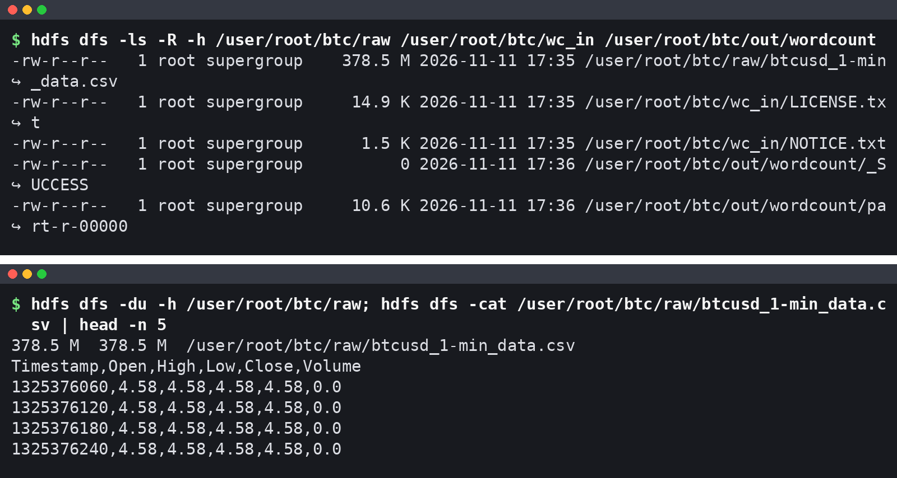
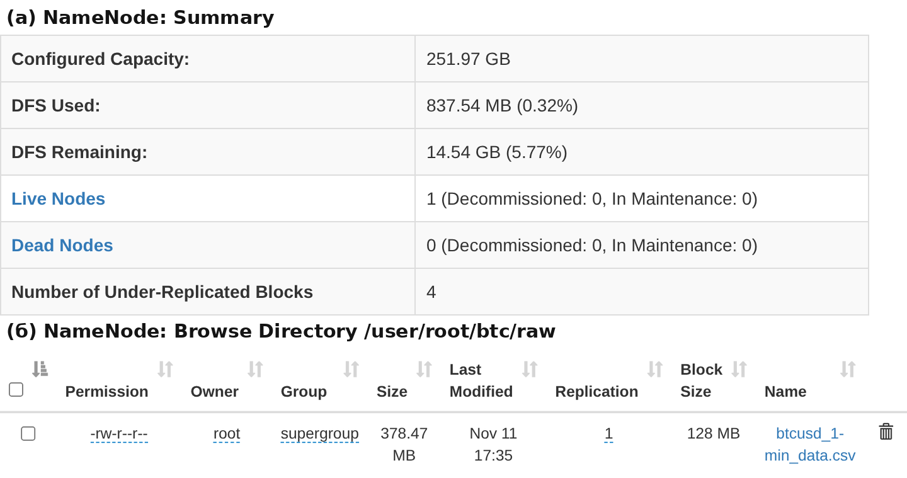
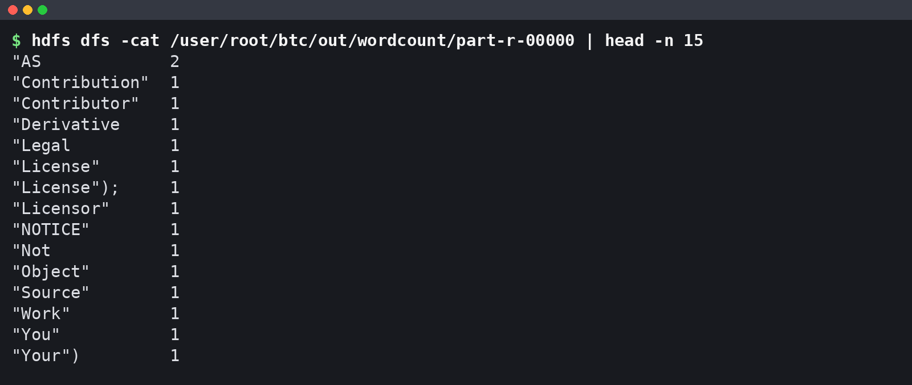
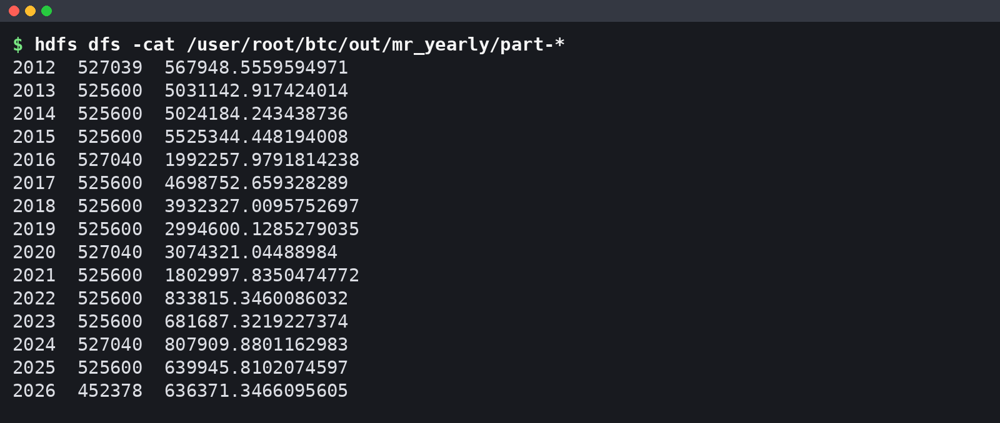
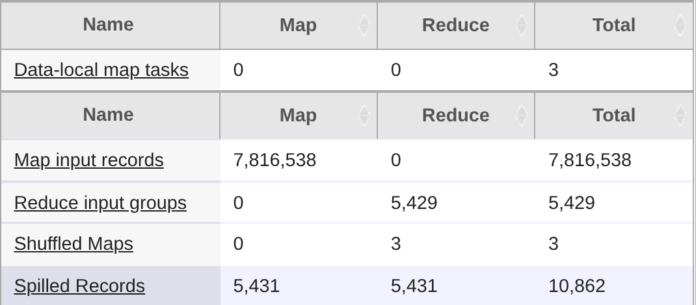
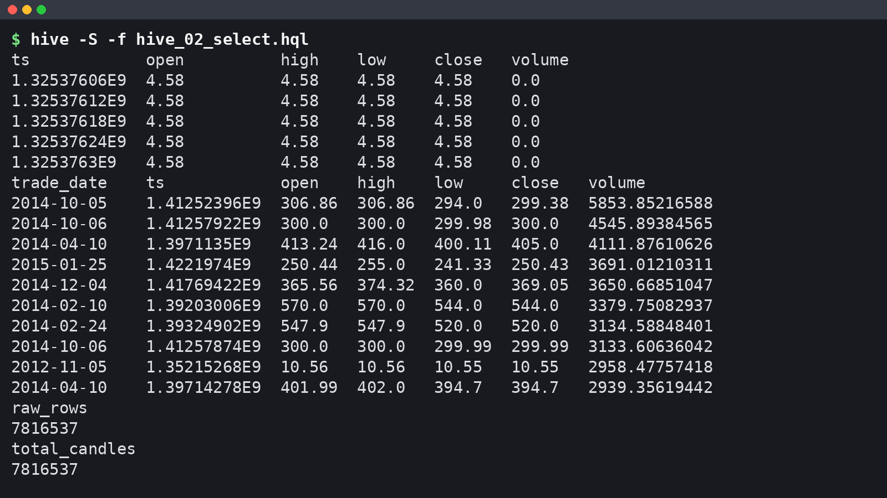
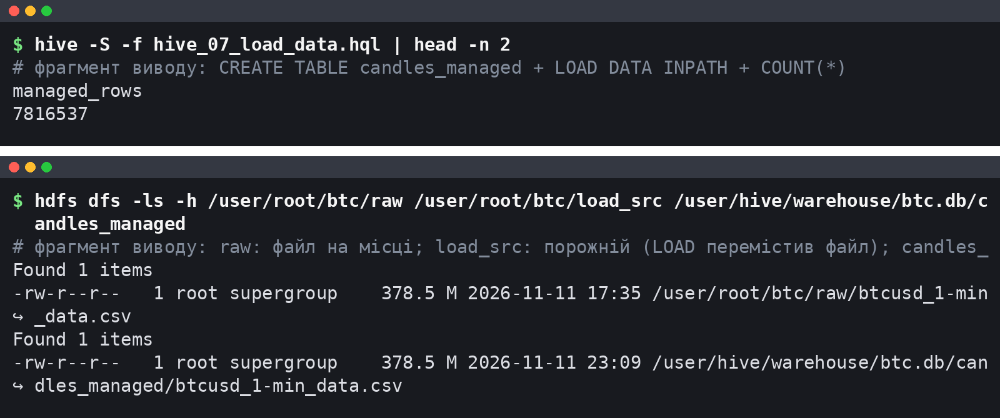
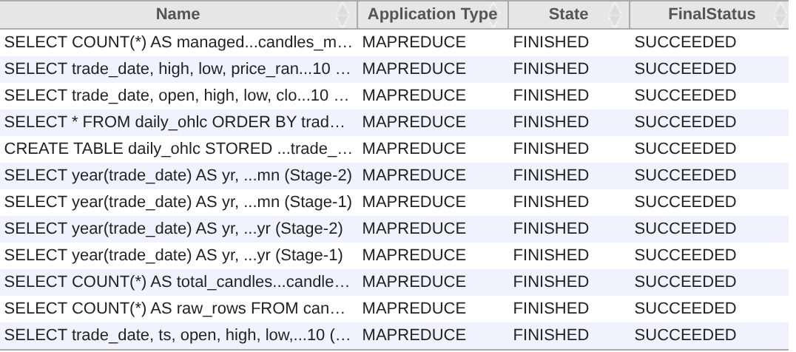
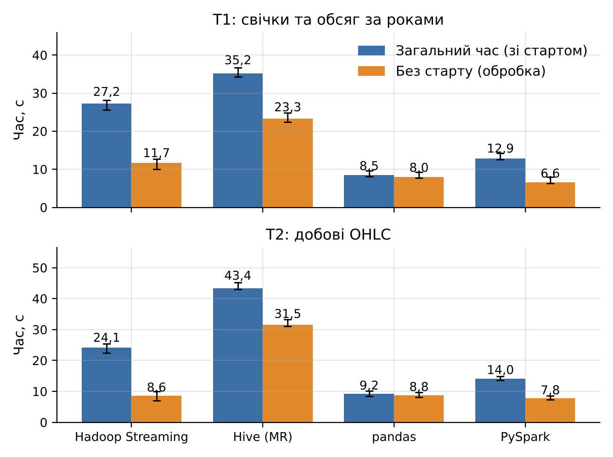

# Мета роботи

Мета роботи: ознайомитися з архітектурою та принципами роботи платформи Apache Hadoop; навчитися працювати з розподіленою файловою системою HDFS; засвоїти базові прийоми обробки даних моделлю MapReduce; ознайомитися з використанням Hive для SQL-запитів до великих обсягів даних на прикладі повного набору хвилинних свічок BTC/USD (Bitcoin Historical Data, 7 816 537 рядків, 396,8 МБ) з порівнянням результатів, швидкодії і зручності роботи з Pandas та Spark.

# Короткі теоретичні відомості

HDFS ділить файл на блоки фіксованого розміру (типово 128 МБ) і зберігає кожен блок на DataNode в кількох репліках. NameNode тримає в пам'яті лише метадані (дерево каталогів і розміщення блоків), а дані клієнт читає безпосередньо з DataNode.

YARN розподіляє ресурси: ResourceManager приймає задачі й виділяє контейнери (пам'ять і vCPU), NodeManager запускає їх на вузлі, а для кожної задачі стартує власний ApplicationMaster. JobHistoryServer зберігає лічильники завершених задач.

MapReduce описує обчислення двома функціями. Map обробляє один вхідний фрагмент (split, зазвичай один блок HDFS) і видає пари «ключ – значення». Фреймворк сортує і групує ці пари за ключем (shuffle), після чого reduce отримує всі значення одного ключа. Необов'язковий combiner виконує часткову агрегацію на боці map і зменшує обсяг shuffle; він коректний лише для асоціативних і комутативних операцій (сума, кількість, максимум), у яких формат входу збігається з форматом виходу. Проміжні результати пишуться на диск. Hadoop Streaming дозволяє писати map і reduce будь-якою мовою через stdin/stdout.

Hive зберігає схему таблиць у метасховищі (тут Derby), а дані – файлами в HDFS. Зовнішня таблиця (EXTERNAL TABLE) лише описує схему над каталогом, і DROP TABLE видаляє тільки метадані; керована таблиця володіє своїм каталогом у сховищі Hive, і її видалення знищує дані. Запит компілюється в одну чи кілька задач MapReduce.

Для набору BTC/USD агрегати зводяться до групування за ключем часу, але добові Open і Close залежать від порядку свічок за Timestamp.

# Результати виконання практичного заняття

## 1 Архітектура Hadoop та принципи роботи HDFS

Кластер розгорнуто на одній віртуальній машині (4 vCPU, 15 GiB RAM, Intel Xeon 2,10 ГГц): Hadoop 3.3.6, Hive 3.1.3, Java 1.8.0_472, Python 3.13.18, pandas 3.0.5, PySpark 4.3.0. На одному вузлі працюють NameNode і DataNode (HDFS), ResourceManager і NodeManager (YARN) та JobHistoryServer. Команда `jps` показує всі п'ять демонів, звіт `hdfs dfsadmin -report` підтверджує одну живу DataNode і місткість 270 553 174 016 байт, а `hdfs getconf` – адресу `hdfs://localhost:9000`, реплікацію 1 і розмір блоку 134 217 728 байт.

## 2 Встановлення Hadoop у pseudo-distributed mode

Hadoop і Hive встановлено з архівів Apache скриптом `run_pz1.py` (додаток А.15). Демони запущено командами `hdfs --daemon start` і `yarn --daemon start` (як у `start-dfs.sh` і `start-yarn.sh`, але без ssh). Hive 3.1.3 працює лише з JDK 8, тому стек переведено на JDK 8, а guava 19 з Hive замінено новішою версією з Hadoop. Без вимкнення перевірки віртуальної пам'яті YARN знищував би контейнери Streaming, хоча фізичний пік map становив лише 605 048 832 байти. Ключові параметри подано в таблиці 1.

Таблиця 1 – Ключові параметри pseudo-distributed конфігурації

| Параметр | Значення | Обґрунтування |
|---|---|---|
| fs.defaultFS | hdfs://localhost:9000 | усе на одному вузлі |
| dfs.replication | 1 | одна DataNode |
| dfs.blocksize | 134 217 728 (128 МБ) | CSV – 3 блоки |
| mapreduce.framework.name | yarn | UI і лічильники |
| nodemanager memory-mb / vcores | 5120 / 4 | решта RAM – демонам |
| map.memory.mb / java.opts | 1024 / -Xmx768m | AM і 3 map у 5120 МБ |
| reduce.memory.mb / java.opts | 1536 / -Xmx1024m | буфер злиття shuffle у купі JVM |
| mapreduce.job.reduces | 1 | один впорядкований файл |
| vmem-check-enabled | false | вірт. пік map 2 487 697 408 байт |
| maximum-am-resource-percent | 0,8 | при 0,1 AM не вміщується |
| map/reduce.speculative | true (типово) | див. підрозділ 4.2 |
| hive.execution.engine | mr | Tez не встановлено |

## 3 Завантаження набору даних у HDFS

Файл `btcusd_1-min_data.csv` (7 816 537 рядків даних і заголовок) завантажено в каталог `/user/root/btc/raw`. Робочі команди мають такий вигляд:

```bash
hdfs dfs -mkdir -p /user/root/btc/raw && hdfs dfs -put -f btcusd_1-min_data.csv /user/root/btc/raw/
hdfs dfs -stat "%b %r %o" /user/root/btc/raw/btcusd_1-min_data.csv
hdfs dfs -ls -R -h /user/root/btc/raw /user/root/btc/wc_in
hdfs dfs -cat /user/root/btc/raw/btcusd_1-min_data.csv | head -n 5
hdfs fsck /user/root/btc/raw -files -blocks -locations
```

Перевірку вмісту каталогів показано на рисунку 1.



Перші свічки 01.01.2012 мають ціну 4,58 і нульовий обсяг. Блоки за `hdfs fsck` зведено в таблицю 2.

Таблиця 2 – Блоки файлу btcusd_1-min_data.csv у HDFS

| Блок | Ідентифікатор | Довжина, байт | Реплік |
|---|---|---|---|
| 0 | blk_1073742503 | 134 217 728 | 1 |
| 1 | blk_1073742504 | 134 217 728 | 1 |
| 2 | blk_1073742505 | 128 414 038 | 1 |
| Разом | – | 396 849 494 | – |

Сума довжин дорівнює розміру файлу, fsck дає статус HEALTHY без недореплікованих і пошкоджених блоків. Файл і зведення по HDFS у веб-інтерфейсі NameNode показано на рисунку 2.



Розмір 378,47 МБ (у веб-інтерфейсі 378.47 MB) – це 396 849 494 байти в MiB; DFS Used 837,54 МБ включає ще копію файлу для керованої таблиці Hive і результати задач. Лічильник Number of Under-Replicated Blocks = 4 стосується не CSV (fsck каталогу raw – 0), а файлів, записаних задачами MapReduce і Hive з реплікацією понад 1, якої одна DataNode забезпечити не може; до запуску задач `dfsadmin -report` показував 0.

## 4 Задачі MapReduce

### 4.1 WordCount як перевірка кластера

Приклад `wordcount` запущено над `LICENSE.txt` і `NOTICE.txt` для перевірки кластера. Задача прочитала 304 рядки, combiner скоротив 1 879 пар до 798, на виході 748 різних слів («the» – 107, «of» – 68). Початок файлу результату в HDFS наведено на рисунку 3.



Слова розділено лише пробілами, тож «"License"» і «"License");» – різні ключі.

### 4.2 Кількість свічок і обсяг торгів за роками

Перша задача Hadoop Streaming рахує для кожного року UTC кількість свічок і сумарний обсяг. Mapper `mapper_year.py` (додаток А.1) відкидає заголовок і неповні рядки і видає `рік \t 1 \t Volume`, обчислюючи рік UTC через `time.gmtime`. Reducer `reducer_year.py` (додаток А.2) сумує кількість і обсяг; його вхід і вихід мають однаковий формат, тому той самий скрипт використано як combiner:

```bash
hadoop jar hadoop-streaming-3.3.6.jar -D mapreduce.job.reduces=1 \
  -files mapper_year.py,reducer_year.py -mapper 'python3 mapper_year.py' \
  -combiner 'python3 reducer_year.py' -reducer 'python3 reducer_year.py' \
  -input /user/root/btc/raw -output /user/root/btc/out/mr_yearly
```

Результат задачі в HDFS показано на рисунку 4.



Рядків 15, по одному на рік. Hadoop створив 3 splits і прочитав 396 857 686 байт, трохи більше за розмір файлу, бо reader дочитує рядок за межею split. Launched map tasks = 4 при Killed map tasks = 1 означає спекулятивну копію повільної map-задачі. На одному вузлі вона лише конкурує з оригіналом за ті самі 4 ядра, тому типово ввімкнене спекулятивне виконання тут додає розкиду часу.

### 4.3 Добові OHLC

Друга задача будує добові свічки за правилом Open = first, High = max, Low = min, Close = last, Volume = sum, де first і last визначаються за Timestamp. Combiner тут не підходить, бо Open і Close залежать від порядку, тому в `mapper_ohlc.py` (додаток А.3) застосовано in-mapper combining: mapper тримає для кожної доби свого split найранішу і найпізнішу свічку, максимум, мінімум і суму обсягу та видає один запис на добу з мітками часу.

Межа блоку може розрізати добу, а порядок записів усередині ключа не гарантовано, тому `reducer_ohlc.py` (додаток А.4) явно обирає запис із найменшим і найбільшим часом:

```python
for day, grp in groupby(parse(sys.stdin), key=itemgetter(0)):
    parts = list(grp)
    first = sorted(parts, key=itemgetter(1))[0]   # найраніша свічка доби
    last = sorted(parts, key=itemgetter(7))[-1]   # найпізніша свічка доби
    hi = max(parts, key=itemgetter(3))
    lo = min(parts, key=itemgetter(5))
```

Пари mapper – reducer попередньо перевірено конвеєром `cat | mapper | sort | reducer` на 200 000 рядках. Отримано 5 429 діб; неповні лише перша (1 439 свічок) і остання (218 свічок). Для обвалу 19.05.2021 результат містить Open 42 900,85, High 43 601,63, Low 30 066,00, Close 36 780,43.

### 4.4 Лічильники задач

Лічильники обох задач зведено в таблицю 3 (джерело – `mr_counters_extended.csv`, виділений з журналів задач).

Таблиця 3 – Лічильники Streaming-задач над повним CSV

| Лічильник | mr_yearly | mr_daily_ohlc |
|---|---|---|
| Map input records | 7 816 538 | 7 816 538 |
| Map output records | 7 816 537 | 5 431 |
| Map output bytes | 127 655 772 | 490 246 |
| Combine input / output records | 7 816 537 / 17 | 0 / 0 |
| Reduce shuffle bytes | 567 | 501 126 |
| Reduce input records | 17 | 5 431 |
| Reduce output records | 15 | 5 429 |

Map input records містить ще заголовок. Combiner стиснув 127 655 772 байти виходу map до 567 байт shuffle, а in-mapper combining скоротив вихід map з 7,8 млн до 5 431 запису. Значення 17 і 5 431 замість 15 і 5 429 означають, що межі блоків розрізали по одному року і одній добі, а reducer злив ці часткові записи. Лічильники добової задачі в JobHistory наведено на рисунку 5.



Shuffled Maps = 3 і Data-local map tasks = 3 підтверджують, що reducer отримав дані від трьох map-задач, і кожна читала свій блок локально (у річній задачі цей лічильник дорівнює 4 разом зі спекулятивною копією).

## 5 Таблиця Hive над даними в HDFS

### 5.1 Зовнішня таблиця

Hive підключено до Hadoop через `HADOOP_HOME`, метасховище Derby створено командою `schematool -dbType derby -initSchema`. Таблицю `btc.candles` створено як зовнішню над каталогом із CSV (додаток А.5) з властивістю `"skip.header.line.count"="1"`, яка пропускає рядок заголовка. Опис таблиці наведено на рисунку 6; усі HQL-скрипти виконано командою `hive -S -f`.


Тип таблиці – EXTERNAL_TABLE, totalSize дорівнює розміру файлу. Подання обчислює дату UTC як `date_add('1970-01-01', floor(ts / 86400))` і відкидає неповні рядки (рисунок 7).



`SELECT * FROM candles LIMIT 5` починається з першої свічки 01.01.2012 00:01 UTC, рядка NULL немає. `COUNT(*)` по таблиці (`raw_rows`) і по поданню (`total_candles`) однаково дорівнюють 7 816 537: заголовок пропускає сама таблиця, а неповних рядків у файлі немає. Для `ts` тип BIGINT дав би читабельніший вивід, ніж `1.32537606E9`.

У першій версії DDL властивість мала хибну назву `skip.header.line.number`; Hive мовчки ігнорував її, і заголовок CSV читався як рядок із NULL. Після виправлення запити Hive перезапущено; результати побайтно збіглися з попередніми, бо подання `candles_v` відкидало цей рядок і раніше; рядок NULL був видимий лише у простій вибірці без подання, а агрегати від нього не залежали.

### 5.2 Завантаження даних у керовану таблицю

Для кроку «Завантажити дані в таблицю» копію CSV з `/user/root/btc/load_src` завантажено в керовану таблицю `candles_managed` командою `LOAD DATA INPATH` (додаток А.14, рисунок 8). Копіювання в `load_src`: `hdfs dfs -mkdir -p /user/root/btc/load_src && hdfs dfs -cp /user/root/btc/raw/btcusd_1-min_data.csv /user/root/btc/load_src/`.



Таблиця містить 7 816 537 рядків, каталог `load_src` порожній, а файл опинився у `/user/hive/warehouse/btc.db/candles_managed`: LOAD DATA INPATH переміщує файл у межах HDFS, не копіюючи його. Основні запити виконано над зовнішньою таблицею, бо `DROP TABLE` керованої таблиці видалив би й дані.

## 6 SQL-запити в Hive

### 6.1 Групування за роками і місяцями

Запит `hive_03a_yearly.hql` (додаток А.8) групує подання за `year(trade_date)` і рахує кількість свічок, суму обсягу, середню ціну закриття, максимум High і мінімум Low. Результат Hive подано в таблиці 4.

Таблиця 4 – Річні агрегати Hive (обсяг округлено до 0,01 BTC, ціни – до 0,01 USD)

| Рік | Свічок | Обсяг, BTC | Сер. Close | Max High | Min Low |
|---|---|---|---|---|---|
| 2012 | 527 039 | 567 948,56 | 8,23 | 16,41 | 3,80 |
| 2013 | 525 600 | 5 031 142,92 | 187,43 | 1 163,00 | 12,77 |
| 2014 | 525 600 | 5 024 184,24 | 525,57 | 995,00 | 275,00 |
| 2015 | 525 600 | 5 525 344,45 | 272,25 | 502,00 | 152,40 |
| 2016 | 527 040 | 1 992 257,98 | 565,83 | 980,74 | 352,00 |
| 2017 | 525 600 | 4 698 752,66 | 3 948,33 | 19 666,00 | 751,34 |
| 2018 | 525 600 | 3 932 327,01 | 7 524,76 | 17 234,99 | 3 122,28 |
| 2019 | 525 600 | 2 994 600,13 | 7 352,19 | 13 880,00 | 3 322,19 |
| 2020 | 527 040 | 3 074 321,04 | 11 074,63 | 29 300,00 | 3 850,00 |
| 2021 | 525 600 | 1 802 997,84 | 47 386,18 | 69 000,00 | 27 734,00 |
| 2022 | 525 600 | 833 815,35 | 28 228,66 | 48 234,00 | 15 479,00 |
| 2023 | 525 600 | 681 687,32 | 28 811,76 | 44 729,00 | 16 496,00 |
| 2024 | 527 040 | 807 909,88 | 65 895,12 | 108 364,00 | 38 505,00 |
| 2025 | 525 600 | 639 945,81 | 101 639,98 | 126 272,00 | 74 434,00 |
| 2026 | 452 378 | 636 371,35 | 74 103,97 | 97 939,00 | 57 734,63 |

Кількість свічок за всі 15 років збігається з результатом MapReduce до одиниці, а обсяги відрізняються лише в останніх знаках (2014 рік: 5 024 184,243438596 у Hive проти 5 024 184,243438736 у MapReduce) через порядок підсумовування. Обсяг максимальний у 2015 році; у 2012 році свічок 527 039, бо перша має час 00:01. Повні роки мають 525 600 або 527 040 хвилин (високосні 2016, 2020, 2024), тобто хвилинна сітка повна, але торгівля не безперервна: 1 312 419 свічок (16,79 %) мають нульовий обсяг (`facts.csv`). Це заповнені пропуски з ціною попереднього закриття (перші рядки на рисунку 1); їх збережено, тому вони входять у кількість свічок і середню ціну закриття. Місячний розріз (`GROUP BY year, month`, 179 груп) має пік у листопаді 2013 року (965 986,91 BTC).

### 6.2 Добова таблиця і топ-10 діб

Добову таблицю `daily_ohlc` створено запитом CTAS (додаток А.10). Open і Close обчислено без віконних функцій: Hive порівнює структури лексикографічно, починаючи з першого поля, а `ts` унікальний у межах доби, тому мінімум структури `(ts, open)` дає Open найранішої свічки:

```sql
SELECT trade_date,
       min(struct(ts, open)).col2  AS open,
       max(high) AS high, min(low) AS low,
       max(struct(ts, close)).col2 AS close,
       sum(volume) AS volume, count(*) AS candles
FROM candles_v GROUP BY trade_date;
```

Таблиця має 5 429 рядків, як і результат MapReduce. На її основі виконано два запити топ-10: за сумарним обсягом (додаток А.11) і за амплітудою High − Low через подання `daily_range_v` (додаток А.12). Результати подано в таблиці 5.

Таблиця 5 – Топ-10 діб за обсягом торгів і за амплітудою High − Low (Hive)

| № | Доба (обсяг) | Обсяг, BTC | Доба (амплітуда) | High − Low, USD |
|---|---|---|---|---|
| 1 | 2013-12-18 | 137 070,18 | 2021-05-19 | 13 535,63 |
| 2 | 2015-01-14 | 124 188,89 | 2025-10-10 | 12 899,00 |
| 3 | 2014-02-25 | 115 761,99 | 2021-12-04 | 11 910,27 |
| 4 | 2015-11-04 | 105 959,26 | 2026-02-06 | 11 743,00 |
| 5 | 2015-01-15 | 83 488,42 | 2024-12-05 | 11 555,00 |
| 6 | 2013-12-07 | 79 852,42 | 2025-02-03 | 11 039,00 |
| 7 | 2015-11-03 | 77 212,78 | 2026-02-05 | 10 975,00 |
| 8 | 2014-02-10 | 71 860,54 | 2021-02-22 | 10 164,19 |
| 9 | 2013-11-19 | 71 560,95 | 2025-03-02 | 10 123,00 |
| 10 | 2018-02-06 | 70 961,37 | 2021-09-07 | 10 056,46 |

Рейтинги не перетинаються. Дев'ять діб з найбільшим обсягом припадають на 2013–2015 роки, коли BTC коштував сотні доларів (18.12.2013 ціна впала з 675,00 до 382,21). Абсолютна амплітуда зростає з ціною, тому її топ-10 належить 2021–2026 рокам на чолі з обвалом 19.05.2021; для порівняння різних років її треба нормувати на ціну відкриття.

Під час розбору виводу виявилося, що при `hive.cli.print.header=true` інструкція `CREATE VIEW` друкує назви стовпців подання ще до заголовка результату `SELECT`. Кожен запит, що потребує обчислень, Hive виконав окремим застосунком YARN (рисунок 9).



Усі 12 застосунків завершилися зі статусом SUCCEEDED. Запити за роками і за місяцями мають по дві стадії (Stage-1 – GROUP BY, Stage-2 – ORDER BY), а `SELECT * FROM candles LIMIT 5` у списку відсутній: Hive виконав його простим читанням файлу без MapReduce.

## 7 Зручність та ефективність: порівняння з Pandas і Spark

### 7.1 Звірка результатів

Ті самі дві агрегації (Т1 – кількість і обсяг за роками, Т2 – добові OHLC) повторено в Pandas (`groupby` після сортування за Timestamp, додатки А.16 і А.17) і в PySpark local[*]. Підсумки звірки наведено в таблиці 6.

Таблиця 6 – Звірка результатів MapReduce, Hive, Pandas і Spark

| Порівняння | Рядків | Збіг | Примітка |
|---|---|---|---|
| Hive – MapReduce, роки | 15 / 15 | так | обсяг з допуском 10⁻⁹ |
| Hive – MapReduce, доби | 5 429 / 5 429 | так | OHLC з допуском 10⁻¹² |
| MapReduce – Pandas, роки | 15 / 15 | так | відн. різниця 1,00·10⁻¹³ |
| MapReduce – Pandas, доби | 5 429 / 5 429 | так | OHLC без розбіжностей |
| Hive – Pandas, роки | 15 / 15 | так | – |
| Hive – Pandas, топ-10 за обсягом | 10 / 10 | так | ті самі 10 дат у тому ж порядку |
| Hive – Pandas, топ-10 за High − Low | 10 / 10 | так | ті самі 10 дат у тому ж порядку |
| Spark – Pandas, роки і доби | 15 і 5 429 | так | – |

Збіг Hive – Pandas і Spark – MapReduce по добах випливає транзитивно з прямих звірок. Усі рушії обчислюють те саме, тож порівняння часу коректне.

### 7.2 Методика вимірювання часу

Вимірювання виконано скриптом `bench_all.py` (додатки А.17–А.19). Вимірювався повний настінний час від запуску нового процесу до записаного результату, включно зі стартом JVM, CLI Hive, інтерпретатора Python або SparkSession (local[*], драйвер 3 ГБ, 8 shuffle-розділів). Hadoop і Hive читають і пишуть HDFS (Hive для Т1 без ORDER BY, як і Streaming), Pandas і Spark – локальний диск; ця асиметрія збережена свідомо, бо HDFS тут працює на тому самому диску. Спекулятивне виконання залишено типовим (увімкненим), тому його можливий вплив входить у розкид min–max.

Старт кожного рушія виміряно окремо (імпорт pandas, створення SparkSession, `hive -S -e "select 1"`, порожня map-only задача Streaming). «Обробка» – медіана загального часу мінус медіана старту; старт Hive не містить запуску задачі MapReduce.

Вимірювання почалися після очікування тиші: щохвилинне опитування до трьох поспіль значень loadavg (1 хв) < 1,5; умову виконано на опитуванні 52 при loadavg 1,28. Далі виконано одне прогрівальне коло, яке відкинуто, і 5 вимірюваних кіл. У кожному колі запускалися всі 8 пар «рушій – задача» і 4 вимірювання старту з циклічним зсувом початку, щоб дрейф навантаження і кеш ОС діяли на рушії однаково. Усі 46 інших запусків Т1/Т2 (включно з прогрівальними) збіглися з еталоном – результатом Pandas з прогрівального кола. Loadavg перед запусками – 1,44–3,22 (медіана 2,43), вільна пам'ять – 10,5–11,1 ГБ.

### 7.3 Результати вимірювання

Медіани з 5 вимірювань разом із мінімумом і максимумом показано на рисунку 10, а медіани і міжквартильний розмах (IQR) загального часу – в таблиці 7.



Таблиця 7 – Час виконання Т1 і Т2 на 7 816 537 рядках, с (медіана з 5 запусків, 4 vCPU, 15 ГБ)

| Рушій | Задача | Загальний час | IQR | Старт | Обробка |
|---|---|---|---|---|---|
| Hadoop Streaming | Т1 | 27,20 | 0,97 | 15,47 | 11,73 |
| Hadoop Streaming | Т2 | 24,08 | 1,74 | 15,47 | 8,62 |
| Hive (рушій MR) | Т1 | 35,19 | 0,83 | 11,88 | 23,31 |
| Hive (рушій MR) | Т2 | 43,38 | 0,38 | 11,88 | 31,49 |
| Pandas | Т1 | 8,46 | 0,21 | 0,43 | 8,03 |
| Pandas | Т2 | 9,21 | 1,37 | 0,43 | 8,78 |
| PySpark local[*] | Т1 | 12,88 | 0,44 | 6,29 | 6,58 |
| PySpark local[*] | Т2 | 14,04 | 0,88 | 6,29 | 7,75 |

IQR не перевищує 1,74 с, тому порядок рушіїв стійкий. На 7,8 млн рядків і 396,8 МБ на одній 4-ядерній машині найшвидший за загальним часом Pandas (8,46 і 9,21 с), старт якого займає 0,43 с. Spark за чистою обробкою найшвидший (6,58 і 7,75 с), бо читає файл на 4 ядрах, але 6,29 с на створення сесії роблять його повільнішим за Pandas. Hadoop Streaming витрачає 15,47 с на старт; його обробка Т2 (8,62 с) завдяки in-mapper combining швидша за Т1 (11,73 с), де mapper видає запис на кожну свічку. Hive найповільніший: до старту CLI додаються компіляція плану і запуск задачі MapReduce.

Отже, тут час Hadoop і Hive визначають фіксовані витрати на JVM і контейнери YARN, а не обчислення.

### 7.4 Зручність розробки

Добові OHLC у Streaming потребували mapper і reducer на 43 і 26 рядків Python без коментарів, з ручною обробкою меж блоків і порядку записів; у Hive – один запит CTAS на 13 рядків HiveQL; у Pandas і Spark – один вираз `groupby`/`groupBy`.

# Висновки

Порівняння з Pandas і Spark. Чотири рушії дали ідентичні результати. За медіаною з 5 запусків Pandas виконав задачі за 8,46 і 9,21 с, Spark – за 12,88 і 14,04 с, Hadoop Streaming – за 27,20 і 24,08 с, Hive – за 35,19 і 43,38 с. Різницю визначає старт: 15,47 с у Hadoop і 11,88 с у Hive проти 0,43 с у Pandas.

Переваги Hadoop. HDFS розбила файл на 3 блоки і контролює їх цілісність, а MapReduce автоматично розпаралелив обробку за блоками (3 data-local map-задачі) і коректно злив записи, розрізані межами блоків. На справжньому кластері реплікація і спекулятивне виконання компенсують збої та повільні вузли, але на одному вузлі лише споживають ресурси.

Обмеження. Налаштування вимагало узгодити версії (JDK 8 для Hive, конфлікт guava) і підібрати пам'ять контейнерів YARN. MapReduce вимагає ручної обробки порядку і меж блоків для Open і Close. Hive мовчки ігнорує невідомі властивості таблиці, як сталося з хибною назвою властивості пропуску заголовка.

Доцільність. Для 7,8 млн рядків на машині з 15 GiB RAM Hadoop не виправданий: дані вміщуються в пам'ять Pandas, а один вузол не дає ні масштабування, ні відмовостійкості. Він доцільний для пакетної обробки даних, що перевищують ресурси однієї машини і вже зберігаються в HDFS.
