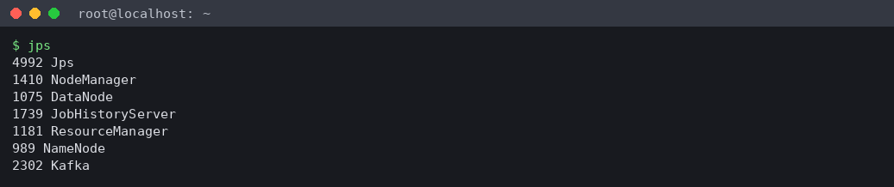
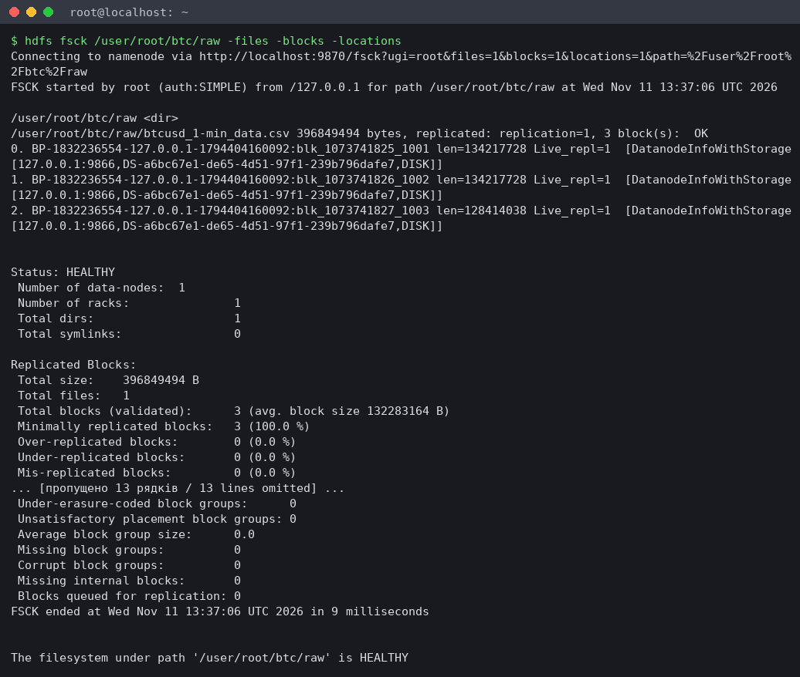
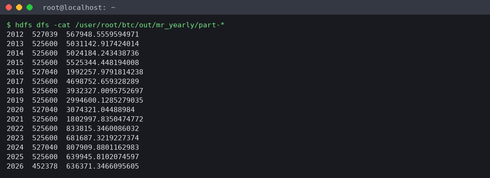
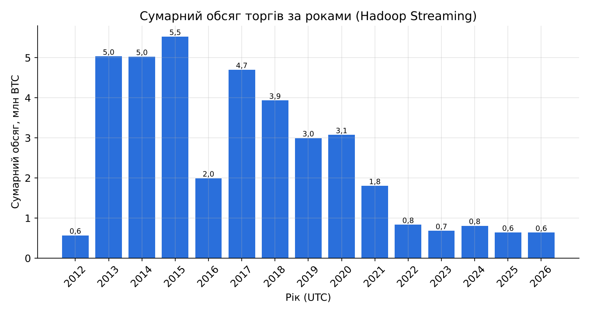
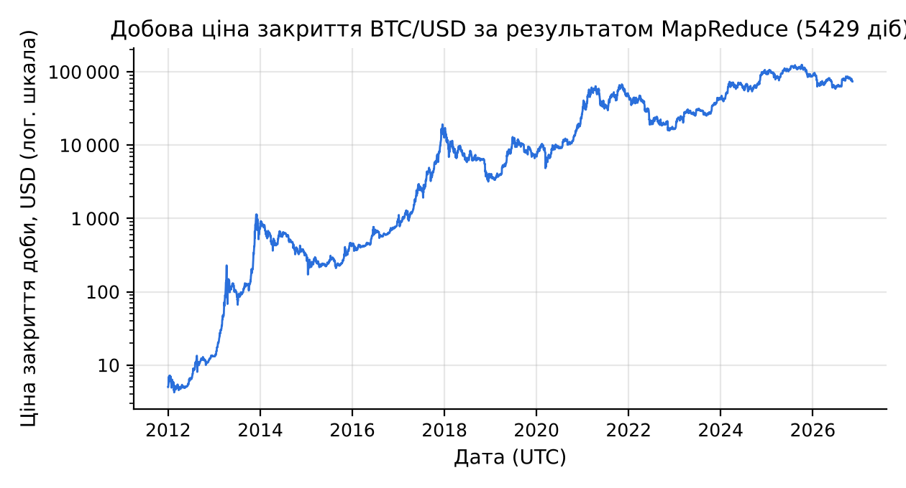
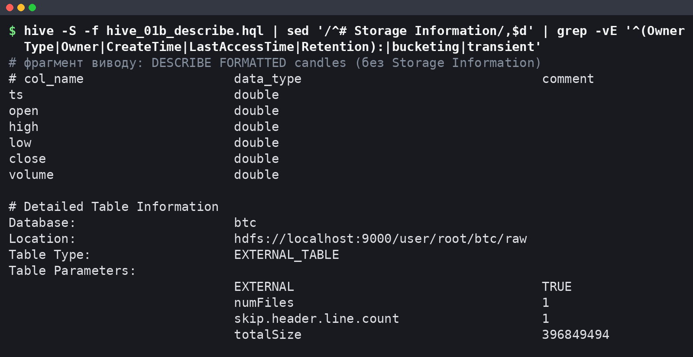
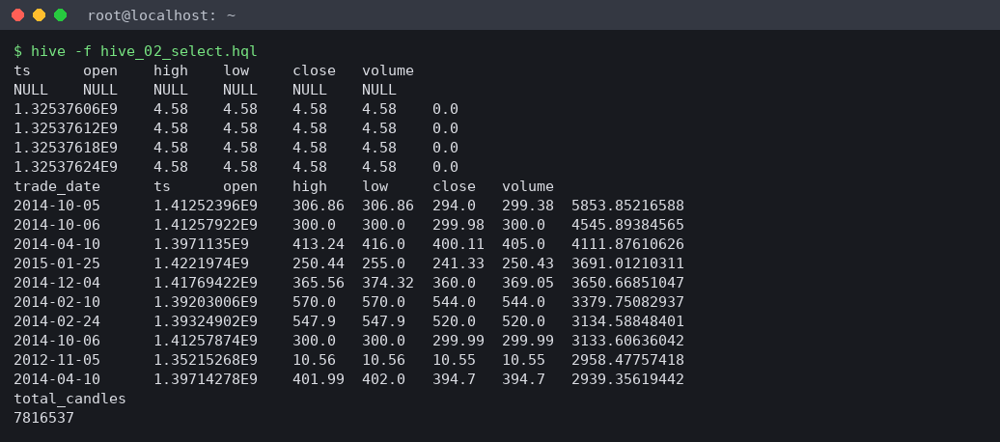
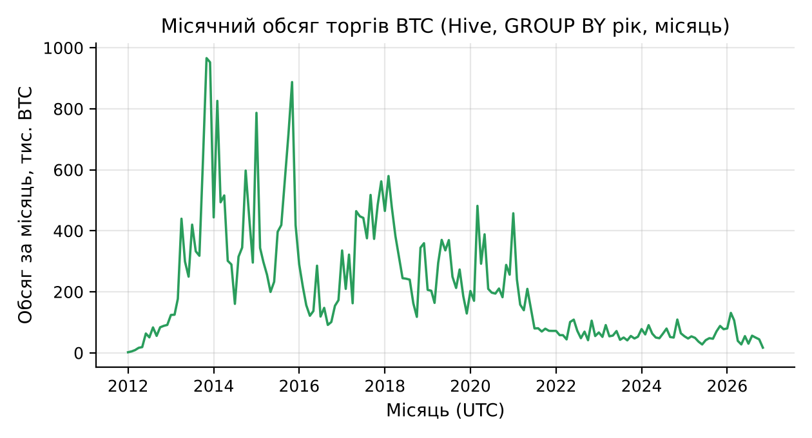
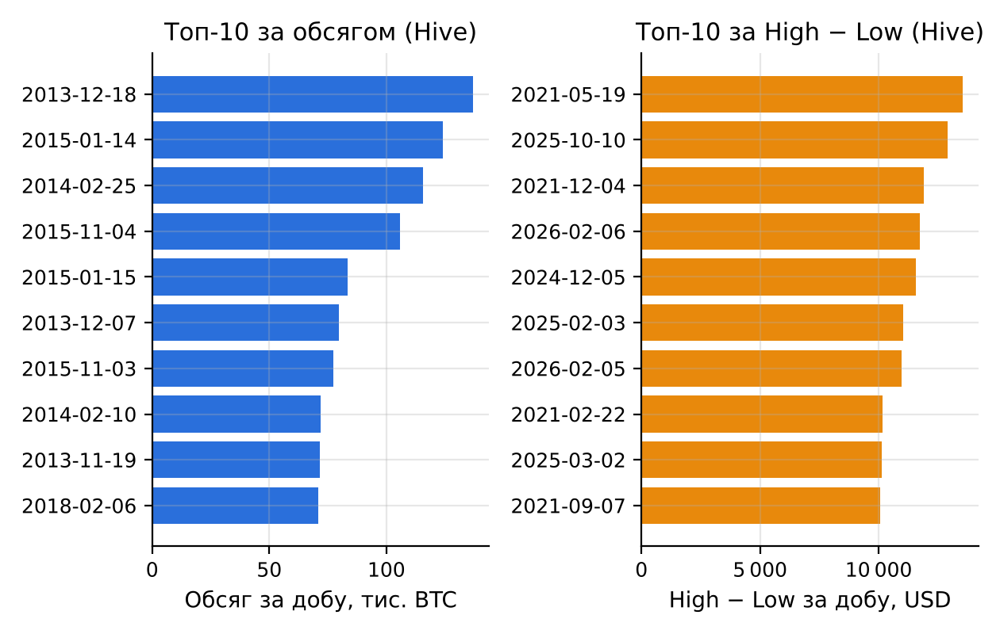

# Мета роботи

Мета роботи: ознайомитися з архітектурою та принципами роботи платформи Apache Hadoop; навчитися працювати з розподіленою файловою системою HDFS; засвоїти базові прийоми обробки даних моделлю MapReduce; ознайомитися з використанням Hive для SQL-запитів до великих обсягів даних на прикладі повного набору хвилинних свічок BTC/USD (Bitcoin Historical Data, 7 816 537 рядків, 396,8 МБ) з порівнянням результатів і зручності роботи з Pandas та Spark.

# Короткі теоретичні відомості

Hadoop поєднує сховище і обчислення на одних і тих самих вузлах. HDFS ділить файл на блоки фіксованого розміру (типово 128 МБ) і зберігає кожен блок на DataNode в кількох репліках. NameNode тримає в пам'яті лише метадані (дерево каталогів і розміщення блоків), а дані клієнт читає безпосередньо з DataNode.

YARN розподіляє ресурси: ResourceManager приймає задачі й виділяє контейнери (пам'ять і vCPU), NodeManager запускає їх на вузлі, а для кожної задачі стартує власний ApplicationMaster. JobHistoryServer зберігає лічильники завершених задач.

MapReduce описує обчислення двома функціями. Map обробляє один вхідний фрагмент (split, зазвичай один блок HDFS) і видає пари «ключ – значення». Фреймворк сортує і групує ці пари за ключем (shuffle), після чого reduce отримує всі значення одного ключа. Необов'язковий combiner виконує часткову агрегацію на боці map і зменшує обсяг shuffle; він коректний лише для асоціативних операцій на зразок суми. Проміжні результати пишуться на диск. Hadoop Streaming дозволяє писати map і reduce будь-якою мовою, що читає stdin і пише stdout.

Hive надає SQL-подібну мову HiveQL. Метасховище (тут Derby) зберігає схему таблиць, а самі дані залишаються файлами в HDFS. Зовнішня таблиця (EXTERNAL TABLE) лише описує схему над каталогом і не копіює дані; DROP TABLE видаляє тільки метадані. Кожен запит компілюється в план із однієї чи кількох задач MapReduce.

Для набору BTC/USD ця модель природна: рядки незалежні, а потрібні агрегати (обсяг за роками, добові OHLC) зводяться до групування за ключем часу. Добові Open і Close не є асоціативними агрегатами, тому їх потрібно обчислювати з явним урахуванням порядку свічок за Timestamp.

# Результати виконання практичного заняття

## 1 Архітектура Hadoop та принципи роботи HDFS

Кластер розгорнуто на одній віртуальній машині (4 vCPU, 15 GiB RAM, Intel Xeon 2,10 ГГц): Hadoop 3.3.6, Hive 3.1.3, Java 1.8.0_472, Python 3.13.18, pandas 3.0.5, PySpark 4.3.0. На одному вузлі працюють усі ролі: NameNode і DataNode (HDFS), ResourceManager і NodeManager (YARN), а також JobHistoryServer для перегляду лічильників. Перелік процесів JVM після запуску наведено на рисунку 1.



Усі п'ять демонів працюють (Kafka належить іншій роботі). Звіт `hdfs dfsadmin -report` підтверджує одну живу DataNode і місткість 270 553 174 016 байт, а `hdfs getconf` – адресу `hdfs://localhost:9000`, реплікацію 1 і розмір блоку 134 217 728 байт.

## 2 Встановлення Hadoop у pseudo-distributed mode

Hadoop і Hive встановлено з архівів Apache, конфігураційні файли згенеровано скриптом `run_pz1.py` (додаток А.13). Демони запущено командами `hdfs --daemon start` і `yarn --daemon start`: це ті самі процеси, що піднімають `start-dfs.sh` і `start-yarn.sh`, але без входу по ssh на localhost, якого в контейнері немає. Hive 3.1.3 працює лише з JDK 8 (під JDK 21 CLI завершується помилкою рефлексії), тому весь стек переведено на JDK 8; бібліотеку guava 19 з Hive замінено на версію з Hadoop, бо Hadoop 3.3 потребує новішої. Ключові параметри та причини їх вибору подано в таблиці 1.

Таблиця 1 – Ключові параметри pseudo-distributed конфігурації

| Параметр | Значення | Обґрунтування |
|---|---|---|
| fs.defaultFS | hdfs://localhost:9000 | NameNode і клієнти на одному вузлі |
| dfs.replication | 1 | одна DataNode; при 3 блоки лишалися б недореплікованими |
| dfs.blocksize | 134 217 728 (128 МБ) | типове; CSV – 3 блоки, 3 map-задачі |
| mapreduce.framework.name | yarn | задачі через ResourceManager, є UI і лічильники |
| yarn.nodemanager.resource.memory-mb / cpu-vcores | 5120 / 4 | решта RAM – демонам, Hive і Spark |
| mapreduce.map.memory.mb / java.opts | 1024 / -Xmx768m | AM і 3 map-контейнери вміщуються в 5120 МБ |
| mapreduce.reduce.memory.mb / java.opts | 1536 / -Xmx1024m | один reducer збирає всі ключі |
| yarn.nodemanager.vmem-check-enabled | false | пік вірт. пам'яті map 2 487 697 408 байт > 2,1 × 1024 МБ |
| maximum-am-resource-percent | 0,8 | при 0,1 на AM лише 512 МБ замість 1024 МБ |
| hive.execution.engine | mr | рушій MapReduce, метасховище Derby |

Без вимкнення перевірки віртуальної пам'яті YARN знищував би контейнери Streaming, хоча фізичний пік map становив лише 605 048 832 байти.

## 3 Завантаження набору даних у HDFS

Файл `btcusd_1-min_data.csv` (7 816 537 рядків даних і заголовок) завантажено в каталог `/user/root/btc/raw`. Робочі команди мають такий вигляд:

```bash
hdfs dfs -mkdir -p /user/root/btc/raw /user/root/btc/wc_in /user/root/btc/out
hdfs dfs -put -f btcusd_1-min_data.csv /user/root/btc/raw/
hdfs dfs -ls -h /user/root/btc/raw
hdfs dfs -du -h /user/root/btc
hdfs dfs -cat /user/root/btc/raw/btcusd_1-min_data.csv | head -n 6
hdfs fsck /user/root/btc/raw -files -blocks -locations
```

Розбиття файлу на блоки, отримане `hdfs fsck`, зведено в таблицю 2.

Таблиця 2 – Блоки файлу btcusd_1-min_data.csv у HDFS

| Блок | Ідентифікатор | Довжина, байт | Реплік |
|---|---|---|---|
| 0 | blk_1073742503 | 134 217 728 | 1 |
| 1 | blk_1073742504 | 134 217 728 | 1 |
| 2 | blk_1073742505 | 128 414 038 | 1 |
| Разом | – | 396 849 494 | – |

Файл розміром 396 849 494 байти дає два повні блоки по 128 МБ і третій неповний; сума довжин точно дорівнює розміру локального файлу, що скрипт перевіряє через `hdfs dfs -stat`. Повний вивід перевірки наведено на рисунку 2.



Статус HEALTHY і Live_repl=1 для кожного блоку, а в повному звіті (`logs/04_hdfs.log`) 0 недореплікованих і 0 пошкоджених блоків, означають, що реплікація 1 відповідає конфігурації. Веб-інтерфейс NameNode показує той самий файл як 378,47 MB: це 396 849 494 байти у двійкових мегабайтах (MiB). Межі блоків проходять посеред рядків CSV; `TextInputFormat` дочитує розрізаний рядок із наступного блоку, тому жоден запис не губиться.

## 4 Задачі MapReduce

### 4.1 WordCount як перевірка кластера

Стандартний приклад `wordcount` з `hadoop-mapreduce-examples` запущено над файлами `LICENSE.txt` і `NOTICE.txt`, щоб перевірити ланцюжок HDFS – YARN – MapReduce до роботи з основним набором. Задача з 2 map і 1 reduce прочитала 304 рядки, combiner скоротив 1 879 пар до 798, на виході 748 різних слів; лідирують службові слова ліцензії («the» – 107, «of» – 68). Отже, кластер готовий до власних задач.

### 4.2 Кількість свічок і обсяг торгів за роками

Перша власна задача Hadoop Streaming рахує для кожного року UTC кількість хвилинних свічок і сумарний обсяг. Mapper `mapper_year.py` (додаток А.1) розбирає рядок CSV, відкидає заголовок і рядки з пропусками (як `dropna` у Pandas) і видає `рік \t 1 \t Volume`. Рік обчислюється в UTC через `time.gmtime` з кешем на добу. Reducer `reducer_year.py` (додаток А.2) сумує кількість і обсяг; його вхід і вихід мають однаковий формат, тому той самий скрипт використано як combiner:

```bash
hadoop jar hadoop-streaming-3.3.6.jar -D mapreduce.job.reduces=1 \
  -files mapper_year.py,reducer_year.py \
  -mapper 'python3 mapper_year.py' \
  -combiner 'python3 reducer_year.py' \
  -reducer 'python3 reducer_year.py' \
  -input /user/root/btc/raw -output /user/root/btc/out/mr_yearly
```

Сума й кількість асоціативні, тому часткове згортання на боці map не змінює результату. Результат задачі, прочитаний з HDFS, показано на рисунку 3.



Рядків 15, по одному на рік 2012–2026. Hadoop створив 3 splits за кількістю блоків і прочитав 396 857 686 байт (Bytes Read). Лічильник Launched map tasks дорівнює 4 при Killed map tasks 1: YARN запустив спекулятивну копію повільної map-задачі і зупинив її після завершення оригіналу, на результат це не вплинуло.

### 4.3 Добові OHLC

Друга задача будує добові свічки за правилом Open = first, High = max, Low = min, Close = last, Volume = sum, де first і last визначаються за Timestamp. Стандартний combiner тут не підходить: його може бути викликано нуль або кілька разів, а Open і Close залежать від порядку. Тому в `mapper_ohlc.py` (додаток А.3) застосовано in-mapper combining: у межах свого split mapper тримає для кожної доби найранішу і найпізнішу свічку, максимум High, мінімум Low і суму обсягу, а наприкінці видає один запис на добу разом із мітками часу першої та останньої свічки.

Блок HDFS може розрізати добу навпіл, і тоді до reducer надходять два часткові записи. Hadoop сортує лише за ключем (добою), порядок записів усередині ключа не гарантовано, тому `reducer_ohlc.py` (додаток А.4) явно обирає запис із найменшим і найбільшим часом:

```python
for day, grp in groupby(parse(sys.stdin), key=itemgetter(0)):
    parts = list(grp)
    first = sorted(parts, key=itemgetter(1))[0]   # найраніша свічка доби
    last = sorted(parts, key=itemgetter(7))[-1]   # найпізніша свічка доби
    hi = max(parts, key=itemgetter(3))
    lo = min(parts, key=itemgetter(5))
```

Ціни передаються вихідними текстовими токенами, без похибки округлення. Перед запуском на кластері обидві пари mapper – reducer перевірено конвеєром `cat | mapper | sort | reducer` на перших 200 000 рядках зі звіркою з Pandas.

### 4.4 Лічильники задач

Лічильники обох задач зведено в таблицю 3 (джерело – `mr_counters_extended.csv`, виділений з журналів задач).

Таблиця 3 – Лічильники Streaming-задач над повним CSV

| Лічильник | mr_yearly | mr_daily_ohlc |
|---|---|---|
| Map input records | 7 816 538 | 7 816 538 |
| Map output records | 7 816 537 | 5 431 |
| Map output bytes | 127 655 772 | 490 246 |
| Combine input / output records | 7 816 537 / 17 | 0 / 0 |
| Reduce shuffle bytes | 567 | 501 126 |
| Reduce input records | 17 | 5 431 |
| Reduce output records | 15 | 5 429 |

Map input records на одиницю більше за кількість свічок, бо містить заголовок, який mapper відкидає. Combiner у річній задачі стиснув 127 655 772 байти виходу map до 567 байт shuffle. У добовій задачі in-mapper combining скоротив вихід map з 7,8 млн до 5 431 запису. Значення 17 і 5 431 замість 15 і 5 429 мають одну причину: дві межі між трьома блоками розрізали по одному року і по одній добі, і єдиний reducer коректно злив ці часткові записи від трьох map-задач (Shuffled Maps 3 в JobHistory).

Сумарний обсяг за роками, отриманий MapReduce, показано на рисунку 4.



Обсяг у BTC максимальний у 2015 році (5 525 344,45 BTC) і з 2021 року не перевищує 1,81 млн BTC. У 2012 році свічок 527 039, а не 527 040: перша свічка файлу має час 00:01, а 2026 рік неповний (452 378 свічок до 11.11.2026). Добову ціну закриття з результату MapReduce наведено на рисунку 5.



Отримано 5 429 діб від 01.01.2012 до 11.11.2026; сума свічок за добами дорівнює 7 816 537. Неповні лише перша доба (1 439 свічок) і остання (218 свічок, файл вивантажено о 03:37 UTC). Для всіх діб виконується High ≥ max(Open, Close) і Low ≤ min(Open, Close).

## 5 Таблиця Hive над даними в HDFS

Hive 3.1.3 підключено до Hadoop через `HADOOP_HOME`, метасховище Derby ініціалізовано командою `schematool -dbType derby -initSchema`. Таблицю `btc.candles` створено як зовнішню над каталогом із CSV (додаток А.5), тому окремий крок `LOAD DATA` не потрібен: файл уже лежить у HDFS, і перенесення його у warehouse Hive лише продублювало б 396,8 МБ. Опис таблиці наведено на рисунку 6.



Тип EXTERNAL_TABLE і розташування `hdfs://localhost:9000/user/root/btc/raw` відповідають каталогу з CSV, а пропущений на рисунку параметр totalSize дорівнює 396 849 494, тобто розміру файлу. Над таблицею створено подання `candles_v` з датою UTC `date_add('1970-01-01', floor(ts / 86400))`, яка не залежить від часового поясу сесії, і з фільтром рядків, де є NULL. Результати першої вибірки показано на рисунку 7.



`SELECT * FROM candles LIMIT 5` повернув першим рядок із NULL у всіх полях: Hive виконав цей запит простим читанням файлу без MapReduce, і властивість `skip.header.line.number` на ньому не спрацювала, тож заголовок CSV розібрано як дані. Агрегати від цього не страждають, бо `candles_v` відкидає NULL: `COUNT(*)` дорівнює 7 816 537, тобто кількості рядків даних у CSV.

## 6 SQL-запити в Hive

### 6.1 Групування за роками і місяцями

Запит `hive_03a_yearly.hql` (додаток А.7) групує подання за `year(trade_date)` і рахує кількість свічок, суму обсягу, середню ціну закриття, максимум High і мінімум Low. Результат разом із підсумками MapReduce подано в таблиці 4.

Таблиця 4 – Річні агрегати Hive (обсяг округлено до 0,01 BTC, ціни – до 0,01 USD)

| Рік | Свічок | Обсяг, BTC | Сер. Close | Max High | Min Low |
|---|---|---|---|---|---|
| 2012 | 527 039 | 567 948,56 | 8,23 | 16,41 | 3,80 |
| 2013 | 525 600 | 5 031 142,92 | 187,43 | 1 163,00 | 12,77 |
| 2014 | 525 600 | 5 024 184,24 | 525,57 | 995,00 | 275,00 |
| 2015 | 525 600 | 5 525 344,45 | 272,25 | 502,00 | 152,40 |
| 2016 | 527 040 | 1 992 257,98 | 565,83 | 980,74 | 352,00 |
| 2017 | 525 600 | 4 698 752,66 | 3 948,33 | 19 666,00 | 751,34 |
| 2018 | 525 600 | 3 932 327,01 | 7 524,76 | 17 234,99 | 3 122,28 |
| 2019 | 525 600 | 2 994 600,13 | 7 352,19 | 13 880,00 | 3 322,19 |
| 2020 | 527 040 | 3 074 321,04 | 11 074,63 | 29 300,00 | 3 850,00 |
| 2021 | 525 600 | 1 802 997,84 | 47 386,18 | 69 000,00 | 27 734,00 |
| 2022 | 525 600 | 833 815,35 | 28 228,66 | 48 234,00 | 15 479,00 |
| 2023 | 525 600 | 681 687,32 | 28 811,76 | 44 729,00 | 16 496,00 |
| 2024 | 527 040 | 807 909,88 | 65 895,12 | 108 364,00 | 38 505,00 |
| 2025 | 525 600 | 639 945,81 | 101 639,98 | 126 272,00 | 74 434,00 |
| 2026 | 452 378 | 636 371,35 | 74 103,97 | 97 939,00 | 57 734,63 |

Кількість свічок за всі 15 років збігається з MapReduce до одиниці, а обсяги відрізняються лише в останніх знаках (2014 рік: 5 024 184,243438596 у Hive проти 5 024 184,243438736 у MapReduce) через інший порядок підсумовування чисел з рухомою комою. Повні роки мають 525 600 або 527 040 хвилин (високосні 2016, 2020, 2024), отже, хвилинна сітка без пропусків. Місячний розріз (`GROUP BY year, month`, 179 груп) показано на рисунку 8.



Пік припадає на листопад 2013 року (965 986,91 BTC) і грудень 2013 року (952 410,66 BTC), третій за величиною – листопад 2015 року (887 623,85 BTC). Після 2021 року місячний обсяг стабілізувався на рівні десятків тисяч BTC; листопад 2026 року містить лише 14 618 свічок.

### 6.2 Добова таблиця і топ-10 діб

Добову таблицю `daily_ohlc` створено запитом CTAS (додаток А.9). Open і Close обчислено без віконних функцій: Hive порівнює структури за першим полем, тому мінімум структури `(ts, open)` дає Open найранішої свічки доби:

```sql
SELECT trade_date,
       min(struct(ts, open)).col2  AS open,
       max(high) AS high, min(low) AS low,
       max(struct(ts, close)).col2 AS close,
       sum(volume) AS volume, count(*) AS candles
FROM candles_v GROUP BY trade_date;
```

Таблиця має 5 429 рядків, як і результат MapReduce. На її основі виконано два запити топ-10: за сумарним обсягом (додаток А.10) і за амплітудою High − Low через подання `daily_range_v` (додаток А.11). Результати подано в таблиці 5.

Таблиця 5 – Топ-10 діб за обсягом торгів і за амплітудою High − Low (Hive)

| № | Доба (обсяг) | Обсяг, BTC | Доба (амплітуда) | High − Low, USD |
|---|---|---|---|---|
| 1 | 2013-12-18 | 137 070,18 | 2021-05-19 | 13 535,63 |
| 2 | 2015-01-14 | 124 188,89 | 2025-10-10 | 12 899,00 |
| 3 | 2014-02-25 | 115 761,99 | 2021-12-04 | 11 910,27 |
| 4 | 2015-11-04 | 105 959,26 | 2026-02-06 | 11 743,00 |
| 5 | 2015-01-15 | 83 488,42 | 2024-12-05 | 11 555,00 |
| 6 | 2013-12-07 | 79 852,42 | 2025-02-03 | 11 039,00 |
| 7 | 2015-11-03 | 77 212,78 | 2026-02-05 | 10 975,00 |
| 8 | 2014-02-10 | 71 860,54 | 2021-02-22 | 10 164,19 |
| 9 | 2013-11-19 | 71 560,95 | 2025-03-02 | 10 123,00 |
| 10 | 2018-02-06 | 70 961,37 | 2021-09-07 | 10 056,46 |

Два рейтинги не перетинаються. Дев'ять із десяти діб з найбільшим обсягом припадають на 2013–2015 роки, коли BTC коштував сотні доларів і за ту саму суму купувалося більше монет (десята – 06.02.2018); 18.12.2013 ціна за добу впала з Open 675,00 до Low 382,21. Абсолютна амплітуда, навпаки, зростає з рівнем ціни, тому її топ-10 цілком належить 2021–2026 рокам. Перше місце займає обвал 19.05.2021: від High 43 601,63 до Low 30 066,00 при обсязі 32 468,86 BTC. Обидва рейтинги наочно зіставлено на рисунку 9.



Під час розбору виводу `hive_05b_top_range.hql` виявилася особливість Hive: при `hive.cli.print.header=true` інструкція `CREATE VIEW` друкує рядок назв стовпців подання ще до заголовка результату `SELECT`, і перший варіант розбору зсував стовпці. Виправлений `run_pz1.py` починає розбір з заголовка `SELECT` (`trade_date\thigh`); повний вивід збережено в `logs/08_hive_top_range.log`.

## 7 Зручність та ефективність: порівняння з Pandas і Spark

Ті самі дві агрегації (кількість і обсяг за роками, добові OHLC) повторено в Pandas (`groupby` після сортування за Timestamp) і в PySpark local[*] (`min_by`/`max_by` за Timestamp). Результати всіх рушіїв звірено між собою, підсумки наведено в таблиці 6.

Таблиця 6 – Звірка результатів MapReduce, Hive, Pandas і Spark

| Порівняння | Рядків | Збіг | Примітка |
|---|---|---|---|
| Hive – MapReduce, роки | 15 / 15 | так | обсяг з допуском 1e-9 |
| Hive – MapReduce, доби | 5 429 / 5 429 | так | OHLC з допуском 1e-12 |
| MapReduce – Pandas, роки | 15 / 15 | так | відн. різниця 1,00e-13 |
| MapReduce – Pandas, доби | 5 429 / 5 429 | так | OHLC без розбіжностей |
| Hive – Pandas, роки | 15 / 15 | так | – |
| Hive – Pandas, топ-10 за обсягом | 10 / 10 | так | ті самі доби |
| Hive – Pandas, топ-10 за High − Low | 10 / 10 | так | ті самі доби |
| Spark – Pandas, роки і доби | 15 і 5 429 | так | – |

Чотири рушії дають ідентичні результати (розбіжності обсягу 1e-13 – наслідок порядку підсумовування), тож порівняння часу коректне.

Час вимірювався від запуску команди до результату, включно з запуском контейнерів YARN або читанням CSV; кожну пару «рушій – задача» виконано 3 рази (таблиця 7).

Таблиця 7 – Час виконання однакових агрегацій на 7 816 537 рядках (4 vCPU, 15 GiB RAM)

| Рушій | Кількість і обсяг за роками (медіана з 3), с | Добові OHLC (медіана з 3), с |
|---|---|---|
| Hadoop Streaming (YARN) | [ЗАПОВНИТИ ПІСЛЯ ЗАПУСКУ] | [ЗАПОВНИТИ ПІСЛЯ ЗАПУСКУ] |
| Hive (рушій MR) | [ЗАПОВНИТИ ПІСЛЯ ЗАПУСКУ] | [ЗАПОВНИТИ ПІСЛЯ ЗАПУСКУ] |
| Pandas | [ЗАПОВНИТИ ПІСЛЯ ЗАПУСКУ] | [ЗАПОВНИТИ ПІСЛЯ ЗАПУСКУ] |
| PySpark (local[*]) | [ЗАПОВНИТИ ПІСЛЯ ЗАПУСКУ] | [ЗАПОВНИТИ ПІСЛЯ ЗАПУСКУ] |

Співвідношення часу між рушіями: [ЗАПОВНИТИ ПІСЛЯ ЗАПУСКУ]. Незалежно від точних чисел структура витрат різна. Hive на кожен запит запускає CLI, компілює план і стартує одну або кілька задач MapReduce: за всі запити роботи YARN зареєстрував 10 застосунків Hive поряд із 3 задачами WordCount і Streaming, причому запити за роками і за місяцями виконано двома задачами MapReduce кожен (окремо GROUP BY і ORDER BY). Streaming на кожен split піднімає JVM-контейнер і процес Python і пише проміжні дані на диск; Pandas читає файл у пам'ять одного процесу, а Spark розпаралелює обробку на 4 ядра в пам'яті.

Зручність розробки також різна: добові OHLC у Streaming потребували 114 рядків Python (mapper і reducer) з ручною обробкою меж блоків і порядку записів, у Hive – один запит CTAS на 18 рядків, у Pandas і Spark – один вираз `groupby`/`groupBy`.

# Висновки

1. Порівняння з Pandas і Spark. На одному наборі з 7 816 537 хвилинних свічок Hadoop Streaming, Hive, Pandas і PySpark дали ідентичні річні підсумки (15 років) і добові OHLC (5 429 діб): 0 розбіжностей OHLC, відносна різниця обсягу не більше 1,00e-13. За часом виконання: [ЗАПОВНИТИ ПІСЛЯ ЗАПУСКУ]. MapReduce і Hive мають фіксовані витрати на старт JVM-контейнерів YARN, компіляцію плану (Hive) і запис проміжних даних на диск, яких немає в Pandas і Spark. Spark, на відміну від Pandas, масштабується на кластер без зміни коду.

2. Переваги Hadoop. HDFS розбила файл 396,8 МБ на 3 блоки й відстежує їх цілісність (fsck: HEALTHY), а MapReduce автоматично розпаралелив обробку за цими блоками: 3 data-local map-задачі, спекулятивний перезапуск повільної задачі, коректне злиття записів, розрізаних межами блоків. Combiner скоротив shuffle річної задачі з 127 655 772 до 567 байт. Hive дав SQL над тим самим файлом без копіювання даних (зовнішня таблиця) і звів добові OHLC до одного запиту. Модель не обмежена пам'яттю однієї машини.

3. Обмеження. Налаштування pseudo-distributed кластера вимагало узгодити версії (Hive 3.1.3 працює лише на JDK 8, конфлікт guava), підібрати пам'ять контейнерів, вимкнути перевірку віртуальної пам'яті й підняти частку ресурсів для ApplicationMaster. MapReduce вимагає ручної обробки порядку і меж блоків для неасоціативних агрегатів (Open, Close). Hive має неочевидну поведінку з заголовками (рядок NULL у простій вибірці, зайвий заголовок після `CREATE VIEW`). Швидкодія на цьому обсязі: [ЗАПОВНИТИ ПІСЛЯ ЗАПУСКУ].

4. Доцільність Hadoop. Для 7,8 млн рядків і 400 МБ на одній машині з 15 GiB RAM Hadoop не виправданий: дані вміщуються в пам'ять Pandas, а один вузол не дає відмовостійкості. Hadoop стає доцільним, коли обсяг перевищує пам'ять і диск однієї машини, дані вже зберігаються в HDFS кластера, а задачі пакетні. Для цього набору практичнішим вибором є Pandas або Spark, а Hadoop тут – навчальний стенд, на якому перевірено, що розподілені обчислення дають той самий результат.

Набуто навичок розгортання Hadoop, роботи з HDFS, написання задач MapReduce засобами Hadoop Streaming і SQL-запитів у Hive.
