# Мета роботи

Мета роботи: ознайомитися з архітектурою та принципами роботи Apache Spark як платформи розподіленої обробки великих даних; отримати практичні навички завантаження, очищення, трансформації та агрегації великого набору даних за допомогою Spark DataFrame і PySpark на прикладі хвилинних свічок BTC/USD (Bitcoin Historical Data, 7 816 537 записів за 2012–2026 роки); навчитися виконувати аналітичні операції над цими даними та використовувати Spark SQL для формування аналітичних запитів, а також порівняти Spark з Hadoop MapReduce за моделлю обчислень, використанням пам'яті, продуктивністю, зручністю програмування та можливостями повторного використання даних.

# Короткі теоретичні відомості

Apache Spark – рушій розподілених обчислень, у якому програма-драйвер описує обробку, а виконавці (executors) обробляють частини даних паралельно. У локальному режимі `local[*]` драйвер і виконавець працюють в одному процесі JVM, а паралелізм забезпечують потоки за кількістю ядер. Для цієї роботи це означає чотири потоки на машині з 4 логічними ядрами: модель розподіленої обробки відтворюється повністю, але без мережі між вузлами.

Базова абстракція Spark Core – RDD (Resilient Distributed Dataset), незмінна колекція записів, поділена на розділи (partitions). Кожен розділ обробляє одна задача (task), тому кількість розділів визначає верхню межу паралелізму. Файл `btcusd_1-min_data.csv` обсягом 396,8 МБ Spark ділить на 4 розділи, і кожне з 4 ядер отримує приблизно чверть файлу. Стійкість RDD забезпечує родовід (lineage): втрачений розділ повторно обчислюється з вихідного файлу за записаним ланцюжком перетворень.

DataFrame – надбудова над RDD зі схемою: кожен стовпець має ім'я і тип (`Timestamp: bigint`, `Open … Volume: double`). Завдяки схемі Spark SQL оптимізує запит оптимізатором Catalyst, який перетворює логічний план на фізичний: виштовхує фільтри ближче до джерела, відкидає непотрібні стовпці, обирає стратегію агрегації. Механізм Adaptive Query Execution (AQE) під час виконання об'єднує дрібні розділи після обміну (shuffle). DataFrame API і SQL-запити компілюються в той самий план, тому вибір між ними визначається зручністю, а не швидкодією.

Операції над DataFrame поділяються на трансформації (`filter`, `withColumn`, `groupBy`, `join`) і дії (`count`, `collect`, `toPandas`, `write`). Трансформації ліниві (lazy evaluation): вони лише доповнюють план і не читають дані, а обчислення запускає тільки дія. Spark будує з плану орієнтований ациклічний граф (DAG) і розрізає його на етапи (stages) по межах широких залежностей. Вузькі трансформації (фільтр, проєкція, обчислення нового стовпця) виконуються конвеєром у межах одного етапу без запису проміжних результатів, а широкі (групування, сортування, вікно без розбиття) вимагають обміну даними між розділами. Групування хвилинних свічок за датою є широкою трансформацією, бо записи однієї доби можуть лежати в різних розділах.

Оскільки кожна дія заново виконує весь родовід, повторні запити до того самого похідного набору повторно читають CSV і перераховують вікна. Метод `persist()` (або `cache()`) зберігає обчислені розділи в пам'яті виконавців, а за рівня `MEMORY_AND_DISK` надлишок вивантажується на диск. Кеш доцільний, якщо той самий DataFrame використовується кількома діями і вартість його побудови значна. У цій роботі саме так використовується DataFrame з похідними атрибутами: на ньому виконуються десятки агрегацій і шість SQL-запитів.

Hadoop MapReduce, з яким порівнюється Spark, виконує кожне завдання як фіксовану пару фаз map і reduce з обов'язковим записом проміжних результатів на диск і читанням вхідних даних з HDFS на початку кожного завдання. Spark натомість об'єднує довільну кількість кроків в один DAG і може тримати проміжні дані в пам'яті, що й перевіряється вимірюваннями в розділі 6.

# Результати виконання практичного заняття

## 1 Підготовка середовища

Середовище розгорнуто на віртуальній машині з процесором Intel Xeon 2,10 ГГц (4 логічні ядра) і 15 ГБ оперативної пам'яті під керуванням Ubuntu 24.04. Склад програмного забезпечення і параметри сесії наведено в таблиці 1.

Таблиця 1 – Програмне середовище та параметри SparkSession

| Компонент або параметр | Значення |
|---|---|
| Java (OpenJDK) | 21.0.12.1 |
| Apache Spark / PySpark | 4.3.0 / 4.3.0 |
| Python | 3.13.18 |
| pandas / numpy | 3.0.5 / 2.5.3 |
| Jupyter Notebook / JupyterLab / ipykernel | 7.6.5 / 4.6.6 / 7.4.0 |
| spark.master | local[*] |
| spark.defaultParallelism | 4 |
| spark.driver.memory | 8g |
| spark.sql.shuffle.partitions | 16 |
| spark.sql.session.timeZone | UTC |
| seed | 42 |

З таблиці 1 видно, що Spark працює в локальному режимі з паралелізмом 4, тобто на всіх ядрах машини. Драйверу виділено 8 ГБ з 15 ГБ, решту залишено операційній системі та процесу Python, який отримує результати через `toPandas()`. Кількість розділів після обміну зменшено з типових 200 до 16 (4 розділи на ядро): для 7,8 млн рядків 200 розділів дали б сотні дрібних задач, накладні витрати на планування яких перевищили б корисну роботу. Часову зону сесії встановлено в UTC, бо мітки `Timestamp` задано в секундах Unix і всі добові та погодинні межі мають збігатися з межами з ПЗ1.

Сесію створено так:

```python
spark = (SparkSession.builder.appName("PZ2_BTC_Spark")
         .master("local[*]")
         .config("spark.driver.memory", "8g")
         .config("spark.sql.shuffle.partitions", str(CORES * 4))
         .config("spark.sql.session.timeZone", "UTC")
         .getOrCreate())
```

Результат перевірки версій і конфігурації сесії показано на рисунку 1. Додатково виконано `java -version`, `pip show pyspark`, `jupyter --version` і тестовий скрипт `smoke_test.py`, який створює SparkSession, генерує 1000 рядків і групує їх за остачею від ділення на 7. Тест завершився без помилок, а Jupyter Notebook 7.6.5 з ядром ipykernel 7.4.0 доступний для інтерактивної роботи.

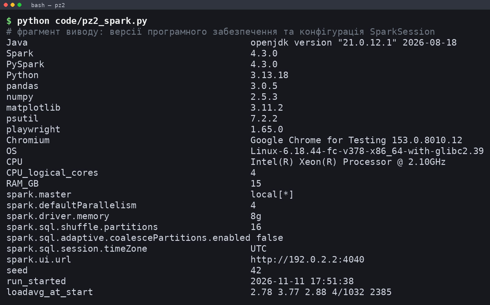

На рисунку 1 значення `spark.defaultParallelism 4` підтверджує, що Spark використовує всі ядра машини. PySpark попереджає про неповну підтримку pandas 3.0, однак усі перетворення `toPandas()` завершилися коректно, а результати Spark збіглися з результатами pandas (розділ 6).

## 2 Завантаження даних

Вихідний файл `btcusd_1-min_data.csv` прочитано Spark-ом напряму, без попередньої конвертації. Завантаження виконано двома способами: з автоматичним виведенням типів (`inferSchema=True`) і з явною схемою.

```python
SCHEMA = StructType([StructField("Timestamp", LongType()), StructField("Open", DoubleType()),
                     StructField("High", DoubleType()), StructField("Low", DoubleType()),
                     StructField("Close", DoubleType()), StructField("Volume", DoubleType())])
raw_inf = spark.read.csv(RAW, header=True, inferSchema=True)
raw = spark.read.csv(RAW, header=True, schema=SCHEMA)
```

Результат `printSchema()` і перші п'ять рядків наведено на рисунку 2.

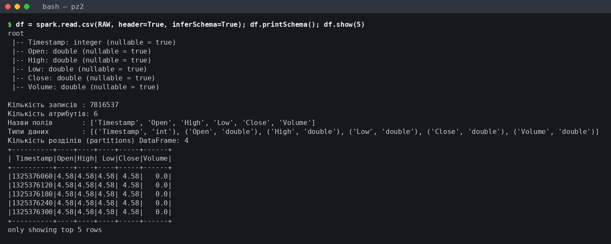

Рисунок 2 показує, що DataFrame містить 7 816 537 записів і 6 атрибутів з назвами `Timestamp`, `Open`, `High`, `Low`, `Close`, `Volume`, поділених на 4 розділи. Перші рядки датовані 1 січня 2012 року і мають однакові ціни 4,58 та нульовий обсяг, тобто вже на вході видно заповнені (flat) хвилини, яким присвячено підрозділ 3.3. Типи даних і результати підрахунку пропусків зведено в таблицю 2.

Таблиця 2 – Поля DataFrame, типи даних і кількість пропущених значень

| Поле | Тип (inferSchema) | Тип (явна схема) | null | NaN |
|---|---|---|---|---|
| Timestamp | int | bigint | 0 | 0 |
| Open | double | double | 0 | 0 |
| High | double | double | 0 | 0 |
| Low | double | double | 0 | 0 |
| Close | double | double | 0 | 0 |
| Volume | double | double | 0 | 0 |

Пропусків немає ні у вигляді `null`, ні у вигляді `NaN`, що узгоджується з перевіркою датасету в ПЗ1. Відмінність між двома схемами лише в полі `Timestamp`: виведення типів обрало 32-бітний `int`, бо всі мітки поки що менші за 2^31, а в явній схемі використано `bigint`. Явний 64-бітний тип усуває залежність від поточного діапазону значень і збігається з типом `int64` у pandas, що спрощує звірку результатів.

Другою причиною використання явної схеми є час. Завантаження з `inferSchema=True` разом з `count()` тривало 10,236 с, а з явною схемою – 1,045 с, тобто приблизно вдесятеро менше. Виведення типів вимагає додаткового повного проходу по файлу ще до виконання запиту, тоді як з явною схемою Spark одразу планує читання. В обох випадках файл поділено на 4 розділи, тож різниця в часі зумовлена саме зайвим проходом, а не іншим розбиттям.

## 3 Попередня обробка

### 3.1 Пропуски, дублікати та приведення типів

Обробку пропусків і дублікатів виконано штатними трансформаціями: `dropna()` видаляє рядки з будь-яким `null`, `dropDuplicates(["Timestamp"])` залишає один запис на кожну хвилину. Ключем дублікатів обрано саме час, бо дві свічки з однаковою міткою суперечили б одна одній, навіть якщо ціни відрізняються. Обидва кроки залишили 7 816 537 рядків, видалено 0 дублікатів; їх збережено в конвеєрі як захист для наступних вивантажень файлу. Приведення типів виконано явною схемою під час читання (таблиця 2) і перетворенням секунд Unix у тип `timestamp` функцією `timestamp_seconds`, з якого в UTC виділено дату, рік, місяць і годину.

### 3.2 Похідні атрибути

Для аналітики сформовано такі похідні атрибути: календарні ознаки `datetime`, `date`, `year`, `month`, `hour`; ознаку нульового обсягу `is_flat`; абсолютний і відносний діапазон свічки `range = High − Low` і `rel_range = (High − Low) / Open`; логарифмічну дохідність закриття відносно попередньої хвилини `log_ret`; ковзне стандартне відхилення `log_ret` за 60 хвилин `vol60`.

```python
w = Window.orderBy("Timestamp")
d = d.withColumn("log_ret", F.log("Close") - F.log(F.lag("Close").over(w)))
d = d.withColumn("vol60", F.stddev("log_ret").over(w.rowsBetween(-59, 0)))
```

Логарифмічну дохідність обрано замість простої, бо вона адитивна за часом: сума хвилинних `log_ret` за добу дорівнює добовій дохідності, а корінь із суми їх квадратів дає реалізовану волатильність доби `rv`, яка використовується в розділі 4. Розмір вікна `vol60` визначено даними. У ПЗ1 встановлено, що сітка хвилин повна (0 пропущених хвилин, 0 розривів), тому рамка `rowsBetween(-59, 0)` охоплює рівно 60 календарних хвилин. Година узгоджується з рівнем погодинного агрегату (130 276 інтервалів) і дає 60 спостережень – достатньо для стабільної оцінки стандартного відхилення без згладжування внутрішньодобових сплесків. Для добових рядів аналогічно використано вікна 7 і 30 діб (`vol_7d`, `vol_30d`), що відповідають тижню і місяцю. Описову статистику основних похідних атрибутів, обчислену методом `describe()`, наведено в таблиці 3.

Таблиця 3 – Описова статистика обсягу та похідних атрибутів (1 хв)

| Показник | Volume | range | rel_range | log_ret | vol60 |
|---|---|---|---|---|---|
| count | 7 816 537 | 7 816 537 | 7 816 537 | 7 816 536 | 7 816 535 |
| mean | 4,8927 | 16,8947 | 0,000863 | 0,0000012 | 0,001093 |
| stddev | 21,3927 | 35,4322 | 0,001853 | 0,001733 | 0,001354 |
| min | 0,0 | 0,0 | 0,0 | −0,617058 | 0,0 |
| max | 5 853,8522 | 4 747,76 | 0,464286 | 0,616914 | 0,116873 |

Кількість значень `log_ret` на одне менша за кількість рядків, а `vol60` – на два, що відповідає першому рядку без попередньої ціни і другому рядку, де стандартне відхилення ще не визначене. Середня хвилинна дохідність близька до нуля (1,24·10⁻⁶), а стандартне відхилення 0,001733 відповідає типовій зміні ціни приблизно на 0,17 % за хвилину. Аномальними є екстремуми `log_ret`: −0,617 і +0,617 майже однакові за модулем, що характерно для одиничного викиду ціни з поверненням на наступній хвилині, а не для реального руху ринку. Ці значення не видалено, бо вони не порушують правил OHLC (у ПЗ1 знайдено 0 некоректних свічок), однак їх вплив на моменти розподілу оцінено окремо в підрозділі 4.2.

### 3.3 Хвилини з нульовим обсягом

Найважливішою особливістю датасету є хвилини з `Volume = 0`. Таких хвилин 1 312 419, або 16,79 % від 7 816 537. У них `Open = High = Low = Close` і дорівнює закриттю попередньої хвилини, тобто це заповнення сітки, а не угоди. Динаміку частки таких хвилин за добу показано на рисунку 3.

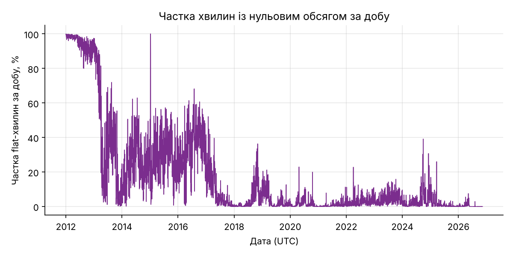

Рисунок 3 показує, що проблема зосереджена на початку ряду: у 2012 році частка flat-хвилин становить 94,95 %, у 2013 році – 39,16 %, у 2016 році – 33,19 %, а з 2018 року вона не перевищує 3,95 % за рік. Окремо виділяється сплеск до 100 % на початку 2015 року: доби 6, 7 і 8 січня 2015 року не містять жодної угоди (нульовий обсяг усіх 1440 хвилин), імовірно через зупинку торгів на біржі-джерелі.

Видаляти ці хвилини не можна з двох причин. По-перше, тоді `lag("Close")` пов'язував би сусідні угоди, розділені хвилинами чи годинами, і `log_ret` втратив би сенс хвилинної дохідності. По-друге, рамка `rowsBetween(-59, 0)` перестала б відповідати 60 хвилинам. Тому хвилини залишено в DataFrame, але позначено ознакою `is_flat`, а в чутливих до них обчисленнях застосовано фільтри: моменти розподілу додатково рахуються лише для хвилин з торгами (`is_flat = 0`), рейтинги волатильних діб – для діб з часткою flat-хвилин менше 0,5, середній обсяг – окремо на хвилину з торгами. Поріг 0,5 обрано так, щоб відсікти 2012 рік (94,95 %) і зберегти більшість діб 2013–2016 років, де річна частка коливається між 24,24 % і 39,16 %. За цього порогу з 5429 діб залишається 4876.

### 3.4 Ліниві обчислення та план виконання

Функція `build()` описує весь конвеєр попередньої обробки: читання, `dropna`, `dropDuplicates`, десять викликів `withColumn` і два віконні вирази. Виклик `build()` тривав 0,245 с, а перша дія `count()` над результатом – 7,829 с. Отже, під час побудови Spark лише формує план, а читання 7,8 млн рядків, обмін і обчислення вікон відбуваються тільки після дії. Фізичний план запиту, що вибирає `date`, `log_ret`, `vol60` за 2021 рік, показано на рисунку 4.

```python
df = build()                      # 0,245 с: лише план
n_proc = df.count()               # 7,829 с: виконання всього плану
df.select("date", "log_ret", "vol60").where("year = 2021").explain("formatted")
```

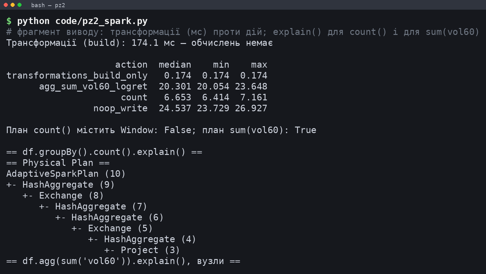

План на рисунку 4 читається знизу вгору і показує роботу Catalyst. Вузол `Scan csv` читає файл зі схемою `bigint/double`, а `Project (3)` одразу відкидає `Open`, `High`, `Low`, `Volume`, бо для `log_ret` і `vol60` вони не потрібні. `dropDuplicates` реалізовано як дворівневу агрегацію `HashAggregate` з функцією `first` і обміном `hashpartitioning(Timestamp, 16)`, тобто з 16 розділами, заданими в конфігурації. Фільтр `year = 2021` (вузол 13) розташований вище за вікна, і Catalyst не опускає його до джерела: вікно з `lag` для першої хвилини 2021 року потребує останньої хвилини 2020 року, тож ранній фільтр змінив би результат.

На рисунку 4 видно й головний недолік цього конвеєра: вузол `Exchange SinglePartition` перед сортуванням. Вікно `Window.orderBy("Timestamp")` без `partitionBy` вимагає глобального порядку, тому Spark збирає всі 7,8 млн рядків в один розділ і обчислює `lag` і `stddev` однією задачею на одному ядрі. Таке рішення гарантує правильну дохідність на межах діб і років, але обмежує паралелізм, і його наслідки проявилися в експерименті з кешуванням.

### 3.5 Кешування

DataFrame з похідними атрибутами використовується десятками дій, тому перевірено доцільність його кешування. Той самий запит `heavy_query` (топ-10 діб за `rv` і обсяг за годиною доби, дві дії) виконано тричі без кешу, після чого DataFrame збережено з рівнем `MEMORY_AND_DISK` і запит повторено ще тричі.

```python
df.persist(StorageLevel.MEMORY_AND_DISK)
df.count()                        # матеріалізація кешу
heavy_query(df)                   # ті самі дві дії, тепер над кешем
```

Результати наведено в таблиці 4.

Таблиця 4 – Час виконання запиту без кешу і з кешем, с

| Режим | Запуск 1 | Запуск 2 | Запуск 3 | Медіана |
|---|---|---|---|---|
| Без cache() | 19,774 | 17,565 | 18,349 | 18,349 |
| З cache() | 3,184 | 2,376 | 2,329 | 2,376 |
| Матеріалізація кешу (count) | 82,293 | – | – | – |

Медіанний час запиту з кешем у 7,7 разу менший, ніж без нього, бо замість читання CSV, обміну і перерахунку вікон Spark читає готові рядки з пам'яті. Однак матеріалізація кешу тривала 82,293 с, що в кілька разів довше за сам запит без кешу. Вигода від кешу настає лише після приблизно п'яти повторних запитів, а в цій роботі над кешованим DataFrame виконано понад двадцять агрегацій і SQL-запитів, тому кешування виправдане. Стан кешу після матеріалізації показано на рисунку 5.

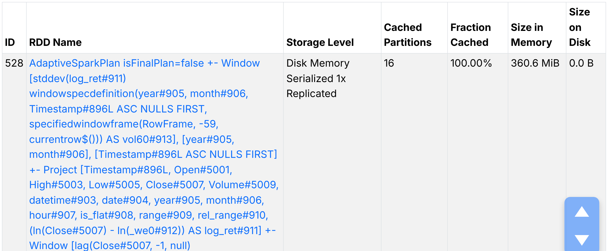

Рисунок 5 пояснює високу вартість матеріалізації. Закешований DataFrame складається з одного розділу (Cached Partitions = 1), повністю розміщеного в пам'яті без вивантаження на диск. Це прямий наслідок `Exchange SinglePartition` з рисунка 4: весь набір проходить через одну задачу, яка послідовно сортує, обчислює вікна і серіалізує 16 стовпців. З тієї ж причини всі подальші запити до кешу виконуються однією задачею (на вкладці Stages етапи `collect` мають по одній задачі), тобто кеш прибирає повторне читання CSV, але не повертає паралелізм. Для датасету такого розміру поточна схема дала прийнятний загальний час 330,477 с на весь конвеєр, тому її залишено, а спосіб усунення обмеження наведено у висновках.

## 4 Розподілена аналітика

### 4.1 Добове агрегування

Хвилинні свічки згруповано за датою з дотриманням правил OHLC: `Open` – перше значення доби, `High` – максимум, `Low` – мінімум, `Close` – останнє значення, `Volume` – сума. Перше й останнє значення отримано функціями `min_by` і `max_by` за міткою часу, бо після обміну порядок рядків у групі не гарантований і функції `first`/`last` могли б повернути довільний рядок.

```python
d1 = df.groupBy("date").agg(
    F.min_by("Open", "Timestamp").alias("open"), F.max("High").alias("high"),
    F.min("Low").alias("low"), F.max_by("Close", "Timestamp").alias("close"),
    F.sum("Volume").alias("volume"), F.count("*").alias("n_minutes"),
    F.sum("is_flat").alias("n_flat"),
    F.sqrt(F.sum(F.col("log_ret") ** 2)).alias("rv"))
```

Отримано 5429 діб, з яких 5427 повні (1440 хвилин), а неповними є лише перша і остання доба ряду, що збігається з ПЗ1. До добового агрегату додано добову дохідність `ret_1d`, відносний розмах `hl_rel = (High − Low) / Open`, частку flat-хвилин, ковзні середні та волатильність за 7 і 30 діб. Аналогічно побудовано погодинний агрегат на 130 276 рядків. Обидві таблиці збережено у форматі Parquet для наступних практичних занять.

### 4.2 Статистичні характеристики дохідностей

Для оцінки форми розподілу дохідностей функціями `F.skewness` і `F.kurtosis` обчислено асиметрію та надлишковий ексцес на трьох масштабах часу. Результати наведено в таблиці 5.

Таблиця 5 – Асиметрія та надлишковий ексцес логарифмічних дохідностей

| Ряд | n | Ст. відхилення | Асиметрія | Ексцес | Мінімум | Максимум |
|---|---|---|---|---|---|---|
| 1 хв, усі свічки | 7 816 536 | 0,001733 | 3,92 | 7161,59 | −0,6171 | 0,6169 |
| 1 хв, лише з торгами | 6 504 118 | 0,001900 | 3,58 | 5958,64 | −0,6171 | 0,6169 |
| 1 год, усі | 130 275 | 0,009522 | −1,23 | 118,11 | −0,3473 | 0,2988 |
| 1 год, flat_share < 0,5 | 113 720 | 0,009235 | −1,26 | 124,73 | −0,3473 | 0,2988 |
| 1 доба, усі | 5 428 | 0,040632 | −1,31 | 25,46 | −0,6639 | 0,3375 |
| 1 доба, flat_share < 0,5 | 4 876 | 0,040541 | −1,36 | 26,70 | −0,6639 | 0,3375 |

Найнесподіванішим результатом є ексцес 7161,59 для хвилинних дохідностей, тоді як для нормального розподілу надлишковий ексцес дорівнює нулю. Спершу перевірено гіпотезу, що його спричиняють flat-хвилини, які додають до ряду 1,3 млн нульових значень і загострюють пік. Виключення цих хвилин зменшило ексцес лише до 5958,64, отже основна причина в іншому. Четвертий момент визначається найбільшими відхиленнями, а пара хвилин з дохідністю ±0,617 (понад 350 стандартних відхилень) разом з іншими одиничними викидами дає більшу частину суми четвертих степенів. Отже, такий ексцес свідчить про поодинокі помилкові тики, і для моделювання хвилинного ризику ці викиди слід обмежувати, наприклад за квантилями.

З переходом до годин і діб ексцес зменшується до 118,11 і 25,46: агрегація наближає розподіл до нормального, хоча й далеко не досягає його. Знак асиметрії змінюється з додатного (3,92) на від'ємний (−1,23 і −1,31), бо на великих масштабах домінують різкі падіння, зокрема 11.04.2013 (добова дохідність −0,664) і 12.03.2020 (−0,494). Фільтр `flat_share < 0,5` майже не змінює годинних і добових показників, бо flat-хвилини зосереджені в 2012 році, який має малу вагу серед 5428 діб. Форму розподілу на трьох масштабах показано на рисунку 6.

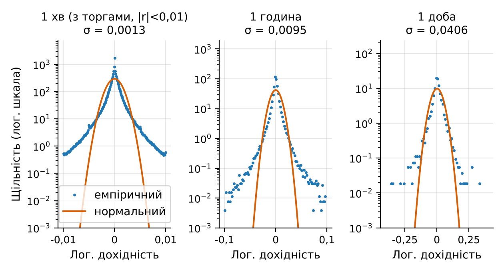

На рисунку 6 вісь щільності логарифмічна, тому нормальний розподіл має вигляд параболи, а емпіричний – майже лінійно спадних хвостів, характерних для розподілів з важкими хвостами. На хвилинному масштабі щільність при |r| = 0,01 перевищує нормальну на кілька порядків. Окремо видно сходинку при |r| ≈ 0,005: імовірно, це наслідок дискретності ціни в перші роки, коли за ціни в кілька доларів мінімальний крок 0,01 USD відповідав дохідності порядку десятих відсотка. На добовому масштабі відхилення менші, але доби з падіннями понад 30 % лежать далеко за межами нормальної кривої.

Часову динаміку волатильності показано на рисунку 7.

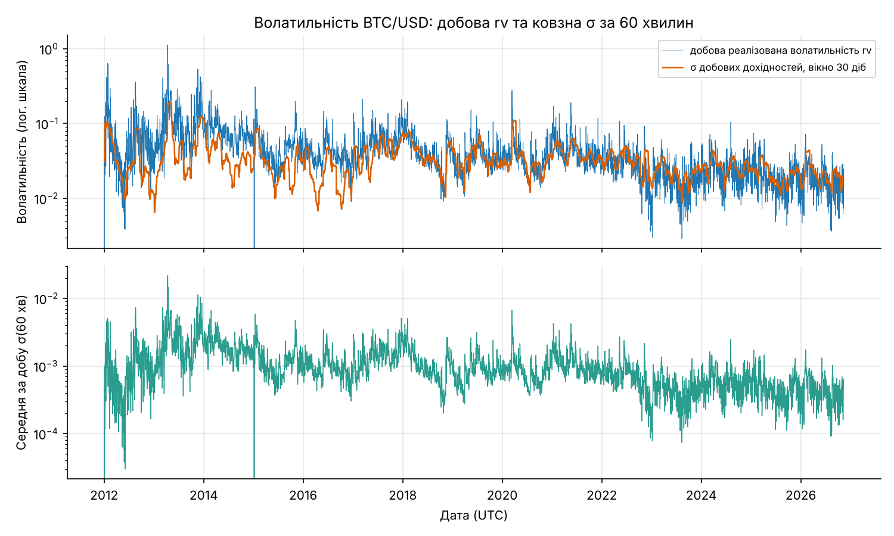

Рисунок 7 показує поступове зниження волатильності: у 2013 році добова `rv` неодноразово перевищує 0,3, а після 2023 року переважно лежить у діапазоні від 0,01 до 0,05. Сплески збігаються з відомими подіями: 12.03.2020 добова `rv` становить 0,211 при 30-денній волатильності 0,094, 19.05.2021 – 0,191 при 0,053. Провали до нуля на початку 2012 року і в січні 2015 року не є затишшям ринку: це доби, де майже всі хвилини flat і `log_ret = 0`, тож показник волатильності тут штучно занижений і не повинен інтерпретуватися як низький ризик.

### 4.3 Найволатильніші доби: сортування і фільтрація

Повні доби відсортовано за спаданням `rv` і за спаданням `hl_rel`, після чого обидва рейтинги повторено з фільтром `flat_share < 0,5`.

```python
comp = d1.filter("is_complete = 1")
top_rv = comp.orderBy(F.desc("rv")).limit(10)
top_rv_active = comp.filter("flat_share < 0.5").orderBy(F.desc("rv")).limit(10)
```

Перші десять діб за `rv` без фільтра наведено в таблиці 6.

Таблиця 6 – Десять повних діб з найбільшою реалізованою волатильністю rv

| Дата | rv | hl_rel | ret_1d | flat_share |
|---|---|---|---|---|
| 2013-04-11 | 1,1260 | 0,7963 | −0,6639 | 0,131 |
| 2013-04-12 | 0,8895 | 0,8034 | 0,2759 | 0,109 |
| 2013-04-10 | 0,8632 | 0,8270 | −0,3461 | 0,162 |
| 2012-01-27 | 0,6358 | 0,4055 | 0,0668 | 0,981 |
| 2013-04-16 | 0,6212 | 0,4351 | −0,0832 | 0,106 |
| 2012-01-31 | 0,6160 | 0,4337 | −0,0515 | 0,972 |
| 2013-11-19 | 0,5358 | 0,5635 | −0,2216 | 0,065 |
| 2013-04-13 | 0,4905 | 0,3094 | −0,1817 | 0,178 |
| 2013-04-17 | 0,4828 | 0,6039 | 0,2788 | 0,063 |
| 2013-12-07 | 0,4233 | 0,3725 | −0,1616 | 0,001 |

Таблиця 6 містить другий неочікуваний результат: доби 27.01.2012 і 31.01.2012 посідають четверте і шосте місця, хоча 98,1 % і 97,2 % їх хвилин не містять угод. За такої ліквідності кожна поодинока угода переносить увесь накопичений рух ціни, а ціна стрибає між віддаленими рівнями (мінімум 3,8 USD 27.01.2012 є мінімумом усього датасету). Висока `rv` у ці доби відображає неліквідність ринку, а не силу ринкового руху. Після фільтра `flat_share < 0,5` обидві доби випадають з рейтингу, а їх місця займають 18.12.2013 і 20.11.2013 з частками flat-хвилин 0,005 і 0,085. Сім із десяти діб припадають на квітень 2013 року, коли ціна за кілька днів упала з 259,34 до 45 USD. Обидва рейтинги (за `rv` без фільтра і за розмахом з фільтром) порівняно на рисунку 8.

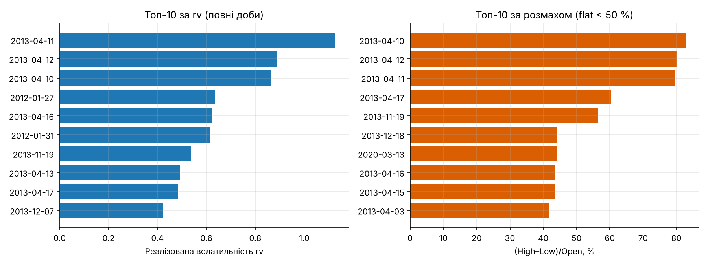

З рисунка 8 видно, що два способи вимірювання волатильності дають близькі, але не тотожні рейтинги. Розмах `hl_rel` залежить лише від двох крайніх цін доби, а `rv` враховує всю траєкторію. Єдиною добою після 2013 року в рейтингу за розмахом є 13.03.2020 з розмахом 44,21 %, наступна за обвалом 12.03.2020. Це показує, що за відносними змінами ціни ранній ринок був значно бурхливішим за пізніші кризи.

### 4.4 Розподіл обсягу за годиною доби та роками

Групування за годиною доби з агрегатами суми обсягу, середнього обсягу на хвилину і середнього відносного діапазону дало розподіл, показаний на рисунку 9.

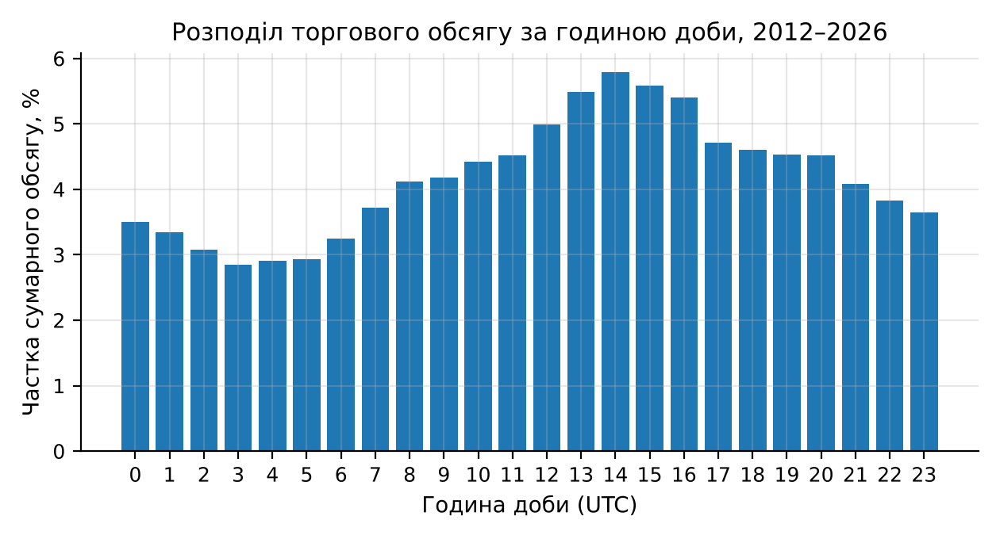

Рисунок 9 демонструє чітку внутрішньодобову сезонність: найменша частка обсягу припадає на 03:00 UTC (2,85 %), найбільша – на 14:00 UTC (5,79 %), а інтервал 12:00–16:00 UTC збігається з початком торгової сесії у США за ще відкритих європейських ринків. Середній відносний діапазон свічки змінюється синхронно (від 0,00067 о 05:00 до 0,00109 о 14:00 UTC). Річні обсяги разом з часткою flat-хвилин наведено на рисунку 10.

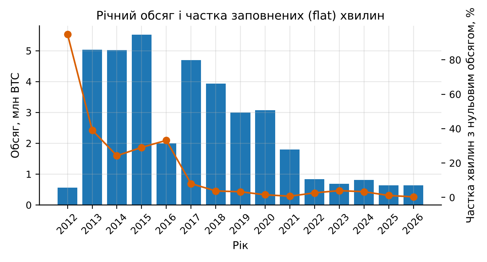

Рисунок 10 показує, що обсяг у BTC зменшився з 5,53 млн у 2015 році до 0,64 млн у 2025 році. Це не свідчить про падіння інтересу до ринку: обсяг вимірюється в біткоїнах, а середня ціна за цей час зросла з 272,25 до 101 639,98 USD, тож обсяг у доларах зріс. Крім того, датасет відображає одну біржу, частка якої на ринку змінювалася. Частка flat-хвилин спадає синхронно зі зростанням ліквідності, і 2012 рік (567 949 BTC при 94,95 % flat-хвилин) слід розглядати окремо від решти ряду.

## 5 Spark SQL

### 5.1 Тимчасові представлення та запити

Для SQL-запитів створено два тимчасові представлення: `btc` над кешованим хвилинним DataFrame і `btc_daily` над добовим агрегатом.

```python
df.createOrReplaceTempView("btc")
d1.createOrReplaceTempView("btc_daily")
r = spark.sql("""SELECT year, COUNT(*) AS minutes, ROUND(AVG(Close),2) AS avg_close,
                 MAX(High) AS max_high, MIN(Low) AS min_low, ROUND(SUM(Volume),0) AS volume,
                 ROUND(100*AVG(is_flat),2) AS flat_pct
                 FROM btc GROUP BY year ORDER BY year""").toPandas()
```

Виконано шість запитів: Q1 – річна статистика; Q2 – десять повних діб з найбільшим розмахом при `flat_share < 0,5`; Q3 – середній хвилинний обсяг за днем тижня і годиною з 2018 року; Q4 – місячна сезонність волатильності й обсягу з 2018 року; Q5 – доба з максимальним обсягом у кожному році (віконна функція `ROW_NUMBER() OVER (PARTITION BY year ORDER BY volume DESC)`); Q6 – дохідність, `rv` і відношення обсягу до середнього за попередні 30 діб для днів відомих обвалів. Кожен запит виконувався від 1,678 до 2,816 с, оскільки працював з кешем.

### 5.2 Результати запитів

Результат запиту Q1 наведено в таблиці 7.

Таблиця 7 – Річна статистика хвилинних свічок (запит Q1)

| Рік | Хвилин | Середня ціна, USD | Максимум High | Мінімум Low | Обсяг, BTC | Flat, % |
|---|---|---|---|---|---|---|
| 2012 | 527 039 | 8,23 | 16,41 | 3,8 | 567 949 | 94,95 |
| 2013 | 525 600 | 187,43 | 1 163,0 | 12,77 | 5 031 143 | 39,16 |
| 2014 | 525 600 | 525,57 | 995,0 | 275,0 | 5 024 184 | 24,24 |
| 2015 | 525 600 | 272,25 | 502,0 | 152,4 | 5 525 344 | 29,08 |
| 2016 | 527 040 | 565,83 | 980,74 | 352,0 | 1 992 258 | 33,19 |
| 2017 | 525 600 | 3 948,33 | 19 666,0 | 751,34 | 4 698 753 | 8,04 |
| 2018 | 525 600 | 7 524,76 | 17 234,99 | 3 122,28 | 3 932 327 | 3,77 |
| 2019 | 525 600 | 7 352,19 | 13 880,0 | 3 322,19 | 2 994 600 | 3,28 |
| 2020 | 527 040 | 11 074,63 | 29 300,0 | 3 850,0 | 3 074 321 | 1,55 |
| 2021 | 525 600 | 47 386,18 | 69 000,0 | 27 734,0 | 1 802 998 | 0,7 |
| 2022 | 525 600 | 28 228,66 | 48 234,0 | 15 479,0 | 833 815 | 2,66 |
| 2023 | 525 600 | 28 811,76 | 44 729,0 | 16 496,0 | 681 687 | 3,95 |
| 2024 | 527 040 | 65 895,12 | 108 364,0 | 38 505,0 | 807 910 | 3,33 |
| 2025 | 525 600 | 101 639,98 | 126 272,0 | 74 434,0 | 639 946 | 1,13 |
| 2026 | 452 378 | 74 103,97 | 97 939,0 | 57 734,63 | 636 371 | 0,34 |

Кількість хвилин у таблиці 7 точно відповідає календарю (525 600 у звичайному році і 527 040 у високосному), що підтверджує повноту сітки; неповні лише 2012 рік (ряд починається з 00:01) і 2026 рік (дані до 11 листопада). Максимум ціни 126 272 USD припадає на 2025 рік, мінімум 3,8 USD – на 2012 рік, а діапазон цін 2013 року від 12,77 до 1163 USD показує, наскільки іншим був ранній ринок.

Запит Q2 повторив мовою SQL рейтинг за розмахом з підрозділу 4.3 і дав ті самі десять діб, що підтверджує еквівалентність DataFrame API і SQL. Запит Q4 виявив помірну місячну сезонність: з 2018 року найбільша середня добова `rv` спостерігається в січні (0,03977) і березні (0,03912), найменша – у жовтні (0,02342). Запит Q5 показав, що доба з найбільшим обсягом за весь період – 18.12.2013 (137 070 BTC), а у 2020 році це 12.03.2020 (58 513 BTC), день обвалу. Результат запиту Q3 у вигляді теплової карти наведено на рисунку 11.

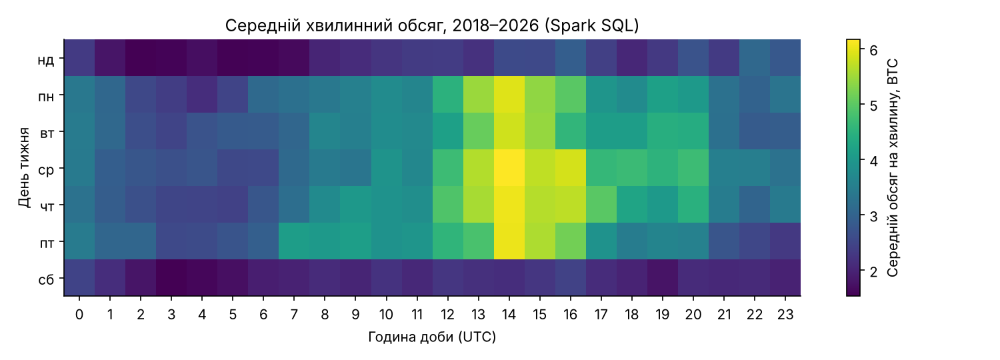

Рисунок 11 уточнює сезонність з рисунка 9: максимум обсягу формується в робочі дні о 14:00 UTC (найбільше значення 6,1661 BTC на хвилину в середу), а субота й неділя мають рівномірно низький обсяг (мінімум 1,532 BTC на хвилину в неділю о 02:00 UTC). Отже, з 2018 року активність значною мірою задають учасники, що працюють за графіком традиційних ринків. Запит Q6 перевіряє, як обвали відображаються в обсязі; його результат наведено в таблиці 8.

Таблиця 8 – Доби різких змін ціни: дохідність, волатильність і аномальність обсягу (запит Q6)

| Дата | Лог. дохідність, % | rv | Обсяг, BTC | Обсяг / середній за 30 діб |
|---|---|---|---|---|
| 2020-03-12 | −49,4 | 0,2111 | 58 513 | 9,27 |
| 2020-03-13 | 14,96 | 0,2784 | 54 420 | 6,81 |
| 2021-05-19 | −15,34 | 0,1914 | 32 469 | 6,12 |
| 2022-06-13 | −16,9 | 0,0938 | 12 622 | 6,56 |
| 2022-11-08 | −10,43 | 0,0933 | 12 036 | 8,45 |
| 2022-11-09 | −15,56 | 0,0815 | 8 351 | 4,63 |

Таблиця 8 підтверджує наявність у даних обвалу 12–13.03.2020, падіння 19.05.2021 і колапсу FTX 08–09.11.2022. У всі ці доби обсяг перевищував середній за попередні 30 діб у 4,63–9,27 разу, тобто сплеск обсягу є надійнішою ознакою кризового дня, ніж розмір падіння: 08.11.2022 падіння становило лише 10,43 %, а обсяг зріс у 8,45 разу. У назві файлу результату запит позначено як порівняння з медіаною, однак у SQL використано середнє `AVG(volume)` за 30 попередніми добами, тому в таблиці 8 вказано саме середнє. Вікно рахується в підзапиті над усіма добами до фільтра за датами, інакше «попередні» рядки бралися б лише з шести відібраних діб.

### 5.3 План виконання SQL-запиту

Щоб перевірити, що SQL-запити виконуються тим самим механізмом, що й DataFrame API, знято вкладку SQL / DataFrame у Spark UI. Знімок зроблено в допоміжній сесії (`spark_ui_sql_shots.py`), що повторює три запити над `btc` без кешу; її результати в таблицях не використано. Граф запиту з групуванням за місяцем показано на рисунку 12.

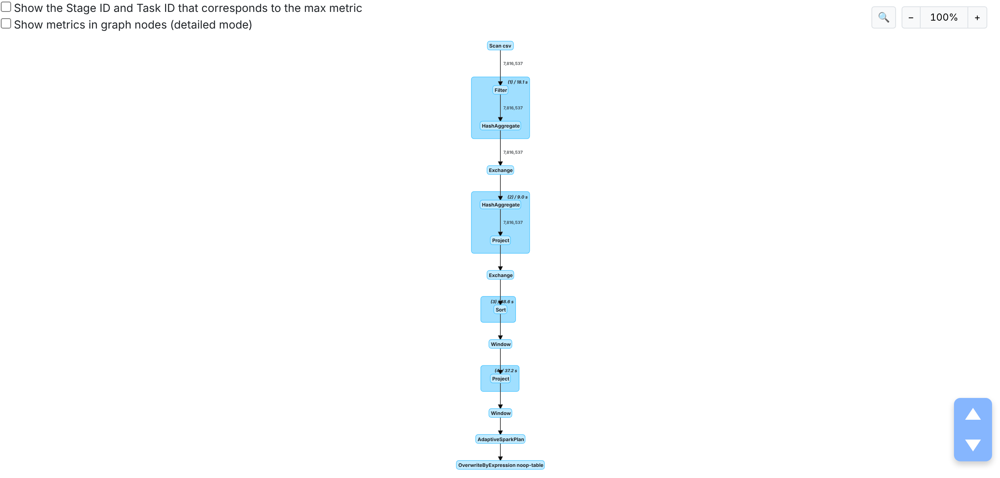

Граф на рисунку 12 складається з трьох етапів. Перший етап конвеєром виконує `Scan csv`, `Filter` (умова `year >= 2018`), `Project` і часткову агрегацію `HashAggregate` в кожному з 4 розділів, тому через обмін (`Exchange`) передаються лише проміжні суми по 12 місяцях, а не мільйони рядків. Вузол `AQEShuffleRead` показує, що механізм адаптивного виконання об'єднав 16 розділів обміну в менший набір, бо після часткової агрегації дані займають кілька кілобайтів. Останній етап сортує результат. Майже весь час запиту припадає на перший етап, тобто на розбір CSV, а не на агрегацію, що пояснює виграш від кешу в підрозділі 3.5.

## 6 Порівняння Hadoop MapReduce та Spark

### 6.1 Умови вимірювання

Для порівняння обрано дві задачі, які однаково формулюються для всіх рушіїв: підрахунок кількості хвилин і суми обсягу за роками (одне групування з малою кількістю ключів) і побудова добових OHLC-свічок (групування на 5429 ключів з вибором першого й останнього значення). Кожна задача читає той самий файл `btcusd_1-min_data.csv` з диска і виконується тричі, у таблицю винесено медіану. Як базову лінію додано pandas, що виконує ту саму роботу в одному процесі Python. Окремо виміряно Spark над кешованим DataFrame, де читання CSV не входить у час.

```python
def spark_daily_ohlc():
    d = spark.read.csv(RAW, header=True, schema=SCHEMA) \
             .withColumn("date", F.to_date(F.timestamp_seconds("Timestamp")))
    return d.groupBy("date").agg(F.min_by("Open", "Timestamp"), F.max("High"), F.min("Low"),
                                 F.max_by("Close", "Timestamp"), F.sum("Volume")).toPandas()
```

Пам'ять виміряно окремими процесами за піковим резидентним обсягом (RSS) з опитуванням кожні 50 мс: для pandas – процес Python, для Spark – процес JVM драйвера і окремо клієнтський процес Python. Результати Spark і pandas перевірено на рівність (кількість хвилин і обсяг за роками, ціни закриття і обсяг за добами), розбіжностей немає. Hadoop MapReduce виконується в ПЗ1 через Hadoop Streaming на тих самих задачах, його результати буде внесено після завершення запуску.

### 6.2 Результати вимірювань

Час виконання і пікову пам'ять наведено в таблиці 9.

Таблиця 9 – Час виконання (медіана з трьох запусків, мінімум–максимум) і пікова пам'ять

| Задача | Рушій | Медіана, с | Мін.–макс., с | Пікова пам'ять, МБ |
|---|---|---|---|---|
| Рік: кількість і обсяг | pandas | 4,733 | 4,553–4,760 | 744,4 |
| Рік: кількість і обсяг | Spark local[*] | 3,897 | 3,159–4,638 | 1279,2 (JVM) + 127,4 (Python) |
| Рік: кількість і обсяг | Spark, кеш | 1,460 | 1,410–1,791 | – |
| Рік: кількість і обсяг | Hadoop Streaming | [ЗАПОВНИТИ ПІСЛЯ ЗАПУСКУ] | [ЗАПОВНИТИ ПІСЛЯ ЗАПУСКУ] | [ЗАПОВНИТИ ПІСЛЯ ЗАПУСКУ] |
| Добовий OHLC | pandas | 5,734 | 5,458–6,243 | 881,6 |
| Добовий OHLC | Spark local[*] | 7,493 | 5,593–12,414 | 1478,1 (JVM) + 131,8 (Python) |
| Добовий OHLC | Spark, кеш | 2,190 | 2,121–2,266 | – |
| Добовий OHLC | Hadoop Streaming | [ЗАПОВНИТИ ПІСЛЯ ЗАПУСКУ] | [ЗАПОВНИТИ ПІСЛЯ ЗАПУСКУ] | [ЗАПОВНИТИ ПІСЛЯ ЗАПУСКУ] |

Результат таблиці 9 відрізняється від поширеного уявлення про багаторазову перевагу Spark. На задачі за роками Spark швидший за pandas лише на 0,836 с (3,897 проти 4,733 с), а на добовому OHLC повільніший (7,493 проти 5,734 с). Файл 396,8 МБ повністю вміщується в пам'ять, тому pandas не має того недоліку, для подолання якого створено Spark, а виграш від чотирьох ядер частково витрачається на планування етапів, обмін між розділами і передачу результату з JVM у Python. Розкид часу Spark значно більший (5,593–12,414 с для OHLC): перший запуск включає розігрів JVM і компіляцію згенерованого коду, тоді як pandas стабільний у межах 0,8 с. Добовий OHLC для Spark дорожчий, ніж підрахунок за роками, бо 5429 ключів і функції `min_by`/`max_by` збільшують обсяг проміжних даних в обміні.

Перевага Spark проявляється при повторному використанні даних: над кешем ті самі задачі виконуються за 1,460 і 2,190 с, тобто швидше за pandas з читанням файлу. Це порівняння не є рівноправним, бо pandas теж міг би тримати дані в пам'яті, але воно показує, що після кешування вартість запиту в Spark визначається обчисленням, а не читанням файлу. Порівняння часу наочно показано на рисунку 13.

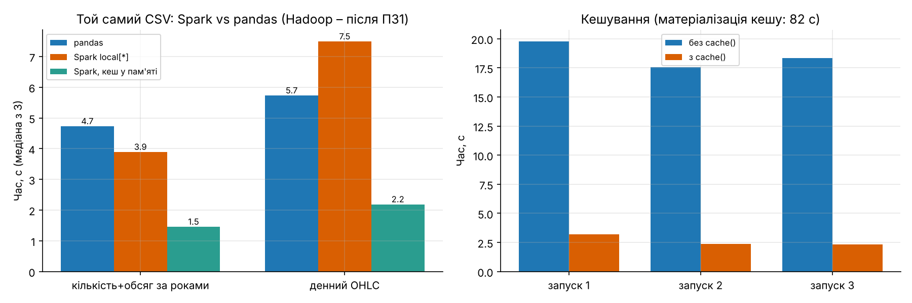

На лівій панелі рисунка 13 видно, що кеш скорочує час обох задач Spark у 2,7–3,4 разу порівняно з читанням CSV, а права панель повторює результати таблиці 4. За пам'яттю Spark на одній машині програє: JVM драйвера займає 1279,2–1478,1 МБ проти 744,4–881,6 МБ у pandas. Значна частина пам'яті Spark – це фіксовані витрати JVM і буфери обміну, які слабко залежать від обсягу даних, тоді як pandas завантажує весь файл у пам'ять, і його потреба зростає пропорційно розміру даних. Для файлу, що перевищує обсяг оперативної пам'яті, pandas не завершив би роботу, а Spark обробляв би його по розділах.

### 6.3 Порівняння за критеріями методичних вказівок

Порівняння MapReduce і Spark за п'ятьма критеріями методичних вказівок зведено в таблицю 10. Для Spark використано виміри цієї роботи, для MapReduce – властивості моделі та вимірювання ПЗ1, які буде внесено після запуску.

Таблиця 10 – Порівняння Hadoop MapReduce і Apache Spark

| Критерій | Hadoop MapReduce | Apache Spark (результати ПЗ2) |
|---|---|---|
| Модель обчислень | Жорстка послідовність map – shuffle – reduce на кожне завдання; багатокроковий аналіз – ланцюжок завдань | DAG з довільної кількості трансформацій; вузькі операції об'єднуються в один етап (рисунок 12: Scan, Filter, Project, HashAggregate в одному етапі) |
| Використання оперативної пам'яті | Потокова обробка записів, проміжні дані на диску; пікова пам'ять: [ЗАПОВНИТИ ПІСЛЯ ЗАПУСКУ] | Проміжні дані й кеш у пам'яті; JVM драйвера 1279,2–1478,1 МБ на задачах таблиці 9 |
| Продуктивність | Час задач таблиці 9: [ЗАПОВНИТИ ПІСЛЯ ЗАПУСКУ] | 3,897 і 7,493 с з читанням CSV, 1,460 і 2,190 с над кешем |
| Зручність програмування | Окремі програми mapper і reducer, ручний розбір рядків і вибір першого та останнього значення для OHLC | Один вираз `groupBy().agg()` з `min_by`/`max_by` або SQL-запит; DataFrame API і SQL дають однаковий план |
| Повторне використання даних | Кожне завдання заново читає вхідні дані з HDFS; кешу між завданнями немає | `persist()`: прискорення запиту в 7,7 разу (18,349 → 2,376 с) |

Таблиця 10 показує, що на одній машині ключові переваги Spark над MapReduce – модель DAG, яка не записує проміжні результати на диск між кроками, і можливість кешування. За продуктивністю на задачах з одним проходом даних різниця визначатиметься переважно накладними витратами запуску завдань Hadoop; кількісний висновок буде зроблено після заповнення рядків Hadoop: [ЗАПОВНИТИ ПІСЛЯ ЗАПУСКУ]. Усі вимірювання виконано на одній машині з 4 ядрами, тому вони не відображають масштабування на кластері, для якого обидві системи створені.

## 7 Візуалізація

За результатами обробки побудовано дев'ять графіків (рисунки 3, 6–11, 13, 14). Spark передає в Python лише агреговані таблиці (5429 діб, 130 276 годин, 24 години доби, 168 комірок теплової карти), тому побудова графіків не потребує завантаження 7,8 млн рядків у пам'ять Python.

```python
daily = d1.orderBy("date").toPandas()          # 5429 рядків замість 7 816 537
ax[0].semilogy(daily.date, daily.close)
ax[0].semilogy(daily.date, daily.ma_30)
```

Динаміку ціни закриття та добового обсягу показано на рисунку 14.

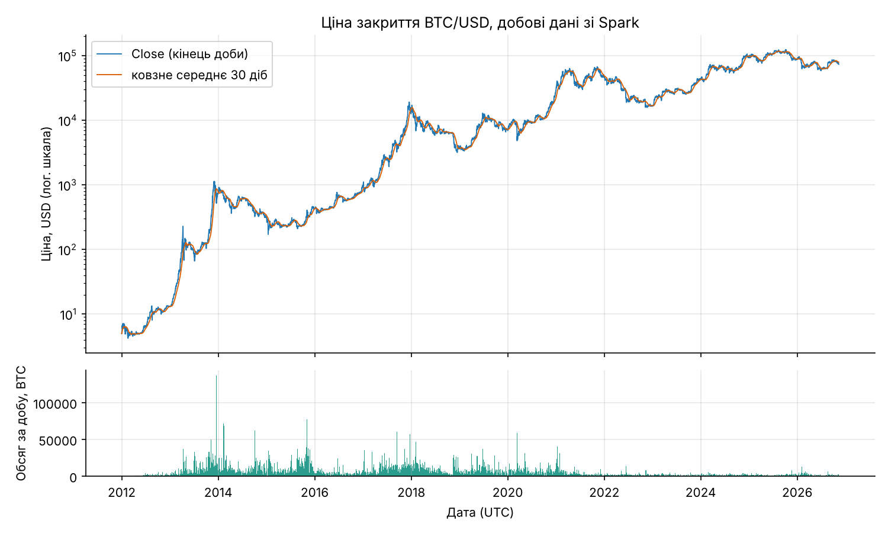

На рисунку 14 логарифмічна шкала дозволяє одночасно показати ціну від 3,8 до 126 202 USD. Видно кілька циклів зростання і падіння: пік кінця 2013 року, тривале падіння 2014–2015 років, пік кінця 2017 року, просідання у березні 2020 року, піки 2021 року і максимум у жовтні 2025 року. Найбільші добові обсяги в BTC припадають на 2013–2018 роки, що узгоджується з рисунком 10.

# Висновки

1. Розгорнуто Apache Spark 4.3.0 у режимі `local[*]` на машині з 4 ядрами і 15 ГБ пам'яті, перевірено PySpark, Java 21, Python 3.13 і Jupyter Notebook 7.6.5; параметри сесії (16 розділів обміну, 8 ГБ для драйвера, UTC) обрано під обсяг і структуру даних.

2. Датасет з ПЗ1 завантажено у Spark DataFrame: 7 816 537 записів, 6 атрибутів (`Timestamp`, `Open`, `High`, `Low`, `Close`, `Volume`), 0 пропущених значень. Явна схема вдесятеро швидша за `inferSchema` (1,045 проти 10,236 с) і задає `Timestamp` як `bigint`, тому її використано в усіх кроках.

3. Попередню обробку виконано трансформаціями `dropna`, `dropDuplicates`, `timestamp_seconds` і віконними функціями; дублікатів не знайдено, сформовано календарні ознаки, діапазон свічки, логарифмічну дохідність і 60-хвилинну волатильність. Хвилини з нульовим обсягом (16,79 %, у 2012 році 94,95 %) не видалено, щоб зберегти рівномірну сітку, а позначено ознакою `is_flat` і враховано фільтрами в аналітиці. Без такого фільтра дві доби січня 2012 року з 97–98 % flat-хвилин потрапляють до десятки найволатильніших.

4. Реалізовано всі п'ять типів операцій з методичних вказівок: фільтрацію, групування, сортування, агрегацію та обчислення статистичних характеристик. Розподіл хвилинних дохідностей має надлишковий ексцес 7161,59, зумовлений переважно поодинокими викидами ±0,617, а не flat-хвилинами; з агрегацією до діб ексцес зменшується до 25,46, а асиметрія стає від'ємною. Обсяг торгів має чітку внутрішньодобову сезонність з максимумом о 14:00 UTC у будні.

5. Створено тимчасові представлення `btc` і `btc_daily` та виконано шість SQL-запитів, серед них запити з віконними функціями `ROW_NUMBER` і ковзним середнім. Запити підтвердили наявність у даних обвалу 12.03.2020, падіння 19.05.2021 і колапсу FTX 08–09.11.2022, коли обсяг перевищував середній за 30 діб у 4,63–9,27 разу.

6. Порівняння Spark і MapReduce за критеріями методичних вказівок дало такі результати. За моделлю обчислень Spark об'єднує кроки в DAG і виконує вузькі трансформації конвеєром у межах етапу, тоді як MapReduce записує результати кожного завдання на диск. За використанням пам'яті Spark на одній машині вимогливіший: 1279,2–1478,1 МБ для JVM драйвера проти 744,4–881,6 МБ для pandas, а пікова пам'ять MapReduce становить [ЗАПОВНИТИ ПІСЛЯ ЗАПУСКУ]. За продуктивністю на одній машині Spark з читанням CSV лише трохи швидший за pandas на агрегації за роками (3,897 проти 4,733 с) і повільніший на добовому OHLC (7,493 проти 5,734 с); час MapReduce на тих самих задачах становить [ЗАПОВНИТИ ПІСЛЯ ЗАПУСКУ]. За зручністю програмування Spark дозволяє описати добовий OHLC одним виразом або SQL-запитом без окремих mapper і reducer. За повторним використанням даних кешування в Spark прискорило запит у 7,7 разу, але його матеріалізація тривала 82,293 с і окупається після приблизно п'яти повторів. Усі вимірювання зроблено на одній машині, тому вони характеризують накладні витрати рушіїв, а не їх масштабованість на кластері.

7. Побудовано дев'ять графіків за результатами обробки. Виявлено обмеження власного конвеєра: віконні функції без `partitionBy` переносять увесь набір в один розділ, через що кешований DataFrame обробляється однією задачею. Для більших даних вікна слід обчислювати в розділах за роком з перекриттям, а кеш – перерозподіляти.

У результаті виконання роботи набуто навичок використання Apache Spark для розподіленої обробки великих даних, роботи з DataFrame і Spark SQL, виконання трансформацій, агрегації та аналітичної обробки даних, а також аналізу планів виконання і Spark UI для пояснення отриманих часових характеристик.

# Додаток А. Лістинг програми

## А.1 Файл pz2_spark.py – основний конвеєр обробки (Spark DataFrame, Spark SQL, вимірювання)

```python
# -*- coding: utf-8 -*-
"""ПЗ2. Apache Spark (PySpark + Spark SQL) на хвилинних свічках BTC/USD.
Запуск: python3 pz2_spark.py   (результати -> ../results, скріншоти -> ../screenshots)
"""
import os, sys, io, time, platform, subprocess, contextlib, statistics, math
import numpy as np
import pandas as pd

SEED = 42
np.random.seed(SEED)
BASE = os.path.abspath(os.path.join(os.path.dirname(__file__), ".."))
RES, SHOTS, TXT = f"{BASE}/results", f"{BASE}/screenshots", f"{BASE}/screenshots/txt"
RAW = "/home/user/AVD/work/data/raw/btcusd_1-min_data.csv"
for d in (RES, SHOTS, TXT):
    os.makedirs(d, exist_ok=True)

from pyspark.sql import SparkSession, Window, functions as F
from pyspark.sql.types import (StructType, StructField, LongType, DoubleType)
from pyspark import StorageLevel
import pyspark

# ---------- допоміжні засоби: тайминги та захоплення виводу для скріншотів ----------
TIMINGS = []
def rec(step, secs, note=""):
    TIMINGS.append((step, round(secs, 3), note))
    print(f"[timing] {step}: {secs:.2f} с {note}")

@contextlib.contextmanager
def timed(step, note=""):
    t = time.perf_counter(); yield
    rec(step, time.perf_counter() - t, note)

class Tee(io.StringIO):
    def write(self, s):
        sys.__stdout__.write(s); return super().write(s)

@contextlib.contextmanager
def cap(name, cmd):
    """Виконує блок, дублює stdout у файл screenshots/txt/<name>.txt з заголовком '$ команда'."""
    buf = Tee()
    with contextlib.redirect_stdout(buf):
        yield
    with open(f"{TXT}/{name}.txt", "w", encoding="utf-8") as f:
        f.write(f"$ {cmd}\n" + buf.getvalue())

def save(df, name):
    df.to_csv(f"{RES}/{name}.csv", index=False, encoding="utf-8")

def explain_str(df, mode="formatted"):
    return df._sc._jvm.PythonSQLUtils.explainString(df._jdf.queryExecution(), mode)

# ---------- Завдання 1. Середовище та SparkSession ----------
t0_all = time.perf_counter()
CORES = os.cpu_count()
spark = (SparkSession.builder.appName("PZ2_BTC_Spark")
         .master("local[*]")                       # усі ядра однієї машини
         .config("spark.driver.memory", "8g")      # 15 ГБ RAM на машині; решта – ОС і Python
         .config("spark.sql.shuffle.partitions", str(CORES * 4))  # 16: ~4 розділи на ядро, 200 за замовч. надмір для 7,8 млн рядків
         .config("spark.sql.session.timeZone", "UTC")             # усі часові операції в UTC
         .config("spark.ui.port", "4040")
         .config("spark.ui.showConsoleProgress", "false")
         .getOrCreate())
sc = spark.sparkContext
sc.setLogLevel("ERROR")

def sh(c):
    return subprocess.run(c, shell=True, capture_output=True, text=True).stdout.strip()
ver_rows = [
    ("Java", sh("java -version 2>&1 | grep -v Picked | head -1")),
    ("Spark", spark.version), ("PySpark", pyspark.__version__),
    ("Python", platform.python_version()), ("pandas", pd.__version__),
    ("numpy", np.__version__), ("OS", platform.platform()),
    ("CPU", sh("lscpu | grep 'Model name' | sed 's/.*: *//'")),
    ("CPU_logical_cores", str(CORES)),
    ("RAM_GB", sh("free -g | awk '/Mem:/{print $2}'")),
    ("spark.master", sc.master), ("spark.defaultParallelism", str(sc.defaultParallelism)),
    ("spark.driver.memory", spark.conf.get("spark.driver.memory")),
    ("spark.sql.shuffle.partitions", spark.conf.get("spark.sql.shuffle.partitions")),
    ("spark.sql.session.timeZone", spark.conf.get("spark.sql.session.timeZone")),
    ("spark.ui.url", sc.uiWebUrl), ("seed", str(SEED)),
]
pd.DataFrame(ver_rows, columns=["parameter", "value"]).to_csv(f"{RES}/env_versions.csv", index=False)
with cap("01_env", "python3 -c \"import pyspark; ...\"  # версії та конфігурація SparkSession"):
    for k, v in ver_rows:
        print(f"{k:32s} {v}")

# ---------- Завдання 2. Завантаження даних ----------
SCHEMA = StructType([StructField("Timestamp", LongType()), StructField("Open", DoubleType()),
                     StructField("High", DoubleType()), StructField("Low", DoubleType()),
                     StructField("Close", DoubleType()), StructField("Volume", DoubleType())])

# 2а. Виведення схеми Spark-ом (inferSchema потребує додаткового проходу по файлу – вимірюємо)
with timed("load_csv_inferSchema_plus_count", "inferSchema=True, count()"):
    raw_inf = spark.read.csv(RAW, header=True, inferSchema=True)
    n_rows = raw_inf.count()
# 2б. Явна схема: без додаткового проходу
with timed("load_csv_explicit_schema_plus_count", "явна схема, count()"):
    raw = spark.read.csv(RAW, header=True, schema=SCHEMA)
    n_rows2 = raw.count()
assert n_rows == n_rows2

with cap("02_schema", "df = spark.read.csv(RAW, header=True, inferSchema=True); df.printSchema(); df.show(5)"):
    raw_inf.printSchema()
    print("Кількість записів :", n_rows)
    print("Кількість атрибутів:", len(raw_inf.columns))
    print("Назви полів       :", raw_inf.columns)
    print("Типи даних        :", raw_inf.dtypes)
    print("Кількість розділів (partitions) DataFrame:", raw_inf.rdd.getNumPartitions())
    raw_inf.show(5)

with timed("missing_values_per_column"):
    nulls = raw.select([F.sum(F.col(c).isNull().cast("int")).alias(c) for c in raw.columns]).first().asDict()
    nans = raw.select([F.sum(F.isnan(F.col(c)).cast("int")).alias(c) for c in raw.columns if c != "Timestamp"]).first().asDict()
schema_tbl = pd.DataFrame({"field": raw.columns,
                           "spark_type_inferred": [t for _, t in raw_inf.dtypes],
                           "spark_type_explicit": [t for _, t in raw.dtypes],
                           "null_count": [nulls[c] for c in raw.columns],
                           "nan_count": [nans.get(c, 0) for c in raw.columns]})
save(schema_tbl, "pz2_schema_nulls")
pd.DataFrame([("rows", n_rows), ("columns", len(raw.columns)),
              ("raw_partitions_inferSchema", raw_inf.rdd.getNumPartitions()),
              ("raw_partitions_explicit", raw.rdd.getNumPartitions())],
             columns=["metric", "value"]).to_csv(f"{RES}/pz2_load_summary.csv", index=False)
with cap("03_nulls", "df.select([sum(col(c).isNull()) ...]).show()  # пропущені значення"):
    print(schema_tbl.to_string(index=False))

# ---------- Завдання 3. Попередня обробка ----------
def build():
    """Повертає (ледачий) DataFrame хвилинних свічок з похідними атрибутами."""
    d = spark.read.csv(RAW, header=True, schema=SCHEMA)
    d = d.dropna()                                              # пропущених немає, але крок виконується
    d = d.dropDuplicates(["Timestamp"])                         # дублікати за ключем часу
    d = d.withColumn("datetime", F.timestamp_seconds("Timestamp"))   # unix с -> timestamp (UTC за конфігурацією сесії)
    d = (d.withColumn("date", F.to_date("datetime"))
          .withColumn("year", F.year("datetime")).withColumn("month", F.month("datetime"))
          .withColumn("hour", F.hour("datetime"))
          .withColumn("is_flat", (F.col("Volume") == 0).cast("int"))      # нульовий обсяг = заповнена (flat) свічка
          .withColumn("range", F.col("High") - F.col("Low"))               # діапазон свічки
          .withColumn("rel_range", (F.col("High") - F.col("Low")) / F.col("Open")))
    w = Window.orderBy("Timestamp")
    d = d.withColumn("log_ret", F.log("Close") - F.log(F.lag("Close").over(w)))   # логарифмічна дохідність
    # ковзна волатильність: ст. відхилення log_ret за 60 хвилин (сітка без пропусків, тому 60 рядків = 60 хв)
    d = d.withColumn("vol60", F.stddev("log_ret").over(w.rowsBetween(-59, 0)))
    return d

# 3.1 Демонстрація дублікатів/пропусків
with timed("dedup_check"):
    n_dedup = raw.dropna().dropDuplicates(["Timestamp"]).count()
pd.DataFrame([("rows_raw", n_rows), ("rows_after_dropna", raw.dropna().count()),
              ("rows_after_dropDuplicates_Timestamp", n_dedup),
              ("duplicates_removed", n_rows - n_dedup)], columns=["metric", "value"]).to_csv(f"{RES}/pz2_cleaning.csv", index=False)

# ---------- Ледача обчислюваність: трансформації та дії ----------
t = time.perf_counter()
df = build()
t_transform = time.perf_counter() - t
rec("lazy_build_transformations", t_transform, "лише побудова плану, без обчислень")
t = time.perf_counter()
n_proc = df.count()                      # дія: запускає виконання всього плану
t_action = time.perf_counter() - t
rec("first_action_count_uncached", t_action, "count() запускає читання+вікна")
pd.DataFrame([("transformations_build_s", t_transform), ("first_action_count_s", t_action),
              ("rows", n_proc)], columns=["metric", "value"]).to_csv(f"{RES}/pz2_lazy_vs_action.csv", index=False)
with cap("04_lazy", "df = build(); # трансформації (мс)  ->  df.count() # дія; df.explain('formatted')"):
    print(f"Трансформації (read, dropna, dropDuplicates, withColumn x10, Window lag/stddev): {t_transform*1000:.1f} мс – обчислень немає")
    print(f"Дія count() = {n_proc} рядків за {t_action:.2f} с – лише тепер Spark виконує план")
    print()
    print(explain_str(df.select('date', 'log_ret', 'vol60').where('year = 2021'), "formatted")[:3800])
with open(f"{RES}/logs/explain_full.txt", "w") as f:
    f.write(explain_str(df, "extended"))

# ---------- Кешування: той самий запит без cache() та з cache() ----------
def heavy_query(d):
    """Два аналітичні запити (дві дії): топ-10 днів за реалізованою волатильністю та обсяг за годиною доби."""
    a = (d.groupBy("date").agg(F.sqrt(F.sum(F.col("log_ret") ** 2)).alias("rv"))
          .orderBy(F.desc("rv")).limit(10).collect())
    b = d.groupBy("hour").agg(F.sum("Volume").alias("v")).orderBy("hour").collect()
    return a, b

cache_rows = []
df.unpersist()
for i in range(1, 4):
    t = time.perf_counter(); heavy_query(df); dt = time.perf_counter() - t
    cache_rows.append(("without_cache", f"run{i}", round(dt, 3))); rec(f"cache_exp_without_cache_run{i}", dt)
df.persist(StorageLevel.MEMORY_AND_DISK)
t = time.perf_counter(); df.count(); dt = time.perf_counter() - t       # матеріалізація кешу
cache_rows.append(("with_cache", "materialize_count", round(dt, 3))); rec("cache_exp_materialize", dt)
for i in range(1, 4):
    t = time.perf_counter(); heavy_query(df); dt = time.perf_counter() - t
    cache_rows.append(("with_cache", f"run{i}", round(dt, 3))); rec(f"cache_exp_with_cache_run{i}", dt)
cache_df = pd.DataFrame(cache_rows, columns=["mode", "run", "seconds"])
save(cache_df, "pz2_cache_experiment")
with cap("05_cache", "df.unpersist(); heavy_query(df) x3; df.cache(); df.count(); heavy_query(df) x3"):
    print(cache_df.to_string(index=False))
    m_no = cache_df[(cache_df['mode']=='without_cache')]['seconds'].median()
    m_c = cache_df[(cache_df['mode']=='with_cache') & (cache_df['run']!='materialize_count')]['seconds'].median()
    print(f"\nмедіана без кешу: {m_no:.2f} с; з кешем: {m_c:.2f} с; прискорення x{m_no/m_c:.1f}")
    print("Storage level:", df.storageLevel)
pd.DataFrame([("median_without_cache_s", m_no), ("median_with_cache_s", m_c), ("speedup", m_no / m_c)],
             columns=["metric", "value"]).to_csv(f"{RES}/pz2_cache_summary.csv", index=False)

# ---------- Опис змінних та контроль якості похідних атрибутів ----------
with timed("describe_derived"):
    desc = df.select("Open", "High", "Low", "Close", "Volume", "range", "rel_range", "log_ret", "vol60").describe().toPandas()
save(desc, "pz2_describe")
flat = df.agg(F.sum("is_flat").alias("flat"), F.count("*").alias("n")).first()
flat_by_year = (df.groupBy("year").agg(F.count("*").alias("n_minutes"), F.sum("is_flat").alias("n_flat"),
                                       F.sum("Volume").alias("volume"), F.avg("Close").alias("avg_close"))
                  .withColumn("flat_share_pct", F.round(100 * F.col("n_flat") / F.col("n_minutes"), 2))
                  .orderBy("year").toPandas())
save(flat_by_year, "pz2_yearly_volume_flat")
pd.DataFrame([("flat_minutes", flat["flat"]), ("rows", flat["n"]), ("flat_share_pct", round(100 * flat["flat"] / flat["n"], 2))],
             columns=["metric", "value"]).to_csv(f"{RES}/pz2_flat_summary.csv", index=False)
with cap("06_derived", "df.select('Timestamp','datetime','Close','log_ret','range','rel_range','vol60').show(8); df.describe()"):
    df.select("Timestamp", "datetime", "Open", "High", "Low", "Close", "Volume", "log_ret", "range", "rel_range", "vol60", "year", "month", "hour").filter("year = 2021 and month = 5").show(8, truncate=False)
    print(desc.to_string(index=False))
    print(f"\nНульовий обсяг: {flat['flat']} з {flat['n']} = {100*flat['flat']/flat['n']:.2f} %")

# ---------- Завдання 4. Розподілена аналітика ----------
# 4.1 Денний агрегат (групування + агрегація) з похідними ознаками
with timed("daily_aggregation"):
    d1 = (df.groupBy("date").agg(
        F.min_by("Open", "Timestamp").alias("open"), F.max("High").alias("high"), F.min("Low").alias("low"),
        F.max_by("Close", "Timestamp").alias("close"), F.sum("Volume").alias("volume"),
        F.count("*").alias("n_minutes"), F.sum("is_flat").alias("n_flat"),
        F.sqrt(F.sum(F.col("log_ret") ** 2)).alias("rv"),            # реалізована волатильність за добу
        F.stddev("log_ret").alias("std_ret_1m"), F.avg("vol60").alias("vol60_mean"),
        F.max("rel_range").alias("max_rel_range_1m")))
    wd = Window.orderBy("date")
    d1 = (d1.withColumn("ret_1d", F.log("close") - F.log(F.lag("close").over(wd)))
            .withColumn("hl_rel", (F.col("high") - F.col("low")) / F.col("open"))
            .withColumn("flat_share", F.col("n_flat") / F.col("n_minutes"))
            .withColumn("is_complete", (F.col("n_minutes") == 1440).cast("int"))
            .withColumn("log_volume", F.log1p("volume"))
            .withColumn("vol_7d", F.stddev("ret_1d").over(wd.rowsBetween(-6, 0)))
            .withColumn("vol_30d", F.stddev("ret_1d").over(wd.rowsBetween(-29, 0)))
            .withColumn("ma_7", F.avg("close").over(wd.rowsBetween(-6, 0)))
            .withColumn("ma_30", F.avg("close").over(wd.rowsBetween(-29, 0)))
            .withColumn("dow", F.dayofweek("date")).withColumn("year", F.year("date")).withColumn("month", F.month("date")))
    daily = d1.orderBy("date").toPandas()
daily["date"] = pd.to_datetime(daily["date"])
daily.to_parquet(f"{RES}/pz2_daily_features.parquet", index=False)
save(daily, "pz2_daily_features")

# 4.2 Найволатильніші дні (сортування + фільтрація)
comp = d1.filter("is_complete = 1")
with timed("top10_volatile_days"):
    top_rv = comp.orderBy(F.desc("rv")).limit(10).toPandas()
    top_hl = comp.orderBy(F.desc("hl_rel")).limit(10).toPandas()
    # варіант без «розріджених» днів: щонайменше 50 % хвилин з торгами (щоб виключити 2012–2013 з частковими заповненнями)
    top_rv_active = comp.filter("flat_share < 0.5").orderBy(F.desc("rv")).limit(10).toPandas()
    top_hl_active = comp.filter("flat_share < 0.5").orderBy(F.desc("hl_rel")).limit(10).toPandas()
cols = ["date", "open", "high", "low", "close", "volume", "rv", "hl_rel", "ret_1d", "flat_share"]
save(top_rv[cols], "pz2_top10_rv"); save(top_hl[cols], "pz2_top10_hl_rel")
save(top_rv_active[cols], "pz2_top10_rv_active"); save(top_hl_active[cols], "pz2_top10_hl_rel_active")
with cap("07_top_days", "comp.orderBy(desc('rv')).limit(10); comp.orderBy(desc('hl_rel')).limit(10)"):
    pd.set_option("display.width", 200)
    print("Топ-10 за реалізованою волатильністю rv = sqrt(sum(log_ret^2)), повні доби:")
    print(top_rv[cols].round(4).to_string(index=False))
    print("\nТоп-10 за (High-Low)/Open:")
    print(top_hl[cols].round(4).to_string(index=False))
    print("\nТоп-10 за rv, flat_share < 0,5:")
    print(top_rv_active[cols].round(4).to_string(index=False))

# 4.3 Обсяг за годиною доби (UTC) та за роками
with timed("volume_by_hour"):
    vh = (df.groupBy("hour").agg(F.sum("Volume").alias("volume_total"),
                                 F.avg("Volume").alias("volume_mean_per_minute"),
                                 F.avg(F.when(F.col("is_flat") == 0, F.col("Volume"))).alias("volume_mean_active_minute"),
                                 F.avg("rel_range").alias("rel_range_mean"),
                                 F.stddev("log_ret").alias("std_ret_1m"))
            .withColumn("share_pct", 100 * F.col("volume_total") / F.sum("volume_total").over(Window.partitionBy())).orderBy("hour").toPandas())
save(vh, "pz2_volume_by_hour")
save(flat_by_year, "pz2_volume_by_year")
with cap("08_volume", "df.groupBy('hour').agg(sum('Volume')...); df.groupBy('year').agg(...)"):
    print(vh.round(5).to_string(index=False)); print(); print(flat_by_year.round(2).to_string(index=False))

# 4.4 Погодинна таблиця ознак
with timed("hourly_features"):
    hh = (df.groupBy(F.date_trunc("hour", "datetime").alias("datetime_utc")).agg(
        F.min_by("Open", "Timestamp").alias("open"), F.max("High").alias("high"), F.min("Low").alias("low"),
        F.max_by("Close", "Timestamp").alias("close"), F.sum("Volume").alias("volume"),
        F.count("*").alias("n_minutes"), F.sum("is_flat").alias("n_flat"),
        F.sqrt(F.sum(F.col("log_ret") ** 2)).alias("rv"), F.stddev("log_ret").alias("std_ret_1m")))
    wh = Window.orderBy("datetime_utc")
    hh = (hh.withColumn("ret_1h", F.log("close") - F.log(F.lag("close").over(wh)))
            .withColumn("range", F.col("high") - F.col("low")).withColumn("rel_range", (F.col("high") - F.col("low")) / F.col("open"))
            .withColumn("flat_share", F.col("n_flat") / F.col("n_minutes"))
            .withColumn("log_volume", F.log1p("volume"))
            .withColumn("vol_24h", F.stddev("ret_1h").over(wh.rowsBetween(-23, 0)))
            .withColumn("hour", F.hour("datetime_utc")).withColumn("dow", F.dayofweek("datetime_utc"))
            .withColumn("year", F.year("datetime_utc")))
    hourly = hh.orderBy("datetime_utc").toPandas()
hourly.to_parquet(f"{RES}/pz2_hourly_features.parquet", index=False)

# 4.5 Асиметрія та ексцес дохідностей на різних масштабах
def moments(name, d, col, filt=None):
    x = d.filter(filt) if filt else d
    r = x.filter(F.col(col).isNotNull()).agg(F.count(col).alias("n"), F.avg(col).alias("mean"), F.stddev(col).alias("std"),
                                              F.skewness(col).alias("skew"), F.kurtosis(col).alias("excess_kurtosis"),
                                              F.min(col).alias("min"), F.max(col).alias("max")).first().asDict()
    r["series"] = name; return r
with timed("skew_kurtosis"):
    rows = [moments("1 хв, усі свічки", df, "log_ret"),
            moments("1 хв, лише з торгами (Volume>0)", df, "log_ret", "is_flat = 0"),
            moments("1 год, усі", d1.sparkSession.createDataFrame(hourly[["ret_1h"]].dropna()), "ret_1h"),
            moments("1 год, flat_share<0,5", d1.sparkSession.createDataFrame(hourly[hourly.flat_share < 0.5][["ret_1h"]].dropna()), "ret_1h"),
            moments("1 доба, усі", d1.sparkSession.createDataFrame(daily[["ret_1d"]].dropna()), "ret_1d"),
            moments("1 доба, flat_share<0,5", d1.sparkSession.createDataFrame(daily[daily.flat_share < 0.5][["ret_1d"]].dropna()), "ret_1d")]
mom = pd.DataFrame(rows)[["series", "n", "mean", "std", "skew", "excess_kurtosis", "min", "max"]]
save(mom, "pz2_skew_kurtosis")
with cap("09_moments", "F.skewness('log_ret'), F.kurtosis('log_ret')  # 1 хв / 1 год / 1 доба"):
    print(mom.to_string(index=False, float_format=lambda v: f"{v:.6g}"))

# гістограма хвилинних дохідностей (лише з торгами) для порівняння з нормальним розподілом
BW = 0.0001
with timed("minute_return_histogram"):
    hist = (df.filter("is_flat = 0 and log_ret is not null and abs(log_ret) < 0.01")
              .withColumn("bin", F.floor(F.col("log_ret") / BW)).groupBy("bin").count().orderBy("bin").toPandas())
hist["bin_center"] = (hist["bin"] + 0.5) * BW
save(hist, "pz2_hist_ret_1m_active")

# ---------- Завдання 5. Spark SQL ----------
df.createOrReplaceTempView("btc")
d1.createOrReplaceTempView("btc_daily")
SQLQ = {
 "q1_year_stats": """SELECT year, COUNT(*) AS minutes, ROUND(AVG(Close),2) AS avg_close, MAX(High) AS max_high, MIN(Low) AS min_low,
                          ROUND(SUM(Volume),0) AS volume, ROUND(100*AVG(is_flat),2) AS flat_pct
                     FROM btc GROUP BY year ORDER BY year""",
 "q2_top_days_range": """SELECT date, open, high, low, ROUND((high-low)/open,4) AS hl_rel, ROUND(volume,0) AS volume, ROUND(flat_share,3) AS flat_share
                     FROM btc_daily WHERE is_complete = 1 AND flat_share < 0.5 ORDER BY hl_rel DESC LIMIT 10""",
 "q3_dow_hour_volume": """SELECT dayofweek(datetime) AS dow, hour, ROUND(AVG(Volume),4) AS avg_volume_per_minute,
                          ROUND(SUM(Volume),0) AS volume_total
                     FROM btc WHERE year >= 2018 GROUP BY dow, hour ORDER BY dow, hour""",
 "q4_month_seasonality": """SELECT month, ROUND(AVG(rv),5) AS avg_daily_rv, ROUND(AVG(hl_rel),4) AS avg_hl_rel, ROUND(AVG(volume),1) AS avg_daily_volume, COUNT(*) AS days
                     FROM btc_daily WHERE year >= 2018 AND is_complete = 1 GROUP BY month ORDER BY month""",
 "q5_max_volume_day_per_year": """SELECT year, date, ROUND(volume,0) AS volume, close FROM (
                         SELECT year, date, volume, close, ROW_NUMBER() OVER (PARTITION BY year ORDER BY volume DESC) AS rn FROM btc_daily)
                     WHERE rn = 1 ORDER BY year""",
 "q6_crash_days_vs_30d_median": """SELECT date, ROUND(100*ret_1d,2) AS ret_pct, ROUND(rv,4) AS rv, ROUND(volume,0) AS volume,
                          ROUND(volume / AVG(volume) OVER (ORDER BY date ROWS BETWEEN 30 PRECEDING AND 1 PRECEDING),2) AS volume_x_prev30_mean
                     FROM btc_daily WHERE date IN (DATE'2020-03-12', DATE'2020-03-13', DATE'2021-05-19', DATE'2022-11-08', DATE'2022-11-09', DATE'2022-06-13') ORDER BY date""",
}
# q6: вікно рахується всередині відфільтрованого набору, тому рахуємо у підзапиті над усіма днями
SQLQ["q6_crash_days_vs_30d_median"] = """SELECT * FROM (
    SELECT date, ROUND(100*ret_1d,2) AS ret_pct, ROUND(rv,4) AS rv, ROUND(volume,0) AS volume,
           ROUND(volume / AVG(volume) OVER (ORDER BY date ROWS BETWEEN 30 PRECEDING AND 1 PRECEDING),2) AS volume_x_prev30_mean
    FROM btc_daily) WHERE date IN (DATE'2020-03-12', DATE'2020-03-13', DATE'2021-05-19', DATE'2022-06-13', DATE'2022-11-08', DATE'2022-11-09') ORDER BY date"""
for i, (k, q) in enumerate(SQLQ.items(), 1):
    with timed(f"sql_{k}"):
        r = spark.sql(q).toPandas()
    save(r, f"pz2_sql_{k}")
    with cap(f"10_sql_{k}", "spark.sql(\"" + " ".join(q.split())[:150] + " ...\").show()"):
        print(r.head(25).to_string(index=False))
with open(f"{RES}/pz2_sql_queries.sql", "w", encoding="utf-8") as f:
    for k, q in SQLQ.items():
        f.write(f"-- {k}\n{' '.join(q.split())};\n\n")
with cap("11_sql_explain", "spark.sql('SELECT year, ... FROM btc GROUP BY year').explain()"):
    print(explain_str(spark.sql(SQLQ["q1_year_stats"]), "formatted")[:3500])

# ---------- Завдання 6. Spark vs pandas vs (Hadoop) на тому самому CSV ----------
def spark_year_count_volume():
    d = spark.read.csv(RAW, header=True, schema=SCHEMA)
    return d.groupBy(F.year(F.timestamp_seconds("Timestamp")).alias("year")).agg(F.count("*").alias("n"), F.sum("Volume").alias("vol")).orderBy("year").toPandas()
def spark_daily_ohlc():
    d = spark.read.csv(RAW, header=True, schema=SCHEMA).withColumn("date", F.to_date(F.timestamp_seconds("Timestamp")))
    return (d.groupBy("date").agg(F.min_by("Open", "Timestamp").alias("open"), F.max("High").alias("high"), F.min("Low").alias("low"),
                                  F.max_by("Close", "Timestamp").alias("close"), F.sum("Volume").alias("volume")).orderBy("date").toPandas())
def pandas_year_count_volume():
    d = pd.read_csv(RAW); y = pd.to_datetime(d["Timestamp"], unit="s").dt.year
    return d.groupby(y).agg(n=("Volume", "size"), vol=("Volume", "sum"))
def pandas_daily_ohlc():
    d = pd.read_csv(RAW); dt = pd.to_datetime(d["Timestamp"], unit="s").dt.date
    return d.groupby(dt).agg(open=("Open", "first"), high=("High", "max"), low=("Low", "min"), close=("Close", "last"), volume=("Volume", "sum"))
cmp_rows = []
chk = {}
for task, fs, fp in (("year_count_volume", spark_year_count_volume, pandas_year_count_volume),
                     ("daily_ohlc", spark_daily_ohlc, pandas_daily_ohlc)):
    for engine, fn in (("spark_local[*]", fs), ("pandas", fp)):
        for run in (1, 2, 3):
            t = time.perf_counter(); out = fn(); dt = time.perf_counter() - t
            cmp_rows.append((task, engine, run, round(dt, 3), "читання CSV + агрегація"))
            chk[(task, engine)] = out
    # перевірка однаковості результатів
    a, b = chk[(task, "spark_local[*]")], chk[(task, "pandas")]
    if task == "year_count_volume":
        assert (a["n"].values == b["n"].values).all() and np.allclose(a["vol"].values, b["vol"].values)
    else:
        assert len(a) == len(b) and np.allclose(a["close"].values, b["close"].values) and np.allclose(a["volume"].values, b["volume"].values)
# Spark на кешованому DataFrame (дані вже в пам'яті, без читання CSV)
for run in (1, 2, 3):
    t = time.perf_counter()
    df.groupBy("year").agg(F.count("*"), F.sum("Volume")).orderBy("year").collect(); dt1 = time.perf_counter() - t
    cmp_rows.append(("year_count_volume", "spark_cached_df", run, round(dt1, 3), "лише агрегація над кешем"))
    t = time.perf_counter()
    df.groupBy("date").agg(F.min_by("Open", "Timestamp"), F.max("High"), F.min("Low"), F.max_by("Close", "Timestamp"), F.sum("Volume")).collect(); dt2 = time.perf_counter() - t
    cmp_rows.append(("daily_ohlc", "spark_cached_df", run, round(dt2, 3), "лише агрегація над кешем"))
cmp_rows.append(("year_count_volume", "hadoop_streaming", "", "[ЗАПОВНИТИ ПІСЛЯ ЗАПУСКУ]", "значення з ПЗ1 (Colab)"))
cmp_rows.append(("daily_ohlc", "hadoop_streaming", "", "[ЗАПОВНИТИ ПІСЛЯ ЗАПУСКУ]", "значення з ПЗ1 (Colab)"))
cmp = pd.DataFrame(cmp_rows, columns=["task", "engine", "run", "seconds", "note"])
save(cmp, "pz2_engine_comparison")
num = cmp[pd.to_numeric(cmp["seconds"], errors="coerce").notna()].copy(); num["seconds"] = num["seconds"].astype(float)
summ = num.groupby(["task", "engine"])["seconds"].agg(["median", "min", "max"]).round(3).reset_index()
save(summ, "pz2_engine_comparison_summary")
for _, r in summ.iterrows():
    rec(f"engine_{r['task']}_{r['engine']}", r["median"], "медіана з 3 запусків")
rec("engine_year_count_volume_hadoop_streaming", float("nan"), "[ЗАПОВНИТИ ПІСЛЯ ЗАПУСКУ]")
rec("engine_daily_ohlc_hadoop_streaming", float("nan"), "[ЗАПОВНИТИ ПІСЛЯ ЗАПУСКУ]")
with cap("12_engines", "spark vs pandas: рік (count+volume) та денний OHLC, 3 запуски, той самий CSV"):
    print(cmp.to_string(index=False)); print(); print(summ.to_string(index=False))

# ---------- Знімки Spark UI, поки сесія жива ----------
def ui_screens():
    os.environ.setdefault("PLAYWRIGHT_BROWSERS_PATH", "/opt/pw-browsers")
    from playwright.sync_api import sync_playwright
    pages = {"jobs": "jobs/", "stages": "stages/", "sql": "SQL/", "executors": "executors/", "storage": "storage/", "environment": "environment/"}
    with sync_playwright() as p:
        b = p.chromium.launch(executable_path="/opt/pw-browsers/chromium_headless_shell-1243/chrome-headless-shell-linux64/chrome-headless-shell")
        pg = b.new_page(viewport={"width": 1500, "height": 950})
        for k, u in pages.items():
            pg.goto(f"http://localhost:4040/{u}", wait_until="load"); pg.wait_for_timeout(1200)
            pg.screenshot(path=f"{SHOTS}/spark_ui_{k}.png")
        # деталі найважчого SQL-запиту (план виконання)
        pg.goto("http://localhost:4040/SQL/", wait_until="load")
        link = pg.locator("table a").first
        if link.count():
            link.click(); pg.wait_for_timeout(1500); pg.screenshot(path=f"{SHOTS}/spark_ui_sql_detail.png", full_page=False)
        b.close()
try:
    ui_screens()
except Exception as e:
    print("UI screenshots failed:", repr(e))
    open(f"{RES}/logs/ui_error.txt", "w").write(repr(e))

rec("TOTAL_script_runtime", time.perf_counter() - t0_all)
pd.DataFrame(TIMINGS, columns=["step", "seconds", "note"]).to_csv(f"{RES}/timings.csv", index=False)
spark.stop()
print("OK")
```

## А.2 Файл make_figures.py – побудова рисунків

```python
# -*- coding: utf-8 -*-
"""Рисунки до ПЗ2 з файлів results/ (matplotlib, dpi 150, підписи українською)."""
import os, numpy as np, pandas as pd, matplotlib
matplotlib.use("Agg")
import matplotlib.pyplot as plt
from matplotlib.ticker import FuncFormatter
np.random.seed(42)
BASE = os.path.abspath(os.path.join(os.path.dirname(__file__), ".."))
R, FG = f"{BASE}/results", f"{BASE}/figures"
plt.rcParams.update({"font.size": 10, "axes.grid": True, "grid.alpha": .3, "axes.spines.top": False, "axes.spines.right": False})
C = ["#1f77b4", "#d95f02", "#2a9d8f", "#7b2d8e"]
def out(n): plt.tight_layout(); plt.savefig(f"{FG}/{n}.png", dpi=150); plt.close()
daily = pd.read_parquet(f"{R}/pz2_daily_features.parquet"); hourly = pd.read_parquet(f"{R}/pz2_hourly_features.parquet")

# 1. Ціна закриття (лог-шкала) + обсяг
fig, ax = plt.subplots(2, 1, figsize=(10, 6), sharex=True, gridspec_kw={"height_ratios": [3, 1]})
ax[0].semilogy(daily.date, daily.close, color=C[0], lw=.9, label="Close (кінець доби)")
ax[0].semilogy(daily.date, daily.ma_30, color=C[1], lw=.9, label="ковзне середнє 30 діб")
ax[0].set_ylabel("Ціна, USD (лог. шкала)"); ax[0].legend(); ax[0].set_title("Ціна закриття BTC/USD, добові дані зі Spark")
ax[1].bar(daily.date, daily.volume, width=1, color=C[2]); ax[1].set_ylabel("Обсяг за добу, BTC"); ax[1].set_xlabel("Дата (UTC)")
out("fig01_close_log")

# 2. Розподіл дохідностей vs нормальний (лог. вісь Y)
from math import erf
h = pd.read_csv(f"{R}/pz2_hist_ret_1m_active.csv"); mk = pd.read_csv(f"{R}/pz2_skew_kurtosis.csv")
fig, ax = plt.subplots(1, 3, figsize=(13, 4))
def panel(a, x, bw, title, xlab, lim):
    x = x[np.isfinite(x)]; mu, sd = x.mean(), x.std()
    bins = np.arange(-lim, lim + bw, bw); cnt, e = np.histogram(x, bins=bins); ce = (e[1:] + e[:-1]) / 2
    dens = cnt / (len(x) * bw); ok = cnt > 0
    a.semilogy(ce[ok], dens[ok], ".", color=C[0], ms=4, label="емпіричний")
    g = np.linspace(-lim, lim, 400); a.semilogy(g, np.exp(-(g - mu) ** 2 / (2 * sd ** 2)) / (sd * np.sqrt(2 * np.pi)), color=C[1], label=f"нормальний (σ={sd:.4f})")
    a.set_title(title); a.set_xlabel(xlab); a.set_ylabel("Щільність (лог. шкала)"); a.legend(fontsize=8); a.set_ylim(bottom=1e-3)
x1 = np.repeat(h.bin_center.values, h["count"].values)
panel(ax[0], x1, 1e-4, "1 хвилина (свічки з торгами, |r|<0,01)", "Логарифмічна дохідність", 0.01)
panel(ax[1], hourly.ret_1h.dropna().values, 0.002, "1 година", "Логарифмічна дохідність", 0.1)
panel(ax[2], daily.ret_1d.dropna().values, 0.01, "1 доба", "Логарифмічна дохідність", 0.4)
out("fig02_returns_vs_normal")

# 3. Обсяг за годиною доби
vh = pd.read_csv(f"{R}/pz2_volume_by_hour.csv")
fig, ax = plt.subplots(figsize=(9, 4)); ax.bar(vh.hour, vh.share_pct, color=C[0])
ax.set_xlabel("Година доби (UTC)"); ax.set_ylabel("Частка сумарного обсягу, %"); ax.set_xticks(range(24))
ax.set_title("Розподіл торгового обсягу за годиною доби, 2012–2026"); out("fig03_volume_by_hour")

# 4. Волатильність у часі
fig, ax = plt.subplots(2, 1, figsize=(10, 6), sharex=True)
ax[0].plot(daily.date, daily.rv, color=C[0], lw=.5, label="добова реалізована волатильність rv")
ax[0].plot(daily.date, daily.vol_30d, color=C[1], lw=1.2, label="σ добових дохідностей, вікно 30 діб")
ax[0].set_yscale("log"); ax[0].set_ylabel("Волатильність (лог. шкала)"); ax[0].legend(fontsize=8)
ax[1].plot(daily.date, daily.vol60_mean, color=C[2], lw=.7); ax[1].set_yscale("log")
ax[1].set_ylabel("Середня за добу σ(60 хв)"); ax[1].set_xlabel("Дата (UTC)")
ax[0].set_title("Волатильність BTC/USD: добова rv та ковзна σ за 60 хвилин"); out("fig04_volatility")

# 5. Обсяг за роками + частка flat
y = pd.read_csv(f"{R}/pz2_yearly_volume_flat.csv")
fig, ax = plt.subplots(figsize=(9, 4.2)); ax.bar(y.year, y.volume / 1e6, color=C[0]); ax.set_xlabel("Рік"); ax.set_ylabel("Обсяг, млн BTC")
a2 = ax.twinx(); a2.plot(y.year, y.flat_share_pct, color=C[1], marker="o"); a2.set_ylabel("Частка хвилин з нульовим обсягом, %"); a2.grid(False)
ax.set_xticks(y.year); ax.tick_params(axis="x", rotation=45); ax.set_title("Річний обсяг і частка заповнених (flat) хвилин"); out("fig05_yearly_volume")

# 6. Топ-10 днів
t = pd.read_csv(f"{R}/pz2_top10_rv.csv"); t2 = pd.read_csv(f"{R}/pz2_top10_hl_rel_active.csv")
fig, ax = plt.subplots(1, 2, figsize=(12, 4.5))
ax[0].barh(t.date[::-1], t.rv[::-1], color=C[0]); ax[0].set_xlabel("Реалізована волатильність rv"); ax[0].set_title("Топ-10 за rv (повні доби)")
ax[1].barh(t2.date[::-1], t2.hl_rel[::-1] * 100, color=C[1]); ax[1].set_xlabel("(High–Low)/Open, %"); ax[1].set_title("Топ-10 за розмахом (flat < 50 %)")
out("fig06_top_days")

# 7. Погодинна й добова сезонність (теплова карта день тижня × година)
q = pd.read_csv(f"{R}/pz2_sql_q3_dow_hour_volume.csv").pivot(index="dow", columns="hour", values="avg_volume_per_minute")
fig, ax = plt.subplots(figsize=(10, 3.6)); im = ax.imshow(q.values, aspect="auto", cmap="viridis")
ax.set_yticks(range(7)); ax.set_yticklabels(["нд", "пн", "вт", "ср", "чт", "пт", "сб"]); ax.set_xticks(range(24)); ax.grid(False)
ax.set_xlabel("Година доби (UTC)"); ax.set_ylabel("День тижня"); plt.colorbar(im, label="Середній обсяг на хвилину, BTC")
ax.set_title("Середній хвилинний обсяг, 2018–2026 (Spark SQL)"); out("fig07_dow_hour_heatmap")

# 8. Час виконання: Spark vs pandas, кеш
s = pd.read_csv(f"{R}/pz2_engine_comparison_summary.csv"); c = pd.read_csv(f"{R}/pz2_cache_experiment.csv")
fig, ax = plt.subplots(1, 2, figsize=(12, 4))
tasks = ["year_count_volume", "daily_ohlc"]; names = {"year_count_volume": "кількість+обсяг за роками", "daily_ohlc": "денний OHLC"}
w = .26
for i, (e, lab) in enumerate([("pandas", "pandas"), ("spark_local[*]", "Spark local[*]"), ("spark_cached_df", "Spark, кеш у пам'яті")]):
    v = [s[(s.task == k) & (s.engine == e)]["median"].iloc[0] for k in tasks]
    b = ax[0].bar(np.arange(2) + (i - 1) * w, v, w, label=lab, color=C[i])
    for r_, vv in zip(b, v): ax[0].text(r_.get_x() + r_.get_width() / 2, vv, f"{vv:.1f}", ha="center", va="bottom", fontsize=8)
ax[0].set_xticks(range(2)); ax[0].set_xticklabels([names[k] for k in tasks]); ax[0].set_ylabel("Час, с (медіана з 3)"); ax[0].legend(fontsize=8)
ax[0].set_title("Той самий CSV: Spark vs pandas (Hadoop – після ПЗ1)")
cc = c[c["run"] != "materialize_count"].copy(); cc["lab"] = cc["mode"].map({"without_cache": "без cache()", "with_cache": "з cache()"})
for i, m in enumerate(["without_cache", "with_cache"]):
    v = cc[cc["mode"] == m].seconds.values; ax[1].bar(np.arange(3) + (i - .5) * .38, v, .38, color=C[i], label=cc[cc["mode"] == m].lab.iloc[0])
mat = c[c["run"] == "materialize_count"].seconds.iloc[0]
ax[1].set_xticks(range(3)); ax[1].set_xticklabels(["запуск 1", "запуск 2", "запуск 3"]); ax[1].set_ylabel("Час, с"); ax[1].legend(fontsize=8)
ax[1].set_title(f"Кешування (матеріалізація кешу: {mat:.0f} с)"); out("fig08_timings")

# 9. Об'ємна модель: залежність волатильності від рівня flat (чому flat слід враховувати)
fig, ax = plt.subplots(figsize=(8, 4)); ax.plot(daily.date, daily.flat_share * 100, color=C[3], lw=.8)
ax.set_ylabel("Частка flat-хвилин за добу, %"); ax.set_xlabel("Дата (UTC)"); ax.set_title("Частка хвилин із нульовим обсягом за добу"); out("fig09_flat_share")
print("ok")
```

## А.3 Файл make_screens.py – рендер виводу програми в зображення терміналу

```python
# -*- coding: utf-8 -*-
"""Рендер реального виводу програми (screenshots/txt/*.txt) у PNG: темний фон, моноширинний шрифт."""
import glob, os
from PIL import Image, ImageDraw, ImageFont
BASE = os.path.abspath(os.path.join(os.path.dirname(__file__), ".."))
FONT = "/usr/share/fonts/truetype/dejavu/DejaVuSansMono.ttf"
BOLD = "/usr/share/fonts/truetype/dejavu/DejaVuSansMono-Bold.ttf"
SZ, PAD, MAXLINES, MAXCOLS = 16, 18, 48, 150
f, fb = ImageFont.truetype(FONT, SZ), ImageFont.truetype(BOLD, SZ)
cw = f.getlength("M"); lh = SZ + 5
for p in sorted(glob.glob(f"{BASE}/screenshots/txt/*.txt")):
    lines = open(p, encoding="utf-8").read().rstrip("\n").split("\n")
    lines = [l.expandtabs(4) for l in lines]
    note = None
    if len(lines) > MAXLINES:
        note = f"... (виведено перші {MAXLINES - 1} рядків із {len(lines)}; повний вивід у results/)"
        lines = lines[:MAXLINES - 1]
    lines = [(l[:MAXCOLS - 1] + "…") if len(l) > MAXCOLS else l for l in lines]
    if note: lines.append(note)
    w = int(max(len(l) for l in lines) * cw + 2 * PAD) + 10
    h = lh * (len(lines)) + 2 * PAD + 34
    im = Image.new("RGB", (max(w, 700), h), (22, 24, 29)); d = ImageDraw.Draw(im)
    d.rectangle([0, 0, im.width, 30], fill=(48, 52, 62))
    for i, c in enumerate([(255, 95, 86), (255, 189, 46), (39, 201, 63)]):
        d.ellipse([12 + i * 22, 9, 24 + i * 22, 21], fill=c)
    d.text((100, 6), "bash – pz2", font=f, fill=(190, 195, 205))
    y = 30 + PAD
    for i, l in enumerate(lines):
        if i == 0 and l.startswith("$"):
            d.text((PAD, y), "$", font=fb, fill=(120, 220, 120)); d.text((PAD + cw * 2, y), l[2:], font=fb, fill=(240, 240, 240))
        else:
            d.text((PAD, y), l, font=f, fill=(205, 210, 220))
        y += lh
    out = f"{BASE}/screenshots/term_{os.path.basename(p)[:-4]}.png"
    im.save(out); print(out)
```

## А.4 Файл measure_memory.py – вимірювання пікової пам'яті pandas і Spark

```python
# -*- coding: utf-8 -*-
"""Пік пам'яті (RSS) для pandas і Spark на тих самих двох задачах, що й у pz2_spark.py.
Кожне вимірювання – окремий процес; psutil опитує RSS кожні 50 мс (процес + діти, для Spark – JVM драйвера)."""
import os, sys, time, subprocess, threading, psutil, csv
RAW = "/home/user/AVD/work/data/raw/btcusd_1-min_data.csv"
RES = os.path.abspath(os.path.join(os.path.dirname(__file__), "..", "results"))
WORKER = r'''
import sys, pandas as pd
RAW, eng, task = sys.argv[1:4]
if eng == "pandas":
    d = pd.read_csv(RAW)
    if task == "year_count_volume":
        y = pd.to_datetime(d["Timestamp"], unit="s").dt.year
        r = d.groupby(y).agg(n=("Volume", "size"), vol=("Volume", "sum"))
    else:
        dt = pd.to_datetime(d["Timestamp"], unit="s").dt.date
        r = d.groupby(dt).agg(open=("Open","first"), high=("High","max"), low=("Low","min"), close=("Close","last"), volume=("Volume","sum"))
else:
    from pyspark.sql import SparkSession, functions as F
    from pyspark.sql.types import *
    spark = (SparkSession.builder.master("local[*]").config("spark.driver.memory","8g")
             .config("spark.sql.shuffle.partitions","16").config("spark.sql.session.timeZone","UTC")
             .config("spark.ui.enabled","false").getOrCreate())
    SCHEMA = StructType([StructField("Timestamp", LongType())] + [StructField(c, DoubleType()) for c in ["Open","High","Low","Close","Volume"]])
    d = spark.read.csv(RAW, header=True, schema=SCHEMA)
    if task == "year_count_volume":
        r = d.groupBy(F.year(F.timestamp_seconds("Timestamp")).alias("year")).agg(F.count("*").alias("n"), F.sum("Volume").alias("vol")).orderBy("year").toPandas()
    else:
        d = d.withColumn("date", F.to_date(F.timestamp_seconds("Timestamp")))
        r = d.groupBy("date").agg(F.min_by("Open","Timestamp").alias("open"), F.max("High").alias("high"), F.min("Low").alias("low"),
              F.max_by("Close","Timestamp").alias("close"), F.sum("Volume").alias("volume")).orderBy("date").toPandas()
    spark.stop()
print("rows", len(r))
'''
def run(eng, task):
    p = subprocess.Popen([sys.executable, "-I", "-c", WORKER, RAW, eng, task], stdout=subprocess.PIPE, text=True)
    ps = psutil.Process(p.pid); peak = {"py": 0, "jvm": 0, "tot": 0}
    while p.poll() is None:
        try:
            py = ps.memory_info().rss; jvm = 0
            for c in ps.children(recursive=True):
                try:
                    if "java" in c.name(): jvm = max(jvm, c.memory_info().rss)
                except psutil.Error: pass
            peak["py"] = max(peak["py"], py); peak["jvm"] = max(peak["jvm"], jvm); peak["tot"] = max(peak["tot"], py + jvm)
        except psutil.Error: pass
        time.sleep(0.05)
    return peak
rows = []
for eng in ["pandas", "spark"]:
    for task in ["year_count_volume", "daily_ohlc"]:
        pk = run(eng, task); mb = lambda b: round(b / 2**20, 1)
        if eng == "pandas":
            rows.append((eng, task, mb(pk["py"]), "peak RSS of Python process (psutil, 50 ms polling)"))
        else:
            rows.append((eng, task, mb(pk["jvm"]), "peak RSS of driver JVM (java child process, psutil, 50 ms polling), local[*], driver 8g"))
            rows.append(("spark_python_client", task, mb(pk["py"]), "peak RSS of PySpark Python process (excluding JVM)"))
        print(rows[-1], flush=True)
with open(f"{RES}/pz2_memory.csv", "w", newline="", encoding="utf-8") as f:
    w = csv.writer(f); w.writerow(["engine", "task", "peak_mb", "method"]); w.writerows(rows)
```

## А.5 Файл smoke_test.py – перевірка працездатності PySpark

```python
from pyspark.sql import SparkSession
spark = SparkSession.builder.master("local[2]").config("spark.ui.enabled","false").getOrCreate()
spark.sparkContext.setLogLevel("ERROR")
df = spark.range(1, 1001).selectExpr("id", "id % 7 AS k")
print("Spark", spark.version, "| count =", df.count())
df.groupBy("k").count().orderBy("k").show()
spark.stop()
```

## А.6 Файл spark_ui_sql_shots.py – знімки вкладки SQL у Spark UI

```python
import sys, time, re
sys.path.insert(0, "/tmp")
from pyspark.sql import SparkSession
from playwright.sync_api import sync_playwright
src = open("/home/user/AVD/work/pz2/code/pz2_spark.py", encoding="utf-8").read()
RAW = "/home/user/AVD/work/data/raw/btcusd_1-min_data.csv"
spark = (SparkSession.builder.appName("PZ2_BTC_Spark").master("local[*]").config("spark.driver.memory","8g")
         .config("spark.sql.shuffle.partitions","16").config("spark.sql.session.timeZone","UTC").config("spark.ui.port","4040").getOrCreate())
spark.sparkContext.setLogLevel("ERROR")
from pyspark.sql import functions as F
d = spark.read.csv(RAW, header=True, inferSchema=True)
d = (d.withColumn("datetime", F.timestamp_seconds("Timestamp")).withColumn("year", F.year("datetime")).withColumn("month", F.month("datetime"))
      .withColumn("hour", F.hour("datetime")).withColumn("is_flat", (F.col("Open")==F.col("Close")).cast("int")))
d.createOrReplaceTempView("btc")
qs = re.findall(r"^-- q[123].*\n(.*);", open("/home/user/AVD/work/pz2/results/pz2_sql_queries.sql").read(), re.M)
for q in [
 "SELECT year, COUNT(*) AS minutes, ROUND(AVG(Close),2) AS avg_close, MAX(High) AS max_high, MIN(Low) AS min_low, ROUND(SUM(Volume),0) AS volume, ROUND(100*AVG(is_flat),2) AS flat_pct FROM btc GROUP BY year ORDER BY year",
 "SELECT dayofweek(datetime) AS dow, hour, ROUND(AVG(Volume),4) AS avg_volume_per_minute, ROUND(SUM(Volume),0) AS volume_total FROM btc WHERE year >= 2018 GROUP BY dow, hour ORDER BY dow, hour",
 "SELECT month, COUNT(*) AS minutes, ROUND(AVG(Volume),4) AS avg_vol FROM btc WHERE year >= 2018 GROUP BY month ORDER BY month"]:
    print(spark.sql(q).toPandas().shape, flush=True)
url = spark.sparkContext.uiWebUrl; print(url)
out = "/home/user/AVD/work/pz2/screenshots"
with sync_playwright() as p:
    b = p.chromium.launch(executable_path="/opt/pw-browsers/chromium-1243/chrome-linux64/chrome", args=["--no-sandbox"])
    pg = b.new_page(viewport={"width":1500,"height":900})
    pg.goto(url + "/SQL/", wait_until="load")
    pg.wait_for_selector("table tbody tr", timeout=30000); time.sleep(3)
    pg.screenshot(path=f"{out}/spark_ui_sql.png", full_page=True)
    links = pg.eval_on_selector_all("a[href*='SQL/execution/?id=']", "e=>e.map(a=>a.href)")
    print(links)
    pg.goto(links[0], wait_until="load")
    pg.wait_for_selector("svg", timeout=30000); time.sleep(3)
    pg.screenshot(path=f"{out}/spark_ui_sql_detail.png", full_page=True)
    b.close()
spark.stop()
```
