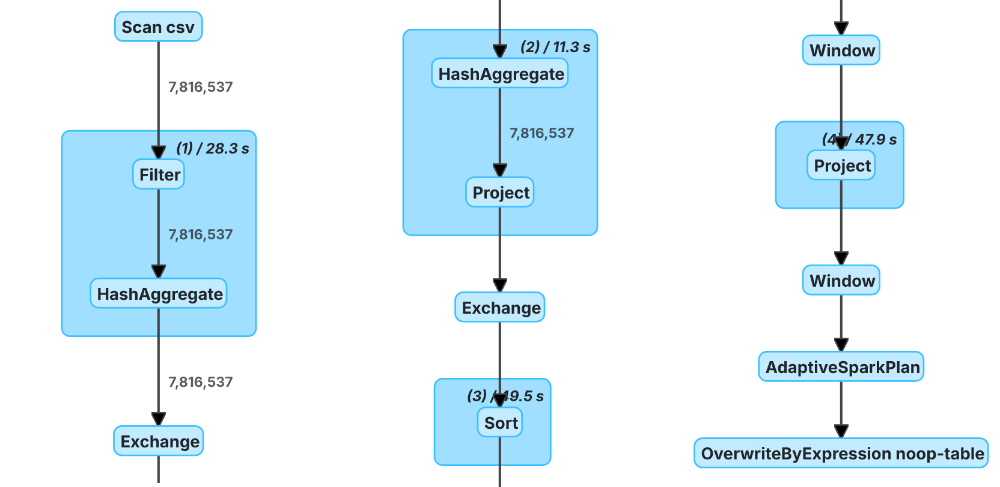
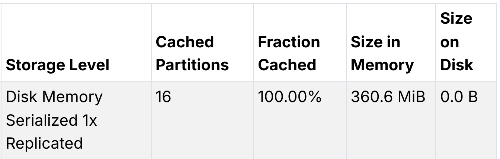
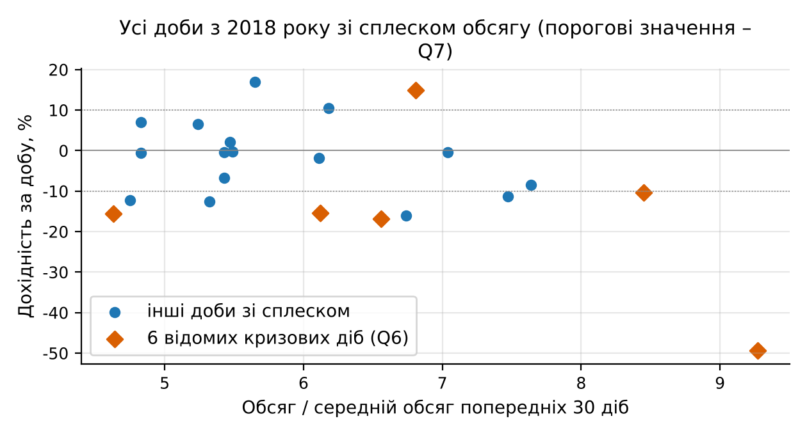
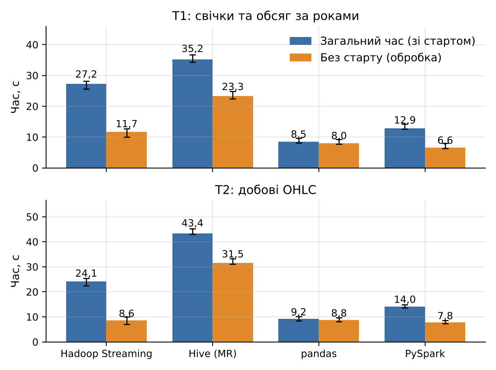

# Мета роботи

Ознайомитися з архітектурою та принципами роботи Apache Spark як платформи розподіленої обробки великих даних; отримати практичні навички завантаження, очищення, трансформації та агрегації великого набору даних за допомогою Spark DataFrame і PySpark на прикладі хвилинних свічок BTC/USD (Bitcoin Historical Data, 7 816 537 записів за 2012–2026 роки); навчитися виконувати аналітичні операції над цими даними та використовувати Spark SQL для формування аналітичних запитів, а також порівняти Spark з Hadoop MapReduce за моделлю обчислень, використанням пам'яті, продуктивністю, зручністю програмування та можливостями повторного використання даних.

# Короткі теоретичні відомості

Apache Spark – рушій розподілених обчислень, що складається з ядра Spark Core і бібліотек над ним: Spark SQL (DataFrame і SQL-запити), Structured Streaming (потокова обробка), MLlib (машинне навчання) і GraphX (графи). У роботі використано Spark Core і Spark SQL. Точка входу програми PySpark – `SparkSession`, що створює драйвер (описує обробку) і виконавців (обробляють частини даних); у режимі `local[*]` вони працюють в одній JVM, а паралелізм дають потоки за кількістю ядер.

Базова абстракція Spark Core – RDD, незмінна колекція записів, поділена на розділи (partitions); кожен розділ обробляє одна задача (task). DataFrame додає до RDD схему, за якою оптимізатор Catalyst будує фізичний план: відкидає непотрібні стовпці (ColumnPruning), виштовхує фільтри, обирає стратегію агрегації; DataFrame API і Spark SQL дають той самий план.

Трансформації (`filter`, `withColumn`, `groupBy`) ліниві (lazy evaluation): вони лише доповнюють план, а обчислення в потрібному обсязі запускає дія (`count`, `collect`, `toPandas`, запис). План перетворюється на DAG, розрізаний на етапи (stages) по межах широких залежностей: вузькі трансформації виконуються конвеєром, а групування, сортування і вікна з `partitionBy` вимагають обміну (shuffle). Метод `persist()` зберігає обчислені розділи в пам'яті для повторних дій.

Hadoop MapReduce виконує кожне завдання як пару фаз map і reduce із записом проміжних результатів на диск, а кожне наступне завдання знову читає дані з диска.

# Результати виконання практичного заняття

## 1 Підготовка середовища

Використано машину з процесором Intel Xeon 2,10 ГГц (4 логічні ядра), 15 ГБ пам'яті, Ubuntu 24.04; встановлено OpenJDK 21.0.12.1, Python 3.13.18, Apache Spark і PySpark 4.3.0, pandas 3.0.5, Jupyter Notebook 7.6.5. Перевірки `java -version`, `pip show pyspark`, `jupyter --version` і пробне групування в PySpark пройшли без помилок; версії та параметри сесії наведено на рисунку 1.


`spark.defaultParallelism = 4` підтверджує використання всіх ядер. Розділів обміну 16 (4 на ядро) замість типових 200, бо дрібні задачі дали б більше накладних витрат, ніж роботи; злиття малих розділів вимкнено, щоб кеш зберігав 16 розділів; зона UTC узгоджує межі діб з ПЗ1.

## 2 Завантаження даних

Файл прочитано з `inferSchema=True` і з явною схемою `StructType` (`Timestamp` – `LongType`, решта – `DoubleType`); структуру DataFrame показано на рисунку 2.


DataFrame містить 7 816 537 записів і 6 атрибутів (`Timestamp`, `Open`, `High`, `Low`, `Close`, `Volume`) у 4 розділах; перші рядки 1 січня 2012 року мають однакові ціни 4,58 і нульовий обсяг, тобто це заповнені (flat) хвилини. Підрахунок `isNull` і `isnan` за кожним полем дав 0 пропусків, як і в ПЗ1. Ціни й обсяг мають тип `double`, а для `Timestamp` виведення типів дало 32-бітний `int`, бо всі мітки поки менші за 2³¹; явна схема задає `bigint`, що не залежить від діапазону. Вартість виведення типів виміряно дією, що розбирає всі шість стовпців (сума кожного), у трьох парах запусків з чергуванням порядку після прогріву файлового кешу ОС: медіана 10,744 с (9,903–16,929) з `inferSchema` проти 5,014 с (4,949–5,124) з явною схемою, у 2,14 разу довше через додатковий прохід файлом. `count()` для цього не годиться: він не розбирає стовпців і з явною схемою триває 1,056 с.

## 3 Попередня обробка

### 3.1 Пропуски, дублікати, типи та похідні атрибути

`dropna()` і `dropDuplicates(["Timestamp"])` (дві свічки з однією міткою суперечили б одна одній) залишили 7 816 537 рядків, тобто 0 дублікатів. Типи приведено явною схемою і `timestamp_seconds`, з якого в UTC виділено `datetime`, `date`, `year`, `month`, `hour`. Сформовано також `is_flat` (нульовий обсяг), `range = High − Low`, `rel_range = (High − Low) / Open`, логарифмічну дохідність `log_ret` і її 60-хвилинне стандартне відхилення `vol60`:

```python
w = Window.partitionBy("year", "month").orderBy("Timestamp")
d = d.withColumn("log_ret", F.log("Close") - F.log(F.lag("Close").over(w)))
d = d.withColumn("vol60", F.stddev("log_ret").over(w.rowsBetween(-59, 0)))
```

Корінь із суми квадратів `log_ret` за добу дає реалізовану волатильність `rv`; сітка хвилин повна (ПЗ1), тож рамка `rowsBetween(-59, 0)` охоплює рівно 60 хвилин. Вікно секціоновано за (year, month), бо без `partitionBy` Spark зводить 7,8 млн рядків в один розділ і рахує вікна однією задачею. Ціна секціонування – крайовий ефект: у кожній із 179 груп «рік–місяць» перша хвилина має `log_ret = NULL` (179 рядків замість 1), а 10 740 рядків (0,14 %) мають у рамці `vol60` менше 60 точок. Для добових агрегатів це одна хвилина з 1440 на початку місяця, тому ефект прийнято.

### 3.2 Хвилини з нульовим обсягом

Хвилин з `Volume = 0` – 1 312 419 (16,79 %); у них усі чотири ціни дорівнюють попередньому закриттю, тобто це заповнення сітки, а не угоди. Їх частка становить 94,95 % у 2012 році, 39,16 % у 2013, 33,19 % у 2016 і не перевищує 3,95 % з 2018 року; доби 6–8 січня 2015 року не мають жодної угоди. Видалення цих хвилин зруйнувало б `lag("Close")` і 60-хвилинну рамку, тому їх позначено `is_flat` і відфільтровано лише в моментах (`is_flat = 0`) і рейтингах діб (`flat_share < 0,5`). Поріг відсікає 2012 рік, зберігає 2013–2016 роки (24,24–39,16 %) і залишає 4876 з 5429 діб.

### 3.3 Ліниві обчислення, план виконання і кешування

Функція `build()` описує весь конвеєр (читання, `dropna`, `dropDuplicates`, десять `withColumn`, два вікна) без обчислень. Над тим самим DataFrame виконано три дії по три рази з ротацією порядку; плани і час наведено на рисунку 3 і в таблиці 1.


У плані `df.groupBy().count()` немає вузлів `Window`: правило ColumnPruning відкидає непотрібні стовпці `log_ret` і `vol60` разом із вікнами, лишаються `Scan csv`, `Filter` (`dropna`) і `HashAggregate` дедуплікації. Тому `count()` не є повним проходом. Повний прохід вимірюється записом у формат `noop`, який обчислює всі стовпці й нічого не пише:

```python
df.count()                                                    # без Window
df.agg(F.sum("vol60"), F.sum("log_ret")).first()              # з Window
df.write.format("noop").mode("overwrite").save()              # усі стовпці
```

Таблиця 1 – Час дій над конвеєром і ефект кешування (медіана з трьох запусків)

| Операція | Window у плані | Медіана, с | Мін.–макс., с |
|---|---|---|---|
| Лише трансформації `build()` | – | 0,174 | – |
| `count()` | ні | 6,653 | 6,414–7,161 |
| `agg(sum(vol60), sum(log_ret))` | так | 20,301 | 20,054–23,648 |
| `write.format("noop")` | так | 24,537 | 23,729–26,927 |
| Запит `heavy_query` без кешу | так | 15,484 | 14,012–16,811 |
| Матеріалізація кешу (`persist` + `count`) | так | 28,950 | 21,209–29,722 |
| Запит `heavy_query` над кешем | – | 1,363 | 0,927–1,640 |

Різниця між 6,653 і 24,537 с – це вартість двох вікон: обміну за (year, month), сортування всередині груп і обчислення `lag` і `stddev`. Граф повного проходу в Spark UI наведено на рисунку 4.



Перший етап конвеєром виконує `Scan csv`, `Filter` і часткову дедуплікацію, другий після обміну за `Timestamp` її завершує, а обмін за (year, month) готує дані для `Sort` і двох вузлів `Window`.

Запит `heavy_query` (топ-10 діб за `rv` і обсяг за годиною, дві дії) виконано у трьох раундах з чергуванням порядку «без кешу – матеріалізація – з кешем». Кеш прискорив запит у 11,4 разу (15,484 проти 1,363 с), а матеріалізація (28,950 с, довша за noop-прохід на час серіалізації 16 стовпців) окупається після 2,1 повтору; над кешем виконано понад двадцять запитів, тож він виправданий. Стан кешу показано на рисунку 5.



Кеш займає 360,6 МіБ у пам'яті і всі 16 з 16 розділів, тож запити до нього виконуються 16 паралельними задачами; розділи містять від 266 400 до 754 560 рядків, бо місяці розподіляються за хешем нерівномірно.

## 4 Розподілена аналітика

### 4.1 Групування і агрегація

Хвилинні свічки згруповано за датою за правилами OHLC (first/max/min/last/sum); перше й останнє значення взято `min_by`/`max_by` за міткою часу, бо після обміну порядок рядків у групі не гарантований:

```python
d1 = df.groupBy("date").agg(
    F.min_by("Open", "Timestamp").alias("open"), F.max("High").alias("high"),
    F.min("Low").alias("low"), F.max_by("Close", "Timestamp").alias("close"),
    F.sum("Volume").alias("volume"),
    F.sqrt(F.sum(F.col("log_ret") ** 2)).alias("rv"))   # також n_minutes, n_flat
```

Отримано 5429 діб, 5427 з них повні (1440 хвилин), як і в ПЗ1; додано `ret_1d`, `hl_rel`, частку flat-хвилин і ковзні показники за 7 і 30 діб, так само побудовано погодинний агрегат (130 276 рядків). Групування за годиною доби дало мінімум частки обсягу о 03:00 UTC (2,85 %) і максимум о 14:00 UTC (5,79 %); близько змінюється середній `rel_range` (0,000672 о 05:00, 0,001087 о 14:00). Частки визначають переважно 2013–2015 роки, тому сезонність з 2018 року перевірено запитом Q3.

### 4.2 Статистичні характеристики дохідностей

Асиметрію та надлишковий ексцес (`F.skewness`, `F.kurtosis`) на трьох масштабах і їх стійкість до викидів наведено в таблиці 2.

Таблиця 2 – Асиметрія та надлишковий ексцес логарифмічних дохідностей

| Ряд | n | Ст. відхилення | Асиметрія | Ексцес |
|---|---|---|---|---|
| 1 хв, усі свічки | 7 816 358 | 0,001733 | 3,92 | 7161,62 |
| 1 хв, без 2 найбільших \|r\| | 7 816 356 | 0,001705 | 4,12 | 3260,81 |
| 1 хв, без 10 найбільших \|r\| | 7 816 348 | 0,001665 | −0,07 | 711,21 |
| 1 хв, лише з торгами | 6 503 968 | 0,001900 | 3,58 | 5958,66 |
| 1 хв, з торгами, без 10 найбільших \|r\| | 6 503 958 | 0,001825 | −0,06 | 591,29 |
| 1 год | 130 275 | 0,009522 | −1,23 | 118,11 |
| 1 доба | 5 428 | 0,040632 | −1,31 | 25,46 |

Хвилинний ексцес 7161,62 (для нормального розподілу 0) майже повністю створюють кілька хвилин. Дві найбільші за модулем, −0,617 і +0,617 (понад 350 σ), – миттєвий обвал 11.04.2013 о 10:57 UTC до 75,0 USD з поверненням до 138,99 USD при реальному обсязі 15,61 і 5,89 BTC. Без них ексцес падає до 3260,81, без десяти найбільших – до 711,21. Додатна хвилинна асиметрія 3,92 також є ефектом викидів: серед десяти найбільших |r| переважають стрибки вгору (+0,462 і +0,457 у січні 2012 року, +0,435 10.04.2013), і після їх виключення асиметрія стає −0,07. З агрегацією ексцес спадає до 118,11 (година) і 25,46 (доба), а асиметрія стає від'ємною через падіння 11.04.2013 (−0,664) і 12.03.2020 (−0,494). Динаміку волатильності показано на рисунку 6.

Добова `rv` у 2013 році перевищувала 0,3 протягом 13 діб. Після 2023 року (1411 діб) її медіана становить 0,020, міжквартильний діапазон 0,015–0,027, 5-й і 95-й процентилі – 0,009 і 0,041, мінімум 0,003, максимум 0,105 (05.08.2024); для порівняння, з 2018 року медіана 0,028 і максимум 0,278. Сплески збігаються з подіями: 12.03.2020 `rv` 0,211 при 30-денній волатильності 0,094, 19.05.2021 – 0,191 при 0,053.


Обидві панелі показують поступове зниження волатильності після 2018 року на тлі окремих сплесків.

### 4.3 Фільтрація і сортування: найволатильніші доби

Повні доби відсортовано за спаданням `rv` і `hl_rel`, також з фільтром `flat_share < 0,5`. Без фільтра доби 27.01.2012 і 31.01.2012 посідають четверте і шосте місця за `rv` (0,6358 і 0,6160), хоча 98,1 % і 97,2 % їх хвилин без угод: поодинокі угоди за 3,8 USD переносять увесь накопичений рух ціни, тож `rv` тут відображає неліквідність. Шість із десяти діб за `rv` припадають на квітень 2013 року (лідер 11.04.2013, `rv` 1,1260), коли ціна впала з 259,34 до 45 USD. Єдина доба після 2013 року в рейтингу за розмахом – 13.03.2020 (44,21 %).

## 5 Spark SQL

### 5.1 Тимчасові представлення та запити

Над представленнями `btc` (кешований хвилинний DataFrame) і `btc_daily` (добовий агрегат) виконано сім запитів: Q1 – річна статистика, Q2 – топ-10 діб за розмахом, Q3 – обсяг за днем тижня і годиною, Q4 – місячна сезонність, Q5 – доба з максимальним обсягом у році (`ROW_NUMBER()`), Q6 – шість відомих кризових діб, Q7 – усі доби зі сплеском обсягу з 2018 року. Кожен запит тривав 0,633–1,203 с. Фрагмент Q7:

```sql
SELECT * FROM (
  SELECT date, ROUND(100*ret_1d,2) AS ret_pct,
    ROUND(volume / AVG(volume) OVER (ORDER BY date ROWS
      BETWEEN 30 PRECEDING AND 1 PRECEDING), 2) AS volume_x_prev30_mean
  FROM btc_daily)
WHERE date >= DATE'2018-01-01' AND volume_x_prev30_mean >= 4.63
```

Вікно рахується в підзапиті над усіма добами, а відбір – зовні, інакше середнє бачило б лише відібрані дати. За `explain("formatted")` запит Q1 читає дані через `InMemoryTableScan`, тож CSV і вікна повторно не обчислюються, а часткова `SortAggregate` іде без сортування, бо рядки кешу вже впорядковані за (year, month, Timestamp).

### 5.2 Результати запитів

Результат Q1 наведено в таблиці 3.

Таблиця 3 – Річна статистика хвилинних свічок (запит Q1)

| Рік | Хвилин | Середня ціна, USD | Максимум High, USD | Мінімум Low, USD | Обсяг, BTC | Flat, % |
|---|---|---|---|---|---|---|
| 2012 | 527 039 | 8,23 | 16,41 | 3,80 | 567 949 | 94,95 |
| 2013 | 525 600 | 187,43 | 1 163,00 | 12,77 | 5 031 143 | 39,16 |
| 2014 | 525 600 | 525,57 | 995,00 | 275,00 | 5 024 184 | 24,24 |
| 2015 | 525 600 | 272,25 | 502,00 | 152,40 | 5 525 344 | 29,08 |
| 2016 | 527 040 | 565,83 | 980,74 | 352,00 | 1 992 258 | 33,19 |
| 2017 | 525 600 | 3 948,33 | 19 666,00 | 751,34 | 4 698 753 | 8,04 |
| 2018 | 525 600 | 7 524,76 | 17 234,99 | 3 122,28 | 3 932 327 | 3,77 |
| 2019 | 525 600 | 7 352,19 | 13 880,00 | 3 322,19 | 2 994 600 | 3,28 |
| 2020 | 527 040 | 11 074,63 | 29 300,00 | 3 850,00 | 3 074 321 | 1,55 |
| 2021 | 525 600 | 47 386,18 | 69 000,00 | 27 734,00 | 1 802 998 | 0,70 |
| 2022 | 525 600 | 28 228,66 | 48 234,00 | 15 479,00 | 833 815 | 2,66 |
| 2023 | 525 600 | 28 811,76 | 44 729,00 | 16 496,00 | 681 687 | 3,95 |
| 2024 | 527 040 | 65 895,12 | 108 364,00 | 38 505,00 | 807 910 | 3,33 |
| 2025 | 525 600 | 101 639,98 | 126 272,00 | 74 434,00 | 639 946 | 1,13 |
| 2026 | 452 378 | 74 103,97 | 97 939,00 | 57 734,63 | 636 371 | 0,34 |

Спад обсягу в BTC з 5 525 344 (2015) до 639 946 (2025) пояснюється зростанням ціни.

Q2 повторив рейтинг з підрозділу 4.3; за Q3 максимум хвилинного обсягу з 2018 року припадає на будні о 14:00 UTC (6,1661 BTC у середу), мінімум – на неділю о 02:00 UTC (1,532 BTC). За Q4 найбільша середня добова `rv` у січні (0,03977) і березні (0,03912), найменша – у жовтні (0,02342). За Q5 рекордна доба за обсягом – 18.12.2013 (137 070 BTC).

Q6 показав, що в дні обвалу 12–13.03.2020, падіння 19.05.2021, заморожування виведення коштів платформою Celsius 13.06.2022 і колапсу FTX 08–09.11.2022 обсяг перевищував середній за 30 попередніх діб у 4,63–9,27 разу (12.03.2020: −49,40 % при 9,27). Щоб перевірити, чи такий сплеск характерний саме для криз, Q7 відібрав усі доби з 2018 року з відношенням не менше 4,63. Результат показано на рисунку 7.



Поріг перевищили 22 доби з 3237 (0,68 %), медіана відношення 5,88. З них 12 мають |дохідність| ≥ 10 %, а 10 – менше 10 %, зокрема 6 – менше 5 %, наприклад 12.05.2022 (−0,36 %) і 15.07.2025 (−1,78 %): кризові доби мають сплеск обсягу, але майже половина діб зі сплеском не супроводжувалася великою зміною ціни.

## 6 Порівняння Hadoop MapReduce та Spark

### 6.1 Наскрізний бенчмарк Hadoop Streaming, Hive, pandas і Spark

Продуктивність порівняно окремим бенчмарком на тій самій машині: Т1 – кількість хвилин і обсяг за роками, Т2 – добові OHLC; Hadoop Streaming 3.3.6 (YARN і HDFS на одному вузлі, mapper і reducer з ПЗ1), Hive 3.1.3 на рушії MR, pandas і PySpark обробляли той самий CSV. Вимірювався час від запуску процесу до записаного результату і окремо старт рушія («обробка» – різниця медіан). Після очікування тиші виконано прогрівальне і п'ять вимірюваних кіл з циклічним зсувом порядку рушіїв (навантаження 1,44–3,22); усі 48 запусків пройшли звірку з pandas. Результати наведено в таблиці 4 і на рисунку 8.

Таблиця 4 – Наскрізний час виконання задач (медіана з п'яти запусків), с

| Задача | Рушій | Загальний час | Мін.–макс. | Старт | Обробка |
|---|---|---|---|---|---|
| Т1 | Hadoop Streaming | 27,20 | 25,54–28,18 | 15,47 | 11,73 |
| Т1 | Hive (MR) | 35,19 | 34,23–36,68 | 11,88 | 23,31 |
| Т1 | pandas | 8,46 | 8,14–9,64 | 0,43 | 8,03 |
| Т1 | PySpark | 12,88 | 12,57–14,29 | 6,29 | 6,58 |
| Т2 | Hadoop Streaming | 24,08 | 22,42–25,47 | 15,47 | 8,62 |
| Т2 | Hive (MR) | 43,38 | 42,95–45,18 | 11,88 | 31,49 |
| Т2 | pandas | 9,21 | 8,50–10,18 | 0,43 | 8,78 |
| Т2 | PySpark | 14,04 | 13,58–14,86 | 6,29 | 7,75 |



Spark виконав обидві задачі в півтора–два рази швидше за Hadoop Streaming (12,88 проти 27,20 с і 14,04 проти 24,08 с), і більшу частину різниці дає старт: 15,47 с на подання завдання в YARN проти 6,29 с на створення SparkSession. Без старту Spark швидший на Т1 (6,58 проти 11,73 с), а на Т2 майже рівний (7,75 проти 8,62 с). Hive найповільніший через компіляцію запиту і MR-завдання. За загальним часом виграє pandas (файл вміщується в пам'ять, старт 0,43 с), але без старту Spark на чотирьох ядрах швидший за нього (6,58 проти 8,03 с і 7,75 проти 8,78 с). Обмеження: один вузол без масштабування, запис у HDFS для Hadoop і Hive проти локального диска, лише п'ять вимірювань.

### 6.2 Вимірювання в межах сесії Spark

В основній програмі окремо виміряно Spark проти pandas у вже запущеній сесії (порядок S, P, S, P, S, P, ще без кешу), ті самі задачі над кешем і пікову пам'ять (RSS кожні 50 мс, три окремі процеси, медіана); результати наведено в таблиці 5.

Таблиця 5 – Час і пікова пам'ять Spark і pandas у межах однієї сесії (медіана з трьох запусків)

| Задача | Рушій | Медіана, с | Мін.–макс., с | Пікова пам'ять, МБ |
|---|---|---|---|---|
| Т1 | pandas | 3,556 | 3,524–3,707 | 783,1 |
| Т1 | Spark, читання CSV | 3,588 | 3,023–3,944 | 1483,3 (JVM) + 124,7 (Python) |
| Т1 | Spark, кеш | 0,549 | 0,428–0,729 | – |
| Т2 | pandas | 4,884 | 4,851–5,449 | 879,0 |
| Т2 | Spark, читання CSV | 4,547 | 4,220–4,841 | 1496,7 (JVM) + 128,9 (Python) |
| Т2 | Spark, кеш | 0,618 | 0,563–0,986 | – |

У межах сесії Spark і pandas рівні на Т1 (3,588 проти 3,556 с), а на Т2 Spark трохи швидший (4,547 проти 4,884 с); час Spark включає `toPandas()`, pandas працює в одному потоці. Результати збігаються (дати, кількості й OHLC точно, обсяг з похибкою до 1e-6). Над кешем задачі тривають 0,549 і 0,618 с, отже без кешу основну частину часу займає читання CSV.

Числа таблиць 4 і 5 відрізняються через межу вимірювання: у бенчмарку кожен запуск – новий процес з холодною JVM, `dropna` і записом у файл, а в сесії JVM прогріта і результат лишається в пам'яті. Тому Spark у сесії обробляє Т1 за 3,588 с проти 6,58 с «обробки» в бенчмарку; для pandas (3,556 проти 8,03 с) різницю дають додаткові кроки бенчмарку та інший стан машини, тож серії не об'єднано.

Пікова RSS JVM (1483,3–1496,7 МБ) більша, ніж у pandas (783,1–879,0 МБ), але не є мінімальною потребою: проста сесія займає 480,1 МБ, а з драйвером 2 ГБ ті самі задачі вкладаються в 923,3 і 1026,1 МБ, бо JVM звільняє пам'ять ліниво. pandas при читанні частинами `read_csv(chunksize=500_000)` виконує Т1 з піком 197,0 МБ.

### 6.3 Порівняння за критеріями методичних вказівок

Порівняння за п'ятьма критеріями зведено в таблицю 6.

Таблиця 6 – Порівняння Hadoop MapReduce і Apache Spark

| Критерій | Hadoop MapReduce | Apache Spark |
|---|---|---|
| Модель обчислень | Жорстка послідовність map – shuffle – reduce на кожне завдання; багатокроковий аналіз – ланцюжок завдань | DAG з довільної кількості трансформацій; вузькі операції об'єднуються в етап (рисунок 4: Scan, Filter і часткова агрегація в одному етапі) |
| Використання оперативної пам'яті | Потокова обробка записів, проміжні дані на диску; пам'ять обмежена розміром контейнерів YARN | Проміжні дані й кеш у пам'яті; JVM 1483,3–1496,7 МБ при драйвері 8 ГБ, 923,3–1026,1 МБ при 2 ГБ; кеш 360,6 МіБ |
| Продуктивність (таблиця 4) | 27,20 і 24,08 с, з них 15,47 с старт | 12,88 і 14,04 с, з них 6,29 с старт |
| Зручність програмування | Окремі програми mapper і reducer, ручний розбір рядків і вибір першого та останнього значення для OHLC | Один вираз `groupBy().agg()` з `min_by`/`max_by` або SQL-запит; DataFrame API і SQL дають однаковий план |
| Повторне використання даних | Кожне завдання заново читає вхідні дані з HDFS; кешу між завданнями немає | `persist()`: запит у 11,4 разу швидший (15,484 → 1,363 с), окупність 2,1 повтору |

На одній машині переваги Spark – менший старт, DAG без запису проміжних даних на диск і кеш для повторних запитів.

## 7 Візуалізація

Програма `make_figures.py` будує дванадцять графіків з агрегатів, переданих у Python (5429 добових рядків замість 7 816 537); у звіті наведено рисунки 6, 7 і 8. Решта графіків збережена в каталозі `figures`.

# Висновки

1. Розгорнуто Apache Spark 4.3.0 (`local[*]`, 4 ядра) з PySpark, Java 21 і Jupyter Notebook.

2. Датасет завантажено у DataFrame: 7 816 537 записів, 6 атрибутів, 0 пропусків; виведення типів подовжує розбір у 2,14 разу.

3. Попередня обробка: 0 дублікатів, явні типи, похідні ознаки у вікнах за (year, month) з крайовим ефектом на 0,14 % рядків, flat-хвилини (16,79 %) позначено. Ліниві обчислення підтверджено планами: `count()` вікон не обчислює (6,653 с проти 24,537 с повного проходу).

4. Реалізовано фільтрацію, групування, сортування, агрегацію та моменти: хвилинні ексцес 7161,62 і асиметрія 3,92 створені кількома викидами (без десяти – 711,21 і −0,07).

5. Виконано сім SQL-запитів: у кризових добах обсяг перевищував середній за 30 діб у 4,63–9,27 разу, але з 22 діб зі сплеском з 2018 року лише 12 мали зміну ціни від 10 %.

6. Spark виконує трансформації конвеєром в етапах DAG, MapReduce пише результат на диск; JVM Spark займає 1483,3–1496,7 МБ проти 783,1–879,0 МБ у pandas; наскрізно Spark швидший за Hadoop Streaming (12,88 і 14,04 проти 27,20 і 24,08 с) переважно за рахунок старту; OHLC – один вираз; кеш прискорив запит у 11,4 разу.

7. На одній машині з файлом, що вміщується в пам'ять, pandas найшвидший за загальним часом, а перевага Spark проявляється в паралельній обробці та повторних запитах над кешем.

# Додаток А. Лістинг програми

Усі результати отримано одним запуском `bash code/run_all.sh` з каталогу роботи; файли нижче наведено повністю. Допоміжні скрипти `env_shots.py`, `make_screens.py` і `smoke_test.py` лише перетворюють вивід команд на зображення терміналу та перевіряють встановлення PySpark, результатів не обчислюють, тому їх не наведено.

### А.1 Файл run_all.sh – послідовність запуску

```bash
#!/usr/bin/env bash
# Повний відтворюваний запуск ПЗ2 одним командою:  bash code/run_all.sh   (з будь-якого каталогу)
# Після нього results/, figures/, screenshots/ створені лише цим кодом. Seed 42.
set -euo pipefail
cd "$(dirname "$0")/.."
export JAVA_HOME=${JAVA_HOME:-/usr/lib/jvm/java-21-openjdk-amd64}
mkdir -p results/logs figures screenshots/txt
T0=$(date +%s)
python code/env_shots.py                 # скріншоти середовища (java, python, pyspark, jupyter, smoke-тест)
python code/pz2_spark.py 2>&1 | tee results/logs/run.log     # конвеєр Spark, Spark UI-знімки, txt для терміналів
python code/measure_memory.py            # пік пам'яті: pandas і Spark, окремі процеси (після завершення основної сесії)
python code/make_figures.py              # рисунки з results/
python code/make_screens.py              # рендер txt -> PNG терміналів
T1=$(date +%s)
echo "run_all.sh wall-clock: $((T1-T0)) s ($(date '+%F %T'))" | tee results/logs/run_all_runtime.txt
```

### А.2 Файл pz2_spark.py – основний конвеєр (Spark DataFrame, Spark SQL, вимірювання, знімки Spark UI)

```python
# -*- coding: utf-8 -*-
"""ПЗ2. Apache Spark (PySpark + Spark SQL) на хвилинних свічках BTC/USD.
Запуск з каталогу pz2:  python code/pz2_spark.py   (результати -> results, скріншоти -> screenshots)
Увесь конвеєр, знімки Spark UI і txt для терміналних скріншотів створюються одним запуском.
"""
import os, sys, io, time, platform, subprocess, contextlib, json, urllib.request
import numpy as np
import pandas as pd

SEED = 42
np.random.seed(SEED)
BASE = os.path.abspath(os.path.join(os.path.dirname(__file__), ".."))
RES, SHOTS, TXT = f"{BASE}/results", f"{BASE}/screenshots", f"{BASE}/screenshots/txt"
RAW = os.path.normpath(f"{BASE}/../data/raw/btcusd_1-min_data.csv")   # датасет Kaggle (той самий, що в ПЗ1)
for d in (RES, f"{RES}/logs", SHOTS, TXT):
    os.makedirs(d, exist_ok=True)

from pyspark.sql import SparkSession, Window, functions as F
from pyspark.sql.types import StructType, StructField, LongType, DoubleType
from pyspark import StorageLevel
import pyspark

# ---------- допоміжні засоби: вимірювання часу та захоплення виводу для скріншотів ----------
TIMINGS = []
sc = None
def rec(step, secs, note=""):
    TIMINGS.append((step, round(secs, 3), note))
    print(f"[timing] {step}: {secs:.2f} с {note}")

@contextlib.contextmanager
def timed(step, note=""):
    if sc: sc.setJobDescription(f"pz2_spark.py: {step}")   # підпис у вкладках Jobs і SQL у Spark UI
    t = time.perf_counter(); yield
    rec(step, time.perf_counter() - t, note)

def jobdesc(text):
    if sc: sc.setJobDescription(f"pz2_spark.py: {text}")

class Tee(io.StringIO):
    def write(self, s):
        sys.__stdout__.write(s); return super().write(s)

@contextlib.contextmanager
def cap(name, what):
    """Виконує блок і дублює реальний stdout у screenshots/txt/<name>.txt.
    Перший рядок – справжня команда запуску, другий – коментар про фрагмент, далі – вивід без змін."""
    buf = Tee()
    with contextlib.redirect_stdout(buf):
        yield
    with open(f"{TXT}/{name}.txt", "w", encoding="utf-8") as f:
        f.write(f"$ python code/pz2_spark.py\n# фрагмент виводу: {what[:68]}\n" + buf.getvalue())

def save(df, name):
    df.to_csv(f"{RES}/{name}.csv", index=False, encoding="utf-8")

def explain_str(df, mode="formatted"):
    return df._sc._jvm.PythonSQLUtils.explainString(df._jdf.queryExecution(), mode)

def rest(path):
    with urllib.request.urlopen(f"{sc.uiWebUrl}/api/v1/applications/{sc.applicationId}/{path}") as r:
        return json.loads(r.read())

def cache_info():
    """Стан кешу за REST API Spark UI: кількість розділів, закешованих розділів, пам'ять і диск."""
    out = [(x["name"][:40], x["numPartitions"], x["numCachedPartitions"], x["memoryUsed"], x["diskUsed"]) for x in rest("storage/rdd")]
    return out

def sh(c):
    return subprocess.run(c, shell=True, capture_output=True, text=True).stdout.strip()

# ---------- Завдання 1. Середовище та SparkSession ----------
t0_all = time.perf_counter()
CORES = os.cpu_count()
spark = (SparkSession.builder.appName("PZ2_BTC_Spark")
         .master("local[*]")                       # усі ядра однієї машини
         .config("spark.driver.memory", "8g")      # 15 ГБ RAM на машині; решта – ОС і Python
         .config("spark.sql.shuffle.partitions", str(CORES * 4))  # 16: ~4 розділи на ядро, 200 за замовч. надмір для 7,8 млн рядків
         # AQE зливає малі розділи шафла; вимкнено злиття, щоб після вікон із partitionBy кеш мав усі 16 розділів
         .config("spark.sql.adaptive.coalescePartitions.enabled", "false")
         .config("spark.sql.session.timeZone", "UTC")             # усі часові операції в UTC
         .config("spark.ui.port", "4040")
         .config("spark.ui.showConsoleProgress", "false")
         .getOrCreate())
sc = spark.sparkContext
sc.setLogLevel("ERROR")

import matplotlib, psutil
ver_rows = [
    ("Java", sh("java -version 2>&1 | grep -v Picked | head -1")),
    ("Spark", spark.version), ("PySpark", pyspark.__version__),
    ("Python", platform.python_version()), ("pandas", pd.__version__),
    ("numpy", np.__version__), ("matplotlib", matplotlib.__version__), ("psutil", psutil.__version__),
    ("playwright", sh("pip show playwright | awk '/^Version/{print $2}'")),
    ("Chromium", sh("/opt/pw-browsers/chromium-1243/chrome-linux64/chrome --version 2>/dev/null")),
    ("OS", platform.platform()),
    ("CPU", sh("lscpu | grep 'Model name' | sed 's/.*: *//'")),
    ("CPU_logical_cores", str(CORES)),
    ("RAM_GB", sh("free -g | awk '/Mem:/{print $2}'")),
    ("spark.master", sc.master), ("spark.defaultParallelism", str(sc.defaultParallelism)),
    ("spark.driver.memory", spark.conf.get("spark.driver.memory")),
    ("spark.sql.shuffle.partitions", spark.conf.get("spark.sql.shuffle.partitions")),
    ("spark.sql.adaptive.coalescePartitions.enabled", spark.conf.get("spark.sql.adaptive.coalescePartitions.enabled")),
    ("spark.sql.session.timeZone", spark.conf.get("spark.sql.session.timeZone")),
    ("spark.ui.url", sc.uiWebUrl), ("seed", str(SEED)),
    ("run_started", time.strftime("%Y-%m-%d %H:%M:%S")),
    ("loadavg_at_start", sh("cat /proc/loadavg")),
]
pd.DataFrame(ver_rows, columns=["parameter", "value"]).to_csv(f"{RES}/env_versions.csv", index=False)
with cap("01_env", "версії програмного забезпечення та конфігурація SparkSession"):
    for k, v in ver_rows:
        print(f"{k:44s} {v}"[:90])

# ---------- Завдання 2. Завантаження даних ----------
SCHEMA = StructType([StructField("Timestamp", LongType()), StructField("Open", DoubleType()),
                     StructField("High", DoubleType()), StructField("Low", DoubleType()),
                     StructField("Close", DoubleType()), StructField("Volume", DoubleType())])
def read_inferred(): return spark.read.csv(RAW, header=True, inferSchema=True)
def read_explicit(): return spark.read.csv(RAW, header=True, schema=SCHEMA)
def parse_all(d):
    """Дія, що розбирає ВСІ шість стовпців: суми всіх стовпців (на відміну від count(), який стовпці не читає)."""
    return d.agg(*[F.sum(c).alias(c) for c in d.columns]).first().asDict()

# Експеримент inferSchema vs явна схема: гріємо файловий кеш ОС, потім 3 пари запусків із чергуванням порядку
mem_before = sh("free -m | awk '/Mem:/{print $6}'")
with open(RAW, "rb") as fh:
    while fh.read(1 << 24): pass                       # прогрів файлового кешу ОС: один повний послідовний прохід
mem_after = sh("free -m | awk '/Mem:/{print $6}'")
schema_rows, sums = [], {}
for i in (1, 2, 3):
    order = ("inferSchema", "explicit") if i % 2 else ("explicit", "inferSchema")   # порядок чергується
    for kind in order:
        jobdesc(f"schema_experiment_{kind}_run{i}")
        t = time.perf_counter()
        s = parse_all(read_inferred() if kind == "inferSchema" else read_explicit())
        dt = time.perf_counter() - t
        schema_rows.append((kind, i, order.index(kind) + 1, round(dt, 3))); sums[kind] = s
        rec(f"schema_experiment_{kind}_run{i}", dt, f"read+sum усіх 6 стовпців, позиція в парі {order.index(kind)+1}")
assert all(abs(sums["inferSchema"][c] - sums["explicit"][c]) <= 1e-9 * abs(sums["explicit"][c]) for c in sums["explicit"])
schema_exp = pd.DataFrame(schema_rows, columns=["variant", "run", "position_in_pair", "seconds"])
schema_exp["note"] = f"warm OS file cache: file read once before the runs; free -m buff/cache {mem_before} -> {mem_after} MB; action = sum of all 6 columns"
save(schema_exp, "pz2_schema_experiment")
schema_sum = schema_exp.groupby("variant")["seconds"].agg(["median", "min", "max"]).reset_index()
schema_sum["ratio_vs_explicit"] = schema_sum["median"] / schema_sum.loc[schema_sum.variant == "explicit", "median"].iloc[0]
save(schema_sum, "pz2_schema_experiment_summary")
with cap("02a_schema_experiment", "inferSchema проти явної схеми: сума всіх 6 стовпців, 3 запуски, порядок чергується"):
    print(f"Файловий кеш ОС прогріто (buff/cache, МБ: {mem_before} -> {mem_after})")
    print(schema_exp.drop(columns="note").to_string(index=False)); print(); print(schema_sum.round(3).to_string(index=False))

raw_inf = read_inferred()
raw = read_explicit()
with timed("count_explicit_schema", "count() без розбору стовпців"):
    n_rows = raw.count()
with cap("02_schema", "printSchema(), кількість записів/атрибутів, назви та типи полів, show(5)"):
    raw_inf.printSchema()
    print("Кількість записів :", n_rows)
    print("Кількість атрибутів:", len(raw_inf.columns))
    print("Назви полів       :", raw_inf.columns)
    print("Типи даних        :", dict(raw_inf.dtypes))
    print("Кількість розділів (partitions) DataFrame:", raw_inf.rdd.getNumPartitions())
    raw_inf.show(5)

with timed("missing_values_per_column"):
    nulls = raw.select([F.sum(F.col(c).isNull().cast("int")).alias(c) for c in raw.columns]).first().asDict()
    nans = raw.select([F.sum(F.isnan(F.col(c)).cast("int")).alias(c) for c in raw.columns if c != "Timestamp"]).first().asDict()
schema_tbl = pd.DataFrame({"field": raw.columns,
                           "spark_type_inferred": [t for _, t in raw_inf.dtypes],
                           "spark_type_explicit": [t for _, t in raw.dtypes],
                           "null_count": [nulls[c] for c in raw.columns],
                           "nan_count": [nans.get(c, 0) for c in raw.columns]})
save(schema_tbl, "pz2_schema_nulls")
pd.DataFrame([("rows", n_rows), ("columns", len(raw.columns)),
              ("raw_partitions_inferSchema", raw_inf.rdd.getNumPartitions()),
              ("raw_partitions_explicit", raw.rdd.getNumPartitions())],
             columns=["metric", "value"]).to_csv(f"{RES}/pz2_load_summary.csv", index=False)
with cap("03_nulls", "кількість пропущених значень і NaN за стовпцями, типи"):
    print(schema_tbl.to_string(index=False))

# ---------- Завдання 3. Попередня обробка ----------
# Ключ секціонування вікон: (year, month). Вікно без partitionBy зводить усі 7,8 млн рядків в один розділ
# (Exchange SinglePartition). Із partitionBy вікна рахуються паралельно, а кеш має 16 розділів.
# Ціна: у першому рядку кожного розділу-місяця log_ret = NULL, а перші 59 хв місяця мають менше 60 точок у vol60.
PART = ["year", "month"]
def build(partitioned=True):
    """Повертає (ледачий) DataFrame хвилинних свічок з похідними атрибутами."""
    d = spark.read.csv(RAW, header=True, schema=SCHEMA)
    d = d.dropna()                                              # пропущених немає, але крок виконується
    d = d.dropDuplicates(["Timestamp"])                         # дублікати за ключем часу
    d = d.withColumn("datetime", F.timestamp_seconds("Timestamp"))   # unix с -> timestamp (UTC за конфігурацією сесії)
    d = (d.withColumn("date", F.to_date("datetime"))
          .withColumn("year", F.year("datetime")).withColumn("month", F.month("datetime"))
          .withColumn("hour", F.hour("datetime"))
          .withColumn("is_flat", (F.col("Volume") == 0).cast("int"))      # нульовий обсяг = заповнена (flat) свічка
          .withColumn("range", F.col("High") - F.col("Low"))               # діапазон свічки
          .withColumn("rel_range", (F.col("High") - F.col("Low")) / F.col("Open")))
    w = Window.partitionBy(*PART).orderBy("Timestamp") if partitioned else Window.orderBy("Timestamp")
    d = d.withColumn("log_ret", F.log("Close") - F.log(F.lag("Close").over(w)))   # логарифмічна дохідність
    # ковзна волатильність: ст. відхилення log_ret за 60 хвилин (сітка без пропусків, тому 60 рядків = 60 хв)
    d = d.withColumn("vol60", F.stddev("log_ret").over(w.rowsBetween(-59, 0)))
    return d

# Демонстрація дублікатів/пропусків
with timed("dedup_check"):
    n_dedup = raw.dropna().dropDuplicates(["Timestamp"]).count()
pd.DataFrame([("rows_raw", n_rows), ("rows_after_dropna", raw.dropna().count()),
              ("rows_after_dropDuplicates_Timestamp", n_dedup),
              ("duplicates_removed", n_rows - n_dedup)], columns=["metric", "value"]).to_csv(f"{RES}/pz2_cleaning.csv", index=False)

# ---------- Завдання 6 (частина). Spark vs pandas: чергування рушіїв, ДО кешування (сесія без кешу) ----------
def spark_year_count_volume():
    d = read_explicit()
    return d.groupBy(F.year(F.timestamp_seconds("Timestamp")).alias("year")).agg(F.count("*").alias("n"), F.sum("Volume").alias("vol")).orderBy("year").toPandas()
def spark_daily_ohlc():
    d = read_explicit().withColumn("date", F.to_date(F.timestamp_seconds("Timestamp")))
    return (d.groupBy("date").agg(F.min_by("Open", "Timestamp").alias("open"), F.max("High").alias("high"), F.min("Low").alias("low"),
                                  F.max_by("Close", "Timestamp").alias("close"), F.sum("Volume").alias("volume"),
                                  F.count("*").alias("n")).orderBy("date").toPandas())
def pandas_year_count_volume():
    d = pd.read_csv(RAW); y = pd.to_datetime(d["Timestamp"], unit="s").dt.year.rename("year")
    return d.groupby(y).agg(n=("Volume", "size"), vol=("Volume", "sum")).reset_index()
def pandas_daily_ohlc():
    d = pd.read_csv(RAW)
    assert d["Timestamp"].is_monotonic_increasing, "first/last у pandas вимагають відсортованого за часом файлу"
    dt = pd.to_datetime(d["Timestamp"], unit="s").dt.date.rename("date")
    return d.groupby(dt).agg(open=("Open", "first"), high=("High", "max"), low=("Low", "min"), close=("Close", "last"),
                             volume=("Volume", "sum"), n=("Volume", "size")).reset_index()

def rel_diff(a, b):
    a, b = np.asarray(a, float), np.asarray(b, float)
    return float(np.max(np.abs(a - b) / np.maximum(np.abs(b), 1e-300)))
def check_equal(task, a, b):
    """Повна звірка результатів двох рушіїв; повертає рядки для pz2_engine_equality.csv і перериває при розбіжності."""
    rows = []
    def chk(name, ok, val): rows.append((task, name, bool(ok), val)); assert ok, f"{task}: {name} {val}"
    chk("row_count_equal", len(a) == len(b), f"{len(a)} vs {len(b)}")
    if task == "year_count_volume":
        chk("year_equal", (a["year"].values == b["year"].values).all(), "")
        chk("count_equal", (a["n"].values == b["n"].values).all(), "")
        d = rel_diff(a["vol"], b["vol"]); chk("volume_rel_diff<=1e-6", d <= 1e-6, f"max rel diff {d:.3g}")
    else:
        chk("date_equal", (pd.to_datetime(a["date"]).values == pd.to_datetime(b["date"]).values).all(), "")
        chk("minutes_per_day_equal", (a["n"].values == b["n"].values).all(), "")
        for c in ("open", "high", "low", "close"):
            d = rel_diff(a[c], b[c]); chk(f"{c}_rel_diff<=1e-9", d <= 1e-9, f"max rel diff {d:.3g}")
        d = rel_diff(a["volume"], b["volume"]); chk("volume_rel_diff<=1e-6", d <= 1e-6, f"max rel diff {d:.3g}")
    return rows

cmp_rows, eq_rows = [], []
for task, fs, fp in (("year_count_volume", spark_year_count_volume, pandas_year_count_volume),
                     ("daily_ohlc", spark_daily_ohlc, pandas_daily_ohlc)):
    last = {}
    for run in (1, 2, 3):                      # порядок S, P, S, P, S, P
        for engine, fn in (("spark_local[*]", fs), ("pandas", fp)):
            jobdesc(f"engine_{task}_{engine}_run{run}")
            t = time.perf_counter(); out = fn(); dt = time.perf_counter() - t
            cmp_rows.append((task, engine, run, round(dt, 3), "читання CSV + агрегація; Spark включає toPandas(), pandas – один потік"))
            last[engine] = out
    eq_rows += check_equal(task, last["spark_local[*]"], last["pandas"])
pd.DataFrame(eq_rows, columns=["task", "check", "passed", "detail"]).to_csv(f"{RES}/pz2_engine_equality.csv", index=False)

# ---------- Ледача обчислюваність: трансформації, дії, explain() ----------
t = time.perf_counter()
df = build()
t_transform = time.perf_counter() - t
rec("lazy_build_transformations", t_transform, "лише побудова плану, без обчислень")
plan_count = explain_str(df.groupBy().count(), "formatted")
plan_vol = explain_str(df.agg(F.sum("vol60").alias("sum_vol60")), "formatted")
has_win_count, has_win_vol = "Window" in plan_count, "Window" in plan_vol
with open(f"{RES}/logs/explain_count.txt", "w") as f: f.write(plan_count)
with open(f"{RES}/logs/explain_sum_vol60.txt", "w") as f: f.write(plan_vol)
with open(f"{RES}/logs/explain_full.txt", "w") as f: f.write(explain_str(df, "extended"))

ACTIONS = {
    "count": lambda: df.count(),                                                       # стовпці вікон не потрібні -> обрізаються
    "agg_sum_vol60_logret": lambda: df.agg(F.sum("vol60"), F.sum("log_ret")).first(),  # потребує обох вікон
    "noop_write": lambda: df.write.format("noop").mode("overwrite").save(),            # обчислює всі стовпці, нічого не пише
}
names = list(ACTIONS)
act_rows = []
for i in range(3):
    for k in names[i % 3:] + names[:i % 3]:     # порядок дій ротується між раундами
        jobdesc(f"lazy_action_{k}_run{i+1}")
        t = time.perf_counter(); ACTIONS[k](); dt = time.perf_counter() - t
        act_rows.append((k, i + 1, round(dt, 3))); rec(f"lazy_action_{k}_run{i+1}", dt)
act = pd.DataFrame(act_rows, columns=["action", "run", "seconds"])
act["plan_contains_Window"] = act["action"].map({"count": has_win_count, "agg_sum_vol60_logret": has_win_vol, "noop_write": True})
save(act, "pz2_lazy_vs_action")
act_sum = act.groupby("action")["seconds"].agg(["median", "min", "max"]).reset_index()
act_sum = pd.concat([pd.DataFrame([("transformations_build_only", t_transform, t_transform, t_transform)], columns=act_sum.columns), act_sum])
save(act_sum, "pz2_lazy_vs_action_summary")
with cap("04_lazy", "трансформації (мс) проти дій; explain() для count() і для sum(vol60)"):
    print(f"Трансформації (build): {t_transform*1000:.1f} мс – обчислень немає\n")
    print(act_sum.round(3).to_string(index=False))
    print(f"\nПлан count() містить Window: {has_win_count}; план sum(vol60): {has_win_vol}\n")
    print("== df.groupBy().count().explain() ==")
    print("\n".join(plan_count.splitlines()[:9]))
    print("== df.agg(sum('vol60')).explain(), вузли ==")
    print("\n".join(l[:88] for l in plan_vol.splitlines()[:30] if ("Window" in l or "Exchange" in l or "Scan" in l) and l.startswith(("+-", "   ", "(", "-")) and "[" in l)[:2000])

# ---------- Кешування: розділи, матеріалізація, кешований vs некешований запит ----------
def heavy_query(d):
    """Два аналітичні запити (дві дії): топ-10 днів за реалізованою волатильністю та обсяг за годиною доби."""
    a = (d.groupBy("date").agg(F.sqrt(F.sum(F.col("log_ret") ** 2)).alias("rv"))
          .orderBy(F.desc("rv")).limit(10).collect())
    b = d.groupBy("hour").agg(F.sum("Volume").alias("v")).orderBy("hour").collect()
    return a, b

# Порядок у раундах чергується: 1) U,M,C  2) M,C,U  3) U,M,C  (U = без кешу, M = матеріалізація кешу, C = з кешем)
cache_rows, part_rows = [], []
def run_U(i):
    jobdesc(f"cache_exp_uncached_run{i}")
    t = time.perf_counter(); heavy_query(df); dt = time.perf_counter() - t
    cache_rows.append(("without_cache", f"run{i}", round(dt, 3))); rec(f"cache_exp_without_cache_run{i}", dt)
def run_M(i):
    df.unpersist(blocking=True); df.persist(StorageLevel.MEMORY_AND_DISK)
    jobdesc(f"cache_exp_materialize_run{i}")
    t = time.perf_counter(); df.count(); dt = time.perf_counter() - t       # count() матеріалізує КЕШ усіх стовпців плану
    cache_rows.append(("with_cache", f"materialize_run{i}", round(dt, 3))); rec(f"cache_exp_materialize_run{i}", dt)
    ci = cache_info(); part_rows.append((i, *ci[0]) if ci else (i, "", 0, 0, 0, 0))
def run_C(i):
    jobdesc(f"cache_exp_cached_run{i}")
    t = time.perf_counter(); heavy_query(df); dt = time.perf_counter() - t
    cache_rows.append(("with_cache", f"run{i}", round(dt, 3))); rec(f"cache_exp_with_cache_run{i}", dt)
df.unpersist(blocking=True)
run_U(1); run_M(1); run_C(1)                 # раунд 1: U -> C
run_M(2); run_C(2); df.unpersist(blocking=True); run_U(2)    # раунд 2: C -> U
run_U(3); run_M(3); run_C(3)                 # раунд 3: U -> C; наприкінці кеш матеріалізовано (для Storage у Spark UI)
cache_df = pd.DataFrame(cache_rows, columns=["mode", "run", "seconds"])
save(cache_df, "pz2_cache_experiment")
save(pd.DataFrame(part_rows, columns=["round", "rdd_name", "numPartitions", "numCachedPartitions", "memoryUsed_bytes", "diskUsed_bytes"]), "pz2_cache_partitions")
m_no = cache_df[cache_df["mode"] == "without_cache"]["seconds"].median()
m_c = cache_df[(cache_df["mode"] == "with_cache") & (~cache_df["run"].str.startswith("materialize"))]["seconds"].median()
m_mat = cache_df[cache_df["run"].str.startswith("materialize")]["seconds"].median()
pd.DataFrame([("median_without_cache_s", m_no), ("median_with_cache_s", m_c), ("median_materialize_s", m_mat),
              ("speedup", m_no / m_c), ("break_even_runs", m_mat / (m_no - m_c)),
              ("cached_partitions_last", part_rows[-1][3]), ("total_partitions_last", part_rows[-1][2]),
              ("cache_memory_bytes_last", part_rows[-1][4]), ("cache_disk_bytes_last", part_rows[-1][5])],
             columns=["metric", "value"]).to_csv(f"{RES}/pz2_cache_summary.csv", index=False)
with cap("05_cache", "кеш: некешований запит, матеріалізація, кешований запит (3 раунди, порядок чергується)"):
    print(cache_df.to_string(index=False))
    print(f"\nмедіана без кешу: {m_no:.2f} с; з кешем: {m_c:.2f} с; прискорення x{m_no/m_c:.1f}; матеріалізація (медіана): {m_mat:.2f} с")
    print("Розділів: всього / у кеші, пам'ять (байт), за раундами:")
    for r in part_rows: print(f"   раунд {r[0]}: {r[2]} / {r[3]}, {r[4]}")
    print("Storage level:", df.storageLevel)

# Розподіл рядків за розділами кешу та крайовий ефект вікон
with timed("partition_sizes_and_window_boundary"):
    ps = df.groupBy(F.spark_partition_id().alias("partition_id")).count().orderBy("partition_id").toPandas()
    w60 = Window.partitionBy(*PART).orderBy("Timestamp").rowsBetween(-59, 0)
    bnd = df.withColumn("n60", F.count("log_ret").over(w60))
    n_null_ret = df.filter("log_ret is null").count()
    n_incomplete = bnd.filter("n60 < 60").count()
    n_vol_null = df.filter("vol60 is null").count()
    n_keys = df.select(*PART).distinct().count()
save(ps, "pz2_partition_sizes")
n_rows_proc = df.count()
save(pd.DataFrame([("window_partition_key", "+".join(PART)), ("partition_groups", n_keys), ("rows", n_rows_proc),
                   ("rdd_partitions", df.rdd.getNumPartitions()), ("non_empty_partitions", len(ps)),
                   ("log_ret_null_rows", n_null_ret), ("log_ret_null_rows_unpartitioned_window", 1),
                   ("rows_with_vol60_window_lt_60_points", n_incomplete), ("rows_with_vol60_window_lt_60_points_unpartitioned", 60),
                   ("rows_vol60_null", n_vol_null), ("share_rows_vol60_incomplete_pct", round(100 * n_incomplete / n_rows_proc, 4))],
                  columns=["metric", "value"]), "pz2_window_boundary")

# ---------- Опис змінних та контроль якості похідних атрибутів ----------
with timed("describe_derived"):
    desc = df.select("Open", "High", "Low", "Close", "Volume", "range", "rel_range", "log_ret", "vol60").describe().toPandas()
save(desc, "pz2_describe")
flat = df.agg(F.sum("is_flat").alias("flat"), F.count("*").alias("n")).first()
flat_by_year = (df.groupBy("year").agg(F.count("*").alias("n_minutes"), F.sum("is_flat").alias("n_flat"),
                                       F.sum("Volume").alias("volume"), F.avg("Close").alias("avg_close"))
                  .withColumn("flat_share_pct", F.round(100 * F.col("n_flat") / F.col("n_minutes"), 2))
                  .orderBy("year").toPandas())
save(flat_by_year, "pz2_yearly_volume_flat")
pd.DataFrame([("flat_minutes", flat["flat"]), ("rows", flat["n"]), ("flat_share_pct", round(100 * flat["flat"] / flat["n"], 2))],
             columns=["metric", "value"]).to_csv(f"{RES}/pz2_flat_summary.csv", index=False)
with cap("06_derived", "похідні атрибути (травень 2021) та describe()"):
    df.select("datetime", "Close", "Volume", "log_ret", "rel_range", "vol60").filter("year = 2021 and month = 5").show(6, truncate=False)
    print(desc[["summary", "Close", "Volume", "log_ret", "vol60"]].to_string(index=False, float_format=lambda v: f"{v:.5g}"))
    print(f"\nНульовий обсяг: {flat['flat']} з {flat['n']} = {100*flat['flat']/flat['n']:.2f} %")

# ---------- Завдання 4. Розподілена аналітика ----------
# Денний агрегат (групування + агрегація) з похідними ознаками
with timed("daily_aggregation"):
    d1 = (df.groupBy("date").agg(
        F.min_by("Open", "Timestamp").alias("open"), F.max("High").alias("high"), F.min("Low").alias("low"),
        F.max_by("Close", "Timestamp").alias("close"), F.sum("Volume").alias("volume"),
        F.count("*").alias("n_minutes"), F.sum("is_flat").alias("n_flat"),
        F.sqrt(F.sum(F.col("log_ret") ** 2)).alias("rv"),            # реалізована волатильність за добу
        F.stddev("log_ret").alias("std_ret_1m"), F.avg("vol60").alias("vol60_mean"),
        F.max("rel_range").alias("max_rel_range_1m")))
    wd = Window.orderBy("date")             # ~5,4 тис. добових рядків: один розділ не є проблемою
    d1 = (d1.withColumn("ret_1d", F.log("close") - F.log(F.lag("close").over(wd)))
            .withColumn("hl_rel", (F.col("high") - F.col("low")) / F.col("open"))
            .withColumn("flat_share", F.col("n_flat") / F.col("n_minutes"))
            .withColumn("is_complete", (F.col("n_minutes") == 1440).cast("int"))
            .withColumn("log_volume", F.log1p("volume"))
            .withColumn("vol_7d", F.stddev("ret_1d").over(wd.rowsBetween(-6, 0)))
            .withColumn("vol_30d", F.stddev("ret_1d").over(wd.rowsBetween(-29, 0)))
            .withColumn("ma_7", F.avg("close").over(wd.rowsBetween(-6, 0)))
            .withColumn("ma_30", F.avg("close").over(wd.rowsBetween(-29, 0)))
            .withColumn("dow", F.dayofweek("date")).withColumn("year", F.year("date")).withColumn("month", F.month("date")))
    daily = d1.orderBy("date").toPandas()
daily["date"] = pd.to_datetime(daily["date"])
daily.to_parquet(f"{RES}/pz2_daily_features.parquet", index=False)
save(daily, "pz2_daily_features")

# Розподіл добової rv після 2023 року (квантилі для опису волатильності останніх років)
def rv_dist(sub, label):
    x = sub["rv"].dropna()
    return (label, len(x), x.min(), x.quantile(.05), x.quantile(.25), x.median(), x.quantile(.75), x.quantile(.95), x.max())
rvd = pd.DataFrame([rv_dist(daily[daily.date >= "2023-01-01"], "all days >= 2023-01-01"),
                    rv_dist(daily[(daily.date >= "2023-01-01") & (daily.is_complete == 1)], "complete days >= 2023-01-01"),
                    rv_dist(daily[(daily.date >= "2018-01-01")], "all days >= 2018-01-01")],
                   columns=["subset", "n", "min", "p05", "p25", "median", "p75", "p95", "max"])
save(rvd, "pz2_rv_after2023")

# Найволатильніші доби (сортування + фільтрація)
comp = d1.filter("is_complete = 1")
with timed("top10_volatile_days"):
    top_rv = comp.orderBy(F.desc("rv")).limit(10).toPandas()
    top_hl = comp.orderBy(F.desc("hl_rel")).limit(10).toPandas()
    # варіант без «розріджених» днів: щонайменше 50 % хвилин з торгами (щоб виключити 2012 і частину 2013 з майже суцільними заповненнями)
    top_rv_active = comp.filter("flat_share < 0.5").orderBy(F.desc("rv")).limit(10).toPandas()
    top_hl_active = comp.filter("flat_share < 0.5").orderBy(F.desc("hl_rel")).limit(10).toPandas()
cols = ["date", "open", "high", "low", "close", "volume", "rv", "hl_rel", "ret_1d", "flat_share"]
save(top_rv[cols], "pz2_top10_rv"); save(top_hl[cols], "pz2_top10_hl_rel")
save(top_rv_active[cols], "pz2_top10_rv_active"); save(top_hl_active[cols], "pz2_top10_hl_rel_active")
with cap("07_top_days", "топ-10 найволатильніших діб (rv та (High-Low)/Open)"):
    pd.set_option("display.width", 200)
    c6 = ["date", "close", "volume", "rv", "hl_rel", "ret_1d", "flat_share"]
    print("Топ-10 за rv = sqrt(sum(log_ret^2)), повні доби:")
    print(top_rv[c6].round(4).to_string(index=False))
    print("\nТоп-10 за (High-Low)/Open, повні доби:")
    print(top_hl[c6].round(4).to_string(index=False))

# Обсяг за годиною доби (UTC) та за роками
with timed("volume_by_hour"):
    vh = (df.groupBy("hour").agg(F.sum("Volume").alias("volume_total"),
                                 F.avg("Volume").alias("volume_mean_per_minute"),
                                 F.avg(F.when(F.col("is_flat") == 0, F.col("Volume"))).alias("volume_mean_active_minute"),
                                 F.avg("rel_range").alias("rel_range_mean"),
                                 F.stddev("log_ret").alias("std_ret_1m"))
            .withColumn("share_pct", 100 * F.col("volume_total") / F.sum("volume_total").over(Window.partitionBy())).orderBy("hour").toPandas())
save(vh, "pz2_volume_by_hour")
save(flat_by_year, "pz2_volume_by_year")
with cap("08_volume", "обсяг за годиною доби (UTC) і за роками"):
    print(vh[["hour", "volume_total", "volume_mean_per_minute", "share_pct"]].round(4).to_string(index=False))

# Погодинна таблиця ознак
with timed("hourly_features"):
    hh = (df.groupBy(F.date_trunc("hour", "datetime").alias("datetime_utc")).agg(
        F.min_by("Open", "Timestamp").alias("open"), F.max("High").alias("high"), F.min("Low").alias("low"),
        F.max_by("Close", "Timestamp").alias("close"), F.sum("Volume").alias("volume"),
        F.count("*").alias("n_minutes"), F.sum("is_flat").alias("n_flat"),
        F.sqrt(F.sum(F.col("log_ret") ** 2)).alias("rv"), F.stddev("log_ret").alias("std_ret_1m")))
    wh = Window.orderBy("datetime_utc")     # ~130 тис. погодинних рядків: один розділ допустимий
    hh = (hh.withColumn("ret_1h", F.log("close") - F.log(F.lag("close").over(wh)))
            .withColumn("range", F.col("high") - F.col("low")).withColumn("rel_range", (F.col("high") - F.col("low")) / F.col("open"))
            .withColumn("flat_share", F.col("n_flat") / F.col("n_minutes"))
            .withColumn("log_volume", F.log1p("volume"))
            .withColumn("vol_24h", F.stddev("ret_1h").over(wh.rowsBetween(-23, 0)))
            .withColumn("hour", F.hour("datetime_utc")).withColumn("dow", F.dayofweek("datetime_utc"))
            .withColumn("year", F.year("datetime_utc")))
    hourly = hh.orderBy("datetime_utc").toPandas()
hourly.to_parquet(f"{RES}/pz2_hourly_features.parquet", index=False)

# Асиметрія та ексцес дохідностей на різних масштабах + стійкість до викидів
def moments(name, d, col, filt=None):
    x = d.filter(filt) if filt is not None else d
    r = x.filter(F.col(col).isNotNull()).agg(F.count(col).alias("n"), F.avg(col).alias("mean"), F.stddev(col).alias("std"),
                                              F.skewness(col).alias("skew"), F.kurtosis(col).alias("excess_kurtosis"),
                                              F.min(col).alias("min"), F.max(col).alias("max")).first().asDict()
    r["series"] = name; return r
with timed("skew_kurtosis"):
    ext = (df.filter("log_ret is not null").withColumn("abs_ret", F.abs("log_ret")).orderBy(F.desc("abs_ret")).limit(10)
             .select("Timestamp", "datetime", "Open", "High", "Low", "Close", "Volume", "log_ret").toPandas())
    top2, top10 = ext["Timestamp"].tolist()[:2], ext["Timestamp"].tolist()
    keep2, keep10 = ~F.col("Timestamp").isin(top2), ~F.col("Timestamp").isin(top10)
    rows = [moments("1 хв, усі свічки", df, "log_ret"),
            moments("1 хв, без 2 найбільших |r|", df, "log_ret", keep2),
            moments("1 хв, без 10 найбільших |r|", df, "log_ret", keep10),
            moments("1 хв, лише з торгами (Volume>0)", df, "log_ret", "is_flat = 0"),
            moments("1 хв, лише з торгами, без 10 найбільших |r|", df, "log_ret", (F.col("is_flat") == 0) & keep10),
            moments("1 год, усі", hh, "ret_1h"),
            moments("1 год, flat_share<0,5", hh, "ret_1h", "flat_share < 0.5"),
            moments("1 доба, усі", d1, "ret_1d"),
            moments("1 доба, flat_share<0,5", d1, "ret_1d", "flat_share < 0.5")]
mom = pd.DataFrame(rows)[["series", "n", "mean", "std", "skew", "excess_kurtosis", "min", "max"]]
save(mom, "pz2_skew_kurtosis")
save(ext, "pz2_top10_abs_minute_returns")
with cap("09_moments", "асиметрія й ексцес на 1 хв / 1 год / 1 добу та стійкість до викидів"):
    print(mom[["series", "n", "skew", "excess_kurtosis"]].to_string(index=False, float_format=lambda v: f"{v:.5g}"))
    print("\n5 найбільших за модулем хвилинних дохідностей:")
    print(ext[["datetime", "Close", "Volume", "log_ret"]].head(5).to_string(index=False, float_format=lambda v: f"{v:.5g}"))

# гістограма хвилинних дохідностей (лише з торгами) для порівняння з нормальним розподілом
BW = 0.0001
with timed("minute_return_histogram"):
    hist = (df.filter("is_flat = 0 and log_ret is not null and abs(log_ret) < 0.01")
              .withColumn("bin", F.floor(F.col("log_ret") / BW)).groupBy("bin").count().orderBy("bin").toPandas())
hist["bin_center"] = (hist["bin"] + 0.5) * BW
save(hist, "pz2_hist_ret_1m_active")

# ---------- Завдання 5. Spark SQL ----------
df.createOrReplaceTempView("btc")
d1.createOrReplaceTempView("btc_daily")
Q6_DATES = "DATE'2020-03-12', DATE'2020-03-13', DATE'2021-05-19', DATE'2022-06-13', DATE'2022-11-08', DATE'2022-11-09'"
RATIO = ("ROUND(volume / AVG(volume) OVER (ORDER BY date ROWS BETWEEN 30 PRECEDING AND 1 PRECEDING),2)")
SQLQ = {
 "q1_year_stats": """SELECT year, COUNT(*) AS minutes, ROUND(AVG(Close),2) AS avg_close, MAX(High) AS max_high, MIN(Low) AS min_low,
                          ROUND(SUM(Volume),0) AS volume, ROUND(100*AVG(is_flat),2) AS flat_pct
                     FROM btc GROUP BY year ORDER BY year""",
 "q2_top_days_range": """SELECT date, open, high, low, ROUND((high-low)/open,4) AS hl_rel, ROUND(volume,0) AS volume, ROUND(flat_share,3) AS flat_share
                     FROM btc_daily WHERE is_complete = 1 AND flat_share < 0.5 ORDER BY hl_rel DESC LIMIT 10""",
 "q3_dow_hour_volume": """SELECT dayofweek(datetime) AS dow, hour, ROUND(AVG(Volume),4) AS avg_volume_per_minute,
                          ROUND(SUM(Volume),0) AS volume_total
                     FROM btc WHERE year >= 2018 GROUP BY dow, hour ORDER BY dow, hour""",
 "q4_month_seasonality": """SELECT month, ROUND(AVG(rv),5) AS avg_daily_rv, ROUND(AVG(hl_rel),4) AS avg_hl_rel, ROUND(AVG(volume),1) AS avg_daily_volume, COUNT(*) AS days
                     FROM btc_daily WHERE year >= 2018 AND is_complete = 1 GROUP BY month ORDER BY month""",
 "q5_max_volume_day_per_year": """SELECT year, date, ROUND(volume,0) AS volume, close FROM (
                         SELECT year, date, volume, close, ROW_NUMBER() OVER (PARTITION BY year ORDER BY volume DESC) AS rn FROM btc_daily)
                     WHERE rn = 1 ORDER BY year""",
 # вікно рахується в підзапиті над усіма днями, а відбір дат – зовні (інакше вікно бачило б лише відібрані дати)
 "q6_crash_days_vs_30d_mean": f"""SELECT * FROM (
    SELECT date, ROUND(100*ret_1d,2) AS ret_pct, ROUND(rv,4) AS rv, ROUND(volume,0) AS volume, {RATIO} AS volume_x_prev30_mean
    FROM btc_daily) WHERE date IN ({Q6_DATES}) ORDER BY date""",
}
res_sql = {}
def run_sql(k, q):
    with timed(f"sql_{k}"):
        r = spark.sql(q).toPandas()
    res_sql[k] = r; save(r, f"pz2_sql_{k}")
    with cap(f"10_sql_{k}", f"результат запиту {k} (spark.sql)"):
        print(" ".join(q.split())[:86] + "…\n"); print(r.head(18).to_string(index=False))
for k, q in SQLQ.items(): run_sql(k, q)

# Q7: УСІ доби з 2018 року, де обсяг перевищує поріг k × середній обсяг попередніх 30 діб (те саме правило, що в Q6)
K = float(res_sql["q6_crash_days_vs_30d_mean"]["volume_x_prev30_mean"].min())      # k = найменше відношення серед 6 відомих кризових діб
SQLQ["q7_volume_spike_days"] = f"""SELECT * FROM (
    SELECT date, ROUND(100*ret_1d,2) AS ret_pct, ROUND(rv,4) AS rv, ROUND(volume,0) AS volume, {RATIO} AS volume_x_prev30_mean,
           CASE WHEN date IN ({Q6_DATES}) THEN 1 ELSE 0 END AS in_q6_list
    FROM btc_daily) WHERE date >= DATE'2018-01-01' AND volume_x_prev30_mean >= {K} ORDER BY date"""
run_sql("q7_volume_spike_days", SQLQ["q7_volume_spike_days"])
q7 = res_sql["q7_volume_spike_days"]
n_days_2018 = int((daily.date >= "2018-01-01").sum())
big = q7["ret_pct"].abs() >= 10
pd.DataFrame([("k_threshold_min_ratio_of_q6_dates", K), ("days_since_2018_total", n_days_2018), ("spike_days", len(q7)),
              ("spike_days_share_of_all_days_pct", round(100 * len(q7) / n_days_2018, 2)),
              ("spike_days_with_abs_ret_ge_10pct", int(big.sum())), ("spike_days_with_abs_ret_lt_10pct", int((~big).sum())),
              ("spike_days_with_abs_ret_lt_5pct", int((q7["ret_pct"].abs() < 5).sum())),
              ("share_spike_days_with_abs_ret_ge_10pct", round(float(big.mean()), 4)),
              ("q6_list_dates_in_q7", int(q7["in_q6_list"].sum())),
              ("max_ratio", float(q7["volume_x_prev30_mean"].max())), ("median_ratio", float(q7["volume_x_prev30_mean"].median()))],
             columns=["metric", "value"]).to_csv(f"{RES}/pz2_sql_q7_summary.csv", index=False)

with open(f"{RES}/pz2_sql_queries.sql", "w", encoding="utf-8") as f:
    for k, q in SQLQ.items():
        f.write(f"-- {k}\n{' '.join(q.split())};\n\n")
with cap("11_sql_explain", "план виконання запиту q1 (explain formatted)"):
    print("\n".join(l[:88] for l in explain_str(spark.sql(SQLQ["q1_year_stats"]), "formatted").splitlines()[:34]))

# ---------- Завдання 6. Spark на кешованому DataFrame; підсумок порівняння рушіїв ----------
# (S/P-запуски без кешу виконано вище; тут – агрегація над даними в пам'яті, без читання CSV)
for run in (1, 2, 3):
    jobdesc(f"engine_cached_run{run}")
    t = time.perf_counter()
    df.groupBy("year").agg(F.count("*"), F.sum("Volume")).orderBy("year").collect(); dt1 = time.perf_counter() - t
    cmp_rows.append(("year_count_volume", "spark_cached_df", run, round(dt1, 3), "лише агрегація над кешем (16 розділів)"))
    t = time.perf_counter()
    df.groupBy("date").agg(F.min_by("Open", "Timestamp"), F.max("High"), F.min("Low"), F.max_by("Close", "Timestamp"), F.sum("Volume")).collect(); dt2 = time.perf_counter() - t
    cmp_rows.append(("daily_ohlc", "spark_cached_df", run, round(dt2, 3), "лише агрегація над кешем (16 розділів)"))
# Hadoop MapReduce (Hadoop Streaming) вимірюється окремим наскрізним бенчмарком на тих самих задачах (розділ 6 звіту)
cmp = pd.DataFrame(cmp_rows, columns=["task", "engine", "run", "seconds", "note"])
save(cmp, "pz2_engine_comparison")
num = cmp[pd.to_numeric(cmp["seconds"], errors="coerce").notna()].copy(); num["seconds"] = num["seconds"].astype(float)
summ = num.groupby(["task", "engine"])["seconds"].agg(["median", "min", "max"]).round(3).reset_index()
save(summ, "pz2_engine_comparison_summary")
for _, r in summ.iterrows():
    rec(f"engine_{r['task']}_{r['engine']}", r["median"], "медіана з 3 запусків")
with cap("12_engines", "Spark проти pandas (порядок S,P,S,P,S,P), медіани, звірка результатів"):
    print(summ.to_string(index=False))
    print("\nЗвірка результатів двох рушіїв (assert):"); print(pd.read_csv(f"{RES}/pz2_engine_equality.csv").drop(columns="detail").to_string(index=False))

# ---------- Знімки Spark UI, поки SparkSession жива ----------
def ui_screens():
    """Знімки Spark UI: viewport 1280x800, device_scale_factor=2, лише потрібна область (таблиця/граф), масштаб сторінки 1,5."""
    from playwright.sync_api import sync_playwright
    exe = "/opt/pw-browsers/chromium-1243/chrome-linux64/chrome"
    sql_list = rest("sql?details=false&length=1000")
    def exec_id(label):
        for e in sql_list:
            if label in (e.get("description") or ""): return e["id"]
    def hide_fixed(pg):   # плаваючі кнопки прокрутки не повинні перекривати знімок
        pg.evaluate("document.querySelectorAll('*').forEach(e=>{if(getComputedStyle(e).position=='fixed')e.style.display='none'})")
    def snap(pg, sel, path, maxh=520):
        el = pg.locator(sel).first; el.wait_for(timeout=30000)
        bb = el.bounding_box()
        pg.screenshot(path=path, full_page=True, clip={"x": max(bb["x"] - 4, 0), "y": max(bb["y"] - 4, 0),
                      "width": min(bb["width"] + 8, 1280), "height": min(bb["height"] + 8, maxh)})
    with sync_playwright() as p:
        b = p.chromium.launch(executable_path=exe, args=["--no-sandbox"])
        pg = b.new_page(viewport={"width": 1280, "height": 800}, device_scale_factor=2)
        pages = {"jobs": ("jobs/", "#completedJob-table"), "stages": ("stages/", "#completedStage-table"),
                 "storage": ("storage/", "#storage-by-rdd-table"), "sql": ("SQL/", "table:has(th:has-text('Description'))"),
                 "executors": ("executors/", "#summary-execs-table"), "environment": ("environment/", "#runtime-table")}
        for k, (u, sel) in pages.items():
            pg.goto(f"{sc.uiWebUrl}/{u}", wait_until="load"); pg.wait_for_timeout(2500)
            hide_fixed(pg)
            pg.evaluate("document.body.style.zoom = 1.5")         # збільшує текст відносно ширини знімка
            pg.wait_for_timeout(500)
            snap(pg, sel, f"{SHOTS}/spark_ui_{k}.png")
        # деталі SQL-запиту: DAG знімається як елемент графа
        for label, fn in (("lazy_action_noop_write_run1", "spark_ui_sql_detail"), ("sql_q1_year_stats", "spark_ui_sql_detail_q1")):
            i = exec_id(label)
            if i is None: print("SQL execution not found:", label); continue
            pg.goto(f"{sc.uiWebUrl}/SQL/execution/?id={i}", wait_until="load")
            pg.wait_for_selector("#plan-viz-graph svg", timeout=30000); pg.wait_for_timeout(2500)
            hide_fixed(pg); pg.evaluate("document.body.style.zoom = 2.2"); pg.wait_for_timeout(800)
            bb = pg.evaluate("(()=>{const r=document.querySelector('#plan-viz-graph svg > g').getBoundingClientRect();return {x:r.x+scrollX,y:r.y+scrollY,width:r.width,height:r.height}})()")
            pg.screenshot(path=f"{SHOTS}/{fn}.png", full_page=True, clip={"x": max(bb["x"] - 10, 0), "y": max(bb["y"] - 10, 0),
                          "width": bb["width"] + 20, "height": bb["height"] + 20})     # лише область графа DAG
        b.close()
ui_screens()

rec("TOTAL_script_runtime", time.perf_counter() - t0_all)
pd.DataFrame(TIMINGS, columns=["step", "seconds", "note"]).to_csv(f"{RES}/timings.csv", index=False)
spark.stop()
print("OK")
```

### А.3 Файл measure_memory.py – пікова пам'ять pandas і Spark

```python
# -*- coding: utf-8 -*-
"""Пік пам'яті (RSS) для pandas і Spark на тих самих двох задачах, що й у pz2_spark.py.
Кожне вимірювання – окремий процес; psutil опитує RSS кожні 50 мс (процес + діти, для Spark – JVM драйвера).
3 раунди, у кожному раунді конфігурації йдуть у чергуванні pandas/Spark; підсумок – медіана.
Додатково: базовий рівень простої сесії Spark (spark.range(1).count()), Spark із driver 2g, pandas з read_csv(chunksize)."""
import os, sys, time, subprocess, psutil, csv, statistics
RAW = os.path.normpath(os.path.join(os.path.dirname(os.path.abspath(__file__)), "..", "..", "data", "raw", "btcusd_1-min_data.csv"))
RES = os.path.abspath(os.path.join(os.path.dirname(__file__), "..", "results"))
WORKER = r'''
import sys, pandas as pd
RAW, eng, task, mem = sys.argv[1:5]
if eng == "pandas":
    if task == "year_count_volume_chunked":
        parts = []
        for ch in pd.read_csv(RAW, chunksize=500_000):
            y = pd.to_datetime(ch["Timestamp"], unit="s").dt.year
            parts.append(ch.groupby(y).agg(n=("Volume", "size"), vol=("Volume", "sum")))
        r = pd.concat(parts).groupby(level=0).sum()
    else:
        d = pd.read_csv(RAW)
        if task == "year_count_volume":
            y = pd.to_datetime(d["Timestamp"], unit="s").dt.year
            r = d.groupby(y).agg(n=("Volume", "size"), vol=("Volume", "sum"))
        else:
            dt = pd.to_datetime(d["Timestamp"], unit="s").dt.date
            r = d.groupby(dt).agg(open=("Open","first"), high=("High","max"), low=("Low","min"), close=("Close","last"), volume=("Volume","sum"))
else:
    from pyspark.sql import SparkSession, functions as F
    from pyspark.sql.types import *
    spark = (SparkSession.builder.master("local[*]").config("spark.driver.memory", mem)
             .config("spark.sql.shuffle.partitions","16").config("spark.sql.session.timeZone","UTC")
             .config("spark.ui.enabled","false").getOrCreate())
    SCHEMA = StructType([StructField("Timestamp", LongType())] + [StructField(c, DoubleType()) for c in ["Open","High","Low","Close","Volume"]])
    if task == "idle":
        r = spark.range(1).count()
    else:
        d = spark.read.csv(RAW, header=True, schema=SCHEMA)
        if task == "year_count_volume":
            r = d.groupBy(F.year(F.timestamp_seconds("Timestamp")).alias("year")).agg(F.count("*").alias("n"), F.sum("Volume").alias("vol")).orderBy("year").toPandas()
        else:
            d = d.withColumn("date", F.to_date(F.timestamp_seconds("Timestamp")))
            r = d.groupBy("date").agg(F.min_by("Open","Timestamp").alias("open"), F.max("High").alias("high"), F.min("Low").alias("low"),
                  F.max_by("Close","Timestamp").alias("close"), F.sum("Volume").alias("volume")).orderBy("date").toPandas()
    spark.stop()
'''
def run(eng, task, mem="8g"):
    p = subprocess.Popen([sys.executable, "-I", "-c", WORKER, RAW, eng, task, mem], stdout=subprocess.DEVNULL, stderr=subprocess.DEVNULL)
    ps = psutil.Process(p.pid); peak = {"py": 0, "jvm": 0}
    while p.poll() is None:
        try:
            peak["py"] = max(peak["py"], ps.memory_info().rss); jvm = 0
            for c in ps.children(recursive=True):
                try:
                    if "java" in c.name(): jvm = max(jvm, c.memory_info().rss)
                except psutil.Error: pass
            peak["jvm"] = max(peak["jvm"], jvm)
        except psutil.Error: pass
        time.sleep(0.05)
    return peak
mb = lambda b: round(b / 2**20, 1)
CONF = [("pandas", "year_count_volume", "-"), ("spark", "year_count_volume", "8g"),
        ("pandas", "daily_ohlc", "-"), ("spark", "daily_ohlc", "8g"),
        ("pandas", "year_count_volume_chunked", "-"), ("spark", "idle", "8g"),
        ("spark", "year_count_volume", "2g"), ("spark", "daily_ohlc", "2g")]
runs = []
for rnd in (1, 2, 3):
    conf = CONF if rnd % 2 else CONF[::-1]          # порядок конфігурацій чергується між раундами
    for eng, task, mem in conf:
        pk = run(eng, task, mem if mem != "-" else "8g")
        if eng == "pandas":
            runs.append((rnd, "pandas" if task != "year_count_volume_chunked" else "pandas_chunksize500k", task, "-", mb(pk["py"])))
        else:
            runs.append((rnd, "spark_jvm", task, mem, mb(pk["jvm"]))); runs.append((rnd, "spark_python_client", task, mem, mb(pk["py"])))
        print(runs[-1], flush=True)
with open(f"{RES}/pz2_memory_runs.csv", "w", newline="", encoding="utf-8") as f:
    w = csv.writer(f); w.writerow(["round", "engine", "task", "driver_memory", "peak_rss_mb"]); w.writerows(runs)
keys = sorted({(r[1], r[2], r[3]) for r in runs})
with open(f"{RES}/pz2_memory.csv", "w", newline="", encoding="utf-8") as f:
    w = csv.writer(f); w.writerow(["engine", "task", "driver_memory", "peak_mb_median", "peak_mb_min", "peak_mb_max", "method"])
    for k in keys:
        v = [r[4] for r in runs if (r[1], r[2], r[3]) == k]
        w.writerow([*k, statistics.median(v), min(v), max(v), "peak RSS, psutil 50 ms polling, median of 3 separate processes; spark_jvm = java child of the driver"])
```

### А.4 Файл make_figures.py – побудова рисунків

```python
# -*- coding: utf-8 -*-
"""Рисунки до ПЗ2 з файлів results/ (matplotlib, друкований розмір 6,3 дюйма, dpi 200, підписи українською, десяткова кома)."""
import os, numpy as np, pandas as pd, matplotlib
matplotlib.use("Agg")
import matplotlib.pyplot as plt
from matplotlib.ticker import FuncFormatter
np.random.seed(42)
BASE = os.path.abspath(os.path.join(os.path.dirname(__file__), ".."))
R, FG = f"{BASE}/results", f"{BASE}/figures"
plt.rcParams.update({"font.family": "DejaVu Sans", "axes.unicode_minus": False, "font.size": 9, "axes.labelsize": 10, "axes.titlesize": 11, "legend.fontsize": 10, "xtick.labelsize": 9, "ytick.labelsize": 9, "axes.grid": True, "grid.alpha": .3, "axes.spines.top": False, "axes.spines.right": False})
C = ["#1f77b4", "#d95f02", "#2a9d8f", "#7b2d8e"]
from matplotlib.ticker import ScalarFormatter
def _fmt(v, _=None):
    return f"{v:,.0f}".replace(",", " ") if abs(v) >= 1e4 else f"{v:.10g}".replace(".", ",")
def out(n):
    """Десяткова кома на всіх лінійних осях; збереження рисунка."""
    fig = plt.gcf()
    for ax in fig.axes:
        for axis in (ax.xaxis, ax.yaxis):
            if isinstance(axis.get_major_formatter(), ScalarFormatter) and axis.get_scale() == "linear":
                axis.set_major_formatter(FuncFormatter(_fmt))
    import textwrap
    for ax in fig.axes:
        t = ax.get_title()
        if t and "\n" not in t: ax.set_title("\n".join(textwrap.wrap(t, 62)), fontsize=11)
    plt.tight_layout(); plt.savefig(f"{FG}/{n}.png", dpi=200); plt.close()
def cm(x, d=2): return f"{x:.{d}f}".replace(".", ",")
daily = pd.read_parquet(f"{R}/pz2_daily_features.parquet"); hourly = pd.read_parquet(f"{R}/pz2_hourly_features.parquet")

# 1. Ціна закриття (лог-шкала) + обсяг
fig, ax = plt.subplots(2, 1, figsize=(6.3, 4.7), sharex=True, gridspec_kw={"height_ratios": [3, 1]})
ax[0].semilogy(daily.date, daily.close, color=C[0], lw=.9, label="Close (кінець доби)")
ax[0].semilogy(daily.date, daily.ma_30, color=C[1], lw=.9, label="ковзне середнє 30 діб")
ax[0].set_ylabel("Ціна, USD (лог. шкала)"); ax[0].legend(); ax[0].set_title("Ціна закриття BTC/USD, добові дані зі Spark")
ax[1].bar(daily.date, daily.volume, width=1, color=C[2]); ax[1].set_ylabel("Обсяг за добу, BTC"); ax[1].set_xlabel("Дата (UTC)")
out("fig01_close_log")

# 2. Розподіл дохідностей vs нормальний (лог. вісь Y)
from math import erf
h = pd.read_csv(f"{R}/pz2_hist_ret_1m_active.csv"); mk = pd.read_csv(f"{R}/pz2_skew_kurtosis.csv")
fig, ax = plt.subplots(1, 3, figsize=(6.3, 3.4))
def panel(a, x, bw, title, xlab, lim, first=False):
    x = x[np.isfinite(x)]; mu, sd = x.mean(), x.std()
    bins = np.arange(-lim, lim + bw, bw); cnt, e = np.histogram(x, bins=bins); ce = (e[1:] + e[:-1]) / 2
    dens = cnt / (len(x) * bw); ok = cnt > 0
    a.semilogy(ce[ok], dens[ok], ".", color=C[0], ms=3, label="емпіричний")
    g = np.linspace(-lim, lim, 400); a.semilogy(g, np.exp(-(g - mu) ** 2 / (2 * sd ** 2)) / (sd * np.sqrt(2 * np.pi)), color=C[1], label="нормальний")
    a.set_title(f"{title}\nσ = {cm(sd,4)}", fontsize=10); a.set_xlabel(xlab); a.set_ylim(bottom=1e-3)
    if first: a.set_ylabel("Щільність (лог. шкала)"); a.legend(loc="lower center")
x1 = np.repeat(h.bin_center.values, h["count"].values)
panel(ax[0], x1, 1e-4, "1 хв (з торгами, |r|<0,01)", "Лог. дохідність", 0.01, True)
panel(ax[1], hourly.ret_1h.dropna().values, 0.002, "1 година", "Лог. дохідність", 0.1)
panel(ax[2], daily.ret_1d.dropna().values, 0.01, "1 доба", "Лог. дохідність", 0.4)
out("fig02_returns_vs_normal")

# 3. Обсяг за годиною доби
vh = pd.read_csv(f"{R}/pz2_volume_by_hour.csv")
fig, ax = plt.subplots(figsize=(6.3, 3.4)); ax.bar(vh.hour, vh.share_pct, color=C[0])
ax.set_xlabel("Година доби (UTC)"); ax.set_ylabel("Частка сумарного обсягу, %"); ax.set_xticks(range(24))
ax.set_title("Розподіл торгового обсягу за годиною доби, 2012–2026"); out("fig03_volume_by_hour")

# 4. Волатильність у часі
fig, ax = plt.subplots(2, 1, figsize=(6.3, 4.7), sharex=True)
ax[0].plot(daily.date, daily.rv, color=C[0], lw=.5, label="добова реалізована волатильність rv")
ax[0].plot(daily.date, daily.vol_30d, color=C[1], lw=1.2, label="σ добових дохідностей, вікно 30 діб")
ax[0].set_yscale("log"); ax[0].set_ylabel("Волатильність (лог. шкала)"); ax[0].legend()
ax[1].plot(daily.date, daily.vol60_mean, color=C[2], lw=.7); ax[1].set_yscale("log")
ax[1].set_ylabel("Середня за добу σ(60 хв)"); ax[1].set_xlabel("Дата (UTC)")
ax[0].set_title("Волатильність BTC/USD: добова rv та ковзна σ за 60 хвилин"); out("fig04_volatility")

# 5. Обсяг за роками + частка flat
y = pd.read_csv(f"{R}/pz2_yearly_volume_flat.csv")
fig, ax = plt.subplots(figsize=(6.3, 3.4)); ax.bar(y.year, y.volume / 1e6, color=C[0]); ax.set_xlabel("Рік"); ax.set_ylabel("Обсяг, млн BTC")
a2 = ax.twinx(); a2.plot(y.year, y.flat_share_pct, color=C[1], marker="o"); a2.set_ylabel("Частка хвилин з нульовим обсягом, %"); a2.grid(False)
ax.set_xticks(y.year); ax.tick_params(axis="x", rotation=45); ax.set_title("Річний обсяг і частка заповнених (flat) хвилин"); out("fig05_yearly_volume")

# 6. Топ-10 днів
t = pd.read_csv(f"{R}/pz2_top10_rv.csv"); t2 = pd.read_csv(f"{R}/pz2_top10_hl_rel_active.csv")
fig, ax = plt.subplots(2, 1, figsize=(6.3, 4.7))
ax[0].barh(t.date[::-1], t.rv[::-1], color=C[0]); ax[0].set_xlabel("Реалізована волатильність rv"); ax[0].set_title("Топ-10 за rv (повні доби)")
ax[1].barh(t2.date[::-1], t2.hl_rel[::-1] * 100, color=C[1]); ax[1].set_xlabel("(High–Low)/Open, %"); ax[1].set_title("Топ-10 за розмахом (flat < 50 %)")
out("fig06_top_days")

# 7. Погодинна й добова сезонність (теплова карта день тижня × година)
q = pd.read_csv(f"{R}/pz2_sql_q3_dow_hour_volume.csv").pivot(index="dow", columns="hour", values="avg_volume_per_minute")
fig, ax = plt.subplots(figsize=(6.3, 3.4)); im = ax.imshow(q.values, aspect="auto", cmap="viridis")
ax.set_yticks(range(7)); ax.set_yticklabels(["нд", "пн", "вт", "ср", "чт", "пт", "сб"]); ax.set_xticks(range(24)); ax.grid(False)
ax.set_xlabel("Година доби (UTC)"); ax.set_ylabel("День тижня"); plt.colorbar(im, label="Середній обсяг на хвилину, BTC")
ax.set_title("Середній хвилинний обсяг, 2018–2026 (Spark SQL)"); out("fig07_dow_hour_heatmap")

# 8. Порівняння рушіїв: медіана з 3 запусків, відрізок = мін–макс
s = pd.read_csv(f"{R}/pz2_engine_comparison_summary.csv"); c = pd.read_csv(f"{R}/pz2_cache_experiment.csv")
fig, ax = plt.subplots(figsize=(6.3, 3.4))
tasks = ["year_count_volume", "daily_ohlc"]; names = {"year_count_volume": "кількість+обсяг за роками", "daily_ohlc": "денний OHLC"}
w = .26
for i, (e, lab) in enumerate([("pandas", "pandas (1 потік)"), ("spark_local[*]", "Spark local[*], з CSV"), ("spark_cached_df", "Spark, кеш у пам'яті")]):
    r_ = [s[(s.task == k) & (s.engine == e)].iloc[0] for k in tasks]
    v = [x["median"] for x in r_]; lo = [x["median"] - x["min"] for x in r_]; hi = [x["max"] - x["median"] for x in r_]
    b = ax.bar(np.arange(2) + (i - 1) * w, v, w, yerr=[lo, hi], capsize=3, label=lab, color=C[i])
    for rr, vv, hh_ in zip(b, v, hi): ax.text(rr.get_x() + rr.get_width() / 2, vv + hh_ + .05, cm(vv, 1), ha="center", va="bottom")
ax.set_xticks(range(2)); ax.set_xticklabels([names[k] for k in tasks]); ax.set_ylabel("Час, с (медіана, мін–макс)"); ax.set_ylim(0, 6.5); ax.legend(loc="upper left", fontsize=9)
ax.set_title("Spark проти pandas на тому самому CSV (запуски чергувалися)"); out("fig08_engines")

# 9. Кешування: кеш із 16 розділів
fig, ax = plt.subplots(2, 1, figsize=(6.3, 4.7))
u = c[c["mode"] == "without_cache"].seconds.values; cc_ = c[(c["mode"] == "with_cache") & (~c.run.str.startswith("materialize"))].seconds.values
mat = c[c.run.str.startswith("materialize")].seconds.values
ax[0].bar(np.arange(3) - .2, u, .4, color=C[0], label="без cache()"); ax[0].bar(np.arange(3) + .2, cc_, .4, color=C[1], label="з cache()")
ax[0].set_xticks(range(3)); ax[0].set_xticklabels(["раунд 1", "раунд 2", "раунд 3"]); ax[0].set_ylabel("Час двох запитів, с"); ax[0].set_ylim(0, max(u) * 1.3); ax[0].legend(loc="upper right", ncol=2)
ax[0].set_title(f"Запит без кешу та з кешем (медіани: {cm(np.median(u),1)} с і {cm(np.median(cc_),1)} с)")
ax[1].bar(range(3), mat, color=C[2]); ax[1].set_xticks(range(3)); ax[1].set_xticklabels(["раунд 1", "раунд 2", "раунд 3"]); ax[1].set_ylabel("Час, с")
ax[1].set_title(f"Матеріалізація кешу (медіана {cm(np.median(mat),2)} с)"); out("fig09_cache")

# 10. Частка flat-хвилин за добу
fig, ax = plt.subplots(figsize=(6.3, 3.4)); ax.plot(daily.date, daily.flat_share * 100, color=C[3], lw=.8)
ax.set_ylabel("Частка, %"); ax.set_xlabel("Дата (UTC)"); ax.set_title("Частка хвилин із нульовим обсягом за добу"); out("fig10_flat_share")

# 11. Ледачі обчислення: ціна різних дій над одним DataFrame
a_ = pd.read_csv(f"{R}/pz2_lazy_vs_action_summary.csv")
lab = {"transformations_build_only": "лише\nтрансформації", "count": "count()\n(без вікон)", "agg_sum_vol60_logret": "sum(vol60),\nsum(log_ret)", "noop_write": "noop-запис\n(усі стовпці)"}
fig, ax = plt.subplots(figsize=(6.3, 3.4)); x = np.arange(len(a_))
ax.bar(x, a_["median"], color=[C[2], C[0], C[1], C[1]], yerr=[a_["median"] - a_["min"], a_["max"] - a_["median"]], capsize=3)
for xi, v, mx in zip(x, a_["median"], a_["max"]): ax.text(xi + .22, mx, cm(v, 2), ha="left", va="bottom", fontsize=9)
ax.set_xticks(x); ax.set_xticklabels([lab[k] for k in a_.action]); ax.set_ylabel("Час, с (медіана з 3)")
ax.set_title("Трансформації та дії: count() не обчислює вікон, повні дії – обчислюють"); out("fig11_lazy_actions")

# 12. Доби зі сплеском обсягу (Q7): сплеск без кризи теж трапляється
q7 = pd.read_csv(f"{R}/pz2_sql_q7_volume_spike_days.csv")
fig, ax = plt.subplots(figsize=(6.3, 3.4))
m = q7.in_q6_list == 1
ax.scatter(q7[~m].volume_x_prev30_mean, q7[~m].ret_pct, color=C[0], s=28, label="інші доби зі сплеском")
ax.scatter(q7[m].volume_x_prev30_mean, q7[m].ret_pct, color=C[1], s=40, marker="D", label="6 відомих кризових діб (Q6)")
ax.axhline(0, color="gray", lw=.6); ax.axhline(10, color="gray", lw=.6, ls=":"); ax.axhline(-10, color="gray", lw=.6, ls=":")
ax.set_xlabel("Обсяг / середній обсяг попередніх 30 діб"); ax.set_ylabel("Дохідність за добу, %"); ax.legend()
ax.set_title("Усі доби з 2018 року зі сплеском обсягу (порогові значення – Q7)"); out("fig12_volume_spikes")
print("ok")
```

