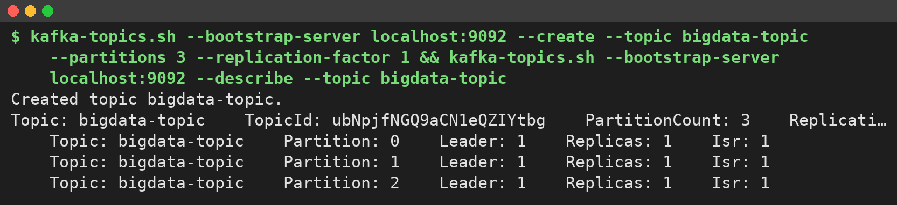
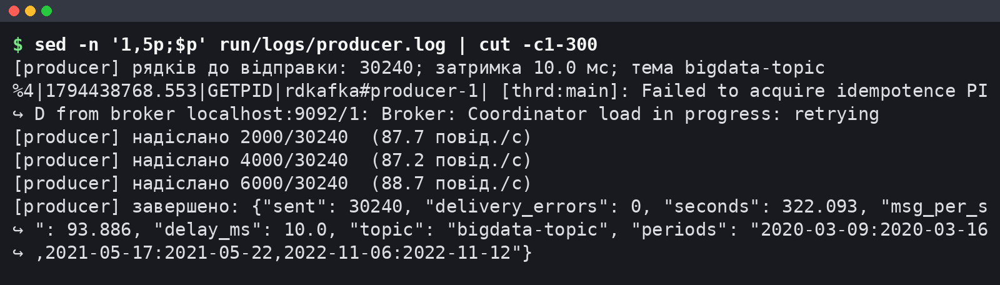
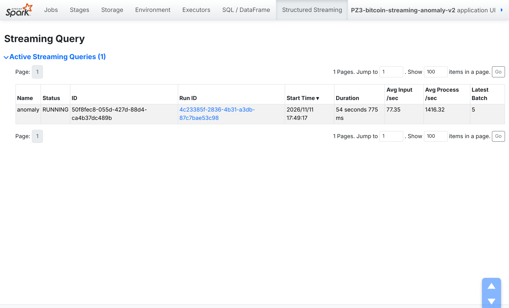
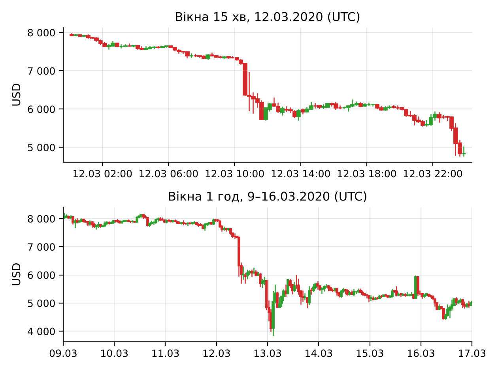
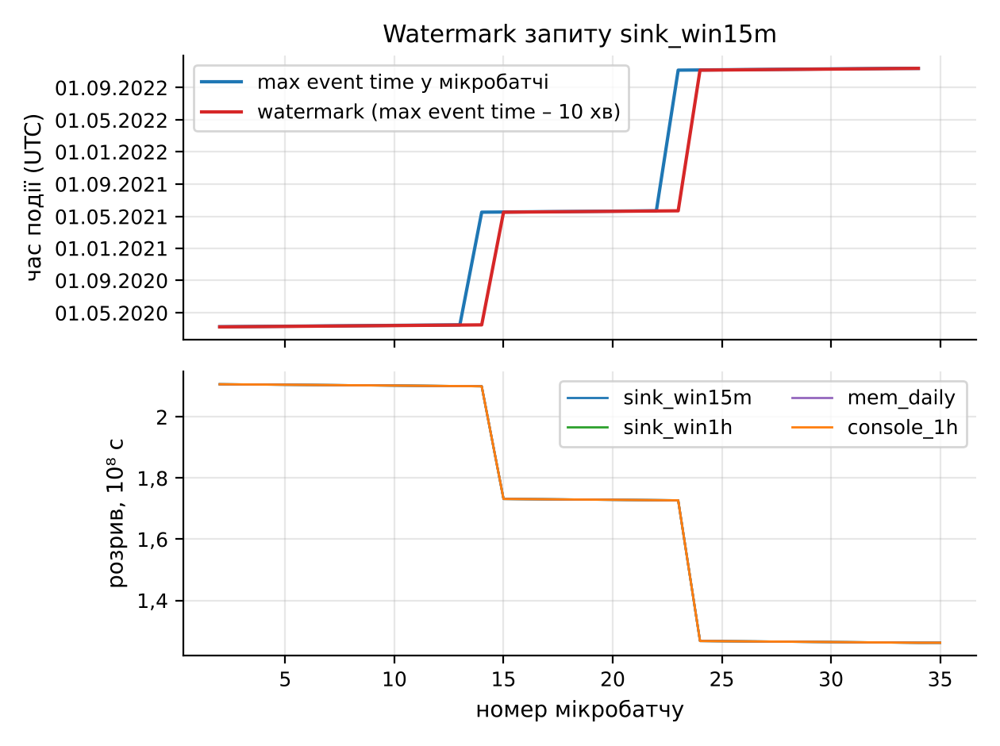
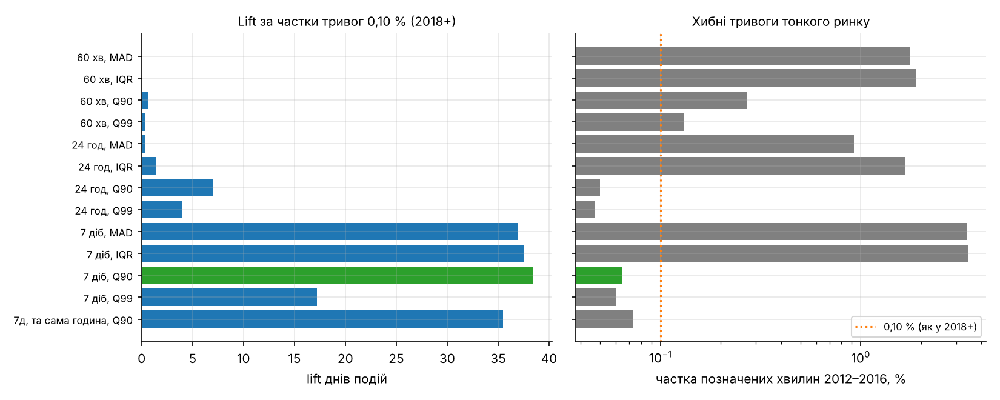
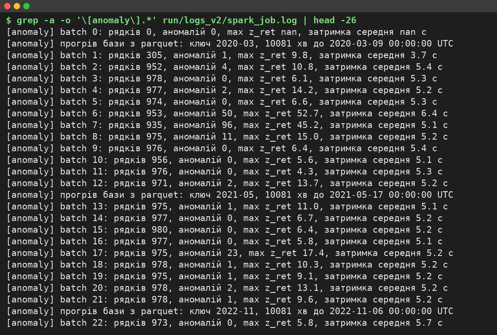
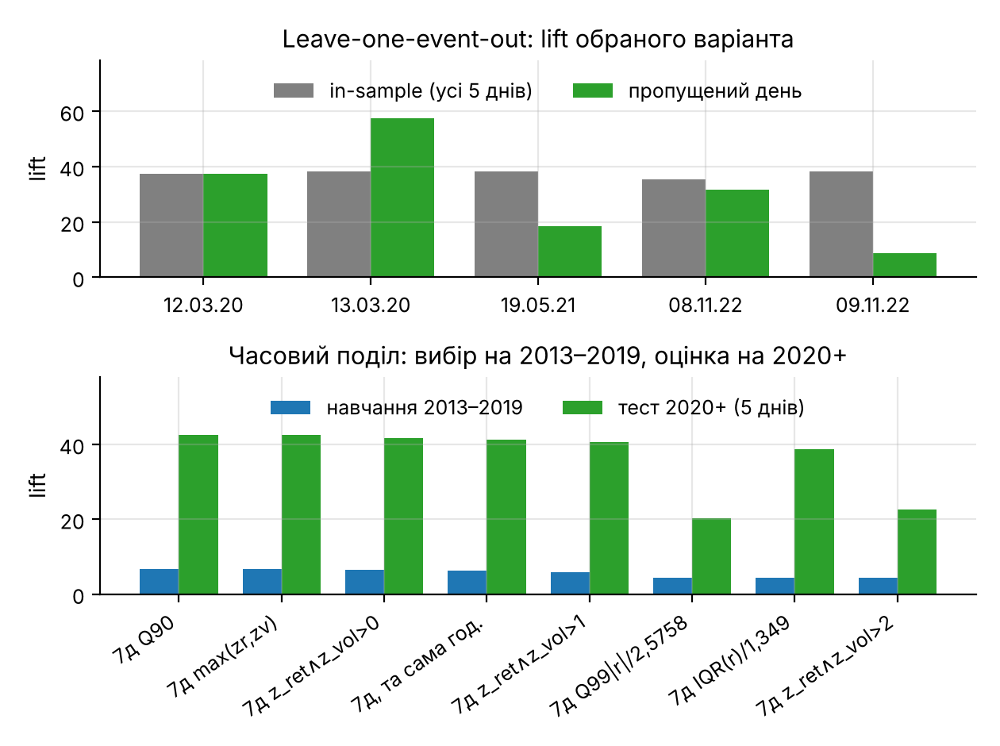
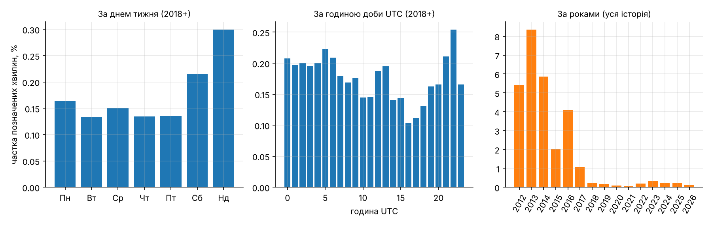

# Мета роботи

Мета роботи: ознайомитися з принципами потокової обробки великих даних та архітектурою Apache Kafka і Spark Structured Streaming; отримати практичні навички формування потоку даних, передавання повідомлень через Kafka та їх обробки засобами Spark у режимі, наближеному до реального часу, на прикладі хвилинних свічок BTC/USD (Bitcoin Historical Data, 7 816 537 записів за 2012–2026 роки).

# Короткі теоретичні відомості

Потокова обробка аналізує записи в міру їх надходження; для хвилинних свічок кожна хвилина ринку – окрема подія. Apache Kafka – розподілений журнал повідомлень. Producer записує повідомлення (ключ, значення, мітку часу) у тему (topic), поділену на партиції; кожна партиція – впорядкований журнал зі зміщеннями (offsets), і порядок гарантується лише в її межах. Партицію визначає хеш ключа, тому записи з одним ключем потрапляють в одну партицію. Broker зберігає партиції (у режимі KRaft без ZooKeeper), а споживачі однієї групи (consumer group) ділять партиції між собою й фіксують прочитані зміщення.

Spark Structured Streaming подає потік як необмежену таблицю і виконує над нею план DataFrame мікробатчами за тригером; checkpoint зберігає прочитані зміщення та стан агрегацій.

Віконна обробка групує події за часовими вікнами; tumbling-вікна мають фіксовану довжину й не перетинаються. Вікно визначається за часом події (event time) – міткою з самого запису, а не за часом обробки (processing time). Водяна позначка (watermark) дорівнює максимальному баченому часу події мінус допустиме запізнення: стан вікон, старших за неї, видаляється, а пізні записи відкидаються. Позначка одна на весь запит, а не на партицію. Режим виводу визначає, що записується після мікробатчу: append – лише остаточно закриті вікна, update – змінені рядки, complete – уся таблиця результату.

# Результати виконання практичного заняття

## 1 Підготовка Kafka

Kafka 3.7.0 запущено як один вузол KRaft із ролями `broker,controller`; до повідомлення `Kafka Server started` минуло 10,1 с. Spark працює в режимі `local[2]`, щоб частина ядер лишалася брокеру та producer. Середовище наведено в таблиці 1.

Таблиця 1 – Програмне середовище та параметри запуску

| Компонент або параметр | Значення |
|---|---|
| Машина | 4 vCPU (спільні з іншими завданнями), 15,7 ГіБ RAM, Ubuntu 24.04.5 LTS |
| Apache Kafka / Java | 3.7.0 (Scala 2.13), KRaft, 1 брокер / OpenJDK 21.0.12.1 |
| Spark / PySpark / конектор | 4.3.0 / 4.3.0 / spark-sql-kafka-0-10_2.13:4.3.0 |
| Producer | confluent-kafka 2.16.1 (librdkafka), acks=all, enable.idempotence=true |
| Python / pandas / pyarrow / seed | 3.13.18 / 3.0.5 / 26.0.1 / 42 |
| spark.master / driver.memory / shuffle.partitions | local[2] / 2g / 4 |
| Часова зона сесії / тригер / maxOffsetsPerTrigger | UTC / 10 с / 3000 |

Тему `bigdata-topic` створено з 3 партиціями та фактором реплікації 1 (рисунок 1).



Ключ повідомлення – рік-місяць UTC, тому кожен період лягає в одну партицію зі збереженим порядком хвилин, потрібним правилу аномалій. Кінцеві зміщення партицій становлять 10 080 / 20 160 / 0: ключі `2020-03` і `2021-05` дали однаковий залишок хешу librdkafka. Для рівномірності партицію слід задавати явно; на коректність це не впливає.

## 2 Формування потоку

Producer (`producer.py`, лістинг А.1) відбирає з CSV хвилини трьох періодів і надсилає їх хронологічно: одне повідомлення – одна хвилина, значення – JSON з полями `ts`, `open`, `high`, `low`, `close`, `volume`.

```python
key = time.strftime("%Y-%m", time.gmtime(ts))   # ключ = період
val = {"ts": ts, "open": num(row.Open), "high": num(row.High), "low": num(row.Low),
       "close": num(row.Close), "volume": num(row.Volume)}
prod.produce(a.topic, key=key, value=json.dumps(val), on_delivery=on_delivery)
prod.poll(0)
time.sleep(a.delay_ms / 1000.0)                  # затримка 10 мс
```

Ідемпотентний режим (`enable.idempotence=true`, `acks=all`) виключає дублювання й перестановку повідомлень під час повторних спроб. Періоди обрано навколо відомих обвалів, підтверджених денними лог-дохідностями (таблиця 2).

Таблиця 2 – Відтворювані періоди

| Ключ | Дати (UTC) | Хвилин | Подія | Денна лог-дохідність | Партиція |
|---|---|---|---|---|---|
| 2020-03 | 09–16.03.2020 | 11 520 | обвал COVID-19, 12–13.03 | −0,494 / +0,150 | 1 |
| 2021-05 | 17–22.05.2021 | 8 640 | обвал 19.05 | −0,153 | 1 |
| 2022-11 | 06–12.11.2022 | 10 080 | крах FTX, 08–09.11 | −0,104 / −0,156 | 0 |

Затримка 10 мс імітує прискорений потік: 10 хв ринкового часу відтворюються приблизно за 0,1 с (рисунок 2).



Producer надіслав 30 240 повідомлень за 322,093 с (93,886 повід./с) з 0 помилок доставки; попередження librdkafka на початку журналу – повторна спроба отримати ідентифікатор ідемпотентного producer під час завантаження координатора. Перечитування групою `pz3-verify` дало `Processed a total of 30240 messages` з нульовим lag.

## 3 Отримання потоку

Застосунок `streaming_job.py` (лістинг А.2) читає тему через конектор `spark-sql-kafka-0-10`:

```python
raw = (spark.readStream.format("kafka")
       .option("kafka.bootstrap.servers", a.bootstrap)
       .option("subscribe", a.topic)
       .option("startingOffsets", "earliest")
       .option("maxOffsetsPerTrigger", a.max_offsets)
       .option("failOnDataLoss", "true")
       .load())
```

`startingOffsets = earliest` діє лише під час першого запуску, далі зміщення беруться з checkpoint, а не з групи споживачів; `failOnDataLoss = true` зупиняє запит, якщо потрібні зміщення зникли. Кожен із семи запитів є окремим споживачем Kafka, тобто тема читається сім разів. Мікробатчі містили 11–977 рядків (медіана 949), тож ліміт 3000 не досягався. Стан запитів на 22-му мікробатчі показано на рисунку 3 (Spark UI на порту 4041).



Усі сім запитів мають статус RUNNING; вхідна швидкість 85,75–87,56 рядків/с близька до швидкості producer, а швидкість обробки 314,64–814,77 рядків/с у кілька разів вища.

## 4 Обробка потоку

Ключ і значення Kafka приводяться з `binary` до `string`, JSON розбирається функцією `from_json` за явною схемою (поле `ts` типу `LongType` і п'ять полів `DoubleType`), а мітка CreateTime зберігається для вимірювання затримки.

Фільтр відкидає записи з порожніми полями, `high < low`, `close ≤ 0` або від'ємним обсягом (таких 0 з 30 240). Групування і статистичне агрегування реалізовано запитом `daily_mem`: tumbling-вікно 1 доба за `event_time` з кількістю хвилин, середнім і стандартним відхиленням `close`, мінімумом `low`, максимумом `high` і сумою `volume`. Вікно з водяною позначкою дозволяє видаляти стан закритих діб; результат містить 21 добу по 1 440 хвилин. Console-приймач у режимі update виводить у журнал змінені вікна. Вікна будуються за часом події з поля `ts` (2020–2022 роки), а не за часом обробки (листопад 2026 року), що залежав би від швидкості відтворення й навантаження хоста.

## 5 Віконна обробка

### 5.1 Віконні агрегати

Вікна коротші за 1 хв містили б одну свічку, тому обрано tumbling-вікна 15 хв (динаміка обвалу всередині години) і 1 год (масштаб ПЗ1–ПЗ2). У кожному вікні обчислюється OHLC за правилом first/max/min/last і сума обсягу:

```python
events = valid.withWatermark("event_time", "10 minutes")
g = events.groupBy(F.window("event_time", "1 hour")).agg(
    F.min(F.struct("event_time", "open")).getField("open").alias("open"),
    F.max("high").alias("high"), F.min("low").alias("low"),
    F.max(F.struct("event_time", "close")).getField("close").alias("close"),
    F.sum("volume").alias("volume"), F.count(F.lit(1)).alias("n_candles"))
```

Open і close взято через `min/max` структури за `event_time`, бо `first/last` у потоці залежать від порядку рядків у мікробатчі. Результат перевірено скриптом `verify_windows.py` (лістинг А.9) проти `pandas.resample` (таблиця 3).

Таблиця 3 – Порівняння віконних агрегатів Spark і pandas

| Показник | Вікна 15 хв | Вікна 1 год |
|---|---|---|
| Вікон у pandas | 2 016 | 504 |
| Рядків memory-приймача (update, з проміжними оновленнями) | 2 048 | 536 |
| Вікон Spark після залишення останнього оновлення | 2 016 | 504 |
| Вікон лише в одному з джерел | 0 | 0 |
| max \|Δ\| open, high, low, close, n_candles | 0 | 0 |
| max \|Δ\| volume | 4,5·10⁻¹³ | 2,7·10⁻¹² |
| Вікон у parquet-приймачі (append), дублікатів | 2 015, 0 | 503, 0 |
| Вікон, не записаних parquet-приймачем | 1 | 1 |

Усі вікна збіглися; розбіжність обсягу порядку 10⁻¹² дає порядок додавання чисел з плаваючою комою. Parquet-приймач (append) не записав останнє вікно кожного масштабу: вікно 23:00–24:00 12.11.2022 закрилося б лише подією з часом не раніше 00:10 13.11.2022, а потік закінчується на 23:59. Вікна березня 2020 року показано на рисунку 4.



На 15-хв вікнах видно дві хвилі обвалу 12.03.2020 (близько 10:30–11:30 UTC і наприкінці доби); обсяг 1-год вікон у ці години сягає 8 925 BTC (11:00) і 8 051 BTC (23:00).

### 5.2 Водяна позначка

Виміряна невпорядкованість подій – 0 з 30 240 повідомлень як у кожній партиції, так і в реальному порядку надходження (максимальне запізнення 0 с), а `numRowsDroppedByWatermark` = 0 в усіх запитах. Отже, 10 хв – запас для живого джерела, де свічка може прийти пізніше через перепідключення до біржі; ціна запасу – append-результат з'являється на 10 хв часу подій пізніше (близько 0,1 с за прискореного відтворення). Рух позначки показано на рисунку 5.



Остання позначка – 2022-11-12 23:49. Розрив між часом обробки і позначкою («Global Watermark Gap» у Spark UI) змінюється сходинками від 2,107·10⁸ с (2020 рік) до 1,261·10⁸ с (2022 рік), медіана 1,730·10⁸ с ≈ 5,48 року (`pz3_watermark_gap.csv`); це вік історичних подій, а не затримка обробки.

Позначка глобальна (максимум часу подій за всіма партиціями мінус 10 хв); політика `multipleWatermarkPolicy = min` діє лише між кількома вхідними позначками (join, union). В експерименті backlog запит вікон 15 хв читав заздалегідь заповнену тему з `maxOffsetsPerTrigger = 3000`: партиція 0 (листопад 2022 року) одразу просунула позначку, і за 12 мікробатчів збережено лише 14 080 з 30 240 рядків (939 з 2 016 вікон). `numRowsDroppedByWatermark` при цьому показала лише 1 083 рядки, тож решту втрат ця метрика не пояснює; число близьке до кількості втрачених вікон (1 077), тобто лічильник, імовірно, рахує частково агреговані рядки, але це окремо не перевірялося. Без ліміту (один мікробатч) збережено всі 30 240 рядків, тож періоди в різних партиціях безпечні лише за послідовного надсилання і читання наживо.

## 6 Виявлення аномалій

### 6.1 Перша версія правила

Перша версія (|r| > k·1,4826·MAD за 60 хв або обсяг у k_v разів вищий за медіану за 60 хв) за k ∈ {3, 5, 7, 10} позначала 9,9–27,1 % хвилин, а в періодах обвалів – лише 0,53–0,90 від звичайної частоти, бо 60-хв база встигала підлаштуватися під обвал.

### 6.2 Правило v2

Нехай r_t = ln(C_t / C_{t−1}). Активною вважається хвилина з V_t > 0; пласкі хвилини з нульовим обсягом (16,79 % історії) є заповненням сітки, тому не оцінюються і не входять до бази. База B_t – активні хвилини серед 10 080 попередніх (7 діб), без поточної:

```
sigma_t = Q0,90{|r_i| : i ∈ B_t} / 1,6449
z_ret,t = |r_t| / sigma_t
z_vol,t = (ln V_t − Q0,50{ln V_i}) / ((Q0,75{ln V_i} − Q0,25{ln V_i}) / 1,349)
аномалія_t ⇔ z_ret,t > k і z_vol,t > 0,   k = 9
```

Константи 1,6449 і 1,349 роблять шкали спроможними оцінками σ за нормального розподілу; оцінка вимагає не менше 3 360 активних хвилин у базі, тому оцінено 6 453 867 з 7 816 537 хвилин.

Елементи формули обрано порівнянням 19 варіантів за однакового бюджету: поріг кожного підбирався так, щоб позначалося 0,10 % активних хвилин 2018+. Порівнювалися lift (частка позначених хвилин у п'яти днях подій, поділена на частку в інші дні 2018+), частота позначок 2012–2016 років і ранги днів подій (таблиця 4, рисунок 6). Це числа проєктної вибірки; оцінку поза нею наведено в підрозділі 6.5.

Таблиця 4 – Варіанти правила за однакового бюджету тривог 0,10 % (2018+), проєктна вибірка

| База | Шкала або комбінація | Поріг | Lift | Позначено хвилин 2012–2016, % | Ранги 12.03.20 / 13.03.20 / 19.05.21 / 08.11.22 / 09.11.22 |
|---|---|---|---|---|---|
| 60 хв | MAD | 118,11 | 0,0 | 1,7518 | 1286 / 1286 / 1286 / 1286 / 1286 |
| 24 год | MAD | 37,68 | 0,3 | 0,9245 | 352 / 482 / 482 / 352 / 482 |
| 24 год | Q90 | 8,64 | 7,0 | 0,0499 | 9 / 1895 / 20 / 35 / 1895 |
| 7 діб | MAD | 13,14 | 36,9 | 3,4019 | 258 / 205 / 367 / 231 / 303 |
| 7 діб | Q90 | 8,87 | 38,4 | 0,0648 | 1 / 2 / 25 / 4 / 65 |
| 7 діб | Q99 | 5,72 | 17,2 | 0,0604 | 3 / 34 / 12 / 11 / 434 |
| 7 діб | лише обсяг | 2,59 | 11,3 | 0,5099 | 381 / 1133 / 25 / 219 / 1787 |
| 7 діб | Q90 і z_vol > 0 | 8,87 | 38,4 | 0,0613 | 1 / 2 / 25 / 4 / 63 |
| 60 хв (v1) | MAD або обсяг | 1,28 | 0,3 | 5,0698 | 3406 / 3406 / 3406 / 2262 / 3406 |



За базою 60 хв і 24 год шкала зростає вже під час обвалу (lift не більше 7,0), а 7-денна база охоплює тижневий цикл ринку й реагує повільніше за обвал (lift 36,9–38,4). Q90 обрано замість MAD через точні нулі дохідності: частка активних хвилин з r = 0 становить 42,6 % у 2012 році й 29,4 % у 2013 році проти 0,4 % у 2021 році, тому за MAD 2012–2016 роки отримують 3,40 % позначених хвилин, а за Q90 – 0,0648 %.

Обсяг слабкий як тригер (99,99-й перцентиль z_vol у 2018+ лише 3,067; правило лише за обсягом має lift 11,3 і 60,6 % позначок у 2012–2016 роках), тому використано підтвердження z_vol > 0. Воно майже не впливає: за k = 9 позначок 5 437 замість 5 489 без втрати lift, а жорсткіша умова z_vol > 2 знижує lift до 23,2.

### 6.3 Вибір порогу k

Поріг – найменше k із сітки, за якого позначається не більше 0,10 % активних хвилин 2018+, тобто близько 1,4 тривоги на добу, які оператор може переглянути вручну (таблиця 5).

Таблиця 5 – Кількість спрацювань правила v2 для різних k (уся історія)

| k | Позначено хвилин | Частка 2018+, % | Тривог на добу 2018+ | Частка 2012–2016, % | Хвилин у днях подій | Lift (хвилини) | Lift (вікна 1 год) |
|---|---|---|---|---|---|---|---|
| 3 | 126 956 | 2,1178 | 30,50 | 1,5564 | 1 636 | 10,9 | 2,6 |
| 5 | 29 528 | 0,5093 | 7,33 | 0,3318 | 761 | 21,4 | 5,7 |
| 7 | 11 009 | 0,1918 | 2,76 | 0,1213 | 398 | 30,2 | 8,5 |
| 8 | 7 527 | 0,1321 | 1,90 | 0,0816 | 307 | 34,0 | 9,7 |
| 9 | 5 437 | 0,0959 | 1,38 | 0,0582 | 251 | 38,5 | 11,8 |
| 10 | 3 985 | 0,0702 | 1,01 | 0,0431 | 199 | 41,9 | 13,0 |
| 20 | 540 | 0,0095 | 0,14 | 0,0062 | 39 | 62,4 | 33,6 |

За k = 8 частка ще 0,1321 %, тому обрано k = 9: 0,0959 % (1,38 тривоги на добу). Більше k підвищує lift, але зменшує кількість позначених хвилин у днях подій (251 за k = 9, 39 за k = 20).

### 6.4 Потокова реалізація

У потоці правило виконується в `foreachBatch` класом `StreamScorer` (лістинг А.3), який для кожного ключа Kafka тримає буфер останніх 10 081 хвилини. Тижневу базу неможливо накопичити з 6–8-денних періодів, тому буфер прогрівається 10 081 хвилиною історії з parquet (рисунок 7).



Найбільше аномалій дали мікробатчі 8 (95; ніч 12–13.03.2020), 7 (56; 12.03.2020 10:30–17:09 UTC) і 27 (56; 08.11.2022). Мікробатч 18 на рисунку 7 містить 23 аномалії 19.05.2021.

### 6.5 Оцінка поза вибіркою

Числа таблиці 4 оптимістичні, тому виконано дві перевірки (рисунок 8). У leave-one-event-out варіант обирається за lift на чотирьох днях і оцінюється на п'ятому; 7-денна база обирається в усіх п'яти фолдах, але шкала змінюється (Q90 у трьох, IQR(r) в одному, «та сама година» в одному). Середній lift пропущеного дня 30,7 проти 38,4 на проєктній вибірці, тобто проєктна оцінка завищена приблизно на п'яту частину.



У часовому поділі «подіями» навчання були 118 днів 2013–2019 років з |денна лог-дохідність| ≥ 0,10, а k підбирався за бюджетом 0,10 % на тих самих роках. Найкращим виявився варіант 7 діб, Q90 (k = 8,38); на 2020+ він дає lift 42,5 для п'яти відомих днів і 0,094 % позначок у базові дні, тобто бюджет переноситься на нові роки. Вибір відтворюється без днів 2020+, хоча «події» навчання – не розмічені аномалії, а дні великої зміни ціни.

## 7 Збереження результатів

Віконні агрегати записуються parquet-приймачами в режимі append з окремим checkpoint для кожного запиту, кожне вікно один раз (дублікатів 0). Оцінки хвилин `foreachBatch` записує у файл з номером мікробатчу, і повторне виконання мікробатчу після збою перезаписує той самий файл, тому запис ідемпотентний. Для ПЗ4 сформовано `pz3_anomalies.csv` і `.parquet` – 5 437 аномальних хвилин за всю історію, з них 272 у відтворених періодах. Стан `StreamScorer` живе в драйвері, а не в checkpoint; повторний прогрів з parquet відновлює його лише для відтворення історії, а живому потоку потрібне сховище стану, наприклад `applyInPandasWithState`.

## 8 Аналіз результатів

### 8.1 Аномалії в потоці та перевірка формули

Потокову оцінку порівняно з офлайн-оцінкою (таблиця 6).

Таблиця 6 – Аномалії у відтворених періодах: потік і офлайн-оцінка

| Період | Оцінено хвилин | Аномалій у потоці | Аномалій офлайн | На добу | Відношення до бази 2018+ | Lift (вікна 15 хв) | Lift (вікна 1 год) | max z_ret |
|---|---|---|---|---|---|---|---|---|
| 2020-03 | 11 461 | 166 | 166 | 20,86 | 16,0 | 8,2 | 5,6 | 52,69 |
| 2021-05 | 8 640 | 29 | 29 | 4,83 | 3,7 | 2,8 | 2,4 | 17,38 |
| 2022-11 | 9 915 | 77 | 77 | 11,18 | 8,6 | 5,0 | 3,7 | 85,31 |
| Разом | 30 016 | 272 | 272 | – | – | – | – | – |

На 30 016 оцінених хвилинах max |Δz_ret| = max |Δz_vol| = max |Δsigma| = 0, розбіжностей прапорців 0. Обидві сторони викликають одну функцію `score()`, тому збіг доводить лише, що розбиття на мікробатчі та прогрів не змінюють результату. Формулу перевірено скриптом `verify_anomalies_independent.py` (лістинг А.7) без `score()`: для 200 позначених і 200 непозначених хвилин окрема pandas-реалізація дала 0 розбіжностей. У тесті на заглядання вперед для 40 хвилин усі наступні 3 000 свічок замінено випадковими, і z у момент t збіглися в 40 з 40 випадків. Частота аномалій у періодах у 3,7–16,0 раза вища за базову (1,3 на добу).

### 8.2 Відомі події

Відомі події наведено в таблиці 7; ранг – місце дати серед 1 572 дат з позначками, останній стовпець – lift дня, виключеного з вибору варіанта.

Таблиця 7 – Виявлення відомих подій правилом v2 (k = 9)

| Дата | Аномалій | Ранг (уся історія) | Ранг (2018+) | Позначених вікон 1 год | max z_ret | Медіана sigma за добу | Lift (хвилини) | Lift поза вибіркою |
|---|---|---|---|---|---|---|---|---|
| 12.03.2020 | 82 | 1 | 1 | 11 | 52,69 | 0,00104 | 62,9 | 37,5 |
| 13.03.2020 | 75 | 2 | 2 | 13 | 31,26 | 0,00193 | 57,5 | 57,4 |
| 19.05.2021 | 23 | 27 | 19 | 4 | 17,38 | 0,00188 | 17,6 | 18,4 |
| 08.11.2022 | 59 | 4 | 4 | 8 | 85,31 | 0,00048 | 45,4 | 31,6 |
| 09.11.2022 | 12 | 66 | 51 | 5 | 20,61 | 0,00072 | 9,2 | 8,8 |

Обвал COVID-19 і крах FTX 08.11.2022 отримали найвищі ранги (1, 2 і 4). Події 19.05.2021 і 09.11.2022 виявлено частково (ранги 27 і 66), бо тижнева база вже містила попередню волатильність: медіанна sigma 19.05.2021 (0,00188) у 1,8 раза вища, ніж 12.03.2020 (0,00104), і позначено лише 23 хвилини між 11:31 і 14:45 UTC. Для 09.11.2022 база включала крах попередньої доби, а падіння розгорталося поступово: правило реагує на раптові хвилинні рухи, а не на багатоденні тренди.

### 8.3 Закономірності

Закономірності оцінено за офлайн-оцінкою всієї історії тим самим правилом, бо три відтворені тижні замалі для статистики; 4 364 з 5 437 позначок належать до 2018+ (рисунок 9).



Частка позначених хвилин у будні 0,113 %, у вихідні 0,052 % (відношення 2,17); за годиною вона зростає з 0,0358 % о 07 UTC до 0,1556 % о 14 UTC, що збігається з робочими годинами американських ринків, хоча частину піку дає база без урахування внутрішньодобової сезонності. Правило нечутливе до знака руху: серед 50 найактивніших дат історії 30 обвалів і 20 зростань, серед 50 дат 2018+ – 25 і 25. Аномалії йдуть сплесками: 71,1 % позначок 2018+ мають іншу позначку в межах 60 хв, тож у потоці тривоги доцільно групувати в інциденти.

### 8.4 Продуктивність

Метрики взято з `query.recentProgress` того самого прогону (таблиця 8). Хост був спільний з іншими завданнями (loadavg 5,11–13,16, у середньому 8,31 на 4 vCPU), тому значення занижені.

Таблиця 8 – Метрики потокових запитів (тригер 10 с, local[2])

| Запит | Мікробатчів з даними | Тривалість, середня / медіана / p95 / max, мс | Оброблено рядків/с, середнє | Вхід, рядків/с |
|---|---|---|---|---|
| anomaly | 34 | 1142,7 / 968,5 / 2384,2 / 2680 | 919,2 | 88,9 |
| console_1h | 34 | 2516,8 / 2007,0 / 5006,2 / 6682 | 428,3 | 89,0 |
| mem_daily | 34 | 2719,1 / 2363,0 / 6275,5 / 7504 | 446,2 | 90,2 |
| mem_win15m | 34 | 2219,7 / 1896,5 / 4287,4 / 5497 | 488,3 | 89,1 |
| mem_win1h | 34 | 2307,9 / 2006,0 / 4931,9 / 6996 | 501,6 | 89,1 |
| sink_win15m | 34 | 2817,6 / 2535,5 / 4920,9 / 6105 | 371,4 | 89,9 |
| sink_win1h | 34 | 2646,7 / 2389,5 / 4357,9 / 5263 | 380,2 | 89,6 |

Усі мікробатчі тривали менше за інтервал тригера 10 с (максимум 7 504 мс), а швидкість обробки 371,4–919,2 рядків/с перевищує вхідну 88,9–90,2 рядків/с, отже система встигає за потоком. Наскрізна затримка від CreateTime у Kafka до початку оцінювання в `foreachBatch` за всіма 30 240 повідомленнями становить у середньому 5,651 с, до готового результату – 5,823 с (медіана 5,761 с, p95 10,377 с, максимум 12,445 с). Основна її частина – очікування тригера, а обробка у `foreachBatch` займає в середньому 0,716 с. Офлайн-оцінка всієї історії тривала 68,1 с.

# Висновки

Kafka 3.7.0 розгорнуто в режимі KRaft, створено тему `bigdata-topic`; ідемпотентний producer передав 30 240 свічок трьох періодів обвалів за 322,093 с без помилок, а Spark Structured Streaming обробляв їх сімома запитами з декодуванням, фільтрацією й добовою агрегацією.

Віконні OHLC-агрегати 15 хв і 1 год збіглися з `pandas.resample` в усіх 2 016 і 504 вікнах. Водяна позначка 10 хв – запас (невпорядкованість 0), але через її глобальність backlog двох партицій з різними епохами залишив у вікнах 15 хв лише 14 080 з 30 240 рядків. Правило v2 (|r| понад 9 робастних сигм за 7-денною базою Q90 з підтвердженням обсягом) дає 1,38 тривоги на добу; lift днів подій 38,4 на проєктній вибірці, 30,7 у leave-one-event-out і 42,5 на 2020+ за порогу з 2013–2019 років.

Потік збігся з офлайн-оцінкою (272 = 272), незалежна перевірка формули розбіжностей не виявила; 5 437 аномалій історії збережено в `pz3_anomalies.csv` для ПЗ4. Аномалії в 2,17 раза частіші в будні, мають пік о 14 UTC, супроводжують і обвали, і зростання (30 і 20 серед топ-50 дат) та йдуть сплесками. Мікробатчі тривали не більше 7 504 мс, середня затримка до результату – 5,823 с.

Набуто навичок організації потоку, віконної агрегації та виявлення аномалій засобами Kafka і Spark Structured Streaming.
# Додаток А. Лістинг програми

## А.1 Файл producer.py – producer: відтворення хвилинних свічок у Kafka

```python
# -*- coding: utf-8 -*-
"""Producer: відтворює 1-хвилинні свічки BTC/USD у Kafka (ПЗ3, завдання 2).
1 повідомлення = 1 ринкова хвилина; key = рік-місяць UTC (YYYY-MM); value = JSON.
Затримка між повідомленнями імітує потік (прискорене відтворення)."""
import argparse, json, os, sys, time
import pandas as pd
from confluent_kafka import Producer

p = argparse.ArgumentParser()
p.add_argument("--csv", required=True)
p.add_argument("--bootstrap", default="localhost:9092")
p.add_argument("--topic", default="bigdata-topic")
# періоди відтворення: "YYYY-MM-DD:YYYY-MM-DD,..." (межі включно, UTC)
p.add_argument("--periods", default="2020-03-09:2020-03-16,2021-05-17:2021-05-22,2022-11-06:2022-11-12")
p.add_argument("--delay-ms", type=float, default=10.0)
p.add_argument("--max-rows", type=int, default=0, help="0 = без обмеження (для smoke-тесту)")
p.add_argument("--stats", default="")
p.add_argument("--done-flag", default="")
a = p.parse_args()

# --- вибір рядків потрібних періодів (читаємо CSV блоками, щоб не тримати всю історію в RAM)
bounds = []
for item in a.periods.split(","):
    s, e = item.split(":")
    lo = int(pd.Timestamp(s, tz="UTC").timestamp())
    hi = int((pd.Timestamp(e, tz="UTC") + pd.Timedelta(days=1)).timestamp())  # межа виключно
    bounds.append((lo, hi))
parts = []
for ch in pd.read_csv(a.csv, chunksize=1_000_000):
    ch.columns = [c.strip() for c in ch.columns]
    ch["Timestamp"] = ch["Timestamp"].astype("int64")
    m = False
    for lo, hi in bounds:
        m = m | ((ch["Timestamp"] >= lo) & (ch["Timestamp"] < hi))
    if m.any():
        parts.append(ch[m])
if not parts:
    sys.exit("ПОМИЛКА: у CSV немає жодного рядка для вказаних періодів " + a.periods)
df = pd.concat(parts).sort_values("Timestamp").reset_index(drop=True)
if a.max_rows:
    df = df.head(a.max_rows)
print(f"[producer] рядків до відправки: {len(df)}; затримка {a.delay_ms} мс; тема {a.topic}", flush=True)

prod = Producer({"bootstrap.servers": a.bootstrap, "linger.ms": 5, "acks": "all", "enable.idempotence": True})   # ідемпотентний producer: повтори не дублюють і не переставляють повідомлення
errors = []
def on_delivery(err, msg):  # зворотний виклик: рахуємо помилки доставки
    if err is not None:
        errors.append(str(err))

def num(x):  # NaN -> null у JSON
    return None if pd.isna(x) else float(x)

t0 = time.time()
sent = 0
for row in df.itertuples(index=False):
    ts = int(row.Timestamp)
    key = time.strftime("%Y-%m", time.gmtime(ts))   # ключ = період (рік-місяць): кожен період іде в одну партицію, порядок у межах періоду збережено
    val = {"ts": ts, "open": num(row.Open), "high": num(row.High), "low": num(row.Low),
           "close": num(row.Close), "volume": num(row.Volume)}
    prod.produce(a.topic, key=key, value=json.dumps(val), on_delivery=on_delivery)
    prod.poll(0)
    sent += 1
    if sent % 2000 == 0:
        print(f"[producer] надіслано {sent}/{len(df)}  ({sent/(time.time()-t0):.1f} повід./с)", flush=True)
    time.sleep(a.delay_ms / 1000.0)
prod.flush(60)
el = time.time() - t0
stats = {"sent": sent, "delivery_errors": len(errors), "seconds": round(el, 3),
         "msg_per_s": round(sent / el, 3), "delay_ms": a.delay_ms, "topic": a.topic, "periods": a.periods}
print("[producer] завершено:", json.dumps(stats, ensure_ascii=False), flush=True)
if a.stats:
    json.dump(stats, open(a.stats, "w"))
if a.done_flag:
    json.dump(stats, open(a.done_flag, "w"))
sys.exit(1 if errors else 0)
```

## А.2 Файл streaming_job.py – Spark Structured Streaming: читання, обробка, вікна, аномалії, збереження

```python
# -*- coding: utf-8 -*-
"""Spark Structured Streaming: Kafka -> розбір JSON -> віконна агрегація -> аномалії -> parquet (ПЗ3, завдання 3-7)."""
import argparse, glob, json, os, sys, time
import numpy as np
import pandas as pd
from pyspark.sql import SparkSession, functions as F, types as T

sys.path.insert(0, os.path.dirname(os.path.abspath(__file__)))
from anomaly_rule import StreamScorer, K_SEL, WINDOW, load_history_parquet

ap = argparse.ArgumentParser()
ap.add_argument("--bootstrap", default="localhost:9092")
ap.add_argument("--topic", default="bigdata-topic")
ap.add_argument("--out", required=True)
ap.add_argument("--ckpt", required=True)
ap.add_argument("--done-flag", required=True)
ap.add_argument("--kafka-pkg", required=True)
ap.add_argument("--watermark", default="10 minutes")
ap.add_argument("--trigger-seconds", type=int, default=10)
ap.add_argument("--max-offsets", type=int, default=3000)
ap.add_argument("--k", type=float, default=K_SEL)
ap.add_argument("--history-parquet", required=True, help="історія для прогріву 7-денної бази (дані ДО кожного періоду відтворення)")
ap.add_argument("--only-anomaly", action="store_true", help="запустити лише запит аномалій (віконні запити не перезапускаються)")
ap.add_argument("--ui-port", type=int, default=4040, help="порт Spark UI (якщо зайнятий – Spark бере наступний вільний)")
ap.add_argument("--max-seconds", type=int, default=1200)
a = ap.parse_args()
# Seed 42 (конвеєр детермінований; випадковість використовується лише в скриптах перевірки).
SEED = 42; np.random.seed(SEED)

os.makedirs(a.out, exist_ok=True)
PARTS = os.path.join(a.out, "scored_parts"); os.makedirs(PARTS, exist_ok=True)

spark = (SparkSession.builder.appName("PZ3-bitcoin-streaming" + ("-anomaly-v2" if a.only_anomaly else "")).master("local[2]")
         .config("spark.jars.packages", a.kafka_pkg)
         .config("spark.sql.shuffle.partitions", "4")
         .config("spark.sql.session.timeZone", "UTC")     # вікна вирівнюються по UTC
         .config("spark.driver.memory", "2g")
         .config("spark.ui.port", str(a.ui_port))
         .config("spark.sql.streaming.forceDeleteTempCheckpointLocation", "true")
         .getOrCreate())
spark.sparkContext.setLogLevel("WARN")
print("[job] Spark UI:", spark.sparkContext.uiWebUrl, flush=True)
print("[job] Spark", spark.version, "| пакет", a.kafka_pkg, flush=True)

# ---------- Завдання 3: читання з Kafka ----------
raw = (spark.readStream.format("kafka")
       .option("kafka.bootstrap.servers", a.bootstrap)
       .option("subscribe", a.topic)
       .option("startingOffsets", "earliest")
       .option("maxOffsetsPerTrigger", a.max_offsets)   # обмеження розміру мікробатчу
       .option("failOnDataLoss", "true")
       .load())

# ---------- Завдання 4: декодування, типи, фільтрація ----------
schema = T.StructType([                       # явна схема JSON-повідомлення
    T.StructField("ts", T.LongType()), T.StructField("open", T.DoubleType()),
    T.StructField("high", T.DoubleType()), T.StructField("low", T.DoubleType()),
    T.StructField("close", T.DoubleType()), T.StructField("volume", T.DoubleType())])
parsed = (raw.select(F.col("key").cast("string").alias("key"),                # bytes -> string
                     F.col("value").cast("string").alias("json"),
                     F.col("timestamp").cast("double").alias("kafka_epoch"),  # час запису в Kafka (CreateTime)
                     F.col("offset").alias("kafka_offset"))
          .withColumn("m", F.from_json("json", schema))                       # string -> struct
          .select("key", "kafka_epoch", "kafka_offset", "m.*")
          .withColumn("event_time", F.col("ts").cast("timestamp"))            # ЧАС ПОДІЇ (unix с), а не час обробки
          .withColumn("valid", F.col("ts").isNotNull() & F.col("open").isNotNull() & F.col("close").isNotNull()
                      & F.col("high").isNotNull() & F.col("low").isNotNull() & F.col("volume").isNotNull()
                      & (F.col("high") >= F.col("low")) & (F.col("close") > 0) & (F.col("volume") >= 0)))
valid = parsed.filter("valid")                                                # фільтрація некоректних записів

# watermark: допустиме запізнення подій 10 хв (обґрунтування: results/pz3_watermark_*.csv, watermark_analysis.py)
events = valid.withWatermark("event_time", a.watermark)

# ---------- Завдання 5: віконні агрегації (tumbling) ----------
def win_agg(df, dur):
    g = df.groupBy(F.window("event_time", dur)).agg(
        F.min(F.struct("event_time", "open")).getField("open").alias("open"),    # open = значення з найранішим event_time
        F.max("high").alias("high"), F.min("low").alias("low"),
        F.max(F.struct("event_time", "close")).getField("close").alias("close"), # close = значення з найпізнішим event_time
        F.sum("volume").alias("volume"), F.count(F.lit(1)).alias("n_candles"))
    return g.select(F.col("window.start").alias("win_start"), F.col("window.end").alias("win_end"),
                    "open", "high", "low", "close", "volume", "n_candles")

w15, w1h = win_agg(events, "15 minutes"), win_agg(events, "1 hour")
# групування + статистичне агрегування по календарній добі UTC (tumbling-вікно 1 день)
daily = (events.groupBy(F.window("event_time", "1 day").alias("w"))    # доба = tumbling-вікно 1 день: стан витісняється водяною позначкою
         .agg(F.count(F.lit(1)).alias("n"), F.avg("close").alias("avg_close"), F.stddev("close").alias("std_close"),
              F.min("low").alias("min_low"), F.max("high").alias("max_high"), F.sum("volume").alias("volume"))
         .select(F.col("w.start").cast("date").alias("trade_date"), "n", "avg_close", "std_close", "min_low", "max_high", "volume"))

trig = {"processingTime": f"{a.trigger_seconds} seconds"}
Q = {}
if not a.only_anomaly:
    start_window_queries = True
else:
    start_window_queries = False
# ---------- Завдання 7: parquet-приймачі (append: вікно записується після закриття водяною позначкою) ----------
for name, df in ((("win15m", w15), ("win1h", w1h)) if start_window_queries else ()):
    Q[f"sink_{name}"] = (df.writeStream.queryName(f"sink_{name}").outputMode("append").format("parquet")
                         .option("path", os.path.join(a.out, "parquet", name))
                         .option("checkpointLocation", os.path.join(a.ckpt, name)).trigger(**trig).start())
# memory-приймачі (update): повний поточний стан вікон для перевірки та скріншотів
if start_window_queries:
  Q["mem_win15m"] = w15.writeStream.queryName("win15m_mem").outputMode("update").format("memory").trigger(**trig).start()
  Q["mem_win1h"] = w1h.writeStream.queryName("win1h_mem").outputMode("update").format("memory").trigger(**trig).start()
  Q["mem_daily"] = daily.writeStream.queryName("daily_mem").outputMode("update").format("memory").trigger(**trig).start()
# console-приймач для демонстрації (вивід у лог)
  Q["console_1h"] = (w1h.writeStream.queryName("console_1h").outputMode("update").format("console")
                     .option("truncate", "false").option("numRows", 6).trigger(**trig).start())

# ---------- Завдання 6: аномалії у foreachBatch зі станом ----------
# Стан: окремий буфер останніх W+1 = 10 081 хвилин (7 діб) для кожного ключа Kafka (= період відтворення).
# Перед першою хвилиною кожного періоду буфер ПРОГРІВАЄТЬСЯ історією з parquet (7 діб до початку періоду),
# тому оцінюється кожна хвилина потоку, а результат збігається з офлайн-оцінкою на всій історії.
scorer = StreamScorer(load_history_parquet(a.history_parquet), k=a.k)
BATCH_LOG, LAT_ALL = [], []
def process_batch(bdf, batch_id):
    t0 = time.time()
    pdf = bdf.select("key", "ts", "close", "volume", "valid", "kafka_epoch").toPandas()
    t_col = time.time()                                  # дані мікробатчу зібрано в драйвері
    n_pw = len(scorer.prewarm_log)
    n_raw, n_valid = len(pdf), int(pdf["valid"].sum())
    lat = (t_col - pdf["kafka_epoch"]).to_numpy() if n_raw else np.array([np.nan])   # Kafka CreateTime -> початок оцінювання
    res = scorer.update(pdf[pdf["valid"]]) if n_valid else pd.DataFrame()
    if n_raw:   # затримка до готового результату = затримка до початку оцінювання + тривалість оцінювання мікробатчу
        LAT_ALL.append(pd.DataFrame({"batch_id": batch_id, "key": pdf["key"], "ts": pdf["ts"], "lat_to_score_start_s": lat,
                                     "lat_to_result_s": lat + (time.time() - t_col)}))
    n_anom = 0
    if len(res):
        res = res.copy()
        res["batch_id"] = batch_id
        res.to_parquet(os.path.join(PARTS, f"part-{batch_id:05d}.parquet"), index=False)  # ідемпотентний запис
        n_anom = int(res["anomaly"].sum())
    rec = {"batch_id": batch_id, "n_raw": n_raw, "n_invalid": n_raw - n_valid, "n_valid": n_valid,
           "n_anomalies": n_anom, "latency_mean_s": float(np.nanmean(lat)),
           "latency_p95_s": float(np.nanpercentile(lat, 95)), "latency_max_s": float(np.nanmax(lat)),
           "foreachbatch_s": round(time.time() - t0, 3)}
    BATCH_LOG.append(rec)
    for pw in scorer.prewarm_log[n_pw:]:
        print(f"[anomaly] прогрів бази з parquet: ключ {pw['key']}, {pw['prewarm_rows']} хв до "
              f"{pd.to_datetime(pw['first_stream_ts'], unit='s')} UTC", flush=True)
    mx = float(res["z_ret"].max()) if len(res) else float("nan")
    print(f"[anomaly] batch {batch_id}: рядків {n_raw}, аномалій {n_anom}, max z_ret {mx:.1f}, "
          f"затримка середня {rec['latency_mean_s']:.1f} с", flush=True)

Q["anomaly"] = (parsed.writeStream.queryName("anomaly").foreachBatch(process_batch)
                .option("checkpointLocation", os.path.join(a.ckpt, "anomaly")).trigger(**trig).start())
print("STREAMING_STARTED", [q.name for q in Q.values()], flush=True)

# ---------- моніторинг: збір прогресу, умова зупинки ----------
PROG, RAW = {}, {}
def _ts(x):
    return pd.Timestamp(x) if x else pd.NaT
def collect():
    for key, q in Q.items():
        for p in q.recentProgress:
            RAW[(key, p["batchId"])] = p
            so = p.get("stateOperators") or []
            wm = (p.get("eventTime") or {}).get("watermark")
            PROG[(key, p["batchId"])] = {
                "dropped_by_watermark": sum(o.get("numRowsDroppedByWatermark", 0) for o in so),
                "state_rows_total": sum(o.get("numRowsTotal", 0) for o in so),
                "event_time_max": (p.get("eventTime") or {}).get("max"), "event_time_min": (p.get("eventTime") or {}).get("min"),
                "watermark_gap_s": ((_ts(p["timestamp"]) - _ts(wm)).total_seconds() if wm else None),
                "query": key, "batch_id": p["batchId"], "timestamp": p["timestamp"],
                "num_input_rows": p["numInputRows"], "input_rows_per_s": p.get("inputRowsPerSecond"),
                "processed_rows_per_s": p.get("processedRowsPerSecond"),
                "trigger_execution_ms": p["durationMs"].get("triggerExecution", sum(v for k2, v in p["durationMs"].items() if k2 != "triggerExecution")),   # якщо поля немає – сума фаз
                "add_batch_ms": p["durationMs"].get("addBatch"),
                "get_batch_ms": p["durationMs"].get("getBatch"),
                "watermark": (p.get("eventTime") or {}).get("watermark")}
def totals():
    t = {k: 0 for k in Q}
    for (k, _), v in PROG.items():
        t[k] += v["num_input_rows"] or 0
    return t

t_start, status, expected = time.time(), "timeout", None
while time.time() - t_start < a.max_seconds:
    time.sleep(5)
    collect()
    for k, q in Q.items():
        if q.exception():
            print("ПОМИЛКА у запиті", k, q.exception(), flush=True); status = "query_failed"
    if status == "query_failed":
        break
    if expected is None and os.path.exists(a.done_flag):
        try:
            expected = json.load(open(a.done_flag))["sent"]
        except Exception:
            expected = None
    tt = totals()
    print(f"[job] t={time.time()-t_start:.0f}с прочитано(anomaly)={tt['anomaly']} очікується={expected}", flush=True)
    if expected is not None and all(v >= expected for v in tt.values()):
        time.sleep(2 * a.trigger_seconds)   # дати завершитися останнім мікробатчам
        collect(); status = "ok"
        break

# ---------- збереження результатів ----------
summary = {"status": status, "expected_messages": expected, "input_totals": totals(),
           "seconds": round(time.time() - t_start, 1)}
pd.DataFrame(scorer.prewarm_log).to_csv(os.path.join(a.out, "prewarm_log.csv"), index=False)
if status in ("ok", "timeout") and not a.only_anomaly:
    for tbl, fn in (("win15m_mem", "win15m_all"), ("win1h_mem", "win1h_all"), ("daily_mem", "daily_stats")):
        d = spark.table(tbl).toPandas()
        d = d.sort_values(d.columns[0]).reset_index(drop=True)
        d.to_csv(os.path.join(a.out, fn + ".csv"), index=False)
        d.to_parquet(os.path.join(a.out, fn + ".parquet"), index=False)
        summary[fn + "_rows"] = len(d)
        print(f"[job] {tbl}: {len(d)} рядків -> {fn}.csv", flush=True)
        if tbl == "win1h_mem":
            print(d.head(8).to_string(index=False), flush=True)
pd.DataFrame(list(PROG.values())).sort_values(["query", "batch_id"]).to_csv(os.path.join(a.out, "progress.csv"), index=False)
# сирий прогрес усіх мікробатчів (джерело для watermark, droppedByWatermark, швидкостей) і lastProgress кожного запиту
with open(os.path.join(a.out, "progress_raw.jsonl"), "w") as f:
    for (k, bid), p in sorted(RAW.items()):
        f.write(json.dumps({"query": k, **p}, ensure_ascii=False, default=str) + "\n")
json.dump({k: q.lastProgress for k, q in Q.items()}, open(os.path.join(a.out, "lastProgress.json"), "w"), indent=1, ensure_ascii=False, default=str)
if LAT_ALL:
    pd.concat(LAT_ALL, ignore_index=True).to_parquet(os.path.join(a.out, "latency_per_message.parquet"), index=False)
pd.DataFrame(BATCH_LOG).to_csv(os.path.join(a.out, "batch_stats.csv"), index=False)
parts = sorted(glob.glob(os.path.join(PARTS, "part-*.parquet")))
if parts:
    sc = pd.concat([pd.read_parquet(p) for p in parts], ignore_index=True).sort_values("ts").reset_index(drop=True)
    sc["datetime_utc"] = pd.to_datetime(sc["ts"], unit="s", utc=True).dt.strftime("%Y-%m-%d %H:%M:%S")
    sc.to_parquet(os.path.join(a.out, "scored.parquet"), index=False)
    sc.to_csv(os.path.join(a.out, "scored.csv"), index=False)
    an = sc[sc["anomaly"]]
    an.to_parquet(os.path.join(a.out, "anomalies.parquet"), index=False)
    an.to_csv(os.path.join(a.out, "anomalies.csv"), index=False)
    summary.update(scored_rows=len(sc), anomalies_rows=len(an), k=a.k, window=WINDOW)
    print(f"[job] scored={len(sc)} anomalies={len(an)}", flush=True)
json.dump(summary, open(os.path.join(a.out, "job_summary.json"), "w"), indent=1)
for q in Q.values():
    try: q.stop()
    except Exception: pass
spark.stop()
print("JOB_DONE", json.dumps(summary), flush=True)
sys.exit(0 if status == "ok" else 3)
```

## А.3 Файл anomaly_rule.py – правило виявлення аномалій v2 і потоковий стан StreamScorer

```python
# -*- coding: utf-8 -*-
"""Правило виявлення аномалій для потоку 1-хвилинних свічок BTC/USD (ПЗ3, завдання 6), версія 2.

Позначення: C_t – ціна закриття хвилини t, V_t – обсяг, r_t = ln(C_t / C_{t-1}) – логарифмічна дохідність.
Активна хвилина: V_t > 0 (пласкі хвилини з V=0 – 16,79 % історії – заповнені пропуски біржі, вони не оцінюються
і не входять до бази).
База B_t = активні хвилини серед W = 10 080 попередніх хвилин (7 діб, поточна хвилина не входить).

    sigma_t = Q_0.90( |r_i| : i in B_t ) / 1,6449          робастна оцінка sigma за 90-м перцентилем |r|
    z_ret,t = |r_t| / sigma_t                               робастний z-показник дохідності
    z_vol,t = (ln V_t - Q_0.50(ln V)) / ((Q_0.75(ln V) - Q_0.25(ln V)) / 1,349)   робастний z логарифма обсягу (по B_t)

    аномалія_t  <=>  z_ret,t > k  І  z_vol,t > 0              (k = 9; обсяг вище тижневої медіани)
    score_t = z_ret,t / k  (аномалія <=> score > 1 і є підтвердження обсягом)

Константи 1,6449 = Phi^-1(0,95) і 1,349 = 2*Phi^-1(0,75) роблять оцінки sigma незміщеними для нормального розподілу
(аналог множника 1,4826 у MAD = Q_0.50(|r|)/0,6745). 90-й перцентиль обрано замість медіани (MAD), бо в тонкому ринку
2012–2016 років 18–43 % активних хвилин мають r = 0 і медіанна шкала колапсує (докази: results/pz3_design_comparison.csv).
Мінімальна активність: у базі має бути не менше MIN_ACTIVE = W/3 = 3 360 активних хвилин, а W+1 записів поспіль
вкладаються у (W+1)·60 + 300 с (немає великих пропусків). Обґрунтування й числа – results/ANOMALY_DESIGN.md.
Одна функція score() використовується і офлайн (уся історія), і в потоці (StreamScorer у foreachBatch).
"""
import numpy as np
import pandas as pd

WINDOW = 10_080         # довжина бази, хв (7 діб)
P_SCALE = 0.90          # перцентиль |r| для шкали
Q_TO_SIGMA = 1.6449     # Phi^-1((1+0,90)/2): Q_0.90(|r|) = 1,6449·sigma для N(0, sigma^2)
IQR_TO_SIGMA = 1.349    # IQR = 1,349·sigma для нормального розподілу
MIN_ACTIVE = WINDOW // 3  # мін. кількість активних хвилин у базі
SIGMA_FLOOR = 1e-6      # захист від нульової шкали (на практиці не спрацьовує)
LV_SCALE_FLOOR = 0.05   # захист від нульового IQR ln V
SPAN_TOL = 300          # допуск на тривалість W+1 записів, с
K_GRID = (3, 4, 5, 6, 7, 8, 9, 10, 12, 15, 20, 30)   # сітка k (вимога завдання 3,5,7,10 входить)
K_SEL = 9               # обране k: найменше з сітки з частотою <= 0,10 % активних хвилин 2018+ (pz3_threshold_selection.csv)
ZV_MIN = 0.0            # підтвердження обсягом: z_vol > 0 (обсяг вище медіани за 7 діб)


def _baseline(r_act, lv_act, w=WINDOW):
    """Ковзні квантилі по w ПОПЕРЕДНІХ записах (shift(1)); NaN (пласкі хвилини) пропускаються pandas.rolling."""
    ra, la = pd.Series(np.abs(r_act)), pd.Series(lv_act)
    q90 = ra.rolling(w, min_periods=MIN_ACTIVE).quantile(P_SCALE).shift(1).to_numpy()
    q25 = la.rolling(w, min_periods=MIN_ACTIVE).quantile(0.25).shift(1).to_numpy()
    q50 = la.rolling(w, min_periods=MIN_ACTIVE).quantile(0.50).shift(1).to_numpy()
    q75 = la.rolling(w, min_periods=MIN_ACTIVE).quantile(0.75).shift(1).to_numpy()
    return q90, q25, q50, q75


def score(df, k=K_SEL, w=WINDOW):
    """df: колонки ts (unix с), close, volume. Повертає оцінки для кожного рядка (рядки без повної бази: scored=False)."""
    d = df[["ts", "close", "volume"]].drop_duplicates("ts").sort_values("ts").reset_index(drop=True)
    n = len(d)
    ts = d["ts"].to_numpy(np.int64)
    c = d["close"].to_numpy(float)
    v = d["volume"].to_numpy(float)
    r = np.full(n, np.nan)
    if n > 1:
        r[1:] = np.diff(np.log(c))
    active = v > 0
    r_act = np.where(active, r, np.nan)
    with np.errstate(divide="ignore"):
        lv_act = np.where(active, np.log(np.where(active, v, 1.0)), np.nan)
    q90, q25, q50, q75 = _baseline(r_act, lv_act, w)
    sigma = np.maximum(q90 / Q_TO_SIGMA, SIGMA_FLOOR)
    s_lv = np.maximum((q75 - q25) / IQR_TO_SIGMA, LV_SCALE_FLOOR)
    span = np.full(n, np.inf)
    if n > w + 1:
        span[w + 1:] = ts[w + 1:] - ts[:-(w + 1)]
    valid = active & (span <= (w + 1) * 60 + SPAN_TOL) & np.isfinite(r) & np.isfinite(q90) & np.isfinite(q50)
    z = np.where(valid, np.abs(r) / sigma, np.nan)
    zv = np.where(valid, (lv_act - q50) / s_lv, np.nan)
    out = d.copy()
    out["r"] = r
    out["sigma_ret"] = np.where(valid, sigma, np.nan)
    out["med_vol"] = np.where(valid, np.exp(q50), np.nan)          # медіана обсягу бази (exp медіани ln V)
    out["z_ret"] = z
    out["z_vol"] = zv
    out["vol_ratio"] = np.where(valid, v / np.exp(q50), np.nan)    # V_t / медіана обсягу за 7 діб
    out["scored"] = valid
    out["score"] = np.nan_to_num(z / k, nan=0.0)
    out["vol_confirmed"] = np.nan_to_num(zv, nan=-np.inf) > ZV_MIN
    out["anomaly"] = (out["score"] > 1.0) & out["vol_confirmed"]
    out["rule"] = np.where(out["anomaly"], "return+volume", "")
    return out


def load_history_parquet(path):
    """Повертає функцію-завантажувач історії: (ts_first, n) -> DataFrame ts, close, volume для n хвилин ПЕРЕД ts_first.
    Використовується для попереднього прогріву бази потоку з parquet (дані до початку відтворюваного періоду)."""
    import pyarrow.parquet as pq

    def loader(ts_first, n):
        lo = int(ts_first) - n * 60
        t = pq.read_table(path, columns=["Timestamp", "Close", "Volume"],
                          filters=[("Timestamp", ">=", lo), ("Timestamp", "<", int(ts_first))])
        return t.to_pandas().rename(columns={"Timestamp": "ts", "Close": "close", "Volume": "volume"})
    return loader


class StreamScorer:
    """Стан для foreachBatch: окремий буфер останніх W+1 хвилин для кожного ключа Kafka (ключ = рік-місяць = період
    відтворення; у межах ключа порядок збережено, бо ключ потрапляє в одну партицію).
    Якщо нова хвилина не продовжує буфер (початок потоку або пропуск), буфер прогрівається історією з parquet:
    W+1 хвилин перед першою новою хвилиною. Без прогріву перші 7 діб потоку не оцінювалися б."""

    def __init__(self, loader, w=WINDOW, k=K_SEL):
        self.w, self.k, self.loader = w, k, loader
        self.buf = {}
        self.prewarm_log = []

    def _update_key(self, key, batch):
        buf = self.buf.get(key)
        if buf is not None and len(buf):
            batch = batch[batch["ts"] > buf["ts"].iloc[-1]]      # повторна доставка (at-least-once): відкидаємо оброблене
        if batch.empty:
            return None
        first = int(batch["ts"].iloc[0])
        if buf is None or int(buf["ts"].iloc[-1]) != first - 60:   # немає суміжної історії -> прогрів з parquet
            buf = self.loader(first, self.w + 1)
            self.prewarm_log.append({"key": key, "first_stream_ts": first, "prewarm_rows": len(buf),
                                     "prewarm_from_ts": int(buf["ts"].iloc[0]) if len(buf) else None})
        full = pd.concat([buf, batch], ignore_index=True)
        sc = score(full, self.k, self.w)
        res = sc.iloc[len(buf):].reset_index(drop=True)
        self.buf[key] = full.tail(self.w + 1).reset_index(drop=True)
        return res

    def update(self, batch, key_col="key"):
        """batch: DataFrame key, ts, close, volume (лише коректні записи). Повертає оцінки нових рядків."""
        batch = batch.drop_duplicates("ts").sort_values("ts")
        res = []
        for key, g in batch.groupby(key_col, sort=False):
            out = self._update_key(key, g[["ts", "close", "volume"]].reset_index(drop=True))
            if out is not None:
                res.append(out.assign(key=key))
        return pd.concat(res, ignore_index=True) if res else pd.DataFrame()
```

## А.4 Файл anomaly_analysis.py – калібрування порогу, аналіз аномалій, порівняння потоку й офлайн

```python
# -*- coding: utf-8 -*-
"""Офлайн-калібрування правила аномалій v2 на всій історії (ПЗ3, завдання 6, 8) і порівняння з потоком.
Фаза 1 (без --scored): оцінка всієї історії, сітка k, вибір k, lift днів подій, топ-20 дат, ери, вікна 15 хв / 1 год.
Фаза 2 (--scored scored.parquet): порівняння потік/офлайн, підсумкові файли для ПЗ4."""
import argparse, os, sys, time
import numpy as np
import pandas as pd

sys.path.insert(0, os.path.dirname(os.path.abspath(__file__)))
from anomaly_rule import score, K_GRID, K_SEL, ZV_MIN, WINDOW, MIN_ACTIVE, P_SCALE

ap = argparse.ArgumentParser()
ap.add_argument("--parquet", required=True)
ap.add_argument("--out", required=True)
ap.add_argument("--cache", required=True, help="каталог для проміжного файлу офлайн-оцінок")
ap.add_argument("--scored", default="")
ap.add_argument("--target", type=float, default=0.0010, help="цільова частка тривог: 0,10 % активних хвилин 2018+ (~1,4 на добу)")
a = ap.parse_args()
os.makedirs(a.out, exist_ok=True); os.makedirs(a.cache, exist_ok=True)
cache_f = os.path.join(a.cache, "offline_scored_v2.parquet")
EVENTS = {"2020-03-12": "обвал COVID-19", "2020-03-13": "обвал COVID-19 (продовження)", "2021-05-19": "обвал 19.05.2021",
          "2022-11-08": "FTX (08.11)", "2022-11-09": "FTX (09.11)"}
PERIODS = {"2020-03": ("2020-03-09", "2020-03-16"), "2021-05": ("2021-05-17", "2021-05-22"), "2022-11": ("2022-11-06", "2022-11-12")}
W_OUT = lambda name: os.path.join(a.out, name)

# --- 1. повна історія
if os.path.exists(cache_f):
    sc = pd.read_parquet(cache_f)
else:
    t0 = time.time()
    df = pd.read_parquet(a.parquet, columns=["Timestamp", "Close", "Volume"]).rename(
        columns={"Timestamp": "ts", "Close": "close", "Volume": "volume"})
    sc = score(df)
    sc["date"] = pd.to_datetime(sc["ts"], unit="s", utc=True).dt.strftime("%Y-%m-%d")
    sc.to_parquet(cache_f, index=False)
    pd.DataFrame([{"stage": "offline_score_full_history_v2", "rows": len(sc), "seconds": round(time.time() - t0, 1)}]).to_csv(
        W_OUT("offline_timing.csv"), index=False)
    print(f"[analysis] score() на {len(sc)} рядках: {time.time()-t0:.0f} с", flush=True)
sc["year"] = sc["date"].str[:4].astype(int)
v = sc[sc["scored"]].copy()
nv = len(v)
ev_mask = v["date"].isin(EVENTS.keys())
m18 = v["year"] >= 2018
base = m18 & ~ev_mask                      # базові дні: 2018+ без днів подій
old = v["year"] <= 2016
print(f"[analysis] оцінено хвилин {nv} з {len(sc)}; пласких (V=0) {int((sc.volume==0).sum())}", flush=True)


def win_flags(frame, flag, freq_s):
    """Вікно (tumbling, вирівняне по UTC) позначене, якщо в ньому є хоча б одна позначена хвилина."""
    wid = frame["ts"].to_numpy() // freq_s
    g = pd.DataFrame({"wid": wid, "f": flag.to_numpy(), "date": frame["date"].to_numpy(), "year": frame["year"].to_numpy()})
    return g.groupby("wid").agg(f=("f", "max"), date=("date", "first"), year=("year", "first"))


if not a.scored:
    # --- 2. сітка k: кількість спрацювань, частки за ерами, lift днів подій; вікна 1 год
    rows = []
    for k in K_GRID:
        f_r = v["z_ret"] > k
        f = f_r & (v["z_vol"] > ZV_MIN)
        w1h = win_flags(v, f, 3600)
        wb = w1h[(w1h.year >= 2018) & ~w1h.date.isin(EVENTS.keys())]
        we = w1h[w1h.date.isin(EVENTS.keys())]
        rate18, rate_ev = f[base].mean(), f[ev_mask].mean()
        rows.append({"k": k, "n_return_only": int(f_r.sum()), "n_flags": int(f.sum()), "share_all_pct": round(100 * f.mean(), 4),
                     "n_2018plus": int(f[m18].sum()), "share_2018plus_pct": round(100 * f[m18].mean(), 4),
                     "per_day_2018plus": round(f[m18].sum() / (m18.sum() / 1440), 2),
                     "share_2012_2016_pct": round(100 * f[old].mean(), 4), "share_2017_pct": round(100 * f[v.year == 2017].mean(), 4),
                     "n_event_days": int(f[ev_mask].sum()), "share_event_days_pct": round(100 * rate_ev, 3),
                     "lift_event_vs_base": round(rate_ev / max(rate18, 1e-12), 1),
                     "share_1h_windows_2018plus_pct": round(100 * w1h[w1h.year >= 2018].f.mean(), 3),
                     "lift_1h_windows": round(we.f.mean() / max(wb.f.mean(), 1e-12), 1)})
    sel = pd.DataFrame(rows)
    ok_k = sel[sel.share_2018plus_pct <= 100 * a.target]
    k_chosen = int(ok_k["k"].min())
    sel["chosen"] = sel["k"] == k_chosen
    sel.to_csv(W_OUT("pz3_threshold_selection.csv"), index=False)
    print(sel.to_string(index=False), flush=True)
    print(f"[analysis] критерій: найменше k з часткою <= {100*a.target:.2f} % активних хвилин 2018+ -> k = {k_chosen}; у коді K_SEL = {K_SEL}", flush=True)
    assert k_chosen == K_SEL, "оновіть K_SEL в anomaly_rule.py"
    # вимога завдання: k in {3,5,7,10}
    tc = sel[sel.k.isin([3, 5, 7, 10, K_SEL])][["k", "n_return_only", "n_flags", "share_all_pct", "share_2018plus_pct", "per_day_2018plus"]].copy()
    tc.insert(1, "n_valid_minutes", nv)
    tc.to_csv(W_OUT("pz3_trigger_counts_offline.csv"), index=False)

    # --- 3. обраний поріг
    v["anomaly"] = (v["z_ret"] > K_SEL) & (v["z_vol"] > ZV_MIN)
    fl = v[v["anomaly"]].copy()
    fl["datetime_utc"] = pd.to_datetime(fl["ts"], unit="s", utc=True).dt.strftime("%Y-%m-%d %H:%M:%S")
    # денна зміна ціни для інтерпретації топ-дат (лог-дохідність доби за close)
    dclose = sc.groupby("date")["close"].last()
    dret = np.log(dclose / dclose.shift(1))
    by_date = (fl.groupby("date").agg(n_anomalies=("ts", "size"), max_z_ret=("z_ret", "max"), max_z_vol=("z_vol", "max"),
                                      max_abs_r=("r", lambda s: s.abs().max()), first_utc=("datetime_utc", "min"), last_utc=("datetime_utc", "max"))
               .sort_values(["n_anomalies", "max_z_ret"], ascending=False))
    by_date["day_logret"] = dret.reindex(by_date.index).round(4)
    by_date["rank"] = np.arange(1, len(by_date) + 1)
    by_date.head(20).to_csv(W_OUT("pz3_top_dates.csv"))
    print(by_date.head(20).to_string(), flush=True)
    t2 = by_date[by_date.index >= "2018-01-01"].copy(); t2["rank_2018plus"] = np.arange(1, len(t2) + 1)
    t2.head(20).to_csv(W_OUT("pz3_top_dates_2018plus.csv"))
    fl.sort_values("z_ret", ascending=False).head(40)[["datetime_utc", "close", "volume", "r", "sigma_ret", "z_ret", "z_vol", "vol_ratio", "score"]].to_csv(
        W_OUT("pz3_top_minutes.csv"), index=False)
    # ери та роки
    yr = v.groupby("year").agg(scored_minutes=("ts", "size"), n_anomalies=("anomaly", "sum"))
    yr["share_pct"] = (100 * yr.n_anomalies / yr.scored_minutes).round(4)
    yr["active_share_pct"] = (100 * sc.groupby("year")["volume"].apply(lambda s: (s > 0).mean())).round(1)
    yr.to_csv(W_OUT("pz3_anomalies_by_year.csv"))
    era = []
    top20_years = by_date.head(20).index.str[:4].astype(int)
    for nm, lo, hi in (("2012–2016", 2012, 2016), ("2017", 2017, 2017), ("2018+", 2018, 2100), ("2017+", 2017, 2100), ("усе", 2012, 2100)):
        mk = v.year.between(lo, hi)
        era.append({"era": nm, "scored_minutes": int(mk.sum()), "n_anomalies": int(v.anomaly[mk].sum()),
                    "share_pct": round(100 * v.anomaly[mk].mean(), 4), "per_day": round(v.anomaly[mk].sum() / (mk.sum() / 1440), 2),
                    "n_dates_with_anomalies": int(fl[fl.year.between(lo, hi)]["date"].nunique()),
                    "dates_in_top20": int(((top20_years >= lo) & (top20_years <= hi)).sum())})
    pd.DataFrame(era).to_csv(W_OUT("pz3_anomalies_by_era.csv"), index=False)
    print(pd.DataFrame(era).to_string(index=False), flush=True)
    # відомі події: кількість, ранги, вікна
    rank_all = by_date["rank"]; rank18 = t2["rank_2018plus"]
    w1 = win_flags(v, v["anomaly"], 3600); w15 = win_flags(v, v["anomaly"], 900)
    chk = []
    for d, nm in EVENTS.items():
        dm = v["date"] == d
        chk.append({"date": d, "event": nm, "scored_minutes": int(dm.sum()), "n_anomalies": int(v.anomaly[dm].sum()),
                    "rank_all_dates": int(rank_all.get(d, 0)) or None, "rank_2018plus": int(rank18.get(d, 0)) or None,
                    "n_dates_with_anomalies": len(by_date), "n_dates_2018plus": len(t2),
                    "flagged_1h_windows": int(w1[w1.date == d].f.sum()), "flagged_15m_windows": int(w15[w15.date == d].f.sum()),
                    "max_z_ret": round(float(v.z_ret[dm].max()), 2), "sigma_ret_median_day": float(v.sigma_ret[dm].median()),
                    "day_logret": round(float(dret.get(d)), 4),
                    "first_flag_utc": by_date.loc[d, "first_utc"] if d in by_date.index else "", "last_flag_utc": by_date.loc[d, "last_utc"] if d in by_date.index else ""})
    pd.DataFrame(chk).to_csv(W_OUT("pz3_known_events_check.csv"), index=False)
    print(pd.DataFrame(chk).to_string(index=False), flush=True)
    # lift: хвилини, вікна 15 хв, 1 год; дні подій та відтворені періоди проти базових днів 2018+
    lift = []
    for lvl, frame in (("minute", None), ("15m_window", w15), ("1h_window", w1)):
        if frame is None:
            fb, unit = v.anomaly[base], 1
            sel_ev = lambda mk: v.anomaly[mk(v)]
        else:
            fb = frame.f[(frame.year >= 2018) & ~frame.date.isin(EVENTS.keys())]
            sel_ev = lambda mk, fr=frame: fr.f[mk(fr)]
        rb = fb.mean()
        groups = [("усі 5 днів подій", lambda x: x["date"].isin(EVENTS.keys()))] + [(d, lambda x, d=d: x["date"] == d) for d in EVENTS] + \
                 [(f"період {p} ({d0}..{d1})", lambda x, d0=d0, d1=d1: x["date"].between(d0, d1)) for p, (d0, d1) in PERIODS.items()]
        for gname, mk in groups:
            fe = sel_ev(mk)
            lift.append({"level": lvl, "group": gname, "units": len(fe), "flagged": int(fe.sum()), "rate_pct": round(100 * fe.mean(), 3),
                         "base_rate_2018plus_pct": round(100 * rb, 4), "lift": round(fe.mean() / rb, 1)})
    lift = pd.DataFrame(lift); lift.to_csv(W_OUT("pz3_lift.csv"), index=False)
    print(lift.to_string(index=False), flush=True)
    # періоди відтворення
    base_per_day = v.anomaly[base].sum() / (base.sum() / 1440)
    prow = []
    for p, (d0, d1) in PERIODS.items():
        mk = v["date"].between(d0, d1)
        n_p = int(v.loc[mk, "anomaly"].sum()); days = mk.sum() / 1440
        prow.append({"period": p, "from": d0, "to": d1, "scored_minutes": int(mk.sum()), "n_anomalies": n_p, "per_day": round(n_p / days, 2),
                     "baseline_per_day_2018plus": round(base_per_day, 2), "ratio_to_baseline": round(n_p / days / base_per_day, 1),
                     "max_z_ret": round(float(v.loc[mk, "z_ret"].max()), 2)})
    pd.DataFrame(prow).to_csv(W_OUT("pz3_periods_vs_baseline.csv"), index=False)
    print(pd.DataFrame(prow).to_string(index=False), flush=True)
    # пласкі хвилини та мінімальна активність
    flat_info = {"total_minutes": len(sc), "flat_minutes": int((sc["volume"] == 0).sum()), "flat_share_pct": round(100 * (sc["volume"] == 0).mean(), 2),
                 "scored_minutes": nv, "unscored_active_minutes": int(((sc.volume > 0) & ~sc.scored).sum()),
                 "unscored_active_2012": int(((sc.volume > 0) & ~sc.scored & (sc.year == 2012)).sum()),
                 "window": WINDOW, "min_active": MIN_ACTIVE, "p_scale": P_SCALE}
    pd.DataFrame([flat_info]).to_csv(W_OUT("pz3_flat_minutes_handling.csv"), index=False)
    print(flat_info, flush=True)
    # закономірності 2018+: день тижня, година UTC
    vv = v[m18].assign(dt=lambda x: pd.to_datetime(x["ts"], unit="s", utc=True))
    vv["dow"] = vv["dt"].dt.dayofweek; vv["hour"] = vv["dt"].dt.hour
    for col, nm in (("dow", "weekday"), ("hour", "hour")):
        g = vv.groupby(col).agg(scored_minutes=("ts", "size"), n_anomalies=("anomaly", "sum"))
        g["share_pct"] = (100 * g["n_anomalies"] / g["scored_minutes"]).round(4)
        g.to_csv(W_OUT(f"pz3_anomalies_by_{nm}_2018plus.csv"))
    # результат для ПЗ4: повна історія, обраний поріг
    out = fl.rename(columns={"r": "log_return"})
    out["timestamp"] = out["datetime_utc"]; out["k"] = K_SEL; out["k_v"] = ZV_MIN
    cols = ["timestamp", "ts", "close", "log_return", "volume", "z_ret", "vol_ratio", "score", "rule", "k", "k_v", "date",
            "z_vol", "sigma_ret", "med_vol"]
    out[cols].to_csv(W_OUT("pz3_anomalies_offline_full.csv"), index=False)
    print("[analysis] FULL anomalies:", len(out), flush=True)
    print("ANALYSIS_PHASE1_DONE", flush=True)
    sys.exit(0)

# ---------------- фаза 2: порівняння потоку та офлайн ----------------
st = pd.read_parquet(a.scored)
m = st.merge(sc, on="ts", suffixes=("_stream", "_off"))
both = m[m["scored_stream"] & m["scored_off"]]
cmp_ = {"n_stream_rows": len(st), "n_stream_scored": int(st["scored"].sum()), "n_stream_unscored_flat": int((~st["scored"]).sum()),
        "n_unscored_flat_offline_same_ts": int((~m["scored_off"]).sum()), "n_compared": len(both),
        "max_abs_diff_z_ret": float(np.nanmax(np.abs(both["z_ret_stream"] - both["z_ret_off"]))),
        "max_abs_diff_z_vol": float(np.nanmax(np.abs(both["z_vol_stream"] - both["z_vol_off"]))),
        "max_abs_diff_sigma": float(np.nanmax(np.abs(both["sigma_ret_stream"] - both["sigma_ret_off"]))),
        "n_anomalies_stream": int(both["anomaly_stream"].sum()), "n_anomalies_offline": int(both["anomaly_off"].sum()),
        "flag_mismatches": int((both["anomaly_stream"] != both["anomaly_off"]).sum()),
        "scored_mismatches": int((m["scored_stream"] != m["scored_off"]).sum()), "k": K_SEL, "zv_min": ZV_MIN}
pd.DataFrame([cmp_]).to_csv(W_OUT("pz3_stream_vs_offline.csv"), index=False)
print("[analysis] потік проти офлайн:", cmp_, flush=True)
s2 = st[st["scored"]].copy()
s2["datetime_utc"] = pd.to_datetime(s2["ts"], unit="s", utc=True).dt.strftime("%Y-%m-%d %H:%M:%S")
s2["date"] = s2["datetime_utc"].str[:10]; s2["period"] = s2["date"].str[:7]
rows = []
for k in (3, 5, 7, 10, K_SEL):
    fr = s2["z_ret"] > k; f = fr & (s2["z_vol"] > ZV_MIN)
    row = {"k": k, "n_scored": len(s2), "n_return_only": int(fr.sum()), "n_flags": int(f.sum()), "share_pct": round(100 * f.mean(), 3)}
    for p in PERIODS:
        row["n_flags_" + p] = int(f[s2["period"] == p].sum())
    rows.append(row)
pd.DataFrame(rows).drop_duplicates("k").to_csv(W_OUT("pz3_trigger_counts_stream.csv"), index=False)
print(pd.DataFrame(rows).drop_duplicates("k").to_string(index=False), flush=True)
an = s2[s2["anomaly"]].copy()
an_by_day = an.groupby("date").agg(n_anomalies=("ts", "size"), max_z_ret=("z_ret", "max"), max_z_vol=("z_vol", "max"),
                                   first_utc=("datetime_utc", "min"), last_utc=("datetime_utc", "max")).sort_values("n_anomalies", ascending=False)
an_by_day.to_csv(W_OUT("pz3_stream_anomalies_by_date.csv"))
print(an_by_day.to_string(), flush=True)
out = an.rename(columns={"r": "log_return"})
out["timestamp"] = out["datetime_utc"]; out["k"] = K_SEL; out["k_v"] = ZV_MIN
cols = ["timestamp", "ts", "close", "log_return", "volume", "z_ret", "vol_ratio", "score", "rule", "k", "k_v", "date", "period",
        "z_vol", "sigma_ret", "med_vol"]
out[cols].to_csv(W_OUT("pz3_anomalies_stream.csv"), index=False)
out[cols].to_parquet(W_OUT("pz3_anomalies_stream.parquet"), index=False)
full = pd.read_csv(W_OUT("pz3_anomalies_offline_full.csv"))
full["in_stream_replay"] = False
for d0, d1 in PERIODS.values():
    full["in_stream_replay"] |= full["date"].between(d0, d1)
full["rule_version"] = "v2"
full.to_csv(W_OUT("pz3_anomalies.csv"), index=False)
full.to_parquet(W_OUT("pz3_anomalies.parquet"), index=False)
print(f"[analysis] pz3_anomalies.csv: {len(full)} рядків; у відтворених періодах {int(full.in_stream_replay.sum())}", flush=True)
print("ANALYSIS_DONE", flush=True)
```

## А.5 Файл anomaly_design_eval.py – порівняння варіантів правила за однакового бюджету тривог

```python
# -*- coding: utf-8 -*-
"""Порівняння варіантів правила аномалій на всій історії (ПЗ3, завдання 6): обґрунтування вибору формули v2.
Для кожного варіанта поріг k підбирається так, щоб частка позначених активних хвилин 2018+ дорівнювала 0,10 %
(однаковий бюджет тривог), після чого порівнюються: частка у 2012–2016, частка у відомі дні подій, lift
(частка в днях подій / частка в інші дні 2018+), ранги днів подій серед усіх дат за кількістю позначок, топ-5 дат.
Вихід: results/pz3_design_comparison.csv."""
import argparse, os, sys, time
import numpy as np
import pandas as pd

ap = argparse.ArgumentParser()
ap.add_argument("--parquet", required=True)
ap.add_argument("--v1-cache", default="", help="офлайн-оцінки правила v1 (run/offline_scored.parquet)")
ap.add_argument("--out", required=True)
a = ap.parse_args()
EV = ["2020-03-12", "2020-03-13", "2021-05-19", "2022-11-08", "2022-11-09"]
RATE = 0.001

df = pd.read_parquet(a.parquet, columns=["Timestamp", "Close", "Volume"])
ts = df["Timestamp"].to_numpy(np.int64); c = df["Close"].to_numpy(float); v = df["Volume"].to_numpy(float)
n = len(c); r = np.full(n, np.nan); r[1:] = np.diff(np.log(c))
act = v > 0
dt = pd.to_datetime(ts, unit="s", utc=True)
date = dt.strftime("%Y-%m-%d").to_numpy(); y = dt.year.to_numpy(); hour = dt.hour.to_numpy()
ev = np.isin(date, EV)
r_act = np.where(act, r, np.nan); ra = pd.Series(np.abs(r_act))
lv = pd.Series(np.where(act, np.log(np.where(act, v, 1.0)), np.nan))
rows = []
DAILY = []   # денні лічильники (variant, date, n_ok, n_flag за k на 2018+, n_flag_train за k на 2013–2019) для out-of-sample аналізу
tr_mask = (y >= 2013) & (y <= 2019)


def evaluate(name, W, scale, comb, sc, extra_ok=None):
    ok = act & np.isfinite(sc)
    if extra_ok is not None:
        ok &= extra_ok
    m18 = ok & (y >= 2018)
    k = float(np.nanquantile(sc[m18], 1 - RATE))
    f = ok & (sc > k)
    k_tr = float(np.nanquantile(sc[ok & tr_mask], 1 - RATE))          # k за тим самим бюджетом 0,10 %, але лише на 2013–2019
    f_tr = ok & (sc > k_tr)
    DAILY.append(pd.DataFrame({"n_ok": pd.Series(ok).groupby(date).sum(), "n_flag": pd.Series(f).groupby(date).sum(),
                               "n_flag_train": pd.Series(f_tr).groupby(date).sum()}).reset_index(names="date").assign(variant=name, k_all=k, k_train=k_tr))
    b18 = m18 & ~ev
    r18, rev = f[b18].mean(), f[ok & ev].mean()
    cnt = pd.Series(f[ok]).groupby(date[ok]).sum()
    rk = cnt.rank(ascending=False, method="min")
    top = cnt.sort_values(ascending=False).head(5)
    rows.append({"variant": name, "baseline_min": W, "scale": scale, "combination": comb, "k_at_0.1pct_2018plus": round(k, 2),
                 "rate_2018plus_nonevent_pct": round(100 * r18, 4), "rate_2012_2016_pct": round(100 * f[ok & (y <= 2016)].mean(), 4),
                 "rate_2017_pct": round(100 * f[ok & (y == 2017)].mean(), 4), "rate_event_days_pct": round(100 * rev, 3),
                 "lift_event_vs_2018plus": round(rev / r18, 1), "share_flags_2012_2016_pct": round(100 * f[y <= 2016].sum() / f.sum(), 1),
                 **{f"rank_{d}": int(rk[d]) for d in EV}, "n_dates": len(cnt),
                 "top5_dates": " ".join(f"{d}({int(x)})" for d, x in top.items())})
    print(rows[-1], flush=True)


t0 = time.time()
for W in (60, 1440, 10080):
    mp = max(20, W // 3)
    rl = ra.rolling(W, min_periods=mp)
    q50 = rl.quantile(0.5).shift(1).to_numpy()
    q90 = rl.quantile(0.9).shift(1).to_numpy()
    q99 = rl.quantile(0.99).shift(1).to_numpy()
    rr = pd.Series(r_act).rolling(W, min_periods=mp)
    iqr = (rr.quantile(0.75) - rr.quantile(0.25)).shift(1).to_numpy()
    for scale, s in (("MAD0=Q50|r|/0,6745", q50 / 0.6745), ("IQR(r)/1,349", iqr / 1.349),
                     ("Q90|r|/1,6449", q90 / 1.6449), ("Q99|r|/2,5758", q99 / 2.5758)):
        z = np.abs(r) / np.maximum(s, 1e-6)
        evaluate(f"W{W}_{scale}", W, scale, "return", z)
    if W == 10080:
        z90 = np.abs(r) / np.maximum(q90 / 1.6449, 1e-6)
        ll = lv.rolling(W, min_periods=mp)
        lq25, lq50, lq75 = (ll.quantile(q).shift(1).to_numpy() for q in (0.25, 0.5, 0.75))
        zv = (lv.to_numpy() - lq50) / np.maximum((lq75 - lq25) / 1.349, 0.05)
        both = np.isfinite(zv)
        evaluate("W10080_volume_only", W, "IQR(lnV)/1,349", "volume", zv, np.isfinite(z90))
        evaluate("W10080_max(zr,zv)", W, "Q90|r| ; IQR(lnV)", "max (OR)", np.fmax(z90, zv), both)
        for cth in (0, 1, 2):
            evaluate(f"W10080_zr_and_zv>{cth}", W, "Q90|r| ; IQR(lnV)", f"return AND z_vol>{cth}", np.where(zv > cth, z90, 0.0), both)
        print("zv quantiles 2018+:", np.nanpercentile(zv[act & (y >= 2018)], [50, 99, 99.9, 99.99]), flush=True)
    print(f"W={W} done {time.time()-t0:.0f}s", flush=True)
# з урахуванням години доби: база = та сама година UTC за 7 попередніх діб (420 хв)
qh = np.full(n, np.nan)
for h in range(24):
    idx = np.where(hour == h)[0]
    qh[idx] = pd.Series(np.abs(r_act[idx])).rolling(420, min_periods=140).quantile(0.9).shift(1).to_numpy()
evaluate("W7d_same_hour_Q90", 420, "Q90|r|/1,6449 (та сама година)", "return", np.abs(r) / np.maximum(qh / 1.6449, 1e-6))
# правило v1 (60 хв, MAD, k=10 АБО V/median > 500) – для порівняння при його власних порогах
if a.v1_cache and os.path.exists(a.v1_cache):
    o = pd.read_parquet(a.v1_cache, columns=["ts", "z_ret", "vol_ratio", "scored", "anomaly"])
    assert len(o) == n and (o["ts"].to_numpy() == ts).all()
    sc1 = np.where(o["scored"], np.fmax(o["z_ret"] / 10, o["vol_ratio"] / 500), np.nan)
    evaluate("v1_W60_MAD_k10_or_kv500 (k at 0.1%)", 60, "1,4826·MAD (60 хв); V/median", "max (OR)", sc1)
pd.DataFrame(rows).to_csv(os.path.join(a.out, "pz3_design_comparison.csv"), index=False)
pd.concat(DAILY, ignore_index=True).to_parquet(os.path.join(a.out, "pz3_design_daily_counts.parquet"), index=False)
print("DESIGN_EVAL_DONE", round(time.time() - t0), "s", flush=True)
```

## А.6 Файл anomaly_oos_eval.py – оцінка вибору правила поза вибіркою

```python
# -*- coding: utf-8 -*-
"""Out-of-sample оцінка вибору правила аномалій (ПЗ3, завдання 6). Вхід: results/pz3_design_daily_counts.parquet (anomaly_design_eval.py).
(a) leave-one-event-out: для кожного з 5 днів подій варіант обирається за lift на решті 4 днів (критерій ANOMALY_DESIGN.md: однаковий бюджет
    0,10 % активних хвилин 2018+, максимум lift), після чого оцінюється lift і ранг пропущеного дня; те саме для 3 подій-кластерів
    (COVID 12–13.03.2020, 19.05.2021, FTX 08–09.11.2022), бо сусідні дні однієї події корельовані.
(b) часовий поділ: варіант і k обираються на 2013–2019 (події = дні з |денна лог-дохідність| >= TAU; k – бюджет 0,10 % активних хвилин 2013–2019),
    оцінка на 2020+ (5 відомих днів та всі дні 2020+ з |ret| >= TAU) з незмінним k.
Виходи: pz3_oos_loo.csv, pz3_oos_timesplit.csv, pz3_oos_timesplit_events.csv, pz3_oos_summary.csv. Використання: anomaly_oos_eval.py RESULTS HISTORY_PARQUET"""
import os, sys
import numpy as np, pandas as pd
R, HIST = sys.argv[1], sys.argv[2]
TAU = 0.10
EV = ["2020-03-12", "2020-03-13", "2021-05-19", "2022-11-08", "2022-11-09"]
CL = {"COVID 12–13.03.2020": ["2020-03-12", "2020-03-13"], "19.05.2021": ["2021-05-19"], "FTX 08–09.11.2022": ["2022-11-08", "2022-11-09"]}
d = pd.read_parquet(os.path.join(R, "pz3_design_daily_counts.parquet"))
variants = list(dict.fromkeys(d["variant"]))
PROD = "W10080_zr_and_zv>0"       # варіант, реалізований у v2 (z_ret > k і z_vol > 0)
h = pd.read_parquet(HIST, columns=["Timestamp", "Close"])
dt = pd.to_datetime(h["Timestamp"], unit="s", utc=True).dt.strftime("%Y-%m-%d")
dret = np.log(h["Close"].groupby(dt.to_numpy()).last()).diff()
T = {v: g.set_index("date").sort_index() for v, g in d.groupby("variant")}


def lift(v, days, base_days, col="n_flag"):
    g = T[v]
    e = g.loc[g.index.intersection(days)]; b = g.loc[g.index.intersection(base_days)]
    if e["n_ok"].sum() == 0 or b[col].sum() == 0:
        return np.nan
    return (e[col].sum() / e["n_ok"].sum()) / (b[col].sum() / b["n_ok"].sum())


def rank(v, day, col="n_flag"):
    c = T[v][col]
    return int((c > c.get(day, 0)).sum() + 1)


dates = sorted(set(d["date"]))
base_all = [x for x in dates if x >= "2018-01-01" and x not in EV]
rows = []
for unit, groups in (("день", {e: [e] for e in EV}), ("подія", CL)):
    for name, held in groups.items():
        train = [e for e in EV if e not in held]
        sc = {v: lift(v, train, base_all) for v in variants}
        best = max(sc, key=lambda v: (sc[v] if np.isfinite(sc[v]) else -1))
        full = {v: lift(v, EV, base_all) for v in variants}
        held_l = {v: lift(v, held, base_all) for v in variants}
        orc = max(held_l, key=lambda v: held_l[v] if np.isfinite(held_l[v]) else -1)
        rows.append({"unit": unit, "held_out": name, "chosen_variant": best, "train_lift_of_chosen": round(sc[best], 1),
                     "heldout_lift_chosen": round(held_l[best], 1), "heldout_flags_chosen": int(sum(T[best].at[x, "n_flag"] for x in held)),
                     "heldout_rank_chosen": ", ".join(str(rank(best, x)) for x in held), "n_dates": len(T[best]),
                     "heldout_lift_production_variant": round(held_l[PROD], 1), "heldout_rank_production": ", ".join(str(rank(PROD, x)) for x in held),
                     "heldout_lift_best_in_hindsight": round(held_l[orc], 1), "best_in_hindsight_variant": orc,
                     "heldout_lift_rank_of_chosen_among_variants": int(sum(1 for v in variants if held_l[v] > held_l[best]) + 1),
                     "insample_lift_chosen_all_5_days": round(full[best], 1)})
loo = pd.DataFrame(rows); loo.to_csv(os.path.join(R, "pz3_oos_loo.csv"), index=False)
print(loo.drop(columns=["n_dates"]).T.to_string())

# --- (b) часовий поділ
big = dret[dret.abs() >= TAU]
tr_ev = [x for x in big.index if "2013-01-01" <= x <= "2019-12-31"]
te_ev_big = [x for x in big.index if x >= "2020-01-01"]
pd.DataFrame({"date": list(big.index), "day_logret": big.values.round(4), "set": ["train 2013–2019" if "2013-01-01" <= x <= "2019-12-31" else ("test 2020+" if x >= "2020-01-01" else "поза діапазоном") for x in big.index],
              "known_event": [x in EV for x in big.index]}).to_csv(os.path.join(R, "pz3_oos_timesplit_events.csv"), index=False)
base_tr = [x for x in dates if "2013-01-01" <= x <= "2019-12-31" and x not in tr_ev]
base_te = [x for x in dates if x >= "2020-01-01" and x not in EV and x not in te_ev_big]
rows = []
for v in variants:
    g = T[v]
    te_base_rate = g.loc[g.index.intersection(base_te)]; te_base_rate = te_base_rate["n_flag_train"].sum() / te_base_rate["n_ok"].sum()
    rows.append({"variant": v, "k_train": round(float(g["k_train"].iloc[0]), 2), "train_lift": lift(v, tr_ev, base_tr, "n_flag_train"),
                 "test_lift_5_known_days": lift(v, EV, base_te, "n_flag_train"), "test_lift_all_big_move_days": lift(v, te_ev_big, base_te, "n_flag_train"),
                 "test_base_rate_pct": 100 * te_base_rate, "test_rank_known_days": ", ".join(str(rank(v, x, "n_flag_train")) for x in EV)})
ts = pd.DataFrame(rows).round(3).sort_values("train_lift", ascending=False)
ts["chosen_on_train"] = ts["variant"] == ts["variant"].iloc[0]
ts.to_csv(os.path.join(R, "pz3_oos_timesplit.csv"), index=False)
print(ts.to_string(index=False))
ch = ts.iloc[0]; pr = ts[ts.variant == PROD].iloc[0]
pd.DataFrame([{"tau_daily_logret": TAU, "n_train_events": len(tr_ev), "n_test_big_move_days": len(te_ev_big), "chosen_on_train": ch.variant,
               "chosen_k_train": ch.k_train, "chosen_train_lift": ch.train_lift, "chosen_test_lift_5_known": ch.test_lift_5_known_days,
               "chosen_test_lift_big_days": ch.test_lift_all_big_move_days, "chosen_test_base_rate_pct": ch.test_base_rate_pct,
               "production_variant_train_lift": pr.train_lift, "production_test_lift_5_known": pr.test_lift_5_known_days,
               "production_test_base_rate_pct": pr.test_base_rate_pct,
               "loo_days_mean_heldout_lift": loo[loo.unit == "день"].heldout_lift_chosen.mean(), "loo_days_same_variant_all_folds": loo[loo.unit == "день"].chosen_variant.nunique() == 1,
               "loo_events_mean_heldout_lift": loo[loo.unit == "подія"].heldout_lift_chosen.mean()}]).round(3).to_csv(os.path.join(R, "pz3_oos_summary.csv"), index=False)
print(pd.read_csv(os.path.join(R, "pz3_oos_summary.csv")).T.to_string())
```

## А.7 Файл verify_anomalies_independent.py – незалежна перевірка формули і тест на заглядання вперед

```python
# -*- coding: utf-8 -*-
"""Незалежна перевірка правила аномалій (ПЗ3, завдання 6/8). Потік і офлайн викликають ОДНУ функцію score(), тому їх збіг
(pz3_stream_vs_offline.csv) перевіряє буферизацію, прогрів і порядок, а не формулу. Тут формула перевіряється окремо:
 (1) для 200 випадкових позначених і 200 випадкових непозначених хвилин потоку z_ret, z_vol, прапорець перераховано
     прямою pandas/numpy-реалізацією, написаною окремо (без імпорту anomaly_rule.score) за сирими даними parquet;
 (2) тест на «заглядання вперед»: для 40 хвилин усі наступні свічки замінено випадковими, z у момент t не змінюється.
Використання: verify_anomalies_independent.py RESULTS_DIR HISTORY_PARQUET OFFLINE_SCORED_PARQUET"""
import os, sys
import numpy as np, pandas as pd
sys.path.insert(0, os.path.dirname(os.path.abspath(__file__)))
R, HIST, OFF = sys.argv[1:4]
W, K = 10_080, 9
h = pd.read_parquet(HIST, columns=["Timestamp", "Close", "Volume"])
TS, C, V = h["Timestamp"].to_numpy(np.int64), h["Close"].to_numpy(float), h["Volume"].to_numpy(float)
st = pd.read_parquet(os.path.join(R, "stream", "scored.parquet"))
off = pd.read_parquet(OFF, columns=["ts", "z_ret", "z_vol", "anomaly", "scored"]).set_index("ts")
st = st[st["scored"]]
rng = np.random.default_rng(42)
fl, un = st[st["anomaly"]], st[~st["anomaly"]]
pick = pd.concat([fl.iloc[rng.choice(len(fl), 200, replace=False)].assign(group="позначені"),
                  un.iloc[rng.choice(len(un), 200, replace=False)].assign(group="непозначені")])


def z_pandas(t):
    """Пряма реалізація: 10 080 попередніх записів, активні (V>0); |r| -> 90-й перцентиль / 1,6449; ln V -> медіана, IQR / 1,349."""
    pos = int(np.searchsorted(TS, t)); assert TS[pos] == t
    close = pd.Series(C[pos - W - 1: pos + 1]); vol = pd.Series(V[pos - W: pos + 1])
    r = np.log(close).diff().iloc[1:].reset_index(drop=True)            # W+1 дохідностей: останній – поточна
    r_win, r_t, v_win, v_t = r.iloc[:W], r.iloc[W], vol.iloc[:W], vol.iloc[W]
    act = v_win > 0
    sigma = r_win[act].abs().quantile(0.90) / 1.6449
    lv = np.log(v_win[act])
    scale = max((lv.quantile(0.75) - lv.quantile(0.25)) / 1.349, 0.05)
    zr, zv = abs(r_t) / sigma, (np.log(v_t) - lv.median()) / scale
    return zr, zv, bool(zr > K and zv > 0), int(act.sum())


rows = []
for t, g, zr_s, zv_s, an_s in zip(pick["ts"], pick["group"], pick["z_ret"], pick["z_vol"], pick["anomaly"]):
    zr, zv, an, nact = z_pandas(int(t))
    rows.append({"ts": int(t), "datetime_utc": pd.to_datetime(int(t), unit="s", utc=True).strftime("%Y-%m-%d %H:%M"), "group": g, "n_active_in_base": nact,
                 "z_ret_stream": zr_s, "z_ret_pandas": zr, "z_vol_stream": zv_s, "z_vol_pandas": zv, "z_ret_offline": off.at[int(t), "z_ret"],
                 "flag_stream": bool(an_s), "flag_pandas": an, "flag_offline": bool(off.at[int(t), "anomaly"])})
d = pd.DataFrame(rows)
d["abs_diff_z_ret"] = (d.z_ret_stream - d.z_ret_pandas).abs(); d["abs_diff_z_vol"] = (d.z_vol_stream - d.z_vol_pandas).abs()
d.to_csv(os.path.join(R, "pz3_independent_check_samples.csv"), index=False)
summ = [{"group": g, "n": len(x), "max_abs_diff_z_ret": x.abs_diff_z_ret.max(), "max_rel_diff_z_ret": (x.abs_diff_z_ret / x.z_ret_pandas).max(),
         "max_abs_diff_z_vol": x.abs_diff_z_vol.max(), "flag_mismatches_stream_vs_pandas": int((x.flag_stream != x.flag_pandas).sum()),
         "flag_mismatches_offline_vs_pandas": int((x.flag_offline != x.flag_pandas).sum())} for g, x in d.groupby("group")]
pd.DataFrame(summ).to_csv(os.path.join(R, "pz3_independent_check.csv"), index=False)
print(pd.DataFrame(summ).T.to_string())
# --- (2) тест на заглядання вперед: score() від зрізу до t включно проти score() на зрізі з випереджальними даними, підміненими на випадкові
from anomaly_rule import score
rows = []
ts_check = list(fl["ts"].iloc[rng.choice(len(fl), 20, replace=False)]) + list(un["ts"].iloc[rng.choice(len(un), 20, replace=False)])
for t in ts_check:
    pos = int(np.searchsorted(TS, t)); lo, hi = pos - W - 1, pos + 3000
    base = pd.DataFrame({"ts": TS[lo:hi], "close": C[lo:hi], "volume": V[lo:hi]})
    pert = base.copy(); n_after = len(pert) - (W + 2)               # рядки після t
    pert.loc[W + 2:, "close"] = pert["close"].iloc[W + 1] * np.exp(np.cumsum(rng.normal(0, 0.05, n_after)))
    pert.loc[W + 2:, "volume"] = rng.exponential(50, n_after)
    a = score(base.iloc[:W + 2]).iloc[-1]; b = score(pert).iloc[W + 1]; c = score(base).iloc[W + 1]
    rows.append({"ts": int(t), "z_ret_truncated": a.z_ret, "z_ret_future_replaced": b.z_ret, "z_ret_full": c.z_ret,
                 "z_vol_truncated": a.z_vol, "z_vol_future_replaced": b.z_vol, "equal": bool(a.z_ret == b.z_ret == c.z_ret and a.z_vol == b.z_vol)})
p = pd.DataFrame(rows); p.to_csv(os.path.join(R, "pz3_lookahead_perturbation.csv"), index=False)
print("заглядання вперед: збігів", int(p.equal.sum()), "з", len(p))
```

## А.8 Файл anomaly_patterns.py – закономірності аномалій (завдання 8)

```python
# -*- coding: utf-8 -*-
"""Завдання 8: закономірності аномалій (офлайн-оцінка всієї історії правилом v2, k = 9) – за годиною доби UTC і днем тижня (2018+),
напрям (обвал/зростання) 50 найактивніших днів, кластеризація у часі. Виходи: pz3_patterns_hour_weekday_2018plus.csv,
pz3_top50_dates_direction.csv, pz3_patterns_summary.csv. Використання: anomaly_patterns.py RESULTS HISTORY_PARQUET OFFLINE_SCORED_PARQUET"""
import os, sys
import numpy as np, pandas as pd
R, HIST, OFF = sys.argv[1:4]
sc = pd.read_parquet(OFF, columns=["ts", "r", "z_ret", "z_vol", "scored", "anomaly", "date"])
sc = sc[sc["scored"]].copy()
dtm = pd.to_datetime(sc["ts"], unit="s", utc=True)
sc["year"] = dtm.dt.year; sc["hour"] = dtm.dt.hour; sc["dow"] = dtm.dt.dayofweek
v = sc[sc["year"] >= 2018]
hw = v.groupby(["dow", "hour"]).agg(scored_minutes=("ts", "size"), n_anomalies=("anomaly", "sum")).reset_index()
hw["share_pct"] = (100 * hw["n_anomalies"] / hw["scored_minutes"]).round(4)
hw["weekday"] = hw["dow"].map(dict(enumerate(["Пн", "Вт", "Ср", "Чт", "Пт", "Сб", "Нд"])))
hw.to_csv(os.path.join(R, "pz3_patterns_hour_weekday_2018plus.csv"), index=False)
wd = v.groupby("dow").agg(n=("anomaly", "sum"), m=("ts", "size")); wd["share"] = wd.n / wd.m
hr = v.groupby("hour").agg(n=("anomaly", "sum"), m=("ts", "size")); hr["share"] = hr.n / hr.m
# напрям: денна лог-дохідність (за close) для топ-50 дат
h = pd.read_parquet(HIST, columns=["Timestamp", "Close"])
dc = h["Close"].groupby(pd.to_datetime(h["Timestamp"], unit="s", utc=True).dt.strftime("%Y-%m-%d").to_numpy()).last()
dret = np.log(dc).diff()
fl = sc[sc["anomaly"]]
bd = (fl.groupby("date").agg(n_anomalies=("ts", "size"), max_z_ret=("z_ret", "max"), n_down_minutes=("r", lambda s: int((s < 0).sum())))
      .sort_values(["n_anomalies", "max_z_ret"], ascending=False))
bd["day_logret"] = dret.reindex(bd.index).round(4)
bd["rank_all"] = np.arange(1, len(bd) + 1)
bd["direction"] = np.where(bd["day_logret"] < 0, "обвал", "зростання")
top = bd.head(50); top.to_csv(os.path.join(R, "pz3_top50_dates_direction.csv"))
b18 = bd[bd.index >= "2018-01-01"].copy(); b18["rank_2018plus"] = np.arange(1, len(b18) + 1); t18 = b18.head(50)
summ = {"flagged_total": len(fl), "flagged_2018plus": int(v["anomaly"].sum()),
        "weekday_mean_share_pct": 100 * wd.n.iloc[:5].sum() / wd.m.iloc[:5].sum(), "weekend_mean_share_pct": 100 * wd.n.iloc[5:].sum() / wd.m.iloc[5:].sum(),
        "weekday_to_weekend_ratio": (wd.n.iloc[:5].sum() / wd.m.iloc[:5].sum()) / (wd.n.iloc[5:].sum() / wd.m.iloc[5:].sum()),
        "max_weekday": wd.share.idxmax(), "max_weekday_share_pct": 100 * wd.share.max(), "min_weekday": wd.share.idxmin(), "min_weekday_share_pct": 100 * wd.share.min(),
        "max_hour_utc": hr.share.idxmax(), "max_hour_share_pct": 100 * hr.share.max(), "min_hour_utc": hr.share.idxmin(), "min_hour_share_pct": 100 * hr.share.min(),
        "max_to_min_hour_ratio": hr.share.max() / hr.share.min()}
for nm, t in (("top50_all", top), ("top50_2018plus", t18)):
    summ.update({f"{nm}_crash": int((t.direction == "обвал").sum()), f"{nm}_rally": int((t.direction == "зростання").sum()),
                 f"{nm}_crash_share_pct": 100 * float((t.direction == "обвал").mean()),
                 f"{nm}_flagged_minutes_down_share_pct": 100 * t.n_down_minutes.sum() / t.n_anomalies.sum(),
                 f"{nm}_median_abs_day_logret": float(t.day_logret.abs().median())})
summ["flagged_minutes_down_share_pct_all"] = 100 * float((fl["r"] < 0).mean())
tsf = fl[fl["year"] >= 2018]["ts"].to_numpy(); gap = np.diff(tsf)
summ["flagged_2018plus_with_neighbour_within_60min_pct"] = 100 * float(np.mean(np.r_[gap[0] <= 3600, (np.minimum(np.r_[np.inf, gap], np.r_[gap, np.inf]) <= 3600)[1:-1], gap[-1] <= 3600]))
summ["top50_2018plus_dates_share_of_2018plus_flags_pct"] = 100 * t18.n_anomalies.sum() / v["anomaly"].sum()
pd.DataFrame([summ]).round(4).T.rename(columns={0: "value"}).to_csv(os.path.join(R, "pz3_patterns_summary.csv"), index_label="metric")
print(pd.DataFrame([summ]).T.to_string())
```

## А.9 Файл verify_windows.py – перевірка віконних агрегатів проти pandas

```python
# -*- coding: utf-8 -*-
"""Перевірка віконних агрегацій Spark проти pandas.resample на тих самих хвилинах (ПЗ3, завдання 5)."""
import sys, os, json
import numpy as np, pandas as pd
R = sys.argv[1]; RAW = sys.argv[2]
df = pd.read_csv(RAW)
df.columns = [c.strip() for c in df.columns]
PER = [("2020-03-09", "2020-03-16"), ("2021-05-17", "2021-05-22"), ("2022-11-06", "2022-11-12")]
m = np.zeros(len(df), bool)
for s, e in PER:
    lo = int(pd.Timestamp(s, tz="UTC").timestamp()); hi = int((pd.Timestamp(e, tz="UTC") + pd.Timedelta(days=1)).timestamp())
    m |= ((df.Timestamp >= lo) & (df.Timestamp < hi)).to_numpy()
d = df[m].copy(); d.index = pd.to_datetime(d.Timestamp, unit="s")
print("рядків у періодах:", len(d))
rows = []
for name, rule in (("win15m", "15min"), ("win1h", "1h")):
    ref = d.resample(rule, label="left", closed="left").agg(
        {"Open": "first", "High": "max", "Low": "min", "Close": "last", "Volume": "sum", "Timestamp": "count"}).dropna(subset=["Open"])
    ref.columns = ["open", "high", "low", "close", "volume", "n_candles"]
    sp = pd.read_csv(os.path.join(R, f"{name}_all.csv"), parse_dates=["win_start", "win_end"])
    # memory-приймач в режимі update зберігає усі проміжні оновлення вікна: лишаємо останнє (з найбільшим n_candles)
    n_raw = len(sp)
    sp = sp.sort_values(["win_start", "n_candles"]).drop_duplicates("win_start", keep="last")
    sp.to_csv(os.path.join(R, f"{name}_final.csv"), index=False)
    sp["win_start"] = pd.to_datetime(sp["win_start"]).dt.tz_localize(None) if sp["win_start"].dt.tz is None else sp["win_start"].dt.tz_convert("UTC").dt.tz_localize(None)
    sp = sp.set_index("win_start").sort_index()
    j = ref.join(sp, how="outer", lsuffix="_pd", rsuffix="_sp")
    only_pd = int(j["open_sp"].isna().sum()); only_sp = int(j["open_pd"].isna().sum())
    both = j.dropna(subset=["open_pd", "open_sp"])
    diffs = {c: float(np.max(np.abs(both[c + "_pd"] - both[c + "_sp"]))) for c in ["open", "high", "low", "close", "volume", "n_candles"]}
    row = {"window": name, "n_pandas": len(ref), "n_spark_raw_updates": n_raw, "n_spark": len(sp), "only_in_pandas": only_pd, "only_in_spark": only_sp,
           "n_compared": len(both), **{"max_abs_diff_" + k: v for k, v in diffs.items()},
           "all_match": bool(only_pd == 0 and only_sp == 0 and max(diffs.values()) < 1e-6)}
    # вікна, записані parquet-приймачем у режимі append (лише закриті водяною позначкою)
    pq = os.path.join(R, "parquet", name)
    if os.path.isdir(pq):
        pp = pd.read_parquet(pq)
        pp["win_start"] = pd.to_datetime(pp["win_start"]).dt.tz_localize(None) if pd.to_datetime(pp["win_start"]).dt.tz is None else pd.to_datetime(pp["win_start"]).dt.tz_convert("UTC").dt.tz_localize(None)
        pp = pp.set_index("win_start").sort_index()
        jj = ref.join(pp, how="inner", lsuffix="_pd", rsuffix="_sp")
        row["parquet_sink_windows"] = len(pp)
        row["parquet_sink_windows_dup"] = int(pp.index.duplicated().sum())
        row["parquet_sink_max_abs_diff"] = float(max(np.max(np.abs(jj[c + "_pd"] - jj[c + "_sp"])) for c in ["open", "high", "low", "close", "volume", "n_candles"]))
        row["parquet_sink_not_flushed_windows"] = len(ref) - len(pp)
    rows.append(row)
    print(row)
pd.DataFrame(rows).to_csv(os.path.join(os.path.dirname(R.rstrip("/")), "pz3_window_verification.csv"), index=False)
```

## А.10 Файл watermark_analysis.py – невпорядкованість подій і розрив водяної позначки

```python
# -*- coding: utf-8 -*-
"""Завдання 5 (watermark): вимірювання невпорядкованості подій при надходженні у Kafka-тему та водяних позначок цього прогону.
Результати: results/pz3_watermark_disorder.csv (запізнення подій відносно максимуму event time, побаченого раніше),
pz3_watermark_gap.csv (за запитами: watermark і розрив час обробки – watermark з lastProgress/progress),
pz3_watermark_lastprogress.csv (eventTime з lastProgress JSON)."""
import json, os, sys
import numpy as np, pandas as pd
from confluent_kafka import Consumer, TopicPartition
R = sys.argv[1]; TOPIC = sys.argv[2] if len(sys.argv) > 2 else "bigdata-topic"
c = Consumer({"bootstrap.servers": "localhost:9092", "group.id": "pz3-wm-analysis", "enable.auto.commit": False, "auto.offset.reset": "earliest"})
md = c.list_topics(TOPIC, timeout=10).topics[TOPIC]
tps = [TopicPartition(TOPIC, p, 0) for p in md.partitions]
hi = {p.partition: c.get_watermark_offsets(p, timeout=10)[1] for p in tps}
c.assign(tps)
rows = []
while len(rows) < sum(hi.values()):
    m = c.poll(5)
    if m is None or m.error():
        continue
    v = json.loads(m.value())
    rows.append((m.partition(), m.offset(), m.timestamp()[1] / 1000.0, m.key().decode(), v["ts"]))
c.close()
d = pd.DataFrame(rows, columns=["partition", "offset", "kafka_create_s", "key", "event_ts"])


def lateness(g):
    """запізнення = max(event_ts, побачений раніше) - event_ts, у секундах; порядок = порядок надходження"""
    mx = g["event_ts"].cummax()
    return (mx - g["event_ts"]).to_numpy()


out = []
def rec(scope, g):
    lt = lateness(g)
    out.append({"scope": scope, "n_messages": len(g), "n_out_of_order": int((lt > 0).sum()), "max_lateness_s": float(lt.max()),
                "p99_lateness_s": float(np.percentile(lt, 99)), "duplicates_event_ts": int(g["event_ts"].duplicated().sum()),
                "event_ts_min": pd.to_datetime(g["event_ts"].min(), unit="s", utc=True).isoformat(),
                "event_ts_max": pd.to_datetime(g["event_ts"].max(), unit="s", utc=True).isoformat()})
for p, g in d.groupby("partition"):
    rec(f"partition {p} (порядок зсувів)", g.sort_values("offset"))
for k, g in d.groupby("key"):
    rec(f"key {k} (порядок зсувів)", g.sort_values(["partition", "offset"]))
rec("усі партиції, порядок за Kafka CreateTime (реальний порядок надходження)", d.sort_values(["kafka_create_s", "partition", "offset"]))
# сценарій backlog: партиції читаються одним мікробатчем, партиція 0 (2022-11) повністю "випереджає" партицію 1 (2020, 2021)
per_p = {p: g.sort_values("offset") for p, g in d.groupby("partition")}
mixed = pd.concat([per_p[p].assign(r=np.arange(len(per_p[p])) / len(per_p[p])) for p in per_p]).sort_values(["r", "partition"])
rec("усі партиції, пропорційне змішування (backlog, maxOffsetsPerTrigger)", mixed)
pd.DataFrame(out).to_csv(os.path.join(R, "pz3_watermark_disorder.csv"), index=False)
print(pd.DataFrame(out).T.to_string())

# --- водяні позначки з прогресу цього прогону
pg = pd.read_csv(os.path.join(R, "stream", "progress.csv"), parse_dates=["timestamp", "watermark"])
pg = pg[pg["watermark"].notna() & (pg["watermark"] > "1971-01-01")]
g = pg.groupby("query").agg(batches_with_watermark=("batch_id", "size"), first_watermark=("watermark", "min"), last_watermark=("watermark", "max"),
                            gap_s_min=("watermark_gap_s", "min"), gap_s_median=("watermark_gap_s", "median"), gap_s_max=("watermark_gap_s", "max"),
                            rows_dropped_by_watermark=("dropped_by_watermark", "sum"))
last = pg.sort_values("batch_id").groupby("query").tail(1).set_index("query")
g["gap_s_last_batch"] = last["watermark_gap_s"]; g["last_batch_timestamp"] = last["timestamp"]
g["gap_years_median"] = (g["gap_s_median"] / 31_557_600).round(2)
g.to_csv(os.path.join(R, "pz3_watermark_gap.csv")); print(g.T.to_string())
lp = json.load(open(os.path.join(R, "stream", "lastProgress.json")))
rows = [{"query": q, "timestamp": p.get("timestamp"), "batchId": p.get("batchId"), "eventTime": json.dumps(p.get("eventTime")),
         "numRowsDroppedByWatermark": sum(o.get("numRowsDroppedByWatermark", 0) for o in p.get("stateOperators", []))} for q, p in lp.items()]
pd.DataFrame(rows).to_csv(os.path.join(R, "pz3_watermark_lastprogress.csv"), index=False)
print(pd.DataFrame(rows).to_string())
```

## А.11 Файл watermark_backlog_test.py – експеримент backlog з глобальною водяною позначкою

```python
# -*- coding: utf-8 -*-
"""Експеримент: що буде з вікнами 15 хв, якщо тема вже повна (backlog) і всі партиції читаються одними мікробатчами
(Trigger.AvailableNow + maxOffsetsPerTrigger = 3000, watermark 10 хв, той самий запит, що в streaming_job.py).
Очікування: партиція 0 (2022-11) просуває глобальний watermark до листопада 2022, рядки партиції 1 (2020, 2021) відкидаються як запізнілі.
Результат: results/pz3_watermark_backlog_test.csv. Використання: watermark_backlog_test.py OUT_DIR"""
import json, os, sys, tempfile
import pandas as pd
from pyspark.sql import SparkSession, functions as F, types as T
R = sys.argv[1]
spark = (SparkSession.builder.appName("PZ3-watermark-backlog").master("local[2]").config("spark.jars.packages", "org.apache.spark:spark-sql-kafka-0-10_2.13:4.3.0")
         .config("spark.sql.shuffle.partitions", "4").config("spark.sql.session.timezone", "UTC").config("spark.ui.enabled", "false").getOrCreate())
spark.sparkContext.setLogLevel("ERROR")
pol = spark.conf.get("spark.sql.streaming.multipleWatermarkPolicy")
schema = T.StructType([T.StructField("ts", T.LongType()), T.StructField("open", T.DoubleType()), T.StructField("high", T.DoubleType()),
                       T.StructField("low", T.DoubleType()), T.StructField("close", T.DoubleType()), T.StructField("volume", T.DoubleType())])
res = []
for label, maxoff in (("backlog, maxOffsetsPerTrigger=3000", 3000), ("backlog, без ліміту (один мікробатч)", None)):
    r = spark.readStream.format("kafka").option("kafka.bootstrap.servers", "localhost:9092").option("subscribe", "bigdata-topic").option("startingOffsets", "earliest")
    if maxoff: r = r.option("maxOffsetsPerTrigger", maxoff)
    df = r.load().select(F.from_json(F.col("value").cast("string"), schema).alias("m")).select("m.*").withColumn("event_time", F.col("ts").cast("timestamp"))
    w = (df.withWatermark("event_time", "10 minutes").groupBy(F.window("event_time", "15 minutes"))
         .agg(F.count(F.lit(1)).alias("n_candles")))
    name = "bk" + str(len(res))
    q = w.writeStream.queryName(name).outputMode("update").format("memory").trigger(availableNow=True).option("checkpointLocation", tempfile.mkdtemp()).start()
    q.awaitTermination(300)
    prog = q.recentProgress
    t = spark.table(name).toPandas(); t["ws"] = t["window"].apply(lambda w: w["start"]); t = t.sort_values(["ws", "n_candles"]).drop_duplicates("ws", keep="last")
    dropped = sum(o.get("numRowsDroppedByWatermark", 0) for p in prog for o in p.get("stateOperators", []))
    res.append({"scenario": label, "micro_batches": len(prog), "messages_in_topic": 30240, "rows_in_windows": int(t["n_candles"].sum()),
                "rows_lost": 30240 - int(t["n_candles"].sum()), "numRowsDroppedByWatermark_sum": int(dropped), "windows": len(t),
                "final_watermark": (prog[-1].get("eventTime") or {}).get("watermark"), "multipleWatermarkPolicy": pol})
    print(res[-1], flush=True)
pd.DataFrame(res).to_csv(os.path.join(R, "pz3_watermark_backlog_test.csv"), index=False)
spark.stop()
```

## А.12 Файл metrics.py – метрики продуктивності потокових запитів

```python
# -*- coding: utf-8 -*-
"""Метрики ОДНОГО прогону (ПЗ3): тривалість мікробатчів, вхідна/оброблена швидкість за запитами, e2e-затримка (mean/p50/p95/max
за всіма 30 240 повідомленнями), час foreachBatch, loadavg. Використання: metrics.py RESULTS_DIR
Виходи: pz3_metrics_per_query.csv, pz3_latency_summary.csv, pz3_metrics_summary.csv (довга форма), load_summary.csv."""
import sys, json, os
import numpy as np, pandas as pd
R = sys.argv[1]
pr = json.load(open(os.path.join(R, "producer_stats.json")))
prog = pd.read_csv(os.path.join(R, "stream", "progress.csv"))
bs = pd.read_csv(os.path.join(R, "stream", "batch_stats.csv"))
lat = pd.read_parquet(os.path.join(R, "stream", "latency_per_message.parquet"))
q = lambda s, p: float(np.percentile(s, p))
rows = []
for name, g in prog.groupby("query"):
    g = g[g.num_input_rows > 0]
    rows.append({"query": name, "batches_with_data": len(g), "rows_total": int(g.num_input_rows.sum()),
                 "batch_ms_mean": g.trigger_execution_ms.mean(), "batch_ms_median": g.trigger_execution_ms.median(),
                 "batch_ms_p95": q(g.trigger_execution_ms.dropna(), 95), "batch_ms_max": g.trigger_execution_ms.max(),
                 "input_rows_per_s_mean": g.input_rows_per_s.mean(), "input_rows_per_s_median": g.input_rows_per_s.median(),
                 "processed_rows_per_s_mean": g.processed_rows_per_s.mean(), "processed_rows_per_s_median": g.processed_rows_per_s.median(),
                 "rows_per_batch_min": int(g.num_input_rows.min()), "rows_per_batch_median": float(g.num_input_rows.median()), "rows_per_batch_max": int(g.num_input_rows.max())})
pq = pd.DataFrame(rows).round(2); pq.to_csv(os.path.join(R, "pz3_metrics_per_query.csv"), index=False)
L = []
for col, nm in (("lat_to_score_start_s", "Kafka CreateTime -> початок оцінювання (foreachBatch)"), ("lat_to_result_s", "Kafka CreateTime -> готовий результат (кінець оцінювання)")):
    s = lat[col]
    L.append({"definition": nm, "n_messages": len(s), "mean_s": s.mean(), "p50_s": q(s, 50), "p95_s": q(s, 95), "p99_s": q(s, 99), "max_s": s.max()})
pd.DataFrame(L).round(3).to_csv(os.path.join(R, "pz3_latency_summary.csv"), index=False)
b = bs[bs.n_raw > 0]
summ = [("producer_messages", pr["sent"]), ("producer_seconds", pr["seconds"]), ("producer_msg_per_s", pr["msg_per_s"]), ("producer_delay_ms", pr["delay_ms"]),
        ("producer_delivery_errors", pr["delivery_errors"]), ("foreachbatch_batches", len(b)), ("foreachbatch_s_mean", b.foreachbatch_s.mean()),
        ("foreachbatch_s_median", b.foreachbatch_s.median()), ("foreachbatch_s_p95", q(b.foreachbatch_s, 95)), ("foreachbatch_s_max", b.foreachbatch_s.max()),
        ("foreachbatch_rows_per_batch_min", int(b.n_raw.min())), ("foreachbatch_rows_per_batch_median", float(b.n_raw.median())), ("foreachbatch_rows_per_batch_max", int(b.n_raw.max())),
        ("anomalies_total", int(b.n_anomalies.sum())), ("invalid_rows", int(b.n_invalid.sum()))]
pd.DataFrame(summ, columns=["metric", "value"]).round(3).to_csv(os.path.join(R, "pz3_metrics_summary.csv"), index=False)
# навантаження за інтервал від першого до останнього мікробатчу
ld = pd.read_csv(os.path.join(R, "load_during_run.csv"))
ld["t"] = ld["epoch"] - ld["epoch"].min()
pd.DataFrame([{"samples": len(ld), "duration_s": int(ld.t.max()), "load1_mean": ld.load1.mean(), "load1_min": ld.load1.min(), "load1_max": ld.load1.max(),
               "load5_mean": ld.load5.mean(), "load15_last": ld.load15.iloc[-1], "java_procs_mean": ld.java_procs.mean(), "java_procs_max": ld.java_procs.max(),
               "vcpu": os.cpu_count()}]).round(2).to_csv(os.path.join(R, "load_summary.csv"), index=False)
for f in ("pz3_metrics_per_query.csv", "pz3_latency_summary.csv", "pz3_metrics_summary.csv", "load_summary.csv"):
    print(f); print(pd.read_csv(os.path.join(R, f)).to_string(index=False))
```

## А.13 Файл thin_market_stats.py – статистика тонкого ринку та розподіл z_vol

```python
# -*- coding: utf-8 -*-
"""Статистика тонкого ринку за роками та розподіл z_vol (докази для ANOMALY_DESIGN.md): results/pz3_thin_market_stats.csv, pz3_zvol_quantiles.csv."""
import numpy as np, pandas as pd
R = "/home/user/AVD/work/pz3/results"
df = pd.read_parquet("/home/user/AVD/work/data/btc_1min.parquet", columns=["Timestamp", "Close", "Volume"])
r = np.r_[np.nan, np.diff(np.log(df.Close.to_numpy()))]; act = df.Volume.to_numpy() > 0
y = pd.to_datetime(df.Timestamp, unit="s", utc=True).dt.year.to_numpy()
t = pd.DataFrame({"y": y, "act": act, "zero": (r == 0) & act, "absr": np.where(act, np.abs(r), np.nan)})
g = t.groupby("y").agg(active_share_pct=("act", "mean"), n_active=("act", "sum"), n_zero_ret_active=("zero", "sum"), median_abs_r_active=("absr", "median"))
g["active_share_pct"] = (100 * g.active_share_pct).round(1); g["zero_ret_share_of_active_pct"] = (100 * g.n_zero_ret_active / g.n_active).round(1)
g.to_csv(R + "/pz3_thin_market_stats.csv"); print(g.to_string())
s = pd.read_parquet("/home/user/AVD/work/pz3/run/offline_scored_v2.parquet", columns=["ts", "scored", "z_vol", "sigma_ret"])
yy = pd.to_datetime(s.ts, unit="s", utc=True).dt.year
m = s.scored & (yy >= 2018)
q = np.nanpercentile(s.z_vol[m], [50, 90, 99, 99.9, 99.99])
lv = pd.read_parquet("/home/user/AVD/work/pz3/run/offline_scored_v2.parquet", columns=["volume", "scored"])
out = pd.DataFrame({"stat": ["zvol_p50", "zvol_p90", "zvol_p99", "zvol_p99.9", "zvol_p99.99", "share_zvol_gt4_pct", "max_zvol"],
                    "value_2018plus": list(np.round(q, 3)) + [round(100 * float((s.z_vol[m] > 4).mean()), 5), round(float(s.z_vol[m].max()), 3)]})
out.to_csv(R + "/pz3_zvol_quantiles.csv", index=False); print(out.to_string(index=False))
```

## А.14 Файл make_figures.py – рисунки потоку, вікон і водяної позначки

```python
# -*- coding: utf-8 -*-
"""Рисунки ПЗ3: метрики потоку, OHLC за вікнами, watermark (підписи українською, стиль figstyle.py; дані лише з results/ цього прогону)."""
import os, sys
import numpy as np, pandas as pd
import matplotlib.dates as mdates
P = "/home/user/AVD/work/pz3"; R = P + "/results"; F = P + "/figures"
os.makedirs(F, exist_ok=True); sys.path.insert(0, P + "/code")
from figstyle import *

pg = pd.read_csv(R + "/stream/progress.csv", parse_dates=["timestamp", "watermark"])
t0 = pg["timestamp"].min()
NM = {"anomaly": "anomaly (foreachBatch)", "sink_win1h": "вікно 1 год", "sink_win15m": "вікно 15 хв", "mem_daily": "добова статистика"}
# 1. тривалість мікробатчів і швидкість обробки
fig, ax = plt.subplots(2, 1, figsize=(W, H2), sharex=True)
for q, col in (("anomaly", C2), ("sink_win1h", C1), ("sink_win15m", C3), ("mem_daily", C5)):
    g = pg[(pg["query"] == q) & (pg.num_input_rows > 0)].sort_values("timestamp")
    t = (g["timestamp"] - t0).dt.total_seconds()
    ax[0].plot(t, g["trigger_execution_ms"] / 1000, "o-", ms=2.5, lw=1, color=col, label=NM[q])
    ax[1].plot(t, g["processed_rows_per_s"], "o-", ms=2.5, lw=1, color=col, label=NM[q])
ax[0].axhline(10, color="k", ls=":", lw=1, label="тригер 10 с"); ax[0].set_ylabel("тривалість, с"); ax[0].legend(ncol=3, fontsize=9, loc="upper right")
ax[0].set_title("Тривалість мікробатчів і швидкість обробки")
ax[1].set_ylabel("оброблено, рядків/с"); ax[1].set_xlabel("секунди від початку першого мікробатчу"); commaize(*ax)
save(fig, F + "/pz3_batch_duration_throughput.png")
# 2. вхідна та оброблена швидкість запиту anomaly
g = pg[(pg["query"] == "anomaly") & (pg.num_input_rows > 0)].sort_values("timestamp"); t = (g["timestamp"] - t0).dt.total_seconds()
fig, ax = plt.subplots(figsize=(W, H1)); ax.bar(t, g["num_input_rows"], width=6, color=C1, alpha=.6, label="рядків у мікробатчі")
ax.set_ylabel("рядків у мікробатчі"); ax.set_xlabel("секунди від початку"); a2 = ax.twinx()
a2.plot(t, g["input_rows_per_s"], color=C2, label="вхідна, рядків/с"); a2.plot(t, g["processed_rows_per_s"], color=C3, label="оброблена, рядків/с"); a2.set_ylabel("рядків/с"); a2.grid(False)
h1, l1 = ax.get_legend_handles_labels(); h2, l2 = a2.get_legend_handles_labels(); ax.legend(h1 + h2, l1 + l2, fontsize=9, loc="upper center", ncol=3, bbox_to_anchor=(.5, 1.0))
ax.set_ylim(0, g["num_input_rows"].max() * 1.35); ax.set_title("Запит anomaly: вхідна та оброблена швидкість"); commaize(ax, a2)
save(fig, F + "/pz3_input_vs_processed.png")

# 3. OHLC за вікнами (12.03.2020, 15 хв; 9–16.03.2020, 1 год) і обсяг
def candles(ax, d, width, title):
    for _, r in d.iterrows():
        c = C3 if r.close >= r.open else C2
        ax.plot([r.mid, r.mid], [r.low, r.high], color=c, lw=.9)
        ax.add_patch(plt.Rectangle((mdates.date2num(r.mid) - width / 2, min(r.open, r.close)), width, max(abs(r.close - r.open), 1), color=c))
    ax.set_title(title); ax.set_ylabel("USD"); ax.xaxis_date(); ax.xaxis.set_major_formatter(mdates.DateFormatter("%d.%m %H:%M"))
w15 = pd.read_csv(R + "/stream/win15m_final.csv", parse_dates=["win_start", "win_end"]); w1h = pd.read_csv(R + "/stream/win1h_final.csv", parse_dates=["win_start", "win_end"])
fig, ax = plt.subplots(2, 1, figsize=(W, H2))
for a, d, wd, ttl, lo, hi in ((ax[0], w15, 15 / 1440, "Вікна 15 хв, 12.03.2020 (UTC)", "2020-03-12", "2020-03-13"),
                              (ax[1], w1h, 1 / 24, "Вікна 1 год, 9–16.03.2020 (UTC)", "2020-03-09", "2020-03-17")):
    d = d.copy(); d["mid"] = d["win_start"] + (d["win_end"] - d["win_start"]) / 2; d = d[(d.win_start >= lo) & (d.win_start < hi)]
    candles(a, d, wd * .8, ttl); a.set_xlim(d.mid.min() - pd.Timedelta(minutes=30), d.mid.max() + pd.Timedelta(minutes=30))
    plt.setp(a.get_xticklabels(), rotation=0); a.yaxis.set_major_formatter(FuncFormatter(lambda x, _: f"{x:,.0f}".replace(",", " ")))
ax[0].xaxis.set_major_locator(mdates.HourLocator(interval=4)); ax[1].xaxis.set_major_formatter(mdates.DateFormatter("%d.%m")); ax[1].xaxis.set_major_locator(mdates.DayLocator())
save(fig, F + "/pz3_window_ohlc.png")
d = w1h[(w1h.win_start >= "2020-03-12") & (w1h.win_start < "2020-03-14")]
fig, ax = plt.subplots(figsize=(W, H1)); ax.bar(d.win_start + pd.Timedelta(minutes=30), d.volume, width=1 / 24 * .8, color=C1)
ax.set_ylabel("обсяг, BTC"); ax.set_title("Обсяг за 1-годинними вікнами, 12–13.03.2020 (UTC)"); ax.xaxis_date(); ax.xaxis.set_major_formatter(mdates.DateFormatter("%d.%m %H:%M"))
ax.xaxis.set_major_locator(mdates.HourLocator(interval=8)); ax.yaxis.set_major_formatter(FuncFormatter(lambda x, _: f"{x:,.0f}".replace(",", " ")))
save(fig, F + "/pz3_window_volume.png")

# 4. watermark: event time max і watermark за мікробатчами (sink_win15m) та розрив час обробки – watermark за запитами
g = pg[(pg["query"] == "sink_win15m") & pg["watermark"].notna() & (pg["watermark"] > "1971-01-01") & pg["event_time_max"].notna()].sort_values("batch_id")
fig, ax = plt.subplots(2, 1, figsize=(W, H2), sharex=True)
ax[0].plot(g["batch_id"], pd.to_datetime(g["event_time_max"], utc=True), color=C1, label="max event time у мікробатчі")
ax[0].plot(g["batch_id"], g["watermark"], color=C2, label="watermark (max event time – 10 хв)")
ax[0].yaxis.set_major_formatter(mdates.DateFormatter("%d.%m.%Y")); ax[0].legend(fontsize=9); ax[0].set_title("Watermark запиту sink_win15m"); ax[0].set_ylabel("час події (UTC)")
for q, col in (("sink_win15m", C1), ("sink_win1h", C3), ("mem_daily", C5), ("console_1h", C4)):
    gg = pg[(pg["query"] == q) & pg["watermark"].notna() & (pg["watermark"] > "1971-01-01")].sort_values("batch_id")
    ax[1].plot(gg["batch_id"], gg["watermark_gap_s"] / 1e8, color=col, lw=1, label=q)
ax[1].set_ylabel("розрив, 10⁸ с"); ax[1].set_xlabel("номер мікробатчу"); ax[1].legend(fontsize=9, ncol=2); commaize(ax[1])
save(fig, F + "/pz3_watermark.png")
print("figures done (make_figures)")
```

## А.15 Файл make_figures_anomaly.py – рисунки правила аномалій v2

```python
# -*- coding: utf-8 -*-
"""Рисунки ПЗ3 для правила аномалій v2 (українські підписи, стиль figstyle.py). Дані – з results/ цього прогону."""
import os, sys
import numpy as np, pandas as pd
import matplotlib.dates as mdates
P = "/home/user/AVD/work/pz3"; R = P + "/results"; F = P + "/figures"
sys.path.insert(0, P + "/code")
from anomaly_rule import K_SEL
from figstyle import *

# 1. ціна та аномалії в потоці для кожного періоду
st = pd.read_parquet(R + "/stream/scored.parquet"); st["dt"] = pd.to_datetime(st["ts"], unit="s", utc=True)
names = {"2020-03": "9–16.03.2020 (обвал COVID-19)", "2021-05": "17–22.05.2021 (обвал 19.05)", "2022-11": "6–12.11.2022 (крах FTX)"}
for p, g in st.groupby("key"):
    fig, (a1, a2) = plt.subplots(2, 1, figsize=(W, H2), sharex=True, gridspec_kw={"height_ratios": [3, 1.6]})
    a1.plot(g["dt"], g["close"], lw=.8, color=C1, label="ціна закриття")
    an = g[g["anomaly"]]
    a1.scatter(an["dt"], an["close"], s=12, c=C2, zorder=3, label=f"аномалії: {len(an)}")
    a1.set_ylabel("USD"); a1.set_title(f"Потік і аномалії: {names.get(p, p)}"); a1.legend(loc="best", fontsize=9)
    a1.yaxis.set_major_formatter(FuncFormatter(lambda x, _: f"{x:,.0f}".replace(",", " ")))
    a2.plot(g["dt"], g["z_ret"], lw=.6, color="gray", label="z_ret"); a2.axhline(K_SEL, color=C2, ls="--", lw=1, label=f"k = {K_SEL}")
    a2.set_yscale("symlog", linthresh=10); a2.set_ylabel("z_ret"); a2.set_xlabel("дата (UTC)"); a2.legend(loc="upper right", fontsize=9)
    a2.xaxis.set_major_formatter(mdates.DateFormatter("%d.%m")); a2.xaxis.set_major_locator(mdates.DayLocator())
    save(fig, f"{F}/pz3_price_anomalies_{p}.png")

# 2. k проти частки спрацювань і lift
sel = pd.read_csv(R + "/pz3_threshold_selection.csv")
fig, ax = plt.subplots(2, 1, figsize=(W, H2), sharex=True)
a = ax[0]
a.plot(sel.k, sel.share_2018plus_pct, "o-", color=C1, ms=4, label="2018+"); a.plot(sel.k, sel.share_2012_2016_pct, "s--", color="gray", ms=4, label="2012–2016")
a.plot(sel.k, sel.share_event_days_pct, "^-", color=C2, ms=4, label="5 днів подій"); a.axhline(0.10, color=C4, ls=":", label="ціль 0,10 %")
a.axvline(K_SEL, color=C3, ls="--", label=f"k = {K_SEL}"); a.set_xscale("log"); a.set_yscale("log"); a.set_ylabel("частка позначених, %")
a.set_title("Частка спрацювань і lift залежно від k"); a.legend(fontsize=9, ncol=3, loc="lower left")
a = ax[1]
a.plot(sel.k, sel.lift_event_vs_base, "o-", color=C2, ms=4, label="хвилини"); a.plot(sel.k, sel.lift_1h_windows, "s--", color=C1, ms=4, label="1-год вікна")
a.axvline(K_SEL, color=C3, ls="--"); a.set_xscale("log"); a.set_xticks(sel.k); a.set_xticklabels(sel.k); a.minorticks_off()
a.set_xlabel("поріг k"); a.set_ylabel("lift"); a.legend(fontsize=9)
save(fig, F + "/pz3_k_vs_triggers.png")

# 3. lift по днях подій і періодах
lf = pd.read_csv(R + "/pz3_lift.csv"); groups = lf["group"].unique().tolist()
fig, ax = plt.subplots(figsize=(W, H1 + .4)); x = np.arange(len(groups)); w = .27
for i, (lvl, nm, col) in enumerate((("minute", "хвилини", C2), ("15m_window", "вікна 15 хв", C4), ("1h_window", "вікна 1 год", C1))):
    d = lf[lf.level == lvl].set_index("group").reindex(groups); ax.bar(x + (i - 1) * w, d["lift"], w, color=col, label=nm)
ax.axhline(1, color="k", lw=.8, ls=":"); ax.set_xticks(x)
lab = {"усі 5 днів подій": "5 днів", "2020-03-12": "12.03.20", "2020-03-13": "13.03.20", "2021-05-19": "19.05.21", "2022-11-08": "08.11.22", "2022-11-09": "09.11.22"}
ax.set_xticklabels([lab[g] if g in lab else "період\n" + g.split(" ")[1] for g in groups], fontsize=9)
ax.set_ylabel("lift"); ax.set_title(f"Концентрація аномалій у днях подій (k = {K_SEL})"); ax.legend(fontsize=9); commaize(ax, axis="y")
save(fig, F + "/pz3_lift.png")

# 4. порівняння варіантів за однакового бюджету 0,10 %
dc = pd.read_csv(R + "/pz3_design_comparison.csv"); dc = dc[dc.combination == "return"].copy()
lbl = {"MAD0=Q50|r|/0,6745": "MAD", "IQR(r)/1,349": "IQR", "Q90|r|/1,6449": "Q90", "Q99|r|/2,5758": "Q99"}
dc["lab"] = [("7 діб, та сама година, Q90" if "same_hour" in v else f"{ {60: '60 хв', 1440: '24 год', 10080: '7 діб'}[b]}, {lbl.get(s, s)}") for v, b, s in zip(dc.variant, dc.baseline_min, dc.scale)]
fig, ax = plt.subplots(2, 1, figsize=(W, H2 + 1.0)); y = np.arange(len(dc)); isel = [l == "7 діб, Q90" for l in dc.lab]
ax[0].bar(y, dc.lift_event_vs_2018plus, color=[C3 if s else C1 for s in isel]); ax[0].set_ylabel("lift днів подій"); ax[0].set_title("Варіанти правила за бюджету 0,10 % (2018+)"); ax[0].set_xticks(y); ax[0].set_xticklabels([])
ax[1].bar(y, dc.rate_2012_2016_pct, color=[C3 if s else "gray" for s in isel]); ax[1].set_yscale("log"); ax[1].axhline(0.1, color=C4, ls=":", label="0,10 % (як 2018+)")
ax[1].set_ylabel("частка 2012–2016, %"); ax[1].set_xticks(y); ax[1].set_xticklabels(dc.lab, rotation=40, ha="right", fontsize=9); ax[1].legend(fontsize=9)
save(fig, F + "/pz3_design_comparison.png")

# 5. k = 3,5,7,10 і обране: офлайн та потік
off = pd.read_csv(R + "/pz3_trigger_counts_offline.csv"); sc = pd.read_csv(R + "/pz3_trigger_counts_stream.csv")
fig, ax = plt.subplots(2, 1, figsize=(W, H2), sharex=False); w = .38
for a, d, ttl in ((ax[0], off, f"Уся історія ({off.n_valid_minutes.iloc[0]:,} оцінених хвилин)".replace(",", " ")), (ax[1], sc, f"Відтворений потік ({sc.n_scored.iloc[0]:,} оцінених хвилин)".replace(",", " "))):
    x = np.arange(len(d)); a.bar(x - w / 2, d.n_return_only, w, label="z_ret > k", color=C1); a.bar(x + w / 2, d.n_flags, w, label="z_ret > k і z_vol > 0", color=C3)
    a.set_xticks(x); a.set_xticklabels([f"k = {int(k)}" for k in d.k]); a.set_yscale("log"); a.set_ylabel("хвилин"); a.set_title(ttl); a.legend(fontsize=9)
save(fig, F + "/pz3_trigger_counts_grid.png")

# 6. закономірності (завдання 8): година×день тижня, маргінальні розподіли, роки, напрям топ-50
hw = pd.read_csv(R + "/pz3_patterns_hour_weekday_2018plus.csv"); wd = ["Пн", "Вт", "Ср", "Чт", "Пт", "Сб", "Нд"]
pv = hw.pivot(index="dow", columns="hour", values="n_anomalies")
fig, ax = plt.subplots(figsize=(W, H1)); im = ax.imshow(pv.values, aspect="auto", cmap="YlOrRd"); ax.grid(False)
ax.set_yticks(range(7)); ax.set_yticklabels(wd); ax.set_xticks(range(0, 24, 2)); ax.set_xlabel("година доби (UTC)"); ax.set_title("Кількість аномалій: день тижня × година (2018+)")
cb = fig.colorbar(im, ax=ax); cb.set_label("кількість"); save(fig, F + "/pz3_patterns_hour_weekday.png")
wk = pd.read_csv(R + "/pz3_anomalies_by_weekday_2018plus.csv"); hr = pd.read_csv(R + "/pz3_anomalies_by_hour_2018plus.csv")
fig, ax = plt.subplots(2, 1, figsize=(W, H2))
ax[0].bar(wd, wk.n_anomalies, color=C1); ax[0].set_ylabel("аномалій"); ax[0].set_title("За днем тижня (2018+)")
ax[1].bar(hr.hour, hr.n_anomalies, color=C1); ax[1].set_ylabel("аномалій"); ax[1].set_xlabel("година доби (UTC)"); ax[1].set_title("За годиною доби (2018+)"); ax[1].set_xticks(range(0, 24, 2))
for a in ax: a.yaxis.set_major_formatter(FuncFormatter(lambda x, _: f"{x:,.0f}".replace(",", " ")))
save(fig, F + "/pz3_patterns.png")
yr = pd.read_csv(R + "/pz3_anomalies_by_year.csv")
fig, ax = plt.subplots(figsize=(W, H1)); ax.bar(yr.year.astype(str), yr.share_pct, color=C4); ax.axhline(0.1, color=C2, ls=":", lw=1, label="0,10 %")
ax.set_ylabel("частка позначених хвилин, %"); ax.set_title("Частка аномалій за роками"); plt.setp(ax.get_xticklabels(), rotation=60); ax.legend(fontsize=9); commaize(ax, axis="y")
save(fig, F + "/pz3_patterns_year.png")
t = pd.read_csv(R + "/pz3_top50_dates_direction.csv")
fig, ax = plt.subplots(figsize=(W, H1)); cols = [C2 if v < 0 else C3 for v in t.day_logret]
ax.bar(range(len(t)), t.n_anomalies, color=cols); ax.set_xlabel("ранг дати за кількістю аномалій"); ax.set_ylabel("аномалій за добу"); ax.set_title("Топ-50 днів: обвали та зростання")
from matplotlib.patches import Patch
ax.legend(handles=[Patch(color=C2, label=f"обвал: {int((t.day_logret < 0).sum())}"), Patch(color=C3, label=f"зростання: {int((t.day_logret >= 0).sum())}")], fontsize=9)
save(fig, F + "/pz3_top50_direction.png")

# 7. оцінка поза вибіркою (out-of-sample)
loo = pd.read_csv(R + "/pz3_oos_loo.csv"); ts = pd.read_csv(R + "/pz3_oos_timesplit.csv")
fig, ax = plt.subplots(2, 1, figsize=(W, H2 + .6))
l1 = loo[loo.unit == "день"]; x = np.arange(len(l1)); w = .38
ax[0].bar(x - w / 2, l1.insample_lift_chosen_all_5_days, w, color="gray", label="in-sample (усі 5 днів)"); ax[0].bar(x + w / 2, l1.heldout_lift_chosen, w, color=C3, label="пропущений день")
ax[0].set_xticks(x); ax[0].set_xticklabels([f"{d[8:10]}.{d[5:7]}.{d[2:4]}" for d in l1.held_out]); ax[0].set_ylabel("lift"); ax[0].legend(fontsize=9); ax[0].set_title("Leave-one-event-out: lift обраного варіанта")
t2 = ts.head(8); x = np.arange(len(t2))
ax[1].bar(x - w / 2, t2.train_lift, w, color=C1, label="навчання 2013–2019"); ax[1].bar(x + w / 2, t2.test_lift_5_known_days, w, color=C3, label="тест 2020+ (5 днів)")
ax[1].set_xticks(x); ax[1].set_xticklabels([v.replace("W7d_same_hour_Q90", "7д, та сама год.").replace("W10080_", "7д ").replace("zr_and_zv>", "z_ret∧z_vol>").replace("Q90|r|/1,6449", "Q90") for v in t2.variant], rotation=35, ha="right", fontsize=9)
ax[1].set_ylabel("lift"); ax[1].legend(fontsize=9); ax[1].set_title("Часовий поділ: вибір на 2013–2019, оцінка на 2020+")
save(fig, F + "/pz3_oos_eval.png")
print("figures done (anomaly)")
```

## А.16 Файл figstyle.py – спільний стиль рисунків

```python
# -*- coding: utf-8 -*-
"""Спільний стиль рисунків ПЗ3: розмір для друку 6,3×3,4 дюйма (два рядки панелей 6,3×4,7), шрифти ≥ 9 pt
(тіки 9, підписи й легенда 10, заголовок 11), dpi 200, десяткова кома на осях. Якщо є work/tools_report/plotstyle.py – застосовується він,
далі локальні значення (вони діють як мінімальні)."""
import sys
import matplotlib; matplotlib.use("Agg")
import matplotlib.pyplot as plt
from matplotlib.ticker import FuncFormatter
sys.path.insert(0, "/home/user/AVD/work/tools_report")
try:
    import plotstyle  # noqa: F401  (спільний хелпер координатора, якщо вже доданий)
except Exception:
    pass
plt.rcParams.update({"font.size": 10, "axes.titlesize": 11, "axes.labelsize": 10, "xtick.labelsize": 9, "ytick.labelsize": 9, "legend.fontsize": 10,
                     "axes.grid": True, "grid.alpha": .3, "axes.spines.top": False, "axes.spines.right": False, "savefig.dpi": 200, "figure.dpi": 100,
                     "axes.unicode_minus": False})
W, H1, H2 = 6.3, 3.4, 4.7
C1, C2, C3, C4, C5 = "#1f77b4", "#d62728", "#2ca02c", "#ff7f0e", "#9467bd"
dec = lambda x, n=2: f"{x:.{n}f}".replace(".", ",")
COMMA = FuncFormatter(lambda x, _: f"{x:g}".replace(".", ","))


def commaize(*axes, axis="both"):
    for a in axes:
        if axis in ("both", "x"):
            a.xaxis.set_major_formatter(COMMA)
        if axis in ("both", "y"):
            a.yaxis.set_major_formatter(COMMA)


def save(fig, path):
    fig.tight_layout(); fig.savefig(path, dpi=200); plt.close(fig)
```

## А.17 Файл env_versions.py – версії програмного забезпечення і конфігурація машини

```python
# -*- coding: utf-8 -*-
"""Версії ПЗ, конфігурація машини: results/env_versions.csv (запускається на початку run_pipeline.sh)."""
import os, subprocess, sys, platform
from importlib.metadata import version
R = sys.argv[1]
env = {k: v for k, v in os.environ.items() if k != "JAVA_TOOL_OPTIONS"}
sh = lambda c: subprocess.run(c, shell=True, capture_output=True, text=True, env=env, executable="/bin/bash").stdout.strip()
mem = [l for l in open("/proc/meminfo") if l.startswith("MemTotal")][0].split()[1]
rows = [("OS", f"{platform.freedesktop_os_release()['PRETTY_NAME']} / kernel {platform.release()}"),
        ("CPU", f"{os.cpu_count()} vCPU"), ("RAM", f"{int(mem)/1048576:.1f} GiB"), ("Python", platform.python_version()),
        ("Java", sh("java -version 2>&1 | head -1")),
        ("Apache Kafka", "3.7.0 (Scala 2.13), KRaft combined broker+controller, 1 broker"),
        ("Spark/PySpark", version("pyspark")), ("Spark Kafka connector", "org.apache.spark:spark-sql-kafka-0-10_2.13:4.3.0 (Maven Central)"),
        ("confluent-kafka (producer)", f"{version('confluent-kafka')} (librdkafka)"),
        ("pandas", version("pandas")), ("numpy", version("numpy")), ("pyarrow", version("pyarrow")), ("matplotlib", version("matplotlib")),
        ("playwright", f"{version('playwright')} / Chromium 153"),
        ("Spark master", "local[2], driver 2g, shuffle.partitions=4, session timezone UTC"),
        ("Seed", "42 (конвеєр детермінований; випадковість лише у скриптах перевірки)"),
        ("Load note", "хост спільний з іншими завданнями: loadavg під час запуску – results/load_during_run.csv, results/load_summary.csv")]
import pandas as pd
pd.DataFrame(rows, columns=["component", "value"]).to_csv(os.path.join(R, "env_versions.csv"), index=False)
print(pd.DataFrame(rows).to_string(index=False))
```

## А.18 Файл ui_shot_run.py – знімки Spark UI під час прогону

```python
# -*- coding: utf-8 -*-
"""Знімки Spark UI під час роботи ПОВНОГО конвеєра (7 запитів): Structured Streaming (таблиця активних запитів),
сторінка віконного запиту, сторінка запиту anomaly, Jobs, Executors. Viewport 1280x800, масштаб 2, кадр обмежено вмістом.
Використання: ui_shot_run.py OUT_DIR http://localhost:PORT [window_query_name]"""
import sys, json
from playwright.sync_api import sync_playwright
out, base = sys.argv[1], sys.argv[2].rstrip("/")
winq = sys.argv[3] if len(sys.argv) > 3 else "sink_win1h"
EXE = "/opt/pw-browsers/chromium-1243/chrome-linux64/chrome"


def clip_of(pg, js_selector_fn, pad=8, maxh=2600):
    """Обмежувальний прямокутник вмісту (в CSS-пікселях сторінки) для кадрування."""
    box = pg.evaluate(js_selector_fn)
    x, y, w, h = box
    return {"x": max(x - pad, 0), "y": max(y - pad, 0), "width": min(w + 2 * pad, 1280), "height": min(h + 2 * pad, maxh)}


with sync_playwright() as p:
    b = p.chromium.launch(executable_path=EXE, args=["--no-sandbox"])
    pg = b.new_page(viewport={"width": 1280, "height": 800}, device_scale_factor=2)
    info = {}

    def snap(name, clip):
        pg.screenshot(path=f"{out}/{name}.png", full_page=True, clip=clip)
        info[name] = clip
        print("saved", name, clip, flush=True)

    # 1. Structured Streaming: заголовок + таблиця активних запитів
    pg.goto(base + "/StreamingQuery/", wait_until="load"); pg.wait_for_selector("table tbody tr", timeout=30000); pg.wait_for_timeout(1500)
    n_act = pg.evaluate("()=>document.querySelectorAll('table')[0].querySelectorAll('tbody tr').length")
    print("активних запитів у таблиці:", n_act, flush=True)
    snap("ui_streaming_tab", clip_of(pg, """()=>{
        const t=document.querySelectorAll('table')[0]; let h=t.previousElementSibling; while(h && !/Active Streaming Queries/.test(h.textContent)) h=h.previousElementSibling;
        const r1=(h||t).getBoundingClientRect(), r2=t.getBoundingClientRect();
        return [Math.min(r1.x,r2.x)+window.scrollX, r1.y+window.scrollY, Math.max(r1.width,r2.width), r2.bottom-r1.top]}"""))
    links = pg.eval_on_selector_all("table tbody tr", "e=>e.map(r=>[r.querySelector('td').textContent.trim(),(r.querySelector('a[href*=\\'StreamingQuery/statistics\\']')||{}).href])")
    print(links, flush=True)
    info["queries"] = [l[0] for l in links]
    # 2. сторінки запитів (статистика: input rate, process rate, batch duration, state)
    for nm, href in links:
        if nm in (winq, "anomaly"):
            pg.goto(href, wait_until="load"); pg.wait_for_timeout(5000)
            snap("ui_query_" + nm, clip_of(pg, """()=>{
                const e=document.querySelector('body > .container-fluid')||document.body; const r=e.getBoundingClientRect();
                return [r.x+window.scrollX, r.y+window.scrollY, r.width, r.height]}""", maxh=2600))
    # 3. Jobs (активні/завершені завдання)
    pg.goto(base + "/jobs/", wait_until="load"); pg.wait_for_timeout(2000)
    snap("ui_jobs", clip_of(pg, """()=>{
        const e=document.querySelector('body > .container-fluid')||document.body; const r=e.getBoundingClientRect();
        return [r.x+window.scrollX, r.y+window.scrollY, r.width, r.height]}""", maxh=1500))
    # 4. Executors: таблиця Summary + Executors; якщо колонки не вміщуються, розширюємо viewport
    pg.goto(base + "/executors/", wait_until="load"); pg.wait_for_selector("#active-executors-table tbody tr", timeout=30000); pg.wait_for_timeout(1500)
    sw = pg.evaluate("()=>Math.max(document.documentElement.scrollWidth, document.querySelector('#active-executors-table').scrollWidth)")
    print("scrollWidth executors:", sw, flush=True)
    pg.set_viewport_size({"width": max(1280, sw + 80), "height": 800}); pg.wait_for_timeout(1000)
    sw2 = pg.evaluate("()=>Math.max(document.documentElement.scrollWidth, document.querySelector('#active-executors-table').scrollWidth)")
    wv = pg.evaluate("()=>window.innerWidth")
    print("viewport", wv, "scrollWidth after", sw2, flush=True)
    c = clip_of(pg, """()=>{
        const e=document.querySelector('body > .container-fluid')||document.body; const r=e.getBoundingClientRect();
        return [r.x+window.scrollX, r.y+window.scrollY, r.width, r.height]}""", maxh=1100)
    c["width"] = min(wv, max(c["width"], sw2) + 16)
    c["height"] = min(c["height"], 560)
    snap("ui_executors", c)
    info["executors_viewport_width"] = wv
    json.dump(info, open(f"{out}/ui_shot_run.json", "w"), indent=1)
    b.close()
```

## А.19 Файл term_shot.py – рендер виводу команди терміналу у PNG

```python
# -*- coding: utf-8 -*-
"""Рендер реального виводу команди у PNG (темний термінал, рядок '$ команда' та фактичний вивід).
Використання: term_shot.py OUT.png --cmd "команда" [--from-file лог] [--head N] [--tail N] [--width 120]
  --from-file: показати збережений вивід (лог раніше виконаної команди) під рядком '$ cmd'."""
import argparse, subprocess, textwrap, os, sys
from PIL import Image, ImageDraw, ImageFont
ap = argparse.ArgumentParser()
ap.add_argument("out"); ap.add_argument("--cmd", required=True); ap.add_argument("--from-file", default="")
ap.add_argument("--head", type=int, default=0); ap.add_argument("--tail", type=int, default=0)
ap.add_argument("--grep", default=""); ap.add_argument("--width", type=int, default=125)
ap.add_argument("--comment", default="")
ap.add_argument("--save", default="", help="зберегти сирий вивід команди у файл")
ap.add_argument("--run", action="store_true", help="виконати --cmd у shell і зняти вивід")
a = ap.parse_args()
if a.from_file:
    txt = open(a.from_file, errors="replace").read()
else:
    env = dict(os.environ); env.pop("JAVA_TOOL_OPTIONS", None)
    txt = subprocess.run(a.cmd, shell=True, capture_output=True, text=True, env=env, timeout=120, executable="/bin/bash")
    txt = txt.stdout + txt.stderr
if a.save:
    open(a.save, "w").write(txt)
lines = txt.replace("\t", "    ").splitlines()
if a.grep:
    import re
    lines = [l for l in lines if re.search(a.grep, l)]
if a.head: lines = lines[:a.head]
if a.tail: lines = lines[-a.tail:]
# Рендер: спільний хелпер координатора (правило 2a: 90 колонок на всю ширину 1600 px, <= 35 рядків, перенос довгих рядків маркером)
sys.path.insert(0, "/home/user/AVD/work/tools_report")
from term_png import render_terminal_png
if a.save:
    open(a.save + ".cmd", "w").write(a.cmd)
size = render_terminal_png(a.cmd, "\n".join(lines), a.out, note=a.comment or None)
print("saved", a.out, size)
```

## А.20 Файл show_csv.py – компактний друк CSV для знімків терміналу

```python
# -*- coding: utf-8 -*-
"""Компактний друк CSV у термінал для скріншотів: show_csv.py FILE [--T] [--cols a,b,c] [--round N]"""
import argparse, pandas as pd
ap = argparse.ArgumentParser(); ap.add_argument("f"); ap.add_argument("--T", action="store_true"); ap.add_argument("--cols", default=""); ap.add_argument("--round", type=int, default=3)
a = ap.parse_args()
d = pd.read_csv(a.f)
if a.cols: d = d[a.cols.split(",")]
d = d.round(a.round)
pd.set_option("display.width", 200)
print((d.T if a.T else d).to_string(header=not a.T) if a.T else d.to_string(index=False))
```

## А.21 Файл run_pipeline.sh – оркестрація прогону: брокер, тема, Spark, producer, споживачі

```bash
#!/usr/bin/env bash
# Повний прогін ПЗ3 одним запуском: брокер -> свіжа тема -> Spark Structured Streaming (УСІ запити: parquet-приймачі 15 хв і 1 год,
# memory-приймачі, добова статистика, console, foreachBatch-аномалії v2 з прогрівом --history-parquet) -> producer (3 періоди)
# -> консольний споживач/групи -> знімки Spark UI (під час роботи, після >= 22 мікробатчів) -> перевірочний споживач -> run_post.sh.
# Вихід: results/ (CSV), screenshots/, логи run/logs/.
set -u
W=/home/user/AVD/work; P=$W/pz3; L=$P/run/logs; R=$P/results; SC=$P/screenshots
mkdir -p $L $R $SC $R/stream; rm -rf $L/* $P/run/ckpt $R/stream/* $P/run/done.json
export JAVA_HOME=/usr/lib/jvm/java-21-openjdk-amd64 KAFKA_HOME=$W/tools/kafka_2.13-3.7.0
export PATH=$JAVA_HOME/bin:$KAFKA_HOME/bin:$PATH
BS=localhost:9092; TOPIC=bigdata-topic
KN() { env -u JAVA_TOOL_OPTIONS "$@"; }
ts() { date +%s.%N; }
cd $P
shot() { # shot NAME "команда" [опції term_shot]: команда виконується ЗАРАЗ у shell, вивід зберігається в $L/NAME.out і рендериться у PNG
  local n=$1 c=$2; shift 2
  python3 -I code/term_shot.py $SC/$n.png --cmd "$c" --save $L/$n.out "$@" > $L/shot_$n.log 2>&1
}
T0=$(ts); echo "stage,start_epoch,end_epoch,seconds" > $R/timings_stages.csv
stage() { echo "$1,$2,$3,$(python3 -c "print(round($3-$2,2))")" >> $R/timings_stages.csv; }
python3 -I code/env_versions.py $R > $L/env_versions.log 2>&1

# навантаження хоста: loadavg + кількість java-процесів кожні 5 с
echo "epoch,load1,load5,load15,java_procs" > $R/load_during_run.csv
( while true; do echo "$(date +%s),$(cut -d' ' -f1-3 /proc/loadavg | tr ' ' ','),$(pgrep -c java)" >> $R/load_during_run.csv; sleep 5; done ) &
LOADPID=$!

# ---- 1. брокер (KRaft): чистий перезапуск
s=$(ts)
pkill -f kafka.Kafka; sleep 4
KN nohup $KAFKA_HOME/bin/kafka-server-start.sh $KAFKA_HOME/config/kraft/server.properties > $L/kafka_server.log 2>&1 &
for i in $(seq 1 60); do grep -q "Kafka Server started" $L/kafka_server.log && break; sleep 1; done
stage broker_start $s $(ts)
grep -E "KafkaRaftServer|Kafka Server started|process.roles|Awaiting socket|Registered broker|started \(kafka" $L/kafka_server.log | head -20 > $L/kafka_start_excerpt.log
shot term_01_broker_start "grep -E 'process.roles|Kafka Server started|Registered broker|Awaiting socket' run/logs/kafka_server.log | cut -c1-200"

# ---- 2. тема (свіжа): видалення старих тем, створення і опис
s=$(ts)
for t in $(KN kafka-topics.sh --bootstrap-server $BS --list 2>/dev/null | grep -v '^__'); do KN kafka-topics.sh --bootstrap-server $BS --delete --topic $t > /dev/null 2>&1; done; sleep 4
shot term_02_topic_create_describe "kafka-topics.sh --bootstrap-server $BS --create --topic $TOPIC --partitions 3 --replication-factor 1 && kafka-topics.sh --bootstrap-server $BS --describe --topic $TOPIC"
cp $L/term_02_topic_create_describe.out $L/topic_create_describe.log
stage topic_create $s $(ts)

# ---- 3. Spark Structured Streaming (усі запити) у фоні
s_spark=$(ts)
cd $P/code
nohup python3 -I streaming_job.py --out $R/stream --ckpt $P/run/ckpt --done-flag $P/run/done.json --topic $TOPIC \
  --history-parquet $W/data/btc_1min.parquet --kafka-pkg org.apache.spark:spark-sql-kafka-0-10_2.13:4.3.0 \
  --watermark "10 minutes" --trigger-seconds 10 --max-offsets 3000 > $L/spark_job.log 2>&1 &
for i in $(seq 1 240); do grep -q STREAMING_STARTED $L/spark_job.log && break; sleep 1; done
grep -q STREAMING_STARTED $L/spark_job.log || { echo "Spark не стартував"; tail -30 $L/spark_job.log; kill $LOADPID; exit 1; }
echo "spark started after $(python3 -c "print(round($(ts)-$s_spark,1))") s"
UI=$(grep -a "Spark UI:" $L/spark_job.log | head -1 | sed "s/.*Spark UI: //; s/[[:space:]]*$//; s#//[^:]*:#//localhost:#"); echo "UI=$UI"
cd $P

# ---- 4. producer (3 періоди, затримка 10 мс)
s_prod=$(ts)
python3 -I code/producer.py --csv $W/data/raw/btcusd_1-min_data.csv --topic $TOPIC --delay-ms 10 \
  --stats $R/producer_stats.json --done-flag $P/run/done.json > $L/producer.log 2>&1 &
PROD=$!
# ---- 5. паралельно: консольний споживач, групи, зсуви
for i in $(seq 1 120); do grep -q "надіслано 2000" $L/producer.log && break; sleep 1; done
shot term_04_console_consumer "kafka-console-consumer.sh --bootstrap-server $BS --topic $TOPIC --group pz3-console --from-beginning --max-messages 8 --property print.key=true --property print.partition=true --property print.offset=true --property print.timestamp=true"
shot term_05_consumer_groups "kafka-consumer-groups.sh --bootstrap-server $BS --describe --group pz3-console"
shot term_06_topic_offsets "kafka-get-offsets.sh --bootstrap-server $BS --topic $TOPIC --time -1"
# ---- 6. знімки Spark UI після >= 22 мікробатчів запиту anomaly (продюсер ще працює)
for i in $(seq 1 400); do grep -aq "\[anomaly\] batch 22:" $L/spark_job.log && break; sleep 1; done
echo "UI-знімки: $(grep -a '\[anomaly\] batch' $L/spark_job.log | tail -1)"
python3 -I code/ui_shot_run.py $SC $UI sink_win1h > $L/ui_shot.log 2>&1; tail -3 $L/ui_shot.log
wait $PROD; stage producer $s_prod $(ts)
echo "producer finished"
while pgrep -f streaming_job.py > /dev/null; do sleep 3; done
stage spark_job $s_spark $(ts)
tail -3 $L/spark_job.log | cut -c1-300
# ---- 7. скріншоти: producer-лог, console sink, foreachBatch
shot term_03_producer_log "sed -n '1,5p;\$p' run/logs/producer.log | cut -c1-300"
shot term_07_spark_console_batch "grep -a -A 13 -m1 '^Batch: 12\$' run/logs/spark_job.log"
shot term_08_spark_anomaly_foreachbatch "grep -a -E '\[anomaly\]' run/logs/spark_job.log | sed -n '1,4p;20,23p;48,50p'"
# ---- 8. перевірочний споживач (повне перечитування) та групи
KN timeout 120 kafka-console-consumer.sh --bootstrap-server $BS --topic $TOPIC --group pz3-verify --from-beginning --timeout-ms 15000 \
  --property print.partition=true > $L/verify_consumer_all.log 2>&1
wc -l < $L/verify_consumer_all.log > $L/verify_consumer_count.txt
shot term_05b_consumer_groups_list "kafka-consumer-groups.sh --bootstrap-server $BS --list"
shot term_05c_consumer_group_verify "kafka-consumer-groups.sh --bootstrap-server $BS --describe --group pz3-verify"
shot term_06b_topic_offsets_final "kafka-get-offsets.sh --bootstrap-server $BS --topic $TOPIC --time -1"
cp $L/term_06b_topic_offsets_final.out $L/topic_offsets_final.log
kill $LOADPID
echo "pipeline_wall_s,$(python3 -c "print(round($(ts)-$T0,1))")" > $L/wall.csv
echo "PIPELINE_DONE"
echo "далі: bash code/run_post.sh"
```

## А.22 Файл run_post.sh – обробка результатів прогону: перевірки, аналіз, рисунки

```bash
#!/usr/bin/env bash
# Обробка результатів ОДНОГО прогону run_pipeline.sh: перевірки, метрики, watermark, аномалії (офлайн, потік проти офлайн, незалежна перевірка,
# out-of-sample), закономірності, рисунки, скріншоти терміналу. Запускати після PIPELINE_DONE (Kafka має працювати).
set -u
W=/home/user/AVD/work; P=$W/pz3; L=$P/run/logs; R=$P/results; SC=$P/screenshots
export JAVA_HOME=/usr/lib/jvm/java-21-openjdk-amd64 KAFKA_HOME=$W/tools/kafka_2.13-3.7.0
export PATH=$JAVA_HOME/bin:$KAFKA_HOME/bin:$PATH
cd $P
shot() { local n=$1 c=$2; shift 2; python3 -I code/term_shot.py $SC/$n.png --cmd "$c" --save $L/$n.out "$@" > $L/shot_$n.log 2>&1; }
HIST=$W/data/btc_1min.parquet; OFF=$P/run/offline_scored_v2.parquet
rm -f $OFF
python3 -I code/verify_windows.py $R/stream $W/data/raw/btcusd_1-min_data.csv > $L/verify_windows.log 2>&1
python3 -I code/metrics.py $R > $L/metrics.log 2>&1
python3 -I code/watermark_analysis.py $R bigdata-topic > $L/watermark_analysis.log 2>&1
env -u JAVA_TOOL_OPTIONS python3 -I code/watermark_backlog_test.py $R > $L/watermark_backlog_test.log 2>&1
python3 -I code/anomaly_analysis.py --parquet $HIST --out $R --cache $P/run > $L/analysis_phase1.log 2>&1
python3 -I code/anomaly_analysis.py --parquet $HIST --out $R --cache $P/run --scored $R/stream/scored.parquet > $L/analysis_phase2.log 2>&1
python3 -I code/thin_market_stats.py > $L/thin_market.log 2>&1
python3 -I code/anomaly_design_eval.py --parquet $HIST --v1-cache $P/run/offline_scored.parquet --out $R > $L/design_eval.log 2>&1
python3 -I code/anomaly_oos_eval.py $R $HIST > $L/oos_eval.log 2>&1
python3 -I code/verify_anomalies_independent.py $R $HIST $OFF > $L/independent_check.log 2>&1
python3 -I code/anomaly_patterns.py $R $HIST $OFF > $L/patterns.log 2>&1
python3 -I code/make_figures.py > $L/figures1.log 2>&1
python3 -I code/make_figures_anomaly.py > $L/figures2.log 2>&1
# скріншоти терміналу (команди виконуються зараз)
shot term_09_window_verification "python3 code/show_csv.py results/pz3_window_verification.csv --T" 
shot term_10_trigger_counts_stream_vs_offline "python3 code/show_csv.py results/pz3_stream_vs_offline.csv --T && python3 code/show_csv.py results/pz3_trigger_counts_stream.csv"
shot term_11_metrics "python3 code/show_csv.py results/pz3_metrics_per_query.csv --cols query,batches_with_data,batch_ms_mean,batch_ms_p95,input_rows_per_s_mean,processed_rows_per_s_mean && python3 code/show_csv.py results/pz3_latency_summary.csv --cols n_messages,mean_s,p50_s,p95_s,max_s"
shot term_12_threshold_selection "python3 code/show_csv.py results/pz3_threshold_selection.csv --cols k,n_flags,share_2018plus_pct,per_day_2018plus,lift_event_vs_base,chosen"
shot term_13_independent_check "python3 code/show_csv.py results/pz3_independent_check.csv --T && python3 code/show_csv.py results/pz3_oos_summary.csv --T"
shot term_14_watermark "python3 code/show_csv.py results/pz3_watermark_disorder.csv --cols scope,n_messages,n_out_of_order,max_lateness_s && python3 code/show_csv.py results/pz3_watermark_backlog_test.csv --cols micro_batches,rows_in_windows,rows_lost,numRowsDroppedByWatermark_sum"
# час
python3 - <<'PY'
import pandas as pd, json
R = "/home/user/AVD/work/pz3/results"
st = pd.read_csv(R + "/timings_stages.csv"); of = pd.read_csv(R + "/offline_timing.csv")
t = pd.concat([st[["stage", "seconds"]], pd.DataFrame({"stage": ["offline_score_full_history_%d_rows" % of.rows[0]], "seconds": [of.seconds[0]]}),
               pd.DataFrame({"stage": ["producer_send_loop_s"], "seconds": [json.load(open(R + "/producer_stats.json"))["seconds"]]})])
t.to_csv(R + "/timings.csv", index=False); print(t)
PY
echo POST_DONE
```
