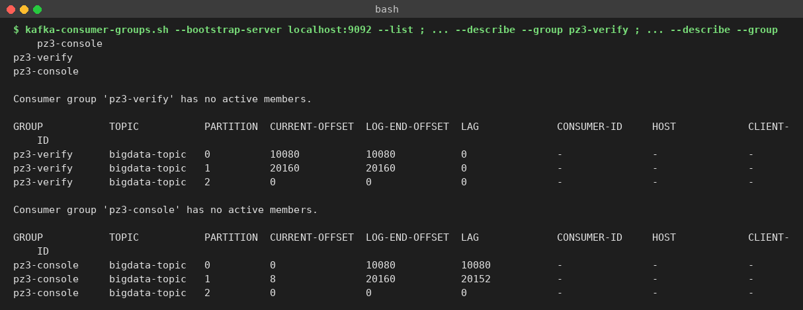
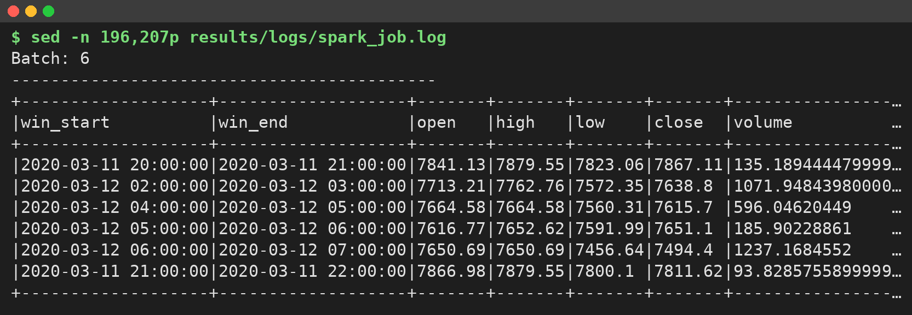
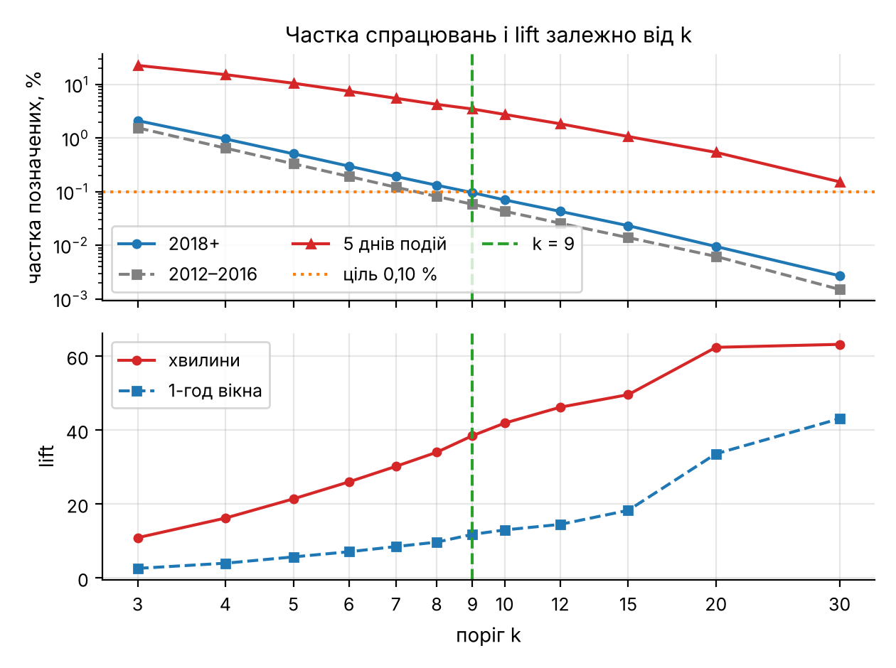
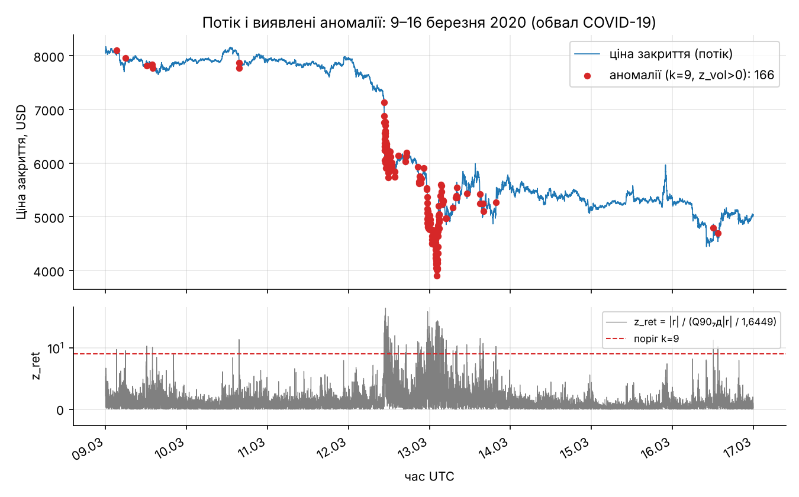
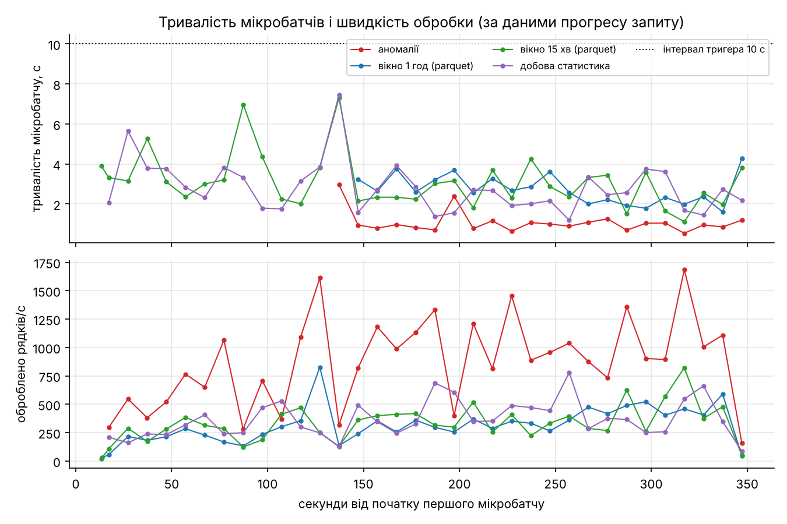

# Мета роботи

Мета роботи: ознайомитися з принципами потокової обробки великих даних та архітектурою Apache Kafka і Spark Structured Streaming; отримати практичні навички формування потоку даних, передавання повідомлень через Kafka та їх обробки засобами Spark у режимі, наближеному до реального часу, на прикладі хвилинних свічок BTC/USD (Bitcoin Historical Data, 7 816 537 записів за 2012–2026 роки).

# Короткі теоретичні відомості

Потокова обробка аналізує записи в міру їх надходження, а не після накопичення всього набору; для хвилинних свічок кожна хвилина ринку стає окремою подією.

Apache Kafka – розподілений журнал повідомлень. Producer записує повідомлення (ключ, значення, мітку часу) у тему (topic), яка поділена на партиції; кожна партиція – впорядкований журнал зі зміщеннями (offsets), а порядок гарантується лише в її межах. Партицію для повідомлення з ключем визначає хеш ключа, тому всі записи з одним ключем потрапляють в одну партицію. Broker зберігає партиції й обслуговує клієнтів; у режимі KRaft метадані кластера веде вбудований кворум контролерів без ZooKeeper. Consumer читає партиції, а споживачі однієї групи (consumer group) ділять партиції між собою й фіксують прочитані зміщення.

Spark Structured Streaming подає потік як необмежену таблицю, до якої дописуються рядки, і виконує над нею звичайний план DataFrame мікробатчами за тригером. Checkpoint зберігає прочитані зміщення та стан агрегацій, що дає змогу відновити запит після збою.

Віконна обробка групує події за часовими вікнами; tumbling-вікна мають фіксовану довжину й не перетинаються. Вікно визначається за часом події (event time) – міткою з самого запису, а не за часом обробки (processing time). Водяна позначка (watermark) дорівнює максимальному баченому часу події мінус допустиме запізнення: стан вікон, старших за неї, видаляється, а пізні записи відкидаються. Режим виводу визначає, що записується після кожного мікробатчу: append – лише остаточно закриті вікна, update – змінені рядки, complete – уся таблиця результату.

# Результати виконання практичного заняття

## 1 Підготовка Kafka

Kafka 3.7.0 запущено як один вузол KRaft із ролями `broker,controller` (`process.roles = [broker, controller]`, порти 9092 і 9093); від запуску до повідомлення `Kafka Server started` минуло 10,11 с. Spark працює в режимі `local[2]`, щоб два з чотирьох ядер лишалися брокеру та producer на тій самій машині. Середовище наведено в таблиці 1.

Таблиця 1 – Програмне середовище та параметри запуску

| Компонент або параметр | Значення |
|---|---|
| Машина | 4 vCPU, 15 ГіБ RAM, Ubuntu 24.04.5 LTS |
| Apache Kafka | 3.7.0 (Scala 2.13), KRaft, 1 брокер |
| Spark / PySpark / конектор | 4.3.0 / 4.3.0 / spark-sql-kafka-0-10_2.13:4.3.0 |
| Producer | confluent-kafka 2, librdkafka 2.16.0 |
| Python / pandas / pyarrow | 3.13.18 / 3.0.5 / 26.0.1 |
| spark.master / driver.memory / shuffle.partitions | local[2] / 2g / 4 |
| Часова зона сесії / тригер / maxOffsetsPerTrigger | UTC / 10 с / 3000 |

Тему `bigdata-topic` створено з 3 партиціями та фактором реплікації 1 (рисунок 1).


Фактор реплікації 1 – максимум для одного брокера. Три партиції відповідають трьом відтворюваним періодам: ключ повідомлення – рік-місяць UTC (`2020-03`, `2021-05`, `2022-11`), тому весь період лягає в одну партицію і порядок хвилин у ньому зберігається, що потрібно для стану правила аномалій (розділ 6). Фактичний розподіл виявився нерівномірним: 10 080 / 20 160 / 0 повідомлень (рисунок 3). Ключі `2020-03` і `2021-05` дали однаковий залишок хешу за модулем 3 і потрапили в партицію 1, а партиція 2 лишилася порожньою: три ключі на три партиції не гарантують взаємно однозначного відображення. На коректність це не впливає, бо порядок у межах ключа збережено, а паралелізм читання й так обмежено `local[2]`.

## 2 Формування потоку

Producer (`producer.py`, лістинг А.1) читає вихідний CSV блоками, відбирає хвилини трьох періодів і надсилає їх у хронологічному порядку: одне повідомлення – одна ринкова хвилина, значення – JSON з полями `ts`, `open`, `high`, `low`, `close`, `volume`.

```python
key = time.strftime("%Y-%m", time.gmtime(ts))   # ключ = період
val = {"ts": ts, "open": num(row.Open), "high": num(row.High), "low": num(row.Low),
       "close": num(row.Close), "volume": num(row.Volume)}
prod.produce(a.topic, key=key, value=json.dumps(val), on_delivery=on_delivery)
prod.poll(0)
time.sleep(a.delay_ms / 1000.0)                  # затримка 10 мс
```

Періоди обрано навколо відомих обвалів, підтверджених денними лог-дохідностями (таблиця 2). Кожен містить спокійніші дні до події, тож у потоці є і фон, і сплеск.

Таблиця 2 – Відтворювані періоди

| Ключ | Дати (UTC) | Хвилин | Подія | Денна лог-дохідність | Партиція |
|---|---|---|---|---|---|
| 2020-03 | 09–16.03.2020 | 11 520 | обвал COVID-19, 12–13.03 | −0,494 / +0,150 | 1 |
| 2021-05 | 17–22.05.2021 | 8 640 | обвал 19.05 | −0,153 | 1 |
| 2022-11 | 06–12.11.2022 | 10 080 | крах FTX, 08–09.11 | −0,104 / −0,156 | 0 |

Затримка 10 мс між повідомленнями імітує потік з прискоренням: 10 хв ринкового часу відтворюються приблизно за 0,1 с. Журнал producer показано на рисунку 2.


Producer надіслав 30 240 повідомлень за 327,041 с (92,465 повід./с) з 0 помилок доставки. Отримання повідомлень перевірено консольним споживачем: перші 8 записів групи `pz3-console` мають ключ `2020-03`, партицію 1 і зміщення 0–7, тобто хвилини надходять у хронологічному порядку. Повне перечитування групою `pz3-verify` завершилося рядком `Processed a total of 30240 messages`. Стан груп наведено на рисунку 3.



Група `pz3-verify` має нульовий lag в усіх партиціях, а `pz3-console`, що прочитала 8 повідомлень, – lag 20 152 у партиції 1. Spark-джерело Kafka зберігає зміщення у власному checkpoint і не фіксує їх у групі, тому в списку груп є лише дві консольні.

## 3 Отримання потоку

Застосунок `streaming_job.py` (лістинг А.2) підписується на тему через конектор `spark-sql-kafka-0-10`:

```python
raw = (spark.readStream.format("kafka")
       .option("kafka.bootstrap.servers", a.bootstrap)
       .option("subscribe", a.topic)
       .option("startingOffsets", "earliest")
       .option("maxOffsetsPerTrigger", a.max_offsets)
       .load())
```

`startingOffsets = earliest` гарантує, що жодне повідомлення не пропущено, навіть якщо producer стартує раніше за запити. Обмеження 3000 зміщень на мікробатч захищає від надмірно великого першого батчу; за тригера 10 с і швидкості producer близько 90 повід./с реальні мікробатчі містили 950–980 рядків. Над одним джерелом запущено сім запитів (рисунок 4).


Усі запити мають статус RUNNING, а середня вхідна швидкість 68,73–75,71 рядків/с через хвилину після старту наближається до швидкості producer. Кожен приймач має власний режим виводу і checkpoint, тому запити окремі.

## 4 Обробка потоку

Декодування і перетворення типів виконуються явною схемою: ключ і значення Kafka приводяться з `binary` до `string`, JSON розбирається функцією `from_json` у структуру з полем `ts` типу `LongType` і п'ятьма полями `DoubleType`, а мітка часу запису Kafka (CreateTime) зберігається для вимірювання затримки. Явна схема не залежить від складу першого мікробатчу.

```python
.withColumn("m", F.from_json("json", schema))               # string -> struct
.select("key", "kafka_epoch", "kafka_offset", "m.*")
.withColumn("event_time", F.col("ts").cast("timestamp"))    # час події
```

Фільтрація відкидає записи з порожніми полями, `high < low`, `close ≤ 0` або від'ємним обсягом. Серед 30 240 повідомлень недопустимих виявилося 0. Групування і статистичне агрегування реалізовано запитом `daily_mem`: групування за календарною добою UTC з кількістю хвилин, середнім і стандартним відхиленням `close`, мінімумом `low`, максимумом `high` і сумою `volume`. Результат містить 21 добу по 1 440 хвилин; найбільший розмах ціни має 19.05.2021 (`min_low` 30 066,0, `max_high` 43 601,63).

Час події `event_time` береться з поля `ts`, тобто з 2020–2022 років, тоді як час обробки – момент мікробатчу 11.11.2026. Вікна за часом обробки залежали б від швидкості відтворення та навантаження хоста, тоді як вікна за часом події детерміновані.

## 5 Віконна обробка

Вікна коротші за 1 хв містили б лише одну свічку, тому обрано tumbling-вікна 15 хв і 1 год: перше показує внутрішньогодинну динаміку обвалу, друге – стандартний масштаб погодинних свічок ПЗ1–ПЗ2. У кожному вікні обчислюється OHLC за правилом first/max/min/last і сума обсягу:

```python
events = valid.withWatermark("event_time", "10 minutes")
g = events.groupBy(F.window("event_time", "1 hour")).agg(
    F.min(F.struct("event_time", "open")).getField("open").alias("open"),
    F.max("high").alias("high"), F.min("low").alias("low"),
    F.max(F.struct("event_time", "close")).getField("close").alias("close"),
    F.sum("volume").alias("volume"), F.count(F.lit(1)).alias("n_candles"))
```

Open і close взято як значення з найменшим і найбільшим `event_time` через `min/max` структури, бо `first/last` у потоковій агрегації залежать від порядку рядків у мікробатчі. Водяна позначка 10 хв обґрунтована тим, що події надходять від одного producer у хронологічному порядку, тож реального запізнення немає, а 10 хв ринкового часу дорівнюють приблизно 0,1 с відтворення: вікно закривається майже одразу після появи наступних хвилин, а стан тримає лише кілька відкритих вікон. Показник Spark UI «Global Watermark Gap» для цих запитів становить близько 2·10⁸ с: це різниця між часом обробки (листопад 2026 року) і водяною позначкою, яка рахується від історичних часів подій 2020–2022 років. Для відтворення історії такий розрив очікуваний. Результат console-приймача наведено на рисунку 5.



У режимі update console-приймач виводить лише вікна, змінені в мікробатчі, тому рядки йдуть не за часом. Повні вікна мають `n_candles` 60. Коректність агрегатів перевірено скриптом `verify_windows.py` (лістинг А.7) проти `pandas.resample` на тих самих хвилинах (таблиця 3).

Таблиця 3 – Порівняння віконних агрегатів Spark і pandas

| Показник | Вікна 15 хв | Вікна 1 год |
|---|---|---|
| Вікон у pandas | 2 016 | 504 |
| Рядків memory-приймача (update, з проміжними оновленнями) | 2 047 | 537 |
| Вікон Spark після залишення останнього оновлення | 2 016 | 504 |
| Вікон лише в одному з джерел | 0 | 0 |
| max \|Δ\| open, high, low, close, n_candles | 0 | 0 |
| max \|Δ\| volume | 4,5·10⁻¹³ | 2,7·10⁻¹² |
| Вікон у parquet-приймачі (append) | 2 015 | 503 |
| Вікон, не записаних parquet-приймачем | 1 | 1 |

Усі вікна збіглися, а розбіжність обсягу на рівні 10⁻¹² пояснюється іншим порядком додавання чисел з плаваючою комою. Зайві рядки memory-приймача – проміжні оновлення вікон, що розтягнулися на два мікробатчі (режим update). У режимі append parquet-приймач записав 2 015 з 2 016 і 503 з 504 вікон: останнє вікно кожного масштабу не записується ніколи. Вікно 23:00–24:00 12.11.2022 закривається, коли водяна позначка досягне 24:00, тобто коли надійде подія з часом не раніше 00:10 13.11.2022; потік закінчується на 23:59, і після його зупинки водяна позначка більше не зростає, тому вікно назавжди лишається у стані. Для скінченного відтворення потрібен update-приймач або завершальна «сигнальна» подія. Вікна для 12.03.2020 показано на рисунку 6.


На 15-хв вікнах видно два етапи обвалу 12.03.2020: падіння з 7 300 до 6 000 USD близько 10:30–11:30 UTC і другу хвилю наприкінці доби. Обсяг за 1-год вікнами в ці години зростає до 6 000–9 000 BTC проти кількох сотень у звичайні години.

## 6 Виявлення аномалій

### 6.1 Перша версія правила

Перша версія позначала хвилину, якщо |r| перевищувало k·1,4826·MAD за попередні 60 хв або обсяг перевищував медіану за 60 хв у k_v разів. Вона виявилася непридатною: за k ∈ {3, 5, 7, 10} позначалося 9,9–27,1 % хвилин, у відтворених періодах частота позначок становила лише 0,53–0,90 від звичайної, а за бюджету тривог 0,10 % lift днів подій дорівнював 0,3 при частці позначених хвилин 2012–2016 років 5,07 %.

### 6.2 Правило v2

Позначимо r_t = ln(C_t / C_{t−1}). Активною вважається хвилина з V_t > 0; пласкі хвилини з нульовим обсягом (16,79 % історії) є заповненням сітки, тому не оцінюються і не входять до бази. База B_t – активні хвилини серед 10 080 попередніх (7 діб), без поточної:

```
sigma_t = Q0,90{|r_i| : i ∈ B_t} / 1,6449
z_ret,t = |r_t| / sigma_t
z_vol,t = (ln V_t − Q0,50{ln V_i}) / ((Q0,75{ln V_i} − Q0,25{ln V_i}) / 1,349)
аномалія_t ⇔ z_ret,t > k і z_vol,t > 0,   k = 9
```

Константи 1,6449 і 1,349 роблять обидві шкали незміщеними оцінками σ для нормального розподілу. Оцінка виконується лише за не менше ніж 3 360 активних хвилин у базі; ця умова відкидає майже весь 2012 рік, і з 7 816 537 хвилин оцінено 6 453 867.

Кожен елемент формули обрано порівнянням 19 варіантів на всій історії за однакового бюджету тривог: для кожного варіанта поріг підбирався так, щоб позначалося 0,10 % активних хвилин 2018+, після чого порівнювалися lift (частка позначених хвилин у п'яти днях подій, поділена на частку в інші дні 2018+), частка позначок у 2012–2016 роках і ранги днів подій (таблиця 4, рисунок 7).

Таблиця 4 – Варіанти правила за однакового бюджету тривог 0,10 % (2018+)

| База | Шкала або комбінація | Поріг | Lift | Позначено 2012–2016, % | Ранги 12.03.20 / 13.03.20 / 19.05.21 / 08.11.22 / 09.11.22 |
|---|---|---|---|---|---|
| 60 хв | MAD | 118,11 | 0,0 | 1,7518 | 1286 / 1286 / 1286 / 1286 / 1286 |
| 60 хв | Q90 | 7,63 | 0,6 | 0,2697 | 3062 / 3062 / 1827 / 695 / 3062 |
| 24 год | MAD | 37,68 | 0,3 | 0,9245 | 352 / 482 / 482 / 352 / 482 |
| 24 год | Q90 | 8,64 | 7,0 | 0,0499 | 9 / 1895 / 20 / 35 / 1895 |
| 7 діб | MAD | 13,14 | 36,9 | 3,4019 | 258 / 205 / 367 / 231 / 303 |
| 7 діб | Q90 | 8,87 | 38,4 | 0,0648 | 1 / 2 / 25 / 4 / 65 |
| 7 діб | Q99 | 5,72 | 17,2 | 0,0604 | 3 / 34 / 12 / 11 / 434 |
| 7 діб, та сама година | Q90 | 8,73 | 35,5 | 0,0725 | 4 / 1 / 19 / 11 / 27 |
| 7 діб | лише обсяг | 2,59 | 11,3 | 0,5099 | 381 / 1133 / 25 / 219 / 1787 |
| 7 діб | Q90 і z_vol > 0 | 8,87 | 38,4 | 0,0613 | 1 / 2 / 25 / 4 / 63 |
| 7 діб | Q90 і z_vol > 2 | 6,97 | 23,2 | 0,0548 | 1 / 51 / 10 / 2 / 303 |
| 60 хв (v1) | MAD або обсяг | 1,28 | 0,3 | 5,0698 | 3406 / 3406 / 3406 / 2262 / 3406 |


Довжина бази визначає, чи «розчиниться» подія: за 60 хв і 24 год шкала зростає вже під час обвалу, і lift не перевищує 7,0, тоді як 7-денна база охоплює повний тижневий цикл цілодобового ринку й реагує на зміну режиму повільніше за обвал (lift 36,9–38,4). Шкалу Q90 обрано замість MAD через точні нулі дохідності: у тонкому ринку частка активних хвилин з r = 0 становить 42,6 % у 2012 році, 29,4 % у 2013 році й 25,0 % у 2016 році проти 0,4 % у 2021 році. Медіана |r| за такої частки нулів майже нульова, будь-яка угода виглядає як багатосигмова, і за MAD 2012–2016 роки отримують 3,40 % позначок, у 34 рази більше за ціль. 90-й перцентиль лишається інформативним і за 30 % нулів, тож частка 2012–2016 падає до 0,0648 % за найвищого lift. Q99 після бурхливого тижня завищена (lift 17,2), а база за годиною доби результату не покращує (35,5).

Обсяг використано як підтвердження, а не як тригер. Робастний z логарифма обсягу рідко буває великим: у 2018+ його 99,99-й перцентиль дорівнює 3,067, максимум – 4,239. Тому правило лише за обсягом має lift 11,3 і 60,6 % позначок у 2012–2016 роках, а комбінація «АБО» збігається з правилом за дохідністю. Умова z_vol > 0 (обсяг вище тижневої медіани) знижує частку 2012–2016 з 0,0648 до 0,0613 % без втрати lift, тоді як жорсткіша z_vol > 2 зменшує lift до 23,2.

### 6.3 Вибір порогу k

Поріг обрано за бюджетом тривог: найменше k із сітки, за якого позначається не більше 0,10 % активних хвилин 2018+, тобто близько 1,4 тривоги на добу. Залежність від k показано на рисунку 8 і в таблиці 5.



Таблиця 5 – Кількість спрацювань правила v2 для різних k (уся історія)

| k | Позначено хвилин | Частка 2018+, % | Тривог на добу 2018+ | Частка 2012–2016, % | Хвилин у днях подій | Lift (хвилини) | Lift (вікна 1 год) |
|---|---|---|---|---|---|---|---|
| 3 | 126 956 | 2,1178 | 30,50 | 1,5564 | 1 636 | 10,9 | 2,6 |
| 5 | 29 528 | 0,5093 | 7,33 | 0,3318 | 761 | 21,4 | 5,7 |
| 7 | 11 009 | 0,1918 | 2,76 | 0,1213 | 398 | 30,2 | 8,5 |
| 8 | 7 527 | 0,1321 | 1,90 | 0,0816 | 307 | 34,0 | 9,7 |
| 9 | 5 437 | 0,0959 | 1,38 | 0,0582 | 251 | 38,5 | 11,8 |
| 10 | 3 985 | 0,0702 | 1,01 | 0,0431 | 199 | 41,9 | 13,0 |
| 20 | 540 | 0,0095 | 0,14 | 0,0062 | 39 | 62,4 | 33,6 |

За k = 3…7 правило дає 2,76–30,50 тривоги на добу. Обрано k = 9: 0,0959 % (1,38 тривоги на добу). Подальше зростання k підвищує lift, але зменшує кількість позначених хвилин у самих днях подій (251 за k = 9, 199 за k = 10, 39 за k = 20). Частка 2012–2016 років (0,0582 %) нижча, ніж у 2018+, тобто тонкий ринок не перекошує правило.

У потоці правило виконується в `foreachBatch` класом `StreamScorer` (лістинг А.3), який для кожного ключа Kafka тримає буфер останніх 10 081 хвилини. Тижневу базу неможливо накопичити з 6–8-денних періодів, тому перед першою хвилиною кожного періоду буфер прогрівається 10 081 хвилиною історії з parquet (рисунок 9). Повторний прогін з правилом v2 виконано з темою `bigdata-topic-v2` (ті самі періоди і producer, 30 240 повідомлень за 310,945 с).


Найбільше аномалій дали мікробатчі 6 і 7 (50 і 96, max z_ret 52,7 і 45,2), що відповідають 12.03.2020. Середня затримка від запису в Kafka до обробки становить 3,7–6,4 с, основну частину якої складає очікування тригера 10 с.

## 7 Збереження результатів

Віконні агрегати записуються parquet-приймачами в режимі append з окремим checkpoint для кожного запиту; файловий приймач підтримує лише цей режим, і кожне вікно записується один раз в остаточному вигляді (дублікатів 0).

```python
(w1h.writeStream.queryName("sink_win1h").outputMode("append").format("parquet")
    .option("path", os.path.join(a.out, "parquet", "win1h"))
    .option("checkpointLocation", os.path.join(a.ckpt, "win1h"))
    .trigger(processingTime="10 seconds").start())
```

Memory-приймачі в режимі update використано для перевірки й добової статистики, а після завершення їх вміст збережено у CSV і parquet. Оцінки всіх хвилин потоку `foreachBatch` записує у файл `part-<batch_id>.parquet`; повторне виконання того самого батчу після збою перезаписує файл, тому запис ідемпотентний. Для ПЗ4 сформовано `pz3_anomalies.csv` і `.parquet` – 5 437 аномальних хвилин за всю історію, з них 272 у відтворених періодах. Стан `StreamScorer` живе в драйвері, а не в checkpoint, і після перезапуску відновлюється повторним прогрівом з parquet.

## 8 Аналіз результатів

### 8.1 Аномалії в потоці та збіг з офлайн-оцінкою

Потокову оцінку порівняно з офлайн-оцінкою тієї самої функції `score()` на всій історії (таблиця 6).

Таблиця 6 – Аномалії у відтворених періодах: потік і офлайн-оцінка

| Період | Оцінено хвилин | Аномалій у потоці | Аномалій офлайн | На добу | Відношення до бази 2018+ | Lift (вікна 15 хв) | Lift (вікна 1 год) | max z_ret |
|---|---|---|---|---|---|---|---|---|
| 2020-03 | 11 461 | 166 | 166 | 20,86 | 16,0 | 8,2 | 5,6 | 52,69 |
| 2021-05 | 8 640 | 29 | 29 | 4,83 | 3,7 | 2,8 | 2,4 | 17,38 |
| 2022-11 | 9 915 | 77 | 77 | 11,18 | 8,6 | 5,0 | 3,7 | 85,31 |
| Разом | 30 016 | 272 | 272 | – | – | – | – | – |

Порівнянням 30 016 оцінених хвилин встановлено max |Δz_ret| = max |Δz_vol| = max |Δsigma| = 0 і 0 розбіжностей прапорців; 224 пласкі хвилини не оцінено ні в потоці, ні офлайн. Отже, потокова реалізація з прогрівом бази точно відтворює офлайн-правило. Усі три періоди мають частоту аномалій у 3,7–16,0 раза вищу за базову (1,3 на добу), найвищу – березень 2020 року (рисунок 10).



Позначки зосереджені на двох хвилях обвалу 12.03.2020 і відскоку 13.03.2020.

### 8.2 Відомі події

Перевірку п'яти днів відомих подій наведено в таблиці 7; ранг – місце дати серед 1 572 дат з позначками за кількістю аномалій.

Таблиця 7 – Виявлення відомих подій правилом v2 (k = 9)

| Дата | Аномалій | Ранг (уся історія) | Ранг (2018+) | Позначених вікон 1 год | max z_ret | Медіана sigma за добу | Lift (хвилини) |
|---|---|---|---|---|---|---|---|
| 12.03.2020 | 82 | 1 | 1 | 11 | 52,69 | 0,00104 | 62,9 |
| 13.03.2020 | 75 | 2 | 2 | 13 | 31,26 | 0,00193 | 57,5 |
| 19.05.2021 | 23 | 27 | 19 | 4 | 17,38 | 0,00188 | 17,6 |
| 08.11.2022 | 59 | 4 | 4 | 8 | 85,31 | 0,00048 | 45,4 |
| 09.11.2022 | 12 | 66 | 51 | 5 | 20,61 | 0,00072 | 9,2 |

Обвал COVID-19 12–13.03.2020 і крах FTX 08.11.2022 виявлено повністю: ранги 1, 2 і 4, lift 45,4–62,9. Події 19.05.2021 і 09.11.2022 виявлено лише частково (ранги 27 і 66), і причина спільна: тижнева база вже містила попередній розпродаж. Травневе падіння 2021 року тривало з 12.05, тому медіанна sigma 19.05 (0,00188) у 1,8 раза вища, ніж 12.03.2020 (0,00104), і позначено лише фазу найрізкішого падіння – 23 хвилини між 11:31 і 14:45 UTC. Для 09.11.2022 база включала крах попередньої доби (sigma зросла з 0,00048 до 0,00072), а падіння (лог-дохідність доби −0,156) розгорталося поступово, без окремих хвилинних стрибків. Правило реагує на раптові хвилинні рухи відносно попереднього тижня, а не на багатоденні тренди.

Серед топ-20 дат історії 13 належать до 2018+, 1 – до 2017 року і 6 – до 2012–2016 років; останні також є реальними обвалами (10.04.2013, 19.11.2013, 02.10.2013).

### 8.3 Закономірності

Розподіл аномалій за днем тижня, годиною доби й роками наведено на рисунку 11.


У 2018+ аномалії вдвічі рідші у вихідні (0,0509 % у суботу і 0,0532 % у неділю проти 0,131 % у середу), а за годиною доби частка зростає з 0,0358 % о 07 UTC до 0,1556 % о 14 UTC. Це збігається з робочим часом і відкриттям американських ринків, коли надходять макроекономічні новини. За роками частка коливається від 0,0233 % (2016) до 0,1539 % (2013) і 0,1529 % (2019).

### 8.4 Продуктивність

Метрики взято з `query.recentProgress` першого прогону, у якому одночасно працювали сім запитів (таблиця 8, рисунок 12). Хост був спільний з іншими завданнями (loadavg 4,9–12,3 на 4 vCPU), тому значення занижені відносно ізольованої машини.

Таблиця 8 – Метрики потокових запитів (тригер 10 с, local[2])

| Запит | Мікробатчів з даними | Тривалість, середня / медіана / p95 / max, мс | Оброблено рядків/с, середнє | Вхід, рядків/с |
|---|---|---|---|---|
| anomaly (перший прогін) | 34 | 1084,1 / 964,5 / 2332,6 / 2968,0 | 868,9 | 88,9 |
| console_1h | 34 | 2832,4 / 2713,5 / 4899,4 / 5825,0 | 396,0 | 89,4 |
| mem_daily | 34 | 2828,1 / 2692,5 / 4525,5 / 7449,0 | 367,4 | 89,6 |
| mem_win15m | 34 | 2595,8 / 2055,5 / 5620,5 / 5886,0 | 451,1 | 89,7 |
| mem_win1h | 34 | 2609,6 / 2362,5 / 5090,0 / 6389,0 | 424,4 | 89,9 |
| sink_win15m | 35 | 3130,7 / 3019,0 / 5772,4 / 7310,0 | 328,7 | 87,9 |
| sink_win1h | 35 | 2724,7 / 2604,0 / 3758,0 / 4269,0 | 311,5 | 87,9 |



Усі мікробатчі тривали менше за інтервал тригера 10 с (максимум 7 449 мс), а середня швидкість обробки в 3,5–10 разів перевищує вхідну, отже система встигає за потоком із запасом. Найповільніші – parquet-приймачі, що записують файл і checkpoint. Наскрізна затримка від CreateTime у Kafka до `foreachBatch` становить у середньому 5,791 с, максимум 12,354 с; її основна частина – очікування тригера, а власне обробка в `foreachBatch` займає в середньому 0,643 с. Офлайн-оцінка всієї історії (7 816 537 хвилин) правилом v2 тривала 75,5 с, порівняння 19 варіантів – 127 с, повторний потоковий прогін v2 – 340,7 с.

# Висновки

1. Kafka 3.7.0 розгорнуто в режимі KRaft на одному вузлі, створено тему `bigdata-topic` з 3 партиціями; ключ «рік-місяць» зберігає порядок хвилин періоду, але хеш трьох ключів дав розподіл 10 080 / 20 160 / 0 з порожньою партицією 2.

2. Producer передав 30 240 хвилинних свічок трьох періодів високої волатильності (березень 2020, травень 2021, листопад 2022) із затримкою 10 мс за 327,041 с без помилок доставки; повне перечитування консольним споживачем підтвердило всі 30 240 повідомлень.

3. Spark Structured Streaming-застосунок отримує повідомлення з Kafka; над одним джерелом працювали сім запитів.

4. Реалізовано декодування з явною схемою, перетворення типів, фільтрацію, групування й агрегування за добою.

5. Віконні OHLC-агрегати 15 хв і 1 год за часом події з водяною позначкою 10 хв збіглися з `pandas.resample` в усіх 2 016 і 504 вікнах; parquet-приймач у режимі append не записує останнє вікно, бо водяна позначка скінченного потоку не переходить його кінець.

6. Розроблено правило аномалій v2: |r| понад 9 робастних сигм за 7-денною базою Q90 із підтвердженням обсягом вище тижневої медіани. Конструкцію обґрунтовано порівнянням 19 варіантів (lift 38,4 проти 0,3 у першої версії), поріг – бюджетом 0,10 % тривог (1,38 на добу).

7. Результати збережено у parquet з checkpoint; 5 437 аномалій історії – у `pz3_anomalies.csv` для ПЗ4.

8. Потокова оцінка точно збіглася з офлайн (272 = 272 аномалії, max |Δz| = 0); обвали 12–13.03.2020 і 08.11.2022 мають ранги 1, 2 і 4, а 19.05.2021 і 09.11.2022 виявлено частково через уже підвищену тижневу базу. Аномалії концентруються в робочі дні й о 13–15 UTC; мікробатчі тривали не більше 7 449 мс за тригера 10 с, середня наскрізна затримка – 5,791 с.

Набуто практичних навичок роботи з Apache Kafka і Spark Structured Streaming: організації потоку даних, потокової віконної агрегації за часом події та виявлення аномальних подій у потоці.

# Додаток А. Лістинг програми

## А.1 Файл producer.py – producer: відтворення хвилинних свічок у Kafka

```python
# -*- coding: utf-8 -*-
"""Producer: відтворює 1-хвилинні свічки BTC/USD у Kafka (ПЗ3, завдання 2).
1 повідомлення = 1 ринкова хвилина; key = рік-місяць UTC (YYYY-MM); value = JSON.
Затримка між повідомленнями імітує потік (прискорене відтворення)."""
import argparse, json, os, sys, time
import pandas as pd
from confluent_kafka import Producer

p = argparse.ArgumentParser()
p.add_argument("--csv", required=True)
p.add_argument("--bootstrap", default="localhost:9092")
p.add_argument("--topic", default="bigdata-topic")
# періоди відтворення: "YYYY-MM-DD:YYYY-MM-DD,..." (межі включно, UTC)
p.add_argument("--periods", default="2020-03-09:2020-03-16,2021-05-17:2021-05-22,2022-11-06:2022-11-12")
p.add_argument("--delay-ms", type=float, default=10.0)
p.add_argument("--max-rows", type=int, default=0, help="0 = без обмеження (для smoke-тесту)")
p.add_argument("--stats", default="")
p.add_argument("--done-flag", default="")
a = p.parse_args()

# --- вибір рядків потрібних періодів (читаємо CSV блоками, щоб не тримати всю історію в RAM)
bounds = []
for item in a.periods.split(","):
    s, e = item.split(":")
    lo = int(pd.Timestamp(s, tz="UTC").timestamp())
    hi = int((pd.Timestamp(e, tz="UTC") + pd.Timedelta(days=1)).timestamp())  # межа виключно
    bounds.append((lo, hi))
parts = []
for ch in pd.read_csv(a.csv, chunksize=1_000_000):
    ch.columns = [c.strip() for c in ch.columns]
    ch["Timestamp"] = ch["Timestamp"].astype("int64")
    m = False
    for lo, hi in bounds:
        m = m | ((ch["Timestamp"] >= lo) & (ch["Timestamp"] < hi))
    if m.any():
        parts.append(ch[m])
if not parts:
    sys.exit("ПОМИЛКА: у CSV немає жодного рядка для вказаних періодів " + a.periods)
df = pd.concat(parts).sort_values("Timestamp").reset_index(drop=True)
if a.max_rows:
    df = df.head(a.max_rows)
print(f"[producer] рядків до відправки: {len(df)}; затримка {a.delay_ms} мс; тема {a.topic}", flush=True)

prod = Producer({"bootstrap.servers": a.bootstrap, "linger.ms": 5, "acks": "1"})
errors = []
def on_delivery(err, msg):  # зворотний виклик: рахуємо помилки доставки
    if err is not None:
        errors.append(str(err))

def num(x):  # NaN -> null у JSON
    return None if pd.isna(x) else float(x)

t0 = time.time()
sent = 0
for row in df.itertuples(index=False):
    ts = int(row.Timestamp)
    key = time.strftime("%Y-%m", time.gmtime(ts))   # ключ = період (рік-місяць): кожен період іде в одну партицію, порядок у межах періоду збережено
    val = {"ts": ts, "open": num(row.Open), "high": num(row.High), "low": num(row.Low),
           "close": num(row.Close), "volume": num(row.Volume)}
    prod.produce(a.topic, key=key, value=json.dumps(val), on_delivery=on_delivery)
    prod.poll(0)
    sent += 1
    if sent % 2000 == 0:
        print(f"[producer] надіслано {sent}/{len(df)}  ({sent/(time.time()-t0):.1f} повід./с)", flush=True)
    time.sleep(a.delay_ms / 1000.0)
prod.flush(60)
el = time.time() - t0
stats = {"sent": sent, "delivery_errors": len(errors), "seconds": round(el, 3),
         "msg_per_s": round(sent / el, 3), "delay_ms": a.delay_ms, "topic": a.topic, "periods": a.periods}
print("[producer] завершено:", json.dumps(stats, ensure_ascii=False), flush=True)
if a.stats:
    json.dump(stats, open(a.stats, "w"))
if a.done_flag:
    json.dump(stats, open(a.done_flag, "w"))
sys.exit(1 if errors else 0)
```

## А.2 Файл streaming_job.py – Spark Structured Streaming: читання, обробка, вікна, аномалії, збереження

```python
# -*- coding: utf-8 -*-
"""Spark Structured Streaming: Kafka -> розбір JSON -> віконна агрегація -> аномалії -> parquet (ПЗ3, завдання 3-7)."""
import argparse, glob, json, os, sys, time
import numpy as np
import pandas as pd
from pyspark.sql import SparkSession, functions as F, types as T

sys.path.insert(0, os.path.dirname(os.path.abspath(__file__)))
from anomaly_rule import StreamScorer, K_SEL, WINDOW, load_history_parquet

ap = argparse.ArgumentParser()
ap.add_argument("--bootstrap", default="localhost:9092")
ap.add_argument("--topic", default="bigdata-topic")
ap.add_argument("--out", required=True)
ap.add_argument("--ckpt", required=True)
ap.add_argument("--done-flag", required=True)
ap.add_argument("--kafka-pkg", required=True)
ap.add_argument("--watermark", default="10 minutes")
ap.add_argument("--trigger-seconds", type=int, default=10)
ap.add_argument("--max-offsets", type=int, default=3000)
ap.add_argument("--k", type=float, default=K_SEL)
ap.add_argument("--history-parquet", required=True, help="історія для прогріву 7-денної бази (дані ДО кожного періоду відтворення)")
ap.add_argument("--only-anomaly", action="store_true", help="запустити лише запит аномалій (віконні запити не перезапускаються)")
ap.add_argument("--ui-port", type=int, default=4040, help="порт Spark UI (якщо зайнятий – Spark бере наступний вільний)")
ap.add_argument("--max-seconds", type=int, default=1200)
a = ap.parse_args()
# Seed: випадкових величин у конвеєрі немає (правило детерміноване), тому seed 42 не потрібен; зафіксовано для відповідності RULES.
SEED = 42; np.random.seed(SEED)

os.makedirs(a.out, exist_ok=True)
PARTS = os.path.join(a.out, "scored_parts"); os.makedirs(PARTS, exist_ok=True)

spark = (SparkSession.builder.appName("PZ3-bitcoin-streaming" + ("-anomaly-v2" if a.only_anomaly else "")).master("local[2]")
         .config("spark.jars.packages", a.kafka_pkg)
         .config("spark.sql.shuffle.partitions", "4")
         .config("spark.sql.session.timeZone", "UTC")     # вікна вирівнюються по UTC
         .config("spark.driver.memory", "2g")
         .config("spark.ui.port", str(a.ui_port))
         .config("spark.sql.streaming.forceDeleteTempCheckpointLocation", "true")
         .getOrCreate())
spark.sparkContext.setLogLevel("WARN")
print("[job] Spark UI:", spark.sparkContext.uiWebUrl, flush=True)
print("[job] Spark", spark.version, "| пакет", a.kafka_pkg, flush=True)

# ---------- Завдання 3: читання з Kafka ----------
raw = (spark.readStream.format("kafka")
       .option("kafka.bootstrap.servers", a.bootstrap)
       .option("subscribe", a.topic)
       .option("startingOffsets", "earliest")
       .option("maxOffsetsPerTrigger", a.max_offsets)   # обмеження розміру мікробатчу
       .option("failOnDataLoss", "false")
       .load())

# ---------- Завдання 4: декодування, типи, фільтрація ----------
schema = T.StructType([                       # явна схема JSON-повідомлення
    T.StructField("ts", T.LongType()), T.StructField("open", T.DoubleType()),
    T.StructField("high", T.DoubleType()), T.StructField("low", T.DoubleType()),
    T.StructField("close", T.DoubleType()), T.StructField("volume", T.DoubleType())])
parsed = (raw.select(F.col("key").cast("string").alias("key"),                # bytes -> string
                     F.col("value").cast("string").alias("json"),
                     F.col("timestamp").cast("double").alias("kafka_epoch"),  # час запису в Kafka (CreateTime)
                     F.col("offset").alias("kafka_offset"))
          .withColumn("m", F.from_json("json", schema))                       # string -> struct
          .select("key", "kafka_epoch", "kafka_offset", "m.*")
          .withColumn("event_time", F.col("ts").cast("timestamp"))            # ЧАС ПОДІЇ (unix с), а не час обробки
          .withColumn("valid", F.col("ts").isNotNull() & F.col("open").isNotNull() & F.col("close").isNotNull()
                      & F.col("high").isNotNull() & F.col("low").isNotNull() & F.col("volume").isNotNull()
                      & (F.col("high") >= F.col("low")) & (F.col("close") > 0) & (F.col("volume") >= 0)))
valid = parsed.filter("valid")                                                # фільтрація некоректних записів

# watermark: допустиме запізнення подій 10 хв (докладніше у ноутбуці)
events = valid.withWatermark("event_time", a.watermark)

# ---------- Завдання 5: віконні агрегації (tumbling) ----------
def win_agg(df, dur):
    g = df.groupBy(F.window("event_time", dur)).agg(
        F.min(F.struct("event_time", "open")).getField("open").alias("open"),    # open = значення з найранішим event_time
        F.max("high").alias("high"), F.min("low").alias("low"),
        F.max(F.struct("event_time", "close")).getField("close").alias("close"), # close = значення з найпізнішим event_time
        F.sum("volume").alias("volume"), F.count(F.lit(1)).alias("n_candles"))
    return g.select(F.col("window.start").alias("win_start"), F.col("window.end").alias("win_end"),
                    "open", "high", "low", "close", "volume", "n_candles")

w15, w1h = win_agg(events, "15 minutes"), win_agg(events, "1 hour")
# групування + статистичне агрегування по календарній добі (без вікна)
daily = (events.groupBy(F.to_date("event_time").alias("trade_date"))
         .agg(F.count(F.lit(1)).alias("n"), F.avg("close").alias("avg_close"), F.stddev("close").alias("std_close"),
              F.min("low").alias("min_low"), F.max("high").alias("max_high"), F.sum("volume").alias("volume")))

trig = {"processingTime": f"{a.trigger_seconds} seconds"}
Q = {}
if not a.only_anomaly:
    start_window_queries = True
else:
    start_window_queries = False
# ---------- Завдання 7: parquet-приймачі (append: вікно записується після закриття водяною позначкою) ----------
for name, df in ((("win15m", w15), ("win1h", w1h)) if start_window_queries else ()):
    Q[f"sink_{name}"] = (df.writeStream.queryName(f"sink_{name}").outputMode("append").format("parquet")
                         .option("path", os.path.join(a.out, "parquet", name))
                         .option("checkpointLocation", os.path.join(a.ckpt, name)).trigger(**trig).start())
# memory-приймачі (update): повний поточний стан вікон для перевірки та скріншотів
if start_window_queries:
  Q["mem_win15m"] = w15.writeStream.queryName("win15m_mem").outputMode("update").format("memory").trigger(**trig).start()
  Q["mem_win1h"] = w1h.writeStream.queryName("win1h_mem").outputMode("update").format("memory").trigger(**trig).start()
  Q["mem_daily"] = daily.writeStream.queryName("daily_mem").outputMode("update").format("memory").trigger(**trig).start()
# console-приймач для демонстрації (вивід у лог)
  Q["console_1h"] = (w1h.writeStream.queryName("console_1h").outputMode("update").format("console")
                     .option("truncate", "false").option("numRows", 6).trigger(**trig).start())

# ---------- Завдання 6: аномалії у foreachBatch зі станом ----------
# Стан: окремий буфер останніх W+1 = 10 081 хвилин (7 діб) для кожного ключа Kafka (= період відтворення).
# Перед першою хвилиною кожного періоду буфер ПРОГРІВАЄТЬСЯ історією з parquet (7 діб до початку періоду),
# тому оцінюється кожна хвилина потоку, а результат збігається з офлайн-оцінкою на всій історії.
scorer = StreamScorer(load_history_parquet(a.history_parquet), k=a.k)
BATCH_LOG = []
def process_batch(bdf, batch_id):
    t0 = time.time()
    pdf = bdf.select("key", "ts", "close", "volume", "valid", "kafka_epoch").toPandas()
    n_pw = len(scorer.prewarm_log)
    n_raw, n_valid = len(pdf), int(pdf["valid"].sum())
    lat = (time.time() - pdf["kafka_epoch"]).to_numpy() if n_raw else np.array([np.nan])
    res = scorer.update(pdf[pdf["valid"]]) if n_valid else pd.DataFrame()
    n_anom = 0
    if len(res):
        res = res.copy()
        res["batch_id"] = batch_id
        res.to_parquet(os.path.join(PARTS, f"part-{batch_id:05d}.parquet"), index=False)  # ідемпотентний запис
        n_anom = int(res["anomaly"].sum())
    rec = {"batch_id": batch_id, "n_raw": n_raw, "n_invalid": n_raw - n_valid, "n_valid": n_valid,
           "n_anomalies": n_anom, "latency_mean_s": float(np.nanmean(lat)),
           "latency_p95_s": float(np.nanpercentile(lat, 95)), "latency_max_s": float(np.nanmax(lat)),
           "foreachbatch_s": round(time.time() - t0, 3)}
    BATCH_LOG.append(rec)
    for pw in scorer.prewarm_log[n_pw:]:
        print(f"[anomaly] прогрів бази з parquet: ключ {pw['key']}, {pw['prewarm_rows']} хв до "
              f"{pd.to_datetime(pw['first_stream_ts'], unit='s')} UTC", flush=True)
    mx = float(res["z_ret"].max()) if len(res) else float("nan")
    print(f"[anomaly] batch {batch_id}: рядків {n_raw}, аномалій {n_anom}, max z_ret {mx:.1f}, "
          f"затримка середня {rec['latency_mean_s']:.1f} с", flush=True)

Q["anomaly"] = (parsed.writeStream.queryName("anomaly").foreachBatch(process_batch)
                .option("checkpointLocation", os.path.join(a.ckpt, "anomaly")).trigger(**trig).start())
print("STREAMING_STARTED", [q.name for q in Q.values()], flush=True)

# ---------- моніторинг: збір прогресу, умова зупинки ----------
PROG = {}
def collect():
    for key, q in Q.items():
        for p in q.recentProgress:
            PROG[(key, p["batchId"])] = {
                "query": key, "batch_id": p["batchId"], "timestamp": p["timestamp"],
                "num_input_rows": p["numInputRows"], "input_rows_per_s": p.get("inputRowsPerSecond"),
                "processed_rows_per_s": p.get("processedRowsPerSecond"),
                "trigger_execution_ms": p["durationMs"].get("triggerExecution"),
                "add_batch_ms": p["durationMs"].get("addBatch"),
                "get_batch_ms": p["durationMs"].get("getBatch"),
                "watermark": (p.get("eventTime") or {}).get("watermark")}
def totals():
    t = {k: 0 for k in Q}
    for (k, _), v in PROG.items():
        t[k] += v["num_input_rows"] or 0
    return t

t_start, status, expected = time.time(), "timeout", None
while time.time() - t_start < a.max_seconds:
    time.sleep(5)
    collect()
    for k, q in Q.items():
        if q.exception():
            print("ПОМИЛКА у запиті", k, q.exception(), flush=True); status = "query_failed"
    if status == "query_failed":
        break
    if expected is None and os.path.exists(a.done_flag):
        try:
            expected = json.load(open(a.done_flag))["sent"]
        except Exception:
            expected = None
    tt = totals()
    print(f"[job] t={time.time()-t_start:.0f}с прочитано(anomaly)={tt['anomaly']} очікується={expected}", flush=True)
    if expected is not None and all(v >= expected for v in tt.values()):
        time.sleep(2 * a.trigger_seconds)   # дати завершитися останнім мікробатчам
        collect(); status = "ok"
        break

# ---------- збереження результатів ----------
summary = {"status": status, "expected_messages": expected, "input_totals": totals(),
           "seconds": round(time.time() - t_start, 1)}
pd.DataFrame(scorer.prewarm_log).to_csv(os.path.join(a.out, "prewarm_log.csv"), index=False)
if status in ("ok", "timeout") and not a.only_anomaly:
    for tbl, fn in (("win15m_mem", "win15m_all"), ("win1h_mem", "win1h_all"), ("daily_mem", "daily_stats")):
        d = spark.table(tbl).toPandas()
        d = d.sort_values(d.columns[0]).reset_index(drop=True)
        d.to_csv(os.path.join(a.out, fn + ".csv"), index=False)
        d.to_parquet(os.path.join(a.out, fn + ".parquet"), index=False)
        summary[fn + "_rows"] = len(d)
        print(f"[job] {tbl}: {len(d)} рядків -> {fn}.csv", flush=True)
        if tbl == "win1h_mem":
            print(d.head(8).to_string(index=False), flush=True)
pd.DataFrame(list(PROG.values())).sort_values(["query", "batch_id"]).to_csv(os.path.join(a.out, "progress.csv"), index=False)
pd.DataFrame(BATCH_LOG).to_csv(os.path.join(a.out, "batch_stats.csv"), index=False)
parts = sorted(glob.glob(os.path.join(PARTS, "part-*.parquet")))
if parts:
    sc = pd.concat([pd.read_parquet(p) for p in parts], ignore_index=True).sort_values("ts").reset_index(drop=True)
    sc["datetime_utc"] = pd.to_datetime(sc["ts"], unit="s", utc=True).dt.strftime("%Y-%m-%d %H:%M:%S")
    sc.to_parquet(os.path.join(a.out, "scored.parquet"), index=False)
    sc.to_csv(os.path.join(a.out, "scored.csv"), index=False)
    an = sc[sc["anomaly"]]
    an.to_parquet(os.path.join(a.out, "anomalies.parquet"), index=False)
    an.to_csv(os.path.join(a.out, "anomalies.csv"), index=False)
    summary.update(scored_rows=len(sc), anomalies_rows=len(an), k=a.k, window=WINDOW)
    print(f"[job] scored={len(sc)} anomalies={len(an)}", flush=True)
json.dump(summary, open(os.path.join(a.out, "job_summary.json"), "w"), indent=1)
for q in Q.values():
    try: q.stop()
    except Exception: pass
spark.stop()
print("JOB_DONE", json.dumps(summary), flush=True)
sys.exit(0 if status == "ok" else 3)
```

## А.3 Файл anomaly_rule.py – правило виявлення аномалій v2 і потоковий стан StreamScorer

```python
# -*- coding: utf-8 -*-
"""Правило виявлення аномалій для потоку 1-хвилинних свічок BTC/USD (ПЗ3, завдання 6), версія 2.

Позначення: C_t – ціна закриття хвилини t, V_t – обсяг, r_t = ln(C_t / C_{t-1}) – логарифмічна дохідність.
Активна хвилина: V_t > 0 (пласкі хвилини з V=0 – 16,79 % історії – заповнені пропуски біржі, вони не оцінюються
і не входять до бази).
База B_t = активні хвилини серед W = 10 080 попередніх хвилин (7 діб, поточна хвилина не входить).

    sigma_t = Q_0.90( |r_i| : i in B_t ) / 1,6449          робастна оцінка sigma за 90-м перцентилем |r|
    z_ret,t = |r_t| / sigma_t                               робастний z-показник дохідності
    z_vol,t = (ln V_t - Q_0.50(ln V)) / ((Q_0.75(ln V) - Q_0.25(ln V)) / 1,349)   робастний z логарифма обсягу (по B_t)

    аномалія_t  <=>  z_ret,t > k  І  z_vol,t > 0              (k = 9; обсяг вище тижневої медіани)
    score_t = z_ret,t / k  (аномалія <=> score > 1 і є підтвердження обсягом)

Константи 1,6449 = Phi^-1(0,95) і 1,349 = 2*Phi^-1(0,75) роблять оцінки sigma незміщеними для нормального розподілу
(аналог множника 1,4826 у MAD = Q_0.50(|r|)/0,6745). 90-й перцентиль обрано замість медіани (MAD), бо в тонкому ринку
2012–2016 років 18–43 % активних хвилин мають r = 0 і медіанна шкала колапсує (докази: results/pz3_design_comparison.csv).
Мінімальна активність: у базі має бути не менше MIN_ACTIVE = W/3 = 3 360 активних хвилин, а W+1 записів поспіль
вкладаються у (W+1)·60 + 300 с (немає великих пропусків). Обґрунтування й числа – results/ANOMALY_DESIGN.md.
Одна функція score() використовується і офлайн (уся історія), і в потоці (StreamScorer у foreachBatch).
"""
import numpy as np
import pandas as pd

WINDOW = 10_080         # довжина бази, хв (7 діб)
P_SCALE = 0.90          # перцентиль |r| для шкали
Q_TO_SIGMA = 1.6449     # Phi^-1((1+0,90)/2): Q_0.90(|r|) = 1,6449·sigma для N(0, sigma^2)
IQR_TO_SIGMA = 1.349    # IQR = 1,349·sigma для нормального розподілу
MIN_ACTIVE = WINDOW // 3  # мін. кількість активних хвилин у базі
SIGMA_FLOOR = 1e-6      # захист від нульової шкали (на практиці не спрацьовує)
LV_SCALE_FLOOR = 0.05   # захист від нульового IQR ln V
SPAN_TOL = 300          # допуск на тривалість W+1 записів, с
K_GRID = (3, 4, 5, 6, 7, 8, 9, 10, 12, 15, 20, 30)   # сітка k (вимога завдання 3,5,7,10 входить)
K_SEL = 9               # обране k: найменше з сітки з частотою <= 0,10 % активних хвилин 2018+ (pz3_threshold_selection.csv)
ZV_MIN = 0.0            # підтвердження обсягом: z_vol > 0 (обсяг вище медіани за 7 діб)


def _baseline(r_act, lv_act, w=WINDOW):
    """Ковзні квантилі по w ПОПЕРЕДНІХ записах (shift(1)); NaN (пласкі хвилини) пропускаються pandas.rolling."""
    ra, la = pd.Series(np.abs(r_act)), pd.Series(lv_act)
    q90 = ra.rolling(w, min_periods=MIN_ACTIVE).quantile(P_SCALE).shift(1).to_numpy()
    q25 = la.rolling(w, min_periods=MIN_ACTIVE).quantile(0.25).shift(1).to_numpy()
    q50 = la.rolling(w, min_periods=MIN_ACTIVE).quantile(0.50).shift(1).to_numpy()
    q75 = la.rolling(w, min_periods=MIN_ACTIVE).quantile(0.75).shift(1).to_numpy()
    return q90, q25, q50, q75


def score(df, k=K_SEL, w=WINDOW):
    """df: колонки ts (unix с), close, volume. Повертає оцінки для кожного рядка (рядки без повної бази: scored=False)."""
    d = df[["ts", "close", "volume"]].drop_duplicates("ts").sort_values("ts").reset_index(drop=True)
    n = len(d)
    ts = d["ts"].to_numpy(np.int64)
    c = d["close"].to_numpy(float)
    v = d["volume"].to_numpy(float)
    r = np.full(n, np.nan)
    if n > 1:
        r[1:] = np.diff(np.log(c))
    active = v > 0
    r_act = np.where(active, r, np.nan)
    with np.errstate(divide="ignore"):
        lv_act = np.where(active, np.log(np.where(active, v, 1.0)), np.nan)
    q90, q25, q50, q75 = _baseline(r_act, lv_act, w)
    sigma = np.maximum(q90 / Q_TO_SIGMA, SIGMA_FLOOR)
    s_lv = np.maximum((q75 - q25) / IQR_TO_SIGMA, LV_SCALE_FLOOR)
    span = np.full(n, np.inf)
    if n > w + 1:
        span[w + 1:] = ts[w + 1:] - ts[:-(w + 1)]
    valid = active & (span <= (w + 1) * 60 + SPAN_TOL) & np.isfinite(r) & np.isfinite(q90) & np.isfinite(q50)
    z = np.where(valid, np.abs(r) / sigma, np.nan)
    zv = np.where(valid, (lv_act - q50) / s_lv, np.nan)
    out = d.copy()
    out["r"] = r
    out["sigma_ret"] = np.where(valid, sigma, np.nan)
    out["med_vol"] = np.where(valid, np.exp(q50), np.nan)          # медіана обсягу бази (exp медіани ln V)
    out["z_ret"] = z
    out["z_vol"] = zv
    out["vol_ratio"] = np.where(valid, v / np.exp(q50), np.nan)    # V_t / медіана обсягу за 7 діб
    out["scored"] = valid
    out["score"] = np.nan_to_num(z / k, nan=0.0)
    out["vol_confirmed"] = np.nan_to_num(zv, nan=-np.inf) > ZV_MIN
    out["anomaly"] = (out["score"] > 1.0) & out["vol_confirmed"]
    out["rule"] = np.where(out["anomaly"], "return+volume", "")
    return out


def load_history_parquet(path):
    """Повертає функцію-завантажувач історії: (ts_first, n) -> DataFrame ts, close, volume для n хвилин ПЕРЕД ts_first.
    Використовується для попереднього прогріву бази потоку з parquet (дані до початку відтворюваного періоду)."""
    import pyarrow.parquet as pq

    def loader(ts_first, n):
        lo = int(ts_first) - n * 60
        t = pq.read_table(path, columns=["Timestamp", "Close", "Volume"],
                          filters=[("Timestamp", ">=", lo), ("Timestamp", "<", int(ts_first))])
        return t.to_pandas().rename(columns={"Timestamp": "ts", "Close": "close", "Volume": "volume"})
    return loader


class StreamScorer:
    """Стан для foreachBatch: окремий буфер останніх W+1 хвилин для кожного ключа Kafka (ключ = рік-місяць = період
    відтворення; у межах ключа порядок збережено, бо ключ потрапляє в одну партицію).
    Якщо нова хвилина не продовжує буфер (початок потоку або пропуск), буфер прогрівається історією з parquet:
    W+1 хвилин перед першою новою хвилиною. Без прогріву перші 7 діб потоку не оцінювалися б."""

    def __init__(self, loader, w=WINDOW, k=K_SEL):
        self.w, self.k, self.loader = w, k, loader
        self.buf = {}
        self.prewarm_log = []

    def _update_key(self, key, batch):
        buf = self.buf.get(key)
        if buf is not None and len(buf):
            batch = batch[batch["ts"] > buf["ts"].iloc[-1]]      # повторна доставка (at-least-once): відкидаємо оброблене
        if batch.empty:
            return None
        first = int(batch["ts"].iloc[0])
        if buf is None or int(buf["ts"].iloc[-1]) != first - 60:   # немає суміжної історії -> прогрів з parquet
            buf = self.loader(first, self.w + 1)
            self.prewarm_log.append({"key": key, "first_stream_ts": first, "prewarm_rows": len(buf),
                                     "prewarm_from_ts": int(buf["ts"].iloc[0]) if len(buf) else None})
        full = pd.concat([buf, batch], ignore_index=True)
        sc = score(full, self.k, self.w)
        res = sc.iloc[len(buf):].reset_index(drop=True)
        self.buf[key] = full.tail(self.w + 1).reset_index(drop=True)
        return res

    def update(self, batch, key_col="key"):
        """batch: DataFrame key, ts, close, volume (лише коректні записи). Повертає оцінки нових рядків."""
        batch = batch.drop_duplicates("ts").sort_values("ts")
        res = []
        for key, g in batch.groupby(key_col, sort=False):
            out = self._update_key(key, g[["ts", "close", "volume"]].reset_index(drop=True))
            if out is not None:
                res.append(out.assign(key=key))
        return pd.concat(res, ignore_index=True) if res else pd.DataFrame()
```

## А.4 Файл anomaly_design_eval.py – порівняння варіантів правила за однакового бюджету тривог

```python
# -*- coding: utf-8 -*-
"""Порівняння варіантів правила аномалій на всій історії (ПЗ3, завдання 6): обґрунтування вибору формули v2.
Для кожного варіанта поріг k підбирається так, щоб частка позначених активних хвилин 2018+ дорівнювала 0,10 %
(однаковий бюджет тривог), після чого порівнюються: частка у 2012–2016, частка у відомі дні подій, lift
(частка в днях подій / частка в інші дні 2018+), ранги днів подій серед усіх дат за кількістю позначок, топ-5 дат.
Вихід: results/pz3_design_comparison.csv."""
import argparse, os, sys, time
import numpy as np
import pandas as pd

ap = argparse.ArgumentParser()
ap.add_argument("--parquet", required=True)
ap.add_argument("--v1-cache", default="", help="офлайн-оцінки правила v1 (run/offline_scored.parquet)")
ap.add_argument("--out", required=True)
a = ap.parse_args()
EV = ["2020-03-12", "2020-03-13", "2021-05-19", "2022-11-08", "2022-11-09"]
RATE = 0.001

df = pd.read_parquet(a.parquet, columns=["Timestamp", "Close", "Volume"])
ts = df["Timestamp"].to_numpy(np.int64); c = df["Close"].to_numpy(float); v = df["Volume"].to_numpy(float)
n = len(c); r = np.full(n, np.nan); r[1:] = np.diff(np.log(c))
act = v > 0
dt = pd.to_datetime(ts, unit="s", utc=True)
date = dt.strftime("%Y-%m-%d").to_numpy(); y = dt.year.to_numpy(); hour = dt.hour.to_numpy()
ev = np.isin(date, EV)
r_act = np.where(act, r, np.nan); ra = pd.Series(np.abs(r_act))
lv = pd.Series(np.where(act, np.log(np.where(act, v, 1.0)), np.nan))
rows = []


def evaluate(name, W, scale, comb, sc, extra_ok=None):
    ok = act & np.isfinite(sc)
    if extra_ok is not None:
        ok &= extra_ok
    m18 = ok & (y >= 2018)
    k = float(np.nanquantile(sc[m18], 1 - RATE))
    f = ok & (sc > k)
    b18 = m18 & ~ev
    r18, rev = f[b18].mean(), f[ok & ev].mean()
    cnt = pd.Series(f[ok]).groupby(date[ok]).sum()
    rk = cnt.rank(ascending=False, method="min")
    top = cnt.sort_values(ascending=False).head(5)
    rows.append({"variant": name, "baseline_min": W, "scale": scale, "combination": comb, "k_at_0.1pct_2018plus": round(k, 2),
                 "rate_2018plus_nonevent_pct": round(100 * r18, 4), "rate_2012_2016_pct": round(100 * f[ok & (y <= 2016)].mean(), 4),
                 "rate_2017_pct": round(100 * f[ok & (y == 2017)].mean(), 4), "rate_event_days_pct": round(100 * rev, 3),
                 "lift_event_vs_2018plus": round(rev / r18, 1), "share_flags_2012_2016_pct": round(100 * f[y <= 2016].sum() / f.sum(), 1),
                 **{f"rank_{d}": int(rk[d]) for d in EV}, "n_dates": len(cnt),
                 "top5_dates": " ".join(f"{d}({int(x)})" for d, x in top.items())})
    print(rows[-1], flush=True)


t0 = time.time()
for W in (60, 1440, 10080):
    mp = max(20, W // 3)
    rl = ra.rolling(W, min_periods=mp)
    q50 = rl.quantile(0.5).shift(1).to_numpy()
    q90 = rl.quantile(0.9).shift(1).to_numpy()
    q99 = rl.quantile(0.99).shift(1).to_numpy()
    rr = pd.Series(r_act).rolling(W, min_periods=mp)
    iqr = (rr.quantile(0.75) - rr.quantile(0.25)).shift(1).to_numpy()
    for scale, s in (("MAD0=Q50|r|/0,6745", q50 / 0.6745), ("IQR(r)/1,349", iqr / 1.349),
                     ("Q90|r|/1,6449", q90 / 1.6449), ("Q99|r|/2,5758", q99 / 2.5758)):
        z = np.abs(r) / np.maximum(s, 1e-6)
        evaluate(f"W{W}_{scale}", W, scale, "return", z)
    if W == 10080:
        z90 = np.abs(r) / np.maximum(q90 / 1.6449, 1e-6)
        ll = lv.rolling(W, min_periods=mp)
        lq25, lq50, lq75 = (ll.quantile(q).shift(1).to_numpy() for q in (0.25, 0.5, 0.75))
        zv = (lv.to_numpy() - lq50) / np.maximum((lq75 - lq25) / 1.349, 0.05)
        both = np.isfinite(zv)
        evaluate("W10080_volume_only", W, "IQR(lnV)/1,349", "volume", zv, np.isfinite(z90))
        evaluate("W10080_max(zr,zv)", W, "Q90|r| ; IQR(lnV)", "max (OR)", np.fmax(z90, zv), both)
        for cth in (0, 1, 2):
            evaluate(f"W10080_zr_and_zv>{cth}", W, "Q90|r| ; IQR(lnV)", f"return AND z_vol>{cth}", np.where(zv > cth, z90, 0.0), both)
        print("zv quantiles 2018+:", np.nanpercentile(zv[act & (y >= 2018)], [50, 99, 99.9, 99.99]), flush=True)
    print(f"W={W} done {time.time()-t0:.0f}s", flush=True)
# з урахуванням години доби: база = та сама година UTC за 7 попередніх діб (420 хв)
qh = np.full(n, np.nan)
for h in range(24):
    idx = np.where(hour == h)[0]
    qh[idx] = pd.Series(np.abs(r_act[idx])).rolling(420, min_periods=140).quantile(0.9).shift(1).to_numpy()
evaluate("W7d_same_hour_Q90", 420, "Q90|r|/1,6449 (та сама година)", "return", np.abs(r) / np.maximum(qh / 1.6449, 1e-6))
# правило v1 (60 хв, MAD, k=10 АБО V/median > 500) – для порівняння при його власних порогах
if a.v1_cache and os.path.exists(a.v1_cache):
    o = pd.read_parquet(a.v1_cache, columns=["ts", "z_ret", "vol_ratio", "scored", "anomaly"])
    assert len(o) == n and (o["ts"].to_numpy() == ts).all()
    sc1 = np.where(o["scored"], np.fmax(o["z_ret"] / 10, o["vol_ratio"] / 500), np.nan)
    evaluate("v1_W60_MAD_k10_or_kv500 (k at 0.1%)", 60, "1,4826·MAD (60 хв); V/median", "max (OR)", sc1)
pd.DataFrame(rows).to_csv(os.path.join(a.out, "pz3_design_comparison.csv"), index=False)
print("DESIGN_EVAL_DONE", round(time.time() - t0), "s", flush=True)
```

## А.5 Файл anomaly_analysis.py – калібрування порогу, аналіз аномалій, порівняння потоку й офлайн

```python
# -*- coding: utf-8 -*-
"""Офлайн-калібрування правила аномалій v2 на всій історії (ПЗ3, завдання 6, 8) і порівняння з потоком.
Фаза 1 (без --scored): оцінка всієї історії, сітка k, вибір k, lift днів подій, топ-20 дат, ери, вікна 15 хв / 1 год.
Фаза 2 (--scored scored.parquet): порівняння потік/офлайн, підсумкові файли для ПЗ4."""
import argparse, os, sys, time
import numpy as np
import pandas as pd

sys.path.insert(0, os.path.dirname(os.path.abspath(__file__)))
from anomaly_rule import score, K_GRID, K_SEL, ZV_MIN, WINDOW, MIN_ACTIVE, P_SCALE

ap = argparse.ArgumentParser()
ap.add_argument("--parquet", required=True)
ap.add_argument("--out", required=True)
ap.add_argument("--cache", required=True, help="каталог для проміжного файлу офлайн-оцінок")
ap.add_argument("--scored", default="")
ap.add_argument("--target", type=float, default=0.0010, help="цільова частка тривог: 0,10 % активних хвилин 2018+ (~1,4 на добу)")
a = ap.parse_args()
os.makedirs(a.out, exist_ok=True); os.makedirs(a.cache, exist_ok=True)
cache_f = os.path.join(a.cache, "offline_scored_v2.parquet")
EVENTS = {"2020-03-12": "обвал COVID-19", "2020-03-13": "обвал COVID-19 (продовження)", "2021-05-19": "обвал 19.05.2021",
          "2022-11-08": "FTX (08.11)", "2022-11-09": "FTX (09.11)"}
PERIODS = {"2020-03": ("2020-03-09", "2020-03-16"), "2021-05": ("2021-05-17", "2021-05-22"), "2022-11": ("2022-11-06", "2022-11-12")}
W_OUT = lambda name: os.path.join(a.out, name)

# --- 1. повна історія
if os.path.exists(cache_f):
    sc = pd.read_parquet(cache_f)
else:
    t0 = time.time()
    df = pd.read_parquet(a.parquet, columns=["Timestamp", "Close", "Volume"]).rename(
        columns={"Timestamp": "ts", "Close": "close", "Volume": "volume"})
    sc = score(df)
    sc["date"] = pd.to_datetime(sc["ts"], unit="s", utc=True).dt.strftime("%Y-%m-%d")
    sc.to_parquet(cache_f, index=False)
    pd.DataFrame([{"stage": "offline_score_full_history_v2", "rows": len(sc), "seconds": round(time.time() - t0, 1)}]).to_csv(
        W_OUT("offline_timing.csv"), index=False)
    print(f"[analysis] score() на {len(sc)} рядках: {time.time()-t0:.0f} с", flush=True)
sc["year"] = sc["date"].str[:4].astype(int)
v = sc[sc["scored"]].copy()
nv = len(v)
ev_mask = v["date"].isin(EVENTS.keys())
m18 = v["year"] >= 2018
base = m18 & ~ev_mask                      # базові дні: 2018+ без днів подій
old = v["year"] <= 2016
print(f"[analysis] оцінено хвилин {nv} з {len(sc)}; пласких (V=0) {int((sc.volume==0).sum())}", flush=True)


def win_flags(frame, flag, freq_s):
    """Вікно (tumbling, вирівняне по UTC) позначене, якщо в ньому є хоча б одна позначена хвилина."""
    wid = frame["ts"].to_numpy() // freq_s
    g = pd.DataFrame({"wid": wid, "f": flag.to_numpy(), "date": frame["date"].to_numpy(), "year": frame["year"].to_numpy()})
    return g.groupby("wid").agg(f=("f", "max"), date=("date", "first"), year=("year", "first"))


if not a.scored:
    # --- 2. сітка k: кількість спрацювань, частки за ерами, lift днів подій; вікна 1 год
    rows = []
    for k in K_GRID:
        f_r = v["z_ret"] > k
        f = f_r & (v["z_vol"] > ZV_MIN)
        w1h = win_flags(v, f, 3600)
        wb = w1h[(w1h.year >= 2018) & ~w1h.date.isin(EVENTS.keys())]
        we = w1h[w1h.date.isin(EVENTS.keys())]
        rate18, rate_ev = f[base].mean(), f[ev_mask].mean()
        rows.append({"k": k, "n_return_only": int(f_r.sum()), "n_flags": int(f.sum()), "share_all_pct": round(100 * f.mean(), 4),
                     "n_2018plus": int(f[m18].sum()), "share_2018plus_pct": round(100 * f[m18].mean(), 4),
                     "per_day_2018plus": round(f[m18].sum() / (m18.sum() / 1440), 2),
                     "share_2012_2016_pct": round(100 * f[old].mean(), 4), "share_2017_pct": round(100 * f[v.year == 2017].mean(), 4),
                     "n_event_days": int(f[ev_mask].sum()), "share_event_days_pct": round(100 * rate_ev, 3),
                     "lift_event_vs_base": round(rate_ev / max(rate18, 1e-12), 1),
                     "share_1h_windows_2018plus_pct": round(100 * w1h[w1h.year >= 2018].f.mean(), 3),
                     "lift_1h_windows": round(we.f.mean() / max(wb.f.mean(), 1e-12), 1)})
    sel = pd.DataFrame(rows)
    ok_k = sel[sel.share_2018plus_pct <= 100 * a.target]
    k_chosen = int(ok_k["k"].min())
    sel["chosen"] = sel["k"] == k_chosen
    sel.to_csv(W_OUT("pz3_threshold_selection.csv"), index=False)
    print(sel.to_string(index=False), flush=True)
    print(f"[analysis] критерій: найменше k з часткою <= {100*a.target:.2f} % активних хвилин 2018+ -> k = {k_chosen}; у коді K_SEL = {K_SEL}", flush=True)
    assert k_chosen == K_SEL, "оновіть K_SEL в anomaly_rule.py"
    # вимога завдання: k in {3,5,7,10}
    tc = sel[sel.k.isin([3, 5, 7, 10, K_SEL])][["k", "n_return_only", "n_flags", "share_all_pct", "share_2018plus_pct", "per_day_2018plus"]].copy()
    tc.insert(1, "n_valid_minutes", nv)
    tc.to_csv(W_OUT("pz3_trigger_counts_offline.csv"), index=False)

    # --- 3. обраний поріг
    v["anomaly"] = (v["z_ret"] > K_SEL) & (v["z_vol"] > ZV_MIN)
    fl = v[v["anomaly"]].copy()
    fl["datetime_utc"] = pd.to_datetime(fl["ts"], unit="s", utc=True).dt.strftime("%Y-%m-%d %H:%M:%S")
    # денна зміна ціни для інтерпретації топ-дат (лог-дохідність доби за close)
    dclose = sc.groupby("date")["close"].last()
    dret = np.log(dclose / dclose.shift(1))
    by_date = (fl.groupby("date").agg(n_anomalies=("ts", "size"), max_z_ret=("z_ret", "max"), max_z_vol=("z_vol", "max"),
                                      max_abs_r=("r", lambda s: s.abs().max()), first_utc=("datetime_utc", "min"), last_utc=("datetime_utc", "max"))
               .sort_values(["n_anomalies", "max_z_ret"], ascending=False))
    by_date["day_logret"] = dret.reindex(by_date.index).round(4)
    by_date["rank"] = np.arange(1, len(by_date) + 1)
    by_date.head(20).to_csv(W_OUT("pz3_top_dates.csv"))
    print(by_date.head(20).to_string(), flush=True)
    t2 = by_date[by_date.index >= "2018-01-01"].copy(); t2["rank_2018plus"] = np.arange(1, len(t2) + 1)
    t2.head(20).to_csv(W_OUT("pz3_top_dates_2018plus.csv"))
    fl.sort_values("z_ret", ascending=False).head(40)[["datetime_utc", "close", "volume", "r", "sigma_ret", "z_ret", "z_vol", "vol_ratio", "score"]].to_csv(
        W_OUT("pz3_top_minutes.csv"), index=False)
    # ери та роки
    yr = v.groupby("year").agg(scored_minutes=("ts", "size"), n_anomalies=("anomaly", "sum"))
    yr["share_pct"] = (100 * yr.n_anomalies / yr.scored_minutes).round(4)
    yr["active_share_pct"] = (100 * sc.groupby("year")["volume"].apply(lambda s: (s > 0).mean())).round(1)
    yr.to_csv(W_OUT("pz3_anomalies_by_year.csv"))
    era = []
    top20_years = by_date.head(20).index.str[:4].astype(int)
    for nm, lo, hi in (("2012–2016", 2012, 2016), ("2017", 2017, 2017), ("2018+", 2018, 2100), ("2017+", 2017, 2100), ("усе", 2012, 2100)):
        mk = v.year.between(lo, hi)
        era.append({"era": nm, "scored_minutes": int(mk.sum()), "n_anomalies": int(v.anomaly[mk].sum()),
                    "share_pct": round(100 * v.anomaly[mk].mean(), 4), "per_day": round(v.anomaly[mk].sum() / (mk.sum() / 1440), 2),
                    "n_dates_with_anomalies": int(fl[fl.year.between(lo, hi)]["date"].nunique()),
                    "dates_in_top20": int(((top20_years >= lo) & (top20_years <= hi)).sum())})
    pd.DataFrame(era).to_csv(W_OUT("pz3_anomalies_by_era.csv"), index=False)
    print(pd.DataFrame(era).to_string(index=False), flush=True)
    # відомі події: кількість, ранги, вікна
    rank_all = by_date["rank"]; rank18 = t2["rank_2018plus"]
    w1 = win_flags(v, v["anomaly"], 3600); w15 = win_flags(v, v["anomaly"], 900)
    chk = []
    for d, nm in EVENTS.items():
        dm = v["date"] == d
        chk.append({"date": d, "event": nm, "scored_minutes": int(dm.sum()), "n_anomalies": int(v.anomaly[dm].sum()),
                    "rank_all_dates": int(rank_all.get(d, 0)) or None, "rank_2018plus": int(rank18.get(d, 0)) or None,
                    "n_dates_with_anomalies": len(by_date), "n_dates_2018plus": len(t2),
                    "flagged_1h_windows": int(w1[w1.date == d].f.sum()), "flagged_15m_windows": int(w15[w15.date == d].f.sum()),
                    "max_z_ret": round(float(v.z_ret[dm].max()), 2), "sigma_ret_median_day": float(v.sigma_ret[dm].median()),
                    "day_logret": round(float(dret.get(d)), 4),
                    "first_flag_utc": by_date.loc[d, "first_utc"] if d in by_date.index else "", "last_flag_utc": by_date.loc[d, "last_utc"] if d in by_date.index else ""})
    pd.DataFrame(chk).to_csv(W_OUT("pz3_known_events_check.csv"), index=False)
    print(pd.DataFrame(chk).to_string(index=False), flush=True)
    # lift: хвилини, вікна 15 хв, 1 год; дні подій та відтворені періоди проти базових днів 2018+
    lift = []
    for lvl, frame in (("minute", None), ("15m_window", w15), ("1h_window", w1)):
        if frame is None:
            fb, unit = v.anomaly[base], 1
            sel_ev = lambda mk: v.anomaly[mk(v)]
        else:
            fb = frame.f[(frame.year >= 2018) & ~frame.date.isin(EVENTS.keys())]
            sel_ev = lambda mk, fr=frame: fr.f[mk(fr)]
        rb = fb.mean()
        groups = [("усі 5 днів подій", lambda x: x["date"].isin(EVENTS.keys()))] + [(d, lambda x, d=d: x["date"] == d) for d in EVENTS] + \
                 [(f"період {p} ({d0}..{d1})", lambda x, d0=d0, d1=d1: x["date"].between(d0, d1)) for p, (d0, d1) in PERIODS.items()]
        for gname, mk in groups:
            fe = sel_ev(mk)
            lift.append({"level": lvl, "group": gname, "units": len(fe), "flagged": int(fe.sum()), "rate_pct": round(100 * fe.mean(), 3),
                         "base_rate_2018plus_pct": round(100 * rb, 4), "lift": round(fe.mean() / rb, 1)})
    lift = pd.DataFrame(lift); lift.to_csv(W_OUT("pz3_lift.csv"), index=False)
    print(lift.to_string(index=False), flush=True)
    # періоди відтворення
    base_per_day = v.anomaly[base].sum() / (base.sum() / 1440)
    prow = []
    for p, (d0, d1) in PERIODS.items():
        mk = v["date"].between(d0, d1)
        n_p = int(v.loc[mk, "anomaly"].sum()); days = mk.sum() / 1440
        prow.append({"period": p, "from": d0, "to": d1, "scored_minutes": int(mk.sum()), "n_anomalies": n_p, "per_day": round(n_p / days, 2),
                     "baseline_per_day_2018plus": round(base_per_day, 2), "ratio_to_baseline": round(n_p / days / base_per_day, 1),
                     "max_z_ret": round(float(v.loc[mk, "z_ret"].max()), 2)})
    pd.DataFrame(prow).to_csv(W_OUT("pz3_periods_vs_baseline.csv"), index=False)
    print(pd.DataFrame(prow).to_string(index=False), flush=True)
    # пласкі хвилини та мінімальна активність
    flat_info = {"total_minutes": len(sc), "flat_minutes": int((sc["volume"] == 0).sum()), "flat_share_pct": round(100 * (sc["volume"] == 0).mean(), 2),
                 "scored_minutes": nv, "unscored_active_minutes": int(((sc.volume > 0) & ~sc.scored).sum()),
                 "unscored_active_2012": int(((sc.volume > 0) & ~sc.scored & (sc.year == 2012)).sum()),
                 "window": WINDOW, "min_active": MIN_ACTIVE, "p_scale": P_SCALE}
    pd.DataFrame([flat_info]).to_csv(W_OUT("pz3_flat_minutes_handling.csv"), index=False)
    print(flat_info, flush=True)
    # закономірності 2018+: день тижня, година UTC
    vv = v[m18].assign(dt=lambda x: pd.to_datetime(x["ts"], unit="s", utc=True))
    vv["dow"] = vv["dt"].dt.dayofweek; vv["hour"] = vv["dt"].dt.hour
    for col, nm in (("dow", "weekday"), ("hour", "hour")):
        g = vv.groupby(col).agg(scored_minutes=("ts", "size"), n_anomalies=("anomaly", "sum"))
        g["share_pct"] = (100 * g["n_anomalies"] / g["scored_minutes"]).round(4)
        g.to_csv(W_OUT(f"pz3_anomalies_by_{nm}_2018plus.csv"))
    # результат для ПЗ4: повна історія, обраний поріг
    out = fl.rename(columns={"r": "log_return"})
    out["timestamp"] = out["datetime_utc"]; out["k"] = K_SEL; out["k_v"] = ZV_MIN
    cols = ["timestamp", "ts", "close", "log_return", "volume", "z_ret", "vol_ratio", "score", "rule", "k", "k_v", "date",
            "z_vol", "sigma_ret", "med_vol"]
    out[cols].to_csv(W_OUT("pz3_anomalies_offline_full.csv"), index=False)
    print("[analysis] FULL anomalies:", len(out), flush=True)
    print("ANALYSIS_PHASE1_DONE", flush=True)
    sys.exit(0)

# ---------------- фаза 2: порівняння потоку та офлайн ----------------
st = pd.read_parquet(a.scored)
m = st.merge(sc, on="ts", suffixes=("_stream", "_off"))
both = m[m["scored_stream"] & m["scored_off"]]
cmp_ = {"n_stream_rows": len(st), "n_stream_scored": int(st["scored"].sum()), "n_stream_unscored_flat": int((~st["scored"]).sum()),
        "n_unscored_flat_offline_same_ts": int((~m["scored_off"]).sum()), "n_compared": len(both),
        "max_abs_diff_z_ret": float(np.nanmax(np.abs(both["z_ret_stream"] - both["z_ret_off"]))),
        "max_abs_diff_z_vol": float(np.nanmax(np.abs(both["z_vol_stream"] - both["z_vol_off"]))),
        "max_abs_diff_sigma": float(np.nanmax(np.abs(both["sigma_ret_stream"] - both["sigma_ret_off"]))),
        "n_anomalies_stream": int(both["anomaly_stream"].sum()), "n_anomalies_offline": int(both["anomaly_off"].sum()),
        "flag_mismatches": int((both["anomaly_stream"] != both["anomaly_off"]).sum()),
        "scored_mismatches": int((m["scored_stream"] != m["scored_off"]).sum()), "k": K_SEL, "zv_min": ZV_MIN}
pd.DataFrame([cmp_]).to_csv(W_OUT("pz3_stream_vs_offline.csv"), index=False)
print("[analysis] потік проти офлайн:", cmp_, flush=True)
s2 = st[st["scored"]].copy()
s2["datetime_utc"] = pd.to_datetime(s2["ts"], unit="s", utc=True).dt.strftime("%Y-%m-%d %H:%M:%S")
s2["date"] = s2["datetime_utc"].str[:10]; s2["period"] = s2["date"].str[:7]
rows = []
for k in (3, 5, 7, 10, K_SEL):
    fr = s2["z_ret"] > k; f = fr & (s2["z_vol"] > ZV_MIN)
    row = {"k": k, "n_scored": len(s2), "n_return_only": int(fr.sum()), "n_flags": int(f.sum()), "share_pct": round(100 * f.mean(), 3)}
    for p in PERIODS:
        row["n_flags_" + p] = int(f[s2["period"] == p].sum())
    rows.append(row)
pd.DataFrame(rows).drop_duplicates("k").to_csv(W_OUT("pz3_trigger_counts_stream.csv"), index=False)
print(pd.DataFrame(rows).drop_duplicates("k").to_string(index=False), flush=True)
an = s2[s2["anomaly"]].copy()
an_by_day = an.groupby("date").agg(n_anomalies=("ts", "size"), max_z_ret=("z_ret", "max"), max_z_vol=("z_vol", "max"),
                                   first_utc=("datetime_utc", "min"), last_utc=("datetime_utc", "max")).sort_values("n_anomalies", ascending=False)
an_by_day.to_csv(W_OUT("pz3_stream_anomalies_by_date.csv"))
print(an_by_day.to_string(), flush=True)
out = an.rename(columns={"r": "log_return"})
out["timestamp"] = out["datetime_utc"]; out["k"] = K_SEL; out["k_v"] = ZV_MIN
cols = ["timestamp", "ts", "close", "log_return", "volume", "z_ret", "vol_ratio", "score", "rule", "k", "k_v", "date", "period",
        "z_vol", "sigma_ret", "med_vol"]
out[cols].to_csv(W_OUT("pz3_anomalies_stream.csv"), index=False)
out[cols].to_parquet(W_OUT("pz3_anomalies_stream.parquet"), index=False)
full = pd.read_csv(W_OUT("pz3_anomalies_offline_full.csv"))
full["in_stream_replay"] = False
for d0, d1 in PERIODS.values():
    full["in_stream_replay"] |= full["date"].between(d0, d1)
full["rule_version"] = "v2"
full.to_csv(W_OUT("pz3_anomalies.csv"), index=False)
full.to_parquet(W_OUT("pz3_anomalies.parquet"), index=False)
print(f"[analysis] pz3_anomalies.csv: {len(full)} рядків; у відтворених періодах {int(full.in_stream_replay.sum())}", flush=True)
print("ANALYSIS_DONE", flush=True)
```

## А.6 Файл thin_market_stats.py – статистика тонкого ринку та розподіл z_vol

```python
# -*- coding: utf-8 -*-
"""Статистика тонкого ринку за роками та розподіл z_vol (докази для ANOMALY_DESIGN.md): results/pz3_thin_market_stats.csv, pz3_zvol_quantiles.csv."""
import numpy as np, pandas as pd
R = "/home/user/AVD/work/pz3/results"
df = pd.read_parquet("/home/user/AVD/work/data/btc_1min.parquet", columns=["Timestamp", "Close", "Volume"])
r = np.r_[np.nan, np.diff(np.log(df.Close.to_numpy()))]; act = df.Volume.to_numpy() > 0
y = pd.to_datetime(df.Timestamp, unit="s", utc=True).dt.year.to_numpy()
t = pd.DataFrame({"y": y, "act": act, "zero": (r == 0) & act, "absr": np.where(act, np.abs(r), np.nan)})
g = t.groupby("y").agg(active_share_pct=("act", "mean"), n_active=("act", "sum"), n_zero_ret_active=("zero", "sum"), median_abs_r_active=("absr", "median"))
g["active_share_pct"] = (100 * g.active_share_pct).round(1); g["zero_ret_share_of_active_pct"] = (100 * g.n_zero_ret_active / g.n_active).round(1)
g.to_csv(R + "/pz3_thin_market_stats.csv"); print(g.to_string())
s = pd.read_parquet("/home/user/AVD/work/pz3/run/offline_scored_v2.parquet", columns=["ts", "scored", "z_vol", "sigma_ret"])
yy = pd.to_datetime(s.ts, unit="s", utc=True).dt.year
m = s.scored & (yy >= 2018)
q = np.nanpercentile(s.z_vol[m], [50, 90, 99, 99.9, 99.99])
lv = pd.read_parquet("/home/user/AVD/work/pz3/run/offline_scored_v2.parquet", columns=["volume", "scored"])
out = pd.DataFrame({"stat": ["zvol_p50", "zvol_p90", "zvol_p99", "zvol_p99.9", "zvol_p99.99", "share_zvol_gt4_pct", "max_zvol"],
                    "value_2018plus": list(np.round(q, 3)) + [round(100 * float((s.z_vol[m] > 4).mean()), 5), round(float(s.z_vol[m].max()), 3)]})
out.to_csv(R + "/pz3_zvol_quantiles.csv", index=False); print(out.to_string(index=False))
```

## А.7 Файл verify_windows.py – перевірка віконних агрегатів проти pandas

```python
# -*- coding: utf-8 -*-
"""Перевірка віконних агрегацій Spark проти pandas.resample на тих самих хвилинах (ПЗ3, завдання 5)."""
import sys, os, json
import numpy as np, pandas as pd
R = sys.argv[1]; RAW = sys.argv[2]
df = pd.read_csv(RAW)
df.columns = [c.strip() for c in df.columns]
PER = [("2020-03-09", "2020-03-16"), ("2021-05-17", "2021-05-22"), ("2022-11-06", "2022-11-12")]
m = np.zeros(len(df), bool)
for s, e in PER:
    lo = int(pd.Timestamp(s, tz="UTC").timestamp()); hi = int((pd.Timestamp(e, tz="UTC") + pd.Timedelta(days=1)).timestamp())
    m |= ((df.Timestamp >= lo) & (df.Timestamp < hi)).to_numpy()
d = df[m].copy(); d.index = pd.to_datetime(d.Timestamp, unit="s")
print("рядків у періодах:", len(d))
rows = []
for name, rule in (("win15m", "15min"), ("win1h", "1h")):
    ref = d.resample(rule, label="left", closed="left").agg(
        {"Open": "first", "High": "max", "Low": "min", "Close": "last", "Volume": "sum", "Timestamp": "count"}).dropna(subset=["Open"])
    ref.columns = ["open", "high", "low", "close", "volume", "n_candles"]
    sp = pd.read_csv(os.path.join(R, f"{name}_all.csv"), parse_dates=["win_start", "win_end"])
    # memory-приймач в режимі update зберігає усі проміжні оновлення вікна: лишаємо останнє (з найбільшим n_candles)
    n_raw = len(sp)
    sp = sp.sort_values(["win_start", "n_candles"]).drop_duplicates("win_start", keep="last")
    sp.to_csv(os.path.join(R, f"{name}_final.csv"), index=False)
    sp["win_start"] = pd.to_datetime(sp["win_start"]).dt.tz_localize(None) if sp["win_start"].dt.tz is None else sp["win_start"].dt.tz_convert("UTC").dt.tz_localize(None)
    sp = sp.set_index("win_start").sort_index()
    j = ref.join(sp, how="outer", lsuffix="_pd", rsuffix="_sp")
    only_pd = int(j["open_sp"].isna().sum()); only_sp = int(j["open_pd"].isna().sum())
    both = j.dropna(subset=["open_pd", "open_sp"])
    diffs = {c: float(np.max(np.abs(both[c + "_pd"] - both[c + "_sp"]))) for c in ["open", "high", "low", "close", "volume", "n_candles"]}
    row = {"window": name, "n_pandas": len(ref), "n_spark_raw_updates": n_raw, "n_spark": len(sp), "only_in_pandas": only_pd, "only_in_spark": only_sp,
           "n_compared": len(both), **{"max_abs_diff_" + k: v for k, v in diffs.items()},
           "all_match": bool(only_pd == 0 and only_sp == 0 and max(diffs.values()) < 1e-6)}
    # вікна, записані parquet-приймачем у режимі append (лише закриті водяною позначкою)
    pq = os.path.join(R, "parquet", name)
    if os.path.isdir(pq):
        pp = pd.read_parquet(pq)
        pp["win_start"] = pd.to_datetime(pp["win_start"]).dt.tz_localize(None) if pd.to_datetime(pp["win_start"]).dt.tz is None else pd.to_datetime(pp["win_start"]).dt.tz_convert("UTC").dt.tz_localize(None)
        pp = pp.set_index("win_start").sort_index()
        jj = ref.join(pp, how="inner", lsuffix="_pd", rsuffix="_sp")
        row["parquet_sink_windows"] = len(pp)
        row["parquet_sink_windows_dup"] = int(pp.index.duplicated().sum())
        row["parquet_sink_max_abs_diff"] = float(max(np.max(np.abs(jj[c + "_pd"] - jj[c + "_sp"])) for c in ["open", "high", "low", "close", "volume", "n_candles"]))
        row["parquet_sink_not_flushed_windows"] = len(ref) - len(pp)
    rows.append(row)
    print(row)
pd.DataFrame(rows).to_csv(os.path.join(os.path.dirname(R.rstrip("/")), "pz3_window_verification.csv"), index=False)
```

## А.8 Файл metrics.py – метрики продуктивності потокових запитів

```python
# -*- coding: utf-8 -*-
"""Метрики (ПЗ3, завдання 4 метрик): пропускна здатність producer, тривалість мікробатчів, швидкість обробки, затримка."""
import sys, json, os
import numpy as np, pandas as pd
R = sys.argv[1]
pr = json.load(open(os.path.join(R, "producer_stats.json")))
prog = pd.read_csv(os.path.join(R, "stream", "progress.csv"))
bs = pd.read_csv(os.path.join(R, "stream", "batch_stats.csv"))
rows = [{"metric": "producer_messages", "value": pr["sent"]}, {"metric": "producer_seconds", "value": pr["seconds"]},
        {"metric": "producer_msg_per_s", "value": pr["msg_per_s"]}, {"metric": "producer_delay_ms", "value": pr["delay_ms"]},
        {"metric": "producer_delivery_errors", "value": pr["delivery_errors"]}]
for q, g in prog.groupby("query"):
    g = g[g.num_input_rows > 0]
    if g.empty: continue
    rows += [{"metric": f"{q}_batches_with_data", "value": len(g)},
             {"metric": f"{q}_rows_total", "value": int(g.num_input_rows.sum())},
             {"metric": f"{q}_trigger_ms_mean", "value": round(g.trigger_execution_ms.mean(), 1)},
             {"metric": f"{q}_trigger_ms_median", "value": round(g.trigger_execution_ms.median(), 1)},
             {"metric": f"{q}_trigger_ms_p95", "value": round(g.trigger_execution_ms.quantile(.95), 1)},
             {"metric": f"{q}_trigger_ms_max", "value": round(g.trigger_execution_ms.max(), 1)},
             {"metric": f"{q}_processed_rows_per_s_mean", "value": round(g.processed_rows_per_s.mean(), 1)},
             {"metric": f"{q}_processed_rows_per_s_median", "value": round(g.processed_rows_per_s.median(), 1)},
             {"metric": f"{q}_input_rows_per_s_mean", "value": round(g.input_rows_per_s.mean(), 1)}]
b = bs[bs.n_raw > 0]
w = b.n_raw.to_numpy()
rows += [{"metric": "e2e_latency_mean_s_weighted", "value": round(float(np.average(b.latency_mean_s, weights=w)), 3)},
         {"metric": "e2e_latency_median_of_batch_means_s", "value": round(float(b.latency_mean_s.median()), 3)},
         {"metric": "e2e_latency_p95_max_over_batches_s", "value": round(float(b.latency_p95_s.max()), 3)},
         {"metric": "e2e_latency_max_s", "value": round(float(b.latency_max_s.max()), 3)},
         {"metric": "foreachbatch_s_mean", "value": round(float(b.foreachbatch_s.mean()), 3)},
         {"metric": "foreachbatch_batches", "value": len(b)}]
pd.DataFrame(rows).to_csv(os.path.join(R, "pz3_metrics_summary.csv"), index=False)
print(pd.DataFrame(rows).to_string(index=False))
```

## А.9 Файл make_figures.py – рисунки віконних агрегатів і продуктивності

```python
# -*- coding: utf-8 -*-
"""Рисунки ПЗ3 (підписи українською, dpi 150)."""
import os, sys
import numpy as np, pandas as pd
import matplotlib; matplotlib.use("Agg")
import matplotlib.pyplot as plt
import matplotlib.dates as mdates
P = "/home/user/AVD/work/pz3"; R = P + "/results"; F = P + "/figures"
os.makedirs(F, exist_ok=True)
sys.path.insert(0, P + "/code")
plt.rcParams.update({"font.size": 10, "axes.grid": True, "grid.alpha": .3, "axes.spines.top": False, "axes.spines.right": False})
C1, C2, C3 = "#1f77b4", "#d62728", "#2ca02c"

# Рисунки аномалій (правило v2) – у make_figures_anomaly.py; версія v1 – make_figures_v1.py.

# 3. тривалість мікробатчів і швидкість обробки
pg = pd.read_csv(R + "/stream/progress.csv", parse_dates=["timestamp"])
fig, ax = plt.subplots(2, 1, figsize=(9, 6), sharex=True)
for q, col in (("anomaly", C2), ("sink_win1h", C1), ("sink_win15m", C3), ("mem_daily", "#9467bd")):
    g = pg[(pg["query"] == q) & (pg.num_input_rows > 0)].sort_values("timestamp")
    if g.empty: continue
    t = (g["timestamp"] - pg["timestamp"].min()).dt.total_seconds()
    ax[0].plot(t, g["trigger_execution_ms"] / 1000, "o-", ms=3, lw=1, color=col, label=q)
    ax[1].plot(t, g["processed_rows_per_s"], "o-", ms=3, lw=1, color=col, label=q)
ax[0].axhline(10, color="k", ls=":", lw=1, label="інтервал тригера 10 с"); ax[0].set_ylabel("тривалість мікробатчу, с"); ax[0].legend(fontsize=8, ncol=3)
ax[0].set_title("Тривалість мікробатчів і швидкість обробки (query.recentProgress)")
ax[1].set_ylabel("оброблено рядків/с (processedRowsPerSecond)"); ax[1].set_xlabel("секунди від початку першого мікробатчу")
fig.tight_layout(); fig.savefig(F + "/pz3_batch_duration_throughput.png", dpi=150); plt.close(fig)
# 3b. вхідна швидкість vs оброблена + кількість рядків
g = pg[(pg["query"] == "anomaly") & (pg.num_input_rows > 0)].sort_values("timestamp"); t = (g["timestamp"] - pg["timestamp"].min()).dt.total_seconds()
fig, ax = plt.subplots(figsize=(9, 3.6)); ax.bar(t, g["num_input_rows"], width=6, color=C1, alpha=.7, label="рядків у мікробатчі")
ax.set_ylabel("рядків у мікробатчі"); ax.set_xlabel("секунди від початку"); a2 = ax.twinx()
a2.plot(t, g["input_rows_per_s"], color=C2, label="inputRowsPerSecond"); a2.plot(t, g["processed_rows_per_s"], color=C3, label="processedRowsPerSecond"); a2.set_ylabel("рядків/с"); a2.grid(False)
h1, l1 = ax.get_legend_handles_labels(); h2, l2 = a2.get_legend_handles_labels(); ax.legend(h1 + h2, l1 + l2, fontsize=8, loc="upper right")
ax.set_title("Запит anomaly: вхідна та оброблена швидкість"); fig.tight_layout(); fig.savefig(F + "/pz3_input_vs_processed.png", dpi=150); plt.close(fig)

# 4. OHLC за вікнами (свічки): 15-хв і 1-год, 12.03.2020
def candles(ax, d, width, title):
    up = d.close >= d.open
    for _, r in d.iterrows():
        c = C3 if r.close >= r.open else C2
        ax.plot([r.mid, r.mid], [r.low, r.high], color=c, lw=.9)
        ax.add_patch(plt.Rectangle((mdates.date2num(r.mid) - width / 2, min(r.open, r.close)), width, max(abs(r.close - r.open), 1), color=c))
    ax.set_title(title, fontsize=10); ax.set_ylabel("USD"); ax.xaxis_date(); ax.xaxis.set_major_formatter(mdates.DateFormatter("%d.%m %H:%M"))
w15 = pd.read_csv(R + "/stream/win15m_final.csv", parse_dates=["win_start", "win_end"]); w1h = pd.read_csv(R + "/stream/win1h_final.csv", parse_dates=["win_start", "win_end"])
fig, ax = plt.subplots(3, 1, figsize=(9, 8))
for a, d, wd, ttl, lo, hi in ((ax[0], w15, 15 / 1440, "Вікна 15 хв (tumbling), 12.03.2020 UTC", "2020-03-12", "2020-03-13"),
                              (ax[1], w1h, 1 / 24, "Вікна 1 год (tumbling), 9–16.03.2020 UTC", "2020-03-09", "2020-03-17")):
    d = d.copy(); d["mid"] = d["win_start"] + (d["win_end"] - d["win_start"]) / 2
    d = d[(d.win_start >= lo) & (d.win_start < hi)]
    candles(a, d, wd * .8, ttl); a.set_xlim(d.mid.min() - pd.Timedelta(minutes=30), d.mid.max() + pd.Timedelta(minutes=30))
d = w1h[(w1h.win_start >= "2020-03-12") & (w1h.win_start < "2020-03-14")]
ax[2].bar(d.win_start + pd.Timedelta(minutes=30), d.volume, width=1 / 24 * .8, color=C1); ax[2].set_ylabel("Volume, BTC"); ax[2].set_title("Обсяг за 1-год вікнами, 12–13.03.2020", fontsize=10)
ax[2].xaxis_date(); ax[2].xaxis.set_major_formatter(mdates.DateFormatter("%d.%m %H:%M"))
for a in ax: plt.setp(a.get_xticklabels(), rotation=30, ha="right")
fig.tight_layout(); fig.savefig(F + "/pz3_window_ohlc.png", dpi=150); plt.close(fig)

print("figures done", os.listdir(F))
```

## А.10 Файл make_figures_anomaly.py – рисунки правила аномалій v2

```python
# -*- coding: utf-8 -*-
"""Рисунки ПЗ3 для правила аномалій v2 (підписи українською, dpi 150). Віконні рисунки – у make_figures.py."""
import os, sys
import numpy as np, pandas as pd
import matplotlib; matplotlib.use("Agg")
import matplotlib.pyplot as plt
import matplotlib.dates as mdates
P = "/home/user/AVD/work/pz3"; R = P + "/results"; F = P + "/figures"
sys.path.insert(0, P + "/code")
from anomaly_rule import K_SEL
plt.rcParams.update({"font.size": 10, "axes.grid": True, "grid.alpha": .3, "axes.spines.top": False, "axes.spines.right": False})
C1, C2, C3, C4 = "#1f77b4", "#d62728", "#2ca02c", "#ff7f0e"
dec = lambda x, n=2: f"{x:.{n}f}".replace(".", ",")

# 1. ціна та аномалії в потоці для кожного періоду
st = pd.read_parquet(R + "/stream_anomaly_v2/scored.parquet"); st["dt"] = pd.to_datetime(st["ts"], unit="s", utc=True)
names = {"2020-03": "9–16 березня 2020 (обвал COVID-19)", "2021-05": "17–22 травня 2021 (обвал 19.05)", "2022-11": "6–12 листопада 2022 (крах FTX)"}
for p, g in st.groupby("key"):
    fig, (a1, a2) = plt.subplots(2, 1, figsize=(9, 5.6), sharex=True, gridspec_kw={"height_ratios": [3, 1.4]})
    a1.plot(g["dt"], g["close"], lw=.8, color=C1, label="ціна закриття (потік)")
    an = g[g["anomaly"]]
    a1.scatter(an["dt"], an["close"], s=20, c=C2, zorder=3, label=f"аномалії (k={K_SEL}, z_vol>0): {len(an)}")
    a1.set_ylabel("Close, USD"); a1.set_title(f"Потік і виявлені аномалії: {names.get(p, p)}"); a1.legend(loc="best")
    a2.plot(g["dt"], g["z_ret"], lw=.6, color="gray", label="z_ret = |r| / (Q90₇д|r| / 1,6449)")
    a2.axhline(K_SEL, color=C2, ls="--", lw=1, label=f"поріг k={K_SEL}")
    a2.set_yscale("symlog", linthresh=10); a2.set_ylabel("z_ret"); a2.set_xlabel("час UTC"); a2.legend(loc="upper right", fontsize=8)
    a2.xaxis.set_major_formatter(mdates.DateFormatter("%d.%m")); fig.autofmt_xdate(); fig.tight_layout()
    fig.savefig(f"{F}/pz3_price_anomalies_{p}.png", dpi=150); plt.close(fig)

# 2. k проти кількості спрацювань і lift (сітка k)
sel = pd.read_csv(R + "/pz3_threshold_selection.csv")
fig, ax = plt.subplots(1, 2, figsize=(10.5, 4))
a = ax[0]
a.plot(sel.k, sel.share_2018plus_pct, "o-", color=C1, label="2018+ (ліквідна ера)")
a.plot(sel.k, sel.share_2012_2016_pct, "s--", color="gray", label="2012–2016")
a.plot(sel.k, sel.share_event_days_pct, "^-", color=C2, label="5 днів відомих подій")
a.axhline(0.10, color=C4, ls=":", label="ціль 0,10 % (≈1,4 тривоги/добу)")
a.axvline(K_SEL, color=C3, ls="--", label=f"обране k = {K_SEL}")
a.set_xscale("log"); a.set_yscale("log"); a.set_xticks(sel.k); a.set_xticklabels(sel.k)
a.set_xlabel("поріг k"); a.set_ylabel("частка позначених активних хвилин, %"); a.set_title("Частка спрацювань залежно від k", fontsize=10); a.legend(fontsize=7.5)
a = ax[1]
a.plot(sel.k, sel.lift_event_vs_base, "o-", color=C2, label="хвилини")
a.plot(sel.k, sel.lift_1h_windows, "s--", color=C1, label="вікна 1 год (≥1 позначка)")
a.axvline(K_SEL, color=C3, ls="--", label=f"обране k = {K_SEL}")
a.set_xscale("log"); a.set_xticks(sel.k); a.set_xticklabels(sel.k)
a.set_xlabel("поріг k"); a.set_ylabel("lift = частка в днях подій / частка в базові дні 2018+"); a.set_title("Lift днів подій залежно від k", fontsize=10); a.legend(fontsize=8)
fig.tight_layout(); fig.savefig(F + "/pz3_k_vs_triggers.png", dpi=150); plt.close(fig)

# 3. lift по днях подій і періодах (хвилини, 15 хв, 1 год)
lf = pd.read_csv(R + "/pz3_lift.csv")
groups = lf["group"].unique().tolist()
fig, ax = plt.subplots(figsize=(10, 4.2)); x = np.arange(len(groups)); w = .27
for i, (lvl, nm, col) in enumerate((("minute", "хвилини", C2), ("15m_window", "вікна 15 хв", C4), ("1h_window", "вікна 1 год", C1))):
    d = lf[lf.level == lvl].set_index("group").reindex(groups)
    b = ax.bar(x + (i - 1) * w, d["lift"], w, color=col, label=nm)
    for xi, val in zip(x + (i - 1) * w, d["lift"]):
        ax.text(xi, val, dec(val, 1), ha="center", va="bottom", fontsize=6.5)
ax.axhline(1, color="k", lw=.8, ls=":")
ax.set_xticks(x); ax.set_xticklabels([g.split(" (")[0].replace("період ", "період\n").replace("усі 5 днів подій", "усі 5 днів\nподій") for g in groups], fontsize=8)
ax.set_ylabel("lift (база: дні 2018+ без подій)"); ax.set_title(f"Концентрація аномалій у днях відомих подій (k={K_SEL})", fontsize=10); ax.legend(fontsize=8)
fig.tight_layout(); fig.savefig(F + "/pz3_lift.png", dpi=150); plt.close(fig)

# 4. порівняння варіантів правила за однакового бюджету 0,10 %
dc = pd.read_csv(R + "/pz3_design_comparison.csv")
dc = dc[dc.combination == "return"].copy()
lbl = {"MAD0=Q50|r|/0,6745": "MAD", "IQR(r)/1,349": "IQR", "Q90|r|/1,6449": "Q90", "Q99|r|/2,5758": "Q99"}
dc["lab"] = [("7д, та сама година, Q90" if "same_hour" in v else f"{ {60: '60 хв', 1440: '24 год', 10080: '7 діб'}[b]}, {lbl.get(s, s)}")
             for v, b, s in zip(dc.variant, dc.baseline_min, dc.scale)]
fig, ax = plt.subplots(1, 2, figsize=(11, 4.4), sharey=True); y = np.arange(len(dc))
ax[0].barh(y, dc.lift_event_vs_2018plus, color=[C3 if "7 діб, Q90" == l else C1 for l in dc.lab]); ax[0].set_yticks(y); ax[0].set_yticklabels(dc.lab, fontsize=8)
ax[0].set_xlabel("lift днів подій"); ax[0].set_title("Lift за частки тривог 0,10 % (2018+)", fontsize=10); ax[0].invert_yaxis()
ax[1].barh(y, dc.rate_2012_2016_pct, color=[C3 if "7 діб, Q90" == l else "gray" for l in dc.lab]); ax[1].set_xscale("log")
ax[1].axvline(0.1, color=C4, ls=":", label="0,10 % (як у 2018+)"); ax[1].legend(fontsize=8)
ax[1].set_xlabel("частка позначених хвилин 2012–2016, %"); ax[1].set_title("Хибні тривоги тонкого ринку", fontsize=10)
fig.tight_layout(); fig.savefig(F + "/pz3_design_comparison.png", dpi=150); plt.close(fig)

# 5. k = 3,5,7,10 і обране: офлайн та потік
off = pd.read_csv(R + "/pz3_trigger_counts_offline.csv"); sc = pd.read_csv(R + "/pz3_trigger_counts_stream.csv")
fig, ax = plt.subplots(1, 2, figsize=(10, 4)); w = .38
for a, d, ttl in ((ax[0], off, f"Уся історія ({off.n_valid_minutes.iloc[0]:,} оцінених хвилин)".replace(",", " ")),
                  (ax[1], sc, f"Відтворений потік ({sc.n_scored.iloc[0]:,} оцінених хвилин)".replace(",", " "))):
    x = np.arange(len(d))
    a.bar(x - w / 2, d.n_return_only, w, label="z_ret > k", color=C1); a.bar(x + w / 2, d.n_flags, w, label="z_ret > k і z_vol > 0", color=C3)
    a.set_xticks(x); a.set_xticklabels([f"k={k}" for k in d.k]); a.set_yscale("log"); a.set_ylabel("кількість хвилин"); a.set_title(ttl, fontsize=10); a.legend(fontsize=8)
fig.tight_layout(); fig.savefig(F + "/pz3_trigger_counts_grid.png", dpi=150); plt.close(fig)

# 6. закономірності: роки (з часткою активних хвилин), день тижня, година
wd = pd.read_csv(R + "/pz3_anomalies_by_weekday_2018plus.csv"); hr = pd.read_csv(R + "/pz3_anomalies_by_hour_2018plus.csv"); yr = pd.read_csv(R + "/pz3_anomalies_by_year.csv")
fig, ax = plt.subplots(1, 3, figsize=(12, 3.8))
ax[0].bar(["Пн", "Вт", "Ср", "Чт", "Пт", "Сб", "Нд"], wd.share_pct, color=C1); ax[0].set_title("За днем тижня (2018+)", fontsize=10); ax[0].set_ylabel("частка позначених хвилин, %")
ax[1].bar(hr.hour, hr.share_pct, color=C1); ax[1].set_title("За годиною доби UTC (2018+)", fontsize=10); ax[1].set_xlabel("година UTC")
ax[2].bar(yr.year.astype(str), yr.share_pct, color=C4); ax[2].axhline(0.1, color=C2, ls=":", lw=1); ax[2].set_title("За роками (уся історія)", fontsize=10); plt.setp(ax[2].get_xticklabels(), rotation=60)
fig.tight_layout(); fig.savefig(F + "/pz3_patterns.png", dpi=150); plt.close(fig)
print("figures done", sorted(os.listdir(F)))
```

## А.11 Файл run_pipeline.sh – оркестрація першого прогону: брокер, тема, Spark, producer, споживачі

```bash
#!/usr/bin/env bash
# Оркестрація ПЗ3: брокер -> тема -> Spark-застосунок -> producer -> консольний споживач -> знімки UI.
# Усі виводи зберігаються у pz3/run/logs та використовуються для скріншотів.
set -u
W=/home/user/AVD/work; P=$W/pz3; L=$P/run/logs; mkdir -p $L $P/results/stream; rm -f $L/*
export JAVA_HOME=/usr/lib/jvm/java-21-openjdk-amd64 KAFKA_HOME=$W/tools/kafka_2.13-3.7.0
export PATH=$JAVA_HOME/bin:$KAFKA_HOME/bin:$PATH
BS=localhost:9092; TOPIC=bigdata-topic
KAFKA_NOPROXY() { env -u JAVA_TOOL_OPTIONS "$@"; }
ts() { date +%s.%N; }
T0=$(ts); echo "stage,start_epoch,end_epoch,seconds" > $P/results/timings_stages.csv
stage() { echo "$1,$2,$3,$(python3 -c "print(round($3-$2,2))")" >> $P/results/timings_stages.csv; }

( while true; do echo "$(date +%s) $(cut -d' ' -f1-3 /proc/loadavg)" >> $L/loadavg.log; sleep 5; done ) &
LOADPID=$!
# ---- 1. брокер (KRaft): зупинка діючого та чистий запуск, лог запуску
s=$(ts)
pkill -f kafka.Kafka; sleep 4
rm -f $L/kafka_start.log
KAFKA_NOPROXY nohup $KAFKA_HOME/bin/kafka-server-start.sh $KAFKA_HOME/config/kraft/server.properties > $L/kafka_server.log 2>&1 &
for i in $(seq 1 60); do grep -q "Kafka Server started" $L/kafka_server.log && break; sleep 1; done
stage broker_start $s $(ts)
grep -E "KafkaRaftServer|Kafka Server started|process.roles|Awaiting socket|Registered broker|started \(kafka" $L/kafka_server.log | head -20 > $L/kafka_start_excerpt.log
KAFKA_NOPROXY kafka-broker-api-versions.sh --bootstrap-server $BS 2>&1 | head -3 > $L/broker_api.log

# ---- 2. тема
s=$(ts)
KAFKA_NOPROXY kafka-topics.sh --bootstrap-server $BS --delete --topic $TOPIC > /dev/null 2>&1; sleep 3
KAFKA_NOPROXY kafka-topics.sh --bootstrap-server $BS --create --topic $TOPIC --partitions 3 --replication-factor 1 > $L/topic_create.log 2>&1
KAFKA_NOPROXY kafka-topics.sh --bootstrap-server $BS --describe --topic $TOPIC > $L/topic_describe.log 2>&1
KAFKA_NOPROXY kafka-topics.sh --bootstrap-server $BS --list > $L/topic_list.log 2>&1
stage topic_create $s $(ts)

# ---- 3. Spark Structured Streaming (у фоні)
rm -rf $P/run/ckpt $P/results/stream/*; rm -f $P/run/done.json
s_spark=$(ts)
cd $P/code
nohup python3 -I streaming_job.py --out $P/results/stream --ckpt $P/run/ckpt --done-flag $P/run/done.json \
  --kafka-pkg org.apache.spark:spark-sql-kafka-0-10_2.13:4.3.0 --watermark "10 minutes" --trigger-seconds 10 --max-offsets 3000 \
  > $L/spark_job.log 2>&1 &
for i in $(seq 1 180); do grep -q STREAMING_STARTED $L/spark_job.log && break; sleep 1; done
grep -q STREAMING_STARTED $L/spark_job.log || { echo "Spark не стартував"; tail -30 $L/spark_job.log; exit 1; }
echo "spark started after $(python3 -c "print(round($(ts)-$s_spark,1))") s"

# ---- 4. producer
s_prod=$(ts)
python3 -I producer.py --csv $W/data/raw/btcusd_1-min_data.csv --topic $TOPIC --delay-ms 10 \
  --stats $P/results/producer_stats.json --done-flag $P/run/done.json > $L/producer.log 2>&1 &
PROD=$!
# ---- 5. паралельно: консольний споживач, групи, знімки UI
for i in $(seq 1 120); do grep -q "надіслано 2000" $L/producer.log && break; sleep 1; done
KAFKA_NOPROXY timeout 60 kafka-console-consumer.sh --bootstrap-server $BS --topic $TOPIC --group pz3-console --from-beginning --max-messages 8 \
  --property print.key=true --property print.timestamp=true --property print.partition=true --property print.offset=true > $L/console_consumer.log 2>&1
KAFKA_NOPROXY kafka-consumer-groups.sh --bootstrap-server $BS --describe --group pz3-console > $L/consumer_group_describe_live.log 2>&1
KAFKA_NOPROXY kafka-get-offsets.sh --bootstrap-server $BS --topic $TOPIC --time -1 > $L/topic_offsets_live.log 2>&1
sleep 20
UI=$(grep -a "Spark UI:" $L/spark_job.log | head -1 | sed "s/.*Spark UI: //; s/[[:space:]]*$//"); echo "UI=$UI"; python3 -I ui_shot.py $P/screenshots $UI > $L/ui_shot.log 2>&1
wait $PROD; stage producer $s_prod $(ts)
echo "producer finished"
while pgrep -f streaming_job.py > /dev/null; do sleep 3; done
stage spark_job $s_spark $(ts)
tail -5 $L/spark_job.log
# ---- 6. перевірочний споживач (повне перечитування) та групи
KAFKA_NOPROXY timeout 120 kafka-console-consumer.sh --bootstrap-server $BS --topic $TOPIC --group pz3-verify --from-beginning --timeout-ms 15000 \
  --property print.partition=true > $L/verify_consumer_all.log 2>&1
wc -l < $L/verify_consumer_all.log > $L/verify_consumer_count.txt
KAFKA_NOPROXY kafka-consumer-groups.sh --bootstrap-server $BS --list > $L/consumer_groups_list.log 2>&1
KAFKA_NOPROXY kafka-consumer-groups.sh --bootstrap-server $BS --describe --group pz3-verify > $L/consumer_group_describe_final.log 2>&1
KAFKA_NOPROXY kafka-consumer-groups.sh --bootstrap-server $BS --describe --group pz3-console > $L/consumer_group_describe_console.log 2>&1
KAFKA_NOPROXY kafka-get-offsets.sh --bootstrap-server $BS --topic $TOPIC --time -1 > $L/topic_offsets_final.log 2>&1
KAFKA_NOPROXY kafka-log-dirs.sh --bootstrap-server $BS --describe --topic-list $TOPIC 2>/dev/null | tail -1 | cut -c1-600 > $L/log_dirs.log
kill $LOADPID
echo "total $(python3 -c "print(round($(ts)-$T0,1))") s"
```

## А.12 Файл run_anomaly_v2.sh – повторний потоковий прогін правила v2

```bash
#!/usr/bin/env bash
# Повторний потоковий прогін правила аномалій v2: нова тема bigdata-topic-v2 (ті самі 3 періоди, той самий producer),
# лише запит anomaly (foreachBatch), прогрів 7-денної бази з parquet, потім порівняння з офлайн (фаза 2).
# Віконні результати першого прогону (results/stream/) не змінюються.
set -u
W=/home/user/AVD/work; P=$W/pz3; L=$P/run/logs_v2; O=$P/results/stream_anomaly_v2; mkdir -p $L
export JAVA_HOME=/usr/lib/jvm/java-21-openjdk-amd64 KAFKA_HOME=$W/tools/kafka_2.13-3.7.0
export PATH=$JAVA_HOME/bin:$KAFKA_HOME/bin:$PATH
BS=localhost:9092; TOPIC=bigdata-topic-v2
KN() { env -u JAVA_TOOL_OPTIONS "$@"; }
rm -rf $L/* $O $P/run/ckpt_v2 $P/run/done_v2.json
KN kafka-topics.sh --bootstrap-server $BS --delete --topic $TOPIC > /dev/null 2>&1; sleep 3
KN kafka-topics.sh --bootstrap-server $BS --create --topic $TOPIC --partitions 3 --replication-factor 1 > $L/topic_create.log 2>&1
KN kafka-topics.sh --bootstrap-server $BS --describe --topic $TOPIC > $L/topic_describe.log 2>&1
cd $P/code
s=$(date +%s.%N)
nohup python3 -I streaming_job.py --only-anomaly --topic $TOPIC --out $O --ckpt $P/run/ckpt_v2 --done-flag $P/run/done_v2.json \
  --history-parquet $W/data/btc_1min.parquet --kafka-pkg org.apache.spark:spark-sql-kafka-0-10_2.13:4.3.0 \
  --trigger-seconds 10 --max-offsets 3000 > $L/spark_job.log 2>&1 &
for i in $(seq 1 240); do grep -q STREAMING_STARTED $L/spark_job.log && break; sleep 1; done
grep -q STREAMING_STARTED $L/spark_job.log || { echo "Spark не стартував"; tail -30 $L/spark_job.log; exit 1; }
python3 -I producer.py --csv $W/data/raw/btcusd_1-min_data.csv --topic $TOPIC --delay-ms 10 \
  --stats $O/../producer_stats_v2.json --done-flag $P/run/done_v2.json > $L/producer.log 2>&1
while pgrep -f "streaming_job.py --only-anomaly" > /dev/null; do sleep 3; done
e=$(date +%s.%N)
KN kafka-get-offsets.sh --bootstrap-server $BS --topic $TOPIC --time -1 > $L/topic_offsets.log 2>&1
echo "stream_v2_wall_s,$(python3 -c "print(round($e-$s,1))")" > $L/wall.csv
python3 -I anomaly_analysis.py --parquet $W/data/btc_1min.parquet --out $P/results --cache $P/run --scored $O/scored.parquet > $L/analysis_phase2.log 2>&1
echo "RUN_V2_DONE rc=$?"
```

## А.13 Файл term_shot.py – рендер виводу команди у зображення терміналу

```python
# -*- coding: utf-8 -*-
"""Рендер реального виводу команди у PNG (темний термінал, рядок '$ команда' та фактичний вивід).
Використання: term_shot.py OUT.png --cmd "команда" [--from-file лог] [--head N] [--tail N] [--width 120]
  --from-file: показати збережений вивід (лог раніше виконаної команди) під рядком '$ cmd'."""
import argparse, subprocess, textwrap, os
from PIL import Image, ImageDraw, ImageFont
ap = argparse.ArgumentParser()
ap.add_argument("out"); ap.add_argument("--cmd", required=True); ap.add_argument("--from-file", default="")
ap.add_argument("--head", type=int, default=0); ap.add_argument("--tail", type=int, default=0)
ap.add_argument("--grep", default=""); ap.add_argument("--width", type=int, default=125)
ap.add_argument("--comment", default="")
ap.add_argument("--run", action="store_true", help="виконати --cmd у shell і зняти вивід")
a = ap.parse_args()
if a.from_file:
    txt = open(a.from_file, errors="replace").read()
else:
    env = dict(os.environ); env.pop("JAVA_TOOL_OPTIONS", None)
    txt = subprocess.run(a.cmd, shell=True, capture_output=True, text=True, env=env, timeout=120, executable="/bin/bash")
    txt = txt.stdout + txt.stderr
lines = txt.replace("\t", "    ").splitlines()
if a.grep:
    import re
    lines = [l for l in lines if re.search(a.grep, l)]
if a.head: lines = lines[:a.head]
if a.tail: lines = lines[-a.tail:]
# Правило читабельності: рядки <= 90 символів (довші обрізаються з «…»), разом <= 35 рядків (середина згортається «…»)
COLS, MAXL = 90, 35
lines = [l if len(l) <= COLS else l[:COLS - 1] + "…" for l in lines]
head = textwrap.wrap("$ " + a.cmd, COLS, subsequent_indent="    ", drop_whitespace=False) or ["$"]
extra = [("# " + a.comment) if a.comment else None]
extra = [e[:COLS - 1] + "…" if e and len(e) > COLS else e for e in extra if e]
room = MAXL - len(head) - len(extra)
if len(lines) > room:
    keep_h = room // 2; keep_t = room - keep_h - 1
    lines = lines[:keep_h] + ["…"] + lines[len(lines) - keep_t:]
out = head + extra + lines
SZ = 30
font = ImageFont.truetype("/usr/share/fonts/truetype/dejavu/DejaVuSansMono.ttf", SZ)
bold = ImageFont.truetype("/usr/share/fonts/truetype/dejavu/DejaVuSansMono-Bold.ttf", SZ)
cw, lh = font.getlength("M"), int(SZ * 1.3)
PAD, TOP = 20, 50
W, H = int(cw * COLS + 2 * PAD), lh * len(out) + TOP + 20
img = Image.new("RGB", (W, H), (30, 30, 30)); d = ImageDraw.Draw(img)
d.rectangle([0, 0, W, 40], fill=(60, 60, 60))
for i, c in enumerate([(255, 95, 86), (255, 189, 46), (39, 201, 63)]):
    d.ellipse([14 + i * 32, 10, 34 + i * 32, 30], fill=c)
for i, l in enumerate(out):
    if i < len(head): col, f = (120, 220, 120), bold
    elif l.startswith("# фрагмент") or (extra and i == len(head)): col, f = (140, 140, 140), font
    else: col, f = (225, 225, 225), font
    d.text((PAD, TOP + i * lh), l, font=f, fill=col)
img.save(a.out); print("saved", a.out, W, H, len(out), "рядків")
```

## А.14 Файл ui_shot.py – знімки Spark UI

```python
# -*- coding: utf-8 -*-
"""Знімки Spark UI (:4040) через headless Chromium: Jobs, Structured Streaming, сторінка запиту, Executors/SQL.
Використання: ui_shot.py OUT_DIR  (запускати, поки працює Spark-застосунок)"""
import sys, re
from playwright.sync_api import sync_playwright
out = sys.argv[1]; base = sys.argv[2].rstrip("/")   # напр. http://localhost:4042
with sync_playwright() as p:
    b = p.chromium.launch(executable_path="/opt/pw-browsers/chromium-1243/chrome-linux64/chrome", args=["--no-sandbox"])
    pg = b.new_page(viewport={"width": 1500, "height": 950})
    def shot(path, name):
        pg.goto(base + path, wait_until="load", timeout=45000); pg.wait_for_timeout(1500)
        pg.screenshot(path=f"{out}/{name}.png", full_page=True); print("saved", name, flush=True)
    shot("/jobs/", "ui_jobs")
    shot("/StreamingQuery/", "ui_streaming_tab")
    links = pg.eval_on_selector_all("a[href*='StreamingQuery/statistics']", "e=>e.map(x=>[x.textContent.trim(),x.href])")
    print(links, flush=True)
    for nm, href in links:
        if nm in ("anomaly", "sink_win1h", "console_1h", "mem_win15m", "sink_win15m"):
            pg.goto(href, wait_until="load", timeout=45000); pg.wait_for_timeout(3000)
            pg.screenshot(path=f"{out}/ui_query_{nm}.png", full_page=True); print("saved query", nm, flush=True)
    shot("/stages/", "ui_stages")
    shot("/executors/", "ui_executors")
    b.close()
```

## А.15 Файл ui_shot_queries.py – знімки сторінок окремих потокових запитів Spark UI

```python
# -*- coding: utf-8 -*-
"""Знімки сторінок окремих streaming-запитів Spark UI (Structured Streaming -> Run ID). Використання: ui_shot_queries.py OUT_DIR BASE_URL"""
import sys
from playwright.sync_api import sync_playwright
out, base = sys.argv[1], sys.argv[2].rstrip("/")
with sync_playwright() as p:
    b = p.chromium.launch(executable_path="/opt/pw-browsers/chromium-1243/chrome-linux64/chrome", args=["--no-sandbox"])
    pg = b.new_page(viewport={"width": 1500, "height": 950})
    pg.goto(base + "/StreamingQuery/", wait_until="load"); pg.wait_for_timeout(1500)
    rows = pg.eval_on_selector_all("table tbody tr", "e=>e.map(r=>[...r.querySelectorAll('td')].map(t=>t.textContent.trim()).slice(0,2).concat([(r.querySelector('a')||{}).href]))")
    print(rows, flush=True)
    for name, rid, href in rows:
        if name in ("anomaly", "sink_win1h"):
            pg.goto(href, wait_until="load"); pg.wait_for_timeout(4000)
            pg.screenshot(path=f"{out}/ui_query_{name}.png", full_page=True); print("saved", name, flush=True)
    b.close()
```
