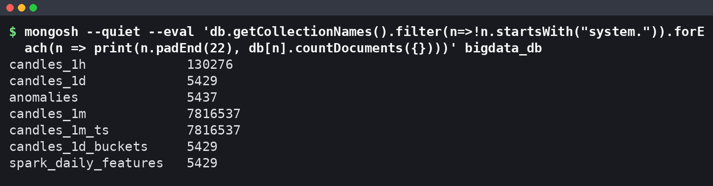
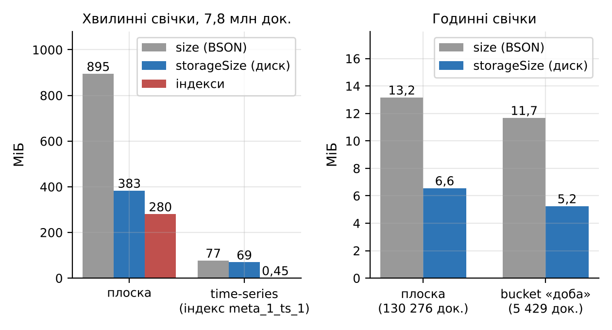
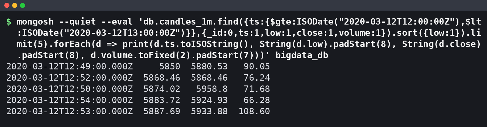
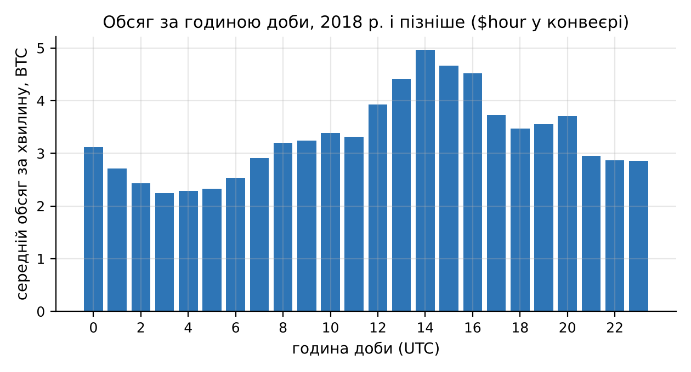
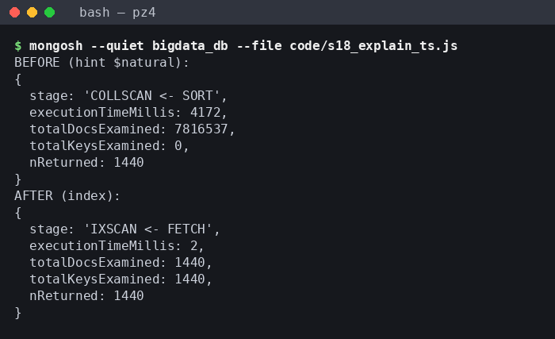
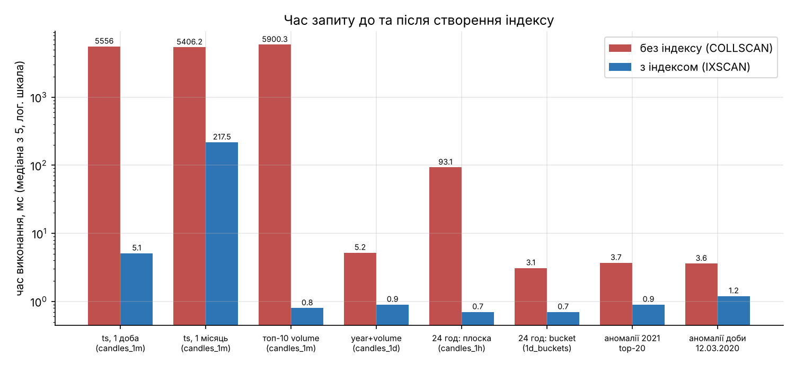
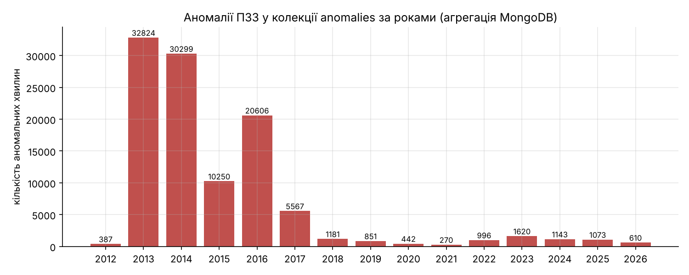
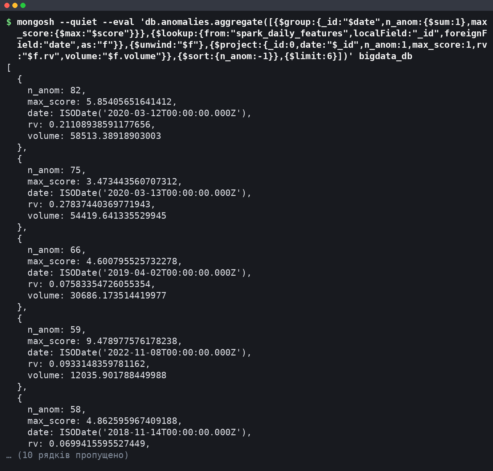

# Мета роботи

Мета роботи: ознайомитися з принципами організації NoSQL-сховищ та документною моделлю MongoDB; отримати практичні навички створення бази даних і колекцій, імпорту великого набору даних, виконання запитів, індексації та агрегування на прикладі 7 816 537 хвилинних свічок BTC/USD (Bitcoin Historical Data, 2012–2026 роки); навчитися використовувати MongoDB як сховище результатів обробки великих даних, отриманих у ПЗ2 (Spark) та ПЗ3 (виявлення аномалій).

# Короткі теоретичні відомості

NoSQL-системи відмовляються від жорсткої реляційної схеми на користь моделей, що легше масштабуються горизонтально. Розрізняють чотири основні типи: key-value (значення за ключем, наприклад Redis), документні (MongoDB), колонкові (Cassandra, HBase) та графові (Neo4j). Для часових рядів свічок найбільш придатні документна і колонкова моделі, бо запити здебільшого вибирають діапазон часу за кількома полями.

Ієрархія MongoDB така: сервер `mongod` містить бази даних, база – колекції, колекція – документи. Документ зберігається у форматі BSON (двійковий JSON), який має типи, відсутні в JSON: Date (мілісекунди від епохи, UTC), Int32 і Int64, Double, ObjectId, масиви та вкладені документи. Розмір документа обмежено 16 МБ, кожен документ має унікальне поле `_id`. Схема не нав'язується, тому в одній базі без міграцій співіснують свічки, ознаки Spark і аномалії з різним набором полів.

Запит `find(filter, projection)` використовує оператори порівняння (`$gt`, `$lt`, `$in`) і логічні оператори (`$and`, `$or`), а `sort` і `limit` виконуються на сервері. Aggregation Framework будує конвеєр стадій (`$match`, `$group`, `$sort`, `$project`, `$bucket`, `$lookup`, `$unwind`), де кожна стадія отримує потік документів від попередньої. Акумулятори `$first` і `$last` залежать від порядку входу, тому для OHLC перед `$group` потрібне сортування за часом.

Індекс – це B-дерево ключів одного або кількох полів із посиланнями на документи. Без придатного індексу планувальник виконує COLLSCAN (читання всієї колекції), з індексом – IXSCAN і FETCH лише потрібних документів. Метод `explain("executionStats")` показує виграшний план і лічильники `totalDocsExamined`, `totalKeysExamined`, `executionTimeMillis`. Для складених індексів діє правило ESR: спочатку поля рівності, потім поле сортування, потім діапазон. Time-series колекції (з версії 5.0) групують виміри у внутрішні бакети зі стовпцевим стисненням.

# Результати виконання практичного заняття

## 1 Підготовка MongoDB

Пряме завантаження з `fastdl.mongodb.org` у контейнері блокує проксі, тому сервер MongoDB Community встановлено з каналу conda-forge менеджером micromamba, оболонку mongosh – з npm, драйвер PyMongo – через pip. Версії компонентів і конфігурацію машини, на якій виміряно всі часи, наведено в таблиці 1.

Таблиця 1 – Програмне забезпечення та обладнання

| Компонент | Версія або параметр | Спосіб встановлення |
|---|---|---|
| MongoDB Community Server (mongod) | 8.3.7, рушій WiredTiger (стиснення snappy) | micromamba, conda-forge |
| MongoDB Shell (mongosh) | 2.14.1 | npm |
| PyMongo | 4.19.0 | pip |
| Python / pandas | 3.13.18 / 3.0.5 | системний / pip |
| MongoDB Compass | не встановлено | контейнер без графічного середовища |
| ОС | Ubuntu 24.04, ядро Linux 6.18, x86_64 | – |
| Процесор / ОЗП | Intel Xeon 2,10 ГГц, 4 vCPU / 15,7 ГіБ | – |

MongoDB Compass потребує дисплея, якого в контейнері немає, тому ті самі операції (перегляд колекцій і документів, фільтри, конвеєри агрегації, індекси, план `explain`) виконано в mongosh. Сервер запущено як фоновий процес, доступний лише локально:

```bash
mongod --dbpath /home/user/AVD/work/mongo_data --bind_ip 127.0.0.1 --port 27017 \
       --fork --logpath /home/user/AVD/work/mongo_data/mongod.log
```

PyMongo підключається з `CodecOptions(tz_aware=True)`, щоб поля Date поверталися як дати UTC (додаток А.1).

## 2 Створення бази даних і колекцій

База `bigdata_db` створюється неявно під час першого запису, а time-series колекцію потрібно створити явно до вставки:

```python
db = MongoClient(URI)["bigdata_db"]
db.create_collection("candles_1m_ts",
    timeseries={"timeField": "ts", "metaField": "meta", "granularity": "minutes"})
db.candles_1m.insert_many(docs, ordered=False)   # звичайна колекція створюється автоматично
```

Створено сім колекцій. Їх призначення і розміри за `collStats` зведено в таблицю 2.

Таблиця 2 – Колекції бази bigdata_db

| Колекція | Призначення | Документів | size, МБ | storageSize, МБ | Індекс _id, МБ |
|---|---|---|---|---|---|
| candles_1m | хвилинні свічки, плоска схема (основна) | 7 816 537 | 894,53 | 383,22 | 82,23 |
| candles_1m_ts | ті самі свічки у time-series колекції | 7 816 537 | 76,94 | 69,31 | 0,45 |
| candles_1h | годинні свічки, плоска схема | 130 276 | 13,17 | 6,56 | 1,24 |
| candles_1d | добові свічки | 5 429 | 0,75 | 0,30 | 0,07 |
| candles_1d_buckets | доба з масивом 24 годинних свічок | 5 429 | 11,68 | 5,25 | 0,07 |
| spark_daily_features | добові ознаки, обчислені Spark у ПЗ2 | 5 429 | 2,04 | 0,96 | 0,07 |
| anomalies | аномальні хвилини ПЗ3 (правило v2) | 5 437 | – | – | – |

Розміри знято одразу після завантаження, до створення вторинних індексів; для `anomalies` знято лише кількість документів. Наявність колекцій і кількість документів у кожній перевірено в mongosh (рисунок 1).



Кількість документів збігається з кількістю рядків джерел.

### 2.1 Обґрунтування схеми

Для хвилинних свічок порівняно три варіанти: плоский документ на хвилину (`candles_1m`), time-series колекцію (`candles_1m_ts`) і шаблон bucket, де один документ містить масив вимірів (`candles_1d_buckets`, доба з 24 годинами). Розміри на диску показано на рисунку 2.



Плоска колекція займає 383,22 МБ на диску (894,53 МБ без стиснення, 120 Б на документ), що більше за вихідний CSV (396,8 МБ) до стиснення: кожен документ повторює імена полів і має `_id`. Time-series колекція займає 69,31 МБ, тобто в 5,5 раза менше, а її індекс – 0,45 МБ проти 82,23 МБ для `_id` плоскої колекції. Сервер згрупував виміри в 7 817 бакетів по 1 000 хвилин і стиснув їх стовпцями. Шаблон bucket для годинних свічок дає менший виграш на диску (5,25 проти 6,56 МБ), але зменшує кількість документів у 24 рази, що важливо для повного сканування (розділ 6).

Основною для запитів обрано плоску колекцію `candles_1m`: кожна хвилина – окремий документ, тому `explain` прямо показує кількість переглянутих документів, а будь-яке поле індексується звичайним B-деревом. Time-series колекція придатна для архіву, де головне – об'єм.

## 3 Імпорт даних

### 3.1 Завантаження

Джерелом слугує оброблений набір `btc_1min.parquet` (час UTC) та похідні годинний і добовий набори. Документи формуються з DataFrame пакетами і вставляються методом `insert_many(ordered=False)`.

Повне завантаження 7 816 537 документів у `candles_1m` тривало 117,7 с: 18,2 с – побудова документів у Python, 99,6 с – власне вставка зі швидкістю 78,5 тис. док/с. Пакет 20 000 документів по 120 Б (близько 2,4 МБ) значно менший за межу повідомлення протоколу (48 МБ), тож драйвер його не дробить, а весь набір передається за 391 звернення. Режим `ordered=False` дозволяє серверу не зупинятися на першій помилці. Time-series колекція `candles_1m_ts` завантажена за 99,2 с і приймає дані на 27 % швидше (вставка 78,5 с, 99 638 док/с), бо записує на диск 7 817 стиснених бакетів замість 7,8 млн окремих документів.

### 3.2 Структура документів і типи полів

Хвилинний документ містить `_id` і сім полів: `ts`, `unix` і OHLCV (див. таблицю 3). Документ bucket-схеми має вкладений масив (Extended JSON, перші дві години з 24):

```json
{"date": {"$date": "2012-01-01T00:00:00Z"}, "year": 2012, "month": 1, "n_hours": 24,
 "hours": [{"hour": 0, "open": 4.58, "high": 4.58, "low": 4.58, "close": 4.58, "volume": 0.0},
           {"hour": 1, "open": 4.58, "high": 4.58, "low": 4.58, "close": 4.58, "volume": 0.0},
           {"...": "ще 22 годин"}]}
```

Типи полів визначено агрегацією `{$group: {_id: {$type: "$поле"}}}` по всіх документах кожної колекції; результат наведено в таблиці 3.

Таблиця 3 – BSON-типи полів

| Колекція | Поля | BSON-тип |
|---|---|---|
| candles_1m, candles_1h | ts | date |
| candles_1m | unix | long |
| усі колекції свічок | open, high, low, close, volume | double |
| candles_1d, candles_1d_buckets | date / year, month, n_minutes, n_hours | date / int |
| candles_1d_buckets | hours | array вкладених документів |
| spark_daily_features | date / rv, hl_rel, flat_share, ret_1d, vol_7d, vol_30d, ma_7, ma_30 / n_minutes, n_flat, year, month, dow, is_complete | date / double / int |
| anomalies | ts, date / score, z_ret, z_vol, close, volume / k, year, ts_epoch / rule, rule_version / in_stream_replay | date / double / int / string / bool |

Кожне поле має єдиний тип у всіх документах, крім трьох полів Spark із типом null (п. 3.3). Час збережено як BSON Date, а не рядок, тому працюють діапазонні фільтри, оператори `$year`, `$month`, `$hour` і сортування в хронологічному порядку.

### 3.3 Пропущені значення

У колекціях свічок для кожного поля підраховано документи, де поле відсутнє, дорівнює null або NaN: у всіх 26 полях таких документів 0. У `spark_daily_features` значення NaN з Parquet замінено на null під час завантаження: 1 у `ret_1d` (перша доба не має попередньої), по 2 у `vol_7d` і `vol_30d` (вікна ковзного стандартного відхилення на початку історії). Хвилини з нульовим обсягом (1 312 419, тобто 16,79 %) не є пропусками: це свічки, якими джерело заповнює хвилини без угод, тому їх збережено, а в аналізі обсягу враховано окремо.

## 4 Виконання запитів

Реалізовано вісім запитів `find`, які разом охоплюють пошук, фільтрацію, сортування, обмеження результатів і проєкцію (таблиця 4). Час виміряно в Python разом із передачею результатів клієнту, після створення індексів з розділу 6.

Таблиця 4 – Запити до бази bigdata_db

| № | Призначення | Колекція | Оператори | Документів | Час, мс |
|---|---|---|---|---|---|
| Q1 | доби 2021 року з close > 60 000 | candles_1d | $gte, $lt, $gt, проєкція, sort | 39 | 3,3 |
| Q2 | топ-10 діб за обсягом | candles_1d | sort(volume: −1), limit(10) | 10 | 3,8 |
| Q3 | 5 найнижчих low 12.03.2020, 12:00–13:00 UTC | candles_1m | діапазон ts, sort, limit(5) | 5 | 1,0 |
| Q4 | 5 хвилин з найбільшим обсягом | candles_1m | $gt, sort, limit(5) | 5 | 0,6 |
| Q5 | повні доби з ret_1d < −0,10 | spark_daily_features | рівність, $lt, sort, limit(10) | 10 | 4,7 |
| Q6 | неповні доби (n_minutes < 1440) | candles_1d | $lt, проєкція | 2 | 2,9 |
| Q7 | кількість хвилин з volume = 0 | candles_1m | countDocuments | 1 | 421,9 |
| Q8 | листопад–грудень 2022 з flat_share = 0 | spark_daily_features | $and, $in | 2 | 12,6 |

Запит Q3 вибирає з 7,8 млн документів одну годину обвалу 12.03.2020 і сортує її за мінімумом (рисунок 3).



Мінімум цієї години – 5 850 USD о 12:49 UTC при обсязі 90,0 BTC за хвилину, а вибірка завдяки індексу `ts_1` займає 1,0 мс. За Q5 найгірші повні доби в результатах Spark – 11.04.2013 (лог-дохідність −0,664) і 12.03.2020 (−0,494). Q6 знаходить дві неповні доби, першу (01.01.2012, 1 439 хвилин) і останню (11.11.2026, 218 хвилин), тому в агрегаціях за роками використано лише повні доби. Q8 повертає 09.11 і 10.11.2022 – дні краху FTX, коли не було жодної хвилини без угод. Найповільніший Q7 (421,9 мс) рахує 1 312 419 ключів індексу `volume_-1`.

## 5 Агрегування

Побудовано п'ять конвеєрів над свічками і ознаками Spark та конвеєр із `$lookup` над аномаліями (розділ 7). Склад стадій і час виконання наведено в таблиці 5.

Таблиця 5 – Конвеєри агрегації

| Конвеєр | Колекція | Стадії | Рядків | Час, с |
|---|---|---|---|---|
| A1 місячні OHLC | candles_1m | $sort → $group ($first, $max, $min, $last, $sum) → $sort → $project | 179 | 116,65 |
| A2 обсяг за годиною доби, 2018+ | candles_1m | $match → $group ($hour) → $sort → $project | 24 | 65,93 |
| A3 річна волатильність | spark_daily_features | $match → $group → $sort → $project | 15 | 0,107 |
| A4 розподіл діб за ціною | candles_1d | $bucket | 7 | 0,106 |
| A5 річний обсяг | candles_1d | $group → $sort | 15 | 0,090 |
| ANOM аномалії і ознаки Spark | anomalies | $group → $lookup → $unwind → $project → $sort | 1 572 | 0,117 |

Конвеєри над 7,8 млн хвилин виконуються хвилинами, а над добовими колекціями – за десяту частку секунди.

### 5.1 Місячні OHLC

Конвеєр A1 ресемплює хвилинні свічки в місячні за правилом first/max/min/last/sum:

```javascript
db.candles_1m.aggregate([{$sort: {ts: 1}},
  {$group: {_id: {y: {$year: "$ts"}, m: {$month: "$ts"}}, open: {$first: "$open"},
            high: {$max: "$high"}, low: {$min: "$low"}, close: {$last: "$close"},
            volume: {$sum: "$volume"}}},
  {$sort: {_id: 1}}], {allowDiskUse: true})
```

Стадія `$sort` стоїть перед `$group`, бо без неї `$first` і `$last` брали б документи в порядку зберігання, який не гарантує хронології.
Коректність перевірено порівнянням з ресемплінгом pandas добових свічок: для всіх 179 місяців максимальна абсолютна різниця open, high, low і close дорівнює 0, а відносна різниця обсягу – 2,1·10⁻¹⁶ (похибка округлення суми з плаваючою комою).

### 5.2 Обсяг за годиною доби

Конвеєр A2 групує хвилини з 2018 року за `$hour` (UTC). Період обмежено 2018 роком, бо раніше частка хвилин без угод була великою і спотворювала середні. Результат подано на рисунку 4.



Найактивніша година – 14:00 UTC (4,96 BTC за хвилину), найспокійніша – 03:00 UTC (2,24 BTC), різниця в 2,2 раза. Пік 13:00–16:00 UTC збігається з відкриттям фондового ринку США, отже, цілодобовий ринок біткоїна має виражену денну сезонність, яку слід враховувати при порівнянні обсягів різних годин.

### 5.3 Річна волатильність і розподіл цін

Конвеєр A3 рахує річні показники за ознаками Spark лише для повних діб (`is_complete = 1`). Середня реалізована волатильність `rv` знизилася з 0,1152 у 2013 році до 0,0200 у 2023 році і з того часу не перевищувала 0,0260, тобто ринок став значно менш волатильним. Конвеєр `$bucket` (A4) розподіляє доби за ціною закриття: 1 332 доби в діапазоні 100–1 000 USD, 1 317 – у 10 000–50 000 USD і 217 діб понад 100 000 USD, перша з яких – 08.12.2024. Річні суми обсягу з A5 (`candles_1d`) для років без неповних діб збігаються із сумами з A3 (`spark_daily_features`), що підтверджує узгодженість колекцій.

## 6 Індексація

Індекси створено для полів, за якими фільтрують і сортують запити: `ts_1` і `volume_-1` у `candles_1m`, `ts_1` у `candles_1h`, складений `{year: 1, volume: -1}` і `date_1` у `candles_1d`, `date_1` у `candles_1d_buckets` і `spark_daily_features`, складений `{date: 1, score: -1}` і `year_1` в `anomalies`.

Порівняння проведено за однакових умов. Для фази «до» з колекції видаляються всі вторинні індекси, для фази «після» створюється рівно один. Той самий запит виконується один раз для прогріву кешу, далі 5 разів поспіль, і в таблицю потрапляє медіана `executionTimeMillis` з `explain("executionStats")`; медіану повного часу виконання в Python показано на рисунку 6. Результати наведено в таблиці 6.

Таблиця 6 – Виконання запитів до і після створення індексу (медіана з 5 прогрітих запусків)

| Запит (колекція), nReturned | Індекс, МБ | executionTimeMillis | totalDocsExamined | totalKeysExamined | Стадії плану |
|---|---|---|---|---|---|
| E1 доба 19.05.2021 (candles_1m), 1 440 | ts_1, 90,43 | 5 939 → 1 | 7 816 537 → 1 440 | 0 → 1 440 | SORT>COLLSCAN → FETCH>IXSCAN |
| E2 травень 2021 (candles_1m), 44 640 | ts_1, 90,43 | 5 938 → 51 | 7 816 537 → 44 640 | 0 → 44 640 | SORT>COLLSCAN → FETCH>IXSCAN |
| E3 топ-10 за volume (candles_1m), 10 | volume_-1, 107,41 | 6 437 → 0 | 7 816 537 → 10 | 0 → 10 | SORT>COLLSCAN → LIMIT>FETCH>IXSCAN |
| E4 2021 рік, volume > 9 483,33 (candles_1d), 36 | year_1_volume_-1, 0,11 | 4 → 0 | 5 429 → 36 | 0 → 36 | SORT>COLLSCAN → FETCH>IXSCAN |
| E5a 24 години доби (candles_1h), 24 | ts_1, 1,48 | 109 → 0 | 130 276 → 24 | 0 → 24 | SORT>COLLSCAN → FETCH>IXSCAN |
| E5b доба-bucket (candles_1d_buckets), 1 | date_1, 0,08 | 2 → 0 | 5 429 → 1 | 0 → 1 | COLLSCAN → FETCH>IXSCAN |
| ANOM1 2021 рік, топ-20 за score (anomalies), 20 | date_1_score_-1, 0,14 | 3 → 0 | 5 437 → 20 | 0 → 338 | SORT>COLLSCAN → FETCH>SORT>IXSCAN |
| ANOM2 доба 12.03.2020 (anomalies), 82 | date_1_score_-1, 0,14 | 2 → 0 | 5 437 → 82 | 0 → 82 | SORT>COLLSCAN → FETCH>IXSCAN |

Зміну плану для запиту E1 в mongosh показано на рисунку 5: «до» отримано примусовим повним скануванням `hint({$natural: 1})`, «після» – планом за замовчуванням.



На скриншоті – один запуск, тому час відрізняється від медіани, але стадії й лічильники збігаються. Порівняння часу для всіх запитів подано на рисунку 6 у логарифмічній шкалі.



На хвилинній колекції індекс скорочує час вибірки доби з 5 556,0 до 5,1 мс (у 1 089 разів), а топ-10 за обсягом – з 5 900,3 до 0,8 мс. Без індексу сервер читає всі 7 816 537 документів і сортує результат у пам'яті, з індексом кількість переглянутих документів дорівнює кількості повернутих. Для травня 2021 року виграш менший (у 25 разів), бо час займає FETCH і передача 44 640 документів. Складений індекс `{year: 1, volume: -1}` побудовано за правилом ESR: рівність за роком, далі сортування за обсягом, тому стадія SORT зникає. В `anomalies` для ANOM1 стадія SORT лишилася: діапазон дат охоплює 338 ключів, а порядок `score` індекс гарантує лише в межах однієї дати; для рівності на дату (ANOM2) сортування не потрібне. На малих колекціях (5 437 документів) виграш становить лише 2–3 мс, хоча кількість переглянутих документів падає з 5 437 до 20 і 82.

Ціна індексів – місце і час побудови: `ts_1` займає 90,43 МБ і будується 23,76 с, `volume_-1` – 107,41 МБ і 36,08 с. Разом з `_id` індекси `candles_1m` займають 280,07 МБ, що порівнянно з 383,22 МБ самих даних і сповільнює кожну вставку. Експеримент E5 показує, що bucket-схема без індексу переглядає 5 429 документів за 3,1 мс замість 130 276 за 93,1 мс, а з індексами обидві схеми повертають добу за 0,7 мс.

### 6.1 Агрегація, яка не прискорюється індексом

Конвеєр A1 виконано з індексом `ts_1` (116,65 с) і без нього з `hint({$natural: 1})` (119,12 с), по одному запуску кожен. Різниця 2 % менша за розкид повторів, тож індекс фактично не допомагає. План з індексом – IXSCAN по всьому діапазону `[MinKey, MaxKey]`, далі FETCH і GROUP: індекс лише замінює зовнішнє сортування читанням документів у порядку ключів, але `$group` все одно обробляє всі 7,8 млн документів. Для регулярних місячних звітів ефективніше рахувати їх з `candles_1d` (A5 – 0,09 с) або зберігати підсумки в окремій колекції.

## 7 Інтеграція з результатами Spark і ПЗ3

Колекцію `spark_daily_features` (5 429 документів, 24 поля) завантажено з таблиці добових ознак, яку обчислив Spark у ПЗ2: OHLCV, кількість хвилин і flat-хвилин, реалізована волатильність `rv`, відносний діапазон `hl_rel`, лог-дохідність `ret_1d`, ковзні середні та волатильності. Колекцію `anomalies` завантажено з результату ПЗ3 `pz3_anomalies.csv` (5 437 документів, 0,12 с). Правило v2 з ПЗ3 позначає хвилину t аномальною, якщо z_ret = |r_t| / σ_t > k і z_vol > 0, де r_t – хвилинна лог-дохідність, σ_t = Q₀,₉₀(|r|)/1,6449 за активними хвилинами попередніх 7 діб, z_vol – робастний z-показник логарифма обсягу за тією самою базою, k = 9. Отримано 5 437 аномальних хвилин у 1 572 добах. Типи полів наведено в таблиці 3.

Кількість аномалій за роками, обчислену агрегацією в MongoDB, показано на рисунку 7.



Аномалії розподілені рівномірно без перекосу в бік тонкого ринку 2013–2016 років (82–461 на рік); найбільше їх у 2019 (777) і 2023 (749) роках. Конвеєр із `$lookup` з'єднує кожну добу з аномаліями з її ознаками Spark за полем `date`; усі 1 572 доби знайшли пару. Перші рядки результату наведено на рисунку 8.



Перше місце посідає 12.03.2020 (82 аномалії, `rv` 0,211, лог-дохідність −0,494), друге – 13.03.2020 (75), четверте – 08.11.2022 (59, найбільший score 9,48 серед топ-5, крах FTX). Для порівняння діб з аномаліями з рештою повних діб на тих самих ознаках Spark складено таблицю 7.

Таблиця 7 – Ознаки Spark для діб з аномаліями і решти повних діб

| Група | Діб | Середнє rv | Медіана rv | Середнє hl_rel | Медіана обсягу, BTC |
|---|---|---|---|---|---|
| доби з аномаліями | 1 572 | 0,0506 | 0,0353 | 0,0695 | 4 853,7 |
| решта повних діб | 3 855 | 0,0453 | 0,0356 | 0,0458 | 3 798,2 |

Медіана `rv` в обох групах майже однакова (0,0353 і 0,0356), а середній відносний діапазон `hl_rel` і медіанний обсяг у добах з аномаліями вищі в 1,5 і 1,3 раза. Правило ПЗ3 знаходить раптові хвилинні стрибки з підвищеним обсягом, які розширюють денний діапазон, але не обов'язково роблять увесь день волатильним.

## 8 Аналіз можливостей MongoDB для зберігання та аналітики великих даних

Документна модель дозволила зберегти в одній базі сирі хвилинні свічки, агрегати, ознаки Spark і аномалії з різною структурою без міграцій, а тип BSON Date дав оператори `$year`, `$month`, `$hour` безпосередньо в конвеєрах. На 4 vCPU сервер приймав 78,5 тис. документів за секунду у звичайну і 99,6 тис. у time-series колекцію. Time-series колекція стискає хвилинний ряд у 5,5 раза порівняно з плоскою. Індекси переводять селективні запити з 5–6 с до одиниць мілісекунд. Aggregation Framework достатній для коректного ресемплінгу OHLC і з'єднання результатів різних етапів через `$lookup`.

Обмеження виявилися на повних проходах. Запит без індексу до `candles_1m` триває 5–6 с, агрегація по всіх хвилинах – 66–117 с, і індекс її не прискорює. Без шардування один конвеєр не розподіляється між вузлами. Плоска схема збільшує дані в 2,25 раза порівняно з CSV до стиснення, а три індекси `candles_1m` займають 280,07 МБ. Тому для часових рядів такого розміру MongoDB доцільно використовувати як шар зберігання і швидкого доступу: важкі перерахунки всієї історії виконувати в Spark, а в MongoDB завантажувати їх результати (добові агрегати, ознаки, аномалії) з індексами під типові запити.

# Висновки

1. Встановлено MongoDB Community Server 8.3.7 (conda-forge), mongosh 2.14.1 і PyMongo 4.19.0; Compass у контейнері без дисплея недоступний, тому всі операції з ним виконано в mongosh.

2. Створено базу `bigdata_db` із семи колекцій; для хвилинних свічок порівняно плоску схему, time-series колекцію і bucket-шаблон: time-series займає 69,31 МБ проти 383,22 МБ.

3. Імпортовано 7 816 537 хвилинних документів за 117,7 с (вставка 78,5 тис. док/с, пакети по 20 000); визначено структуру документів, BSON-типи всіх полів і пропуски: у свічках їх немає, у ознаках Spark 5 значень null, 16,79 % хвилин мають нульовий обсяг і збережені як заповнення сітки.

4. Реалізовано вісім запитів із фільтрацією, сортуванням, обмеженням і проєкцією; селективні запити з індексом виконуються за 0,6–12,6 мс.

5. Побудовано шість конвеєрів агрегації; місячні OHLC збігаються з pandas для всіх 179 місяців, виявлено денну сезонність обсягу (пік о 14:00 UTC, у 2,2 раза вище за мінімум) і зниження середньої `rv` з 0,1152 (2013) до 0,0200 (2023).

6. Створено 9 вторинних індексів; на `candles_1m` час вибірки доби зменшився з 5 556,0 до 5,1 мс, а переглянуті документи – з 7 816 537 до 1 440; повна агрегація A1 від індексу не виграє (116,65 проти 119,12 с).

7. Імпортовано результати ПЗ2 (5 429 діб ознак Spark) і ПЗ3 (5 437 аномалій правила v2, k = 9); `$lookup` показав, що доби з аномаліями мають у 1,5 раза ширший діапазон при майже однаковій медіані `rv`.

8. MongoDB ефективна як сховище результатів обробки великих даних із мілісекундним доступом за індексами, але повні проходи по мільйонах документів у ній повільні, тому їх доцільно виконувати в Spark.

Отримано практичні навички роботи з MongoDB: створення документного сховища, виконання запитів, агрегування великих наборів даних і використання індексації.

# Додаток А. Лістинг програми

## А.1 Файл pz4_common.py – спільні утиліти: підключення, запис результатів, вимірювання до/після індексу

```python
# -*- coding: utf-8 -*-
"""Спільні утиліти ПЗ4: підключення до MongoDB, шляхи, запис результатів."""
import os, csv, json, time, statistics, datetime
from bson import json_util
from pymongo import MongoClient
from bson.codec_options import CodecOptions

BASE = os.path.abspath(os.path.join(os.path.dirname(__file__), ".."))
W = os.path.abspath(os.path.join(BASE, ".."))
RES, FIG, EXPL = f"{BASE}/results", f"{BASE}/figures", f"{BASE}/results/explain"
for d in (RES, FIG, EXPL):
    os.makedirs(d, exist_ok=True)
DB_NAME = "bigdata_db"
URI = "mongodb://127.0.0.1:27017"


def get_db(tz_aware=True):
    """Повертає базу bigdata_db; дати читаються як UTC-aware."""
    cl = MongoClient(URI)
    return cl.get_database(DB_NAME, codec_options=CodecOptions(tz_aware=tz_aware, tzinfo=datetime.timezone.utc))


def save_csv(name, rows, header=None):
    """Зберігає список словників/кортежів у results/<name>.csv."""
    path = f"{RES}/{name}.csv"
    with open(path, "w", newline="", encoding="utf-8") as f:
        if rows and isinstance(rows[0], dict):
            header = header or list(rows[0].keys())
            w = csv.DictWriter(f, fieldnames=header); w.writeheader(); w.writerows(rows)
        else:
            w = csv.writer(f)
            if header: w.writerow(header)
            w.writerows(rows)
    return path


def append_timing(stage, seconds, note=""):
    """Дописує вимір часу до results/timings.csv."""
    path = f"{RES}/timings.csv"
    new = not os.path.exists(path)
    with open(path, "a", newline="", encoding="utf-8") as f:
        w = csv.writer(f)
        if new: w.writerow(["stage", "seconds", "note"])
        w.writerow([stage, f"{seconds:.3f}", note])


def explain_find(db, coll, flt, sort=None, limit=0, proj=None, hint=None):
    """explain('executionStats') для find."""
    cmd = {"find": coll, "filter": flt}
    if sort: cmd["sort"] = dict(sort)
    if limit: cmd["limit"] = limit
    if proj: cmd["projection"] = proj
    if hint is not None: cmd["hint"] = hint
    return db.command({"explain": cmd, "verbosity": "executionStats"})


def stages(plan, out=None):
    """Збирає назви стадій виграшного плану (від кореня до листка)."""
    out = [] if out is None else out
    out.append(plan["stage"])
    if "inputStage" in plan: stages(plan["inputStage"], out)
    for s in plan.get("inputStages", []): stages(s, out)
    return out


def summarize(ex):
    """Витягує ключові метрики з виводу explain."""
    es = ex["executionStats"]
    return dict(executionTimeMillis=es["executionTimeMillis"], totalDocsExamined=es["totalDocsExamined"],
                totalKeysExamined=es["totalKeysExamined"], nReturned=es["nReturned"],
                winning_plan=" > ".join(stages(ex["queryPlanner"]["winningPlan"])))


# ---------- порівняння до/після індексу (спільне для pz4_indexes.py та pz4_anomalies.py) ----------
REPS = 5
_db = get_db()


def drop_secondary(coll):
    """Видаляє всі індекси колекції, крім _id_."""
    for ix in _db[coll].index_information():
        if ix != "_id_": _db[coll].drop_index(ix)


def measure(tag, coll, flt, sort, limit, hint=None):
    """warm-up + 5 вимірювань: executionTimeMillis (з explain) та wall-clock фактичного виконання."""
    run = lambda: list(_db[coll].find(flt, sort=sort, limit=limit))
    explain_find(_db, coll, flt, sort, limit)                 # прогрів кешу
    ex_t, wall = [], []
    for _ in range(REPS):
        ex = explain_find(_db, coll, flt, sort, limit)
        ex_t.append(ex["executionStats"]["executionTimeMillis"])
        t = time.perf_counter(); run(); wall.append((time.perf_counter() - t) * 1000)
    s = summarize(ex)
    json.dump(json.loads(json_util.dumps(ex)), open(f"{EXPL}/{tag}.json", "w"), indent=1)
    s.update(explain_ms_runs=ex_t, wall_ms_runs=[round(x, 1) for x in wall],
             explain_ms_median=statistics.median(ex_t), wall_ms_median=round(statistics.median(wall), 1))
    return s


def experiment(name, coll, flt, sort, limit, spec, descr):
    drop_secondary(coll)
    before = measure(f"{name}_before", coll, flt, sort, limit)
    t = time.perf_counter(); iname = _db[coll].create_index(spec); build = time.perf_counter() - t
    after = measure(f"{name}_after", coll, flt, sort, limit)
    st = _db.command("collStats", coll)
    isize = st["indexSizes"][iname] / 2**20
    out = []
    for phase, m in (("до", before), ("після", after)):
        out.append(dict(experiment=name, description=descr, collection=coll, phase=phase, index=iname if phase == "після" else "-",
                        executionTimeMillis_explain_median=m["explain_ms_median"], wall_ms_median=m["wall_ms_median"],
                        totalDocsExamined=m["totalDocsExamined"], totalKeysExamined=m["totalKeysExamined"],
                        nReturned=m["nReturned"], winning_plan=m["winning_plan"],
                        explain_ms_runs=m["explain_ms_runs"], wall_ms_runs=m["wall_ms_runs"],
                        index_size_MB=round(isize, 2) if phase == "після" else 0, index_build_s=round(build, 2) if phase == "після" else 0))
    for o in out: print(o["experiment"], o["phase"], o["executionTimeMillis_explain_median"], o["wall_ms_median"],
                        o["totalDocsExamined"], o["totalKeysExamined"], o["nReturned"], o["winning_plan"], flush=True)
    return out
```

## А.2 Файл pz4_load.py – створення колекцій та імпорт даних

```python
# -*- coding: utf-8 -*-
"""Завдання 2-3, 7: створення бази bigdata_db, колекцій та імпорт даних.
Колекції: candles_1m (повні 7,8 млн), candles_1m_ts (time-series), candles_1h, candles_1d,
candles_1d_buckets (bucket pattern), spark_daily_features (результати ПЗ2).
Заміряється пропускна здатність insert_many."""
import sys, time, datetime, math
import numpy as np, pandas as pd
from bson.int64 import Int64
from pymongo import MongoClient
sys.path.insert(0, __import__("os").path.dirname(__file__))
from pz4_common import *

DATA = f"{W}/data"
BATCH = 20000
db = get_db()
log = []


def utc_list(series):
    """Конвертація datetime64 (UTC) у список datetime з tz=UTC."""
    return list(pd.DatetimeIndex(series).tz_convert("UTC").to_pydatetime()) if getattr(series.dt, "tz", None) \
        else list(pd.DatetimeIndex(series).tz_localize("UTC").to_pydatetime())


def load_1m(name, ts_mode=False, limit=None):
    """Імпорт хвилинних свічок батчами; повертає (рядків, сек. побудови, сек. вставки)."""
    df = pd.read_parquet(f"{DATA}/btc_1min.parquet")
    if limit: df = df.iloc[:limit]
    db.drop_collection(name)
    if ts_mode:
        db.create_collection(name, timeseries={"timeField": "ts", "metaField": "meta", "granularity": "minutes"})
    coll = db[name]
    n = len(df); t_build = t_ins = 0.0
    for s in range(0, n, BATCH):
        c = df.iloc[s:s + BATCH]
        t0 = time.perf_counter()
        ts = utc_list(c["datetime_utc"]); un = c["Timestamp"].tolist()
        o, h, l, cl, v = (c[k].tolist() for k in ("Open", "High", "Low", "Close", "Volume"))
        if ts_mode:
            docs = [{"ts": ts[i], "meta": {"symbol": "BTCUSD"}, "unix": Int64(un[i]), "open": o[i], "high": h[i],
                     "low": l[i], "close": cl[i], "volume": v[i]} for i in range(len(c))]
        else:
            docs = [{"ts": ts[i], "unix": Int64(un[i]), "open": o[i], "high": h[i], "low": l[i],
                     "close": cl[i], "volume": v[i]} for i in range(len(c))]
        t1 = time.perf_counter()
        coll.insert_many(docs, ordered=False)
        t2 = time.perf_counter()
        t_build += t1 - t0; t_ins += t2 - t1
        if (s // BATCH) % 40 == 0: print(name, s, n, f"{t_ins:.0f}s", flush=True)
    return n, t_build, t_ins


def clean(v):
    """NaN -> None (пропущене значення в MongoDB зберігається як null)."""
    return None if isinstance(v, float) and math.isnan(v) else v


# ---------- candles_1m ----------
for name, ts_mode in (("candles_1m", False), ("candles_1m_ts", True)):
    n, tb, ti = load_1m(name, ts_mode)
    log.append(dict(collection=name, docs=n, batch_size=BATCH, build_docs_s=round(tb, 2), insert_s=round(ti, 2),
                    insert_docs_per_s=round(n / ti), total_s=round(tb + ti, 2)))
    append_timing(f"load_{name}", tb + ti, f"{n} docs, insert only {ti:.1f}s, {n/ti:.0f} docs/s")
    print(log[-1], flush=True)

# ---------- candles_1h, candles_1d, candles_1d_buckets ----------
h = pd.read_parquet(f"{DATA}/btc_1h.parquet"); d = pd.read_parquet(f"{DATA}/btc_1d.parquet")
t0 = time.perf_counter()
db.drop_collection("candles_1h"); db.drop_collection("candles_1d"); db.drop_collection("candles_1d_buckets")
tsh = utc_list(h["datetime_utc"])
db.candles_1h.insert_many([{"ts": tsh[i], "open": r.Open, "high": r.High, "low": r.Low, "close": r.Close,
                            "volume": r.Volume} for i, r in enumerate(h.itertuples())], ordered=False)
tsd = utc_list(d["datetime_utc"])
db.candles_1d.insert_many([{"date": tsd[i], "year": tsd[i].year, "month": tsd[i].month, "open": r.Open, "high": r.High,
                            "low": r.Low, "close": r.Close, "volume": r.Volume, "n_minutes": r.n_minutes}
                           for i, r in enumerate(d.itertuples())], ordered=False)
# bucket pattern: один документ = доба з вкладеним масивом 24 годинних свічок
h["day"] = h["datetime_utc"].dt.floor("D")
buckets = []
for day, g in h.groupby("day"):
    dd = pd.Timestamp(day).tz_convert("UTC").to_pydatetime() if pd.Timestamp(day).tzinfo else pd.Timestamp(day).tz_localize("UTC").to_pydatetime()
    buckets.append({"date": dd, "year": dd.year, "month": dd.month, "n_hours": len(g),
                    "hours": [{"hour": int(x.datetime_utc.hour), "open": x.Open, "high": x.High, "low": x.Low,
                               "close": x.Close, "volume": x.Volume} for x in g.itertuples()]})
db.candles_1d_buckets.insert_many(buckets, ordered=False)

# ---------- spark_daily_features (ПЗ2) ----------
f = pd.read_parquet(f"{W}/pz2/results/pz2_daily_features.parquet")
nan_counts = {c: int(f[c].isna().sum()) for c in f.columns if f[c].isna().any()}
db.drop_collection("spark_daily_features")
docs = []
for r in f.to_dict("records"):
    doc = {k: clean(v) for k, v in r.items()}
    doc["date"] = r["date"].to_pydatetime().replace(tzinfo=datetime.timezone.utc)
    for k in ("year", "month", "dow", "is_complete"): doc[k] = int(r[k])
    doc["n_minutes"] = int(r["n_minutes"]); doc["n_flat"] = int(r["n_flat"])
    docs.append(doc)
db.spark_daily_features.insert_many(docs, ordered=False)
append_timing("load_small_collections", time.perf_counter() - t0, "candles_1h, candles_1d, buckets, spark_daily_features")
save_csv("pz4_load_throughput", log)
save_csv("pz4_spark_nan_to_null", [dict(field=k, nan_replaced_by_null=v) for k, v in nan_counts.items()])
print("DONE", {c: db[c].estimated_document_count() for c in db.list_collection_names()})
```

## А.3 Файл pz4_schema.py – кількість документів, BSON-типи, пропуски, розміри колекцій

```python
# -*- coding: utf-8 -*-
"""Завдання 3: кількість документів, структура, BSON-типи полів, пропущені значення, розміри колекцій."""
import json, sys
from bson import json_util
sys.path.insert(0, __import__("os").path.dirname(__file__))
from pz4_common import *

db = get_db()
colls = ["candles_1m", "candles_1m_ts", "candles_1h", "candles_1d", "candles_1d_buckets", "spark_daily_features"]
# 1. кількість документів і розміри (collStats)
rows = []
for c in colls:
    s = db.command("collStats", c)
    rows.append(dict(collection=c, count=db[c].count_documents({}) if c == "candles_1m_ts" else s["count"], avgObjSize_B=s.get("avgObjSize", 0), size_MB=round(s["size"] / 2**20, 2),
                     storageSize_MB=round(s["storageSize"] / 2**20, 2), totalIndexSize_MB=round(s["totalIndexSize"] / 2**20, 2),
                     nindexes=s["nindexes"]))
save_csv("pz4_storage", rows)
for r in rows: print(r)

# 2. BSON-типи кожного поля ($type) та пропущені значення (відсутнє / null / NaN)
types, miss = [], []
for c in colls:
    if c == "candles_1m_ts":
        continue
    fields = [k for k in db[c].find_one().keys() if k != "_id"]
    n = db[c].estimated_document_count()
    for f in fields:
        for r in db[c].aggregate([{"$group": {"_id": {"$type": "$" + f}, "n": {"$sum": 1}}}], allowDiskUse=True):
            types.append(dict(collection=c, field=f, bson_type=r["_id"], docs=r["n"]))
    grp = {"_id": None}
    for f in fields:
        grp[f] = {"$sum": {"$cond": [{"$or": [{"$eq": [{"$type": "$" + f}, "missing"]}, {"$eq": ["$" + f, None]},
                                                {"$eq": ["$" + f, float("nan")]}]}, 1, 0]}}
    r = next(db[c].aggregate([{"$group": grp}], allowDiskUse=True))
    for f in fields:
        miss.append(dict(collection=c, field=f, missing_or_null_or_nan=r[f], total_docs=n))
save_csv("pz4_field_types", types)
save_csv("pz4_missing_values", miss)

# 3. приклади документів (Extended JSON, дати як $date)
ex = {}
for c in colls:
    d = db[c].find_one({}, sort=[("_id", 1)]) if c != "candles_1d_buckets" else db[c].find_one()
    if c == "candles_1d_buckets": d["hours"] = d["hours"][:2] + [{"...": "ще %d годин" % (len(d["hours"]) - 2)}]
    ex[c] = json.loads(json_util.dumps(d, json_options=json_util.RELAXED_JSON_OPTIONS))
json.dump(ex, open(f"{RES}/pz4_sample_documents.json", "w"), ensure_ascii=False, indent=2)
print(json.dumps(ex["candles_1m"], indent=1))

# 4. порівняння розмірів для time-series: звичайна vs timeseries
ts = db.command("collStats", "candles_1m_ts")
json.dump(json.loads(json_util.dumps(ts)), open(f"{RES}/explain/collStats_candles_1m_ts.json", "w"), indent=1)
print({k: ts.get(k) for k in ("count", "size", "storageSize", "totalIndexSize")}, ts.get("timeseries"))
```

## А.4 Файл pz4_queries.py – запити find

```python
# -*- coding: utf-8 -*-
"""Завдання 4: запити find (пошук, фільтрація, сортування, limit, projection). Результати -> results/pz4_q*.csv"""
import sys, time, datetime as dt
sys.path.insert(0, __import__("os").path.dirname(__file__))
from pz4_common import *

# підключення до бази bigdata_db (параметри в pz4_common.py)
db = get_db()
# допоміжна функція: UTC-дата для фільтрів по полях типу BSON Date
U = lambda *a: dt.datetime(*a, tzinfo=dt.timezone.utc)
# зведення за всіма запитами (id, опис, колекція, кількість рядків, час) -> pz4_queries_summary.csv
summary = []


def run(qid, descr, coll, flt, proj=None, sort=None, limit=0, count_only=False):
    # run(): виконує один find-запит (або count) і вимірює повний wall-clock час разом із передачею результату
    t = time.perf_counter()
    if count_only:
        # лише кількість документів за фільтром (count_documents), без повернення самих документів
        res = [{"count": db[coll].count_documents(flt)}]
    else:
        # find(фільтр, проєкція, сортування, ліміт): проєкція обмежує поля, sort і limit виконує сервер
        res = list(db[coll].find(flt, proj, sort=sort, limit=limit))
    # час у мілісекундах
    dtm = (time.perf_counter() - t) * 1000
    # приводимо дати до рядка, прибираємо службове поле _id, щоб результат був придатний для CSV
    rows = [{k: (v.strftime("%Y-%m-%d %H:%M") if isinstance(v, dt.datetime) else v) for k, v in r.items() if k != "_id"} for r in res]
    save_csv(f"pz4_{qid}", rows)  # повний результат запиту -> results/pz4_<qid>.csv
    # запис у зведену таблицю
    summary.append(dict(query=qid, description=descr, collection=coll, returned=len(res), wall_ms=round(dtm, 1)))
    # короткий вивід у консоль: id, опис, кількість рядків, час і перші 3 рядки
    print(qid, descr, len(res), f"{dtm:.0f} мс"); print(rows[:3])


# Q1: фільтр за діапазоном дат ($gte/$lt) + умова close>60000 ($gt), проєкція трьох полів, сортування за датою за зростанням;
# запит по індексу date_1 колекції добових свічок
run("q1_close_gt_60000_2021", "дні 2021 із close>60000 (сортування за датою)", "candles_1d",
    {"date": {"$gte": U(2021, 1, 1), "$lt": U(2022, 1, 1)}, "close": {"$gt": 60000}}, {"_id": 0, "date": 1, "close": 1, "volume": 1}, [("date", 1)])
# Q2: сортування за спаданням обсягу + limit 10 -> топ-10 діб (використовує індекс year_1_volume_-1 / сортування за volume)
run("q2_top10_volume_days", "топ-10 діб за обсягом", "candles_1d", {}, {"_id": 0, "date": 1, "volume": 1, "close": 1}, [("volume", -1)], 10)
# Q3: вузький діапазон ts (одна година 12.03.2020) у хвилинній колекції (індекс ts_1), сортування за low зростаючи, limit 5
# -> 5 найнижчих мінімумів під час обвалу «чорного четверга»
run("q3_covid_hour", "12.03.2020 12:00-13:00 UTC, 5 найнижчих low", "candles_1m",
    {"ts": {"$gte": U(2020, 3, 12, 12), "$lt": U(2020, 3, 12, 13)}}, {"_id": 0, "ts": 1, "low": 1, "close": 1, "volume": 1}, [("low", 1)], 5)
# Q4: відсікаємо нульовий обсяг ($gt:0), сортуємо за volume спаданням, limit 5 -> хвилини з рекордним обсягом (індекс volume_-1)
run("q4_top5_volume_minutes", "5 хвилин з найбільшим обсягом", "candles_1m", {"volume": {"$gt": 0}},
    {"_id": 0, "ts": 1, "close": 1, "volume": 1}, [("volume", -1)], 5)
# Q5: запит до колекції з результатами Spark (ПЗ2): повні доби (is_complete=1) з падінням ret_1d<-10 %, від найгіршої; limit 10
run("q5_worst_days_spark", "повні доби з ret_1d<-0,10 (результати Spark)", "spark_daily_features",
    {"is_complete": 1, "ret_1d": {"$lt": -0.10}}, {"_id": 0, "date": 1, "close": 1, "ret_1d": 1, "rv": 1}, [("ret_1d", 1)], 10)
# Q6: пошук неповних діб (менше 1440 хвилин) із проєкцією лише дати та кількості хвилин; без sort і limit
run("q6_incomplete_days", "неповні доби (n_minutes<1440)", "candles_1d", {"n_minutes": {"$lt": 1440}},
    {"_id": 0, "date": 1, "n_minutes": 1})
# Q7: count_documents для хвилин з нульовим обсягом (повертається одне число, а не документи)
run("q7_zero_volume_count", "кількість хвилин з нульовим обсягом", "candles_1m", {"volume": 0}, count_only=True)
# Q8: комбінований логічний фільтр: $and із рівністю (year), $in (month 11 або 12) та flat_share=0; сортування за датою, limit 5
run("q8_in_or", "доби листопада-грудня 2022 з flat_share=0 ($in + $and)", "spark_daily_features",
    {"$and": [{"year": 2022}, {"month": {"$in": [11, 12]}}, {"flat_share": 0}]}, {"_id": 0, "date": 1, "flat_share": 1, "volume": 1}, [("date", 1)], 5)
# зберігаємо зведену таблицю часу виконання всіх запитів
save_csv("pz4_queries_summary", summary)
```

## А.5 Файл pz4_aggs.py – конвеєри агрегації

```python
# -*- coding: utf-8 -*-
"""Завдання 5: конвеєри агрегації ($match/$sort/$group/$project/$bucket). Результати -> results/pz4_agg_*.csv"""
import sys, time, json
import pandas as pd
from bson import json_util
sys.path.insert(0, __import__("os").path.dirname(__file__))
from pz4_common import *

db = get_db()


def agg(name, coll, pipe, **kw):
    t = time.perf_counter()
    res = list(db[coll].aggregate(pipe, allowDiskUse=True, **kw))
    s = time.perf_counter() - t
    append_timing(f"agg_{name}", s, f"{coll}, {len(res)} рядків")
    print(name, len(res), f"{s:.1f} с", flush=True)
    return res, s


# A1. Місячні OHLC зі свічок 1 хв: $sort за ts + $first/$last
a1 = [{"$sort": {"ts": 1}},
      {"$group": {"_id": {"y": {"$year": "$ts"}, "m": {"$month": "$ts"}}, "open": {"$first": "$open"}, "high": {"$max": "$high"},
                  "low": {"$min": "$low"}, "close": {"$last": "$close"}, "volume": {"$sum": "$volume"}, "n": {"$sum": 1}}},
      {"$sort": {"_id": 1}},
      {"$project": {"_id": 0, "year": "$_id.y", "month": "$_id.m", "open": 1, "high": 1, "low": 1, "close": 1, "volume": 1, "n": 1}}]
res, t_idx = agg("A1_monthly_ohlc_with_ts_index", "candles_1m", a1)
pd.DataFrame(res).to_csv(f"{RES}/pz4_agg_monthly_ohlc.csv", index=False)
ex = db.command({"explain": {"aggregate": "candles_1m", "pipeline": a1, "cursor": {}, "allowDiskUse": True}, "verbosity": "executionStats"})
json.dump(json.loads(json_util.dumps(ex)), open(f"{EXPL}/A1_monthly_ohlc_explain.json", "w"), indent=1)
# той самий конвеєр без індексу на ts (примусовий $natural): справедливе порівняння часу
res2, t_nat = agg("A1_monthly_ohlc_natural_hint", "candles_1m", a1, hint={"$natural": 1})
save_csv("pz4_agg_A1_timing", [dict(variant="з індексом ts_1 ($sort з індексу)", seconds=round(t_idx, 2)),
                               dict(variant="без індексу ($natural, зовнішнє сортування)", seconds=round(t_nat, 2))])

# перевірка коректності A1 проти pandas-ресемплінгу з btc_1d.parquet
d = pd.read_parquet(f"{W}/data/btc_1d.parquet").set_index("datetime_utc")
m = d.resample("MS").agg({"Open": "first", "High": "max", "Low": "min", "Close": "last", "Volume": "sum"})
m["year"], m["month"] = m.index.year, m.index.month
a = pd.DataFrame(res).merge(m, on=["year", "month"])
chk = dict(months=len(a), max_abs_open=(a.open - a.Open).abs().max(), max_abs_close=(a.close - a.Close).abs().max(),
           max_abs_high=(a.high - a.High).abs().max(), max_abs_low=(a.low - a.Low).abs().max(),
           max_rel_volume=((a.volume - a.Volume).abs() / a.Volume.clip(lower=1e-9)).max())
save_csv("pz4_agg_A1_validation", [chk]); print(chk)

# A2. Обсяг за годиною доби (UTC), 2018+ (ринок після 2017 вже ліквідний)
a2 = [{"$match": {"ts": {"$gte": __import__("datetime").datetime(2018, 1, 1, tzinfo=__import__("datetime").timezone.utc)}}},
      {"$group": {"_id": {"$hour": "$ts"}, "total_volume": {"$sum": "$volume"}, "avg_volume_per_min": {"$avg": "$volume"}, "minutes": {"$sum": 1}}},
      {"$sort": {"_id": 1}}, {"$project": {"_id": 0, "hour": "$_id", "total_volume": 1, "avg_volume_per_min": 1, "minutes": 1}}]
res, _ = agg("A2_volume_by_hour", "candles_1m", a2)
pd.DataFrame(res).to_csv(f"{RES}/pz4_agg_volume_by_hour.csv", index=False)

# A3. Річна волатильність із результатів Spark (ПЗ2): лише повні доби
a3 = [{"$match": {"is_complete": 1}},
      {"$group": {"_id": "$year", "days": {"$sum": 1}, "avg_rv": {"$avg": "$rv"}, "avg_hl_rel": {"$avg": "$hl_rel"},
                  "min_ret_1d": {"$min": "$ret_1d"}, "max_ret_1d": {"$max": "$ret_1d"}, "total_volume": {"$sum": "$volume"},
                  "avg_flat_share": {"$avg": "$flat_share"}}},
      {"$sort": {"_id": 1}}, {"$project": {"_id": 0, "year": "$_id", "days": 1, "avg_rv": 1, "avg_hl_rel": 1, "min_ret_1d": 1,
                                           "max_ret_1d": 1, "total_volume": 1, "avg_flat_share": 1}}]
res, _ = agg("A3_yearly_volatility", "spark_daily_features", a3)
pd.DataFrame(res).to_csv(f"{RES}/pz4_agg_yearly_volatility.csv", index=False)

# A4. $bucket: розподіл діб за ціною закриття
a4 = [{"$bucket": {"groupBy": "$close", "boundaries": [0, 10, 100, 1000, 10000, 50000, 100000, 1000000], "default": "інше",
                   "output": {"days": {"$sum": 1}, "avg_volume": {"$avg": "$volume"}, "first_date": {"$min": "$date"}}}}]
res, _ = agg("A4_bucket_close", "candles_1d", a4)
rows = [dict(bucket_from=r["_id"], days=r["days"], avg_volume=r["avg_volume"], first_date=r["first_date"].strftime("%Y-%m-%d")) for r in res]
save_csv("pz4_agg_bucket_close", rows)

# A5. Річний підсумок з candles_1d (контроль A1): сума обсягу та діапазон цін за рік
a5 = [{"$group": {"_id": "$year", "volume": {"$sum": "$volume"}, "max_high": {"$max": "$high"}, "min_low": {"$min": "$low"}}},
      {"$sort": {"_id": 1}}]
res, _ = agg("A5_yearly_volume", "candles_1d", a5)
pd.DataFrame(res).rename(columns={"_id": "year"}).to_csv(f"{RES}/pz4_agg_yearly_volume.csv", index=False)
```

## А.6 Файл pz4_indexes.py – індекси та порівняння до/після

```python
# -*- coding: utf-8 -*-
"""Завдання 6: індекси та порівняння виконання запитів до/після (explain executionStats).
Умови порівняння: той самий запит, один warm-up запуск, далі 5 вимірювань; у таблицю йде медіана.
Для 'до' усі вторинні індекси колекції видаляються, для 'після' створюється рівно один індекс."""
import sys, time, json, statistics, datetime as dt
from pz4_common import experiment
from bson import json_util
sys.path.insert(0, __import__("os").path.dirname(__file__))
from pz4_common import *
from pz4_common import drop_secondary, measure, experiment

db = get_db()
U = lambda *a: dt.datetime(*a, tzinfo=dt.timezone.utc)
REPS = 5


rows = []
# E1: діапазон за часом, одна доба (1440 документів)
rows += experiment("E1_range_day", "candles_1m", {"ts": {"$gte": U(2021, 5, 19), "$lt": U(2021, 5, 20)}}, [("ts", 1)], 0,
                   [("ts", 1)], "діапазон ts: 19.05.2021 (1440 хв)")
# E2: діапазон за часом, місяць (~44 640 документів)
rows += experiment("E2_range_month", "candles_1m", {"ts": {"$gte": U(2021, 5, 1), "$lt": U(2021, 6, 1)}}, [("ts", 1)], 0,
                   [("ts", 1)], "діапазон ts: травень 2021 (44 640 хв)")
# E3: топ-10 хвилин за обсягом (сортування + limit)
rows += experiment("E3_top_volume", "candles_1m", {}, [("volume", -1)], 10, [("volume", -1)], "топ-10 хвилин за volume")
# E4: складений індекс на добових даних: 2021 рік, обсяг вище 90-го перцентиля 2021 року
vols = sorted(d["volume"] for d in db.candles_1d.find({"year": 2021}, {"volume": 1}))
X = round(vols[int(0.9 * len(vols))], 2)
json.dump({"X_volume_p90_2021": X}, open(f"{RES}/pz4_index_params.json", "w"))
rows += experiment("E4_year_volume", "candles_1d", {"year": 2021, "volume": {"$gt": X}}, [("volume", -1)], 0,
                   [("year", 1), ("volume", -1)], f"year=2021 та volume>{X}, sort volume desc")
# E5: bucket pattern: усі 24 години доби 19.05.2021 – плоска колекція 1h проти документа-доби
drop_secondary("candles_1h"); drop_secondary("candles_1d_buckets")
rows += experiment("E5a_flat_hours", "candles_1h", {"ts": {"$gte": U(2021, 5, 19), "$lt": U(2021, 5, 20)}}, [("ts", 1)], 0,
                   [("ts", 1)], "24 години доби: плоска candles_1h")
rows += experiment("E5b_bucket_day", "candles_1d_buckets", {"date": U(2021, 5, 19)}, None, 0, [("date", 1)],
                   "24 години доби: один документ-доба (bucket)")
# лишаємо корисні індекси для подальших запитів/агрегацій
db.candles_1m.create_index([("ts", 1)]); db.candles_1m.create_index([("volume", -1)])
db.spark_daily_features.create_index([("date", 1)]); db.candles_1d.create_index([("date", 1)])
db.candles_1d.create_index([("year", 1), ("volume", -1)])
for r in rows:
    r["explain_ms_runs"] = json.dumps(r["explain_ms_runs"]); r["wall_ms_runs"] = json.dumps(r["wall_ms_runs"])
save_csv("pz4_index_comparison", rows)
idx = []
for c in db.list_collection_names():
    if c.endswith("_ts") or c.startswith("system"): continue
    st = db.command("collStats", c)
    for n, sz in st["indexSizes"].items(): idx.append(dict(collection=c, index=n, size_MB=round(sz / 2**20, 3)))
save_csv("pz4_index_sizes", idx)
print("OK")
```

## А.7 Файл pz4_anomalies.py – імпорт аномалій ПЗ3, індекс і $lookup з ознаками Spark

```python
# -*- coding: utf-8 -*-
"""Завдання 7 (частина ПЗ3): колекція anomalies, індекси, запити та $lookup зі spark_daily_features.
Скрипт перезапускний: читає актуальний work/pz3/results/pz3_anomalies.csv, перезавантажує колекцію
та пише власні результати results/pz4_anom_*.csv, explain/anom_*.json. Обов'язкові колонки: timestamp, date, score; решта (v2: z_vol, sigma_ret, med_vol, rule_version тощо) завантажується як є."""
import sys, time, json, math, datetime as dt
import pandas as pd
from bson import json_util
sys.path.insert(0, __import__("os").path.dirname(__file__))
from pz4_common import *
from pz4_common import experiment, drop_secondary

db = get_db()
SRC = sys.argv[1] if len(sys.argv) > 1 else f"{W}/pz3/results/pz3_anomalies.csv"   # шлях до CSV можна передати аргументом
U = lambda *a: dt.datetime(*a, tzinfo=dt.timezone.utc)

# ---------- 1. завантаження ----------
df = pd.read_csv(SRC)
cols = list(df.columns)
t0 = time.perf_counter()
db.drop_collection("anomalies")
docs = []
for r in df.to_dict("records"):
    d = {}
    for k, v in r.items():
        if isinstance(v, float) and math.isnan(v): v = None            # NaN -> null
        elif hasattr(v, "item"): v = v.item()
        d[k] = v
    if "ts" in r: d["ts_epoch"] = int(r["ts"])                               # Int (секунди Unix)
    d["ts"] = dt.datetime.fromisoformat(str(r["timestamp"])).replace(tzinfo=dt.timezone.utc)   # Date (UTC)
    d["date"] = dt.datetime.fromisoformat(str(r["date"])[:10]).replace(tzinfo=dt.timezone.utc)
    d["year"] = d["date"].year
    del d["timestamp"]
    docs.append(d)
for i in range(0, len(docs), 20000): db.anomalies.insert_many(docs[i:i + 20000], ordered=False)
load_s = time.perf_counter() - t0
n = db.anomalies.count_documents({})
append_timing("load_anomalies", load_s, f"{n} docs з {SRC}")
save_csv("pz4_anom_load", [dict(source=SRC, csv_rows=len(df), mongo_docs=n, columns="|".join(cols), load_s=round(load_s, 2))])
print("loaded", n, cols)

# ---------- 2. типи полів і пропуски ----------
types = []
for f in [k for k in db.anomalies.find_one().keys() if k != "_id"]:
    for r in db.anomalies.aggregate([{"$group": {"_id": {"$type": "$" + f}, "n": {"$sum": 1}}}]):
        types.append(dict(field=f, bson_type=r["_id"], docs=r["n"]))
save_csv("pz4_anom_field_types", types)

# ---------- 3. індекс {date:1, score:-1}: до/після ----------
rows = experiment("ANOM1_year_top_score", "anomalies", {"date": {"$gte": U(2021, 1, 1), "$lt": U(2022, 1, 1)}}, [("score", -1)], 20,
                  [("date", 1), ("score", -1)], "аномалії 2021, топ-20 за score")
rows += experiment("ANOM2_day", "anomalies", {"date": U(2020, 3, 12)}, [("score", -1)], 0, [("date", 1), ("score", -1)],
                   "аномалії доби 12.03.2020, за score")
for r in rows:
    r["explain_ms_runs"] = json.dumps(r["explain_ms_runs"]); r["wall_ms_runs"] = json.dumps(r["wall_ms_runs"])
save_csv("pz4_anom_index_comparison", rows)
db.anomalies.create_index([("date", 1), ("score", -1)]); db.anomalies.create_index([("year", 1)])
save_csv("pz4_anom_indexes", [dict(index=k, key=str(v["key"])) for k, v in db.anomalies.index_information().items()])

# ---------- 4. агрегації ----------
def agg(name, coll, pipe):
    t = time.perf_counter(); res = list(db[coll].aggregate(pipe, allowDiskUse=True)); s = time.perf_counter() - t
    append_timing(f"agg_{name}", s, f"{coll}, {len(res)} рядків"); print(name, len(res), f"{s:.2f} с"); return res

# anomalies per year (+ частка від кількості хвилин не рахується, лише кількість)
res = agg("ANOM_per_year", "anomalies", [{"$group": {"_id": "$year", "n": {"$sum": 1}, "avg_score": {"$avg": "$score"},
                                                     "max_score": {"$max": "$score"}, "days": {"$addToSet": "$date"}}},
                                         {"$project": {"_id": 0, "year": "$_id", "n": 1, "avg_score": 1, "max_score": 1, "days": {"$size": "$days"}}},
                                         {"$sort": {"year": 1}}])
pd.DataFrame(res).to_csv(f"{RES}/pz4_anom_per_year.csv", index=False)

# $lookup: доба з аномаліями -> ознаки Spark (ПЗ2)
look = [{"$group": {"_id": "$date", "n_anom": {"$sum": 1}, "max_score": {"$max": "$score"}}},
        {"$lookup": {"from": "spark_daily_features", "localField": "_id", "foreignField": "date", "as": "f"}},
        {"$unwind": "$f"},
        {"$project": {"_id": 0, "date": "$_id", "n_anom": 1, "max_score": 1, "rv": "$f.rv", "hl_rel": "$f.hl_rel",
                      "ret_1d": "$f.ret_1d", "volume": "$f.volume", "flat_share": "$f.flat_share"}},
        {"$sort": {"n_anom": -1}}]
res = agg("ANOM_lookup_features", "anomalies", look)
out = pd.DataFrame(res); out["date"] = pd.to_datetime(out["date"]).dt.strftime("%Y-%m-%d")
out.to_csv(f"{RES}/pz4_anom_lookup_full.csv", index=False)
out.head(15).to_csv(f"{RES}/pz4_anom_lookup_top15.csv", index=False)
# підсумок: доби з аномаліями проти решти за середнім rv та обсягом
allf = pd.DataFrame(list(db.spark_daily_features.find({"is_complete": 1}, {"_id": 0, "date": 1, "rv": 1, "volume": 1, "hl_rel": 1})))
allf["date"] = pd.to_datetime(allf["date"]).dt.tz_localize(None).dt.strftime("%Y-%m-%d")
flag = allf.date.isin(set(out.date))
save_csv("pz4_anom_days_vs_rest", [dict(group=g, days=int(m.sum()), mean_rv=allf[m].rv.mean(), median_rv=allf[m].rv.median(),
                                          mean_hl_rel=allf[m].hl_rel.mean(), median_volume=allf[m].volume.median())
                                    for g, m in (("доби з аномаліями", flag), ("решта діб", ~flag))])
# розподіл score ($bucket) і за правилами
if "rule" in cols:
    res = agg("ANOM_by_rule", "anomalies", [{"$group": {"_id": "$rule", "n": {"$sum": 1}, "avg_score": {"$avg": "$score"}}}, {"$sort": {"n": -1}}])
    pd.DataFrame(res).rename(columns={"_id": "rule"}).to_csv(f"{RES}/pz4_anom_by_rule.csv", index=False)
res = agg("ANOM_top_dates", "anomalies", [{"$group": {"_id": "$date", "n": {"$sum": 1}}}, {"$sort": {"n": -1}}, {"$limit": 10}])
pd.DataFrame([dict(date=r["_id"].strftime("%Y-%m-%d"), n=r["n"]) for r in res]).to_csv(f"{RES}/pz4_anom_top_dates.csv", index=False)
print("OK")
```

## А.8 Файл s18_explain_ts.js – план запиту E1 у mongosh

```javascript
// Порівняння плану ДО (hint $natural = COLLSCAN) і ПІСЛЯ (за індексом) для одного й того ж запиту
const f = (e) => { const s = e.executionStats; let p = e.queryPlanner.winningPlan, st = [];
  while (p) { st.push(p.stage); p = p.inputStage }
  return { stage: st.reverse().join(' <- '), executionTimeMillis: s.executionTimeMillis,
           totalDocsExamined: s.totalDocsExamined, totalKeysExamined: s.totalKeysExamined, nReturned: s.nReturned } };
const q = () => db.candles_1m.find({ts:{$gte:ISODate('2021-05-19'),$lt:ISODate('2021-05-20')}}).sort({ts:1});
print('BEFORE (hint $natural):'); printjson(f(q().hint({$natural: 1}).explain('executionStats')));
print('AFTER (index):'); printjson(f(q().explain('executionStats')));
```

## А.9 Файл s19_explain_vol.js – план запиту E3 у mongosh

```javascript
// Порівняння плану ДО (hint $natural = COLLSCAN) і ПІСЛЯ (за індексом) для одного й того ж запиту
const f = (e) => { const s = e.executionStats; let p = e.queryPlanner.winningPlan, st = [];
  while (p) { st.push(p.stage); p = p.inputStage }
  return { stage: st.reverse().join(' <- '), executionTimeMillis: s.executionTimeMillis,
           totalDocsExamined: s.totalDocsExamined, totalKeysExamined: s.totalKeysExamined, nReturned: s.nReturned } };
const q = () => db.candles_1m.find({}).sort({volume:-1}).limit(10);
print('BEFORE (hint $natural):'); printjson(f(q().hint({$natural: 1}).explain('executionStats')));
print('AFTER (index):'); printjson(f(q().explain('executionStats')));
```

## А.10 Файл s20_explain_anom.js – план запиту ANOM1 у mongosh

```javascript
// Порівняння плану ДО (hint $natural = COLLSCAN) і ПІСЛЯ (за індексом) для одного й того ж запиту
const f = (e) => { const s = e.executionStats; let p = e.queryPlanner.winningPlan, st = [];
  while (p) { st.push(p.stage); p = p.inputStage }
  return { stage: st.reverse().join(' <- '), executionTimeMillis: s.executionTimeMillis,
           totalDocsExamined: s.totalDocsExamined, totalKeysExamined: s.totalKeysExamined, nReturned: s.nReturned } };
const q = () => db.anomalies.find({date:{$gte:ISODate('2021-01-01'),$lt:ISODate('2022-01-01')}}).sort({score:-1}).limit(20);
print('BEFORE (hint $natural):'); printjson(f(q().hint({$natural: 1}).explain('executionStats')));
print('AFTER (index):'); printjson(f(q().explain('executionStats')));
```

## А.11 Файл pz4_figures.py – побудова рисунків

```python
# -*- coding: utf-8 -*-
"""Рисунки ПЗ4 (підписи українською, dpi 150) за CSV з results/."""
import pandas as pd, numpy as np, matplotlib
matplotlib.use("Agg")
import matplotlib.pyplot as plt
import sys; sys.path.insert(0, __import__("os").path.dirname(__file__))
from pz4_common import RES, FIG
plt.rcParams.update({"font.size": 10, "axes.spines.top": False, "axes.spines.right": False, "axes.grid": True, "grid.alpha": .3})
C1, C2 = "#c0504d", "#2e75b6"
ic = pd.concat([pd.read_csv(f"{RES}/pz4_index_comparison.csv"), pd.read_csv(f"{RES}/pz4_anom_index_comparison.csv")])
names = {"E1_range_day": "ts, 1 доба\n(candles_1m)", "E2_range_month": "ts, 1 місяць\n(candles_1m)", "E3_top_volume": "топ-10 volume\n(candles_1m)",
         "E4_year_volume": "year+volume\n(candles_1d)", "E5a_flat_hours": "24 год: плоска\n(candles_1h)", "E5b_bucket_day": "24 год: bucket\n(1d_buckets)",
         "ANOM1_year_top_score": "аномалії 2021\ntop-20", "ANOM2_day": "аномалії доби\n12.03.2020"}


def pair(col, ylabel, fn, title, log=True):
    ex = list(names); x = np.arange(len(ex)); w = .38
    b = [ic[(ic.experiment == e) & (ic.phase == "до")][col].iloc[0] for e in ex]
    a = [ic[(ic.experiment == e) & (ic.phase == "після")][col].iloc[0] for e in ex]
    fig, ax = plt.subplots(figsize=(10, 4.6))
    r1 = ax.bar(x - w / 2, np.maximum(b, .1 if log else 0), w, label="без індексу (COLLSCAN)", color=C1)
    r2 = ax.bar(x + w / 2, np.maximum(a, .1 if log else 0), w, label="з індексом (IXSCAN)", color=C2)
    for r, v in list(zip(r1, b)) + list(zip(r2, a)): ax.text(r.get_x() + r.get_width() / 2, max(v, .1 if log else 0) * 1.1, f"{v:g}", ha="center", fontsize=7)
    if log: ax.set_yscale("log")
    ax.set_xticks(x); ax.set_xticklabels([names[e] for e in ex], fontsize=7.5); ax.set_ylabel(ylabel); ax.set_title(title); ax.legend()
    fig.tight_layout(); fig.savefig(f"{FIG}/{fn}", dpi=150); plt.close(fig)


pair("wall_ms_median", "час виконання, мс (медіана з 5, лог. шкала)", "fig_idx_time.png", "Час запиту до та після створення індексу")
pair("totalDocsExamined", "переглянуто документів (лог. шкала)", "fig_idx_docs.png", "totalDocsExamined до та після індексації")

m = pd.read_csv(f"{RES}/pz4_agg_monthly_ohlc.csv"); m["d"] = pd.to_datetime(dict(year=m.year, month=m.month, day=1))
fig, ax = plt.subplots(figsize=(10, 4)); ax.bar(m.d, m.volume / 1e3, width=25, color=C2)
ax.set_ylabel("обсяг, тис. BTC"); ax.set_title("Місячний обсяг торгів (агрегація $group по candles_1m)"); fig.tight_layout(); fig.savefig(f"{FIG}/fig_monthly_volume.png", dpi=150); plt.close(fig)

h = pd.read_csv(f"{RES}/pz4_agg_volume_by_hour.csv")
fig, ax = plt.subplots(figsize=(10, 4)); ax.bar(h.hour, h.avg_volume_per_min, color=C2)
ax.set_xticks(range(24)); ax.set_xlabel("година доби (UTC)"); ax.set_ylabel("середній обсяг за хвилину, BTC")
ax.set_title("Обсяг за годиною доби, 2018 р. і пізніше ($hour у конвеєрі)"); fig.tight_layout(); fig.savefig(f"{FIG}/fig_volume_by_hour.png", dpi=150); plt.close(fig)

a = pd.read_csv(f"{RES}/pz4_anom_per_year.csv")
fig, ax = plt.subplots(figsize=(10, 4)); ax.bar(a.year, a.n, color=C1)
for x, v in zip(a.year, a.n): ax.text(x, v, str(v), ha="center", va="bottom", fontsize=8)
ax.set_xticks(a.year); ax.set_ylabel("кількість аномальних хвилин"); ax.set_title("Аномалії ПЗ3 у колекції anomalies за роками (агрегація MongoDB)")
fig.tight_layout(); fig.savefig(f"{FIG}/fig_anomalies_per_year.png", dpi=150); plt.close(fig)

s = pd.read_csv(f"{RES}/pz4_storage.csv").set_index("collection")
fig, ax = plt.subplots(1, 2, figsize=(11, 4))
cs = ["candles_1m", "candles_1m_ts"]; x = np.arange(2); w = .27
for i, (c, l, col) in enumerate((("size_MB", "size (дані без стиснення)", "#999"), ("storageSize_MB", "storageSize (на диску)", C2), ("totalIndexSize_MB", "індекси", C1))):
    ax[0].bar(x + (i - 1) * w, s.loc[cs, c], w, label=l, color=col)
    for xx, v in zip(x + (i - 1) * w, s.loc[cs, c]): ax[0].text(xx, v, f"{v:.0f}", ha="center", va="bottom", fontsize=8)
ax[0].set_xticks(x); ax[0].set_xticklabels(["звичайна\n(7,8 млн док.)", "time-series\n(7,8 млн док.)"]); ax[0].set_ylabel("МБ"); ax[0].legend(fontsize=8); ax[0].set_title("Хвилинні свічки: звичайна vs time-series")
cs = ["candles_1h", "candles_1d_buckets"]
for i, (c, l, col) in enumerate((("size_MB", "size", "#999"), ("storageSize_MB", "storageSize", C2))):
    ax[1].bar(np.arange(2) + (i - .5) * .35, s.loc[cs, c], .35, label=l, color=col)
    for xx, v in zip(np.arange(2) + (i - .5) * .35, s.loc[cs, c]): ax[1].text(xx, v, f"{v:.1f}", ha="center", va="bottom", fontsize=8)
ax[1].set_xticks(range(2)); ax[1].set_xticklabels(["годинні, плоска\n(130 276 док.)", "bucket «доба»\n(5 429 док.)"]); ax[1].set_ylabel("МБ"); ax[1].legend(fontsize=8); ax[1].set_title("Годинні свічки: плоска vs bucket")
fig.tight_layout(); fig.savefig(f"{FIG}/fig_storage.png", dpi=150); plt.close(fig)

v = pd.read_csv(f"{RES}/pz4_agg_yearly_volatility.csv")
fig, ax = plt.subplots(figsize=(10, 4)); ax.bar(v.year, v.avg_rv, color=C2)
ax.set_xticks(v.year); ax.set_ylabel("середня реалізована волатильність rv"); ax.set_title("Річна волатильність (агрегація по spark_daily_features, ПЗ2)")
fig.tight_layout(); fig.savefig(f"{FIG}/fig_yearly_volatility.png", dpi=150); plt.close(fig)
print("ok")
```

## А.12 Файл pz4_screens_txt.py – отримання реального виводу команд для скриншотів

```python
# -*- coding: utf-8 -*-
"""Генерує реальні тексти виводу mongosh/python для скріншотів (screenshots/txt/*.txt).
Кожен файл: перший рядок "$ команда", далі фактичний вивід команди. Потім make_screens.py рендерить PNG."""
import subprocess, os, sys
BASE = os.path.abspath(os.path.join(os.path.dirname(__file__), ".."))
OUT = f"{BASE}/screenshots/txt"; os.makedirs(OUT, exist_ok=True)
MSH = "/home/user/AVD/work/tools/msh/node_modules/.bin/mongosh"
DB = "bigdata_db"


import shlex
ONLY = set(sys.argv[1:])   # якщо задано імена (s03 s04 ...), перегенеруються лише вони
os.environ["PATH"] = os.path.dirname(MSH) + ":" + os.environ["PATH"]


def trim(out, n=40):
    L = out.rstrip().split("\n")
    return out.rstrip() if len(L) <= n else "\n".join(L[:n - 1] + [f"… (ще {len(L) - n + 1} рядків)"])


def run(name, cmd, note=None):
    """Виконує РЕАЛЬНУ команду через bash (cwd = pz4/); заголовок "$" == ця сама команда, тіло == її вивід."""
    if ONLY and name.split("_")[0] not in ONLY: return
    r = subprocess.run(["bash", "-c", cmd], capture_output=True, text=True, timeout=900, cwd=BASE)
    out = trim(r.stdout + r.stderr)
    head = f"$ {cmd}" + (f"\n# {note}" if note else "")
    open(f"{OUT}/{name}.txt", "w", encoding="utf-8").write(f"{head}\n{out}\n")
    print("ok", name)


def sh(name, js, shown=None, db=DB):
    """mongosh --quiet --eval '<js>' db; заголовок == виконана команда (shown ігнорується)."""
    js = js.replace("'", '"')   # подвійні лапки в JS, щоб команда в оболонці була читабельною (без екранування '"'"')
    run(name, f"mongosh --quiet --eval {shlex.quote(js)} {db}")


def shf(name, jsfile, note=None, db=DB):
    """mongosh --quiet db --file code/<jsfile>.js"""
    run(name, f"mongosh --quiet {db} --file code/{jsfile}", note)


# --- 2. База і колекції ---
sh("s01_show_dbs", "show dbs", db="admin")
sh("s02_collections", "db.getCollectionNames().filter(n => !n.startsWith('system.'))")
sh("s03_counts", "db.getCollectionNames().filter(n=>!n.startsWith('system.')).forEach(n => print(n.padEnd(22), db[n].countDocuments({})))")
# --- 3. Структура, типи, пропуски ---
sh("s04_sample_1m", "printjson(db.candles_1m.findOne())")
sh("s05_sample_spark", "printjson(db.spark_daily_features.findOne({is_complete:1},{_id:0,date:1,close:1,volume:1,rv:1,hl_rel:1,ret_1d:1,year:1,dow:1}))")
sh("s06_types", "printjson(db.candles_1m.aggregate([{$limit:1},{$project:{_id:0,ts:{$type:'$ts'},unix:{$type:'$unix'},open:{$type:'$open'},volume:{$type:'$volume'}}}]).toArray()[0]); printjson(db.candles_1d.aggregate([{$limit:1},{$project:{_id:0,date:{$type:'$date'},year:{$type:'$year'},n_minutes:{$type:'$n_minutes'}}}]).toArray()[0])")
sh("s07_missing", "print('1m null/missing close:', db.candles_1m.countDocuments({$or:[{close:null},{close:{$exists:false}}]})); print('1m volume==0:', db.candles_1m.countDocuments({volume:0})); print('spark ret_1d null:', db.spark_daily_features.countDocuments({ret_1d:null})); print('spark vol_30d null:', db.spark_daily_features.countDocuments({vol_30d:null}))")
# --- 4. Запити ---
sh("s08_q1", "db.candles_1d.find({date:{$gte:ISODate('2021-01-01'),$lt:ISODate('2022-01-01')},close:{$gt:60000}},{_id:0,date:1,close:1,volume:1}).sort({date:1}).limit(8)",
   "db.candles_1d.find({date:{$gte:ISODate('2021-01-01'),$lt:ISODate('2022-01-01')},close:{$gt:60000}},{_id:0,date:1,close:1,volume:1}).sort({date:1}).limit(8)")
sh("s09_q2", "db.candles_1d.find({},{_id:0,date:1,volume:1,close:1}).sort({volume:-1}).limit(10)")
sh("s10_q3", "db.candles_1m.find({ts:{$gte:ISODate('2020-03-12T12:00:00Z'),$lt:ISODate('2020-03-12T13:00:00Z')}},{_id:0,ts:1,low:1,close:1,volume:1}).sort({low:1}).limit(5)")
sh("s11_q5", "db.spark_daily_features.find({is_complete:1,ret_1d:{$lt:-0.10}},{_id:0,date:1,close:1,ret_1d:1,rv:1}).sort({ret_1d:1}).limit(8)")
# --- 5. Агрегація ---
sh("s12_agg_ohlc", "db.candles_1m.aggregate([{$sort:{ts:1}},{$group:{_id:{y:{$year:'$ts'},m:{$month:'$ts'}},open:{$first:'$open'},high:{$max:'$high'},low:{$min:'$low'},close:{$last:'$close'},volume:{$sum:'$volume'}}},{$sort:{_id:1}},{$match:{'_id.y':2021,'_id.m':{$lte:4}}}],{allowDiskUse:true})",
   "db.candles_1m.aggregate([{$sort:{ts:1}},{$group:{_id:{y:{$year:'$ts'},m:{$month:'$ts'}},open:{$first:'$open'},high:{$max:'$high'},low:{$min:'$low'},close:{$last:'$close'},volume:{$sum:'$volume'}}},{$sort:{_id:1}},{$match:{'_id.y':2021,'_id.m':{\\$lte:4}}}],{allowDiskUse:true})")
sh("s13_agg_hour", "db.candles_1m.aggregate([{$match:{ts:{$gte:ISODate('2018-01-01')}}},{$group:{_id:{$hour:'$ts'},total:{$sum:'$volume'},avg_min:{$avg:'$volume'}}},{$sort:{_id:1}},{$limit:6}])")
sh("s14_agg_vol", "db.spark_daily_features.aggregate([{$match:{is_complete:1}},{$group:{_id:'$year',days:{$sum:1},avg_rv:{$avg:'$rv'},avg_hl:{$avg:'$hl_rel'}}},{$sort:{_id:1}},{$match:{_id:{$gte:2017}}}])")
sh("s15_agg_bucket", "db.candles_1d.aggregate([{$bucket:{groupBy:'$close',boundaries:[0,10,100,1000,10000,50000,100000,1000000],default:'other',output:{days:{$sum:1},avg_volume:{$avg:'$volume'}}}}])")
sh("s16_agg_lookup", "db.anomalies.aggregate([{$group:{_id:'$date',n_anom:{$sum:1},max_score:{$max:'$score'}}},{$lookup:{from:'spark_daily_features',localField:'_id',foreignField:'date',as:'f'}},{$unwind:'$f'},{$project:{_id:0,date:'$_id',n_anom:1,max_score:1,rv:'$f.rv',volume:'$f.volume'}},{$sort:{n_anom:-1}},{$limit:6}])")
# --- 6. Індекси ---
for _c in ["candles_1m", "candles_1h", "candles_1d", "candles_1d_buckets", "spark_daily_features", "anomalies"]:
    pass
sh("s17_getindexes", "for (const c of ['candles_1m','candles_1h','candles_1d','candles_1d_buckets','spark_daily_features','anomalies']) { print('// ' + c); console.log(db[c].getIndexes()) }")
EXPL = lambda coll, flt, extra: (
    "const f=(e)=>{const s=e.executionStats;let p=e.queryPlanner.winningPlan,st=[];while(p){st.push(p.stage);p=p.inputStage}; return {stage:st.reverse().join(' <- '),executionTimeMillis:s.executionTimeMillis,totalDocsExamined:s.totalDocsExamined,totalKeysExamined:s.totalKeysExamined,nReturned:s.nReturned}};"
    f"const q=()=>db.{coll}.find({flt}){extra};"
    "print('BEFORE (hint $natural):'); printjson(f(q().hint({$natural:1}).explain('executionStats')));"
    "print('AFTER (index):'); printjson(f(q().explain('executionStats')))")
shf("s18_explain_ts", "s18_explain_ts.js")
shf("s19_explain_vol", "s19_explain_vol.js")
shf("s20_explain_anom", "s20_explain_anom.js")
sh("s21_ts_stats", "const s=db.candles_1m_ts.stats(); printjson({ns:s.ns,timeseries:{bucketCount:s.timeseries.bucketCount,avgBucketSize:s.timeseries.avgBucketSize},size:s.size,storageSize:s.storageSize}); const f=db.candles_1m.stats(); printjson({ns:f.ns,count:f.count,size:f.size,storageSize:f.storageSize,avgObjSize:f.avgObjSize})")
# --- shell-виводи ---
run("s22_load_log", "grep -E '^\\{|^DONE|7200000| 0s$' results/load.log | tail -c 4000",
    "журнал завантаження results/load.log (відфільтровані ключові рядки)")
run("s23_index_table", "python3 -c \"import pandas as pd; pd.set_option('display.width',200); t=pd.read_csv('results/pz4_index_comparison.csv'); print(t[['experiment','phase','executionTimeMillis_explain_median','totalDocsExamined','totalKeysExamined','nReturned','winning_plan']].to_string(index=False))\"")
```

## А.13 Файл make_screens.py – рендер виводу терміналу в PNG

```python
# -*- coding: utf-8 -*-
"""(ПЗ4) Рендер реального виводу програми (screenshots/txt/*.txt) у PNG спільним рендером
tools_report/term_png.py (1600 px, 90 колонок, <=35 рядків, перенос з «↪»). Формат txt: рядок 1 "$ команда",
необов'язковий рядок 2 "# примітка", далі вивід; кінцевий рядок "… (ще N рядків)" означає скорочення на етапі генерації."""
import glob, os, re, sys
sys.path.insert(0, "/home/user/AVD/work/tools_report")
from term_png import render_terminal_png
BASE = os.path.abspath(os.path.join(os.path.dirname(__file__), ".."))
for p in sorted(glob.glob(f"{BASE}/screenshots/txt/*.txt")):
    lines = open(p, encoding="utf-8").read().rstrip("\n").split("\n")
    cmd = lines[0][2:] if lines[0].startswith("$ ") else lines[0]
    rest = lines[1:]
    note = None
    if rest and rest[0].startswith("# "):
        note, rest = rest[0][2:], rest[1:]
    extra = 0
    if rest:
        m = re.match(r"^… \(ще (\d+) рядків\)$", rest[-1])
        if m:
            extra, rest = int(m.group(1)), rest[:-1]
    out = f"{BASE}/screenshots/term_{os.path.basename(p)[:-4]}.png"
    render_terminal_png(cmd, "\n".join(rest), out, note=note, tail=0 if extra else 10, extra_skipped=extra)
    print(out)
```

