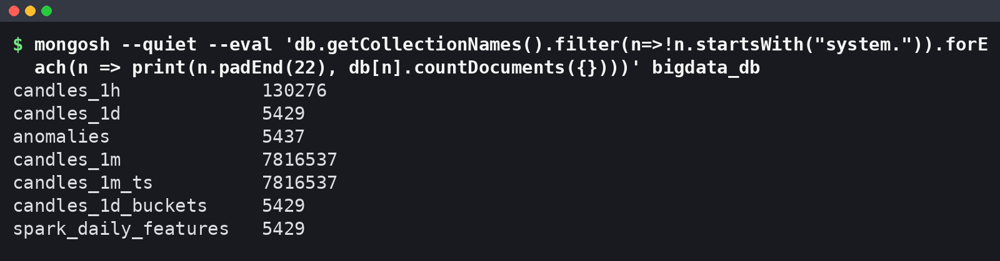
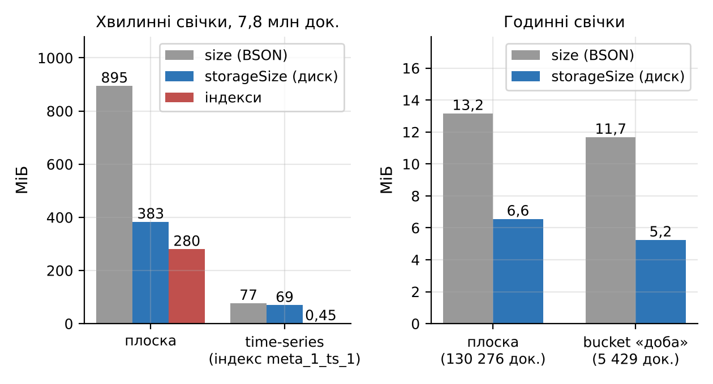
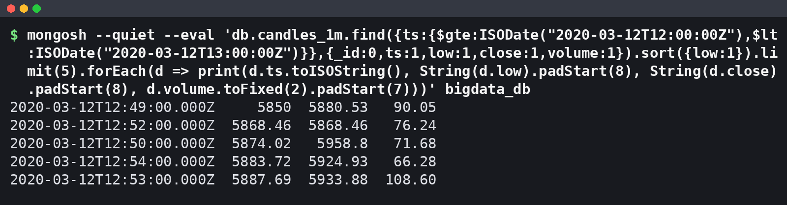
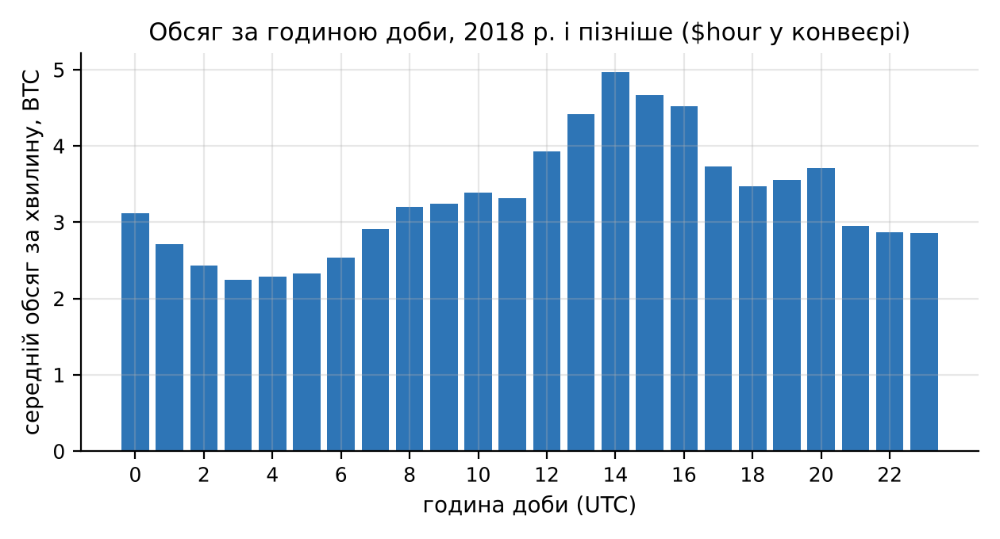
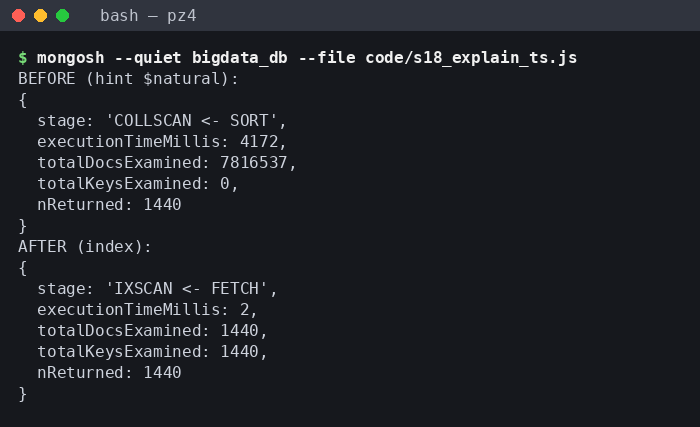
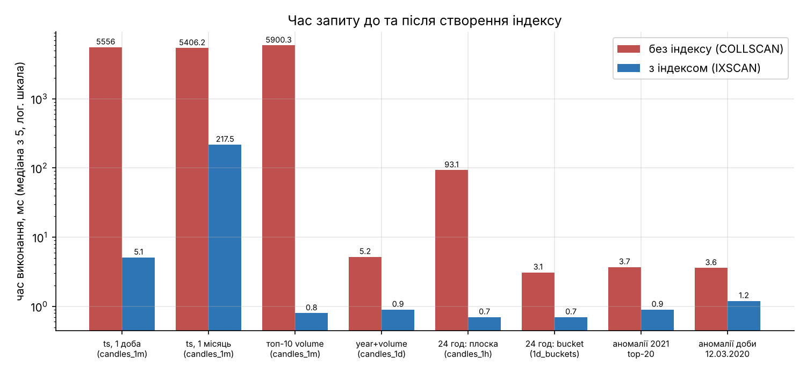
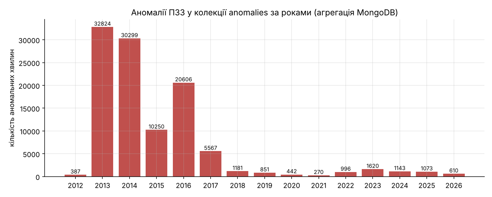
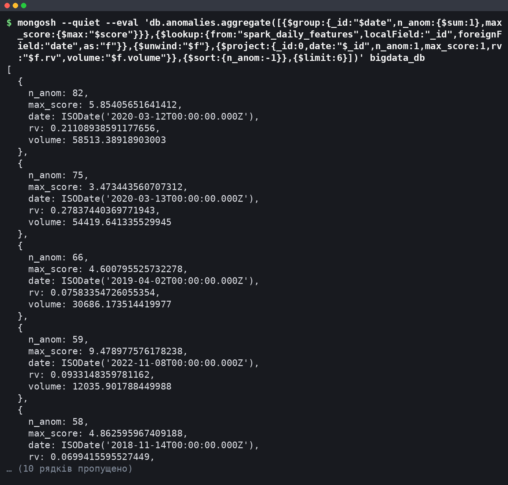

# Мета роботи

Мета роботи: ознайомитися з принципами організації NoSQL-сховищ та документною моделлю MongoDB; отримати практичні навички створення бази даних і колекцій, імпорту великого набору даних, виконання запитів, індексації та агрегування на прикладі 7 816 537 хвилинних свічок BTC/USD (Bitcoin Historical Data, 2012–2026 роки); навчитися використовувати MongoDB як сховище результатів обробки великих даних, отриманих у ПЗ2 (Spark) та ПЗ3 (виявлення аномалій).

# Короткі теоретичні відомості

NoSQL-системи відмовляються від жорсткої реляційної схеми на користь моделей, що легше масштабуються горизонтально. Розрізняють чотири основні типи: key-value (значення за ключем, наприклад Redis), документні (MongoDB), колонкові (Cassandra, HBase) та графові (Neo4j).

Ієрархія MongoDB така: сервер `mongod` містить бази даних, база – колекції, колекція – документи. Документ зберігається у форматі BSON (двійковий JSON), який має типи, відсутні в JSON: Date (мілісекунди від епохи, UTC), Int32 і Int64, Double, ObjectId, масиви та вкладені документи. Розмір документа обмежено 16 МБ, кожен документ має унікальне поле `_id`. Схема не нав'язується: документи однієї колекції можуть мати різні поля.

Запит `find(filter, projection)` використовує оператори порівняння (`$gt`, `$lt`, `$in`) і логічні оператори (`$and`, `$or`), а `sort` і `limit` виконуються на сервері. Aggregation Framework будує конвеєр стадій (`$match`, `$group`, `$sort`, `$project`, `$bucket`, `$lookup`, `$unwind`), де кожна стадія обробляє потік документів від попередньої.

Індекс – це B-дерево ключів одного або кількох полів із посиланнями на документи. Без придатного індексу планувальник виконує COLLSCAN (читання всієї колекції), з індексом – IXSCAN і FETCH лише потрібних документів. Метод `explain("executionStats")` показує виграшний план і лічильники `totalDocsExamined`, `totalKeysExamined`, `executionTimeMillis`. Для складених індексів діє правило ESR: спочатку поля рівності, потім поле сортування, потім діапазон. Time-series колекції (з версії 5.0) групують виміри у внутрішні бакети зі стовпцевим стисненням.

# Результати виконання практичного заняття

## 1 Підготовка MongoDB

Пряме завантаження з `fastdl.mongodb.org` у контейнері блокує проксі, тому сервер MongoDB Community встановлено з каналу conda-forge менеджером micromamba, оболонку mongosh – з npm, драйвер PyMongo – через pip. Версії компонентів і конфігурацію машини, на якій виміряно всі часи, наведено в таблиці 1.

Таблиця 1 – Програмне забезпечення та обладнання

| Компонент | Версія або параметр | Спосіб встановлення |
|---|---|---|
| MongoDB Community Server (mongod) | 8.3.7, рушій WiredTiger (стиснення snappy) | micromamba, conda-forge |
| MongoDB Shell (mongosh) | 2.14.1 | npm |
| PyMongo | 4.19.0 | pip |
| MongoDB Compass | не встановлено | контейнер без графічного середовища |
| Python / pandas | 3.13.18 / 3.0.5 | системний / pip |
| Машина | Ubuntu 24.04; Intel Xeon 2,10 ГГц, 4 vCPU; ОЗП 15,7 ГіБ | – |

MongoDB Compass потребує дисплея, якого в контейнері немає, тому ті самі операції (перегляд колекцій і документів, фільтри, конвеєри агрегації, індекси, план `explain`) виконано в mongosh. Сервер запущено як фоновий процес, доступний лише локально:

```bash
mongod --dbpath /home/user/AVD/work/mongo_data --bind_ip 127.0.0.1 --port 27017 \
       --fork --logpath /home/user/AVD/work/mongo_data/mongod.log
```

PyMongo підключається з `CodecOptions(tz_aware=True)`, щоб поля Date поверталися як дати UTC (додаток А.1).

## 2 Створення бази даних і колекцій

База `bigdata_db` створюється неявно під час першого запису, а time-series колекцію потрібно створити явно до вставки:

```python
db = MongoClient(URI)["bigdata_db"]
db.create_collection("candles_1m_ts",
    timeseries={"timeField": "ts", "metaField": "meta", "granularity": "minutes"})
db.candles_1m.insert_many(docs, ordered=False)   # звичайна колекція створюється автоматично
```

Створено сім колекцій. Їх призначення і розміри за `collStats` зведено в таблицю 2.

Таблиця 2 – Колекції бази bigdata_db

| Колекція | Призначення | Документів | size, МБ | storageSize, МБ | Індекс _id, МБ |
|---|---|---|---|---|---|
| candles_1m | хвилинні свічки, плоска схема (основна) | 7 816 537 | 894,53 | 383,22 | 82,23 |
| candles_1m_ts | ті самі свічки у time-series колекції | 7 816 537 | 76,94 | 69,31 | 0,45 |
| candles_1h | годинні свічки, плоска схема | 130 276 | 13,17 | 6,56 | 1,24 |
| candles_1d | добові свічки | 5 429 | 0,75 | 0,30 | 0,07 |
| candles_1d_buckets | доба з масивом 24 годинних свічок | 5 429 | 11,68 | 5,25 | 0,07 |
| spark_daily_features | добові ознаки, обчислені Spark у ПЗ2 | 5 429 | 2,04 | 0,96 | 0,07 |
| anomalies | аномальні хвилини ПЗ3 (правило v2) | 5 437 | – | – | – |

Розміри знято одразу після завантаження, до створення вторинних індексів; для `anomalies` знято лише кількість документів. Наявність колекцій і кількість документів у кожній перевірено в mongosh (рисунок 1).



Кількість документів збігається з кількістю рядків джерел.

### 2.1 Обґрунтування схеми

Для хвилинних свічок порівняно три варіанти: плоский документ на хвилину (`candles_1m`), time-series колекцію (`candles_1m_ts`) і шаблон bucket, де один документ містить масив вимірів (`candles_1d_buckets`, доба з 24 годинами). Розміри на диску показано на рисунку 2.



Плоска колекція займає 383,22 МБ на диску, а без стиснення – 894,53 МБ (120 Б на документ), що в 2,25 раза більше за вихідний CSV (396,8 МБ): кожен документ повторює імена полів і має `_id`. Time-series колекція займає 69,31 МБ, тобто в 5,5 раза менше, а її індекс – 0,45 МБ проти 82,23 МБ для `_id` плоскої колекції. Сервер згрупував виміри в 7 817 бакетів по 1 000 хвилин і стиснув їх стовпцями. Шаблон bucket для годинних свічок дає менший виграш на диску (5,25 проти 6,56 МБ), але зменшує кількість документів у 24 рази, що прискорює повне сканування (розділ 6).

Основною для запитів обрано плоску колекцію `candles_1m`: кожна хвилина – окремий документ, тому `explain` прямо показує кількість переглянутих документів, а будь-яке поле індексується звичайним B-деревом. Time-series колекція придатна для архіву, де головне – об'єм.

## 3 Імпорт даних

### 3.1 Завантаження

Джерелом слугує оброблений набір `btc_1min.parquet` (час UTC) та похідні годинний і добовий набори. Документи формуються з DataFrame пакетами і вставляються методом `insert_many(ordered=False)`.

Повне завантаження 7 816 537 документів у `candles_1m` тривало 117,7 с: 18,2 с – побудова документів у Python, 99,6 с – власне вставка зі швидкістю 78,5 тис. док/с. Пакет 20 000 документів по 120 Б (близько 2,4 МБ) значно менший за межу повідомлення протоколу (48 МБ), тож драйвер його не дробить, а весь набір передається за 391 звернення. Режим `ordered=False` дозволяє серверу не зупинятися на першій помилці. Time-series колекція `candles_1m_ts` завантажена за 99,2 с і приймає дані на 27 % швидше (вставка 78,5 с, 99 638 док/с), бо записує на диск 7 817 стиснених бакетів замість 7,8 млн окремих документів.

### 3.2 Структура документів і типи полів

Хвилинний документ містить `_id` і сім полів: `ts`, `unix` і OHLCV (див. таблицю 3). Документ bucket-схеми має вкладений масив (Extended JSON, перші дві години з 24):

```json
{"date": {"$date": "2012-01-01T00:00:00Z"}, "year": 2012, "month": 1, "n_hours": 24,
 "hours": [{"hour": 0, "open": 4.58, "high": 4.58, "low": 4.58, "close": 4.58, "volume": 0.0},
           {"hour": 1, "open": 4.58, "high": 4.58, "low": 4.58, "close": 4.58, "volume": 0.0},
           {"...": "ще 22 годин"}]}
```

Типи полів визначено агрегацією `{$group: {_id: {$type: "$поле"}}}` по всіх документах кожної колекції; результат наведено в таблиці 3.

Таблиця 3 – BSON-типи полів

| Колекція | Поля | BSON-тип |
|---|---|---|
| candles_1m, candles_1h | ts | date |
| candles_1m | unix | long |
| усі колекції свічок | open, high, low, close, volume | double |
| candles_1d, candles_1d_buckets | date / year, month, n_minutes, n_hours | date / int |
| candles_1d_buckets | hours | array вкладених документів |
| spark_daily_features | date / rv, hl_rel, flat_share, ret_1d, vol_7d, vol_30d, ma_7, ma_30 / n_minutes, n_flat, year, month, dow, is_complete | date / double / int |
| anomalies | ts, date / score, z_ret, z_vol, close, volume / k, year, ts_epoch / rule, rule_version / in_stream_replay | date / double / int / string / bool |

Кожне поле має єдиний тип у всіх документах, крім трьох полів Spark із типом null (п. 3.3). Час збережено як BSON Date, а не рядок, тому працюють діапазонні фільтри, оператори `$year`, `$month`, `$hour` і сортування в хронологічному порядку.

### 3.3 Пропущені значення

У колекціях свічок для кожного поля підраховано документи, де поле відсутнє, дорівнює null або NaN: у всіх 26 полях таких документів 0. У `spark_daily_features` значення NaN з Parquet замінено на null під час завантаження: 1 у `ret_1d` (перша доба не має попередньої), по 2 у `vol_7d` і `vol_30d` (вікна ковзного стандартного відхилення на початку історії). Хвилини з нульовим обсягом (1 312 419, тобто 16,79 %) не є пропусками: це свічки, якими джерело заповнює хвилини без угод, тому їх збережено, а в аналізі обсягу враховано окремо.

## 4 Виконання запитів

Реалізовано вісім запитів `find`, які разом охоплюють пошук, фільтрацію, сортування, обмеження результатів і проєкцію (таблиця 4). Час виміряно в Python разом із передачею результатів клієнту, після створення індексів з розділу 6.

Таблиця 4 – Запити до бази bigdata_db

| № | Призначення | Колекція | Оператори | Документів | Час, мс |
|---|---|---|---|---|---|
| Q1 | доби 2021 року з close > 60 000 | candles_1d | $gte, $lt, $gt, проєкція, sort | 39 | 3,3 |
| Q2 | топ-10 діб за обсягом | candles_1d | sort(volume: −1), limit(10) | 10 | 3,8 |
| Q3 | 5 найнижчих low 12.03.2020, 12:00–13:00 UTC | candles_1m | діапазон ts, sort, limit(5) | 5 | 1,0 |
| Q4 | 5 хвилин з найбільшим обсягом | candles_1m | $gt, sort, limit(5) | 5 | 0,6 |
| Q5 | повні доби з ret_1d < −0,10 | spark_daily_features | рівність, $lt, sort, limit(10) | 10 | 4,7 |
| Q6 | неповні доби (n_minutes < 1440) | candles_1d | $lt, проєкція | 2 | 2,9 |
| Q7 | кількість хвилин з volume = 0 | candles_1m | countDocuments | 1 | 421,9 |
| Q8 | листопад–грудень 2022 з flat_share = 0 | spark_daily_features | $and, $in | 2 | 12,6 |

Запит Q3 вибирає з 7,8 млн документів одну годину обвалу 12.03.2020 і сортує її за мінімумом (рисунок 3).



Мінімум цієї години – 5 850 USD о 12:49 UTC при обсязі 90,0 BTC за хвилину, а вибірка завдяки індексу `ts_1` займає 1,0 мс. За Q5 найгірші повні доби в результатах Spark – 11.04.2013 (лог-дохідність −0,664) і 12.03.2020 (−0,494). Q6 знаходить дві неповні доби, першу (01.01.2012, 1 439 хвилин) і останню (11.11.2026, 218 хвилин), тому в агрегаціях за роками використано лише повні доби. Q8 повертає 09.11 і 10.11.2022 – дні краху FTX, коли не було жодної хвилини без угод. Найповільніший Q7 (421,9 мс) рахує 1 312 419 ключів індексу `volume_-1`.

## 5 Агрегування

Побудовано п'ять конвеєрів над свічками і ознаками Spark та конвеєр із `$lookup` над аномаліями (розділ 7). Склад стадій і час виконання наведено в таблиці 5.

Таблиця 5 – Конвеєри агрегації

| Конвеєр | Колекція | Стадії | Рядків | Час, с |
|---|---|---|---|---|
| A1 місячні OHLC | candles_1m | $sort → $group ($first, $max, $min, $last, $sum) → $sort → $project | 179 | 116,65 |
| A2 обсяг за годиною доби, 2018+ | candles_1m | $match → $group ($hour) → $sort → $project | 24 | 65,93 |
| A3 річна волатильність | spark_daily_features | $match → $group → $sort → $project | 15 | 0,107 |
| A4 розподіл діб за ціною | candles_1d | $bucket | 7 | 0,106 |
| A5 річний обсяг | candles_1d | $group → $sort | 15 | 0,090 |
| ANOM аномалії і ознаки Spark | anomalies | $group → $lookup → $unwind → $project → $sort | 1 572 | 0,117 |

Конвеєри над 7,8 млн хвилин виконуються хвилинами, а над добовими колекціями – за десяту частку секунди.

### 5.1 Місячні OHLC

Конвеєр A1 ресемплює хвилинні свічки в місячні за правилом first/max/min/last/sum:

```javascript
db.candles_1m.aggregate([{$sort: {ts: 1}},
  {$group: {_id: {y: {$year: "$ts"}, m: {$month: "$ts"}}, open: {$first: "$open"},
            high: {$max: "$high"}, low: {$min: "$low"}, close: {$last: "$close"},
            volume: {$sum: "$volume"}}},
  {$sort: {_id: 1}}], {allowDiskUse: true})
```

Стадія `$sort` стоїть перед `$group`, бо без неї `$first` і `$last` брали б документи в порядку зберігання, який не гарантує хронології.
Коректність перевірено порівнянням з ресемплінгом pandas добових свічок: для всіх 179 місяців максимальна абсолютна різниця open, high, low і close дорівнює 0, а відносна різниця обсягу – 2,1·10⁻¹⁶ (похибка округлення суми з плаваючою комою).

### 5.2 Обсяг за годиною доби

Конвеєр A2 групує хвилини з 2018 року за `$hour` (UTC). Період обмежено 2018 роком, бо раніше частка хвилин без угод була великою і спотворювала середні. Результат подано на рисунку 4.



Найактивніша година – 14:00 UTC (4,96 BTC за хвилину), найспокійніша – 03:00 UTC (2,24 BTC), різниця в 2,2 раза. Пік 13:00–16:00 UTC збігається з відкриттям фондового ринку США, отже, цілодобовий ринок біткоїна має виражену денну сезонність, яку слід враховувати при порівнянні обсягів різних годин.

### 5.3 Річна волатильність і розподіл цін

Конвеєр A3 рахує річні показники за ознаками Spark лише для повних діб (`is_complete = 1`). Середня реалізована волатильність `rv` знизилася з 0,1152 у 2013 році до 0,0200 у 2023 році і з того часу не перевищувала 0,0260, тобто ринок став значно менш волатильним. Конвеєр `$bucket` (A4) розподіляє доби за ціною закриття: 1 332 доби в діапазоні 100–1 000 USD, 1 317 – у 10 000–50 000 USD і 217 діб понад 100 000 USD, перша з яких – 08.12.2024. Річні суми обсягу з A5 (`candles_1d`) для років без неповних діб збігаються із сумами з A3 (`spark_daily_features`), що підтверджує узгодженість колекцій.

## 6 Індексація

Індекси створено для полів, за якими фільтрують і сортують запити: `ts_1` і `volume_-1` у `candles_1m`, `ts_1` у `candles_1h`, складений `{year: 1, volume: -1}` і `date_1` у `candles_1d`, `date_1` у `candles_1d_buckets` і `spark_daily_features`, складений `{date: 1, score: -1}` і `year_1` в `anomalies`.

Порівняння проведено за однакових умов. Для фази «до» з колекції видаляються всі вторинні індекси, для фази «після» створюється рівно один. Той самий запит виконується один раз для прогріву кешу, далі 5 разів поспіль, і в таблицю потрапляє медіана `executionTimeMillis` з `explain("executionStats")`; медіану повного часу виконання в Python показано на рисунку 6. Результати наведено в таблиці 6; план «до» в усіх випадках – COLLSCAN (з SORT, крім E5b), ключів індексу не переглядається, а кількість повернутих документів до і після однакова (для E1 – 1 440, для E2 – 44 640).

Таблиця 6 – Виконання запитів до і після створення індексу (медіана з 5 прогрітих запусків)

| Запит (колекція) | Індекс, МБ | Час (explain), мс | Документів переглянуто | Ключів | План після |
|---|---|---|---|---|---|
| E1 доба 19.05.2021 (candles_1m) | ts_1, 90,43 | 5 939 → 1 | 7 816 537 → 1 440 | 1 440 | IXSCAN, FETCH |
| E2 травень 2021 (candles_1m) | ts_1, 90,43 | 5 938 → 51 | 7 816 537 → 44 640 | 44 640 | IXSCAN, FETCH |
| E3 топ-10 за volume (candles_1m) | volume_-1, 107,41 | 6 437 → 0 | 7 816 537 → 10 | 10 | IXSCAN, FETCH, LIMIT |
| E4 2021, volume > 9 483,33 (candles_1d) | year_1_volume_-1, 0,11 | 4 → 0 | 5 429 → 36 | 36 | IXSCAN, FETCH |
| E5a 24 години (candles_1h) | ts_1, 1,48 | 109 → 0 | 130 276 → 24 | 24 | IXSCAN, FETCH |
| E5b доба-bucket (candles_1d_buckets) | date_1, 0,08 | 2 → 0 | 5 429 → 1 | 1 | IXSCAN, FETCH |
| ANOM1 2021, топ-20 за score (anomalies) | date_1_score_-1, 0,14 | 3 → 0 | 5 437 → 20 | 338 | IXSCAN, SORT, FETCH |
| ANOM2 доба 12.03.2020 (anomalies) | date_1_score_-1, 0,14 | 2 → 0 | 5 437 → 82 | 82 | IXSCAN, FETCH |

Зміну плану для запиту E1 в mongosh показано на рисунку 5: «до» отримано примусовим повним скануванням `hint({$natural: 1})`, «після» – планом за замовчуванням.



На скриншоті – один запуск, тому час відрізняється від медіани, але стадії й лічильники збігаються. Порівняння часу для всіх запитів подано на рисунку 6 у логарифмічній шкалі.



На хвилинній колекції індекс скорочує час вибірки доби з 5 556,0 до 5,1 мс (у 1 089 разів), а топ-10 за обсягом – з 5 900,3 до 0,8 мс. З індексом кількість переглянутих документів дорівнює кількості повернутих. Для травня 2021 року виграш менший (у 25 разів), бо час займає FETCH і передача 44 640 документів. Складений індекс `{year: 1, volume: -1}` відповідає правилу ESR, тому стадія SORT зникає. В `anomalies` для ANOM1 стадія SORT лишилася: діапазон дат охоплює 338 ключів, а порядок `score` індекс гарантує лише в межах однієї дати; для рівності на дату (ANOM2) сортування не потрібне. На малих колекціях виграш – лише 2–3 мс.

Ціна індексів – місце і час побудови: `ts_1` займає 90,43 МБ і будується 23,76 с, `volume_-1` – 107,41 МБ і 36,08 с. Разом з `_id` індекси `candles_1m` займають 280,07 МБ при 383,22 МБ даних. Експеримент E5 показує, що bucket-схема без індексу переглядає 5 429 документів за 3,1 мс замість 130 276 за 93,1 мс, а з індексами обидві схеми повертають добу за 0,7 мс.

### 6.1 Агрегація, яка не прискорюється індексом

Конвеєр A1 виконано з індексом `ts_1` (116,65 с) і без нього з `hint({$natural: 1})` (119,12 с), по одному запуску кожен. Різниця 2 % менша за розкид повних сканувань (E1: від 5 200 до 6 655 мс), тож індекс фактично не допомагає. План з індексом – IXSCAN по всьому діапазону `[MinKey, MaxKey]`, далі FETCH і GROUP: індекс лише замінює сортування читанням документів у порядку ключів, але `$group` все одно обробляє всі 7,8 млн документів. Місячні звіти ефективніше рахувати з `candles_1d` (A5 – 0,09 с).

## 7 Інтеграція з результатами Spark і ПЗ3

Колекцію `spark_daily_features` (5 429 документів, 24 поля) завантажено з таблиці добових ознак, яку обчислив Spark у ПЗ2: OHLCV, частка flat-хвилин, реалізована волатильність `rv`, відносний діапазон `hl_rel`, лог-дохідність `ret_1d`, ковзні показники. Колекцію `anomalies` завантажено з результату ПЗ3 `pz3_anomalies.csv` (5 437 документів, 0,12 с). Правило v2 з ПЗ3 позначає хвилину t аномальною, якщо z_ret = |r_t| / σ_t > k і z_vol > 0, де r_t – хвилинна лог-дохідність, σ_t = Q₀,₉₀(|r|)/1,6449 за активними хвилинами попередніх 7 діб, z_vol – робастний z-показник логарифма обсягу за тією самою базою, k = 9. Отримано 5 437 аномальних хвилин у 1 572 добах. Типи полів наведено в таблиці 3.

Кількість аномалій за роками, обчислену агрегацією в MongoDB, показано на рисунку 7, а результат конвеєра з `$lookup`, що з'єднує кожну добу з аномаліями з її ознаками Spark за полем `date`, – на рисунку 8.





У 2013–2016 роках позначено 82–461 аномалію на рік, тобто перекосу в бік тонкого ринку немає; найбільше їх у 2019 (777) і 2023 (749) роках. У `$lookup` усі 1 572 доби знайшли пару. Перше місце посідає 12.03.2020 (82 аномалії, `rv` 0,211, лог-дохідність −0,494), друге – 13.03.2020 (75), четверте – 08.11.2022 (59, найбільший score 9,48 серед топ-5, крах FTX). Порівняння діб з аномаліями з рештою повних діб наведено в таблиці 7.

Таблиця 7 – Ознаки Spark для діб з аномаліями і решти повних діб

| Група | Діб | Середнє rv | Медіана rv | Середнє hl_rel | Медіана обсягу, BTC |
|---|---|---|---|---|---|
| доби з аномаліями | 1 572 | 0,0506 | 0,0353 | 0,0695 | 4 853,7 |
| решта повних діб | 3 855 | 0,0453 | 0,0356 | 0,0458 | 3 798,2 |

Медіана `rv` в обох групах майже однакова (0,0353 і 0,0356), а середній відносний діапазон `hl_rel` і медіанний обсяг у добах з аномаліями вищі в 1,5 і 1,3 раза. Правило ПЗ3 знаходить раптові хвилинні стрибки з підвищеним обсягом, які розширюють денний діапазон, але не обов'язково роблять увесь день волатильним.

## 8 Аналіз можливостей MongoDB для зберігання та аналітики великих даних

Документна модель дозволила зберегти в одній базі свічки, агрегати, ознаки Spark і аномалії з різною структурою без міграцій. На 4 vCPU сервер приймав 78,5 тис. док/с у звичайну і 99,6 тис. у time-series колекцію, яка стискає хвилинний ряд у 5,5 раза. Індекси переводять селективні запити з 5–6 с до одиниць мілісекунд, а Aggregation Framework достатній для ресемплінгу OHLC і з'єднання результатів через `$lookup`.

Обмеження виявилися на повних проходах: агрегація по всіх хвилинах триває 66–117 с, індекс її не прискорює, а без шардування конвеєр не розподіляється між вузлами. Плоска схема збільшує дані в 2,25 раза порівняно з CSV до стиснення, а три індекси `candles_1m` займають 280,07 МБ. Тому для часових рядів такого розміру MongoDB доцільно використовувати як шар зберігання і швидкого доступу: важкі перерахунки всієї історії виконувати в Spark, а в MongoDB завантажувати їх результати (добові агрегати, ознаки, аномалії) з індексами під типові запити.

# Висновки

1. Встановлено MongoDB Community Server 8.3.7, mongosh 2.14.1 і PyMongo 4.19.0; Compass у контейнері без дисплея недоступний, його операції виконано в mongosh.

2. Створено базу `bigdata_db` із семи колекцій; time-series колекція хвилинних свічок займає 69,31 МБ проти 383,22 МБ для плоскої схеми.

3. Імпортовано 7 816 537 хвилинних документів за 117,7 с (вставка 78,5 тис. док/с, пакети по 20 000); визначено структуру, BSON-типи і пропуски: у свічках їх немає, в ознаках Spark 5 значень null, нульовий обсяг 16,79 % хвилин є заповненням сітки.

4. Вісім запитів охоплюють пошук, фільтрацію, сортування, обмеження і проєкцію; селективні запити з індексом виконуються за 0,6–12,6 мс.

5. Шість конвеєрів агрегації дали місячні OHLC, що збігаються з pandas для 179 місяців, денну сезонність обсягу (пік о 14:00 UTC) і зниження середньої `rv` з 0,1152 до 0,0200.

6. Індекс `ts_1` скоротив вибірку доби з 5 556,0 до 5,1 мс і з 7 816 537 до 1 440 переглянутих документів; повна агрегація A1 від індексу не виграє (116,65 проти 119,12 с).

7. Імпортовано результати ПЗ2 (5 429 діб ознак Spark) і ПЗ3 (5 437 аномалій, k = 9) і з'єднано їх через `$lookup`.

8. MongoDB ефективна як сховище результатів обробки з мілісекундним доступом за індексами, а повні проходи по мільйонах документів доцільно виконувати в Spark.

Отримано практичні навички роботи з MongoDB: створення документного сховища, виконання запитів, агрегування великих наборів даних і використання індексації.

