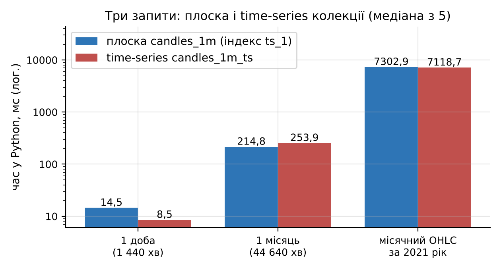
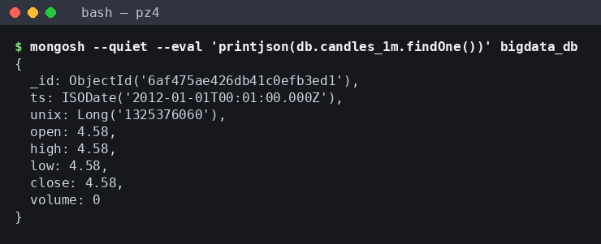
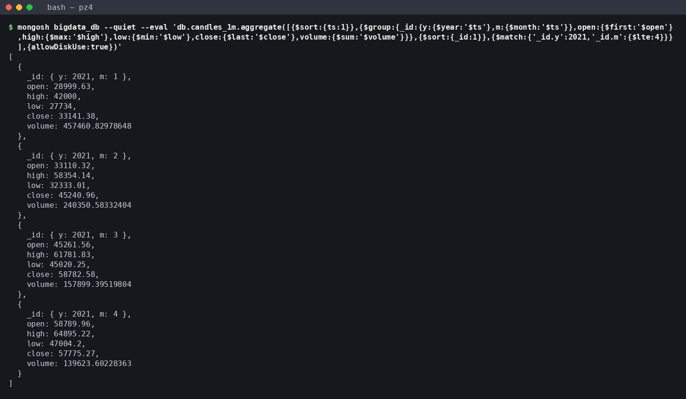

# Мета роботи

Ознайомитися з принципами організації NoSQL-сховищ та документною моделлю MongoDB; отримати практичні навички створення бази даних і колекцій, імпорту великого набору даних, виконання запитів, індексації та агрегування на прикладі 7 816 537 хвилинних свічок BTC/USD (Bitcoin Historical Data, 2012–⁠2026 роки); навчитися використовувати MongoDB як сховище результатів обробки великих даних, отриманих у ПЗ2 (Spark) та ПЗ3 (виявлення аномалій).

# Короткі теоретичні відомості

NoSQL-системи відмовляються від жорсткої реляційної схеми на користь моделей, що легше масштабуються горизонтально; основні типи: key-value (значення за ключем, наприклад Redis), документні (MongoDB), колонкові (Cassandra, HBase) та графові (Neo4j).

Ієрархія MongoDB така: сервер `mongod` містить бази даних, база – колекції, колекція – документи. Документ зберігається у форматі BSON (двійковий JSON), який має типи, відсутні в JSON: Date (мілісекунди від епохи, UTC), Int32 і Int64, Double, ObjectId, масиви та вкладені документи. Розмір документа обмежено 16 МіБ, кожен документ має унікальне поле `_id`. Схема не нав'язується: документи однієї колекції можуть мати різні поля.

Запит `find(filter, projection)` використовує оператори порівняння (`$gt`, `$lt`, `$in`) і логічні (`$and`, `$or`). Aggregation Framework будує конвеєр стадій (`$match`, `$group`, `$sort`, `$project`, `$bucket`, `$lookup`, `$unwind`), де кожна стадія обробляє потік документів від попередньої.

Індекс – це B-дерево ключів одного або кількох полів із посиланнями на документи. Без придатного індексу планувальник виконує COLLSCAN (читання всієї колекції), з індексом – IXSCAN і FETCH лише потрібних документів. Метод `explain("executionStats")` показує виграшний план і лічильники `totalDocsExamined`, `totalKeysExamined`, `executionTimeMillis`. Для складених індексів діє правило ESR: спочатку поля рівності, потім поле сортування, потім діапазон. Time-series колекції (у MongoDB починаючи з п'ятої версії) групують виміри у внутрішні бакети зі стовпцевим стисненням.

# Результати виконання практичного заняття

## 1 Підготовка MongoDB

Через блокування `fastdl.mongodb.org` проксі сервер встановлено з conda-forge (micromamba), mongosh – з npm, PyMongo – через pip. Використано MongoDB Community Server 8.3.7 (рушій WiredTiger, стиснення snappy), mongosh 2.14.1, PyMongo 4.19.0, Python 3.13.18 і pandas 3.0.5; усі часи виміряно на машині з Intel Xeon 2,10 ГГц (4 vCPU) і ОЗП 15,7 ГіБ під Linux (glibc 2.39). Compass потребує дисплея, тому його операції виконано в mongosh. PyMongo підключається з `tz_aware=True`, щоб дати поверталися в UTC (додаток А.1).

Під час повторних вимірів на машині паралельно працювали задачі Spark, і loadavg за 1 хв становив 5–⁠12 при 4 vCPU (записано в CSV поруч із кожним виміром). Тому абсолютні часи мають розкид, і порівнюються лише варіанти одного прогону, виміряні з прогрівом і медіаною.

## 2 Створення бази даних і колекцій

База `bigdata_db` і звичайні колекції створюються неявно під час першого `insert_many`, а time-series колекцію створено явно до вставки методом `create_collection` з параметром `timeseries` (поле часу `ts`, поле метаданих `meta`, гранулярність `minutes`; додаток А.2). Створено сім колекцій. Їх призначення і розміри за `collStats` зведено в таблицю 1.

Таблиця 1 – Колекції бази bigdata_db (розміри в МіБ, 1 МіБ = 2²⁰ Б)

| Колекція | Призначення | Документів | size | storageSize | Індекси |
|---|---|---|---|---|
| candles_1m | хвилинні свічки, плоска схема (основна) | 7 816 537 | 894,53 | 383,05 | 280,07 |
| candles_1m_ts | ті самі свічки у time-series колекції | 7 816 537 | 76,94 | 69,31 | 0,45 |
| candles_1h | годинні свічки, плоска схема | 130 276 | 13,17 | 6,56 | 2,72 |
| candles_1d | добові свічки | 5 429 | 0,75 | 0,30 | 0,25 |
| candles_1d_buckets | доба з масивом 24 годинних свічок | 5 429 | 11,68 | 5,25 | 0,14 |
| spark_daily_features | добові ознаки, обчислені Spark у ПЗ2 | 5 429 | 2,04 | 0,96 | 0,14 |
| anomalies | аномальні хвилини ПЗ3 (правило v2) | 5 437 | 1,59 | 0,63 | 0,25 |

Розміри знято після створення індексів розділу 6: для `candles_1m` це `_id_` (82,23), `ts_1` (90,43) і `volume_-1` (107,41), а time-series колекція має лише автоматичний індекс `meta_1_ts_1`. Кількість документів, перевірена `countDocuments` у mongosh, збігається з кількістю рядків джерел.

### 2.1 Обґрунтування схеми

Для хвилинних свічок порівняно три варіанти: плоский документ на хвилину (`candles_1m`), time-series колекцію (`candles_1m_ts`) і шаблон bucket, де один документ містить масив вимірів (`candles_1d_buckets`, доба з 24 годинами). Обсяг зберігання показано на рисунку 1. Розмір BSON плоскої колекції – 894,53 МіБ, або 937,98 МБ (120 Б на документ), у 2,36 раза більше за вихідний CSV (396,85 МБ, тобто 378,47 МіБ), бо кожен документ повторює імена полів. Після стиснення на диску лишається 383,05 МіБ. Time-series колекція займає 69,31 МіБ, у 5,5 раза менше, а її індекс `meta_1_ts_1` – 0,45 МіБ проти 90,43 МіБ для `ts_1` плоскої колекції. Сервер згрупував виміри в 7 817 бакетів і стиснув їх стовпцями. Шаблон bucket для годинних свічок дає менший виграш (5,25 проти 6,56 МіБ), але зменшує кількість документів у 24 рази.

За обсягом time-series колекція явно вигідніша. Щоб вибір схеми спирався на час запитів, а не лише на обсяг, три типові запити виконано на обох колекціях з прогрівом і медіаною з 5 запусків (рисунок 2).

Доба читається з time-series колекції швидше (8,5 проти 14,5 мс), місяць – повільніше (253,9 проти 214,8 мс), місячний OHLC за 2021 рік – за однаковий час (7 118,7 і 7 302,9 мс); розкид запусків перевищує різницю медіан. Основною обрано плоску колекцію `candles_1m`: вона дозволяє вторинний індекс на будь-якому полі (`volume_-1`), оновлення окремих хвилин без обмежень, а `explain` рахує хвилини, а не бакети. Time-series колекція придатна для архіву.

## 3 Імпорт даних

### 3.1 Завантаження

Джерелом слугує оброблений набір `btc_1min.parquet` (час UTC) та похідні годинний і добовий набори. Документи формуються з DataFrame пакетами і вставляються методом `insert_many(ordered=False)`. Утиліту `mongoimport` не використано, бо типи Date та Int64 для CSV довелося б описувати вручну, а з DataFrame вони переходять у BSON напряму.

Повне завантаження 7 816 537 документів у `candles_1m` тривало 117,7 с: 18,2 с – побудова документів у Python, 99,6 с – власне вставка зі швидкістю 78,5 тис. док/с. Пакет 20 000 документів по 120 Б (близько 2,4 МБ) значно менший за межу повідомлення протоколу (48 МБ), тож драйвер його не дробить, а весь набір передається за 391 звернення; інші розміри пакета не вимірювалися. Time-series колекція `candles_1m_ts` завантажена за 99,2 с і приймає дані на 27 % швидше (вставка 78,5 с, 99 638 док/с), бо записує 7 817 стиснених бакетів.

### 3.2 Структура документів і типи полів

Структуру документів трьох схем показано на рисунку 3: плоский документ має `_id` і сім полів (`ts`, `unix` і OHLCV), time-series документ додає поле `meta`, а документ bucket-схеми містить вкладений масив `hours` (на рисунку виведено перший з 24 елементів).

Поле `unix` типу Int64 `JSON.stringify` виводить як об'єкт. Типи полів визначено агрегацією `{$group: {_id: {$type: "$поле"}}}` по всіх документах кожної колекції; результат наведено в таблиці 2.

Таблиця 2 – BSON-типи полів

| Колекція | Поля | BSON-тип |
|---|---|---|
| candles_1m, candles_1h | ts | date |
| candles_1m | unix | long |
| усі колекції свічок | open, high, low, close, volume | double |
| candles_1d, candles_1d_buckets | date / year, month, n_minutes, n_hours | date / int |
| candles_1d_buckets | hours | array вкладених документів |
| spark_daily_features | date / rv, hl_rel, ret_1d, vol_7d та ще 13 полів / n_minutes, n_flat, year, month, dow, is_complete | date / double / int |
| anomalies | ts, date / score, z_ret, z_vol, log_return та ще 6 полів / k, year, ts_epoch / rule, rule_version / in_stream_replay | date / double / int / string / bool |

Кожне поле має єдиний тип у всіх документах, крім трьох полів Spark із типом null (п. 3.3). Час збережено як BSON Date, а не рядок, тому працюють діапазонні фільтри, оператори `$year`, `$month`, `$hour` і сортування в хронологічному порядку.

### 3.3 Пропущені значення

У колекціях свічок для кожного поля підраховано документи, де поле відсутнє, дорівнює null або NaN: у всіх 27 полях таких документів 0. У `spark_daily_features` значення NaN з Parquet замінено на null під час завантаження: 1 у `ret_1d` (перша доба не має попередньої), по 2 у `vol_7d` і `vol_30d` (вікна ковзного стандартного відхилення на початку історії). Хвилини з нульовим обсягом (1 312 419, тобто 16,79 %) не є пропусками: так джерело заповнює хвилини без угод, тому їх збережено.

## 4 Виконання запитів

Реалізовано вісім запитів `find`, які разом охоплюють пошук, фільтрацію, сортування, обмеження результатів і проєкцію (таблиця 3). Час одного запуску виміряно в Python разом із передачею результатів клієнту за наявності індексів з розділу 6.

Таблиця 3 – Запити до бази bigdata_db

| № | Призначення | Колекція | Оператори | Документів | Час, мс |
|---|---|---|---|---|
| Q1 | доби 2021 року з close > 60 000 | candles_1d | $gte, $lt, $gt, проєкція, sort | 39 | 4,7 |
| Q2 | топ-10 діб за обсягом | candles_1d | sort(volume: −1), limit(10) | 10 | 4,0 |
| Q3 | 5 найнижчих low 12.03.2020, 12:00–⁠13:00 UTC | candles_1m | діапазон ts, sort, limit(5) | 5 | 1,1 |
| Q4 | 5 хвилин з найбільшим обсягом | candles_1m | $gt, sort, limit(5) | 5 | 2,1 |
| Q5 | повні доби з ret_1d < −0,10 | spark_daily_features | рівність, $lt, sort, limit(10) | 10 | 4,3 |
| Q6 | неповні доби (n_minutes < 1 440) | candles_1d | $lt, проєкція | 2 | 2,4 |
| Q7 | кількість хвилин з volume = 0 | candles_1m | countDocuments | 1 | 370,9 |
| Q8 | листопад–грудень 2022 з flat_share = 0 | spark_daily_features | $and, $in | 2 | 10,5 |

Запит Q3 вибирає з 7,8 млн документів одну годину обвалу 12.03.2020 і сортує її за мінімумом (рисунок 4).

Мінімум цієї години – 5 850 USD о 12:49 UTC при обсязі 90,0 BTC за хвилину, а вибірка за індексом `ts_1` займає 1,1 мс. За Q5 найгірші повні доби в результатах Spark – 11.04.2013 (лог-дохідність −0,664) і 12.03.2020 (−0,494). Q6 знаходить дві неповні доби, першу (01.01.2012, 1 439 хвилин) і останню (11.11.2026, 218 хвилин). Q8 повертає 09.11 і 10.11.2022 – дні краху FTX. Найповільніший Q7 (370,9 мс) не читає документів: за `explain` це COUNT_SCAN, що перебирає 1 312 419 ключів індексу `volume_-1`.

## 5 Агрегування

Побудовано п'ять конвеєрів над свічками і ознаками Spark та конвеєр із `$lookup` над аномаліями (розділ 7). Склад стадій і час виконання наведено в таблиці 4.

Таблиця 4 – Конвеєри агрегації

| Конвеєр | Колекція | Стадії | Рядків | Час, с |
|---|---|---|---|---|
| A1 місячні OHLC | candles_1m | $sort → $group ($first, $max, $min, $last, $sum) → $sort → $project | 179 | 103,88 |
| A2 обсяг за годиною доби, 2018+ | candles_1m | $match → $group ($hour) → $sort → $project | 24 | 65,93 |
| A3 річна волатильність | spark_daily_features | $match → $group → $sort → $project | 15 | 0,325 |
| A4 розподіл діб за ціною | candles_1d | $bucket | 7 | 0,290 |
| A5 річний обсяг | candles_1d | $group → $sort | 15 | 0,090 |
| ANOM аномалії і ознаки Spark | anomalies | $group → $lookup → $unwind → $project → $sort | 1 572 | 0,192 |

Для A1 наведено медіану з 3 запусків, для решти – один запуск. Конвеєри над 7,8 млн хвилин тривають хвилину і більше, над добовими колекціями – десяті частки секунди.

### 5.1 Місячні OHLC

Конвеєр A1 ресемплює хвилинні свічки в місячні за правилом first/max/min/last/sum. Стадія `$sort` стоїть перед `$group`, бо без неї `$first` і `$last` брали б документи в порядку зберігання, який не гарантує хронології. Виконання конвеєра в mongosh для перших місяців 2021 року показано на рисунку 5.

Коректність перевірено порівнянням з ресемплінгом pandas добових свічок: для всіх 179 місяців максимальна абсолютна різниця open, high, low і close дорівнює 0, а відносна різниця обсягу – 2,1·10⁻¹⁶ (похибка округлення суми з плаваючою комою).

### 5.2 Обсяг за годиною доби

Конвеєр A2 групує хвилини з 2018 року за `$hour` (UTC). Період обмежено 2018 роком, бо раніше частка хвилин без угод була великою і спотворювала середні. Результат подано на рисунку 6: найактивніша година – 14:00 UTC (4,96 BTC за хвилину), найспокійніша – 03:00 UTC (2,24 BTC), різниця в 2,2 раза.

Пік 13:00–⁠16:00 UTC збігається з відкриттям фондового ринку США, отже, цілодобовий ринок біткоїна має виражену денну сезонність.

### 5.3 Річна волатильність і розподіл цін

Конвеєр A3 рахує річні показники за ознаками Spark лише для повних діб (`is_complete = 1`). Середня реалізована волатильність `rv` знизилася з 0,1152 у 2013 році до 0,0200 у 2023 році і з того часу не перевищувала 0,0260. Конвеєр `$bucket` (A4) розподіляє доби за ціною закриття: 1 332 доби в діапазоні 100–⁠1 000 USD, 1 317 – у 10 000–⁠50 000 USD і 217 діб понад 100 000 USD, перша з яких – 08.12.2024.

## 6 Індексація

Індекси створено для полів, за якими фільтрують і сортують запити (таблиця 5), а також `date_1` у `candles_1d` і `spark_daily_features` та `year_1` в `anomalies`. Для фази «до» видаляються всі вторинні індекси, для фази «після» створюється рівно один; після прогріву запит виконується 5 разів, і в таблицю 5 потрапляють медіани двох метрик: `executionTimeMillis` з `explain("executionStats")` (час на сервері) і повний час виконання в Python разом з передачею результату. План «до» в усіх випадках – COLLSCAN (з SORT, крім E5b), а кількість повернутих документів до і після однакова (для E1 – 1 440, для E2 – 44 640). План «після» – IXSCAN і FETCH (для E3 ще LIMIT, для ANOM1 ще SORT), а кількість переглянутих ключів дорівнює кількості документів, крім ANOM1 (338 ключів на 20 документів).

Зміну плану для запиту E1 в mongosh показано на рисунку 7: «до» отримано примусовим повним скануванням `hint({$natural: 1})`, «після» – планом за замовчуванням.

На скриншоті – один запуск, тому час відрізняється від медіани. Результати для всіх запитів наведено в таблиці 5: E1–E3 виконано на `candles_1m`, E4 – на `candles_1d`, E5a – на `candles_1h`, E5b – на `candles_1d_buckets`, ANOM1 і ANOM2 – на `anomalies`.

Таблиця 5 – Виконання запитів до і після створення індексу (медіана з 5 прогрітих запусків)

| Запит | Індекс | explain, мс | Python, мс | Переглянуто док. |
|---|---|---|---|---|
| E1 доба 19.05.2021 | ts_1 | 4 637 → 1 | 4 548,3 → 5,5 | 7 816 537 → 1 440 |
| E2 травень 2021 | ts_1 | 5 886 → 50 | 4 921,9 → 191,2 | 7 816 537 → 44 640 |
| E3 топ-10 за volume | volume_-1 | 5 399 → 0 | 3 771,6 → 0,5 | 7 816 537 → 10 |
| E4 2021, volume > 9 483,33 | year_1_volume_-1 | 2 → 0 | 3,0 → 0,6 | 5 429 → 36 |
| E5a 24 години | ts_1 | 86 → 0 | 73,5 → 0,6 | 130 276 → 24 |
| E5b доба-bucket | date_1 | 2 → 0 | 3,9 → 0,5 | 5 429 → 1 |
| ANOM1 2021, топ-20 за score | date_1_score_-1 | 3 → 0 | 3,6 → 1,0 | 5 437 → 20 |
| ANOM2 доба 12.03.2020 | date_1_score_-1 | 2 → 0 | 3,2 → 0,9 | 5 437 → 82 |

Час на сервері для всіх запитів подано на рисунку 8 у логарифмічній шкалі.

На хвилинній колекції індекс `ts_1` скорочує вибірку доби з 4 637 до 1 мс за `executionTimeMillis`, а за повним часом у Python – з 4 548,3 до 5,5 мс (у 827 разів); топ-10 за обсягом прискорюється з 3 771,6 до 0,5 мс. Для травня 2021 року виграш менший (у 118 разів на сервері і в 26 разів у Python), бо час займають FETCH і передача 44 640 документів. Складений індекс `{year: 1, volume: -1}` відповідає правилу ESR, тому стадія SORT зникає. В `anomalies` для ANOM1 стадія SORT лишилася: діапазон дат охоплює 338 ключів, а порядок `score` індекс гарантує лише в межах однієї дати; для рівності на дату (ANOM2) сортування не потрібне. На малих колекціях виграш за повним часом становить лише 2,3–⁠3,4 мс.

Ціна індексів – місце, час побудови і уповільнення запису. Індекс `ts_1` займає 90,43 МіБ і будується 26,26 с, `volume_-1` – 107,41 МіБ і 31,29 с; разом з `_id` індекси `candles_1m` займають 280,07 МіБ при 383,05 МіБ даних. Для оцінки вартості запису 200 000 хвилинних документів вставлено пакетами по 20 000 у копію колекції без вторинних індексів і з `ts_1` та `volume_-1` (медіана з 3 запусків): пропускна здатність падає з 120 458 до 66 824 док/с, тобто вставка повільніша на 80,3 %. Побудова обох індексів після вставки займає 1,183 с, тому історію вигідніше завантажувати без вторинних індексів. Без індексу bucket-схема (E5b) повертає добу за 3,9 мс проти 73,5 мс для плоскої (E5a), з індексами обидві – за 0,5–⁠0,6 мс.

### 6.1 Агрегація, яка не прискорюється індексом

Конвеєр A1 виконано по 3 рази з індексом `ts_1` (медіана 103,88 с) і без нього з `hint({$natural: 1})` (104,08 с). Різниця 0,2 % менша за розкид окремих запусків (від 97,34 до 104,53 с), тож індекс фактично не допомагає. За `explain` обидва плани переглядають усі 7 816 537 документів; без індексу на диск виливається SORT (8 скидань), але в обох планах з диском працює і GROUP (3 908 268 скидань), що й визначає час. Покривний індекс на `{ts, open, high, low, close, volume}` прибрав би FETCH, але не групування; його не перевірено. Місячні OHLC з `candles_1d` (5 429 документів) обчислюються за 0,108 с, тому місячні звіти доцільно рахувати з добових агрегатів.

## 7 Інтеграція з результатами Spark і ПЗ3

Колекцію `spark_daily_features` (5 429 документів, 24 поля) завантажено з добових ознак повторного прогону ПЗ2 (Spark). Порівняно з попереднім прогоном відрізняються лише `rv`, `std_ret_1m` і `vol60_mean` у 137–⁠178 рядках (для `rv` не більше ніж на 0,00065), що не змінило чисел розділів 4, 5.3 і 7. Колекцію `anomalies` завантажено з результату ПЗ3 `pz3_anomalies.csv` (5 437 документів, 0,16 с). Правило v2 з ПЗ3 позначає хвилину аномальною, якщо модуль її лог-дохідності перевищує 9σ, де σ = Q₀,₉₀(|r|)/1,6449 за активними хвилинами попередніх 7 діб, а обсяг вищий за тижневу медіану. Отримано 5 437 аномальних хвилин у 1 572 добах.

Результат конвеєра з `$lookup`, що з'єднує кожну добу з аномаліями з її ознаками Spark за полем `date`, показано на рисунку 9.

Агрегація за роками дає найбільше аномалій у 2019 (777) і 2023 (749) роках. Перекіс у бік тонкого ринку перевірено за частками з ПЗ3: у 2012–⁠2016 роках позначено 0,058 % оцінених хвилин, у 2018+ – 0,096 %. Виняток – 2013 рік (461 аномалія, 0,154 %), на який припадають три дати з топ-10: 10.04, 02.10 і 19.11.2013. У `$lookup` пару знайшли всі 1 572 доби. Перше місце посідає 12.03.2020 (82 аномалії, `rv` 0,211, лог-дохідність −0,494), друге – 13.03.2020 (75), четверте – 08.11.2022 (59, найбільший score 9,48 серед перших п'яти діб, крах FTX). Порівняння діб з аномаліями з рештою повних діб наведено в таблиці 6.

Таблиця 6 – Ознаки Spark для діб з аномаліями і решти повних діб

| Група | Діб | Середнє rv | Медіана rv | Середнє hl_rel | Медіана обсягу, BTC |
|---|---|---|---|---|
| доби з аномаліями | 1 572 | 0,0506 | 0,0353 | 0,0695 | 4 853,7 |
| решта повних діб | 3 855 | 0,0453 | 0,0356 | 0,0458 | 3 798,2 |

Медіана `rv` в обох групах майже однакова (0,0353 і 0,0356), а середній відносний діапазон `hl_rel` і медіанний обсяг у добах з аномаліями вищі в 1,5 і 1,3 раза. Правило ПЗ3 знаходить раптові хвилинні стрибки з підвищеним обсягом, які розширюють денний діапазон, але не роблять увесь день волатильним.

## 8 Аналіз можливостей MongoDB для великих даних

Документна модель дозволила зберегти в одній базі свічки, агрегати, ознаки Spark і аномалії з різною структурою без міграцій. Сервер приймав 78,5 тис. док/с у звичайну і 99,6 тис. у time-series колекцію. Індекси переводять селективні запити з 4–⁠6 с до мілісекунд, а Aggregation Framework достатній для ресемплінгу OHLC і `$lookup`.

Обмеження виявилися на повних проходах. Агрегація по всіх хвилинах триває 66–⁠104 с, індекс її не прискорює, а без шардування конвеєр не розподіляється між вузлами. Для порівняння, у ПЗ2 на тій самій машині Spark local[*] будував добові OHLC з усіх 7,8 млн хвилин за 4,547 с (медіана з 3 запусків разом з читанням CSV), pandas – за 4,884 с, а Spark із закешованим DataFrame – за 0,618 с. Умови відрізняються (добові, а не місячні групи; читання CSV, а не BSON; loadavg 8,6 на початку прогону ПЗ2 проти 5–⁠10 під час A1), проте різниця з A1 (103,88 с) перевищує порядок, і навантаженням її не пояснити. Тому MongoDB доцільно використовувати як шар зберігання і швидкого доступу: перерахунки всієї історії виконувати в Spark, а в MongoDB завантажувати їх результати (добові агрегати, ознаки, аномалії) з індексами під типові запити.

# Висновки

1. Встановлено MongoDB Community Server 8.3.7, mongosh 2.14.1 і PyMongo 4.19.0; Compass у контейнері без дисплея недоступний, його операції виконано в mongosh.

2. Створено базу `bigdata_db` із семи колекцій; time-series колекція займає 69,31 МіБ проти 383,05 МіБ для плоскої, але за часом запитів схеми рівноцінні, і основною обрано плоску.

3. Імпортовано 7 816 537 хвилинних документів за 117,7 с (вставка 78,5 тис. док/с, пакети по 20 000); визначено структуру, BSON-типи і пропуски: у 27 полях свічок їх немає, в ознаках Spark 5 значень null, нульовий обсяг 16,79 % хвилин є заповненням сітки.

4. Вісім запитів охоплюють пошук, фільтрацію, сортування, обмеження і проєкцію; усі, крім Q7 (COUNT_SCAN, 370,9 мс), виконуються за 1,1–⁠10,5 мс.

5. Шість конвеєрів агрегації дали місячні OHLC, що збігаються з pandas для 179 місяців, денну сезонність обсягу (пік о 14:00 UTC) і зниження середньої `rv` з 0,1152 до 0,0200.

6. Індекс `ts_1` скоротив вибірку доби з 4 637 до 1 мс на сервері (з 4 548,3 до 5,5 мс у Python) і з 7 816 537 до 1 440 переглянутих документів, але разом з `volume_-1` уповільнив запис на 80,3 %; повна агрегація A1 від індексу не виграє (103,88 проти 104,08 с).

7. Імпортовано результати ПЗ2 (5 429 діб ознак Spark) і ПЗ3 (5 437 аномалій, k = 9) і з'єднано їх через `$lookup`.

8. MongoDB ефективна як сховище результатів обробки з мілісекундним доступом за індексами, а повні проходи доцільно виконувати в Spark (добові OHLC за 4,547 с проти 103,88 с для місячних OHLC у MongoDB).

У результаті отримано практичні навички створення документного сховища, виконання запитів, агрегування великих наборів даних і використання індексації.
