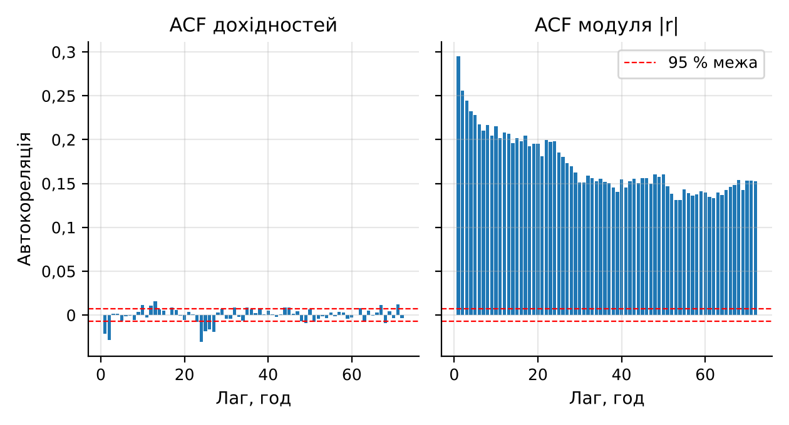
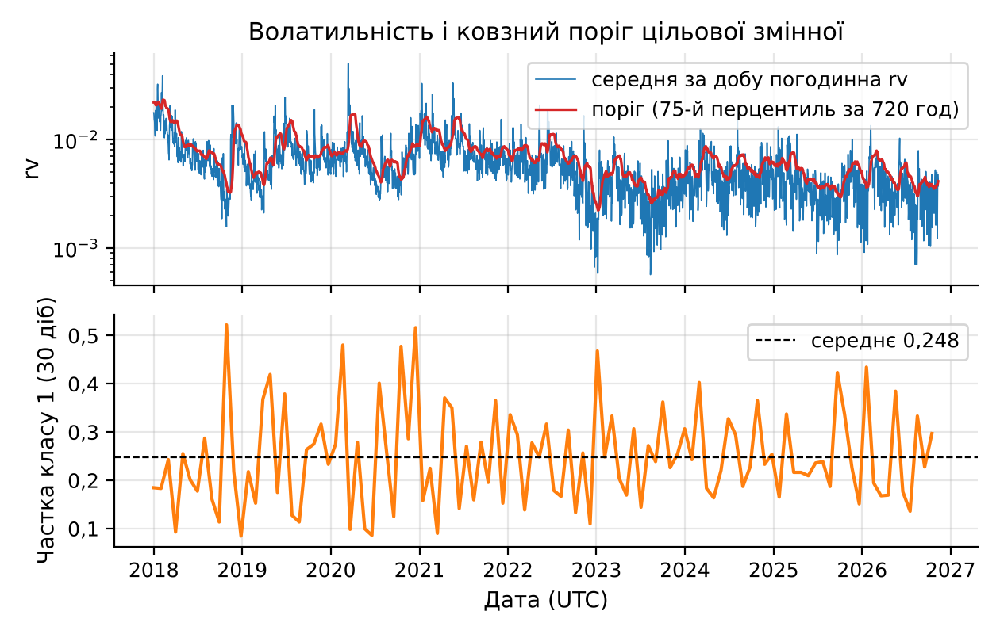
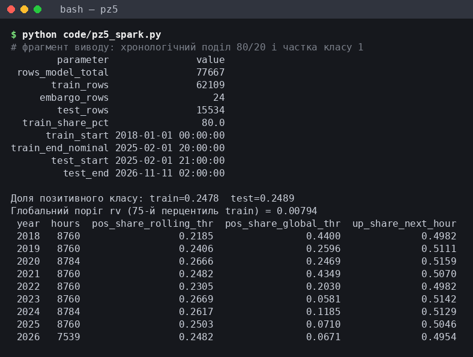
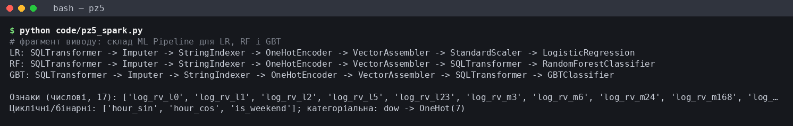
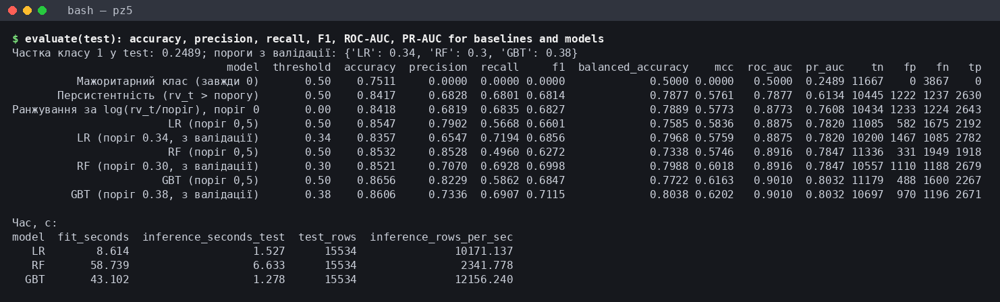
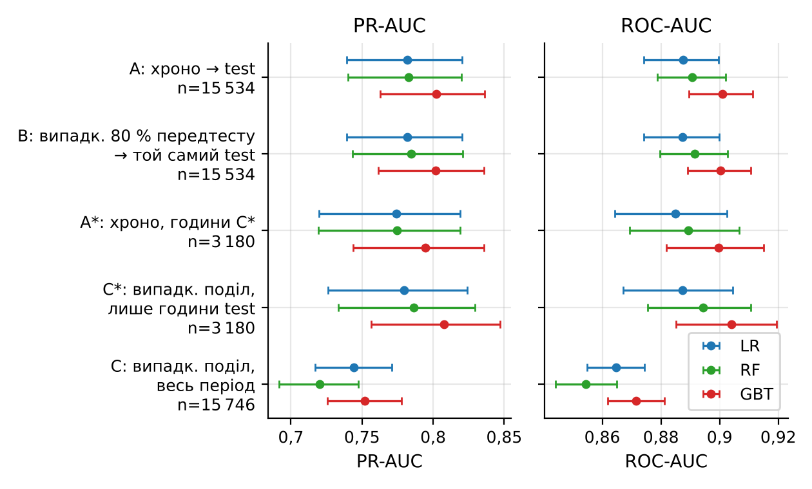
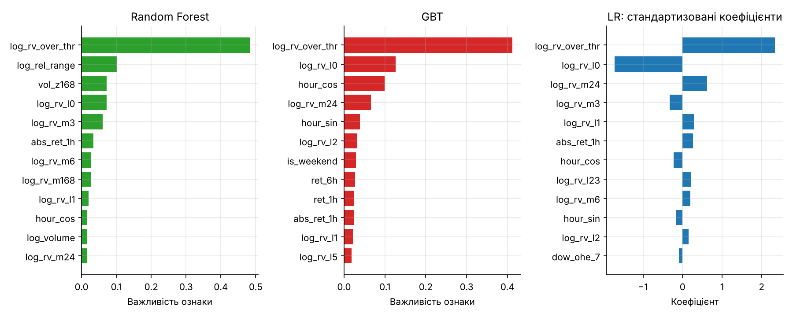
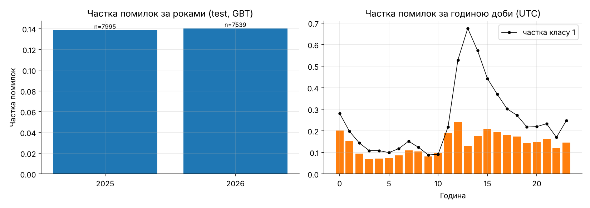

# Мета роботи

Мета роботи: ознайомитися з можливостями Apache Spark MLlib для інтелектуального аналізу великих даних; отримати практичні навички підготовки даних до машинного навчання, формування ознак, побудови та оцінювання моделей класифікації засобами PySpark на прикладі погодинних свічок BTC/USD (Bitcoin Historical Data), отриманих у ПЗ2 агрегацією 7 816 537 хвилинних записів, з прогнозом режиму волатильності наступної години.

# Короткі теоретичні відомості

Основу Spark MLlib становлять дві абстракції: трансформатор (Transformer) перетворює один DataFrame на інший методом `transform()`, оцінювач (Estimator) методом `fit()` навчається на даних і повертає трансформатор-модель. `Pipeline.fit()` навчає етапи послідовно лише на переданих даних і повертає `PipelineModel`, яку можна зберегти й застосувати до нових рядків.

Підготовка ознак виконується етапами того ж типу: `Imputer` заповнює пропуски статистикою навчальної вибірки, `StringIndexer` і `OneHotEncoder` кодують категоріальні значення, `VectorAssembler` збирає числові стовпці у вектор `features`, `StandardScaler` стандартизує ознаки, а `SQLTransformer` додає рядкові вирази SQL. Їх статистики обчислюються під час `fit()`, тож тестові дані не впливають на підготовку.

У роботі використано три класифікатори MLlib. Логістична регресія (`LogisticRegression`) – лінійна модель ймовірності класу з L1/L2-регуляризацією. Випадковий ліс (`RandomForestClassifier`) усереднює дерева, навчені на бутстреп-підвибірках. Градієнтний бустинг дерев (`GBTClassifier`) послідовно додає неглибокі дерева, кожне з яких виправляє помилки попередніх.

`BinaryClassificationEvaluator` обчислює ROC-AUC і PR-AUC за неперервною оцінкою; accuracy, precision, recall і F1 залежать від порогу. При частці класу 1 близько 25 % константа має accuracy 75 %, тому основними метриками обрано PR-AUC і F1.

Сусідні години мають схожу волатильність, тому вибірки формуються хронологічно, з проміжком (ембарго) між частинами, гіперпараметри підбираються крос-валідацією з розширюваним вікном, а невизначеність метрик оцінюється блочним бутстрепом.

# Результати виконання практичного заняття

## 1 Визначення задачі

Вхідні дані – погодинна таблиця ознак ПЗ2 (`pz2_hourly_features.parquet`, 130 276 рядків) з OHLC, обсягом, кількістю flat-хвилин і реалізованою волатильністю `rv` (корінь із суми квадратів хвилинних лог-дохідностей). Кандидатів на ціль два: напрям ціни і рівень волатильності наступної години. Автокореляції годинних дохідностей `r` і їх модуля `|r|` за 2018–2026 роки показано на рисунку 1.



Числові показники зведено в таблицю 1, разом з контрольною LR на мітці «дохідність наступної години > 0».

Таблиця 1 – Передбачуваність напряму ціни і волатильності (2018–2026 роки, 77 666 годин)

| Показник | Значення |
|---|---|
| ACF дохідності, лаг 1 / лаг 2 / лаг 24 | −0,0213 / −0,0288 / −0,0304 |
| ACF модуля дохідності, лаг 1 / лаг 24 / лаг 168 | 0,2951 / 0,1982 / 0,1445 |
| 95 % межа незначущої автокореляції | ±0,0070 |
| Частка годин зі зростанням ціни | 0,5066 |
| Правило «той самий знак»: усі години / train / test | 0,4644 / 0,4593 / 0,4847 |
| Правило «протилежний знак»: усі години / train / test | 0,5356 / 0,5407 / 0,5153 |
| Кореляція Спірмена r_t і r_t+1 | −0,0677 |
| LR для напряму на тесті: ROC-AUC / accuracy | 0,5266 / 0,5132 |
| Мажоритарний клас для напряму на тесті: accuracy | 0,5000 |

LR вгадала напрям у 7961 з 15 511 тестових годин: accuracy 0,5132, біноміальний тест дає z = 3,30, p = 0,001. Напрям статистично передбачуваний краще за 0,5, але перевага в 1,3 відсоткового пункта економічно мізерна. Точність 0,4644 правила «той самий знак» і 0,5356 правила «протилежний знак» пояснюються від'ємною кореляцією сусідніх годинних дохідностей (Спірмен −0,0677): після зростання частіше йде зниження, тобто діє короткострокове повернення до середнього. Ефект слабшає з часом (train 0,5407, test 0,5153). Волатильність має значно сильніший сигнал (ACF модуля 0,2951 на лагу 1), тому обрано задачу бінарної класифікації: чи буде наступна година високоволатильною.

## 2 Підготовка даних

### 2.1 Період моделювання

У ПЗ2 встановлено, що flat-хвилини – заповнення сітки, і при великій їх частці `rv` відображає неліквідність (доба 27.01.2012 з 98,1 % flat-хвилин потрапила до топ-10 за `rv`). Частку flat-хвилин за роками разом із часткою позитивного класу наведено в таблиці 2.

Таблиця 2 – Частка flat-хвилин, медіана rv і частка класу 1 за роками

| Показник | 2017 | 2018 | 2019 | 2020 | 2021 | 2022 | 2023 | 2024 | 2025 | 2026 |
|---|---|---|---|---|---|---|---|---|---|---|
| Flat, % | 8,04 | 3,77 | 3,28 | 1,55 | 0,70 | 2,66 | 3,95 | 3,33 | 1,13 | 0,34 |
| Медіана rv | 0,01010 | 0,00720 | 0,00579 | 0,00579 | 0,00735 | 0,00502 | 0,00294 | 0,00412 | 0,00324 | 0,00318 |
| Клас 1, ковзний поріг | – | 0,2185 | 0,2408 | 0,2665 | 0,2483 | 0,2305 | 0,2669 | 0,2617 | 0,2503 | 0,2482 |
| Клас 1, глоб. поріг | – | 0,4400 | 0,2597 | 0,2469 | 0,4352 | 0,2029 | 0,0581 | 0,1185 | 0,0711 | 0,0671 |

З 2018 року частка flat-хвилин не перевищує 3,95 %, а у 2017 році вона ще 8,04 %, тому моделювання почато з 01.01.2018. Відкинуто неповні години (`n_minutes < 60`) і години з неповною наступною: остання година 11.11.2026 03:00 має 38 хвилин, тому рядок 02:00 мітки не отримує. Залишилося 77 666 годин до 11.11.2026 01:00 UTC. Решту flat-хвилин не видалено, щоб не ламати годинну сітку, а їх частку `flat_share` передано моделі як ознаку.

### 2.2 Цільова змінна

Мітка години t дорівнює 1, якщо `rv` години t+1 перевищує 75-й перцентиль `rv` за останні 720 годин, включно з годиною t, і година t+1 повна:

```python
d = (d.withColumn("thr_rv", F.expr(f"percentile_approx(rv, {PCT}, 10000)").over(roll(HI_WIN)))
       .withColumn("next_rv", F.lead("rv", 1).over(w_all))
       .withColumn("next_nmin", F.lead("n_minutes", 1).over(w_all))
       .withColumn("label", F.when(F.col("next_nmin") == 60,
                                   (F.col("next_rv") > F.col("thr_rv")).cast("int"))))
```

Поріг відомий у момент прогнозу. Перцентиль 75 % дає клас 1 близько чверті годин. Вікно 720 год (30 діб) встигає за зміною режиму: медіана `rv` впала з 0,00720 у 2018 році до 0,00318 у 2026 році (таблиця 2). Глобальний поріг 0,00793 (75-й перцентиль навчальної вибірки) дав би частку класу 1 від 0,0581 (2023) до 0,4400 (2018), тобто модель вчилася б розрізняти епохи, а не години. Ковзний поріг утримує частку в межах 0,2185–0,2669, що видно на рисунку 2.

### 2.3 Ознаки, пропуски та категоріальні змінні

Ознаки побудовано віконними функціями Spark (`lag` і рамки `rowsBetween`), тобто лише з годин до t включно. Волатильність прологарифмовано з доданком 10⁻⁵, бо її розподіл має важкий правий хвіст (годинний надлишковий ексцес дохідностей у ПЗ2 – 118,11), а поодинокі години з `rv = 0` дали б `log 0`. Склад ознак наведено в таблиці 3.



Частка класу 1 коливається навколо 0,248 без тренду, тож мітка не дрейфує.

Таблиця 3 – Ознаки моделі та кількість пропусків (уся історія / рядки моделі)

| Група | Ознаки | Зміст | Пропуски |
|---|---|---|---|
| Рівень rv | log_rv_l0, _l1, _l2, _l5, _l23 | log rv години t і лагів | 0, 1, 2, 5, 23 / 0 |
| Ковзні середні rv | log_rv_m3, _m6, _m24, _m168 | log середньої rv за 3–168 год | 0 / 0 |
| Відносний рівень | log_rv_over_thr | log(rv_t / поріг_t) | 0 / 0 |
| Дохідність | ret_1h, abs_ret_1h, ret_6h | дохідність за 1 і 6 год, модуль | 1, 1, 6 / 0 |
| Діапазон і обсяг | log_rel_range, log_volume, vol_z168, flat_share | розмах, обсяг, z-оцінка обсягу, частка flat-хвилин | 0, 0, 1, 0 / 0 |
| Календар | hour_sin, hour_cos, is_weekend, dow | година (sin/cos), вихідний, день тижня (OneHot) | 0 / 0 |

Пропуски є лише на початку історії 2012 року, де лагам і вікнам бракує минулих годин (до 23 значень для `log_rv_l23`), тому в рядках з 2018 року їх немає. `Imputer` (медіана train) все одно включено в конвеєр для нових рядків. Годину закодовано через sin/cos, щоб 23:00 і 00:00 були поруч, день тижня як категоріальна ознака закодовано `StringIndexer` і `OneHotEncoder` (`dropLast=False`). Вектор ознак має 29 позицій разом зі службовими індикаторами невідомої категорії, які `OneHotEncoder` додає через `handleInvalid="keep"`. Ознаки відібрано за змістом; розділ 8.1 показує, що день тижня можна відкинути.

## 3 Формування вибірок

Ряд упорядковано за часом і поділено 80/20 за номером рядка: перші 80 % – навчальна вибірка, останні 20 % – тестова. Останні 24 години навчальної частини вилучено як ембарго:

```python
n_train = int(N * 0.8)
train = m.filter(F.col("rn") <= n_train - EMB).cache()   # ембарго EMB = 24 год
test = m.filter(F.col("rn") > n_train).cache()
```

Розміри і межі вибірок, виведені програмою, показано на рисунку 3.

Навчальна вибірка охоплює 62 108 годин (01.01.2018 00:00 – 31.01.2025 19:00), ембарго – 24 години, тестова – 15 534 години (01.02.2025 20:00 – 11.11.2026 01:00). Частка класу 1 майже однакова (0,2478 і 0,2489).

Мінімально необхідне ембарго – 1 год: мітка години t залежить від години t+1, і без проміжку остання навчальна мітка обчислювалася б з першої тестової години. 24 години взято із запасом. Проте ACF самої мітки становить 0,5165 на лагу 1, 0,2908 на лагу 24 і 0,0331 на лагу 720 і перевищує межу ±0,0070 для 675 з 720 лагів. Отже, ембарго усуває перекриття міток, але не залежність між навчальними і тестовими годинами.



## 4 Побудова моделей

### 4.1 Моделі та гіперпараметри

Першою моделлю побудовано інтерпретовану LR, другою – деревні ансамблі RF і GBT, що вловлюють нелінійності й взаємодії. Гіперпараметри підібрано на навчальній вибірці крос-валідацією з розширюваним вікном: валідаційні блоки – 50–66,7 %, 66,7–83,3 % і 83,3–100 % навчальної частини, кожен навчається на всіх минулих годинах мінус 24 години ембарго. Критерій – середній PR-AUC, чутливий до рідшого класу 1; за ним же обирається модель, тест у виборі не бере участі. Сітки і результати наведено в таблиці 4.

Таблиця 4 – Сітки гіперпараметрів і найкращі конфігурації (часова крос-валідація, 3 блоки)

| Модель | Сітка (8 конфігурацій) | Найкраща конфігурація | CV ROC‑AUC | CV PR‑AUC за блоками | CV PR‑AUC ± σ |
|---|---|---|---|---|---|
| LR | regParam × elasticNetParam | 0,001; 0 | 0,8625 | 0,7001 / 0,7557 / 0,7810 | 0,7456 ± 0,0338 |
| RF | numTrees × maxDepth × minInstancesPerNode | 100; 8; 20 | 0,8536 | 0,6753 / 0,7289 / 0,7683 | 0,7241 ± 0,0381 |
| GBT | maxIter × maxDepth × stepSize | 100; 3; 0,1 | 0,8680 | 0,7025 / 0,7438 / 0,7938 | 0,7467 ± 0,0373 |

За середнім CV PR-AUC обрано GBT (0,7467), але LR відстає лише на 0,0011 (0,7456) при розкиді між блоками 0,034–0,038, а в другому блоці LR навіть краща (0,7557 проти 0,7438). Отже, CV GBT і LR практично не розрізняє; RF нижчий в усіх блоках. Сильна регуляризація LR (regParam 0,1) знижує PR-AUC до 0,7193, для RF глибина 8 краща за 4 (0,7241 проти 0,6980). Повна сітка (24 конфігурації × 3 блоки) тривала 1038,573 с.

### 4.2 Поріг рішення

Поріг 0,5 не оптимальний для F1 при частці класу 1 близько 0,25, тому поріг обрано за максимумом середнього F1 трьох валідаційних блоків (перебір 0,05–0,95 з кроком 0,01), без доступу до тесту: LR 0,33 (F1 0,6585), RF 0,26 (0,6439), GBT 0,33 (0,6664). Оптимуми блоків різняться (для GBT 0,32, 0,30 і 0,36), тож усереднення стійкіше. Класові ваги (`weightCol`) не застосовано: ранжувальні метрики від них не залежать, а для F1 достатньо порогу.

## 5 ML Pipeline

У конвеєрі Data → Preprocessing → Feature Engineering → Model → Prediction → Evaluation читання Parquet і віконні ознаки виконуються до `Pipeline`, бо потребують упорядкування всього ряду, а етапи підготовки (`SQLTransformer`, `Imputer`, `StringIndexer`, `OneHotEncoder`, `VectorAssembler`, масштабування) і класифікатор, зібрано в `Pipeline` (рисунок 4).



Стандартизація потрібна лише LR, у деревах замість `StandardScaler` стоїть тотожний `SQLTransformer`. Prediction – `PipelineModel.transform(test)`, Evaluation – `BinaryClassificationEvaluator` і матриця помилок. Обрану за CV модель (GBT) збережено `write().save()` у `results/model/best_pipeline_GBT` за 1,912 с і завантажено `PipelineModel.load()` за 2,338 с. Увесь сценарій на 4 ядрах Intel Xeon 2,10 ГГц тривав 1429,708 с, з них 41,642 с – віконні ознаки.

## 6 Оцінювання

Метрики методички (accuracy, precision, recall, F1, ROC-AUC) доповнено PR-AUC і коефіцієнтом Метьюза (MCC), коректними при нерівних класах; precision, recall і F1 – для класу 1. Базові лінії – мажоритарний клас (завжди 0), персистентність (клас 1, якщо `rv` поточної години вже вища за поріг) і ранжування за однією ознакою `log(rv_t/поріг_t)`. Персистентність має один робочий пункт (FPR 0,105, TPR 0,680). PR-AUC у Spark (`areaUnderPR`) – площа трапеціями з лінійною інтерполяцією, що для бінарної оцінки завищує площу: average precision персистентності 0,5441 проти PR-AUC 0,6135.

## 7 Порівняння моделей

### 7.1 Моделі та базові лінії

Метрики на тестовій вибірці, виведені програмою, показано на рисунку 5 і зведено в таблицю 5.



Таблиця 5 – Порівняння моделей і базових ліній на тестовій вибірці (15 534 год, частка класу 1 0,2489)

| Модель (поріг) | Accuracy | Precision | Recall | F1 | ROC‑AUC | PR‑AUC | MCC |
|---|---|---|---|---|---|---|---|
| Мажоритарний | 0,7511 | 0,0000 | 0,0000 | 0,0000 | 0,5000 | 0,2489 | 0,0000 |
| Персистентність | 0,8418 | 0,6829 | 0,6801 | 0,6815 | 0,7877 | 0,6135 | 0,5763 |
| log(rv/поріг) (0) | 0,8419 | 0,6821 | 0,6835 | 0,6828 | 0,8773 | 0,7608 | 0,5775 |
| LR (0,5) | 0,8548 | 0,7905 | 0,5668 | 0,6602 | 0,8875 | 0,7820 | 0,5838 |
| LR (0,33) | 0,8327 | 0,6455 | 0,7274 | 0,6840 | 0,8875 | 0,7820 | 0,5727 |
| RF (0,5) | 0,8541 | 0,8519 | 0,5012 | 0,6311 | 0,8907 | 0,7827 | 0,5776 |
| RF (0,26) | 0,8419 | 0,6649 | 0,7357 | 0,6985 | 0,8907 | 0,7827 | 0,5931 |
| GBT (0,5) | 0,8644 | 0,8162 | 0,5878 | 0,6834 | 0,9010 | 0,8024 | 0,6131 |
| GBT (0,33) | 0,8518 | 0,6916 | 0,7305 | 0,7105 | 0,9010 | 0,8024 | 0,6114 |

Поріг з валідації підвищив F1 усіх моделей за рахунок recall ціною precision: у RF F1 зріс з 0,6311 до 0,6985, recall – з 0,5012 до 0,7357, а precision впала з 0,8519 до 0,6649. Навчання тривало 23,448 с (RF), 23,602 с (GBT) і 4,080 с (LR).

Для оцінки невизначеності тест поділено на 93 тижневі блоки і виконано 1000 повторів блочного бутстрепу (seed 42) з парними різницями на тих самих блоках (таблиця 6).

Таблиця 6 – Тестові метрики та різниці з 95 % довірчими інтервалами (блочний бутстреп)

| Модель / порівняння | PR‑AUC | ДІ | ROC‑AUC | ДІ | F1 | ДІ |
|---|---|---|---|---|---|---|
| LR | 0,7820 | [0,739; 0,821] | 0,8875 | [0,874; 0,900] | 0,6840 | [0,648; 0,717] |
| RF | 0,7827 | [0,740; 0,820] | 0,8907 | [0,879; 0,902] | 0,6985 | [0,665; 0,728] |
| GBT | 0,8024 | [0,763; 0,836] | 0,9010 | [0,890; 0,911] | 0,7105 | [0,680; 0,739] |
| Персистентність | 0,6135 | [0,573; 0,653] | 0,7877 | [0,771; 0,803] | 0,6815 | [0,647; 0,715] |
| log(rv/поріг) | 0,7608 | [0,713; 0,802] | 0,8773 | [0,863; 0,890] | 0,6828 | [0,648; 0,716] |
| GBT − LR | +0,0203 | [+0,014; +0,028] | +0,0134 | [+0,010; +0,017] | +0,0265 | [+0,017; +0,036] |
| GBT − RF | +0,0197 | [+0,014; +0,026] | +0,0103 | [+0,008; +0,012] | +0,0120 | [+0,007; +0,017] |
| GBT − персистентність | +0,1888 | [+0,178; +0,199] | +0,1132 | [+0,106; +0,121] | +0,0290 | [+0,021; +0,037] |
| GBT − log(rv/поріг) | +0,0415 | [+0,033; +0,051] | +0,0236 | [+0,021; +0,028] | +0,0277 | [+0,020; +0,036] |

Інтервали окремих моделей широкі (для PR-AUC близько ±0,04) і перекриваються, а парні різниці вужчі, бо спільні важкі тижні компенсуються. Перевага GBT над LR мала (+0,0203 PR-AUC, +0,0134 ROC-AUC), але її інтервал не містить 0, так само як і перевага над RF. Над персистентністю виграш великий у PR-AUC (+0,1888), але в F1 лише +0,0290, а над однією ознакою `log(rv_t/поріг_t)` – +0,0415 PR-AUC.

### 7.2 Хронологічний і випадковий поділ

Вплив способу поділу перевірено на однакових годинах тесту з тими самими гіперпараметрами. A – хронологічна модель, B навчено на випадкових 80 % передтестового періоду. Варіант C – `randomSplit([0.8, 0.2], seed=42)` усіх 77 666 годин; C* – тестові години C, що потрапляють у період хронологічного тесту, а A* – хронологічна модель на тих самих 3180 годинах. Результати наведено в таблиці 7 і на рисунку 6.

Таблиця 7 – PR-AUC при хронологічному і випадковому поділі на однакових годинах

| Варіант | Train | Test | LR | RF | GBT |
|---|---|---|---|---|---|
| A: хронологічний | 62 108 | 15 534 | 0,7820 | 0,7827 | 0,8024 |
| B: випадкові 80 % до тесту | 49 550 | 15 534 | 0,7819 | 0,7846 | 0,8019 |
| B − A (95 % ДІ) | – | 15 534 | −0,000 [−0,000; +0,000] | +0,002 [+0,000; +0,004] | −0,001 [−0,003; +0,002] |
| A*: хронологічний на годинах C* | 62 108 | 3 180 | 0,7743 | 0,7744 | 0,7946 |
| C*: випадковий 80/20, години тесту | 61 920 | 3 180 | 0,7795 | 0,7864 | 0,8077 |
| C* − A* (95 % ДІ) | – | 3 180 | +0,005 [+0,003; +0,008] | +0,012 [+0,007; +0,020] | +0,013 [+0,006; +0,021] |
| C: випадковий 80/20, свій тест | 61 920 | 15 746 | 0,7441 | 0,7200 | 0,7520 |



Коли обидві моделі навчаються на порівнянному періоді до тесту (B і A), перемішування рядків навчальної вибірки змінює PR-AUC не більше ніж на 0,002 (для RF B − A = +0,0019, ДІ [+0,0003; +0,0038] не містить 0). Коли ж випадковий train містить сусідні години тестового періоду (C* і A*), PR-AUC вищий на 0,005–0,013 і інтервали не містять 0. Частка 0,6399 тестових годин C* має обох сусідів у train (у хронологічному поділі – жодна). Сусідні години мають майже однакові повільні ознаки і сильно корельовані мітки (ACF мітки 0,5165 на лагу 1), тож дерева фактично інтерполюють між відомими сусідами з тестового періоду; тому приріст RF і GBT (+0,012–0,013) більший, ніж LR (+0,005). На власному тесті C PR-AUC нижчий на 0,04–0,06, але це інші рядки 2018–2026 років, тож різниця відображає склад тесту. Тому для оцінки використано хронологічний поділ.

## 8 Аналіз результатів

### 8.1 Інформативність ознак

Важливості ознак показано на рисунку 7.



Найінформативніша ознака в усіх трьох моделях – `log_rv_over_thr`: 0,4770 важливості в RF, 0,4121 у GBT і коефіцієнт 2,3413 у LR, що узгоджується з ROC-AUC 0,8773 цієї ознаки окремо. Далі в RF ідуть `log_rel_range` (0,0981), `log_rv_l0` (0,0741) і `vol_z168` (0,0722). GBT другою ставить `log_rv_l0` (0,1223), третьою – `hour_cos` (0,0978), а разом з `hour_sin` (0,0426) година доби набирає 0,1404 (внутрішньодобова сезонність, у ПЗ2 максимум обсягу о 14:00 UTC). Дохідності разом мають 0,0539 у RF і 0,0770 у GBT; день тижня (0,0027 у RF) і частка flat-хвилин (0,0054) майже не використовуються. Імпурітні важливості зміщені на користь неперервних і корельованих ознак, тому це лише порядок величини.

### 8.2 Помилки моделей

З порогами з валідації GBT робить 2302 помилки з 15 534 (1260 хибно позитивних, 1042 хибно негативних), RF – 2456, LR – 2599. Помилки GBT за групами зведено в таблицю 8.

Таблиця 8 – Помилки GBT (поріг 0,33) за групами тестових годин

| Група | n | Частка класу 1 | Частка помилок | Recall | Precision |
|---|---|---|---|---|---|
| Поточна година нижче порогу | 11 683 | 0,1059 | 0,1064 | 0,2369 | 0,4949 |
| Поточна година вище порогу | 3 851 | 0,6829 | 0,2750 | 0,9627 | 0,7249 |
| Режим зберігається | 13 076 | – | 0,0304 | – | – |
| Початок сплеску (0 → 1) | 1 237 | – | 0,7631 | – | – |
| Завершення сплеску (1 → 0) | 1 221 | – | 0,7871 | – | – |
| 2025 рік | 7 996 | 0,2496 | 0,1471 | 0,7405 | 0,6919 |
| 2026 рік | 7 538 | 0,2482 | 0,1494 | 0,7199 | 0,6911 |

Основне джерело помилок – зміна режиму. Коли режим зберігається, частка помилок лише 0,0304, а на початку сплеску – 0,7631: recall у спокійних годинах 0,2369, тобто сплеск передбачається переважно тоді, коли він уже триває. Так само модель запізнюється із завершенням сплеску (частка помилок 0,7871), і 961 з 1260 хибних тривог припадає на години, коли поточна `rv` вища за поріг, а наступна вже спадає. Частка помилок 0,1471 у 2025 році і 0,1494 у 2026 році, тож деградації за 21 місяць немає. Розподіл за годиною доби показано на рисунку 8 (рядок години t прогнозує годину t+1).



Помилок найменше вночі (0,0742 у рядках 05:00) і найбільше вдень: 0,2226 у рядку 12:00 і 0,2318 у рядку 15:00. У рядку 12:00 частка класу 1 становить 0,5286, а recall лише 0,6959: сплеск на початку американської сесії (13:30–14:30 UTC залежно від літнього часу США) модель передбачає лише частково; за періодами літнього і зимового часу цю гіпотезу не перевіряли.

### 8.3 Шляхи вдосконалення

Резерв – у передбаченні початку і завершення сплесків: доцільно додати ознаки всередині години з хвилинних даних (`rv` останніх 15 хв, кількість стрибків, нахил обсягу) і календар подій (сесії США, макростатистика).

# Висновки

1. Обрано задачу «чи буде наступна година високоволатильною»: напрям ціни передбачуваний статистично (accuracy 0,5132, p = 0,001), але економічно мізерно.

2. Дані підготовлено для 2018–2026 років (77 666 годин); ціль – перевищення `rv` над 75-м перцентилем за 720 годин, ознаки – 17 числових з минулого, година і день тижня.

3. Вибірки сформовано хронологічно 80/20 з ембарго 24 год (62 108 і 15 534 годин); ембарго усуває перекриття міток, але не залежність.

4. Побудовано LR (перша модель), RF і GBT (друга); модель обрано часовою CV за PR-AUC, де GBT (0,7467) і LR (0,7456) практично рівноцінні.

5. Реалізовано повний ML Pipeline MLlib (модель збережено і завантажено); якість оцінено accuracy, precision, recall, F1, ROC-AUC, PR-AUC і MCC з 95 % ДІ блочного бутстрепу.

6. Найкращі значення має GBT з порогом 0,33: F1 0,7105, ROC-AUC 0,9010, PR-AUC 0,8024 [0,7630; 0,8363]. Перевага над LR мала (+0,0203 PR-AUC), але її інтервал [+0,0144; +0,0280] не містить 0. Випадковий поділ завищує PR-AUC на 0,005–0,013, лише коли train містить сусідні години тесту.

7. Найінформативніша ознака – відношення `rv` до порогу; основні помилки – пропуск початку сплеску (0,7631) і запізнення з його завершенням (0,7871), резерв – внутрішньогодинні ознаки.

Набуто навичок формування ознак, побудови ML Pipeline, навчання та оцінювання моделей у Spark MLlib.

# Додаток А. Лістинг програми

Наведено повний код файлів, які запускає `code/run_all.sh` і які формують результати звіту. Допоміжний рендер текстового виводу в зображення терміналу (`make_screens.py` і спільні модулі оформлення `plotstyle.py`, `term_png.py`) результатів не змінює і тому не наведений.

## А.1 Файл run_all.sh – сценарій повного відтворюваного запуску

```bash
#!/usr/bin/env bash
# Повний відтворюваний запуск ПЗ5 однією командою:  bash code/run_all.sh   (з будь-якого каталогу). Seed 42.
# results/, figures/, screenshots/ створюються лише цим кодом.
set -euo pipefail
cd "$(dirname "$0")/.."
export JAVA_HOME=${JAVA_HOME:-/usr/lib/jvm/java-21-openjdk-amd64}
export PATH=$JAVA_HOME/bin:$PATH
mkdir -p results figures screenshots/txt
echo "start $(date '+%F %T'); loadavg: $(cat /proc/loadavg); nproc: $(nproc)" | tee results/run_all_log.txt
T0=$(date +%s)
step() { local s=$(date +%s); echo "== $1 ($(date '+%T'), loadavg $(cut -d' ' -f1-3 /proc/loadavg))" | tee -a results/run_all_log.txt; shift; "$@"; echo "   $(( $(date +%s)-s )) s" | tee -a results/run_all_log.txt; }
step "1 вхідні дані: перевірка даних ПЗ2 та опорні числа ПЗ2" python code/input_diff.py
step "2 Spark MLlib (повний конвеєр, Spark UI)"           bash -c 'python code/pz5_spark.py 2>&1 | tee results/run.log'
step "3 статистика: бутстреп, поділи, напрям, ембарго"     bash -c 'python code/pz5_stats.py 2>&1 | tee results/stats.log'
step "4 рисунки"                                           python code/make_figures.py
step "5 рендер терміналів у PNG"                           python code/make_screens.py
T1=$(date +%s)
echo "run_all.sh wall-clock: $((T1-T0)) s (end $(date '+%F %T'); loadavg $(cat /proc/loadavg))" | tee -a results/run_all_log.txt
```

## А.2 Файл pz5_common.py – спільні шляхи, seed і захоплення виводу

```python
# -*- coding: utf-8 -*-
"""Спільні шляхи та захоплення виводу для ПЗ5. Файл screenshots/txt/<name>.txt:
рядок 1 – справжня команда ('$ python code/...'), рядок 2 – коментар ('# …'), далі – реальний вивід."""
import os, io, sys, contextlib
BASE = os.path.abspath(os.path.join(os.path.dirname(__file__), ".."))
RES, FIG, SHOTS, TXT = f"{BASE}/results", f"{BASE}/figures", f"{BASE}/screenshots", f"{BASE}/screenshots/txt"
for _d in (RES, FIG, SHOTS, TXT):
    os.makedirs(_d, exist_ok=True)
SEED = 42

class Tee(io.StringIO):
    def write(self, s):
        sys.__stdout__.write(s); return super().write(s)

@contextlib.contextmanager
def cap(name, script, desc):
    """Дублює stdout у screenshots/txt/<name>.txt: '$ python code/<script>' + '# desc' + реальний вивід."""
    buf = Tee()
    with contextlib.redirect_stdout(buf):
        yield
    with open(f"{TXT}/{name}.txt", "w", encoding="utf-8") as f:
        f.write(f"$ python code/{script}\n# {desc}\n" + buf.getvalue())

def save(df, name):
    df.to_csv(f"{RES}/{name}.csv", index=False, encoding="utf-8")
```

## А.3 Файл input_diff.py – перевірка вхідних даних ПЗ2 та опорні числа ПЗ2

```python
# -*- coding: utf-8 -*-
"""Перевірка вхідних даних ПЗ2 та опорні числа ПЗ2 для звіту.
Запуск: python code/input_diff.py   ->  results/pz5_input_diff.csv, results/pz2_reference_numbers.csv"""
import os, sys
import numpy as np, pandas as pd
sys.path.insert(0, os.path.dirname(os.path.abspath(__file__)))
from pz5_common import RES, save
P2 = os.path.join(os.path.dirname(RES), "..", "pz2")
REF = os.environ.get("PZ2_REF_DIR", os.path.join(P2, "ref"))   # еталонна копія результатів ПЗ2 для порівняння
o = pd.read_parquet(f"{REF}/results/pz2_hourly_features.parquet").set_index("datetime_utc")
n = pd.read_parquet(f"{P2}/results/pz2_hourly_features.parquet").set_index("datetime_utc")
rows = [("rows_old", len(o), len(o[o.index.year >= 2018]), None, None), ("rows_new", len(n), len(n[n.index.year >= 2018]), None, None),
        ("same_datetime_index (1=yes)", int(o.index.equals(n.index)), int(o.index.equals(n.index)), None, None),
        ("same_columns (1=yes)", int(list(o.columns) == list(n.columns)), int(list(o.columns) == list(n.columns)), None, None)]
common = o.index.intersection(n.index)
mod = common[common.year >= 2018]
for c in o.columns:
    a, b = o.loc[common, c], n.loc[common, c]
    if a.dtype.kind == "f":
        dif = ~np.isclose(a, b, rtol=1e-9, atol=0, equal_nan=True)
        rows.append((c, int(dif.sum()), int(dif[a.index.year >= 2018].sum()), float((a - b).abs().max()), float(((a - b).abs() / a.abs().clip(lower=1e-12)).max())))
    else:
        dif = (a != b).values
        rows.append((c, int(dif.sum()), int(dif[a.index.year >= 2018].sum()), 0.0, 0.0))
out = pd.DataFrame(rows, columns=["item", "n_rows_differing_all_years", "n_rows_differing_2018plus", "max_abs_diff", "max_rel_diff"])
# уточнення: у яких годинах відрізняється rv
dif = ~np.isclose(o.loc[common, "rv"], n.loc[common, "rv"], rtol=1e-9, atol=0, equal_nan=True)
di = common[dif]
fm = (di.day == 1) & (di.hour == 0)
extra = pd.DataFrame([("rv_diff_rows_at_month_start_00h", int(fm.sum()), int((fm & (di.year >= 2018)).sum()), None, None),
                      ("rv_diff_rows_other_hours", int((~fm).sum()), int(((~fm) & (di.year >= 2018)).sum()), None, None)],
                     columns=out.columns)
save(pd.concat([out, extra]), "pz5_input_diff")
print(pd.concat([out, extra]).to_string(index=False))
# опорні числа ПЗ2, на які посилається звіт ПЗ5
sk = pd.read_csv(f"{P2}/results/pz2_skew_kurtosis.csv"); sk = sk[sk.iloc[:, 0] == "1 год, усі"].iloc[0]
top = pd.read_csv(f"{P2}/results/pz2_top10_rv.csv")
vh = pd.read_csv(f"{P2}/results/pz2_volume_by_hour.csv").sort_values("volume_total", ascending=False).iloc[0]
cl = pd.read_csv(f"{P2}/results/pz2_cleaning.csv").set_index("metric").value
ref = pd.DataFrame([("pz2_rows_raw", int(cl["rows_raw"])), ("pz2_hourly_rows", len(n)),
                    ("pz2_hourly_return_excess_kurtosis_all", sk.iloc[5]),
                    ("pz2_flat_share_2012_01_27", float(top[top.date == "2012-01-27"].flat_share.iloc[0])),
                    ("pz2_top_volume_hour_utc", int(vh.hour)), ("pz2_top_volume_hour_share_pct", float(vh.share_pct))], columns=["parameter", "value"])
save(ref, "pz2_reference_numbers")
print(ref.to_string(index=False))
```

## А.4 Файл pz5_spark.py – конвеєр Spark MLlib: ознаки, мітка, поділ, навчання, оцінювання

```python
# -*- coding: utf-8 -*-
"""ПЗ5. Apache Spark MLlib: прогноз «чи буде наступна година високоволатильною» (BTC/USD).
Запуск (з каталогу pz5):  python code/pz5_spark.py      (seed 42)
Результати -> results/, скріншоти терміналів (txt) -> screenshots/txt, знімки Spark UI -> screenshots/
"""
import os, sys, time, platform, subprocess, itertools, json, shutil
import numpy as np
import pandas as pd
sys.path.insert(0, os.path.dirname(os.path.abspath(__file__)))
from pz5_common import BASE, RES, SHOTS, TXT, SEED, cap as _cap, save
np.random.seed(SEED)
SRC = os.path.join(BASE, "..", "pz2", "results", "pz2_hourly_features.parquet")   # результат обробки ПЗ2
SCRIPT = "pz5_spark.py"
def cap(name, desc): return _cap(name, SCRIPT, desc)
os.makedirs(f"{RES}/model", exist_ok=True)

from pyspark.sql import SparkSession, Window, functions as F
from pyspark.ml import Pipeline, PipelineModel
from pyspark.ml.feature import (Imputer, StringIndexer, OneHotEncoder, VectorAssembler,
                                StandardScaler, SQLTransformer)
from pyspark.ml.classification import LogisticRegression, RandomForestClassifier, GBTClassifier
from pyspark.ml.evaluation import BinaryClassificationEvaluator
from pyspark.ml.functions import vector_to_array
import pyspark

# ---------- допоміжні засоби ----------
TIMINGS, LOAD = [], []
def rec(step, secs, note=""):
    TIMINGS.append((step, round(secs, 3), note)); print(f"[timing] {step}: {secs:.2f} с {note}")
def sh(c):
    return subprocess.run(c, shell=True, capture_output=True, text=True).stdout.strip()
def loadavg(step):
    l1, l5, l15 = open("/proc/loadavg").read().split()[:3]
    top = sh("ps -eo pcpu,comm --sort=-pcpu --no-headers | head -4 | awk '{printf \"%s:%s \", $2, $1}'")
    LOAD.append((step, time.strftime("%Y-%m-%d %H:%M:%S"), float(l1), float(l5), float(l15), os.cpu_count(), top.strip()))

T_ALL = time.perf_counter()
loadavg("start")
spark = (SparkSession.builder.appName("PZ5_BTC_MLlib").master("local[*]")
         .config("spark.driver.memory", "8g")
         .config("spark.sql.shuffle.partitions", "16")
         .config("spark.sql.session.timeZone", "UTC")
         .config("spark.ui.port", "4040").config("spark.ui.showConsoleProgress", "false")
         .config("spark.sql.ansi.enabled", "false")
         .getOrCreate())
sc = spark.sparkContext; sc.setLogLevel("ERROR")

env = [("Java", sh("java -version 2>&1 | grep -v Picked | head -1")), ("Spark", spark.version),
       ("PySpark", pyspark.__version__), ("Python", platform.python_version()), ("pandas", pd.__version__),
       ("numpy", np.__version__), ("playwright", sh("pip show playwright | awk '/^Version/{print $2}'")),
       ("OS", platform.platform()),
       ("CPU", sh("lscpu | grep 'Model name' | sed 's/.*: *//'")), ("CPU_logical_cores", str(os.cpu_count())),
       ("RAM_GB", sh("free -g | awk '/Mem:/{print $2}'")), ("spark.master", sc.master),
       ("spark.driver.memory", "8g"), ("spark.sql.shuffle.partitions", "16"), ("seed", str(SEED)),
       ("spark.ui.url", sc.uiWebUrl), ("run_started", time.strftime("%Y-%m-%d %H:%M:%S")),
       ("loadavg_at_start", open("/proc/loadavg").read().strip()), ("input_parquet", SRC)]
pd.DataFrame(env, columns=["parameter", "value"]).to_csv(f"{RES}/env_versions.csv", index=False)
with cap("01_env", "версії ПЗ, ресурси машини та конфігурація SparkSession"):
    for k, v in env: print(f"{k:<20}{v}")

# ---------- Крок 1. Завантаження результатів обробки ПЗ2 ----------
t = time.perf_counter()
raw = spark.read.parquet(SRC).orderBy("datetime_utc")
n_raw = raw.count()
rec("load_parquet_pz2", time.perf_counter() - t, f"{n_raw} годинних рядків")
last_raw = raw.orderBy(F.col("datetime_utc").desc()).select("datetime_utc", "n_minutes").first()
with cap("02_schema", "схема та перші рядки вхідного parquet (результат ПЗ2)"):
    raw.printSchema(); print("rows:", n_raw)
    raw.select("datetime_utc", "close", "volume", "n_minutes", "rv", "ret_1h").show(3, False)

# ---------- Крок 2. Обґрунтування вибору періоду та задачі (з даних) ----------
flat_year = (raw.groupBy("year").agg(F.count("*").alias("hours"), F.round(100 * F.sum("n_flat") / F.sum("n_minutes"), 2).alias("flat_share_pct"),
                                     F.round(F.avg("rv"), 5).alias("mean_rv"), F.round(F.expr("percentile_approx(rv,0.5)"), 5).alias("median_rv"),
                                     F.sum((F.col("volume") == 0).cast("int")).alias("zero_vol_hours")).orderBy("year").toPandas())
save(flat_year, "pz5_flat_share_by_year")
START_YEAR = 2018   # з 2018 р. частка «пласких» хвилин < 4 % щороку (див. pz5_flat_share_by_year.csv)
with cap("03_period", "частка пласких хвилин і rv за роками (вибір періоду моделювання)"):
    print(flat_year.to_string(index=False)); print(f"\nПеріод моделювання: з {START_YEAR} р.")

# ---------- Крок 3. Формування ознак і цільової змінної (лише з минулого) ----------
HI_WIN, PCT = 720, 0.75     # поріг «висока волатильність» = 75-й перцентиль rv за останні 720 год (30 діб), включно з поточною годиною
EMB = 24                    # ембарго (год) між навчальною та тестовою частинами
w_all = Window.orderBy("datetime_utc")
def roll(n): return w_all.rowsBetween(-(n - 1), 0)
EPS = 1e-5
d = raw.withColumn("log_rv", F.log(F.col("rv") + EPS))
for k in (1, 2, 5, 23): d = d.withColumn(f"log_rv_l{k}", F.lag("log_rv", k).over(w_all))
d = d.withColumn("log_rv_l0", F.col("log_rv"))
for n in (3, 6, 24, 168): d = d.withColumn(f"log_rv_m{n}", F.log(F.avg("rv").over(roll(n)) + EPS))
d = (d.withColumn("thr_rv", F.expr(f"percentile_approx(rv, {PCT}, 10000)").over(roll(HI_WIN)))   # лише рядки <= t
       .withColumn("log_rv_over_thr", F.log(F.col("rv") + EPS) - F.log(F.col("thr_rv") + EPS))
       .withColumn("abs_ret_1h", F.abs("ret_1h"))
       .withColumn("ret_6h", F.log(F.col("close") / F.lag("close", 6).over(w_all)))
       .withColumn("log_rel_range", F.log(F.col("rel_range") + EPS))
       .withColumn("vol_z168", (F.col("log_volume") - F.avg("log_volume").over(roll(168))) / (F.stddev("log_volume").over(roll(168)) + 1e-9))
       .withColumn("next_rv", F.lead("rv", 1).over(w_all))
       .withColumn("next_ret", F.lead("ret_1h", 1).over(w_all))
       .withColumn("next_nmin", F.lead("n_minutes", 1).over(w_all))
       # мітка визначена лише якщо НАСТУПНА година повна (60 хв): неповна остання година мітку не формує
       .withColumn("label", F.when(F.col("next_nmin") == 60, (F.col("next_rv") > F.col("thr_rv")).cast("int")))
       .withColumn("label_dir", F.when(F.col("next_nmin") == 60, F.when(F.col("next_ret") > 0, 1).when(F.col("next_ret") < 0, 0)))
       .withColumn("persist", (F.col("rv") > F.col("thr_rv")).cast("double")))
NUM = ["log_rv_l0", "log_rv_l1", "log_rv_l2", "log_rv_l5", "log_rv_l23", "log_rv_m3", "log_rv_m6", "log_rv_m24", "log_rv_m168",
       "log_rv_over_thr", "ret_1h", "abs_ret_1h", "ret_6h", "log_rel_range", "log_volume", "vol_z168", "flat_share"]
base_cols = ["datetime_utc", "year", "hour", "dow", "n_minutes", "label", "label_dir", "persist", "rv", "next_rv", "thr_rv", "ret_1h", "next_ret"] + NUM
base_cols = list(dict.fromkeys(base_cols))
t = time.perf_counter()
m = d.select(*base_cols)
# кількість пропусків ДО фільтрації (розігрів вікон на початку історії)
nulls_before = m.select([F.sum(F.col(c).isNull().cast("int")).alias(c) for c in NUM + ["label"]]).toPandas().T.reset_index()
nulls_before.columns = ["column", "nulls_full_history"]
m = (m.filter((F.col("year") >= START_YEAR) & (F.col("n_minutes") == 60) & F.col("label").isNotNull())   # неповні бари (поточний і наступний) виключені
       .withColumn("rn", F.row_number().over(Window.orderBy("datetime_utc"))).cache())
N = m.count()
rec("feature_engineering", time.perf_counter() - t, f"{N} рядків моделювання")
nulls_after = m.select([F.sum(F.col(c).isNull().cast("int")).alias(c) for c in NUM + ["label"]]).toPandas().T.reset_index()
nulls_after.columns = ["column", "nulls_model_rows"]
save(nulls_before.merge(nulls_after, on="column"), "pz5_missing_values")

# ---------- Хронологічний поділ 80/20 ----------
n_train = int(N * 0.8)
bounds = m.filter(F.col("rn").isin(1, n_train - EMB, n_train, n_train + 1, N)).select("rn", "datetime_utc").orderBy("rn").toPandas()
train = m.filter(F.col("rn") <= n_train - EMB).cache()      # ембарго: останні 24 год навчальної частини вилучено
test = m.filter(F.col("rn") > n_train).cache()
n_tr, n_te = train.count(), test.count()
TEST_START = pd.Timestamp(bounds.datetime_utc[3])
sp = pd.DataFrame([("rows_model_total", N), ("train_rows", n_tr), ("embargo_rows", EMB), ("test_rows", n_te),
                   ("train_share_pct", round(100 * n_train / N, 2)), ("train_start", str(bounds.datetime_utc[0])),
                   ("train_end", str(bounds.datetime_utc[1])), ("embargo_end_nominal_train_boundary", str(bounds.datetime_utc[2])),
                   ("test_start", str(bounds.datetime_utc[3])), ("test_end", str(bounds.datetime_utc[4])),
                   ("raw_last_hour", str(last_raw["datetime_utc"])), ("raw_last_hour_n_minutes", int(last_raw["n_minutes"])),
                   ("raw_hourly_rows", n_raw)], columns=["parameter", "value"])
save(sp, "pz5_split")
lab = {}
for nm, df in (("train", train), ("test", test)):
    r = df.agg(F.avg("label").alias("pos"), F.avg("label_dir").alias("up")).first(); lab[nm] = (r["pos"], r["up"])
# Дрейф: частка позитивних за роками при ковзному порозі (основний) і при глобальному порозі з навчальної вибірки
glob_thr = train.approxQuantile("next_rv", [PCT], 1e-4)[0]
yr = (m.withColumn("label_global", (F.col("next_rv") > glob_thr).cast("int")).groupBy("year")
        .agg(F.count("*").alias("hours"), F.round(F.avg("label"), 4).alias("pos_share_rolling_thr"),
             F.round(F.avg("label_global"), 4).alias("pos_share_global_thr"), F.round(F.avg("label_dir"), 4).alias("up_share_next_hour")).orderBy("year").toPandas())
save(yr, "pz5_target_share_by_year")
ts = m.select("datetime_utc", "year", "label", "rv", "next_rv", "thr_rv", "ret_1h", "next_ret", "label_dir", "rn").toPandas().sort_values("datetime_utc")
ts["split"] = np.where(ts.rn <= n_train - EMB, "train", np.where(ts.rn > n_train, "test", "embargo"))
ts.drop(columns=["rn"]).to_csv(f"{RES}/pz5_target_series.csv", index=False)
with cap("04_split", "хронологічний поділ 80/20 з ембарго, розміри вибірок і частка класу 1"):
    print(sp.to_string(index=False, header=False))
    print(f"\nЧастка класу 1: train={lab['train'][0]:.4f}  test={lab['test'][0]:.4f}")
    print(f"Глобальний поріг rv (75-й перцентиль train) = {glob_thr:.5f}")
    print(yr.to_string(index=False))

# ---------- Чому не напрям ціни: ACF та базові лінії ----------
pdf = ts[["datetime_utc", "ret_1h", "label_dir", "next_ret"]]
r = pdf.ret_1h.values; ar = np.abs(r)
def acf(x, k):
    x = x - x.mean(); return float((x[:-k] * x[k:]).sum() / (x * x).sum())
nn = len(r); conf = 1.96 / np.sqrt(nn)
acf_df = pd.DataFrame({"lag_h": range(1, 73), "acf_ret": [acf(r, k) for k in range(1, 73)], "acf_abs_ret": [acf(ar, k) for k in range(1, 73)]})
acf_df["conf95"] = conf
save(acf_df, "pz5_acf")
dirv = pdf.dropna(subset=["label_dir"])
up_share = dirv.label_dir.mean()
same_sign_acc = float(((np.sign(dirv.ret_1h) > 0).astype(int) == dirv.label_dir)[dirv.ret_1h != 0].mean())   # правило «знак як у поточній годині»
dir_base = pd.DataFrame([("n_hours", nn), ("conf95_bound", conf), ("acf_ret_lag1", acf_df.acf_ret[0]), ("acf_abs_ret_lag1", acf_df.acf_abs_ret[0]),
                         ("acf_abs_ret_lag24", acf_df.acf_abs_ret[23]), ("acf_abs_ret_lag168_not_shown", acf(ar, 168)),
                         ("up_share_next_hour", up_share), ("majority_accuracy_direction", max(up_share, 1 - up_share)),
                         ("same_sign_rule_accuracy_all_hours", same_sign_acc), ("opposite_sign_rule_accuracy_all_hours", 1 - same_sign_acc)],
                        columns=["metric", "value"])
with cap("05_acf", "ACF дохідностей і модуля дохідностей; базові лінії задачі «напрям»"):
    print(dir_base.to_string(index=False))
    print("\nlag  ACF(ret)  ACF(|ret|)"); print(acf_df.head(6).round(4).to_string(index=False))

# ---------- Пайплайни ----------
SQLT = SQLTransformer(statement="SELECT *, sin(2*pi()*hour/24.0) AS hour_sin, cos(2*pi()*hour/24.0) AS hour_cos, "
                                "CAST(dow AS STRING) AS dow_str, CASE WHEN dow IN (1,7) THEN 1.0 ELSE 0.0 END AS is_weekend FROM __THIS__")
CYC = ["hour_sin", "hour_cos", "is_weekend"]
FEATS = NUM
def stages(model, scale):
    st = [SQLT,
          Imputer(inputCols=FEATS, outputCols=[c + "_imp" for c in FEATS], strategy="median"),     # пропуски -> медіана train
          StringIndexer(inputCol="dow_str", outputCol="dow_idx", handleInvalid="keep"),
          OneHotEncoder(inputCols=["dow_idx"], outputCols=["dow_ohe"], handleInvalid="keep", dropLast=False),  # категоріальна ознака
          VectorAssembler(inputCols=[c + "_imp" for c in FEATS] + CYC + ["dow_ohe"], outputCol="features_raw", handleInvalid="keep")]
    if scale:
        st.append(StandardScaler(inputCol="features_raw", outputCol="features", withMean=True, withStd=True))
    else:
        st.append(SQLTransformer(statement="SELECT *, features_raw AS features FROM __THIS__"))
    return st + [model]
def mk(name, p):
    if name == "LR":
        return Pipeline(stages=stages(LogisticRegression(featuresCol="features", labelCol="label", maxIter=200, regParam=p["regParam"],
                                                         elasticNetParam=p["elasticNetParam"], standardization=False), True))
    if name == "RF":
        return Pipeline(stages=stages(RandomForestClassifier(featuresCol="features", labelCol="label", seed=SEED, numTrees=p["numTrees"],
                                                             maxDepth=p["maxDepth"], minInstancesPerNode=p["minInstancesPerNode"], subsamplingRate=0.8), False))
    return Pipeline(stages=stages(GBTClassifier(featuresCol="features", labelCol="label", seed=SEED, maxIter=p["maxIter"], maxDepth=p["maxDepth"],
                                                stepSize=p["stepSize"], subsamplingRate=0.8), False))
GRIDS = {"LR": {"regParam": [0.0, 0.001, 0.01, 0.1], "elasticNetParam": [0.0, 0.5]},
         "RF": {"numTrees": [100, 200], "maxDepth": [4, 8], "minInstancesPerNode": [20, 100]},
         "GBT": {"maxIter": [50, 100], "maxDepth": [3, 5], "stepSize": [0.05, 0.1]}}
def combos(g): return [dict(zip(g, v)) for v in itertools.product(*g.values())]
import textwrap
with cap("06_pipeline", "склад ML Pipeline для LR, RF і GBT; вектор ознак"):
    for nm in ("LR", "RF", "GBT"):
        pl = mk(nm, combos(GRIDS[nm])[0])
        print(f"{nm}: " + " -> ".join(type(s).__name__ for s in pl.getStages()))
    print(f"\nЧислові ознаки ({len(FEATS)}):"); print("\n".join(textwrap.wrap(", ".join(FEATS), 86)))
    print(f"Циклічні/бінарні: {', '.join(CYC)}; категоріальна: dow -> OneHot(7)")

# ---------- Метрики ----------
ev_roc = BinaryClassificationEvaluator(rawPredictionCol="p1", labelCol="label", metricName="areaUnderROC")
ev_pr = BinaryClassificationEvaluator(rawPredictionCol="p1", labelCol="label", metricName="areaUnderPR")
def with_p1(pred):
    return pred.withColumn("p1", vector_to_array("probability")[1])
def metrics(df, thr=0.5, auc=True):
    """df має p1 (оцінка класу 1) та label. precision/recall/F1 – для класу «висока волатильність» (1)."""
    q = df.withColumn("yhat", (F.col("p1") >= thr).cast("int"))
    c = q.groupBy("label", "yhat").count().toPandas()
    g = lambda a, b: int(c[(c.label == a) & (c.yhat == b)]["count"].sum())
    tn, fp, fn, tp = g(0, 0), g(0, 1), g(1, 0), g(1, 1)
    n = tn + fp + fn + tp
    prec = tp / (tp + fp) if tp + fp else 0.0; rec_ = tp / (tp + fn) if tp + fn else 0.0
    f1 = 2 * prec * rec_ / (prec + rec_) if prec + rec_ else 0.0
    spec = tn / (tn + fp) if tn + fp else 0.0
    mcc_d = np.sqrt(float(tp + fp) * (tp + fn) * (tn + fp) * (tn + fn))
    return dict(threshold=thr, accuracy=(tp + tn) / n, precision=prec, recall=rec_, f1=f1, balanced_accuracy=(rec_ + spec) / 2,
                mcc=((tp * tn - fp * fn) / mcc_d) if mcc_d else 0.0,
                roc_auc=ev_roc.evaluate(df) if auc else np.nan, pr_auc=ev_pr.evaluate(df) if auc else np.nan,
                tn=tn, fp=fp, fn=fn, tp=tp, n=n)

# ---------- Часова валідація: розширюване вікно (3 фолди) з ембарго ----------
FOLDS = [(0.50, 0.667), (0.667, 0.833), (0.833, 1.0)]
cuts = [(int(n_tr * a), int(n_tr * b)) for a, b in FOLDS]
def fold_data(i):
    a, b = cuts[i]
    return train.filter(F.col("rn") <= a - EMB), train.filter((F.col("rn") > a) & (F.col("rn") <= b))
fold_rows = []
for i in range(3):
    a, b = cuts[i]; tri, vai = fold_data(i)
    fold_rows.append(dict(fold=i + 1, train_rows=tri.count(), embargo=EMB, val_rows=vai.count(), val_rn_from=a + 1, val_rn_to=b,
                          val_pos_share=vai.agg(F.avg("label")).first()[0]))
save(pd.DataFrame(fold_rows), "pz5_cv_folds")
tune_rows, best = [], {}
loadavg("before_tuning")
t_tune = time.perf_counter()
for nm in ("LR", "RF", "GBT"):
    for p in combos(GRIDS[nm]):
        sc_roc, sc_pr = [], []
        t = time.perf_counter()
        for i in range(3):
            tr_i, va_i = fold_data(i)
            pr_ = with_p1(mk(nm, p).fit(tr_i).transform(va_i))
            sc_roc.append(ev_roc.evaluate(pr_)); sc_pr.append(ev_pr.evaluate(pr_))
        tune_rows.append(dict(model=nm, **{k: p.get(k) for k in ("regParam", "elasticNetParam", "numTrees", "maxDepth", "minInstancesPerNode", "maxIter", "stepSize")},
                              cv_roc_auc=np.mean(sc_roc), cv_pr_auc=np.mean(sc_pr), cv_pr_auc_std=np.std(sc_pr),
                              cv_pr_f1=sc_pr[0], cv_pr_f2=sc_pr[1], cv_pr_f3=sc_pr[2],
                              cv_roc_f1=sc_roc[0], cv_roc_f2=sc_roc[1], cv_roc_f3=sc_roc[2], seconds=time.perf_counter() - t))
        print(f"[tune] {nm} {p} PR-AUC={np.mean(sc_pr):.4f} ROC-AUC={np.mean(sc_roc):.4f}")
rec("hyperparameter_tuning_all", time.perf_counter() - t_tune, "3 моделі, 3 фолди, ембарго 24 год")
loadavg("after_tuning")
tune = pd.DataFrame(tune_rows); save(tune, "pz5_tuning")
tb = {}
for nm in ("LR", "RF", "GBT"):
    sub = tune[tune.model == nm].sort_values("cv_pr_auc", ascending=False).iloc[0]
    tb[nm] = sub
    best[nm] = {k: (int(sub[k]) if k in ("numTrees", "maxDepth", "minInstancesPerNode", "maxIter") else float(sub[k]))
                for k in GRIDS[nm]}
json.dump(best, open(f"{RES}/pz5_best_params.json", "w"), indent=1)
# ВИБІР МОДЕЛІ – лише за середнім PR-AUC часової крос-валідації (test у виборі не бере участі)
sel = max(("LR", "RF", "GBT"), key=lambda k: tb[k].cv_pr_auc)
sel_df = pd.DataFrame([dict(model=k, cv_pr_auc=tb[k].cv_pr_auc, cv_pr_auc_std_between_folds=tb[k].cv_pr_auc_std, cv_roc_auc=tb[k].cv_roc_auc,
                            selected_by_cv=(k == sel)) for k in ("LR", "RF", "GBT")])
save(sel_df, "pz5_model_selection_cv")
with cap("07_tuning", "підбір гіперпараметрів: часова CV (3 фолди), найкращі конфігурації та вибір моделі"):
    for nm in ("LR", "RF", "GBT"):
        s = tune[tune.model == nm].sort_values("cv_pr_auc", ascending=False).head(3)
        s = s.dropna(axis=1, how="all").rename(columns={"cv_roc_auc": "cv_roc", "cv_pr_auc": "cv_pr", "cv_pr_auc_std": "std"})
        s = s[[c for c in s.columns if not c.startswith(("cv_pr_f", "cv_roc_f")) and c not in ("seconds", "model")]]
        print(f"\n{nm}: найкраще {best[nm]}"); print(s.round(4).to_string(index=False))
    print("\nВибір моделі за CV PR-AUC (test не використано):"); print(sel_df.round(4).to_string(index=False))

# ---------- Поріг рішення: середній F1 за 3 валідаційними фолдами (без доступу до test) ----------
thr_grid = np.round(np.arange(0.05, 0.96, 0.01), 2)
chosen_thr, thr_rows, thr_detail = {}, [], []
for nm in ("LR", "RF", "GBT"):
    F1 = np.zeros((3, len(thr_grid))); PR = np.zeros_like(F1); RC = np.zeros_like(F1)
    for i in range(3):
        tr_v, va_v = fold_data(i)
        pv = with_p1(mk(nm, best[nm]).fit(tr_v).transform(va_v)).select("label", "p1").toPandas()
        for j, th in enumerate(thr_grid):
            yh = (pv.p1 >= th).astype(int); tp = ((yh == 1) & (pv.label == 1)).sum(); fp = ((yh == 1) & (pv.label == 0)).sum(); fn = ((yh == 0) & (pv.label == 1)).sum()
            PR[i, j] = tp / (tp + fp) if tp + fp else 0; RC[i, j] = tp / (tp + fn) if tp + fn else 0
            F1[i, j] = 2 * PR[i, j] * RC[i, j] / (PR[i, j] + RC[i, j]) if PR[i, j] + RC[i, j] else 0
        thr_detail.append(dict(model=nm, fold=i + 1, best_threshold=float(thr_grid[F1[i].argmax()]), best_f1=float(F1[i].max())))
    chosen_thr[nm] = float(thr_grid[int(np.argmax(F1.mean(axis=0)))])
    for j, th in enumerate(thr_grid):
        thr_rows.append(dict(model=nm, threshold=th, f1_fold1=F1[0, j], f1_fold2=F1[1, j], f1_fold3=F1[2, j],
                             val_f1=F1[:, j].mean(), val_precision=PR[:, j].mean(), val_recall=RC[:, j].mean()))
    thr_detail.append(dict(model=nm, fold="mean", best_threshold=chosen_thr[nm], best_f1=float(F1.mean(axis=0).max())))
save(pd.DataFrame(thr_rows), "pz5_threshold_validation")
save(pd.DataFrame(thr_detail), "pz5_threshold_per_fold")
json.dump(chosen_thr, open(f"{RES}/pz5_chosen_thresholds.json", "w"))

# ---------- Остаточне навчання на train і оцінка на test ----------
models, preds, timing_models = {}, {}, []
for nm in ("LR", "RF", "GBT"):
    t = time.perf_counter(); pm = mk(nm, best[nm]).fit(train); t_fit = time.perf_counter() - t
    t = time.perf_counter(); pr_ = with_p1(pm.transform(test)).cache(); n_ = pr_.count(); t_inf = time.perf_counter() - t
    models[nm] = pm; preds[nm] = pr_
    timing_models.append(dict(model=nm, fit_seconds=t_fit, inference_seconds_test=t_inf, test_rows=n_, inference_rows_per_sec=n_ / t_inf))
    rec(f"fit_{nm}", t_fit, f"train {n_tr} рядків"); rec(f"inference_{nm}", t_inf, f"test {n_te} рядків")
save(pd.DataFrame(timing_models), "pz5_model_runtimes")
base_test = test.withColumn("p1", F.lit(0.0))
persist_test = test.withColumn("p1", F.col("persist"))
ratio_test = test.withColumn("p1", F.col("log_rv_over_thr"))
all_rows = []
def add(name, df, thr, kind):
    mt = metrics(df, thr); mt.update(model=name, kind=kind); all_rows.append(mt)
add("Мажоритарний клас (завжди 0)", base_test, 0.5, "baseline")
add("Персистентність (rv_t > порогу)", persist_test, 0.5, "baseline")
add("Ранжування за log(rv_t/поріг), поріг 0", ratio_test, 0.0, "baseline")
for nm in ("LR", "RF", "GBT"):
    add(f"{nm} (поріг 0,5)", preds[nm], 0.5, "model")
    add(f"{nm} (поріг {chosen_thr[nm]:.2f}, з валідації)", preds[nm], chosen_thr[nm], "model_tuned_thr")
res = pd.DataFrame(all_rows)[["model", "kind", "threshold", "accuracy", "precision", "recall", "f1", "balanced_accuracy", "mcc", "roc_auc", "pr_auc", "tn", "fp", "fn", "tp", "n"]]
save(res, "pz5_metrics_test")
def short(n): return (n.replace("Мажоритарний клас (завжди 0)", "Мажоритарний").replace("Персистентність (rv_t > порогу)", "Персистентність")
                       .replace("Ранжування за log(rv_t/поріг), поріг 0", "log(rv/поріг)").replace(", з валідації", "").replace("(поріг ", "@").replace(")", "").replace(",", "."))
with cap("08_metrics", "метрики на тесті: базові лінії та моделі (поріг 0,5 і поріг з валідації)"):
    print(f"Частка класу 1 у test: {lab['test'][0]:.4f}; n={n_te}")
    print("Пороги з валідації: " + ", ".join(f"{k} {v:.2f}" for k, v in chosen_thr.items()))
    q = res.drop(columns=["kind", "n", "balanced_accuracy", "tn", "fp", "fn", "tp"]).copy(); q["model"] = q.model.map(short)
    q = q.rename(columns={"model": "модель", "threshold": "thr", "accuracy": "acc", "precision": "prec", "recall": "rec", "roc_auc": "ROC", "pr_auc": "PR"})
    print(q.round(3).to_string(index=False))
    print("\nЧас, с:"); print(pd.DataFrame(timing_models).drop(columns=["test_rows"]).round(2).to_string(index=False))

# ---------- Збереження прогнозів ----------
pcols = test.select("datetime_utc", "year", "hour", "dow", "label", "persist", "log_rv_over_thr", "log_rv_l0", "rv", "next_rv", "thr_rv").toPandas()
for nm in ("LR", "RF", "GBT"):
    pcols[f"p_{nm}"] = preds[nm].select("datetime_utc", "p1").toPandas().set_index("datetime_utc").loc[pcols.datetime_utc, "p1"].values
pcols = pcols.sort_values("datetime_utc")
pcols.to_csv(f"{RES}/pz5_predictions_test_full.csv", index=False)
pcols.head(200).to_csv(f"{RES}/pz5_predictions_sample.csv", index=False)

# ---------- Важливість ознак / коефіцієнти ----------
def feat_names(pm):
    sch = pm.transform(test.limit(5)).schema["features_raw"].metadata["ml_attr"]["attrs"]
    items = [x for grp in sch.values() for x in grp]; items.sort(key=lambda x: x["idx"])
    return [x["name"].replace("_imp", "") for x in items]
names = feat_names(models["RF"])
imp = pd.DataFrame({"feature": names})
imp["RF_importance"] = models["RF"].stages[-1].featureImportances.toArray()
imp["GBT_importance"] = models["GBT"].stages[-1].featureImportances.toArray()
imp["LR_coef_standardized"] = models["LR"].stages[-1].coefficients.toArray()
imp["LR_abs_coef"] = imp.LR_coef_standardized.abs()
imp = imp.sort_values("RF_importance", ascending=False)
save(imp, "pz5_feature_importance")
with cap("09_importance", "model.stages[-1].featureImportances / coefficients (перші 14 з 29 за RF)"):
    print(imp.head(14).drop(columns=["LR_abs_coef"]).rename(columns={"LR_coef_standardized": "LR_coef"}).round(4).to_string(index=False))
    print(f"... ще {len(imp) - 14} рядків у results/pz5_feature_importance.csv; LR intercept:", round(models['LR'].stages[-1].intercept, 4))

# ---------- Випадковий поділ проти хронологічного: порівняння на ОДНАКОВИХ годинах ----------
#  A  – хронологічна модель (train до ембарго) -> хронологічний test (n_te)
#  B  – випадкова вибірка 80 % передтестового періоду (train) -> ТОЙ САМИЙ хронологічний test (ті самі рядки, що й A)
#  C  – випадковий поділ 80/20 усього періоду -> його випадковий test (вся історія 2018–2026)
#  C* – C, обмежений годинами з періоду хронологічного test (>= test_start): модель випадкового поділу, тест лише на цих годинах
#  A* – хронологічна модель на тих самих годинах, що й C*
loadavg("before_random_vs_chrono")
rnd_pre = train.sample(False, 0.8, seed=SEED)
n_B = rnd_pre.count()
rnd_tr, rnd_te = m.randomSplit([0.8, 0.2], seed=SEED)
n_Ctr, n_Cte = rnd_tr.count(), rnd_te.count()
rnd_te = rnd_te.cache(); rnd_te_star = rnd_te.filter(F.col("datetime_utc") >= F.lit(str(TEST_START))).cache()
n_Cs = rnd_te_star.count()
star_keys = rnd_te_star.select("datetime_utc")
cmp_rows, pred_B, pred_C = [], {}, {}
def row(nm, split, df, thr_tuned):
    r_ = metrics(df, 0.5); r2 = metrics(df, thr_tuned, auc=False)
    r_.update(model=nm, split=split, n_test=r_["n"], f1_at_cv_threshold=r2["f1"], cv_threshold=thr_tuned); cmp_rows.append(r_)
for nm in ("LR", "RF", "GBT"):
    th = chosen_thr[nm]
    row(nm, "A chrono -> chrono test", preds[nm], th)
    row(nm, "A* chrono -> test hours of C*", preds[nm].join(star_keys, "datetime_utc"), th)
    pmB = mk(nm, best[nm]).fit(rnd_pre); pB = with_p1(pmB.transform(test)).cache(); pred_B[nm] = pB
    row(nm, "B random 80% of pre-test -> chrono test", pB, th)
    pmC = mk(nm, best[nm]).fit(rnd_tr); pC = with_p1(pmC.transform(rnd_te)).cache(); pred_C[nm] = pC
    row(nm, "C random 80/20 whole period -> random test", pC, th)
    row(nm, "C* random 80/20 -> random test, hours >= test_start", pC.join(star_keys, "datetime_utc"), th)
cmp = pd.DataFrame(cmp_rows)[["model", "split", "n_test", "accuracy", "precision", "recall", "f1", "f1_at_cv_threshold", "cv_threshold", "roc_auc", "pr_auc"]]
save(cmp, "pz5_random_vs_chrono")
def collect_preds(pd_, keycols):
    out = pd_["LR"].select("datetime_utc", "label").toPandas().set_index("datetime_utc")
    for nm in ("LR", "RF", "GBT"):
        out[f"p_{nm}"] = pd_[nm].select("datetime_utc", "p1").toPandas().set_index("datetime_utc").p1.reindex(out.index)
    return out.sort_index().reset_index()
collect_preds(pred_B, None).to_csv(f"{RES}/pz5_pred_random_pretest_on_chrono_test.csv", index=False)
collect_preds(pred_C, None).to_csv(f"{RES}/pz5_pred_random_whole_test.csv", index=False)
rs = pd.DataFrame([("A_chrono_train_rows", n_tr), ("A_chrono_test_rows", n_te), ("B_random_pretest_train_rows", n_B), ("B_test_rows", n_te),
                   ("C_random_train_rows", n_Ctr), ("C_random_test_rows", n_Cte), ("C_star_test_rows(>=test_start)", n_Cs), ("test_start", str(TEST_START))],
                  columns=["parameter", "value"])
save(rs, "pz5_random_split_sizes")
with cap("10_random_vs_chrono", "випадковий і хронологічний поділ: ті самі моделі, ті самі години тесту (поріг 0,5)"):
    print(rs.to_string(index=False, header=False))
    q = cmp.drop(columns=["accuracy", "precision", "recall", "f1_at_cv_threshold", "cv_threshold"]).copy()
    q["split"] = q.split.str.split(" ").str[0]
    print(q.rename(columns={"n_test": "n", "roc_auc": "ROC", "pr_auc": "PR"}).round(3).to_string(index=False))

# ---------- Перевірка «напрямок ціни» (лише LR, для обґрунтування вибору задачі) ----------
dir_tr, dir_te = train.filter(F.col("label_dir").isNotNull()), test.filter(F.col("label_dir").isNotNull())
ev_d = BinaryClassificationEvaluator(rawPredictionCol="p1", labelCol="label_dir", metricName="areaUnderROC")
st_ = stages(LogisticRegression(featuresCol="features", labelCol="label_dir", maxIter=200, regParam=0.01, standardization=False), True)
pd_ = with_p1(Pipeline(stages=st_).fit(dir_tr).transform(dir_te)).cache()
acc_d = pd_.select(F.avg(((F.col("p1") >= 0.5).cast("int") == F.col("label_dir")).cast("double"))).first()[0]
n_dir = pd_.count()
maj_d = dir_te.agg(F.avg("label_dir")).first()[0]
dir_res = pd.DataFrame([("LR direction: ROC-AUC", ev_d.evaluate(pd_)), ("LR direction: accuracy", acc_d), ("LR direction: n_test", n_dir),
                        ("LR direction: n_correct", round(acc_d * n_dir)),
                        ("majority accuracy (test)", max(maj_d, 1 - maj_d)), ("up share test", maj_d)], columns=["metric", "value"])
save(pd.concat([dir_base, dir_res]), "pz5_direction_check")
pd_.select("datetime_utc", "label_dir", "p1", "ret_1h", "next_ret").toPandas().sort_values("datetime_utc").to_csv(f"{RES}/pz5_direction_pred_test.csv", index=False)
with cap("11_direction", "LogisticRegression на label = (дохідність наступної години > 0): контрольний експеримент"):
    print(dir_res.round(4).to_string(index=False))

# ---------- Вибір та збереження моделі: за CV (не за test) ----------
best_name = sel
for stale in os.listdir(f"{RES}/model"):
    if stale != f"best_pipeline_{best_name}": shutil.rmtree(f"{RES}/model/{stale}", ignore_errors=True)
t = time.perf_counter(); models[best_name].write().overwrite().save(f"{RES}/model/best_pipeline_{best_name}")
rec("save_best_pipeline", time.perf_counter() - t, best_name)
t = time.perf_counter(); reloaded = PipelineModel.load(f"{RES}/model/best_pipeline_{best_name}")
chk = with_p1(reloaded.transform(test)).agg(F.max("p1")).first()[0]; rec("load_best_pipeline", time.perf_counter() - t, f"max p1={chk:.4f}")
pd.DataFrame([("best_model_selected_by", "mean CV PR-AUC (3 expanding folds), test not used"), ("best_model", best_name),
              ("cv_pr_auc_LR", tb["LR"].cv_pr_auc), ("cv_pr_auc_RF", tb["RF"].cv_pr_auc), ("cv_pr_auc_GBT", tb["GBT"].cv_pr_auc)],
             columns=["parameter", "value"]).to_csv(f"{RES}/pz5_best_model.csv", index=False)
with cap("12_model_saved", f"model.write().save('results/model/best_pipeline_{best_name}'); PipelineModel.load(...)"):
    print("модель обрано за CV PR-AUC:", best_name); print("збережено:", f"results/model/best_pipeline_{best_name}")
    print(sh(f"ls {RES}/model/best_pipeline_{best_name}")); print("етапи:", [type(s).__name__ for s in reloaded.stages])

# ---------- Таймінги та знімки Spark UI (поки сесія Spark працює) ----------
rec("total_script_before_ui", time.perf_counter() - T_ALL)
loadavg("end")
try:
    from playwright.sync_api import sync_playwright
    def hide_fixed(pg):
        pg.evaluate("document.querySelectorAll('*').forEach(e=>{if(getComputedStyle(e).position=='fixed')e.style.display='none'})")
    def snap(pg, sel, path, maxh=520):
        el = pg.locator(sel).first; el.wait_for(timeout=30000)
        bb = el.bounding_box()
        pg.screenshot(path=path, full_page=True, clip={"x": max(bb["x"] - 4, 0), "y": max(bb["y"] - 4, 0),
                      "width": min(bb["width"] + 8, 1280), "height": min(bb["height"] + 8, maxh)})
    with sync_playwright() as p:
        b = p.chromium.launch(executable_path=os.environ.get("CHROMIUM_PATH"), args=["--no-sandbox"])
        pg = b.new_page(viewport={"width": 1280, "height": 800}, device_scale_factor=2)
        pages = {"jobs": ("jobs/", "#completedJob-table", [6]), "stages": ("stages/", "#completedStage-table", [6, 7, 8, 9]),
                 "storage": ("storage/", "#storage-by-rdd-table", []), "sql": ("SQL/", "table:has(th:has-text('Description'))", []),
                 "executors": ("executors/", "#summary-execs-table", []), "environment": ("environment/", "#runtime-table", [])}
        for k, (u, sel_, hid) in pages.items():
            try:
                pg.goto(f"{sc.uiWebUrl}/{u}", wait_until="load"); pg.wait_for_timeout(2500)
                hide_fixed(pg)
                # приховано найширші стовпці (смуга прогресу завдань, Input/Output/Shuffle), щоб таблиця влізла у 1280 px при збільшенні 1,5
                pg.evaluate("(a)=>{const [sel,h]=a;h.forEach(n=>document.querySelectorAll(sel+' tr > :nth-child('+n+')').forEach(e=>e.style.display='none'));document.body.style.zoom=1.5}", [sel_, hid]); pg.wait_for_timeout(500)
                snap(pg, sel_, f"{SHOTS}/spark_ui_{k}.png")
            except Exception as e:
                print(f"Spark UI {k} failed:", e)
        b.close()
except Exception as e:
    print("Spark UI screenshots failed:", e)
try:
    # Spark UI зберігає лише ~1000 останніх завдань/етапів, тому загальна кількість = максимальний id + 1
    ui_jobs = max(j["jobId"] for j in json.loads(sh(f"curl -s {sc.uiWebUrl}/api/v1/applications/{sc.applicationId}/jobs"))) + 1
    ui_stages = max(j["stageId"] for j in json.loads(sh(f"curl -s {sc.uiWebUrl}/api/v1/applications/{sc.applicationId}/stages?length=100000"))) + 1
    rec("spark_ui_totals", 0.0, f"jobs={ui_jobs} stages={ui_stages}")
except Exception as e:
    print("Spark UI REST failed:", e)
rec("total_script", time.perf_counter() - T_ALL)
pd.DataFrame(TIMINGS, columns=["step", "seconds", "note"]).to_csv(f"{RES}/timings.csv", index=False)
pd.DataFrame(LOAD, columns=["moment", "time", "load1", "load5", "load15", "cpu_cores", "top_processes_pcpu"]).to_csv(f"{RES}/loadavg.csv", index=False)
spark.stop()
```

## А.5 Файл pz5_stats.py – блочний бутстреп, випадковий і хронологічний поділ, напрям ціни, ембарго

```python
# -*- coding: utf-8 -*-
"""ПЗ5: статистика поверх прогнозів pz5_spark.py (numpy/pandas, без Spark; seed 42).
 1. блочний бутстреп (тижневі блоки, 1000 повторів) 95 % ДІ для PR-AUC, ROC-AUC, F1 і різниць GBT-LR, GBT-RF, GBT-персистентність;
 2. випадковий і хронологічний поділ на ОДНАКОВИХ годинах (ДІ та парні різниці);
 3. напрям ціни: біноміальний тест, z, правила «той самий / протилежний знак»;
 4. перевірка ембарго (ACF мітки).
Запуск (з каталогу pz5):  python code/pz5_stats.py"""
import os, sys, json, math, time
import numpy as np, pandas as pd
sys.path.insert(0, os.path.dirname(os.path.abspath(__file__)))
from pz5_common import RES, SEED, cap as _cap, save
SCRIPT = "pz5_stats.py"
def cap(name, desc): return _cap(name, SCRIPT, desc)
NBOOT, BLOCK_H = 1000, 168     # 1000 повторів; блок = 1 тиждень (168 год)
T0 = time.perf_counter()

# ---------- метрики (numpy) ----------
def roc_auc(y, s):
    r = pd.Series(s).rank().values; n1 = int(y.sum()); n0 = len(y) - n1
    return float((r[y == 1].sum() - n1 * (n1 + 1) / 2) / (n1 * n0))
def _curve(y, s):
    o = np.argsort(-s, kind="mergesort"); ys, ss = y[o], s[o]
    tp = np.cumsum(ys); fp = np.cumsum(1 - ys)
    keep = np.r_[np.where(np.diff(ss) != 0)[0], len(ss) - 1]
    tp, fp = tp[keep], fp[keep]
    return tp / ys.sum(), tp / (tp + fp)
def pr_auc(y, s):
    """Площа під PR-кривою трапеціями (як areaUnderPR у Spark: перша точка (0; precision першого порога))."""
    rc, pr = _curve(y, s); return float(np.trapezoid(np.r_[pr[0], pr], np.r_[0, rc]))
def avg_prec(y, s):
    """Average precision (ступінчаста інтерполяція, sklearn-подібна)."""
    rc, pr = _curve(y, s); return float(np.sum(np.diff(np.r_[0, rc]) * pr))
def f1_at(y, s, thr):
    yh = s >= thr; tp = int((yh & (y == 1)).sum()); fp = int((yh & (y == 0)).sum()); fn = int((~yh & (y == 1)).sum())
    return 2 * tp / (2 * tp + fp + fn) if 2 * tp + fp + fn else 0.0
def all_metrics(y, s, thrs):
    d = {"roc_auc": roc_auc(y, s), "pr_auc": pr_auc(y, s), "avg_precision": avg_prec(y, s)}
    for k, th in thrs.items(): d[k] = f1_at(y, s, th)
    return d

def week_groups(dt):
    wk = ((dt - dt.min()).dt.days // 7).values
    return [np.where(wk == w)[0] for w in np.unique(wk)]
def boot_metrics(groups, y, scores, thrs, seed, nboot=NBOOT):
    """scores: {name: array}; thrs: {name: {metric_name: thr}}. Повертає {(name, metric): array(nboot)}.
    Блоки = календарні тижні; повторна вибірка блоків із поверненням (кількість блоків зберігається)."""
    rng = np.random.default_rng(seed); nb = len(groups); out = {}
    for b in range(nboot):
        idx = np.concatenate([groups[g] for g in rng.integers(0, nb, nb)])
        yb = y[idx]
        for nm, s in scores.items():
            for k, v in all_metrics(yb, s[idx], thrs[nm]).items():
                out.setdefault((nm, k), np.empty(nboot))[b] = v
    return out
def ci(a): return float(np.percentile(a, 2.5)), float(np.percentile(a, 97.5))
def pboot(d): return float(min(1.0, 2 * min((d <= 0).mean(), (d >= 0).mean())))

# =============== 1. Бутстреп на хронологічному test ===============
P = pd.read_csv(f"{RES}/pz5_predictions_test_full.csv", parse_dates=["datetime_utc"]).sort_values("datetime_utc").reset_index(drop=True)
thr = json.load(open(f"{RES}/pz5_chosen_thresholds.json"))
M = pd.read_csv(f"{RES}/pz5_metrics_test.csv")
y = P.label.values.astype(int)
score = {"LR": P.p_LR.values, "RF": P.p_RF.values, "GBT": P.p_GBT.values, "Персистентність": P.persist.values, "log(rv/поріг)": P.log_rv_over_thr.values}
TH = {"LR": {"f1": thr["LR"], "f1_05": 0.5}, "RF": {"f1": thr["RF"], "f1_05": 0.5}, "GBT": {"f1": thr["GBT"], "f1_05": 0.5},
      "Персистентність": {"f1": 0.5}, "log(rv/поріг)": {"f1": 0.0}}
groups = week_groups(P.datetime_utc)
est = {nm: all_metrics(y, s, TH[nm]) for nm, s in score.items()}
bs = boot_metrics(groups, y, score, TH, SEED)
rows = []
for (nm, k), a in bs.items():
    lo, hi = ci(a); rows.append(dict(set="chrono test", model=nm, metric=k, estimate=est[nm][k], ci_lo=lo, ci_hi=hi, n=len(y), n_blocks=len(groups), block_hours=BLOCK_H, n_boot=NBOOT, seed=SEED))
cidf = pd.DataFrame(rows); save(cidf, "pz5_bootstrap_ci")
# звірка власних ROC/PR із Spark-значеннями (pz5_metrics_test.csv)
chk = []
mname = {"LR": "LR (поріг 0,5)", "RF": "RF (поріг 0,5)", "GBT": "GBT (поріг 0,5)", "Персистентність": "Персистентність (rv_t > порогу)", "log(rv/поріг)": "Ранжування за log(rv_t/поріг), поріг 0"}
for nm, mn in mname.items():
    r = M[M.model == mn].iloc[0]
    chk.append(dict(model=nm, spark_roc=r.roc_auc, numpy_roc=est[nm]["roc_auc"], spark_pr=r.pr_auc, numpy_pr=est[nm]["pr_auc"],
                    abs_diff_roc=abs(r.roc_auc - est[nm]["roc_auc"]), abs_diff_pr=abs(r.pr_auc - est[nm]["pr_auc"])))
save(pd.DataFrame(chk), "pz5_metric_check_spark_vs_numpy")
drows = []
for other in ("LR", "RF", "Персистентність", "log(rv/поріг)"):
    for k in ("pr_auc", "roc_auc", "f1"):
        d = bs[("GBT", k)] - bs[(other, k)]; lo, hi = ci(d)
        drows.append(dict(comparison=f"GBT - {other}", metric=k, diff=est["GBT"][k] - est[other][k], ci_lo=lo, ci_hi=hi, p_boot=pboot(d),
                          ci_excludes_0=bool(lo > 0 or hi < 0), n=len(y), n_blocks=len(groups), n_boot=NBOOT, seed=SEED))
# якщо за CV обрано не GBT – додаємо порівняння обраної моделі
sel = pd.read_csv(f"{RES}/pz5_best_model.csv").set_index("parameter").value["best_model"]
if sel != "GBT":
    for other in [m_ for m_ in ("LR", "RF", "GBT", "Персистентність", "log(rv/поріг)") if m_ != sel]:
        for k in ("pr_auc", "roc_auc", "f1"):
            d = bs[(sel, k)] - bs[(other, k)]; lo, hi = ci(d)
            drows.append(dict(comparison=f"{sel} - {other}", metric=k, diff=est[sel][k] - est[other][k], ci_lo=lo, ci_hi=hi, p_boot=pboot(d),
                              ci_excludes_0=bool(lo > 0 or hi < 0), n=len(y), n_blocks=len(groups), n_boot=NBOOT, seed=SEED))
ddf = pd.DataFrame(drows); save(ddf, "pz5_bootstrap_diff")
with cap("13_bootstrap", f"блочний бутстреп (тижневі блоки, {NBOOT} повторів, seed {SEED}): 95 % ДІ на test, n={len(y)}"):
    t_ = cidf[cidf.metric.isin(["pr_auc", "roc_auc", "f1"])].copy()
    t_["95% ДІ"] = t_.apply(lambda r: f"[{r.ci_lo:.4f}; {r.ci_hi:.4f}]", axis=1)
    print(t_[["model", "metric", "estimate", "95% ДІ"]].round(4).to_string(index=False))
    print("\nРізниці (парний бутстреп на тих самих блоках):")
    q = ddf.copy(); q["95% ДІ"] = q.apply(lambda r: f"[{r.ci_lo:+.4f}; {r.ci_hi:+.4f}]", axis=1)
    print(q[["comparison", "metric", "diff", "95% ДІ", "p_boot"]].round(4).to_string(index=False))

# =============== 2. Випадковий і хронологічний поділ на однакових годинах ===============
A = P[["datetime_utc", "label", "p_LR", "p_RF", "p_GBT"]]
B = pd.read_csv(f"{RES}/pz5_pred_random_pretest_on_chrono_test.csv", parse_dates=["datetime_utc"])
C = pd.read_csv(f"{RES}/pz5_pred_random_whole_test.csv", parse_dates=["datetime_utc"])
spl = pd.read_csv(f"{RES}/pz5_split.csv").set_index("parameter").value
TEST_START = pd.Timestamp(spl["test_start"])
MODELS = ("LR", "RF", "GBT")
def th2(nm): return {"f1": thr[nm], "f1_05": 0.5}
def mset(df, pref, seed):
    sc_ = {nm: df[f"{pref}{nm}"].values for nm in MODELS}
    yv = df.label.values.astype(int)
    return yv, sc_, boot_metrics(week_groups(df.datetime_utc), yv, sc_, {nm: th2(nm) for nm in MODELS}, seed), {nm: all_metrics(yv, sc_[nm], th2(nm)) for nm in MODELS}, len(week_groups(df.datetime_utc))
rows, drows = [], []
def put(variant, nm, k, e, a, n, nbk):
    lo, hi = ci(a); rows.append(dict(variant=variant, model=nm, metric=k, estimate=e, ci_lo=lo, ci_hi=hi, n=n, n_blocks=nbk))
# A: хроно -> хроно test; B: випадкові 80 % передтестового -> той самий test (парно)
AB = A.merge(B, on="datetime_utc", suffixes=("_A", "_B")); assert (AB.label_A == AB.label_B).all()
dA = AB.rename(columns={"label_A": "label"})
yv = dA.label.values.astype(int); g = week_groups(dA.datetime_utc)
scA = {nm: dA[f"p_{nm}_A"].values for nm in MODELS}; scB = {nm: dA[f"p_{nm}_B"].values for nm in MODELS}
sc_all = {**{f"A{nm}": scA[nm] for nm in MODELS}, **{f"B{nm}": scB[nm] for nm in MODELS}}
th_all = {**{f"A{nm}": th2(nm) for nm in MODELS}, **{f"B{nm}": th2(nm) for nm in MODELS}}
bsAB = boot_metrics(g, yv, sc_all, th_all, SEED)
for nm in MODELS:
    for k in ("pr_auc", "roc_auc", "f1", "f1_05"):
        eA, eB = all_metrics(yv, scA[nm], th2(nm))[k], all_metrics(yv, scB[nm], th2(nm))[k]
        put("A хроно -> хроно test", nm, k, eA, bsAB[(f"A{nm}", k)], len(yv), len(g)); put("B випадкові 80% передтестового -> той самий test", nm, k, eB, bsAB[(f"B{nm}", k)], len(yv), len(g))
        d = bsAB[(f"B{nm}", k)] - bsAB[(f"A{nm}", k)]; lo, hi = ci(d)
        drows.append(dict(comparison="B - A (ті самі рядки test)", model=nm, metric=k, diff=eB - eA, ci_lo=lo, ci_hi=hi, p_boot=pboot(d), n=len(yv), n_blocks=len(g)))
# C* vs A*: випадкова модель на випадковому тесті, обмеженому годинами >= test_start, проти хронологічної на ТИХ САМИХ годинах
Cs = C[C.datetime_utc >= TEST_START]
AC = A.merge(Cs, on="datetime_utc", suffixes=("_A", "_C")); assert (AC.label_A == AC.label_C).all()
dS = AC.rename(columns={"label_A": "label"}); yS = dS.label.values.astype(int); gS = week_groups(dS.datetime_utc)
scS = {**{f"A{nm}": dS[f"p_{nm}_A"].values for nm in MODELS}, **{f"C{nm}": dS[f"p_{nm}_C"].values for nm in MODELS}}
thS = {**{f"A{nm}": th2(nm) for nm in MODELS}, **{f"C{nm}": th2(nm) for nm in MODELS}}
bsS = boot_metrics(gS, yS, scS, thS, SEED)
for nm in MODELS:
    for k in ("pr_auc", "roc_auc", "f1", "f1_05"):
        eA, eC = all_metrics(yS, scS[f"A{nm}"], th2(nm))[k], all_metrics(yS, scS[f"C{nm}"], th2(nm))[k]
        put("A* хроно на тих самих годинах, що C*", nm, k, eA, bsS[(f"A{nm}", k)], len(yS), len(gS))
        put("C* випадковий поділ, тест лише >= test_start", nm, k, eC, bsS[(f"C{nm}", k)], len(yS), len(gS))
        d = bsS[(f"C{nm}", k)] - bsS[(f"A{nm}", k)]; lo, hi = ci(d)
        drows.append(dict(comparison="C* - A* (ті самі години)", model=nm, metric=k, diff=eC - eA, ci_lo=lo, ci_hi=hi, p_boot=pboot(d), n=len(yS), n_blocks=len(gS)))
# C: випадковий поділ усього періоду на власному тесті (інші рядки, ніж A) – незалежні бутстрепи
yC, scC, bsC, estC, nbC = mset(C.sort_values("datetime_utc").reset_index(drop=True), "p_", SEED + 1)
for nm in MODELS:
    for k in ("pr_auc", "roc_auc", "f1", "f1_05"):
        put("C випадковий поділ усього періоду -> власний випадковий test", nm, k, estC[nm][k], bsC[(nm, k)], len(yC), nbC)
        d = bsC[(nm, k)] - bs[(nm, k)]; lo, hi = ci(d); eA = est[nm][k] if k in est[nm] else all_metrics(y, score[nm], th2(nm))[k]
        drows.append(dict(comparison="C - A (різні рядки, незалежні бутстрепи)", model=nm, metric=k, diff=estC[nm][k] - eA, ci_lo=lo, ci_hi=hi, p_boot=pboot(d), n=len(yC), n_blocks=nbC))
rv = pd.DataFrame(rows); rv.to_csv(f"{RES}/pz5_random_vs_chrono_ci.csv", index=False)
rd = pd.DataFrame(drows); rd["ci_excludes_0"] = (rd.ci_lo > 0) | (rd.ci_hi < 0); rd.to_csv(f"{RES}/pz5_random_vs_chrono_diff.csv", index=False)
# «експозиція» витоку: яка частка випадкових тест-годин має обох сусідів (t-1, t+1) у випадковому train
allh = pd.read_csv(f"{RES}/pz5_target_series.csv", parse_dates=["datetime_utc"]).datetime_utc
test_set = set(C.datetime_utc); h = pd.Timedelta(hours=1)
nb_in_train = lambda t: ((t - h) in set_all and (t - h) not in test_set) and ((t + h) in set_all and (t + h) not in test_set)
set_all = set(allh)
expo = pd.DataFrame([("C_test_rows", len(C)), ("C_test_rows_>=test_start", len(Cs)),
                     ("share_C_test_with_both_neighbours_in_random_train", float(np.mean([nb_in_train(t) for t in C.datetime_utc]))),
                     ("share_C*_test_with_both_neighbours_in_random_train", float(np.mean([nb_in_train(t) for t in Cs.datetime_utc]))),
                     ("share_A_test_with_both_neighbours_in_train", 0.0)], columns=["parameter", "value"])
save(expo, "pz5_random_split_exposure")
with cap("14_random_same_hours", "випадковий проти хронологічного поділу на однакових годинах: PR-AUC, 95 % ДІ"):
    q = rv[rv.metric == "pr_auc"].copy(); q["variant"] = q.variant.str.split(" ").str[0]
    q["PR-AUC [95 % ДІ]"] = q.apply(lambda r: f"{r.estimate:.3f} [{r.ci_lo:.3f}; {r.ci_hi:.3f}]", axis=1)
    print(q[["variant", "model", "n", "PR-AUC [95 % ДІ]"]].to_string(index=False))
    print("\nРізниці PR-AUC (парні, ті самі години):")
    q = rd[(rd.metric == "pr_auc")].copy(); q["95% ДІ"] = q.apply(lambda r: f"[{r.ci_lo:+.3f}; {r.ci_hi:+.3f}]", axis=1)
    print(q[["comparison", "model", "n", "diff", "95% ДІ"]].round(3).to_string(index=False))

# =============== 3. Напрям ціни: біноміальний тест і правила знаку ===============
def binom_two_sided(k, n):
    m = min(k, n - k); lp = [math.lgamma(n + 1) - math.lgamma(i + 1) - math.lgamma(n - i + 1) - n * math.log(2) for i in range(m + 1)]
    mx = max(lp); return min(1.0, 2 * math.exp(mx) * sum(math.exp(v - mx) for v in lp))
def wilson(k, n, z=1.96):
    p = k / n; den = 1 + z * z / n; c = (p + z * z / (2 * n)) / den; hw = z * math.sqrt(p * (1 - p) / n + z * z / (4 * n * n)) / den
    return c - hw, c + hw
D = pd.read_csv(f"{RES}/pz5_direction_pred_test.csv", parse_dates=["datetime_utc"]).sort_values("datetime_utc").reset_index(drop=True)
yd = D.label_dir.values.astype(int); pred = (D.p1.values >= 0.5).astype(int)
n_d = len(yd); k_d = int((pred == yd).sum()); acc_d = k_d / n_d
z_d = (k_d - n_d / 2) / math.sqrt(n_d / 4); p_d = binom_two_sided(k_d, n_d); lo_w, hi_w = wilson(k_d, n_d)
maj = max(yd.mean(), 1 - yd.mean())
gD = week_groups(D.datetime_utc); rng = np.random.default_rng(SEED); accs, aucs = [], []
for _ in range(NBOOT):
    idx = np.concatenate([gD[i] for i in rng.integers(0, len(gD), len(gD))])
    accs.append((pred[idx] == yd[idx]).mean()); aucs.append(roc_auc(yd[idx], D.p1.values[idx]))
auc_d = roc_auc(yd, D.p1.values)
dirt = pd.DataFrame([dict(test="LR: accuracy vs 0,5", n=n_d, k_correct=k_d, estimate=acc_d, ci_lo=ci(np.array(accs))[0], ci_hi=ci(np.array(accs))[1], z=z_d, p_binom_two_sided=p_d,
                          note=f"Wilson 95 %: [{lo_w:.4f}; {hi_w:.4f}]; SE={math.sqrt(0.25 / n_d):.4f}; majority(test)={maj:.4f}"),
                     dict(test="LR: ROC-AUC", n=n_d, k_correct=np.nan, estimate=auc_d, ci_lo=ci(np.array(aucs))[0], ci_hi=ci(np.array(aucs))[1], z=np.nan, p_binom_two_sided=np.nan, note="блочний бутстреп")])
S = pd.read_csv(f"{RES}/pz5_target_series.csv", parse_dates=["datetime_utc"])
def sign_rule(df, name):
    v = df[(df.ret_1h != 0) & df.label_dir.notna()]
    same = ((v.ret_1h > 0).astype(int) == v.label_dir); n = len(v); k = int(same.sum())
    return dict(subset=name, n_hours=len(df), n_cur_zero_ret=int((df.ret_1h == 0).sum()), n_next_zero_ret=int((df.label_dir.isna()).sum()), n_used=n,
                same_sign_accuracy=k / n, opposite_sign_accuracy=1 - k / n, z_vs_0_5=(k - n / 2) / math.sqrt(n / 4), p_binom_two_sided=binom_two_sided(k, n),
                spearman_ret_t_ret_t1=float(v.ret_1h.rank().corr(v.next_ret.rank())), pearson_ret_t_ret_t1=float(v.ret_1h.corr(v.next_ret)))
sr = [sign_rule(S, "всі години"), sign_rule(S[S.split == "train"], "train"), sign_rule(S[S.split == "test"], "test")]
sr += [sign_rule(S[S.year == yv_], f"рік {yv_}") for yv_ in sorted(S.year.unique())]
srdf = pd.DataFrame(sr); save(srdf, "pz5_direction_sign_rules")
save(dirt, "pz5_direction_test")
with cap("15_direction_test", "напрям ціни: біноміальний тест LR і правила «той самий / протилежний знак»"):
    print(f"LR напрям, test: n={n_d}, правильних={k_d}, accuracy={acc_d:.4f} (мажоритарний {maj:.4f})")
    print(f"z={z_d:.2f} (SE={math.sqrt(0.25 / n_d):.4f}), p(двосторонній біном.)={p_d:.2e}, ROC-AUC={auc_d:.4f}")
    print(f"Wilson 95 %: [{lo_w:.4f}; {hi_w:.4f}];  бутстреп-ДІ accuracy: [{ci(np.array(accs))[0]:.4f}; {ci(np.array(accs))[1]:.4f}]")
    print("\nПравило знаку поточної години (години з ненульовою дохідністю):")
    q = srdf[["subset", "n_used", "same_sign_accuracy", "opposite_sign_accuracy", "z_vs_0_5"]].copy()
    print(q.round(4).to_string(index=False))
    print(f"\nSpearman(ret_t, ret_t+1), всі: {srdf.spearman_ret_t_ret_t1[0]:.4f};  Pearson: {srdf.pearson_ret_t_ret_t1[0]:.4f}")

# =============== 4. Ембарго: ACF мітки ===============
lab_ = S.label.values.astype(float); lab_ = lab_ - lab_.mean(); n_l = len(lab_); bound = 1.96 / math.sqrt(n_l)
ac = {k: float((lab_[:-k] * lab_[k:]).sum() / (lab_ * lab_).sum()) for k in range(1, 721)}
emb = [dict(lag_h=k, acf_label=ac[k], conf95=bound) for k in (1, 2, 3, 6, 12, 24, 48, 72, 168, 336, 720)]
emb_df = pd.DataFrame(emb); save(emb_df, "pz5_embargo_check")
extra = pd.DataFrame([("n_rows", n_l), ("lags_1_720_with_abs_acf_above_bound", int(sum(abs(v) > bound for v in ac.values()))),
                      ("label_horizon_h(min_embargo)", 1), ("embargo_used_h", 24), ("train_labels_using_test_hours_if_no_embargo", 1)], columns=["parameter", "value"])
save(extra, "pz5_embargo_summary")
print("\nЕмбарго:", emb_df.round(4).to_string(index=False)); print(extra.to_string(index=False))
rec = pd.DataFrame([("pz5_stats_seconds", round(time.perf_counter() - T0, 2), f"bootstrap {NBOOT}, block {BLOCK_H} h")], columns=["step", "seconds", "note"])
tm = pd.read_csv(f"{RES}/timings.csv"); tm = tm[tm.step != "pz5_stats_seconds"]
pd.concat([tm, rec]).to_csv(f"{RES}/timings.csv", index=False)
```

## А.6 Файл make_figures.py – аналіз помилок і побудова рисунків

```python
# -*- coding: utf-8 -*-
"""ПЗ5: аналіз помилок (csv) та рисунки з results/*.csv. Друкований розмір 6,3 x 3,4 / 4,7 дюйма,
шрифти >= 9 pt, dpi 200, українські підписи, десяткова кома."""
import os, sys, json
import numpy as np, pandas as pd
sys.path.insert(0, os.path.join(os.path.dirname(os.path.abspath(__file__)), "..", "..", "tools_report")); sys.path.insert(0, os.path.dirname(os.path.abspath(__file__)))
import plotstyle
from plotstyle import dec, comma_fmt, SINGLE, TWO_PANEL
import matplotlib.pyplot as plt
from matplotlib.ticker import FuncFormatter
from pz5_common import RES as R, FIG as FG

C = {"LR": "#1f77b4", "RF": "#2ca02c", "GBT": "#d62728", "persist": "#7f7f7f", "ratio": "#9467bd"}
def fig_save(name): plt.tight_layout(); plt.savefig(f"{FG}/{name}.png"); plt.close()
def yc(ax): ax.yaxis.set_major_formatter(comma_fmt)
def xc(ax): ax.xaxis.set_major_formatter(comma_fmt)
thin = lambda v: f"{int(v):,}".replace(",", " ")     # тонкий пропуск між розрядами

FEAT_UA = {"log_rv_l0": "lg rv, ця година", "log_rv_l1": "lg rv, 1 год тому", "log_rv_l2": "lg rv, 2 год тому", "log_rv_l5": "lg rv, 5 год тому",
           "log_rv_l23": "lg rv, 23 год тому", "log_rv_m3": "ср. rv за 3 год", "log_rv_m6": "ср. rv за 6 год", "log_rv_m24": "ср. rv за 24 год",
           "log_rv_m168": "ср. rv за 168 год", "log_rv_over_thr": "lg(rv / поріг)", "ret_1h": "дохідність 1 год", "abs_ret_1h": "|дохідність| 1 год",
           "ret_6h": "дохідність 6 год", "log_rel_range": "lg відн. розмах", "log_volume": "lg обсяг", "vol_z168": "z-обсяг (168 год)",
           "flat_share": "частка пласких хв", "hour_sin": "година доби, sin", "hour_cos": "година доби, cos", "is_weekend": "вихідний день"}
def ua(f):
    if f.startswith("dow_ohe_"): return "день тижня, " + f.replace("dow_ohe_", "кат. ")
    return FEAT_UA.get(f, f)
GROUP = {**{k: "рівень rv (лаги, середні, відношення до порога)" for k in ("log_rv_l0", "log_rv_l1", "log_rv_l2", "log_rv_l5", "log_rv_l23", "log_rv_m3", "log_rv_m6", "log_rv_m24", "log_rv_m168", "log_rv_over_thr")},
         **{k: "дохідність" for k in ("ret_1h", "abs_ret_1h", "ret_6h")}, **{k: "розмах і обсяг" for k in ("log_rel_range", "log_volume", "vol_z168", "flat_share")},
         **{k: "календар" for k in ("hour_sin", "hour_cos", "is_weekend")}}
thr = json.load(open(f"{R}/pz5_chosen_thresholds.json"))
best = pd.read_csv(f"{R}/pz5_best_model.csv").set_index("parameter").value["best_model"]     # обрано за CV, не за test
M = pd.read_csv(f"{R}/pz5_metrics_test.csv")

# 1. Цільова змінна в часі
s = pd.read_csv(f"{R}/pz5_target_series.csv", parse_dates=["datetime_utc"]).set_index("datetime_utc")
fig, ax = plt.subplots(2, 1, figsize=(6.3, 4.0), sharex=True)
d1 = s.resample("D").agg({"rv": "mean", "thr_rv": "mean", "label": "mean"})
ax[0].plot(d1.index, d1.rv, lw=.6, label="середня за добу погодинна rv"); ax[0].plot(d1.index, d1.thr_rv, lw=1.2, color="C3", label="поріг (75-й перцентиль за 720 год)")
ax[0].set_yscale("log"); ax[0].set_ylabel("rv"); ax[0].legend(loc="upper right", fontsize=9); ax[0].set_title("Волатильність і ковзний поріг цільової змінної")
m30 = s.label.resample("30D").mean()
ax[1].plot(m30.index, m30.values, color="C1"); ax[1].axhline(s.label.mean(), ls="--", color="k", lw=.8, label=f"середнє {dec(s.label.mean(), 3)}")
ax[1].set_ylabel("Частка класу 1 (30 діб)"); ax[1].legend(loc="upper right", fontsize=9); ax[1].set_xlabel("Дата (UTC)"); yc(ax[1])
fig_save("fig01_target_over_time")

# 2. ACF
a = pd.read_csv(f"{R}/pz5_acf.csv"); lags = a.lag_h.values
fig, ax = plt.subplots(1, 2, figsize=SINGLE, sharey=True)
for x, col, t in ((ax[0], "acf_ret", "ACF дохідностей"), (ax[1], "acf_abs_ret", "ACF модуля |r|")):
    x.bar(lags, a[col], color="C0", width=.8); x.axhline(a.conf95[0], ls="--", color="r", lw=.8); x.axhline(-a.conf95[0], ls="--", color="r", lw=.8, label="95 % межа")
    x.set_title(t); x.set_xlabel("Лаг, год"); yc(x)
ax[0].set_ylabel("Автокореляція"); ax[1].legend(loc="upper right", fontsize=9)
fig_save("fig02_acf_returns_vs_abs")

# Прогнози
P = pd.read_csv(f"{R}/pz5_predictions_test_full.csv", parse_dates=["datetime_utc"])
y = P.label.values
def roc_pr(score, y):
    o = np.argsort(-score, kind="mergesort"); ys = y[o]; sc = score[o]
    tp = np.cumsum(ys); fp = np.cumsum(1 - ys)
    keep = np.r_[np.where(np.diff(sc) != 0)[0], len(sc) - 1]
    tp, fp = tp[keep], fp[keep]
    tpr = np.r_[0, tp / y.sum()]; fpr = np.r_[0, fp / (1 - y).sum()]; prec = np.r_[1, tp / (tp + fp)]
    return fpr, tpr, tpr, prec
scores = {"Персист.": P.persist.values, "LR": P.p_LR.values, "RF": P.p_RF.values, "GBT": P.p_GBT.values}
cols = {"Персист.": C["persist"], "LR": C["LR"], "RF": C["RF"], "GBT": C["GBT"]}
MROW = {"Персист.": "Персистентність (rv_t > порогу)", "LR": "LR (поріг 0,5)", "RF": "RF (поріг 0,5)", "GBT": "GBT (поріг 0,5)"}
fig, ax = plt.subplots(1, 2, figsize=SINGLE)
for k, sc in scores.items():
    fpr, tpr, rc, pr = roc_pr(sc, y)
    row = M[M.model == MROW[k]].iloc[0]; auc, ap = float(row.roc_auc), float(row.pr_auc)
    assert abs(auc - float(np.trapezoid(tpr, fpr))) < 5e-3, (k, auc)      # звірка кривої зі значенням Spark
    ax[0].plot(fpr, tpr, color=cols[k], label=f"{k} {dec(auc, 3)}"); ax[1].plot(rc, pr, color=cols[k], label=f"{k} {dec(ap, 3)}")
ax[0].plot([0, 1], [0, 1], "k--", lw=.8); ax[0].set_xlabel("FPR"); ax[0].set_ylabel("TPR"); ax[0].set_title("ROC (test)"); ax[0].legend(loc="lower right", fontsize=9)
ax[1].axhline(y.mean(), ls="--", color="k", lw=.8); ax[1].set_xlabel("Recall"); ax[1].set_ylabel("Precision"); ax[1].set_title("PR (test)"); ax[1].legend(loc="lower left", fontsize=9)
for x in ax: xc(x); yc(x)
fig_save("fig03_roc_pr")

# 4. Матриці помилок (поріг з валідації)
fig, ax = plt.subplots(1, 3, figsize=SINGLE)
for x, nm in zip(ax, ("LR", "RF", "GBT")):
    r = M[M.model == f"{nm} (поріг {thr[nm]:.2f}, з валідації)"].iloc[0]
    cm = np.array([[r.tn, r.fp], [r.fn, r.tp]])
    x.imshow(cm, cmap="Blues"); x.grid(False)
    for i in range(2):
        for j in range(2): x.text(j, i, thin(cm[i, j]), ha="center", va="center", fontsize=9, color="white" if cm[i, j] > cm.max() / 2 else "black")
    x.set_xticks([0, 1], ["0", "1"]); x.set_yticks([0, 1], ["0", "1"]); x.set_xlabel("прогноз"); x.set_title(f"{nm}, {dec(thr[nm], 2)}")
ax[0].set_ylabel("факт")
fig_save("fig04_confusion_matrices")

# 5. Важливість ознак (імпурітна для RF і GBT, стандартизовані коефіцієнти LR) + групові суми
I = pd.read_csv(f"{R}/pz5_feature_importance.csv")
I["group"] = I.feature.map(GROUP).fillna("календар (день тижня)")
g = I.groupby("group")[["RF_importance", "GBT_importance"]].sum().reset_index(); g["LR_sum_abs_coef"] = I.groupby("group").LR_abs_coef.sum().values
g.to_csv(f"{R}/pz5_feature_importance_groups.csv", index=False)
fig, ax = plt.subplots(2, 1, figsize=(6.3, 3.9))
q = I.assign(mean_imp=(I.RF_importance + I.GBT_importance) / 2).sort_values("mean_imp").tail(6)
yy = np.arange(len(q)); ax[0].barh(yy + .2, q.RF_importance, .4, color=C["RF"], label="RF"); ax[0].barh(yy - .2, q.GBT_importance, .4, color=C["GBT"], label="GBT")
ax[0].set_yticks(yy, [ua(f) for f in q.feature]); ax[0].set_xlabel("Важливість ознаки (імпурітна)"); ax[0].legend(loc="lower right", fontsize=9); xc(ax[0])
q = I.reindex(I.LR_coef_standardized.abs().sort_values().index).tail(6)
ax[1].barh([ua(f) for f in q.feature], q.LR_coef_standardized, color=C["LR"]); ax[1].set_xlabel("LR: стандартизований коефіцієнт"); ax[1].axvline(0, color="k", lw=.6); xc(ax[1])
fig_save("fig05_feature_importance")

# Аналіз помилок (модель, обрана за CV, з порогом із валідації)
P["yhat"] = (P[f"p_{best}"] >= thr[best]).astype(int); P["err"] = (P.yhat != P.label).astype(int)
P["fn"] = ((P.yhat == 0) & (P.label == 1)).astype(int); P["fp"] = ((P.yhat == 1) & (P.label == 0)).astype(int)
P["cur_high"] = P.persist.astype(int)
def grp(k):
    gg = P.groupby(k).agg(n=("err", "size"), pos_share=("label", "mean"), error_rate=("err", "mean"), fn_rate=("fn", "sum"), fp=("fp", "sum"))
    gg["recall"] = P[P.label == 1].groupby(k).yhat.mean(); gg["precision"] = P[P.yhat == 1].groupby(k).label.mean()
    gg["fn_rate"] = gg.fn_rate / (gg.n * gg.pos_share); return gg.reset_index()
ey, eh, er = grp("year"), grp("hour"), grp("cur_high")
tr = P.assign(transition=np.select([(P.cur_high == 0) & (P.label == 1), (P.cur_high == 1) & (P.label == 0), P.cur_high == P.label], ["onset (0->1)", "decay (1->0)", "persist"], "other"))
et = tr.groupby("transition").agg(n=("err", "size"), error_rate=("err", "mean")).reset_index()
for df_, nm in ((ey, "year"), (eh, "hour"), (er, "current_regime"), (et, "transition")):
    df_.assign(model=best, threshold=thr[best]).to_csv(f"{R}/pz5_errors_by_{nm}.csv", index=False)
fig, ax = plt.subplots(figsize=SINGLE)
ax.bar(eh.hour, eh.error_rate, color="C1", label="частка помилок"); ax.plot(eh.hour, eh.pos_share, "k.-", lw=.8, label="частка класу 1"); ax.legend(loc="upper left", fontsize=9, ncol=2)
ax.set_title(f"Помилки {best} за годиною доби (UTC)"); ax.set_xlabel("Година"); ax.set_xticks(range(0, 24, 3)); yc(ax); ax.set_ylim(0, max(eh.error_rate.max(), eh.pos_share.max()) * 1.25)
fig_save("fig06_errors_year_hour")

# 7. Випадковий і хронологічний поділ на однакових годинах (ДІ: блочний бутстреп)
rv = pd.read_csv(f"{R}/pz5_random_vs_chrono_ci.csv")
VAR = [("A хроно -> хроно test", "A: хроно → test"), ("B випадкові 80% передтестового -> той самий test", "B: випадк. 80 % передтесту\n→ той самий test"),
       ("A* хроно на тих самих годинах, що C*", "A*: хроно, години C*"), ("C* випадковий поділ, тест лише >= test_start", "C*: випадк. поділ,\nлише години test"),
       ("C випадковий поділ усього періоду -> власний випадковий test", "C: випадк. поділ,\nвесь період")]
fig, ax = plt.subplots(1, 2, figsize=(6.3, 3.8), sharey=True)
for x, met, t in zip(ax, ("pr_auc", "roc_auc"), ("PR-AUC", "ROC-AUC")):
    for j, (v, lab_) in enumerate(VAR):
        for k, nm in enumerate(("LR", "RF", "GBT")):
            r = rv[(rv.variant == v) & (rv.model == nm) & (rv.metric == met)].iloc[0]
            yp = -j + (1 - k) * .22
            x.errorbar(r.estimate, yp, xerr=[[r.estimate - r.ci_lo], [r.ci_hi - r.estimate]], fmt="o", ms=4, color=C[nm], capsize=2, lw=1.2, label=nm if j == 0 else None)
    x.set_xlabel(t); xc(x); x.set_title(t)
ax[0].set_yticks([-j for j in range(len(VAR))], [f"{l}\nn={thin(rv[(rv.variant == v)].n.iloc[0])}" for v, l in VAR]); ax[1].legend(loc="lower right", fontsize=9)
fig_save("fig07_random_vs_chrono")

# 8. Порівняння моделей: оцінки з 95 % ДІ + час виконання
ci = pd.read_csv(f"{R}/pz5_bootstrap_ci.csv"); tm = pd.read_csv(f"{R}/pz5_model_runtimes.csv")
names = [("Персистентність", "Персист."), ("log(rv/поріг)", "log(rv/пор.)"), ("LR", "LR"), ("RF", "RF"), ("GBT", "GBT")]
fig, ax = plt.subplots(2, 1, figsize=TWO_PANEL, gridspec_kw={"height_ratios": [2.2, 1]})
for k, (met, ln, col) in enumerate((("pr_auc", "PR-AUC", "C3"), ("roc_auc", "ROC-AUC", "C2"), ("f1", "F1", "C0"))):
    for i, (nm, lab_) in enumerate(names):
        r = ci[(ci.model == nm) & (ci.metric == met)].iloc[0]
        ax[0].errorbar(i + (k - 1) * .22, r.estimate, yerr=[[r.estimate - r.ci_lo], [r.ci_hi - r.estimate]], fmt="o", ms=4, color=col, capsize=2, label=ln if i == 0 else None)
ax[0].set_xticks(range(len(names)), [l for _, l in names]); ax[0].set_ylabel("Значення (95 % ДІ)"); ax[0].legend(loc="lower right", fontsize=9, ncol=3); yc(ax[0]); ax[0].set_title("Метрики на test з 95 % ДІ (блочний бутстреп)")
ax[1].bar(tm.model, tm.fit_seconds, color="C0", label="навчання"); ax[1].bar(tm.model, tm.inference_seconds_test, bottom=tm.fit_seconds, color="C1", label="інференс (test)")
ax[1].set_ylabel("Час, с"); ax[1].legend(loc="upper left", fontsize=9)
fig_save("fig08_model_comparison")

# 9. Налаштування гіперпараметрів
T = pd.read_csv(f"{R}/pz5_tuning.csv")
fig, ax = plt.subplots(figsize=SINGLE)
for nm in ("LR", "RF", "GBT"):
    qq = T[T.model == nm].sort_values("cv_pr_auc", ascending=False).reset_index(drop=True)
    ax.errorbar(qq.index + 1, qq.cv_pr_auc, yerr=qq.cv_pr_auc_std, fmt="o-", ms=4, lw=1, capsize=2, color=C[nm], label=nm, alpha=.9)
ax.set_xlabel("Ранг конфігурації"); ax.set_ylabel("Середній PR-AUC (3 фолди)"); ax.legend(loc="lower left", fontsize=9, ncol=3); yc(ax); ax.set_title("Часова CV: сітка гіперпараметрів (± σ між фолдами)")
fig_save("fig09_tuning")

# 10. Вибір порогу (середній F1 за 3 фолдами)
V = pd.read_csv(f"{R}/pz5_threshold_validation.csv")
fig, ax = plt.subplots(figsize=SINGLE)
for nm in ("LR", "RF", "GBT"):
    qq = V[V.model == nm]; ax.plot(qq.threshold, qq.val_f1, color=C[nm], label=f"{nm}, макс. при {dec(thr[nm], 2)}"); ax.axvline(thr[nm], color=C[nm], ls=":", lw=.8)
ax.set_xlabel("Поріг ймовірності"); ax.set_ylabel("Середній F1 (3 фолди)"); ax.legend(loc="lower center", fontsize=9); xc(ax); yc(ax); ax.set_title("Вибір порогу рішення")
fig_save("fig10_threshold")

# 11. Різниці GBT − інші моделі з 95 % ДІ
dd = pd.read_csv(f"{R}/pz5_bootstrap_diff.csv"); dd = dd[dd.comparison.str.startswith("GBT -")]
fig, ax = plt.subplots(figsize=SINGLE)
rows_ = [(c, m_) for c in ("GBT - LR", "GBT - RF", "GBT - Персистентність") for m_ in ("pr_auc", "roc_auc", "f1")]
lab_m = {"pr_auc": "PR-AUC", "roc_auc": "ROC-AUC", "f1": "F1"}; lab_c = {"GBT - LR": "GBT − LR", "GBT - RF": "GBT − RF", "GBT - Персистентність": "GBT − персист."}
for i, (c_, m_) in enumerate(rows_):
    r = dd[(dd.comparison == c_) & (dd.metric == m_)].iloc[0]
    ax.errorbar(r["diff"], -i, xerr=[[r["diff"] - r.ci_lo], [r.ci_hi - r["diff"]]], fmt="o", ms=4, capsize=2, color={"pr_auc": "C3", "roc_auc": "C2", "f1": "C0"}[m_])
ax.axvline(0, color="k", lw=.8); ax.set_yticks([-i for i in range(len(rows_))], [f"{lab_c[c_]}, {lab_m[m_]}" for c_, m_ in rows_]); ax.set_xlabel("Різниця метрики (95 % ДІ)"); xc(ax)
fig_save("fig11_differences")
print("ok; best (CV) =", best)
```
