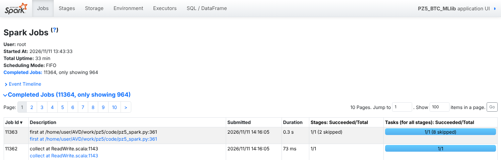
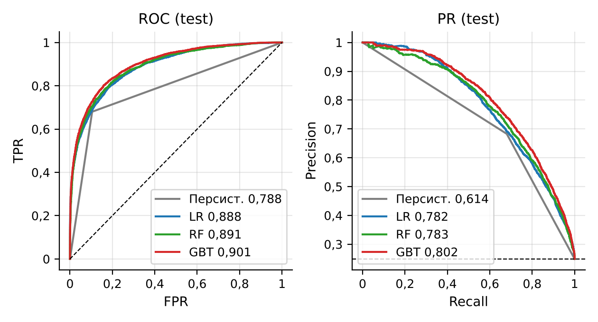
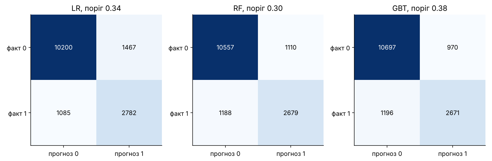

# Мета роботи

Мета роботи: ознайомитися з можливостями Apache Spark MLlib для інтелектуального аналізу великих даних; отримати практичні навички підготовки даних до машинного навчання, формування ознак, побудови та оцінювання моделей класифікації засобами PySpark на прикладі погодинних свічок BTC/USD (Bitcoin Historical Data), отриманих у ПЗ2 агрегацією 7 816 537 хвилинних записів, з прогнозом режиму волатильності наступної години.

# Короткі теоретичні відомості

Основу Spark MLlib становлять дві абстракції: трансформатор (Transformer) перетворює один DataFrame на інший методом `transform()`, оцінювач (Estimator) методом `fit()` навчається на даних і повертає трансформатор-модель. Конвеєр `Pipeline` впорядковує такі етапи, а `Pipeline.fit()` навчає їх послідовно лише на переданих даних і повертає `PipelineModel`, яку можна зберегти й застосувати до нових рядків.

Підготовка ознак виконується етапами того ж типу: `Imputer` заповнює пропуски статистикою навчальної вибірки, `StringIndexer` і `OneHotEncoder` кодують категоріальні значення, `VectorAssembler` збирає числові стовпці у вектор `features`, `StandardScaler` стандартизує ознаки, а `SQLTransformer` додає рядкові вирази SQL. Статистики обчислюються під час `fit()`, тому розміщення цих етапів у конвеєрі гарантує, що тестові дані не впливають на параметри підготовки.

У роботі використано три класифікатори MLlib. Логістична регресія (`LogisticRegression`) – лінійна модель ймовірності класу з L1/L2-регуляризацією. Випадковий ліс (`RandomForestClassifier`) усереднює дерева, навчені на бутстреп-підвибірках, і зменшує дисперсію. Градієнтний бустинг дерев (`GBTClassifier`) послідовно додає неглибокі дерева, кожне з яких виправляє помилки попередніх.

`BinaryClassificationEvaluator` обчислює ROC-AUC і PR-AUC за неперервною оцінкою, а accuracy, precision, recall і F1 залежать від порогу рішення. При частці позитивного класу близько 25 % accuracy завищує якість (константа дає 75 %), тому основними метриками обрано PR-AUC і F1.

Сусідні години мають схожу волатильність, тому вибірки формуються хронологічно, з проміжком (ембарго) між навчальною і тестовою частинами, а гіперпараметри підбираються крос-валідацією з розширюваним вікном.

# Результати виконання практичного заняття

## 1 Визначення задачі

Вхідні дані – погодинна таблиця ознак ПЗ2 (`pz2_hourly_features.parquet`, 130 276 рядків) з OHLC, обсягом, кількістю flat-хвилин і реалізованою волатильністю `rv` (корінь із суми квадратів хвилинних лог-дохідностей). Природних кандидатів на ціль два: напрям ціни наступної години і рівень волатильності наступної години. Автокореляції годинних дохідностей `r` і їх модуля `|r|` за 2018–2026 роки показано на рисунку 1.


Числові показники зведено в таблицю 1; там же наведено контрольний експеримент: логістична регресія з тим самим конвеєром ознак, навчена на мітці «дохідність наступної години > 0».

Таблиця 1 – Передбачуваність напряму ціни і волатильності (2018–2026 роки, 77 667 годин)

| Показник | Значення |
|---|---|
| ACF дохідності, лаг 1 / лаг 2 / лаг 24 | −0,0213 / −0,0288 / −0,0304 |
| ACF модуля дохідності, лаг 1 / лаг 24 / лаг 168 | 0,2951 / 0,1982 / 0,1445 |
| 95 % межа незначущої автокореляції | ±0,0070 |
| Частка годин зі зростанням ціни | 0,5066 |
| Точність прогнозу «знак як у поточній годині» | 0,4644 |
| LR для напряму на тесті: ROC-AUC / accuracy | 0,5267 / 0,5134 |
| Мажоритарний клас для напряму на тесті: accuracy | 0,5000 |

Автокореляції дохідностей перевищують межу ±0,0070 лише через великий обсяг вибірки: квадрат найбільшої (0,0304) пояснює менше 0,1 % дисперсії. LR для напряму досягає ROC-AUC 0,527 і точності 0,513 при 0,500 у константи. Напрям ціни на годинному масштабі практично непередбачуваний, тоді як кластеризація волатильності (ACF модуля 0,2951 на лагу 1 і 0,1445 через тиждень) дає реальний сигнал.

Тому обрано задачу бінарної класифікації: чи буде наступна година високоволатильною. Класифікація, а не регресія `rv`, відповідає практичному питанню «чи зменшувати позицію на наступну годину».

## 2 Підготовка даних

### 2.1 Період моделювання

У ПЗ2 встановлено, що хвилини з нульовим обсягом – заповнення сітки, а не угоди, і в роки з великою їх часткою `rv` відображає неліквідність (доба 27.01.2012 з 98,1 % flat-хвилин потрапила до топ-5 за `rv`). Частку flat-хвилин за роками разом із часткою позитивного класу наведено в таблиці 2.

Таблиця 2 – Частка flat-хвилин, медіана rv і частка класу 1 за роками

| Рік | Flat, % | Медіана rv | Клас 1, ковзний поріг | Клас 1, глобальний поріг |
|---|---|---|---|---|
| 2017 | 8,04 | 0,01010 | – | – |
| 2018 | 3,77 | 0,00720 | 0,2185 | 0,4400 |
| 2019 | 3,28 | 0,00580 | 0,2406 | 0,2596 |
| 2020 | 1,55 | 0,00579 | 0,2666 | 0,2469 |
| 2021 | 0,70 | 0,00735 | 0,2482 | 0,4349 |
| 2022 | 2,66 | 0,00502 | 0,2305 | 0,2030 |
| 2023 | 3,95 | 0,00294 | 0,2669 | 0,0581 |
| 2024 | 3,33 | 0,00412 | 0,2617 | 0,1185 |
| 2025 | 1,13 | 0,00325 | 0,2503 | 0,0710 |
| 2026 | 0,34 | 0,00318 | 0,2482 | 0,0671 |

З 2018 року частка flat-хвилин не перевищує 3,95 %, а у 2017 році вона ще 8,04 %, тому моделювання почато з 01.01.2018. Додатково відкинуто неповні години (`n_minutes < 60`) та останню годину ряду без мітки; залишилося 77 667 годин до 11.11.2026 02:00 UTC. Решту flat-хвилин не видалено, щоб не ламати годинну сітку, а їх частку `flat_share` передано моделі як ознаку.

### 2.2 Цільова змінна

Мітка години t дорівнює 1, якщо `rv` години t+1 перевищує 75-й перцентиль `rv` за останні 720 годин, включно з годиною t:

```python
d = (d.withColumn("thr_rv", F.expr(f"percentile_approx(rv, {PCT}, 10000)").over(roll(HI_WIN)))
       .withColumn("next_rv", F.lead("rv", 1).over(w_all))
       .withColumn("label", (F.col("next_rv") > F.col("thr_rv")).cast("int")))
```

Поріг використовує лише минуле відносно прогнозованої години, тож його відомо в момент прогнозу. Перцентиль 75 % дає клас 1 близько чверті годин: подія рідкісна, але достатньо часта для навчання. Вікно 720 год (30 діб, як у ПЗ2) встигає за зміною режиму: медіана `rv` впала з 0,00720 у 2018 році до 0,00318 у 2026 році (таблиця 2). Глобальний поріг 0,00794 (75-й перцентиль навчальної вибірки) дав би частку класу 1 від 0,0581 (2023) до 0,4400 (2018), тобто модель вчилася б розрізняти епохи, а не години. Ковзний поріг утримує частку в межах 0,2185–0,2669, що видно на рисунку 2.


Частка класу 1 коливається навколо 0,248 без тренду, отже, мітка не дрейфує між навчальним і тестовим періодами.

### 2.3 Ознаки, пропуски та категоріальні змінні

Ознаки побудовано віконними функціями Spark (`lag` і рамки `rowsBetween(-(n−1), 0)`), тобто лише з годин до t включно. Волатильність прологарифмовано з доданком 10⁻⁵, бо її розподіл має важкий правий хвіст (годинний надлишковий ексцес дохідностей у ПЗ2 – 118,11), а поодинокі години з `rv = 0` дали б `log 0`. Склад ознак наведено в таблиці 3.

Таблиця 3 – Ознаки моделі та кількість пропусків (уся історія / рядки моделі)

| Група | Ознаки | Зміст | Пропуски |
|---|---|---|---|
| Рівень rv | log_rv_l0, log_rv_l1, log_rv_l2, log_rv_l5, log_rv_l23 | log rv поточної години і лагів 1, 2, 5, 23 год | 0, 1, 2, 5, 23 / 0 |
| Ковзні середні rv | log_rv_m3, log_rv_m6, log_rv_m24, log_rv_m168 | log середньої rv за 3, 6, 24, 168 год | 0 / 0 |
| Відносний рівень | log_rv_over_thr | log(rv_t / поріг_t) | 0 / 0 |
| Дохідність | ret_1h, abs_ret_1h, ret_6h | лог-дохідність за 1 і 6 год, її модуль | 1, 1, 6 / 0 |
| Діапазон і обсяг | log_rel_range, log_volume, vol_z168, flat_share | log (High − Low)/Open, log обсягу, z-оцінка log обсягу за 168 год, частка flat-хвилин | 0, 0, 1, 0 / 0 |
| Календар | hour_sin, hour_cos, is_weekend, dow | циклічне кодування години, вихідний день, день тижня (OneHot, 7) | 0 / 0 |

Пропуски виникають лише на початку історії 2012 року, де лагам і вікнам бракує попередніх годин (до 23 значень для `log_rv_l23`), тому в рядках з 2018 року їх немає. `Imputer` (медіана навчальної вибірки) все одно включено в конвеєр для нових неповних рядків. Годину закодовано через sin/cos, щоб 23:00 і 00:00 були поруч. День тижня – категоріальна ознака без порядку, тому його переведено в рядок, проіндексовано `StringIndexer` і закодовано `OneHotEncoder` з `dropLast=False`. Вектор ознак (29 позицій разом зі службовими індикаторами невідомої категорії) збирає `VectorAssembler`.

## 3 Формування вибірок

Ряд упорядковано за часом і поділено 80/20 за номером рядка: перші 80 % – навчальна вибірка, останні 20 % – тестова. Останні 24 години навчальної частини вилучено як ембарго: мітка години t залежить від години t+1, а найдовші короткострокові ознаки (`log_rv_l23`, `log_rv_m24`) охоплюють добу, тож жодна навчальна мітка не обчислюється з тестових годин.

```python
n_train = int(N * 0.8)
train = m.filter(F.col("rn") <= n_train - EMB).cache()   # ембарго EMB = 24 год
test = m.filter(F.col("rn") > n_train).cache()
```

Межі вибірок наведено в таблиці 4.

Таблиця 4 – Хронологічний поділ 80/20 з ембарго 24 год

| Частина | Період (UTC) | Рядків | Частка класу 1 |
|---|---|---|---|
| Навчальна | 2018-01-01 00:00 – 2025-01-31 20:00 | 62 109 | 0,2478 |
| Ембарго | 2025-01-31 21:00 – 2025-02-01 20:00 | 24 | – |
| Тестова | 2025-02-01 21:00 – 2026-11-11 02:00 | 15 534 | 0,2489 |
| Разом | 2018-01-01 00:00 – 2026-11-11 02:00 | 77 667 | – |

Номінальна межа 80 % – 2025-02-01 20:00, після вилучення ембарго останній навчальний рядок – 2025-01-31 20:00. Частка класу 1 у навчальній і тестовій вибірках майже однакова (0,2478 і 0,2489), тому стратифікація не потрібна.

## 4 Побудова моделей

### 4.1 Моделі та гіперпараметри

Побудовано три моделі: лінійну LR як інтерпретовану основу та деревні ансамблі RF і GBT, що вловлюють нелінійності й взаємодії. Гіперпараметри підібрано на навчальній вибірці крос-валідацією з розширюваним вікном: валідаційні блоки – 50–66,7 %, 66,7–83,3 % і 83,3–100 % навчальної частини, кожен навчається на всіх попередніх годинах мінус 24 години ембарго. Критерієм обрано середній PR-AUC, бо він чутливий до якості саме рідшого класу 1. Сітки й результати наведено в таблиці 5.

Таблиця 5 – Сітки гіперпараметрів і найкращі конфігурації (часова крос-валідація, 3 блоки)

| Модель | Сітка | Найкраща конфігурація | CV ROC-AUC | CV PR-AUC ± σ |
|---|---|---|---|---|
| LR | regParam {0; 0,001; 0,01; 0,1} × elasticNetParam {0; 0,5} | regParam 0,001, elasticNetParam 0 | 0,8625 | 0,7456 ± 0,0338 |
| RF | numTrees {100; 200} × maxDepth {4; 8} × minInstancesPerNode {20; 100} | 200 дерев, глибина 8, мін. 20 рядків у листі | 0,8534 | 0,7234 ± 0,0379 |
| GBT | maxIter {50; 100} × maxDepth {3; 5} × stepSize {0,05; 0,1} | 100 ітерацій, глибина 3, крок 0,1 | 0,8680 | 0,7468 ± 0,0383 |

Сильна регуляризація LR (regParam 0,1) знижує PR-AUC до 0,7193. Для RF глибина 8 краща за 4 (0,7234 проти 0,6994 при 200 деревах), а для GBT конфігурації першої трійки відрізняються менше ніж на 0,005 при σ між блоками 0,038, тому вибір серед них практично рівноцінний. Уже на крос-валідації найвищий PR-AUC має GBT (0,7468), тобто модель-переможець визначена до доступу до тесту. Повна сітка (24 конфігурації × 3 блоки) тривала 1501,399 с.

### 4.2 Поріг рішення

Типовий поріг 0,5 не оптимальний для F1 при частці класу 1 близько 0,25. Поріг обрано на останньому валідаційному блоці (перебір 0,05–0,95 з кроком 0,01) за максимумом F1, без доступу до тестової вибірки. Максимуми F1 на валідації: LR 0,6982 при порозі 0,34, RF 0,6879 при 0,30, GBT 0,7166 при 0,38. Криві F1 пологі в діапазоні 0,25–0,45, тож вибір стійкий до невеликих зсувів.

## 5 ML Pipeline

Конвеєр Data → Preprocessing → Feature Engineering → Model → Prediction → Evaluation реалізовано так: читання Parquet ПЗ2 і віконні ознаки (Data, Preprocessing) виконуються до `Pipeline`, бо потребують упорядкування всього ряду, а всі етапи, що навчаються на даних, зібрано в `Pipeline`:

```python
st = [SQLT,                                                           # hour_sin, hour_cos, dow_str, is_weekend
      Imputer(inputCols=FEATS, outputCols=[c + "_imp" for c in FEATS], strategy="median"),
      StringIndexer(inputCol="dow_str", outputCol="dow_idx", handleInvalid="keep"),
      OneHotEncoder(inputCols=["dow_idx"], outputCols=["dow_ohe"], handleInvalid="keep", dropLast=False),
      VectorAssembler(inputCols=[c + "_imp" for c in FEATS] + CYC + ["dow_ohe"], outputCol="features_raw")]
# + StandardScaler для LR або SQLTransformer (features = features_raw) для дерев, далі класифікатор
```

Склад етапів для трьох моделей показано на рисунку 3.


Стандартизація потрібна лише LR; деревам масштаб байдужий, тому в них замість `StandardScaler` стоїть тотожний `SQLTransformer`. Prediction – `PipelineModel.transform(test)`, з якого береться ймовірність класу 1, Evaluation – `BinaryClassificationEvaluator` і матриця помилок за порогом. Найкращу модель (GBT) збережено `write().save()` у `results/model/best_pipeline_GBT` за 4,46 с і завантажено `PipelineModel.load()` за 3,083 с з тими самими сімома етапами. Навантаження на Spark показано на рисунку 4.



За 33 хв виконано 11 364 завдання Spark (20 036 етапів за вкладкою Stages): MLlib запускає окремі завдання на кожну ітерацію GBT чи рівень дерев RF. Увесь сценарій на 4 ядрах Intel Xeon 2,10 ГГц тривав 1954,59 с, з них 83,869 с – віконні ознаки (як і в ПЗ2, вікно без `partitionBy` рахується в одному розділі).

## 6 Оцінювання

Для класифікації методичка визначає accuracy, precision, recall, F1 і ROC-AUC; їх доповнено PR-AUC, збалансованою точністю і коефіцієнтом Метьюза (MCC), коректними при нерівних класах. Precision, recall і F1 розраховано для класу 1. Базові лінії – мажоритарний клас (завжди 0), персистентність (клас 1, якщо `rv` поточної години вже вища за поріг) і ранжування за однією ознакою `log(rv_t/поріг_t)`. Криві ROC і precision-recall трьох моделей і персистентності показано на рисунку 5.



Криві моделей майже збігаються, GBT лежить трохи вище на всьому діапазоні. Персистентність має один робочий пункт (FPR 0,105, TPR 0,680), тож її ROC-AUC 0,7877 занижений бінарністю оцінки; справедливіше порівнювати моделі з неперервною версією тієї самої ідеї – ранжуванням за `log(rv_t/поріг_t)`. PR-AUC у таблицях обчислено `BinaryClassificationEvaluator`, тому для персистентності він відрізняється від площі в легенді рисунка.

## 7 Порівняння моделей

### 7.1 Моделі та базові лінії

Усі метрики на тестовій вибірці зведено в таблицю 6.

Таблиця 6 – Порівняння моделей і базових ліній на тестовій вибірці (15 534 год, частка класу 1 0,2489)

| Модель (поріг) | Accuracy | Precision | Recall | F1 | ROC-AUC | PR-AUC | MCC | Навчання, с |
|---|---|---|---|---|---|---|---|---|
| Мажоритарний клас | 0,7511 | 0,0000 | 0,0000 | 0,0000 | 0,5000 | 0,2489 | 0,0000 | – |
| Персистентність | 0,8417 | 0,6828 | 0,6801 | 0,6814 | 0,7877 | 0,6134 | 0,5761 | – |
| log(rv_t/поріг_t) (0) | 0,8418 | 0,6819 | 0,6835 | 0,6827 | 0,8773 | 0,7608 | 0,5773 | – |
| LR (0,5) | 0,8547 | 0,7902 | 0,5668 | 0,6601 | 0,8875 | 0,7820 | 0,5836 | 8,614 |
| LR (0,34) | 0,8357 | 0,6547 | 0,7194 | 0,6856 | 0,8875 | 0,7820 | 0,5759 | 8,614 |
| RF (0,5) | 0,8532 | 0,8528 | 0,4960 | 0,6272 | 0,8916 | 0,7847 | 0,5746 | 58,739 |
| RF (0,30) | 0,8521 | 0,7070 | 0,6928 | 0,6998 | 0,8916 | 0,7847 | 0,6018 | 58,739 |
| GBT (0,5) | 0,8656 | 0,8229 | 0,5862 | 0,6847 | 0,9010 | 0,8032 | 0,6163 | 43,102 |
| GBT (0,38) | 0,8606 | 0,7336 | 0,6907 | 0,7115 | 0,9010 | 0,8032 | 0,6202 | 43,102 |

Найкраща модель – GBT з порогом 0,38: F1 0,7115, MCC 0,6202, ROC-AUC 0,9010, PR-AUC 0,8032. Програма обрала її для збереження за тестовим PR-AUC, але той самий GBT переміг і на крос-валідації (таблиця 5), тож вибір не залежить від тесту. Перевага над базовими лініями помірна. Над персистентністю виграш F1 становить +0,03 (0,7115 проти 0,6814) і MCC +0,044, а одна ознака `log(rv_t/поріг_t)` без навчання вже дає ROC-AUC 0,877 і PR-AUC 0,761, тож решта ознак і бустинг додають лише 0,024 ROC-AUC і 0,042 PR-AUC. Accuracy малоінформативна: константа має 0,7511. Поріг з валідації підвищив F1 усіх моделей (RF з 0,6272 до 0,6998) за рахунок precision. RF найповільніший (58,739 с навчання і 6,633 с прогнозу 15 534 рядків), GBT навчається 43,102 с і прогнозує за 1,278 с, LR – 8,614 і 1,527 с.

### 7.2 Хронологічний і випадковий поділ

Для перевірки впливу способу поділу ті самі моделі з тими самими гіперпараметрами навчено на випадковому поділі 80/20 (`randomSplit`, seed 42) усіх 77 667 годин. `randomSplit` відбирає рядки з ймовірністю 0,2, тому випадковий тест містить 15 746 рядків проти 15 534 у хронологічному, і порівняння ведеться на різних, хоча й близьких за розміром вибірках. Результати наведено в таблиці 7 і на рисунку 6.

Таблиця 7 – Метрики при випадковому і хронологічному поділі (поріг 0,5)

| Модель | Поділ | Тестових рядків | F1 | ROC-AUC | PR-AUC |
|---|---|---|---|---|---|
| LR | випадковий | 15 746 | 0,6354 | 0,8648 | 0,7441 |
| LR | хронологічний | 15 534 | 0,6601 | 0,8875 | 0,7820 |
| RF | випадковий | 15 746 | 0,6103 | 0,8547 | 0,7204 |
| RF | хронологічний | 15 534 | 0,6272 | 0,8916 | 0,7847 |
| GBT | випадковий | 15 746 | 0,6489 | 0,8718 | 0,7523 |
| GBT | хронологічний | 15 534 | 0,6847 | 0,9010 | 0,8032 |


Випадковий поділ не завищив метрики: для всіх трьох моделей вони нижчі, ніж при хронологічному (GBT: ROC-AUC 0,872 проти 0,901). Усі ознаки рядка t обчислено з годин до t включно, а мітку – з години t+1, тож рядок не містить власної мітки. Сусідній навчальний рядок t+1 містить `rv` години t+1 як ознаку, але моделі не бачать часу чи сусідів. Різниця зумовлена складом тесту: випадковий тест розкиданий по 2018–2026 роках, хронологічний припадає на спокійніші 2025–2026 роки, які ранжувати легше (GBT на ранніших валідаційних блоках мав ROC-AUC 0,8680, на тесті – 0,9010). Отже, витоку для цього набору ознак не виявлено. Попри це, випадковий поділ непридатний для оцінки моделі, яку застосовуватимуть: модель навчається на годинах 2026 року і прогнозує 2019 рік, а ембарго неможливе, бо майже кожна тестова година має навчальних сусідів на відстані 1 год. Тому для оцінки використано лише хронологічний поділ.

## 8 Аналіз результатів

### 8.1 Інформативність ознак

Важливості ознак у RF і GBT та стандартизовані коефіцієнти LR показано на рисунку 7.


Найінформативніша ознака в усіх трьох моделях – `log_rv_over_thr`: 0,4828 важливості в RF, 0,4116 у GBT і коефіцієнт 2,341 у LR, що узгоджується з ROC-AUC 0,877 цієї ознаки окремо. Далі в RF ідуть `log_rel_range` (0,1012), `vol_z168` (0,0721) і `log_rv_l0` (0,0720), тобто інші міри поточної активності. GBT третьою ставить `hour_cos` (0,0990), а разом з `hour_sin` (0,0393) година доби набирає 0,138: бустинг вловлює внутрішньодобову сезонність, яку в ПЗ2 видно за обсягом (максимум о 14:00 UTC). Від'ємний коефіцієнт LR при `log_rv_l0` (−1,720) не означає, що висока поточна `rv` знижує ризик: ознака колінеарна з `log_rv_over_thr`, і разом вони виражають рівень відносно порогу. Дохідність, частка flat-хвилин (0,0039 у RF) і день тижня майже не використовуються.

### 8.2 Помилки моделей

Матриці помилок трьох моделей з порогами з валідації наведено на рисунку 8.



Моделі помиляються майже однаково: 2166–2552 помилки з 15 534, хибно негативних 1085–1196, хибно позитивних 970–1467. GBT має найменше хибно позитивних (970), LR при нижчому порозі має найменше пропусків (1085) ціною на 497 більшої кількості хибних тривог. Помилки GBT за режимом поточної години, переходами і роками зведено в таблицю 8.

Таблиця 8 – Помилки GBT (поріг 0,38) за групами тестових годин

| Група | n | Частка класу 1 | Частка помилок | Recall | Precision |
|---|---|---|---|---|---|
| Поточна година нижче порогу | 11 682 | 0,1059 | 0,1010 | 0,1770 | 0,5748 |
| Поточна година вище порогу | 3 852 | 0,6828 | 0,2560 | 0,9323 | 0,7521 |
| Режим зберігається | 13 075 | – | 0,0260 | – | – |
| Початок сплеску (0 → 1) | 1 237 | – | 0,8230 | – | – |
| Завершення сплеску (1 → 0) | 1 222 | – | 0,6612 | – | – |
| 2025 рік | 7 995 | 0,2497 | 0,1386 | 0,6969 | 0,7344 |
| 2026 рік | 7 539 | 0,2482 | 0,1403 | 0,6841 | 0,7327 |

Основне джерело помилок – зміна режиму. Коли режим зберігається, GBT помиляється лише в 2,6 % годин, а початок сплеску після спокійної години пропускає в 82,3 % випадків: recall у спокійних годинах лише 0,1770, тобто модель передбачає сплеск переважно тоді, коли він уже триває. Хибні тривоги (808 з 970) припадають на години, коли поточна `rv` вища за поріг, а наступна вже спадає. Якість стабільна в часі: частка помилок 0,1386 у 2025 році і 0,1403 у 2026 році, тож деградації за 21 місяць без перенавчання немає. Розподіл за годиною доби показано на рисунку 9 (рядок години t прогнозує годину t+1).


Помилок найменше вночі за UTC (0,0696 у рядках 03:00), коли клас 1 рідкісний (0,108), і найбільше в рядку 12:00 (0,2411), що прогнозує годину 13:00–14:00: частка класу 1 там 0,5286, а recall лише 0,6228. Відкриття американської сесії о 13:30 UTC модель передбачає лише частково, через `hour_sin`/`hour_cos`. У рядку 13:00 частка класу 1 найвища (0,6754), але помилок менше (0,1283), бо сплеск уже почався і його підхоплює персистентність.

### 8.3 Шляхи вдосконалення

Таблиця 8 показує, що резерв – у передбаченні початку сплесків. Для цього доцільно додати ознаки всередині години з хвилинних даних (`rv` останніх 15 хв, кількість стрибків, нахил обсягу), бо сплеск часто починається в кінці попередньої години, та календар подій (відкриття сесій США, публікації макростатистики), бо зараз сезонність передається лише sin/cos години. Альтернатива класифікації – регресія `log rv` моделлю типу HAR з подальшим порівнянням з порогом, що не втрачає інформацію при бінаризації. Поріг доцільно обирати за вартістю помилок конкретного застосування (пропущений сплеск зазвичай дорожчий за хибну тривогу), а модель перенавчати на ковзному вікні.

# Висновки

1. Обрано задачу бінарної класифікації «чи буде наступна година високоволатильною»: напрям ціни практично непередбачуваний (ACF дохідностей на лагу 1 −0,021, LR для напряму – ROC-AUC 0,527), а модуль дохідностей має автокореляцію 0,295.

2. Дані ПЗ2 підготовлено для періоду з 2018 року (flat-хвилин не більше 3,95 %, 77 667 годин); ціль визначено через 75-й перцентиль `rv` за попередні 720 годин, сформовано 17 числових ознак з минулого, циклічне кодування години та OneHot-кодування дня тижня.

3. Вибірки сформовано хронологічно 80/20 з ембарго 24 год: 62 109 і 15 534 годин з часткою класу 1 0,2478 і 0,2489.

4. Побудовано LR, RF і GBT; гіперпараметри підібрано часовою крос-валідацією за PR-AUC, поріг – за F1 на валідації.

5. Реалізовано повний ML Pipeline MLlib від `SQLTransformer` до класифікатора; найкращу модель збережено і повторно завантажено.

6. Якість оцінено метриками accuracy, precision, recall, F1, ROC-AUC, доповненими PR-AUC і MCC.

7. Найкраща модель – GBT з порогом 0,38 (переможець і на крос-валідації): F1 0,7115, ROC-AUC 0,9010, PR-AUC 0,8032. Виграш над персистентністю помірний (F1 +0,03), одна ознака `log(rv_t/поріг_t)` дає ROC-AUC 0,877. Випадковий поділ метрик не завищив, але порушує часову причинність.

8. Найінформативніша ознака – відношення `rv` до порогу; основні помилки – пропуск початку сплесків (82,3 %); шляхи вдосконалення – внутрішньогодинні ознаки, календар подій і вибір порогу за вартістю помилок.

Набуто навичок використання Apache Spark MLlib: формування ознак, побудови ML Pipeline, навчання моделей класифікації та оцінювання їх якості з урахуванням часової структури даних.

# Додаток А. Лістинг програми

## А.1 Файл pz5_spark.py – конвеєр Spark MLlib: ознаки, мітка, поділ, навчання, оцінювання

```python
# -*- coding: utf-8 -*-
"""ПЗ5. Apache Spark MLlib: прогноз «чи буде наступна година високоволатильною» (BTC/USD).
Запуск: python3 pz5_spark.py   (результати -> ../results, скріншоти -> ../screenshots)
"""
import os, sys, io, time, platform, subprocess, contextlib, itertools, json
import numpy as np
import pandas as pd

SEED = 42
np.random.seed(SEED)
BASE = os.path.abspath(os.path.join(os.path.dirname(__file__), ".."))
RES, SHOTS, TXT = f"{BASE}/results", f"{BASE}/screenshots", f"{BASE}/screenshots/txt"
SRC = "/home/user/AVD/work/pz2/results/pz2_hourly_features.parquet"   # результат попередньої обробки (ПЗ2)
for d in (RES, SHOTS, TXT, f"{RES}/model"):
    os.makedirs(d, exist_ok=True)

from pyspark.sql import SparkSession, Window, functions as F
from pyspark.ml import Pipeline
from pyspark.ml.feature import (Imputer, StringIndexer, OneHotEncoder, VectorAssembler,
                                StandardScaler, SQLTransformer)
from pyspark.ml.classification import LogisticRegression, RandomForestClassifier, GBTClassifier
from pyspark.ml.evaluation import BinaryClassificationEvaluator
from pyspark.ml.functions import vector_to_array
import pyspark

# ---------- допоміжні засоби ----------
TIMINGS = []
def rec(step, secs, note=""):
    TIMINGS.append((step, round(secs, 3), note)); print(f"[timing] {step}: {secs:.2f} с {note}")

class Tee(io.StringIO):
    def write(self, s):
        sys.__stdout__.write(s); return super().write(s)

@contextlib.contextmanager
def cap(name, cmd):
    """Дублює stdout у screenshots/txt/<name>.txt із заголовком '$ команда' (для рендеру PNG)."""
    buf = Tee()
    with contextlib.redirect_stdout(buf):
        yield
    with open(f"{TXT}/{name}.txt", "w", encoding="utf-8") as f:
        f.write(f"$ {cmd}\n" + buf.getvalue())

def save(df, name):
    df.to_csv(f"{RES}/{name}.csv", index=False, encoding="utf-8")

T_ALL = time.perf_counter()
spark = (SparkSession.builder.appName("PZ5_BTC_MLlib").master("local[*]")
         .config("spark.driver.memory", "8g")
         .config("spark.sql.shuffle.partitions", "16")
         .config("spark.sql.session.timeZone", "UTC")
         .config("spark.ui.port", "4040").config("spark.ui.showConsoleProgress", "false")
         .config("spark.sql.ansi.enabled", "false")
         .getOrCreate())
sc = spark.sparkContext; sc.setLogLevel("ERROR")

def sh(c):
    return subprocess.run(c, shell=True, capture_output=True, text=True).stdout.strip()
env = [("Java", sh("java -version 2>&1 | grep -v Picked | head -1")), ("Spark", spark.version),
       ("PySpark", pyspark.__version__), ("Python", platform.python_version()), ("pandas", pd.__version__),
       ("numpy", np.__version__), ("OS", platform.platform()),
       ("CPU", sh("lscpu | grep 'Model name' | sed 's/.*: *//'")), ("CPU_logical_cores", str(os.cpu_count())),
       ("RAM_GB", sh("free -g | awk '/Mem:/{print $2}'")), ("spark.master", sc.master),
       ("spark.driver.memory", "8g"), ("spark.sql.shuffle.partitions", "16"), ("seed", str(SEED)),
       ("spark.ui.url", sc.uiWebUrl)]
pd.DataFrame(env, columns=["parameter", "value"]).to_csv(f"{RES}/env_versions.csv", index=False)
with cap("01_env", "python3 -c 'import pyspark; print(pyspark.__version__)'; java -version; nproc; free -g"):
    for k, v in env: print(f"{k:<22}{v}")

# ---------- Крок 1. Завантаження результатів попередньої обробки (ПЗ2) ----------
t = time.perf_counter()
raw = spark.read.parquet(SRC).orderBy("datetime_utc")
n_raw = raw.count()
rec("load_parquet_pz2", time.perf_counter() - t, f"{n_raw} годинних рядків")
with cap("02_schema", "df = spark.read.parquet('pz2_hourly_features.parquet'); df.printSchema(); df.show(3)"):
    raw.printSchema(); print("rows:", n_raw)
    raw.select("datetime_utc", "close", "volume", "n_minutes", "rv", "ret_1h", "flat_share", "year").show(3, False)

# ---------- Крок 2. Обґрунтування вибору періоду та задачі (з даних) ----------
flat_year = (raw.groupBy("year").agg(F.count("*").alias("hours"), F.round(100 * F.sum("n_flat") / F.sum("n_minutes"), 2).alias("flat_share_pct"),
                                     F.round(F.avg("rv"), 5).alias("mean_rv"), F.round(F.expr("percentile_approx(rv,0.5)"), 5).alias("median_rv"),
                                     F.sum((F.col("volume") == 0).cast("int")).alias("zero_vol_hours")).orderBy("year").toPandas())
save(flat_year, "pz5_flat_share_by_year")
START_YEAR = 2018   # з 2018 р. частка «пласких» хвилин < 4 % щороку (2017: 8,04 %, 2016: 33,19 %)
with cap("03_period", "df.groupBy('year').agg(flat share, mean rv)  # вибір періоду моделювання"):
    print(flat_year.to_string(index=False)); print(f"\nПеріод моделювання: з {START_YEAR} р.")

# ---------- Крок 3. Формування ознак і цільової змінної (лише з минулого) ----------
HI_WIN, PCT = 720, 0.75     # поріг «висока волатильність» = 75-й перцентиль rv за останні 720 год (30 діб), включно з поточною годиною
EMB = 24                    # ембарго (год) між навчальною та валід./тестовою частинами
w_all = Window.orderBy("datetime_utc")
def roll(n): return w_all.rowsBetween(-(n - 1), 0)
EPS = 1e-5
d = raw.withColumn("log_rv", F.log(F.col("rv") + EPS))
for k in (1, 2, 5, 23): d = d.withColumn(f"log_rv_l{k}", F.lag("log_rv", k).over(w_all))
d = d.withColumn("log_rv_l0", F.col("log_rv"))
for n in (3, 6, 24, 168): d = d.withColumn(f"log_rv_m{n}", F.log(F.avg("rv").over(roll(n)) + EPS))
d = (d.withColumn("thr_rv", F.expr(f"percentile_approx(rv, {PCT}, 10000)").over(roll(HI_WIN)))   # лише рядки <= t
       .withColumn("log_rv_over_thr", F.log(F.col("rv") + EPS) - F.log(F.col("thr_rv") + EPS))
       .withColumn("abs_ret_1h", F.abs("ret_1h"))
       .withColumn("ret_6h", F.log(F.col("close") / F.lag("close", 6).over(w_all)))
       .withColumn("log_rel_range", F.log(F.col("rel_range") + EPS))
       .withColumn("vol_z168", (F.col("log_volume") - F.avg("log_volume").over(roll(168))) / (F.stddev("log_volume").over(roll(168)) + 1e-9))
       .withColumn("next_rv", F.lead("rv", 1).over(w_all))
       .withColumn("next_ret", F.lead("ret_1h", 1).over(w_all))
       .withColumn("label", (F.col("next_rv") > F.col("thr_rv")).cast("int"))
       .withColumn("label_dir", F.when(F.col("next_ret") > 0, 1).when(F.col("next_ret") < 0, 0))
       .withColumn("persist", (F.col("rv") > F.col("thr_rv")).cast("double")))
NUM = ["log_rv_l0", "log_rv_l1", "log_rv_l2", "log_rv_l5", "log_rv_l23", "log_rv_m3", "log_rv_m6", "log_rv_m24", "log_rv_m168",
       "log_rv_over_thr", "ret_1h", "abs_ret_1h", "ret_6h", "log_rel_range", "log_volume", "vol_z168", "flat_share"]
base_cols = ["datetime_utc", "year", "hour", "dow", "n_minutes", "label", "label_dir", "persist", "rv", "next_rv", "thr_rv", "next_ret"] + NUM
t = time.perf_counter()
m = d.select(*base_cols)
# кількість пропусків ДО фільтрації (розігрів вікон на початку історії)
nulls_before = m.select([F.sum(F.col(c).isNull().cast("int")).alias(c) for c in NUM + ["label"]]).toPandas().T.reset_index()
nulls_before.columns = ["column", "nulls_full_history"]
m = (m.filter((F.col("year") >= START_YEAR) & (F.col("n_minutes") == 60) & F.col("label").isNotNull())   # неповні годинні бари та остання година виключені
       .withColumn("rn", F.row_number().over(Window.orderBy("datetime_utc"))).cache())
N = m.count()
rec("feature_engineering", time.perf_counter() - t, f"{N} рядків моделювання")
nulls_after = m.select([F.sum(F.col(c).isNull().cast("int")).alias(c) for c in NUM + ["label"]]).toPandas().T.reset_index()
nulls_after.columns = ["column", "nulls_model_rows"]
save(nulls_before.merge(nulls_after, on="column"), "pz5_missing_values")

# ---------- Хронологічний поділ 80/20 ----------
n_train = int(N * 0.8)
bounds = m.filter(F.col("rn").isin(1, n_train - EMB, n_train, n_train + 1, N)).select("rn", "datetime_utc").orderBy("rn").toPandas()
train = m.filter(F.col("rn") <= n_train - EMB).cache()      # ембарго: останні 24 год навчальної частини вилучено
test = m.filter(F.col("rn") > n_train).cache()
n_tr, n_te = train.count(), test.count()
sp = pd.DataFrame([("rows_model_total", N), ("train_rows", n_tr), ("embargo_rows", EMB), ("test_rows", n_te),
                   ("train_share_pct", round(100 * (n_train) / N, 2)), ("train_start", str(bounds.datetime_utc[0])),
                   ("train_end", str(bounds.datetime_utc[1])), ("embargo_end_nominal_train_boundary", str(bounds.datetime_utc[2])), ("test_start", str(bounds.datetime_utc[3])), ("test_end", str(bounds.datetime_utc[4]))],
                  columns=["parameter", "value"])
save(sp, "pz5_split")
lab = {}
for nm, df in (("train", train), ("test", test)):
    r = df.agg(F.avg("label").alias("pos"), F.avg("label_dir").alias("up")).first(); lab[nm] = (r["pos"], r["up"])
# Дрейф: частка позитивних за роками при ковзному порозі (основний) і при глобальному пороговому значенні з навчальної вибірки
glob_thr = train.approxQuantile("next_rv", [PCT], 1e-4)[0]
yr = (m.withColumn("label_global", (F.col("next_rv") > glob_thr).cast("int")).groupBy("year")
        .agg(F.count("*").alias("hours"), F.round(F.avg("label"), 4).alias("pos_share_rolling_thr"),
             F.round(F.avg("label_global"), 4).alias("pos_share_global_thr"), F.round(F.avg("label_dir"), 4).alias("up_share_next_hour")).orderBy("year").toPandas())
save(yr, "pz5_target_share_by_year")
tgt_over_time = m.select("datetime_utc", "year", "label", "rv", "next_rv", "thr_rv").toPandas()
tgt_over_time.to_csv(f"{RES}/pz5_target_series.csv", index=False)
with cap("04_split", "chronological split 80/20 + target; train.count(), test.count()"):
    print(sp.to_string(index=False))
    print(f"\nДоля позитивного класу: train={lab['train'][0]:.4f}  test={lab['test'][0]:.4f}")
    print(f"Глобальний поріг rv (75-й перцентиль train) = {glob_thr:.5f}")
    print(yr.to_string(index=False))

# ---------- Чому не напрям ціни: ACF та базові лінії ----------
pdf = m.select("datetime_utc", "ret_1h", "label_dir", "next_ret").toPandas().sort_values("datetime_utc")
r = pdf.ret_1h.values; ar = np.abs(r)
def acf(x, k):
    x = x - x.mean(); return float((x[:-k] * x[k:]).sum() / (x * x).sum())
nn = len(r); conf = 1.96 / np.sqrt(nn)
acf_df = pd.DataFrame({"lag_h": range(1, 73), "acf_ret": [acf(r, k) for k in range(1, 73)], "acf_abs_ret": [acf(ar, k) for k in range(1, 73)]})
acf_df["conf95"] = conf
save(acf_df, "pz5_acf")
dirv = pdf.dropna(subset=["label_dir"])
up_share = dirv.label_dir.mean()
sign_persist_acc = float(((np.sign(dirv.ret_1h) > 0).astype(int) == dirv.label_dir)[dirv.ret_1h != 0].mean())
dir_base = pd.DataFrame([("n_hours", nn), ("conf95_bound", conf), ("acf_ret_lag1", acf_df.acf_ret[0]), ("acf_abs_ret_lag1", acf_df.acf_abs_ret[0]),
                         ("acf_abs_ret_lag24", acf_df.acf_abs_ret[23]), ("acf_abs_ret_lag168_not_shown", acf(ar, 168)),
                         ("up_share_next_hour", up_share), ("majority_accuracy_direction", max(up_share, 1 - up_share)),
                         ("sign_persistence_accuracy_direction", sign_persist_acc)], columns=["metric", "value"])
with cap("05_acf", "acf(ret_1h) vs acf(|ret_1h|), baseline of the direction task"):
    print(dir_base.to_string(index=False))
    print("\nlag  ACF(ret)  ACF(|ret|)"); print(acf_df.head(6).round(4).to_string(index=False))

# ---------- Пайплайни ----------
# SQLTransformer: рядкові (без вікон) похідні ознаки всередині конвеєра: циклічний час доби, рядкова мітка дня тижня
SQLT = SQLTransformer(statement="SELECT *, sin(2*pi()*hour/24.0) AS hour_sin, cos(2*pi()*hour/24.0) AS hour_cos, "
                                "CAST(dow AS STRING) AS dow_str, CASE WHEN dow IN (1,7) THEN 1.0 ELSE 0.0 END AS is_weekend FROM __THIS__")
CYC = ["hour_sin", "hour_cos", "is_weekend"]
FEATS = NUM
def stages(model, scale):
    st = [SQLT,
          Imputer(inputCols=FEATS, outputCols=[c + "_imp" for c in FEATS], strategy="median"),     # пропуски -> медіана train
          StringIndexer(inputCol="dow_str", outputCol="dow_idx", handleInvalid="keep"),
          OneHotEncoder(inputCols=["dow_idx"], outputCols=["dow_ohe"], handleInvalid="keep", dropLast=False),  # категоріальна ознака
          VectorAssembler(inputCols=[c + "_imp" for c in FEATS] + CYC + ["dow_ohe"], outputCol="features_raw", handleInvalid="keep")]
    if scale:
        st.append(StandardScaler(inputCol="features_raw", outputCol="features", withMean=True, withStd=True))
    else:
        st.append(SQLTransformer(statement="SELECT *, features_raw AS features FROM __THIS__"))
    return st + [model]
def mk(name, p):
    if name == "LR":
        return Pipeline(stages=stages(LogisticRegression(featuresCol="features", labelCol="label", maxIter=200, regParam=p["regParam"],
                                                         elasticNetParam=p["elasticNetParam"], standardization=False), True))
    if name == "RF":
        return Pipeline(stages=stages(RandomForestClassifier(featuresCol="features", labelCol="label", seed=SEED, numTrees=p["numTrees"],
                                                             maxDepth=p["maxDepth"], minInstancesPerNode=p["minInstancesPerNode"], subsamplingRate=0.8), False))
    return Pipeline(stages=stages(GBTClassifier(featuresCol="features", labelCol="label", seed=SEED, maxIter=p["maxIter"], maxDepth=p["maxDepth"],
                                                stepSize=p["stepSize"], subsamplingRate=0.8), False))
GRIDS = {"LR": {"regParam": [0.0, 0.001, 0.01, 0.1], "elasticNetParam": [0.0, 0.5]},
         "RF": {"numTrees": [100, 200], "maxDepth": [4, 8], "minInstancesPerNode": [20, 100]},
         "GBT": {"maxIter": [50, 100], "maxDepth": [3, 5], "stepSize": [0.05, 0.1]}}
def combos(g): return [dict(zip(g, v)) for v in itertools.product(*g.values())]
with cap("06_pipeline", "pipeline = Pipeline(stages=[SQLTransformer, Imputer, StringIndexer, OneHotEncoder, VectorAssembler, StandardScaler, LogisticRegression])"):
    for nm in ("LR", "RF", "GBT"):
        pl = mk(nm, combos(GRIDS[nm])[0])
        print(f"{nm}: " + " -> ".join(type(s).__name__ for s in pl.getStages()))
    print(f"\nОзнаки (числові, {len(FEATS)}): {FEATS}\nЦиклічні/бінарні: {CYC}; категоріальна: dow -> OneHot(7)")

# ---------- Метрики ----------
ev_roc = BinaryClassificationEvaluator(rawPredictionCol="p1", labelCol="label", metricName="areaUnderROC")
ev_pr = BinaryClassificationEvaluator(rawPredictionCol="p1", labelCol="label", metricName="areaUnderPR")
def with_p1(pred):
    return pred.withColumn("p1", vector_to_array("probability")[1])
def metrics(df, thr=0.5):
    """df має p1 (оцінка класу 1) та label. Повертає всі метрики; precision/recall/F1 – для класу «висока волатильність» (1)."""
    q = df.withColumn("yhat", (F.col("p1") >= thr).cast("int"))
    c = q.groupBy("label", "yhat").count().toPandas()
    g = lambda a, b: int(c[(c.label == a) & (c.yhat == b)]["count"].sum())
    tn, fp, fn, tp = g(0, 0), g(0, 1), g(1, 0), g(1, 1)
    n = tn + fp + fn + tp
    prec = tp / (tp + fp) if tp + fp else 0.0; rec_ = tp / (tp + fn) if tp + fn else 0.0
    f1 = 2 * prec * rec_ / (prec + rec_) if prec + rec_ else 0.0
    spec = tn / (tn + fp) if tn + fp else 0.0
    mcc_d = np.sqrt(float(tp + fp) * (tp + fn) * (tn + fp) * (tn + fn))
    return dict(threshold=thr, accuracy=(tp + tn) / n, precision=prec, recall=rec_, f1=f1, balanced_accuracy=(rec_ + spec) / 2,
                mcc=((tp * tn - fp * fn) / mcc_d) if mcc_d else 0.0, roc_auc=ev_roc.evaluate(df), pr_auc=ev_pr.evaluate(df),
                tn=tn, fp=fp, fn=fn, tp=tp, n=n)

# ---------- Часова валідація: розширюване вікно (3 фолди) з ембарго ----------
FOLDS = [(0.50, 0.667), (0.667, 0.833), (0.833, 1.0)]
cuts = [(int(n_tr * a), int(n_tr * b)) for a, b in FOLDS]
def fold_data(i):
    a, b = cuts[i]
    return train.filter(F.col("rn") <= a - EMB), train.filter((F.col("rn") > a) & (F.col("rn") <= b))
tune_rows, best = [], {}
t_tune = time.perf_counter()
for nm in ("LR", "RF", "GBT"):
    for p in combos(GRIDS[nm]):
        sc_roc, sc_pr = [], []
        t = time.perf_counter()
        for i in range(3):
            tr_i, va_i = fold_data(i)
            pr_ = with_p1(mk(nm, p).fit(tr_i).transform(va_i))
            sc_roc.append(ev_roc.evaluate(pr_)); sc_pr.append(ev_pr.evaluate(pr_))
        tune_rows.append(dict(model=nm, **{k: p.get(k) for k in ("regParam", "elasticNetParam", "numTrees", "maxDepth", "minInstancesPerNode", "maxIter", "stepSize")},
                              cv_roc_auc=np.mean(sc_roc), cv_pr_auc=np.mean(sc_pr), cv_pr_auc_std=np.std(sc_pr), seconds=time.perf_counter() - t))
        print(f"[tune] {nm} {p} PR-AUC={np.mean(sc_pr):.4f} ROC-AUC={np.mean(sc_roc):.4f}")
rec("hyperparameter_tuning_all", time.perf_counter() - t_tune, "3 моделі, 3 фолди, ембарго 24 год")
tune = pd.DataFrame(tune_rows); save(tune, "pz5_tuning")
for nm in ("LR", "RF", "GBT"):
    sub = tune[tune.model == nm].sort_values("cv_pr_auc", ascending=False).iloc[0]
    best[nm] = {k: (int(sub[k]) if k in ("numTrees", "maxDepth", "minInstancesPerNode", "maxIter") else float(sub[k]))
                for k in GRIDS[nm]}
json.dump(best, open(f"{RES}/pz5_best_params.json", "w"), indent=1)
with cap("07_tuning", "tuning: expanding-window 3-fold (PR-AUC), best params per model"):
    for nm in ("LR", "RF", "GBT"):
        s = tune[tune.model == nm].sort_values("cv_pr_auc", ascending=False)
        print(f"\n{nm}: найкраще {best[nm]}"); print(s.head(3).drop(columns=["seconds"]).round(4).to_string(index=False))

# ---------- Вибір порогу рішення на останньому валідаційному фолді (без доступу до test) ----------
thr_grid = np.round(np.arange(0.05, 0.96, 0.01), 2)
chosen_thr, thr_rows = {}, []
tr_v, va_v = fold_data(2)
for nm in ("LR", "RF", "GBT"):
    pv = with_p1(mk(nm, best[nm]).fit(tr_v).transform(va_v)).select("label", "p1").toPandas()
    f1s = []
    for th in thr_grid:
        yh = (pv.p1 >= th).astype(int); tp = ((yh == 1) & (pv.label == 1)).sum(); fp = ((yh == 1) & (pv.label == 0)).sum(); fn = ((yh == 0) & (pv.label == 1)).sum()
        pr = tp / (tp + fp) if tp + fp else 0; rc = tp / (tp + fn) if tp + fn else 0
        f1s.append(2 * pr * rc / (pr + rc) if pr + rc else 0)
        thr_rows.append(dict(model=nm, threshold=th, val_f1=f1s[-1], val_precision=pr, val_recall=rc))
    chosen_thr[nm] = float(thr_grid[int(np.argmax(f1s))])
save(pd.DataFrame(thr_rows), "pz5_threshold_validation")

# ---------- Остаточне навчання на train і оцінка на test ----------
models, preds, rows, timing_models = {}, {}, [], []
for nm in ("LR", "RF", "GBT"):
    t = time.perf_counter(); pm = mk(nm, best[nm]).fit(train); t_fit = time.perf_counter() - t
    t = time.perf_counter(); pr_ = with_p1(pm.transform(test)).cache(); n_ = pr_.count(); t_inf = time.perf_counter() - t
    models[nm] = pm; preds[nm] = pr_
    timing_models.append(dict(model=nm, fit_seconds=t_fit, inference_seconds_test=t_inf, test_rows=n_, inference_rows_per_sec=n_ / t_inf))
    rec(f"fit_{nm}", t_fit, f"train {n_tr} рядків"); rec(f"inference_{nm}", t_inf, f"test {n_te} рядків")
save(pd.DataFrame(timing_models), "pz5_model_runtimes")
# Базові лінії
base_test = test.withColumn("p1", F.lit(0.0))
persist_test = test.withColumn("p1", F.col("persist"))
ratio_test = test.withColumn("p1", F.col("log_rv_over_thr"))
major_train = 0 if lab["train"][0] < 0.5 else 1
all_rows = []
def add(name, df, thr, kind):
    mt = metrics(df, thr); mt.update(model=name, kind=kind); all_rows.append(mt)
add("Мажоритарний клас (завжди 0)", base_test, 0.5, "baseline")
add("Персистентність (rv_t > порогу)", persist_test, 0.5, "baseline")
add("Ранжування за log(rv_t/поріг), поріг 0", ratio_test, 0.0, "baseline")
for nm in ("LR", "RF", "GBT"):
    add(f"{nm} (поріг 0,5)", preds[nm], 0.5, "model")
    add(f"{nm} (поріг {chosen_thr[nm]:.2f}, з валідації)", preds[nm], chosen_thr[nm], "model_tuned_thr")
res = pd.DataFrame(all_rows)[["model", "kind", "threshold", "accuracy", "precision", "recall", "f1", "balanced_accuracy", "mcc", "roc_auc", "pr_auc", "tn", "fp", "fn", "tp", "n"]]
save(res, "pz5_metrics_test")
with cap("08_metrics", "evaluate(test): accuracy, precision, recall, F1, ROC-AUC, PR-AUC for baselines and models"):
    print(f"Частка класу 1 у test: {lab['test'][0]:.4f}; пороги з валідації: {chosen_thr}")
    print(res.drop(columns=["kind", "n"]).round(4).to_string(index=False))
    print("\nЧас, с:"); print(pd.DataFrame(timing_models).round(3).to_string(index=False))

# ---------- Збереження прогнозів ----------
pcols = test.select("datetime_utc", "year", "hour", "dow", "label", "persist", "log_rv_over_thr", "log_rv_l0", "rv", "next_rv", "thr_rv").toPandas()
for nm in ("LR", "RF", "GBT"):
    pcols[f"p_{nm}"] = preds[nm].select("datetime_utc", "p1").toPandas().set_index("datetime_utc").loc[pcols.datetime_utc, "p1"].values
pcols = pcols.sort_values("datetime_utc")
pcols.to_csv(f"{RES}/pz5_predictions_test_full.csv", index=False)
pcols.head(200).to_csv(f"{RES}/pz5_predictions_sample.csv", index=False)
json.dump(chosen_thr, open(f"{RES}/pz5_chosen_thresholds.json", "w"))

# ---------- Важливість ознак / коефіцієнти ----------
def feat_names(pm):
    sch = pm.transform(test.limit(5)).schema["features_raw"].metadata["ml_attr"]["attrs"]
    items = [x for grp in sch.values() for x in grp]; items.sort(key=lambda x: x["idx"])
    return [x["name"].replace("_imp", "") for x in items]
names = feat_names(models["RF"])
imp = pd.DataFrame({"feature": names})
imp["RF_importance"] = models["RF"].stages[-1].featureImportances.toArray()
imp["GBT_importance"] = models["GBT"].stages[-1].featureImportances.toArray()
imp["LR_coef_standardized"] = models["LR"].stages[-1].coefficients.toArray()
imp["LR_abs_coef"] = imp.LR_coef_standardized.abs()
save(imp.sort_values("RF_importance", ascending=False), "pz5_feature_importance")
with cap("09_importance", "model.stages[-1].featureImportances / coefficients"):
    print(imp.sort_values("RF_importance", ascending=False).round(4).to_string(index=False))
    print("LR intercept:", round(models["LR"].stages[-1].intercept, 4))

# ---------- Випадковий поділ проти хронологічного (ілюстрація витоку) ----------
rnd_tr, rnd_te = m.randomSplit([0.8, 0.2], seed=SEED)
cmp_rows = []
for nm in ("LR", "RF", "GBT"):
    pm = mk(nm, best[nm]).fit(rnd_tr); pr_ = with_p1(pm.transform(rnd_te))
    r_ = metrics(pr_, 0.5); r_.update(model=nm, split="random 80/20 (shuffle)", n_test=r_["n"]); cmp_rows.append(r_)
    c_ = metrics(preds[nm], 0.5); c_.update(model=nm, split="chronological 80/20", n_test=c_["n"]); cmp_rows.append(c_)
cmp = pd.DataFrame(cmp_rows)[["model", "split", "accuracy", "precision", "recall", "f1", "roc_auc", "pr_auc", "n_test"]]
save(cmp, "pz5_random_vs_chrono")
with cap("10_random_vs_chrono", "random split vs chronological split (same models and hyperparameters)"):
    print(cmp.round(4).to_string(index=False))

# ---------- Перевірка «напрямок ціни» (лише LR, для обґрунтування вибору задачі) ----------
dir_tr, dir_te = train.filter(F.col("label_dir").isNotNull()), test.filter(F.col("label_dir").isNotNull())
ev_d = BinaryClassificationEvaluator(rawPredictionCol="p1", labelCol="label_dir", metricName="areaUnderROC")
st_ = stages(LogisticRegression(featuresCol="features", labelCol="label_dir", maxIter=200, regParam=0.01, standardization=False), True)
pd_ = with_p1(Pipeline(stages=st_).fit(dir_tr).transform(dir_te))
acc_d = pd_.select(F.avg(((F.col("p1") >= 0.5).cast("int") == F.col("label_dir")).cast("double"))).first()[0]
maj_d = dir_te.agg(F.avg("label_dir")).first()[0]
dir_res = pd.DataFrame([("LR direction: ROC-AUC", ev_d.evaluate(pd_)), ("LR direction: accuracy", acc_d),
                        ("majority accuracy (test)", max(maj_d, 1 - maj_d)), ("up share test", maj_d)], columns=["metric", "value"])
save(pd.concat([dir_base, dir_res]), "pz5_direction_check")
with cap("11_direction", "LogisticRegression on label = (next-hour return > 0): control experiment"):
    print(dir_res.round(4).to_string(index=False))

# ---------- Збереження найкращої моделі ----------
best_name = res[res.kind != "baseline"].sort_values("pr_auc", ascending=False).iloc[0]["model"].split(" ")[0]
t = time.perf_counter(); models[best_name].write().overwrite().save(f"{RES}/model/best_pipeline_{best_name}")
rec("save_best_pipeline", time.perf_counter() - t, best_name)
from pyspark.ml import PipelineModel
t = time.perf_counter(); reloaded = PipelineModel.load(f"{RES}/model/best_pipeline_{best_name}")
chk = with_p1(reloaded.transform(test)).agg(F.max("p1")).first()[0]; rec("load_best_pipeline", time.perf_counter() - t, f"max p1={chk:.4f}")
pd.DataFrame([("best_model_by_test_pr_auc", best_name)], columns=["parameter", "value"]).to_csv(f"{RES}/pz5_best_model.csv", index=False)
with cap("12_model_saved", f"model.write().save('results/model/best_pipeline_{best_name}'); PipelineModel.load(...)"):
    print("збережено:", f"results/model/best_pipeline_{best_name}"); print(sh(f"ls {RES}/model/best_pipeline_{best_name}"))
    print("етапи:", [type(s).__name__ for s in reloaded.stages])

# ---------- Таймінги та Spark UI ----------
rec("total_script", time.perf_counter() - T_ALL)
pd.DataFrame(TIMINGS, columns=["step", "seconds", "note"]).to_csv(f"{RES}/timings.csv", index=False)
try:
    from playwright.sync_api import sync_playwright
    pages = {"jobs": "jobs/", "stages": "stages/", "sql": "SQL/", "executors": "executors/", "environment": "environment/", "storage": "storage/"}
    with sync_playwright() as p:
        b = p.chromium.launch(executable_path="/opt/pw-browsers/chromium-1243/chrome-linux64/chrome", args=["--no-sandbox"])
        pg = b.new_page(viewport={"width": 1500, "height": 950})
        for k, u in pages.items():
            pg.goto(f"http://localhost:4040/{u}", wait_until="load"); pg.wait_for_timeout(1200)
            pg.screenshot(path=f"{SHOTS}/spark_ui_{k}.png")
        b.close()
except Exception as e:
    print("Spark UI screenshot failed:", e)
spark.stop()
```

## А.2 Файл make_figures.py – аналіз помилок і побудова рисунків

```python
# -*- coding: utf-8 -*-
"""ПЗ5: аналіз помилок (csv) та рисунки (dpi 150, українські підписи) із results/*.csv."""
import os, json
import numpy as np, pandas as pd
import matplotlib
matplotlib.use("Agg")
import matplotlib.pyplot as plt

BASE = os.path.abspath(os.path.join(os.path.dirname(__file__), ".."))
R, FG = f"{BASE}/results", f"{BASE}/figures"
os.makedirs(FG, exist_ok=True)
plt.rcParams.update({"font.size": 10, "axes.grid": True, "grid.alpha": .3, "figure.dpi": 150, "savefig.dpi": 150,
                     "axes.spines.top": False, "axes.spines.right": False})
C = {"LR": "#1f77b4", "RF": "#2ca02c", "GBT": "#d62728", "persist": "#7f7f7f"}
def fig_save(name): plt.tight_layout(); plt.savefig(f"{FG}/{name}.png"); plt.close()

# 1. Цільова змінна в часі
s = pd.read_csv(f"{R}/pz5_target_series.csv", parse_dates=["datetime_utc"]).set_index("datetime_utc")
fig, ax = plt.subplots(2, 1, figsize=(10, 6), sharex=True)
d1 = s.resample("D").agg({"rv": "mean", "thr_rv": "mean", "label": "mean"})
ax[0].plot(d1.index, d1.rv, lw=.6, label="середня rv за добу"); ax[0].plot(d1.index, d1.thr_rv, lw=1.2, color="C3", label="поріг (75-й перцентиль за 720 год)")
ax[0].set_yscale("log"); ax[0].set_ylabel("Реалізована волатильність rv"); ax[0].legend(); ax[0].set_title("Волатильність і ковзний поріг цільової змінної")
m30 = s.label.resample("30D").mean()
ax[1].plot(m30.index, m30.values, color="C1"); ax[1].axhline(s.label.mean(), ls="--", color="k", lw=.8, label=f"середнє {s.label.mean():.3f}")
ax[1].set_ylabel("Частка класу 1 (30 діб)"); ax[1].legend(); ax[1].set_xlabel("Дата (UTC)")
fig_save("fig01_target_over_time")

# 2. Автокореляційна функція (ACF)
a = pd.read_csv(f"{R}/pz5_acf.csv"); lags = a.lag_h.values
fig, ax = plt.subplots(1, 2, figsize=(10, 3.8), sharey=True)
for x, col, t in ((ax[0], "acf_ret", "ACF годинних дохідностей"), (ax[1], "acf_abs_ret", "ACF модуля дохідностей |r|")):
    x.bar(lags, a[col], color="C0"); x.axhline(a.conf95[0], ls="--", color="r", lw=.8); x.axhline(-a.conf95[0], ls="--", color="r", lw=.8, label="95 % межа")
    x.set_title(t); x.set_xlabel("Лаг, год")
ax[0].set_ylabel("Автокореляція"); ax[0].legend()
fig_save("fig02_acf_returns_vs_abs")

# Прогнози
P = pd.read_csv(f"{R}/pz5_predictions_test_full.csv", parse_dates=["datetime_utc"])
thr = json.load(open(f"{R}/pz5_chosen_thresholds.json"))
y = P.label.values
def roc_pr(score, y):
    o = np.argsort(-score, kind="mergesort"); ys = y[o]; sc = score[o]
    tp = np.cumsum(ys); fp = np.cumsum(1 - ys)
    keep = np.r_[np.where(np.diff(sc) != 0)[0], len(sc) - 1]
    tp, fp = tp[keep], fp[keep]
    tpr = np.r_[0, tp / y.sum()]; fpr = np.r_[0, fp / (1 - y).sum()]; prec = np.r_[1, tp / (tp + fp)]
    return fpr, tpr, tpr, prec
scores = {"Персистентність": P.persist.values, "LR": P.p_LR.values, "RF": P.p_RF.values, "GBT": P.p_GBT.values}
cols = {"Персистентність": C["persist"], "LR": C["LR"], "RF": C["RF"], "GBT": C["GBT"]}
M = pd.read_csv(f"{R}/pz5_metrics_test.csv")
MROW = {"Персистентність": "Персистентність (rv_t > порогу)", "LR": "LR (поріг 0,5)", "RF": "RF (поріг 0,5)", "GBT": "GBT (поріг 0,5)"}
fig, ax = plt.subplots(1, 2, figsize=(10, 4.3))
for k, sc in scores.items():
    fpr, tpr, rc, pr = roc_pr(sc, y)
    # значення беруться з CSV (Spark areaUnderROC / areaUnderPR), крива лише ілюструє; перевірка власного інтегрування (трапеції по зростаючому recall)
    row = M[M.model == MROW[k]].iloc[0]; auc, ap = float(row.roc_auc), float(row.pr_auc)
    auc_chk = float(np.trapezoid(tpr, fpr)); ap_chk = float(abs(np.trapezoid(pr, rc)))
    assert abs(auc - auc_chk) < 5e-3, (k, auc, auc_chk)
    ax[0].plot(fpr, tpr, color=cols[k], label=f"{k} (AUC={auc:.3f})"); ax[1].plot(rc, pr, color=cols[k], label=f"{k} (PR-AUC={ap:.3f})")
ax[0].plot([0, 1], [0, 1], "k--", lw=.8); ax[0].set_xlabel("FPR"); ax[0].set_ylabel("TPR"); ax[0].set_title("ROC-криві (test)"); ax[0].legend()
ax[1].axhline(y.mean(), ls="--", color="k", lw=.8, label=f"частка класу 1 = {y.mean():.3f}"); ax[1].set_xlabel("Recall"); ax[1].set_ylabel("Precision")
ax[1].set_title("PR-криві (test)"); ax[1].legend()
fig_save("fig03_roc_pr")

# 4. Матриці помилок
fig, ax = plt.subplots(1, 3, figsize=(11, 3.6))
for x, nm in zip(ax, ("LR", "RF", "GBT")):
    r = M[M.model == f"{nm} (поріг {thr[nm]:.2f}, з валідації)"].iloc[0]
    cm = np.array([[r.tn, r.fp], [r.fn, r.tp]])
    x.imshow(cm, cmap="Blues"); x.grid(False)
    for i in range(2):
        for j in range(2): x.text(j, i, f"{int(cm[i, j])}", ha="center", va="center", color="white" if cm[i, j] > cm.max() / 2 else "black")
    x.set_xticks([0, 1], ["прогноз 0", "прогноз 1"]); x.set_yticks([0, 1], ["факт 0", "факт 1"]); x.set_title(f"{nm}, поріг {thr[nm]:.2f}")
fig_save("fig04_confusion_matrices")

# 5. Важливість ознак
I = pd.read_csv(f"{R}/pz5_feature_importance.csv")
fig, ax = plt.subplots(1, 3, figsize=(12, 4.8))
for x, col, t, c in ((ax[0], "RF_importance", "Random Forest", C["RF"]), (ax[1], "GBT_importance", "GBT", C["GBT"]), (ax[2], "LR_coef_standardized", "LR: стандартизовані коефіцієнти", C["LR"])):
    q = I.reindex(I[col].abs().sort_values().index).tail(12)
    x.barh(q.feature, q[col], color=c); x.set_title(t); x.set_xlabel("Коефіцієнт" if col.startswith("LR") else "Важливість ознаки")
fig_save("fig05_feature_importance")

# Аналіз помилок (за найкращою за PR-AUC моделлю з порогом із валідації)
best = M[M.kind == "model_tuned_thr"].sort_values("pr_auc", ascending=False).iloc[0].model.split(" ")[0]
P["yhat"] = (P[f"p_{best}"] >= thr[best]).astype(int); P["err"] = (P.yhat != P.label).astype(int)
P["fn"] = ((P.yhat == 0) & (P.label == 1)).astype(int); P["fp"] = ((P.yhat == 1) & (P.label == 0)).astype(int)
P["cur_high"] = P.persist.astype(int)
def grp(k):
    g = P.groupby(k).agg(n=("err", "size"), pos_share=("label", "mean"), error_rate=("err", "mean"), fn_rate=("fn", "sum"), fp=("fp", "sum"))
    g["recall"] = P[P.label == 1].groupby(k).yhat.mean(); g["precision"] = P[P.yhat == 1].groupby(k).label.mean()
    g["fn_rate"] = g.fn_rate / (g.n * g.pos_share); return g.reset_index()
ey, eh = grp("year"), grp("hour"); er = grp("cur_high")
tr = P.assign(transition=np.select([(P.cur_high == 0) & (P.label == 1), (P.cur_high == 1) & (P.label == 0), P.cur_high == P.label], ["onset (0->1)", "decay (1->0)", "persist"], "other"))
et = tr.groupby("transition").agg(n=("err", "size"), error_rate=("err", "mean")).reset_index()
ey.to_csv(f"{R}/pz5_errors_by_year.csv", index=False); eh.to_csv(f"{R}/pz5_errors_by_hour.csv", index=False)
er.to_csv(f"{R}/pz5_errors_by_current_regime.csv", index=False); et.to_csv(f"{R}/pz5_errors_by_transition.csv", index=False)
fig, ax = plt.subplots(1, 2, figsize=(11, 3.9))
ax[0].bar(ey.year.astype(str), ey.error_rate, color="C0"); ax[0].set_title(f"Частка помилок за роками (test, {best})"); ax[0].set_ylabel("Частка помилок")
for i, (e, n) in enumerate(zip(ey.error_rate, ey.n)): ax[0].text(i, e, f"n={n}", ha="center", va="bottom", fontsize=8)
ax[1].bar(eh.hour, eh.error_rate, color="C1"); ax[1].plot(eh.hour, eh.pos_share, "k.-", lw=.8, label="частка класу 1"); ax[1].legend()
ax[1].set_title("Частка помилок за годиною доби (UTC)"); ax[1].set_xlabel("Година")
fig_save("fig06_errors_year_hour")

# 7. Випадковий vs хронологічний
c = pd.read_csv(f"{R}/pz5_random_vs_chrono.csv")
fig, ax = plt.subplots(1, 3, figsize=(11, 3.8))
for x, met, t in zip(ax, ("roc_auc", "pr_auc", "f1"), ("ROC-AUC", "PR-AUC", "F1 (поріг 0,5)")):
    pv = c.pivot(index="model", columns="split", values=met).loc[["LR", "RF", "GBT"]]
    pv = pv.rename(columns={"random 80/20 (shuffle)": "випадковий поділ 80/20", "chronological 80/20": "хронологічний поділ 80/20"})
    pv.plot.bar(ax=x, rot=0, color=["#e45756", "#4c78a8"][::-1] if False else ["#4c78a8", "#e45756"]); x.set_title(t); x.set_xlabel("Модель"); x.legend(fontsize=7)
    lo = pv.values.min(); x.set_ylim(max(0, lo - .08), pv.values.max() + .03)
fig_save("fig07_random_vs_chrono")

# 8. Порівняння моделей та час
tm = pd.read_csv(f"{R}/pz5_model_runtimes.csv")
mm = M[M.kind != "model"].copy()
import textwrap
fig, ax = plt.subplots(1, 2, figsize=(13, 5.6), gridspec_kw={"width_ratios": [2.3, 1]})
lab = ["\n".join(textwrap.wrap(n.replace("(rv_t > порогу)", "").strip(), 30)) for n in mm.model]
yy = np.arange(len(mm))[::-1]; wd = .2
for i, (met, col, ln) in enumerate((("f1", "C0", "F1"), ("roc_auc", "C2", "ROC-AUC"), ("pr_auc", "C3", "PR-AUC"), ("accuracy", "C7", "Accuracy (частка правильних)"))):
    ax[0].barh(yy + (1.5 - i) * wd, mm[met], wd, label=ln, color=col)
ax[0].set_yticks(yy, lab, fontsize=8); ax[0].legend(fontsize=8, loc="upper center", bbox_to_anchor=(.5, -.1), ncol=4); ax[0].set_title("Метрики на тестовій вибірці"); ax[0].set_xlabel("Значення метрики")
ax[1].bar(tm.model, tm.fit_seconds, label="навчання"); ax[1].bar(tm.model, tm.inference_seconds_test, bottom=tm.fit_seconds, label="інференс (test)")
ax[1].set_ylabel("Час, с"); ax[1].set_title("Час виконання"); ax[1].legend()
fig_save("fig08_model_comparison")

# 9. Налаштування гіперпараметрів
T = pd.read_csv(f"{R}/pz5_tuning.csv")
fig, ax = plt.subplots(figsize=(8, 3.8))
for nm in ("LR", "RF", "GBT"):
    q = T[T.model == nm].sort_values("cv_pr_auc", ascending=False).reset_index(drop=True)
    ax.plot(q.index + 1, q.cv_pr_auc, "o-", color=C[nm], label=nm)
ax.set_xlabel("Ранг конфігурації"); ax.set_ylabel("Середній PR-AUC (3 фолди)"); ax.legend(); ax.set_title("Часова крос-валідація: сітка гіперпараметрів")
fig_save("fig09_tuning")

# 10. Вибір порогу
V = pd.read_csv(f"{R}/pz5_threshold_validation.csv")
fig, ax = plt.subplots(figsize=(7, 3.8))
for nm in ("LR", "RF", "GBT"):
    q = V[V.model == nm]; ax.plot(q.threshold, q.val_f1, color=C[nm], label=f"{nm} (макс. при {thr[nm]:.2f})"); ax.axvline(thr[nm], color=C[nm], ls=":", lw=.8)
ax.set_xlabel("Поріг ймовірності"); ax.set_ylabel("F1 на валідації"); ax.legend(); ax.set_title("Вибір порогу рішення (валідаційний фолд)")
fig_save("fig10_threshold")
print("ok", best)

# G8: перерахунок pz5_split.csv за логікою поділу з pz5_spark.py (rn <= n_train - EMB навчання, ембарго EMB, rn > n_train тест)
EMB = 24; ds = s.index.to_series().reset_index(drop=True); N = len(ds); n_train = int(N * 0.8)
sp = pd.DataFrame([("rows_model_total", N), ("train_rows", n_train - EMB), ("embargo_rows", EMB), ("test_rows", N - n_train),
                   ("train_share_pct", round(100 * n_train / N, 2)), ("train_start", str(ds[0])),
                   ("train_end", str(ds[n_train - EMB - 1])), ("embargo_end_nominal_train_boundary", str(ds[n_train - 1])),
                   ("test_start", str(ds[n_train])), ("test_end", str(ds[N - 1]))], columns=["parameter", "value"])
sp.to_csv(f"{R}/pz5_split.csv", index=False, encoding="utf-8")
```

## А.3 Файл make_screens.py – рендер виводу програми в зображення терміналу

```python
# -*- coding: utf-8 -*-
"""Рендер реального виводу програми (screenshots/txt/*.txt) у PNG: темний фон, моноширинний шрифт."""
import glob, os
from PIL import Image, ImageDraw, ImageFont
BASE = os.path.abspath(os.path.join(os.path.dirname(__file__), ".."))
FONT = "/usr/share/fonts/truetype/dejavu/DejaVuSansMono.ttf"
BOLD = "/usr/share/fonts/truetype/dejavu/DejaVuSansMono-Bold.ttf"
SZ, PAD, MAXLINES, MAXCOLS = 16, 18, 48, 150
f, fb = ImageFont.truetype(FONT, SZ), ImageFont.truetype(BOLD, SZ)
DIM = (125, 130, 140)
SCRIPT = "python code/pz5_spark.py"   # усі фрагменти надруковані цим скриптом
DESC = {"01_env": "версії ПЗ та ресурси машини", "02_schema": "схема та перші рядки вхідного parquet (ПЗ2)",
        "03_period": "частка плоских годин і rv за роками (вибір періоду моделювання)", "04_split": "хронологічний поділ 80/20 і частка класу 1",
        "05_acf": "автокореляція дохідностей і модуля дохідностей", "06_pipeline": "склад ML Pipeline для LR, RF і GBT",
        "07_tuning": "підбір гіперпараметрів (часова крос-валідація, PR-AUC)", "08_metrics": "метрики на тесті: базові лінії та моделі",
        "09_importance": "важливість ознак (RF, GBT, коефіцієнти LR)", "10_random_vs_chrono": "випадковий і хронологічний поділ",
        "11_direction": "контрольний експеримент: прогноз напряму", "12_model_saved": "збереження та завантаження найкращого pipeline"}
cw = f.getlength("M"); lh = SZ + 5
for p in sorted(glob.glob(f"{BASE}/screenshots/txt/*.txt")):
    lines = open(p, encoding="utf-8").read().rstrip("\n").split("\n")
    key = os.path.basename(p)[:-4]
    lines = [l.expandtabs(4) for l in lines[1:]]   # перший рядок txt – службовий заголовок; тіло – реальний захоплений вивід
    lines = [f"$ {SCRIPT}", f"# фрагмент виводу: {DESC[key]}"] + lines
    note = None
    if len(lines) > MAXLINES:
        note = f"... (виведено перші {MAXLINES - 1} рядків із {len(lines)}; повний вивід у results/)"
        lines = lines[:MAXLINES - 1]
    lines = [(l[:MAXCOLS - 1] + "…") if len(l) > MAXCOLS else l for l in lines]
    if note: lines.append(note)
    w = int(max(len(l) for l in lines) * cw + 2 * PAD) + 10
    h = lh * (len(lines)) + 2 * PAD + 34
    im = Image.new("RGB", (max(w, 700), h), (22, 24, 29)); d = ImageDraw.Draw(im)
    d.rectangle([0, 0, im.width, 30], fill=(48, 52, 62))
    for i, c in enumerate([(255, 95, 86), (255, 189, 46), (39, 201, 63)]):
        d.ellipse([12 + i * 22, 9, 24 + i * 22, 21], fill=c)
    d.text((100, 6), "bash – pz5", font=f, fill=(190, 195, 205))
    y = 30 + PAD
    for i, l in enumerate(lines):
        if i == 1:
            d.text((PAD, y), l, font=f, fill=DIM)
        elif i == 0:
            d.text((PAD, y), "$", font=fb, fill=(120, 220, 120)); d.text((PAD + cw * 2, y), l[2:], font=fb, fill=(240, 240, 240))
        else:
            d.text((PAD, y), l, font=f, fill=(205, 210, 220))
        y += lh
    out = f"{BASE}/screenshots/term_{os.path.basename(p)[:-4]}.png"
    im.save(out); print(out)
```
