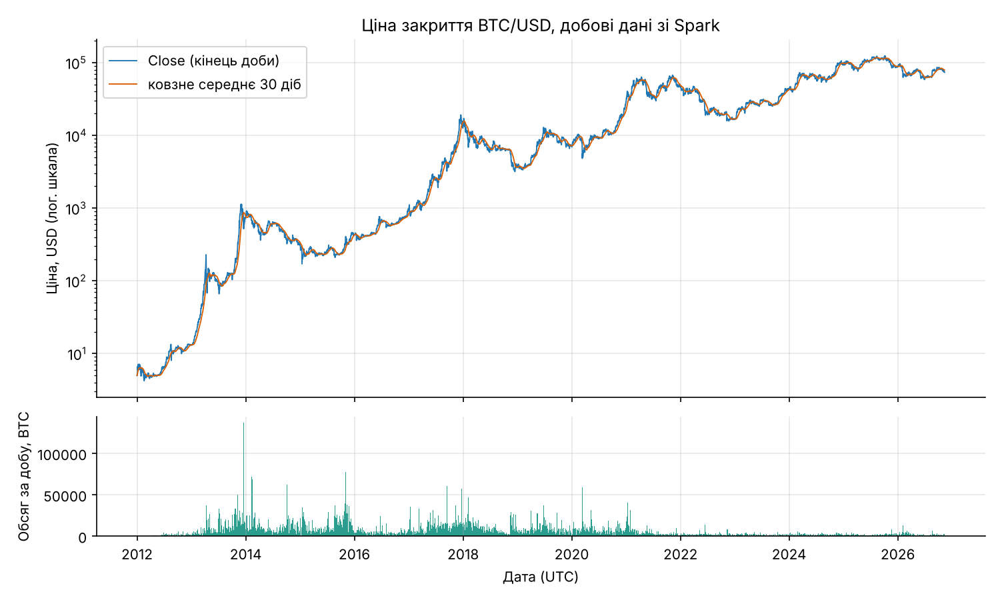
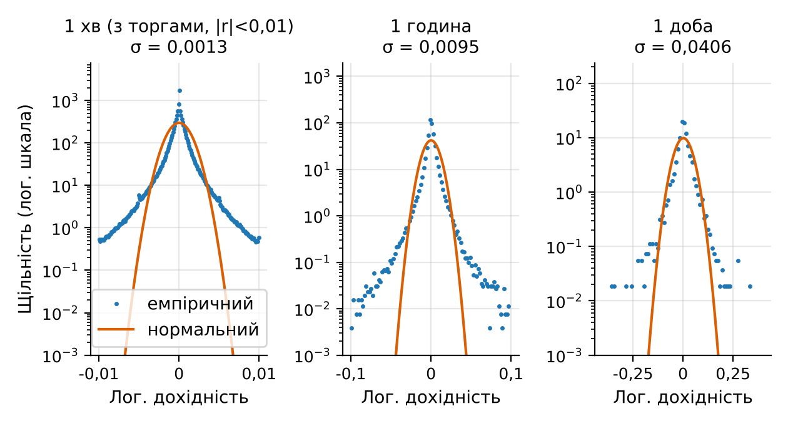
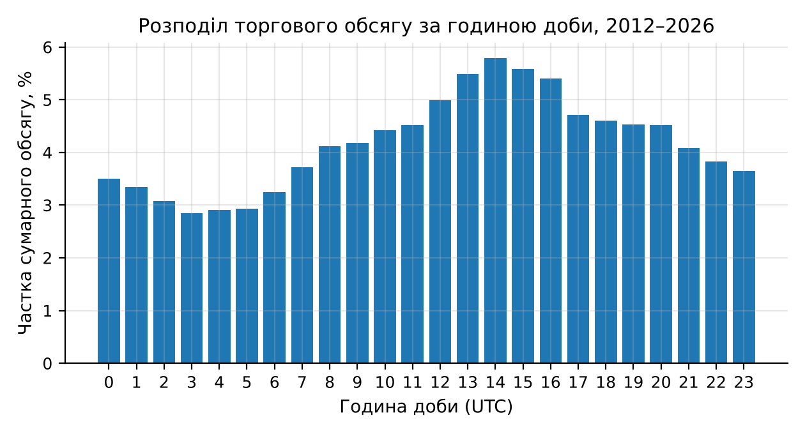

# Мета роботи

Мета роботи: дослідити поведінку 1-хвилинних свічок BTC/USD та порівняти час виконання агрегації (таблиця 1) на різних рушіях. Розмір вибірки становить 1 426 213 рядків, частка нульового обсягу – 13,99 % (рисунок 1). Поле `Timestamp` має тип int64, а **жирний** та *курсив* також підтримуються. Додатковий довгий абзац для перевірки вирівнювання по ширині та переносів: Результати показують, що агрегація до годинних свічок виконується швидше за денні, а різниця між рушіями стає помітною лише для найбільших вибірок, де накладні витрати планування вже не домінують.

# Короткі теоретичні відомості

Свічки OHLC формуються за правилом first/max/min/last/sum.

- перший пункт списку, який достатньо довгий, щоб перенестися на другий рядок і показати висячий відступ;
- другий пункт.

# Результати виконання практичного заняття

## 1 Датасет та програмне середовище

Нижче наведено таблицю та рисунки.

Таблиця 1 – Описова статистика метаданих

| Показник | Середнє | Std | Мін. | Медіана | Макс. |
|---|---|---|---|---|---|
| Ширина, px | 338,38 | 119,07 | 134 | 320 | 1024 |
| Висота, px | 253,07 | 61,56 | 80 | 240 | 442 |
| Співвідношення W/H | 1,33 | 0,31 | 0,56 | 1,44 | 5,48 |





### 1.1 Підрозділ

Текст підрозділу. Команда запуску наведена нижче.

```
$ spark-submit --master local[4] job.py
Done in 12.3 s
```

[СКРІНШОТ: вивід команди spark-submit з часом виконання]

Рисунок 3 – Результат запуску задачі

Таблиця 2 – Короткий порівняльний підсумок

| Рушій | Час, с |
|---|---|
| pandas | 12,3 |
| Spark | 8,1 |



## 2 Висновки до розділу

Ще один абзац тексту після рисунка для перевірки відступів між елементами. Лорем іпсум долор сіт амет, консектетур адіпісцинг еліт, сед до еїусмод темпор інцидідунт ут лаборе.

# Висновки

Отримано такі результати: агрегація працює коректно, час виконання зафіксовано.

# Додаток А. Лістинг програми

## А.1 Агрегація свічок

```python
def resample(df, rule="1h"):
    return df.resample(rule).agg({"Open": "first", "High": "max", "Low": "min", "Close": "last", "Volume": "sum"})  # довгий рядок що переноситься

def other():
    return 1
```

## А.2 Запуск

```python
print(resample(df).head())
```
